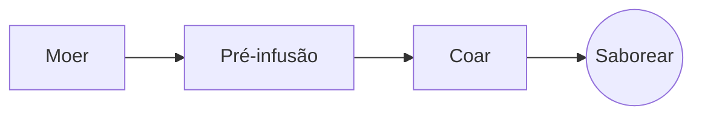

# O Café Coado Perfeito

Um ritual lento de manhã em poucos passos. Escreva no **código-fonte** à esquerda ou direto na *pré-visualização* à direita: os dois ficam em sincronia, e ==cada edição é uma alteração limpa== no Markdown.

> [!TIP]
> Água logo depois de ferver, a cerca de 94 °C, realça a doçura sem amargor.

## A proporção

A maioria das receitas se fixa em uma parte de café para dezesseis partes de água:

$$
m_{\text{água}} = 16 \times m_{\text{café}}
$$

Então $20\,\text{g}$ de café pedem $320\,\text{g}$ de água.

## Passo a passo



## Métodos de preparo

| Método          | Moagem     | Tempo |
|:----------------|:----------:|------:|
| Café coado      | Média-fina |  3:30 |
| Prensa francesa | Grossa     |  4:00 |
| Espresso        | Fina       |  0:28 |

## Antes de começar

- [x] Grãos recém-torrados :coffee:
- [x] Um moedor de rebarbas
- [ ] Uma chaleira com bico de ganso

```python
def water_for(coffee_g: float, ratio: int = 16) -> float:
    return coffee_g * ratio
```

Pré-infusão
: O primeiro jato de água, que deixa o pó liberar o gás.[^1]

[^1]: Grãos frescos formam mais espuma; os velhos mal sobem.
