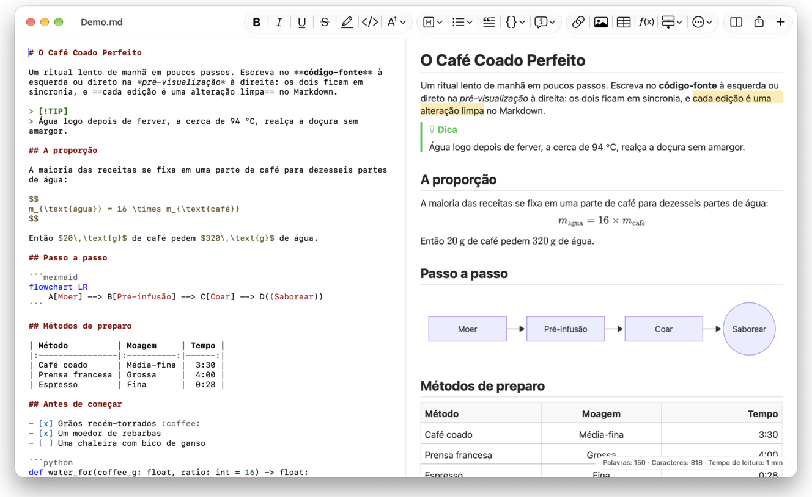
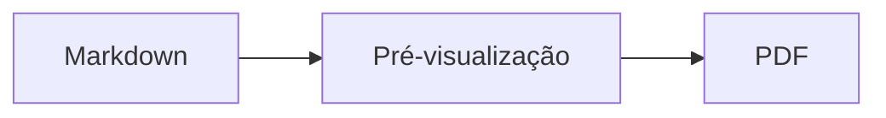

<p>&nbsp;&nbsp;&nbsp;</p>

# Splat

**O editor de Markdown para macOS que deixa você escrever no código-fonte ou direto na pré-visualização.**

O Splat mostra à esquerda o código-fonte Markdown com cores de sintaxe e, à direita, uma pré-visualização ao vivo e totalmente editável. Digite em qualquer uma: tudo o que você escreve na pré-visualização vira uma alteração mínima no código-fonte, de modo que as linhas que você não tocou continuam idênticas byte a byte e seus diffs do Git ficam limpos. O Splat entende o Markdown que você já usa: CommonMark e GitHub Flavored Markdown, alertas do GitHub, wiki links, embeds e caixas de informação do Obsidian, extensões do Pandoc e do Typora, HTML embutido, fórmulas LaTeX e diagramas Mermaid, Graphviz e PlantUML, tudo renderizado offline. Exporte para PDF, HTML ou Word com um clique. Ele é escrito em Rust sobre controles AppKit genuínos, fala 35 idiomas e não envia nada pela rede, a menos que você peça.
 


[](https://raw.githubusercontent.com/sventmueller/splat/main/dist/Splat-1.0.6.dmg)

**[Baixar Splat-1.0.6.dmg](https://raw.githubusercontent.com/sventmueller/splat/main/dist/Splat-1.0.6.dmg)**: assinado e notarizado pela Apple, para macOS 14 ou posterior, em Apple Silicon e Intel.
 
 

[](https://www.rust-lang.org)
[](https://www.apple.com/macos/)

[](https://github.com/madsmtm/objc2)
[](https://webkit.org)
[](https://github.com/kivikakk/comrak)
[](https://github.github.com/gfm/)
[](https://www.mathjax.org)
[](https://cortexjs.io/mathlive/)
[](https://mermaid.js.org)
[](https://graphviz.org)
[](https://plantuml.com)


[](#licença)

[Bahasa Indonesia](../id/README.md) ·
[Bahasa Melayu](../ms/README.md) ·
[Català](../ca/README.md) ·
[Čeština](../cs/README.md) ·
[Dansk](../da/README.md) ·
[Deutsch](../de/README.md) ·
[English](../../../README.md) ·
[Español](../es/README.md) ·
[Français](../fr/README.md) ·
[Hrvatski](../hr/README.md) ·
[Italiano](../it/README.md) ·
[Magyar](../hu/README.md) ·
[Nederlands](../nl/README.md) ·
[Norsk](../no/README.md) ·
[Polski](../pl/README.md) ·
**Português (Brasil)** ·
[Português (Portugal)](../pt_PT/README.md) ·
[Română](../ro/README.md) ·
[Slovenčina](../sk/README.md) ·
[Slovenščina](../sl/README.md) ·
[Suomi](../fi/README.md) ·
[Svenska](../sv/README.md) ·
[Tiếng Việt](../vi/README.md) ·
[Türkçe](../tr/README.md) ·
[Ελληνικά](../el/README.md) ·
[Русский](../ru/README.md) ·
[Українська](../uk/README.md) ·
[עברית](../he/README.md)‎ ·
[العربية](../ar/README.md)‎ ·
[हिन्दी](../hi/README.md) ·
[ไทย](../th/README.md) ·
[한국어](../ko/README.md) ·
[日本語](../ja/README.md) ·
[简体中文](../zh-Hans/README.md) ·
[繁體中文](../zh-Hant/README.md)

## Conteúdo

- [Recursos em resumo](#recursos-em-resumo)
- [Requisitos](#requisitos)
- [Instalação](#instalação)
- [Primeiros passos](#primeiros-passos)
- [Escrita](#escrita)
  - [No código-fonte](#no-código-fonte)
  - [Na pré-visualização](#na-pré-visualização)
  - [Comandos de formatação](#comandos-de-formatação)
  - [Listas e tarefas](#listas-e-tarefas)
  - [Tabelas](#tabelas)
- [Markdown suportado](#markdown-suportado)
  - [CommonMark e GitHub Flavored Markdown](#commonmark-e-github-flavored-markdown)
  - [Caixas de informação](#caixas-de-informação)
  - [Sintaxe estendida](#sintaxe-estendida)
  - [Obsidian](#obsidian)
  - [Citações e referências](#citações-e-referências)
  - [HTML embutido](#html-embutido)
  - [Pontuação tipográfica](#pontuação-tipográfica)
  - [Resumo da sintaxe](#resumo-da-sintaxe)
- [Fórmulas](#fórmulas)
- [Diagramas](#diagramas)
- [Imagens](#imagens)
- [Links e navegação](#links-e-navegação)
- [Exportar, imprimir e compartilhar](#exportar-imprimir-e-compartilhar)
- [Aparência e acessibilidade](#aparência-e-acessibilidade)
- [Idiomas](#idiomas)
- [Atalhos de teclado](#atalhos-de-teclado)
- [Privacidade e segurança](#privacidade-e-segurança)
- [Documentos grandes](#documentos-grandes)
- [Limitações conhecidas](#limitações-conhecidas)
- [Solução de problemas](#solução-de-problemas)
- [Para desenvolvedores](#para-desenvolvedores)
  - [Compilação](#compilação)
  - [Distribuição](#distribuição)
  - [Testes](#testes)
  - [Estrutura do projeto](#estrutura-do-projeto)
  - [Fluxo de dados](#fluxo-de-dados)
  - [Regras no controlador](#regras-no-controlador)
  - [Adicionar um comando](#adicionar-um-comando)
  - [Traduções](#traduções)
  - [Componentes de terceiros](#componentes-de-terceiros)
- [Licença](#licença)

## Recursos em resumo

- **Duas formas de escrever, um só texto.** O código-fonte e a pré-visualização são editáveis. O arquivo Markdown é a única verdade: há um histórico de desfazer por documento, e cada edição na pré-visualização é traduzida na menor alteração possível no código-fonte.
- **O Markdown que você já usa.** CommonMark, GitHub Flavored Markdown, alertas do GitHub, extensões do Obsidian, do Pandoc e do Typora, shortcodes de emoji, spoilers, listas de definição, âncoras de título e HTML como nos README do GitHub.
- **Fórmulas e diagramas integrados.** Fórmulas LaTeX via MathJax, com um editor visual de fórmulas. Diagramas em Mermaid, Graphviz e PlantUML, renderizados no seu Mac, sem Java, servidor ou conexão de rede.
- **Um botão para tudo.** Todo elemento do Markdown tem um botão na barra de ferramentas e um item de menu, e os mais comuns também um atalho de teclado. As tabelas têm um menu próprio para linhas, colunas e alinhamento.
- **Exporte sem perder nada.** PDF, um único arquivo HTML autossuficiente ou um documento do Word com títulos, listas, tabelas, notas de rodapé e imagens de verdade.
- **Nativo até a raiz.** Janelas, abas, menus, popovers, Versões, Salvamento Automático, menu de compartilhamento, modo escuro, verificação ortográfica, ditado e VoiceOver autênticos do AppKit. Sem Electron, sem web view para o texto em si.
- **Rápido com arquivos grandes.** Renderizar uma tecla pressionada em um documento de 10 MB leva cerca de 25 ms, antes do trabalho da própria view.
- **Privado e cuidadoso.** As imagens da web só carregam depois que você permite, links para outros apps perguntam antes, e tudo o que decodifica dados de imagem não confiáveis roda em processos auxiliares isolados em sandbox.
- **No seu idioma.** A interface e a referência rápida de Markdown integrada estão disponíveis em 35 idiomas: alemão, árabe, catalão, checo, chinês (simplificado), chinês (tradicional), coreano, croata, dinamarquês, eslovaco, esloveno, espanhol, finlandês, francês, grego, hebraico, hindi, holandês, húngaro, indonésio, inglês, italiano, japonês, malaio, norueguês, polonês, português (Brasil), português (Portugal), romeno, russo, sueco, tailandês, turco, ucraniano e vietnamita.

## Requisitos

- macOS 14 Sonoma ou posterior. O Splat é desenvolvido e testado no macOS 27, onde adota o design Liquid Glass automaticamente.
- Um Mac com Apple Silicon ou processador Intel.
- Cerca de 45 MB de espaço em disco.

## Instalação

**Pela imagem de disco.** Baixe [`dist/Splat-1.0.6.dmg`](https://raw.githubusercontent.com/sventmueller/splat/main/dist/Splat-1.0.6.dmg), abra-o e arraste o Splat para a pasta Aplicativos. A imagem é assinada com um Developer ID e notarizada pela Apple, então abre sem avisos.

**Com o Homebrew.** O cask fica em um tap próprio:

```sh
brew install --cask sventmueller/tap/splat
```

`brew upgrade --cask splat` instala novas versões, e `brew uninstall --zap --cask splat` também remove os ajustes e os caches do Splat.

**Atualizações.** O Splat instalado pela imagem de disco ou pelo Homebrew se mantém atualizado com o [Sparkle](https://sparkle-project.org). Na segunda abertura, ele pergunta se pode buscar atualizações por conta própria, uma vez por dia. **Splat › Buscar Atualizações…** busca na hora; **Buscar Atualizações Automaticamente** e **Baixar e Instalar Atualizações Automaticamente** no mesmo menu mudam sua escolha depois. O Splat só instala uma atualização se ela tiver a assinatura do desenvolvedor. Uma versão compilada por você não tem atualizador.

**Pelo código-fonte.** Veja [Compilação](#compilação) para os pré-requisitos e depois:

```sh
make build
ditto target/release/Splat.app /Applications/Splat.app
open /Applications/Splat.app
```

Para abrir arquivos Markdown com o Splat por duplo clique, selecione qualquer arquivo `.md` no Finder, escolha **Arquivo › Obter Informações**, selecione o Splat em **Abrir com** e clique em **Alterar Todos…**. O Splat se registra para arquivos `.md`, `.markdown`, `.mdown` e `.mkd`.

## Primeiros passos

### A janela

Cada documento abre em sua própria janela, ou como aba, se você preferir abas:

- **À esquerda: o código-fonte.** Seu Markdown em SF Mono com cores de sintaxe.
- **À direita: a pré-visualização.** O documento renderizado, pronto para editar.
- **Barra lateral de estrutura (opcional).** Todos os títulos em forma de árvore; um clique em um deles o mostra nos dois painéis. Alterne-a com **Visualizar › Mostrar Estrutura** (⌃⌘S).
- **Barra de ferramentas.** Botões agrupados pelo que alteram: caracteres, parágrafos e elementos inseridos, depois pré-visualização ligada/desligada, Compartilhar e Novo Documento. Personalize-a com **Visualizar › Personalizar Barra de Ferramentas…**.

Arraste o divisor para dar mais espaço a qualquer um dos lados. **Visualizar › Ocultar Pré-visualização** (⌥⌘P) deixa só o código-fonte; o Splat lembra disso por janela. Os dois painéis rolam juntos, e uma seleção em um painel é destacada no outro.

### Documentos, abas e versões

O Splat é um app de documentos comum do macOS:

- **Salvamento Automático e Versões.** As alterações são salvas no próprio arquivo. **Arquivo › Reverter Para › Explorar Todas as Versões…** leva você de volta no tempo.
- **Alterações de outros programas.** Quando o Git, um script ou outro editor altera um documento aberto, o Splat o recarrega e mantém o cursor e a posição de rolagem. Se você tiver alterações próprias não salvas, o Splat as mantém, e o macOS pergunta antes de sobrescrever a outra versão.
- **Os comandos de arquivo de sempre.** Duplicar (⇧⌘S), Renomear…, Mover Para… e **Arquivo › Abrir Recente**.
- **Abas.** **Arquivo › Nova Aba** ou o botão **+** na barra de ferramentas abre um novo documento como aba; o menu Janela padrão combina, move e alterna as abas.
- **Posição das janelas.** O tamanho e a posição da sua última janela são lembrados, inclusive entre reinicializações. Se já houver uma janela ali, a nova abre um pouco deslocada.
- **O ícone do Dock.** Um clique nele depois de você fechar a última janela abre um novo documento.
- **Abrir arquivos Markdown no Splat.** **Splat › Definir como App Padrão para Markdown** faz um duplo clique em um arquivo `.md` ou `.markdown` abrir o Splat; o macOS pede uma confirmação, uma única vez. O item mostra uma marca de seleção enquanto o Splat for o padrão.

Os arquivos precisam ser texto UTF-8 ou UTF-16 com marca de ordem de bytes. O Splat recusa outras codificações em vez de adivinhar e corromper o texto. A marca de ordem de bytes permanece, UTF-16 continua UTF-16, e em um arquivo cujas linhas terminam todas em CRLF, as linhas que você adiciona também recebem CRLF.

**Depois de uma falha**, no máximo os últimos segundos de digitação se perdem: a cada cinco segundos, o Splat copia o texto não salvo para `~/Library/Application Support/Splat/Unsaved` e remove as cópias quando o documento é salvo ou o Splat é encerrado normalmente. Na próxima abertura, o que uma falha deixou ali é movido para `~/Library/Application Support/Splat/Recovery`, e o Splat avisa uma única vez, com um botão que abre a pasta. Uma falha à qual o Splat ainda consegue reagir também grava ali o texto de cada documento aberto.

### Referência rápida

**Ajuda › Referência Rápida de Markdown** abre uma folha de consulta no seu idioma como um documento novo e sem título. É um documento comum, então experimente tudo ali mesmo, no código-fonte ou na pré-visualização.

## Escrita

### No código-fonte

O código-fonte é um editor de texto simples ajustado para Markdown:

- **Cores de sintaxe** como no VS Code: títulos, ênfase, links, código, tabelas, HTML, front matter, e LaTeX e Mermaid dentro de fórmulas e diagramas. Há paletas para os modos claro e escuro e para Aumentar Contraste.
- **Blocos de código delimitados** são destacados para Bash, C, C++, C#, CSS (também SCSS e Less), Go, HTML, XML, Java, JavaScript, JSON, Kotlin, PHP, Python, Ruby, Rust, SQL, Swift, TypeScript, YAML, TeX e Mermaid, inclusive com os nomes curtos usuais, como `js`, `py` ou `sh`.
- **Sem substituições surpresa.** Aspas inteligentes, hifens inteligentes e substituição de texto vêm desligados, porque quebram `--`, `---` e `"`. Ligue-os em **Editar › Substituições**.
- **As ferramentas de escrita do sistema.** Verificação de ortografia e gramática, ditado, Buscar e Substituir (⌥⌘F) e Fala.
- **Arrastar e soltar.** Solte um arquivo de imagem para inserir ``, qualquer outro arquivo para inserir um link para ele e uma URL para inserir `[url](url)`. Cada soltura é um passo de desfazer.
- **Colar imagens.** Uma imagem na área de transferência, como uma captura de tela, é salva como arquivo PNG ao lado do documento (`Imagem 2026-10-29 13.09.07.png`) e inserida como imagem. Para isso, o documento precisa ter sido salvo uma vez.

### Na pré-visualização

A pré-visualização se comporta como um processador de texto, mas tudo o que você faz nela acaba como Markdown:

- **Digitação.** Caracteres que significam algo no Markdown, como `*` ou `#`, recebem escape para aparecer como foram digitados.
- **Return** inicia um novo parágrafo ou item de lista. **⌥Return** ou **⌃Return** insere uma quebra de linha.
- **Formatação no cursor.** Com o cursor no fim de uma palavra, Negrito, Itálico e os outros formatos de caractere valem para o que você digitar em seguida. Escolha o formato de novo para parar. Dentro de uma palavra, a palavra inteira é formatada.
- **Linhas vazias.** Return em uma linha vazia adiciona outra linha vazia, e Delete a remove. No código-fonte, cada linha vazia extra equivale a mais duas linhas em branco; outros programas de Markdown as mostram como espaçamento normal entre parágrafos.
- **Desfazer** vale para os dois painéis. Os itens de desfazer têm nome (“Desfazer Negrito”), a digitação é um passo por sequência de teclas, e depois de Desfazer e Refazer os dois painéis rolam até a alteração.
- **Fórmulas e diagramas** aparecem como gráficos prontos. Clique em um, leve o cursor até ele ou pressione Return sobre ele para abrir seu editor (veja [Fórmulas](#fórmulas) e [Diagramas](#diagramas)).
- **HTML embutido, notas embutidas e front matter** são exibidos, mas você os edita no código-fonte. Um clique neles coloca o cursor no lugar correspondente lá.

Tudo o que o Markdown não consegue expressar é bloqueado na pré-visualização: os painéis Fontes e Cores, a régua e a colagem ou soltura de texto rico e imagens. HTML e RTF colados chegam como texto simples.

### Comandos de formatação

Todos os comandos estão disponíveis na barra de ferramentas, na barra de menus e no menu de contexto dos dois painéis. Os itens de menu mostram uma marca de seleção para a formatação no cursor.

| Menu | Comandos |
|---|---|
| **Formatar › Fonte** | Negrito, Itálico, Sublinhado, Tachado, Destaque, Código, Sobrescrito, Subscrito |
| **Formatar › Título** | Corpo de Texto, Título 1 a 6 |
| **Formatar › Lista** | Lista com Marcadores, Lista Numerada, Lista de Tarefas |
| **Formatar** | Citação, Bloco de Código (Sem Linguagem ou uma de 20 linguagens; também altera a linguagem de um bloco existente), Caixa de Informação (Nota, Dica, Importante, Aviso, Cuidado; o mesmo tipo de novo a remove), Editar Fórmula ou Diagrama…, Limpar Formatação |
| **Inserir** | Link…, Imagem…, Tabela…, Fórmula, Diagrama (Fluxograma, Diagrama de Sequência, Gráfico de Gantt), Índice, Nota de Rodapé, Separador |
| **Tabela** | Inserir Linha Acima/Abaixo, Inserir Coluna à Esquerda/à Direita, Apagar Linha, Apagar Coluna, Alinhamento (À Esquerda, Centralizar, À Direita, Padrão), Alinhar Colunas da Tabela |
| **Visualizar** | Ocultar/Mostrar Pré-visualização, Mostrar/Ocultar Estrutura, Pontuação tipográfica, Ampliar/Reduzir, Tamanho Real, barra de ferramentas, barra de abas, tela cheia |

Sublinhado, destaque, sobrescrito e subscrito são escritos como `<ins>`, `<mark>`, `<sup>` e `<sub>`, que o GitHub também exibe. O Splat também lê `<u>`, que o GitHub remove, e as formas mais curtas `==destaque==`, `^sup^` e `~sub~`. O GitHub mostra `==` e `^` como digitados e `~sub~` como tachado.

### Listas e tarefas

- Return continua uma lista; Return em um item vazio a encerra.
- **Tab** e **⇧Tab** aumentam e diminuem o recuo dos itens de lista na pré-visualização.
- Um clique na caixa de seleção de uma tarefa na pré-visualização alterna `- [ ]` e `- [x]`.
- **Formatar › Lista** transforma os parágrafos selecionados em uma lista ou muda o tipo dela.

### Tabelas

- **Inserir › Tabela…** pergunta o número de linhas (incluindo o cabeçalho) e de colunas.
- Na pré-visualização, **Tab** vai para a próxima célula, **⇧Tab** para a anterior e **Return** para a célula abaixo. Tab na última célula adiciona uma linha.
- O menu **Tabela** insere e apaga linhas e colunas e define o alinhamento de uma coluna (⌘{, ⌘|, ⌘}).
- **Tabela › Alinhar Colunas da Tabela** preenche o código-fonte com espaços para que as colunas fiquem alinhadas.

## Markdown suportado

O Splat faz a análise com o [comrak](https://github.com/kivikakk/comrak), um parser compatível com CommonMark e GFM, e ativa a maioria das extensões dele. Tudo o que está abaixo é renderizado na pré-visualização e em todas as exportações.

### CommonMark e GitHub Flavored Markdown

- Títulos (`#` e sublinhados), parágrafos, quebras de linha, ênfase, ênfase forte, código em linha, citações em bloco, separadores.
- Listas com marcadores, numeradas e aninhadas; listas de tarefas.
- Links (em linha, de referência e automáticos), imagens, definições de referência de link.
- Blocos de código delimitados e recuados com cores de sintaxe.
- Tabelas com alinhamento de colunas.
- Tachado com `~~dois til~~`.
- Notas de rodapé: `texto[^1]` com `[^1]: A nota.` em qualquer lugar do documento. Um clique no marcador leva até a nota.
- Front matter YAML entre linhas `---` no início. A pré-visualização o resume em uma linha, como “Metadados: title, date, tags”.

### Caixas de informação

Os alertas do GitHub são renderizados como caixas coloridas com ícone e título:

```markdown
> [!NOTE]
> Informação útil que os usuários devem conhecer.

> [!WARNING]
> Conteúdo crítico que exige atenção imediata.
```

Os cinco tipos são Nota, Dica, Importante, Aviso e Cuidado. **Formatar › Caixa de Informação** transforma o parágrafo no cursor em uma delas.

As caixas de informação do Obsidian também funcionam, com qualquer título e um estado de recolhimento:

```markdown
> [!tip]- Clique em ▸ para expandir
> Oculto até ser aberto.

> [!question]+ Aberto por padrão
> Um `+` começa expandido, um `-` recolhido.
```

Os outros tipos do Obsidian são exibidos na cor mais próxima entre as cinco: `success`, `check`, `done` e `hint` como Dica; `question`, `help` e `faq` como Importante; `attention` como Aviso; `failure`, `fail`, `missing`, `danger`, `error` e `bug` como Cuidado; todo o resto como Nota.

### Sintaxe estendida

| Recurso | Sintaxe | Origem |
|---|---|---|
| Destaque | `==texto marcado==` | Obsidian, Typora |
| Sobrescrito | `x^2^` | Pandoc, Typora |
| Subscrito | `H~2~O` | Pandoc, Typora |
| Shortcode de emoji | `:rocket:` vira 🚀 | GitHub |
| Spoiler | `\|\|texto oculto\|\|`, selecione-o para ler | Discord |
| Nota de rodapé em linha | `texto^[a própria nota]` | Pandoc, Obsidian |
| Lista de definição | `Termo`, linha em branco, `: Explicação` | PHP Markdown Extra, Pandoc |
| Âncora de título | `## Instalar {#setup}`, link com `[veja](#setup)` | Pandoc, kramdown |

As listas de definição ficam assim no código-fonte:

```markdown
Termo

: Explicação do termo.
```

Sem uma âncora personalizada, cada título recebe uma derivada do próprio texto, como no GitHub: `## Primeiros passos` pode ser acessado como `#primeiros-passos`.

### Obsidian

- **Wiki links.** `[[Nota]]` aponta para `Nota.md` na mesma pasta ou em uma pasta abaixo. `[[Nota|Texto exibido]]` mostra o seu próprio texto, e `[[Nota#Título]]` abre a nota. ⌘-clique a abre no Splat.
- **Embeds.** `![[Nota]]` mostra a outra nota dentro desta; as notas embutidas nela aparecem como links. `![[diagram.png]]` mostra uma imagem. Como no Obsidian, os embeds nomeiam notas e imagens na pasta do documento ou abaixo dela, nunca por um caminho absoluto, e só arquivos Markdown aparecem como notas.
- **Comentários.** `%%Só no código-fonte%%` permanece visível no código-fonte e fica de fora da pré-visualização e de todas as exportações, tanto em linha quanto em linhas próprias.
- **Tags.** `#ideia` ou `#projeto/splat` é destacado. ⌘-clique procura a tag no documento.
- **Caixas de informação recolhíveis.** Veja [Caixas de informação](#caixas-de-informação).

### Citações e referências

- **Citações do Pandoc.** `[@doe2020]` ou `[@doe2020; @roe2021]` aparece como “(Doe 2020; Roe 2021)”. As entradas vêm do arquivo BibTeX que o front matter indica com `bibliography: refs.bib`. Sem isso, o Splat usa `references.bib`, `literatur.bib` ou `bibliography.bib` ao lado do documento.
- **Referências do GitHub e do GitLab.** Se o documento estiver em um repositório Git cujo remote `origin` está no github.com ou em um host GitLab, `@nome`, `#12` (issue) e `!7` (merge request, só no GitLab) são destacados. ⌘-clique os abre no navegador.

### HTML embutido

O HTML que se encontra nos README do GitHub é renderizado, com um leitor próprio em vez de um motor de navegador:

- parágrafos e blocos centralizados (`<p align="center">`, `<div align="center">`)
- imagens com tamanho (``)
- links, `<kbd>⌘</kbd>`, `<br>`, `<u>`, `<ins>`, `<mark>`, `<sup>`, `<sub>`
- listas e tabelas, inclusive células que abrangem colunas (`colspan`)
- seções recolhíveis: `<details><summary>Mais</summary>…</details>`, abertas com um clique em ▸

O Markdown entre tags HTML é renderizado como Markdown. Scripts, estilos, frames e formulários são omitidos por completo, e links e imagens mantêm apenas endereços `http`, `https`, `mailto` e relativos.

### Pontuação tipográfica

**Visualizar › Pontuação tipográfica** mostra aspas retas como as aspas do idioma da sua interface, `--` como meia-risca, `---` como travessão e `...` como reticências. Em alemão, `"Ja"` vira „Ja“, em francês «Oui», em japonês 「はい」, também onde chinês e japonês compõem aspas sem espaço; abreviações hebraicas como `צה"ל` recebem seus gershayim, צה״ל. O código-fonte mantém os caracteres simples; a pré-visualização e todas as exportações mostram os tipográficos. A opção vem desligada até você ligá-la.

### Resumo da sintaxe

| Elemento | Markdown |
|---|---|
| **Negrito** | `**Negrito**` |
| *Itálico* | `*Itálico*` |
| Sublinhado | `<ins>Sublinhado</ins>` ou `<u>Sublinhado</u>` |
| ~~Tachado~~ | `~~Tachado~~` |
| Destaque | `<mark>Destaque</mark>` ou `==Destaque==` |
| `Código` | `` `Código` `` |
| x² | `x<sup>2</sup>` ou `x^2^` |
| H₂O | `H<sub>2</sub>O` ou `H~2~O` |
| [Link](https://example.com) | `[Link](https://example.com)` |
| Título | `# Título` a `###### Título` |
| Citação | `> Citação` |
| Lista com marcadores | `- Item` |
| Lista numerada | `1. Item` |
| Tarefa | `- [ ] Pendente` e `- [x] Concluída` |
| Bloco de código | ```` ```rust ```` … ```` ``` ```` |
| Tabela | `\| A \| B \|` com `\|---\|---\|` abaixo do cabeçalho |
| Nota de rodapé | `Texto[^1]` e `[^1]: Nota` |
| Separador | `---` |
| Imagem | `` |
| Fórmula | `$E = mc^2$`, `$$ … $$` |
| Diagrama | ```` ```mermaid ````, ```` ```dot ````, ```` ```plantuml ```` |
| Caixa de informação | `> [!TIP]` |
| Wiki link | `[[Nota]]`, `[[Nota\|Texto]]` |
| Embed | `![[Nota]]`, `![[image.png]]` |
| Comentário | `%%Comentário%%` |
| Tag | `#tag` |
| Citação bibliográfica | `[@chave]` |
| Spoiler | `\|\|Spoiler\|\|` |
| Emoji | `:tada:` |

## Fórmulas

As fórmulas são renderizadas pelo [MathJax](https://www.mathjax.org) com seu TeX e matemática AMS, como gráficos vetoriais nítidos. O texto em `\text{…}` pode estar em qualquer escrita: o que faltar nas fontes do MathJax vem das fontes do seu Mac, com árabe e hebraico correndo da direita para a esquerda, e emoji em cores.

| Tipo | Sintaxe |
|---|---|
| Em linha | `$E = mc^2$`, `` $`E = mc^2`$ `` (GitHub, GitLab), `\(E = mc^2\)` |
| Em bloco | `$$` … `$$`, `\[` … `\]` ou um bloco de código marcado como `math` |

**Editar uma fórmula.** Clique em uma fórmula na pré-visualização, dê um duplo clique nela, pressione Return sobre ela ou leve o cursor até ela para abrir o editor em um popover. **Inserir › Fórmula** insere uma nova e abre o editor na hora.

- **Visual ou LaTeX.** A chave no topo alterna entre um editor visual ([MathLive](https://cortexjs.io/mathlive/)) e o código LaTeX. O Splat lembra da sua escolha.
- **Blocos de construção** para fração, raiz quadrada, sobrescrito e subscrito, somatório e integral com limites, limite, parênteses que crescem com o conteúdo, matriz 2×2, letras gregas, e relações, operadores e setas. Eles deixam marcadores □, e **Tab** salta para o próximo.
- **Pré-visualização ao vivo.** As alterações aparecem no documento enquanto você digita. Os erros do MathJax aparecem em uma linha abaixo do código.
- **Confirmar ou descartar.** Clicar fora mantém a alteração como um único passo de desfazer; **Esc** ou **Cancelar** a descarta. Pressionar Esc em uma fórmula nova e vazia a remove de novo.
- O menu de contexto oferece **Editar Fórmula…** para a fórmula sob o ponteiro.

O VoiceOver lê uma fórmula como o seu código LaTeX. O Splat renderiza fórmulas, não documentos LaTeX completos: não há pacotes, nem TikZ, nem `\documentclass`.

## Diagramas

Os diagramas são renderizados dentro do Splat, offline e em uma variante clara e uma escura.

| Motor | Bloco de código | O que desenha |
|---|---|---|
| [Mermaid](https://mermaid.js.org) | ```` ```mermaid ```` | fluxogramas, diagramas de sequência, de classes, de estados, entidade-relacionamento, Gantt, pizza, mapas mentais, linhas do tempo e todos os outros tipos do Mermaid |
| [Graphviz](https://graphviz.org) | ```` ```dot ```` ou ```` ```graphviz ```` | grafos na linguagem DOT |
| [PlantUML](https://plantuml.com) | ```` ```plantuml ```` ou ```` ```puml ```` | diagramas UML; roda sem Java |



**Editar um diagrama** funciona como editar uma fórmula: clique nele para abrir o código em um popover, com cores de sintaxe e mensagens de erro em uma linha abaixo do código. **Inserir › Diagrama** parte de um modelo de fluxograma, de diagrama de sequência ou de gráfico de Gantt. Blocos de construção ajudam com os três tipos mais comuns do Mermaid:

- **Fluxograma:** Nó ▾ (retângulo, arredondado, círculo, losango, banco de dados), Conexão, Conexão com rótulo, Grupo, Direção ▾
- **Diagrama de sequência:** Participante, Mensagem, Resposta, Nota, Laço, Caminhos alternativos
- **Gráfico de Gantt:** Seção, Tarefa, Marco

Os outros tipos de diagrama são editados como código. O VoiceOver lê o título ou o texto alternativo de um diagrama.

O primeiro diagrama depois da abertura leva cerca de um segundo, porque o motor de renderização inicia em segundo plano. Um diagrama que leva mais de 10 segundos mostra um erro, e o motor de renderização reinicia do zero para o próximo. O motor do PlantUML (3 MB) só é carregado com o primeiro diagrama PlantUML. Um `!include` do PlantUML vindo da web é bloqueado.

## Imagens

- **Imagens locais** usam caminhos relativos ao documento: ``. O Splat exibe PNG, JPEG, GIF, WebP, BMP, SVG, HEIC, TIFF, AVIF e PDF.
- **Imagens da web** ficam bloqueadas até você permitir: uma barra acima da pré-visualização explica que carregá-las informa aos servidores delas que e quando você abre o documento. **Carregar Imagens** as permite para este documento; o Splat lembra da escolha por arquivo.
- **Tamanho.** `` define o tamanho de uma imagem; caso contrário, as imagens se ajustam à largura da pré-visualização.
- **Alterações no disco.** Uma imagem que você substitui, ou uma que aparece depois que o documento a citou, é exibida sem abrir o documento de novo. Imagens da web que falharam por causa da rede são tentadas de novo enquanto um documento as exibe.
- **Memória.** As imagens são exibidas com até 2560 pixels no lado mais longo, o que também preenche uma página A4. Elas são decodificadas menores quando ocupam um oitavo da memória do Mac e enquanto o macOS informa pressão de memória.
- **Modo escuro.** Imagens com fundo branco ficam levemente escurecidas na pré-visualização escura.
- **Colar e soltar.** Veja [No código-fonte](#no-código-fonte).

## Links e navegação

Na pré-visualização, um clique posiciona o cursor para você editar o texto do link; **⌘-clique** segue o link:

- `http`, `https` e `mailto` abrem no seu navegador ou app de e-mail.
- Arquivos Markdown abrem no Splat; outros arquivos e pastas são mostrados no Finder.
- `#anchor` salta para o título no documento.
- Endereços que abrem outro app, como `slack://` ou `vscode://`, perguntam antes e mostram o endereço completo e o app. **Cancelar** vem pré-selecionado.

**Inserir › Índice** insere uma lista com links para todos os títulos. Com o cursor dentro dela, o mesmo comando a atualiza. A barra lateral de estrutura (⌃⌘S) salta para qualquer título nos dois painéis.

## Exportar, imprimir e compartilhar

| Formato | Como | O que você obtém |
|---|---|---|
| **PDF** | **Arquivo › Exportar como PDF…** ou o menu Compartilhar | Páginas no tamanho do papel, sempre na aparência clara, com fórmulas e diagramas como gráficos vetoriais. **Arquivo › Configurar Página…** define o papel. |
| **Impressão** | **Arquivo › Imprimir…** (⌘P) | O mesmo layout do PDF. |
| **HTML** | **Arquivo › Exportar como HTML…** ou o menu Compartilhar | Um único arquivo autossuficiente: imagens locais embutidas, fórmulas e diagramas como imagens nítidas, âncoras de título para o índice funcionar. Sem scripts. |
| **Word** | **Arquivo › Exportar como Documento do Word…** ou o menu Compartilhar | Um `.docx` com os estilos de título do Word, listas e tabelas de verdade (inclusive células mescladas), notas de rodapé como notas de rodapé do Word, imagens embutidas, fórmulas e diagramas. |
| **Markdown** | O botão **Compartilhar** na barra de ferramentas | O documento como arquivo `.md` para o Mail, o Mensagens, o AirDrop e qualquer outro serviço de compartilhamento. |

O menu **Arquivo › Compartilhar** oferece tudo isso em um só lugar. As exportações usam a opção de pontuação tipográfica e as imagens da web que você permitiu; no HTML, as imagens da web continuam sendo links.

## Aparência e acessibilidade

- **O modo escuro** segue o sistema. Fórmulas e diagramas são renderizados para cada aparência.
- **Aumentar contraste** nos Ajustes troca as cores de sintaxe por paletas de alto contraste.
- **Zoom.** ⌘+, ⌘− e ⌘0 escalam os dois painéis.
- **Tela cheia, abas e uma barra de ferramentas personalizável**, como em todo app do Mac.
- **VoiceOver.** Os painéis se chamam “Código-fonte Markdown” e “Pré-Visualização”, as fórmulas são lidas como o código delas e os diagramas como o título. Todo comando é acessível pelo teclado.

O Splat não tem janela de ajustes: as poucas opções ficam onde se aplicam, em **Visualizar** e **Editar › Substituições**.

## Idiomas

A interface, os menus e a referência rápida de Markdown estão traduzidos para 35 idiomas:

alemão, árabe, catalão, checo, chinês (simplificado), chinês (tradicional), coreano, croata, dinamarquês, eslovaco, esloveno, espanhol, finlandês, francês, grego, hebraico, hindi, holandês, húngaro, indonésio, inglês, italiano, japonês, malaio, norueguês, polonês, português (Brasil), português (Portugal), romeno, russo, sueco, tailandês, turco, ucraniano e vietnamita.

O Splat segue a ordem de idiomas em **Ajustes › Geral › Idioma e Região**; ali você também pode escolher um idioma só para o Splat em **Aplicativos**. Sem tradução para o seu idioma, ele usa inglês. Os termos de menu seguem as traduções da própria Apple, de modo que o Splat se lê como o resto do seu Mac.

O texto em hebraico e árabe é lido da direita para a esquerda onde quer que apareça, qualquer que seja o idioma da interface: cada parágrafo, título e item de lista assume a direção da sua primeira letra, citações e caixas de informação desenham a barra à direita, e uma tabela cujo texto começa da direita para a esquerda lista suas colunas a partir da direita. Os blocos de código continuam da esquerda para a direita. As exportações em PDF, HTML e Word mantêm essas direções. Com hebraico ou árabe como idioma do sistema, o macOS também espelha a janela, de modo que a pré-visualização fica à esquerda.

## Atalhos de teclado

| Ação | Atalho |
|---|---|
| Negrito, Itálico, Sublinhado | ⌘B, ⌘I, ⌘U |
| Tachado | ⇧⌘X |
| Link… | ⌘K |
| Corpo de texto, Título 1 a 6 | ⌥⌘0, ⌥⌘1 a ⌥⌘6 |
| Alinhar a coluna da tabela à esquerda, ao centro, à direita | ⌘{, ⌘\|, ⌘} |
| Ocultar ou mostrar a pré-visualização | ⌥⌘P |
| Mostrar ou ocultar a estrutura | ⌃⌘S |
| Ampliar, reduzir, tamanho real | ⌘+, ⌘−, ⌘0 |
| Novo documento, abrir, salvar, duplicar | ⌘N, ⌘O, ⌘S, ⇧⌘S |
| Configurar página, imprimir | ⇧⌘P, ⌘P |
| Buscar, buscar e substituir | ⌘F, ⌥⌘F |
| Buscar seguinte, anterior; usar seleção; saltar para a seleção | ⌘G, ⇧⌘G; ⌘E; ⌘J |
| Mostrar ortografia e gramática; verificar documento | ⌘:, ⌘; |
| Colar com o mesmo estilo | ⌥⇧⌘V |
| Ocultar a barra de ferramentas, mostrar todas as abas, tela cheia | ⌥⌘T, ⇧⌘\\, ⌃⌘F |
| Quebra de linha (pré-visualização) | ⌥Return ou ⌃Return |
| Próxima célula / célula anterior em uma tabela (pré-visualização) | Tab / ⇧Tab |
| Aumentar / diminuir o recuo de um item de lista (pré-visualização) | Tab / ⇧Tab |
| Próximo marcador no editor de fórmulas | Tab |
| Fechar o editor de fórmulas ou de diagramas sem alterações | Esc |
| Seguir um link, uma tag ou uma referência (pré-visualização) | ⌘-clique |

O Splat deixa os atalhos padrão da Apple onde estão.

## Privacidade e segurança

Um arquivo Markdown pode vir de qualquer pessoa, por isso o Splat trata todo documento como não confiável.

- **Sem rede por padrão.** O Splat não tem telemetria. Ele só busca atualizações depois que você concorda ou escolhe **Buscar Atualizações…**: nesse caso, carrega um pequeno arquivo de feed do GitHub, e a requisição informa apenas o app e a versão dele. Fórmulas e diagramas são renderizados localmente; as web views que fazem isso não alcançam a rede.
- **As imagens da web** só carregam com a sua permissão, só por `https`, nunca de hosts da sua rede local, com no máximo 10 MB cada e em uma sessão privada, sem cookies.
- **Decodificação isolada.** Imagens e os gráficos de fórmulas e diagramas são decodificados em processos auxiliares que fecham todo arquivo herdado e se trancam em uma sandbox antes de ler o primeiro byte: sem acesso a arquivos, sem rede. Eles devolvem apenas pixels, cujo tamanho é verificado, e são encerrados após 10 segundos. Os decodificadores de imagem da própria Apple só veem HEIC, TIFF, AVIF e PDF, e apenas quando os dados realmente têm esse formato; eles rodam em um auxiliar próprio, que pode ainda ler as pastas de fontes do sistema e usar o decodificador de vídeo do sistema. SVGs, fórmulas e diagramas também passam por esse auxiliar, então no Splat são imagens com resolução fixa: quatro pixels por ponto, até 2560 no lado mais longo.
- **Arquivos locais** chegam a um documento apenas pelo caminho que ele cita. Os embeds mostram notas Markdown da pasta do documento e abaixo, e uma imagem ausente só é procurada ali. Um caminho de imagem em outro lugar, absoluto ou começando com `~`, ainda carrega, e as exportações HTML e Word o embutem: examine a exportação de um documento que você não escreveu antes de repassá-la.
- **Cópias de texto não salvo** ficam neste Mac, na sua pasta Biblioteca, para a recuperação após uma falha. Elas saem com o salvamento ou com o encerramento normal do Splat; as cópias que uma falha deixou ficam na pasta de recuperação até você apagá-las.
- **Links** nunca iniciam um programa com um clique. Links da web e de e-mail abrem como de costume; links para outros apps perguntam antes.
- **O HTML nos documentos** é lido pelo parser próprio do Splat. Scripts, estilos, frames e formulários nunca são executados.
- **As exportações** não levam scripts. As páginas HTML mantêm apenas uma lista fixa de tags e atributos inofensivos, como o GitHub faz, além de uma política de segurança de conteúdo. Os arquivos Word só vinculam endereços `http`, `https` e `mailto`.
- **Assinatura de código** com o Hardened Runtime. O Splat roda sem o App Sandbox para poder mostrar imagens ao lado dos seus documentos sem perguntar por cada pasta; o isolamento de toda a decodificação compensa isso.

## Documentos grandes

O Splat continua responsivo com documentos de vários megabytes:

- O código-fonte usa o TextKit 2, que faz o layout apenas da parte visível.
- Enquanto você digita na pré-visualização, e no código-fonte de documentos de até 2 MB, só os parágrafos afetados são analisados, coloridos e diagramados de novo. Em um documento de 10 MB, analisar e colorir leva cerca de 20 ms, renderizar cerca de 25 ms, e uma tecla inteira na pré-visualização dele cerca de 60 ms, com o trabalho da própria view.
- Pré-visualizações grandes renderizam primeiro a parte visível e o resto enquanto o app está ocioso. Os blocos que entram na área visível pela rolagem são renderizados antes de serem desenhados.
- No código-fonte de documentos maiores, a análise para a pré-visualização roda em segundo plano enquanto você digita.
- Um documento continua sendo texto simples quando precisaria de cerca de 4 GB de memória, ou seja, cerca de 50 a 120 MB de Markdown comum, mas apenas de 10 a 20 MB se tiver só tabelas ou títulos: o código-fonte fica sem cores e a pré-visualização diz por que continua vazia. As exportações ainda funcionam.
- A partir de cerca de 200 KB, um documento abre a janela antes de ser analisado; com 5 MB, as cores e a pré-visualização vêm cerca de um quarto de segundo depois.

Algumas alterações são processadas por inteiro, com cerca de 300 ms por tecla em 10 MB: as que afetam a definição ou as referências de uma nota de rodapé, o que fica junto a uma nota de rodapé em linha, o fim do documento junto a uma nota de rodapé, o front matter ou as proximidades de definições de referência de link, e toda alteração em um documento com blocos de comentário `%%` ou com uma nota de rodapé definida duas vezes ou dentro de uma citação ou lista. A memória cresce com o arquivo, para aproximadamente 115–160 MB com 1 MB de Markdown e 340–510 MB com 10 MB.

## Limitações conhecidas

- **Um único til significa subscrito.** `~texto~` é subscrito, como no Pandoc; o tachado exige `~~dois~~`. O GitHub também tacha com um único til.
- **Somente leitura na pré-visualização:** HTML embutido, notas embutidas e front matter são editados no código-fonte.
- **Aninhamento muito profundo:** HTML aninhado com mais de 64 níveis, e HTML em linha com mais de 16, cede lugar ao seu conteúdo.
- **Células de tabela mescladas** existem apenas em tabelas HTML, e só entre colunas (`colspan`, sem `rowspan`). A sintaxe de tabela do MultiMarkdown para células mescladas não é suportada.
- **Bibliografias** são lidas apenas de BibTeX, não de CSL JSON nem de YAML.
- **Referências** precisam de um repositório no github.com ou em um host GitLab; `!7` existe apenas no GitLab.
- **Pontuação tipográfica:** uma aspa simples de fechamento alemã não se distingue de um apóstrofo e é composta como ’.
- **Fórmulas, não documentos:** sem pacotes LaTeX, TikZ nem documentos completos.
- **O editor visual de fórmulas** escreve LaTeX na notação do MathLive: os espaços desaparecem (`E = mc^2` vira `E=mc^2`), e a renderização continua a mesma.
- **Por escolha de projeto:** sem números de linha, sem janela de ajustes, sem Help Book, fora da App Store.
- **Menos testado no Intel.** Os autotestes de janela rodam apenas em Apple Silicon; no Intel, o CI executa `cargo test`.

## Solução de problemas

**A lista de documentos recentes está vazia depois que recompilei o Splat.** O macOS associa os documentos recentes e as permissões de pastas à assinatura de código do app. As compilações locais são assinadas com o certificado “Splat Local Signing” no seu chaveiro de login, então as recompilações mantêm os dois. Se o certificado foi apagado, a próxima compilação cria um novo e as listas recomeçam uma vez.

**O app da imagem de disco mostra documentos recentes diferentes da minha própria compilação.** Os dois têm assinaturas diferentes, então o macOS mantém uma lista separada e permissões de pastas separadas para cada um.

**HTML ou outra sintaxe aparece como código simples.** Pode ter sido uma cópia desatualizada do Splat que abriu o documento. Encerre-a, escolha **Arquivo › Obter Informações** no documento, no Finder, e confira se **Abrir com** indica o Splat da sua pasta Aplicativos.

**Não há Buscar Atualizações… no menu Splat.** Apenas a versão da imagem de disco ou do Homebrew se atualiza sozinha; uma compilação própria não tem atualizador.

**As imagens da web não aparecem.** Clique em **Carregar Imagens** na barra acima da pré-visualização. Só carregam imagens `https` de hosts públicos.

**Ao colar uma captura de tela, o Splat pede para salvar antes.** As imagens coladas são guardadas como arquivos ao lado do documento, o que exige um lugar no disco. Salve o documento e cole de novo.

**“O arquivo não é um texto UTF-8.”** O arquivo está em outra codificação e não tem uma marca de ordem de bytes que a indique. Converta-o antes, por exemplo com `iconv -f ISO-8859-1 -t UTF-8 old.md > new.md`.

**Uma fórmula ou um diagrama mostra um erro.** Clique nele: o editor mostra a mensagem do MathJax, do Mermaid, do Graphviz ou do PlantUML abaixo do código.

## Para desenvolvedores

O Splat é um aplicativo em Rust que fala diretamente com o AppKit e o WebKit por meio do [objc2](https://github.com/madsmtm/objc2). Não há Swift, nem Objective-C, nem projeto do Xcode, nem arquivo do Interface Builder.

### Compilação

Pré-requisitos:

- macOS com as Command Line Tools (`xcode-select --install`). O Xcode não é necessário; o Splat compila sem `actool`, `ibtool` e `metal`.
- Rust 1.99 (`brew install rust`). O [rust-toolchain.toml](../../../rust-toolchain.toml) indica a versão exata que o CI usa; o rustup a instala sozinho, e o Rust do Homebrew ignora o arquivo. Aumentá-la ali é como os novos avisos do compilador e do clippy chegam ao projeto.
- rustup, para `make lint`, `make check` e `make universal`: `cargo xtask check-library` compila a biblioteca para Linux para mostrar que ela não precisa do macOS, e o Rust do Homebrew não tem outros alvos.

O [Makefile](../../../Makefile) reúne pontos de entrada curtos; `make help` lista todos:

```sh
make build                  # target/release/Splat.app, o mesmo que cargo xtask bundle --release
make universal              # target/splat-universal para Apple Silicon e Intel, como a imagem de disco o traz
make check                  # formatação, clippy sem avisos, todos os testes, bibliotecas incluídas; o que o CI executa
make test                   # make check e depois o autoteste sem janela
make test-gui               # autotestes com janela; ocupam o Mac por cerca de quatro minutos
make test-long              # busca aleatória mais longa e a verificação de atualização parcial de 10 MB
make coverage               # cobertura de linhas de todos os testes e autotestes, com um piso por módulo
make coverage-library       # os mesmos pisos para os módulos sem janela, como no CI
make bench FILE=<file.md>   # tempos de abertura, digitação e rolagem de um arquivo grande
make release                # primeiro make test, depois a imagem de disco notarizada
```

A própria lógica de compilação fica no crate Rust [xtask](../../../xtask/src/main.rs):

```sh
cargo xtask bundle --release   # target/release/Splat.app, Hardened Runtime, assinado com "Splat Local Signing"
cargo xtask bundle             # target/debug/Splat Debug.app, um app separado que nunca abre arquivos Markdown
cargo xtask dmg                # dist/Splat-<version>.dmg para distribuição, Developer ID, notarizado
cargo xtask icon               # recria assets/AppIcon.icns e o ícone do README a partir de assets/icon-1024.png
cargo xtask vendor check       # verifica o JavaScript incluído contra o vendor.lock
cargo xtask vendor fetch       # baixa-o de novo depois de mudar uma versão no vendor.lock
```

O `bundle` grava o `Info.plist`, copia os recursos e as localizações e assina o app com o certificado “Splat Local Signing”. A primeira compilação cria esse certificado no seu chaveiro de login, válido por 20 anos. Enquanto ele existir, o Splat mantém seus documentos recentes e as permissões de pastas entre recompilações; com uma assinatura ad hoc, cada compilação seria um app novo para o macOS. As compilações de depuração e de autoteste têm IDs de bundle próprios (`local.splat.debug`, `local.splat.selftest`) e não se registram para arquivos Markdown, de modo que o Finder nunca abre um documento em uma compilação desatualizada e elas deixam em paz os ajustes do app normal.

A versão fica em [VERSION](../../../VERSION) como `major.minor.build` e é a que a próxima compilação recebe. Toda compilação de release bem-sucedida (`make build`, `cargo xtask bundle --release`, `make release`) aumenta o número da compilação em um; as compilações de depuração e de autoteste não o alteram. Major e minor são aumentados à mão: defina VERSION como, digamos, `1.1.0`, e a próxima compilação recebe exatamente essa versão.

### Distribuição

O `cargo xtask dmg` (ou `make release`, que executa `make test` antes) compila um release, assina-o com o seu Developer ID, notariza o app com a Apple e anexa o ticket, empacota-o em uma imagem de disco compactada e somente leitura com um link para Aplicativos, notariza e anexa o ticket à imagem também e confere o resultado com o Gatekeeper. O app leva o próprio ticket para que uma cópia instalada sem o Finder, como o Homebrew faz, abra offline já na primeira abertura; as duas rodadas com o serviço de notarização levam alguns minutos cada. Só uma imagem que passou por todas as etapas vira `dist/Splat-<version>.dmg`, a cópia que é commitada: os links de download neste README e nas traduções dele a acompanham, e o número da compilação sobe. A imagem anterior permanece por mais um release, já que o servidor raw do GitHub pode entregar o feed de atualizações antigo por alguns minutos depois de um push; as mais antigas vão para a lixeira. Uma execução que falha deixa `dist/`, os READMEs e o VERSION como estavam.
Cada release adiciona a imagem completa, cerca de 16 MB, ao histórico do repositório. Ele só roda quando chamado, nunca como parte de uma compilação normal, e precisa de:

- um certificado “Developer ID Application” no chaveiro
- um login salvo para o serviço de notarização da Apple com uma senha específica de app, criado uma vez com `xcrun notarytool store-credentials notary --apple-id <Apple ID> --team-id <team ID>`
- a chave privada que assina as atualizações, no chaveiro de login. O `generate_keys` do Sparkle a criou; a metade pública dela é `UPDATE_KEY` em [xtask/src/main.rs](../../../xtask/src/main.rs) e fica dentro de toda cópia instalada, que só aceita atualizações assinadas com ela. Guarde uma cópia de segurança em um gerenciador de senhas: `target/sparkle-2.10.1/bin/generate_keys -x <file>` a exporta, `-f <file>` a importa em outro Mac. Sem ela, as cópias instaladas nunca mais poderão ser atualizadas.
- rustup (`brew install rustup`, que deixa o Rust do Homebrew no lugar)

Se algum deles estiver faltando, o `dmg` para antes de compilar. Na primeira execução, o macOS pergunta se o Terminal pode controlar o Finder; sem essa permissão, a imagem de disco não mostra nem o fundo nem a disposição dos ícones.

Só a imagem de disco traz o atualizador, o [Sparkle](https://sparkle-project.org), que a compilação baixa uma vez para `target/` a partir do release dele no GitHub e confere com o checksum no xtask. O hardened runtime só carrega o framework quando ele leva o Team ID do app, que a assinatura Developer ID tem e o certificado local não tem; e uma atualização não deve substituir uma compilação própria. A compilação de autoteste também leva o Sparkle, para conferir o menu de atualização com ele: com um feed que não existe, sem a pergunta do Sparkle na segunda abertura e com um entitlement que permite ao app assinado localmente carregar o framework. O `dmg` assina a nova imagem com a chave de atualização e grava `dist/appcast.xml`, o feed que as cópias instaladas leem do GitHub. Faça commit e push da imagem, do feed e dos READMEs juntos: a partir daí, as cópias instaladas oferecem a atualização.

A imagem de disco é um binário universal para Apple Silicon e Intel; as outras compilações são só para o processador do host. O Rust do Homebrew traz a biblioteca padrão apenas para o processador do host, então o `dmg` compila pelo rustup, que instala na primeira vez o toolchain e os targets do [rust-toolchain.toml](../../../rust-toolchain.toml), e para se o programa ou o Sparkle não tiver o código para algum dos dois processadores. O `make universal` compila apenas o programa.
O app dentro dela leva uma assinatura diferente da de uma compilação local, então o macOS mantém documentos recentes e permissões de pastas separados para os dois.

### Testes

| Comando | Verifica |
|---|---|
| `cargo test --release` | testes unitários, aleatórios e de tradução |
| `SPLAT_FUZZ_ROUNDS=20000 cargo test --release` | uma busca aleatória mais longa; `SPLAT_FUZZ_SEED` varia as entradas |
| `SPLAT_I18N_ONLY=fr cargo test --release i18n` | um idioma, enquanto outros estão incompletos |
| `cargo clippy --release --all-targets [--features selftest]` | lints, incluindo a justificativa de cada bloco `unsafe`, o comprimento das funções e, na biblioteca, as conversões numéricas |
| `cargo xtask check-library` | a biblioteca compila para Linux, então nada nela precisa do macOS |
| `cargo xtask vendor check` | as bibliotecas JavaScript coincidem com o `vendor.lock` byte a byte |
| `cargo xtask selftest probe` | sem janela, cada um com o resultado esperado: fórmulas, diagramas, imagens da web contra um servidor dentro do processo, endereços bloqueados, o texto que cada comando escreve, cada formato de imagem pelas duas exportações, uma página que para de responder e as defesas das web views contra uma página sem elas. Leva cerca de meio minuto. O que precisa do app à frente da tela é pulado com a tela bloqueada |
| `cargo xtask selftest gui [--stop-after "<check>"] [--scenarios]` | o app em execução, clique a clique. Abre uma janela e digita nela; o Mac fica ocupado por cerca de quatro minutos. `--scenarios` executa só a segunda parte, em cerca de um minuto e meio |
| `cargo xtask selftest resize` | alarga a janela depois de mover o divisor: o código-fonte reflui enquanto a janela é redimensionada. Leva cerca de dez segundos |
| `cargo xtask selftest bench <file.md>` | tempos de abertura, digitação e rolagem de um arquivo grande |
| `cargo test --release -- --ignored partial_updates` | uma tecla em 10 MB: atualização parcial contra completa, o mesmo resultado em no máximo um quarto do tempo |
| `cargo test --release --test hostile` | documentos feitos para estourar a pilha ou levar tempo quadrático, cada um em dois tamanhos cujos tempos precisam crescer como o texto, passando por análise, layout, as duas exportações, teclas e comandos |
| `make mutants` | falhas inseridas em `src/markdown/` e `src/preview/` uma a uma, por meio do [cargo-mutants](https://mutants.rs) (`cargo install cargo-mutants`); diz quais nenhum teste percebe. Leva horas; `FILE=src/preview/bridge.rs` restringe |
| `cargo test --release --test decoder` | o processo decodificador decodifica imagens e não alcança nem arquivos nem a rede |
| `make coverage` | cobertura de linhas do `cargo test` e de todos os autotestes, por meio do [cargo-llvm-cov](https://github.com/taiki-e/cargo-llvm-cov) (`brew install cargo-llvm-cov llvm`); falha abaixo dos pisos. Ocupa o Mac por cerca de cinco minutos |
| `make coverage-library` | `src/markdown/`, `src/preview/` e `i18n.rs` contra os seus pisos mais altos, medidos apenas pelo `cargo test` |

Os testes unitários ficam ao lado do código que testam. O `tests/` guarda o que alcança a biblioteca por fora: os testes aleatórios em `robustness.rs`, que compartilham o gerador em `src/fuzz.rs` com os de `sync.rs`, os documentos feitos para machucar em `hostile.rs` e o teste do decodificador, que inicia o programa compilado. As decisões em `src/editor/` que não precisam de janela ficam em funções livres com testes próprios: tudo o que o controlador sabe e como isso muda em `state.rs`, as regras de renderização em `render_queue.rs`, a cópia do texto em `sync.rs`, estilos de parágrafo, fontes e cores como valores em `render.rs`, o que os identificadores da barra de ferramentas significam em `toolbar.rs`, o que um clique em link significa em `navigation.rs`.

Uma etapa do autoteste de janela espera por uma condição nomeada, não por um tempo; só o que não dá sinal, como a ausência de algo, mantém uma pausa com o seu motivo. Esperar em vão é uma verificação que falhou e nomeia o que nunca chegou, uma etapa que entra em pânico também é uma verificação que falhou, e a execução continua nos dois casos. Uma verificação que não tem nada a dizer nesta execução informa `SELFTEST SKIP`: o xtask a lista, e ela nem passa nem falha. O xtask prende cada modo, e `--scenarios` por conta própria, a cerca de nove décimos das suas verificações. O autoteste de janela executa uma segunda parte depois do percurso principal de cliques, em `src/editor/selftest/scenarios.rs`: todos os comandos de formatação e de tabela, os diálogos, cliques em links, colagem, soltura, exportações, uma alteração grande, imagens mudando no disco, pressão de memória, um documento enorme e a recuperação após uma falha.

A cobertura tem dois pisos: cada módulo com pelo menos 84 % das linhas e todos os módulos juntos com pelo menos 96 %. O `make coverage` mede o `cargo test` junto com os autotestes e falha abaixo de qualquer um dos dois; o `make coverage-library` mantém o que não precisa de janela em 90 % e 97 %. Os pisos e as poucas exceções, como o panic hook em `main.rs`, que só roda em uma falha, estão no [xtask](../../../xtask/src/coverage.rs) junto com seus motivos. As compilações medidas vão para `target/coverage/`, de modo que o código de medição nunca chega a `target/release/` nem a uma imagem de disco. O auxiliar decodificador abre o arquivo de medição antes de se trancar, então também é medido.

O CI ([.github/workflows/ci.yml](../../../.github/workflows/ci.yml)) executa `make check`, `make coverage-library` e a compilação universal em Apple Silicon e `cargo test` em Intel a cada push para `main` e a cada pull request. Toda noite, o [.github/workflows/nightly.yml](../../../.github/workflows/nightly.yml) executa `make test-long` com novas entradas aleatórias. Os autotestes e a imagem de disco ficam no Mac do desenvolvedor: precisam de uma tela e dos certificados de assinatura no chaveiro.

A saída dos autotestes vai para `target/selftest/`. O autoteste compila um app separado (`target/release/Splat Selftest.app`, bundle ID `local.splat.selftest`) e deixa intactos os ajustes, os documentos recentes e as associações de arquivos do app normal.

### Estrutura do projeto

O `src/lib.rs` faz de tudo o que não precisa de janela uma biblioteca própria, `splat`: `markdown/`, `preview/`, `i18n.rs` e o gerador de testes `fuzz.rs`. Ela compila sem o macOS. O app em `src/main.rs` se apoia nela.

- `src/markdown/`: a árvore que todo consumidor lê, `Doc` em `doc/`, que é dona do seu texto, e a única ligação com o parser em `reader/`: o comrak não é nomeado em nenhum outro lugar, e `reader/assumptions.rs` reúne o que o código pressupõe sobre ele. As cores de sintaxe e todos os comandos como edições de texto puras (`Edit`) em `commands/`. Também a nova análise após uma edição (`incremental.rs`), o leitor de HTML embutido (`markup.rs`), tipografia, tags, referências e citações no texto corrido (`typography.rs`), a aparência do texto e quais Markdown e HTML a produzem (`style.rs`), o que um endereço pode ser (`url.rs`) e a exportação HTML e Word (`html.rs`, `docx.rs` com `docx/html.rs` e `docx/xml.rs`). Uma posição tem o seu tipo: `Byte` no texto-fonte, `U16` na view do código-fonte, `Shown` na view da pré-visualização (`text.rs`). Sem AppKit.
- `src/preview/`: o layout da pré-visualização em `layout/`, com o HTML embutido em `layout/html.rs`, e o mapeamento entre pré-visualização e código-fonte (`Bridge`, `Index`). Um `Bridge` recusa o layout de outra versão do `Doc`. Sem AppKit.
- `src/editor/`: a janela. Um objeto `EditorController` atende o AppKit como delegate das duas views e repassa aos componentes, pequenas structs sobre o controlador e o estado que possuem, cujos campos os outros módulos não alcançam:

| Módulo | Responsabilidade |
|---|---|
| `mod.rs` | classe, métodos de delegate que repassam, `invalidate` |
| `panes.rs` | `Panes`: as text views, a estrutura, mostrar e ocultar os painéis, e o que dá acesso às views |
| `state.rs` | o que o controlador sabe sobre o documento e todas as formas de isso mudar; seus campos são privados e ele não toca em nenhuma view |
| `model.rs` | empresta o estado e a cópia do texto a closures que não alcançam uma view |
| `actions.rs` | registro de comandos: seletor, título, atalho, símbolo, quando o comando se aplica |
| `editing.rs` | `Editing`: execução e validação de comandos, digitação na pré-visualização |
| `update.rs` | `Updater`: análise, colorização, atualização da pré-visualização; após uma edição, apenas os parágrafos afetados |
| `sync.rs` | cópia do texto e contabilidade de blocos, sem AppKit e com testes aleatórios |
| `progressive.rs` | `Progressive`: renderização de pré-visualizações grandes passo a passo |
| `selection.rs`, `scroll.rs` | `Selection`, `ScrollSync`: seleção e posição de rolagem dos dois painéis em sincronia |
| `atom.rs`, `atom/edit.rs` | `AtomEditor`: o editor de fórmulas e diagramas |
| `navigation.rs`, `links.rs` | `Links`: links, wiki links, tags, caixas de seleção de tarefas, recolhimento, notas de rodapé |
| `env.rs` | o que a pré-visualização lê de fora do texto: pontuação tipográfica, o repositório para `@name` e `#12`, o arquivo BibTeX, notas embutidas |
| `render.rs`, `images.rs`, `remote.rs`, `safe_image.rs` | texto da pré-visualização, imagens locais e remotas; `Pictures` em `images.rs` |
| `attributes.rs` | atributos de texto; cada chave só recebe um valor do tipo que espera |
| `shadow.rs` | cópias de texto não salvo para a recuperação após uma falha |
| `decoder.rs` | processos auxiliares em sandbox que decodificam imagens e gráficos |
| `export.rs`, `outline.rs` | `Sharing`: exportação HTML e Word, o arquivo de compartilhamento, a impressão; a barra lateral de estrutura |
| `js.rs`, `mathfield.rs`, `render_queue.rs` | WebKit para MathJax, Mermaid, Graphviz, PlantUML e o editor visual de fórmulas; as regras de o que é renderizado quando, à parte do WebKit |
| `webkit.rs` | chamadas ao WebKit; só o tempo de vida do navigation delegate continua com `js.rs` e `mathfield.rs` |
| `window.rs`, `toolbar.rs`, `views.rs`, `dialogs.rs`, `style.rs` | construção da janela, barra de ferramentas, text views, diálogos, cores |

- `src/menu.rs`, `src/app.rs`, `src/document.rs`: barra de menus, app delegate, documento (`MDDocument`, uma subclasse de `NSDocument`).
- `src/i18n.rs` com `resources/*.lproj`: 35 idiomas; as chaves são os textos em alemão, e o app instala a tabela do idioma da interface ao iniciar.
- `src/util/`: threads de trabalho (`lanes.rs`), volumes que podem parar de responder (`volumes.rs`), auxiliares do AppKit, arquivos e processos. `src/diag.rs`: o que dá errado fora da vista do usuário vai para o log do sistema, sem nenhum texto de documento.
- `src/large_alloc.rs`: as alocações grandes vêm direto do kernel e voltam a ele quando liberadas, de modo que a memória é devolvida depois de grandes edições.
- `resources/js/`: páginas web e bibliotecas; versões e checksums em [vendor.lock](../../../vendor.lock).
- `xtask/`: empacotamento, assinatura, a imagem de disco, o ícone, vendoring, o executor de autotestes e os pisos de cobertura.

### Fluxo de dados

O texto-fonte na text view da esquerda é a única fonte da verdade.

1. Cada alteração de caractere ali atualiza a cópia do texto (`Snapshot`) no lugar, sem ler o texto de novo.
2. Uma atualização analisa a cópia, recolore o código-fonte apenas onde as cores mudaram, faz o layout da pré-visualização e substitui apenas os blocos cujo conteúdo mudou.
3. Após uma edição, só os parágrafos afetados são analisados, coloridos e diagramados de novo, desde que os vizinhos continuem iguais; `reparse_part_and_color` diz quando não continuam. Documentos com blocos de comentário `%%`, alterações no front matter e, em um documento com definições de referência de link, alterações em uma parte que contém um colchete são processados por inteiro. O comrak só reconhece uma referência de nota de rodapé com a definição na mesma análise e move as definições para depois do texto, então a parte é analisada com uma definição substituta por rótulo e toma os números da árvore antiga; uma alteração nas referências ou definições da parte, ou junto a uma nota de rodapé em linha, é processada por inteiro.
4. Blocos HTML que abrem `<details>` ou `<div align>` e fecham depois afetam os blocos Markdown no meio; um bloco reaproveitado precisa ter o mesmo entorno.
5. Enquanto você digita no código-fonte de um documento de até 2 MB, a atualização parcial roda na hora; quando ela não se aplica, ou em um documento maior, a análise e o layout rodam em segundo plano. Enquanto você digita na pré-visualização, eles rodam na hora, porque o cursor da pré-visualização depende do resultado.
6. A entrada na pré-visualização é traduzida pelo `Bridge` em uma edição do código-fonte e segue o mesmo caminho a partir dali. O Markdown tem formas demais de transformar texto em sintaxe para bastarem regras, então o `preview/verify.rs` analisa de novo a parte alterada e compara o que ela mostra com o que foi digitado; uma edição que não se sustenta recebe mais escapes ou é recusada.
7. As posições em linha do comrak erram em alguns lugares, por exemplo depois de uma definição de referência de link. O `markdown/reader/positions.rs` as confere com o código-fonte ao ler um bloco e as lê de novo do código-fonte onde não coincidem.

### Regras no controlador

1. As alterações do próprio controlador nas views rodam dentro de `Panes::silently`; os callbacks do delegate as ignoram. Em qualquer outro lugar as views só podem ser lidas, então o compilador verifica isso. O que os callbacks devem ouvir, ou o que entrega uma view ao AppKit, avisa isso passando por `Panes::for_appkit`.
2. O estado é emprestado apenas para ler e calcular, nunca durante uma chamada que altera, diagrama ou rola uma view: o `Model` o empresta a closures `Send`, e nenhuma view é `Send`, então o compilador verifica isso. Ele muda apenas por métodos próprios, cujos testes não precisam de janela.
3. As mensagens de fora (uma imagem carregada, uma fórmula renderizada) chegam com atraso por `renders_arrived` e `image_arrived`, nunca no meio de uma atualização.
4. O redesenho sem alteração de texto passa somente por `invalidate(reason)`.
5. A cópia do texto não é mantida durante uma alteração do código-fonte, ou essa alteração copia o texto inteiro: `with_text` a empresta apenas pela duração de uma closure `Send`.
6. Um novo comando precisa de uma entrada em `actions.rs`, um método em `mod.rs` e um ramo em `Editing::perform`.
7. Todo bloco `unsafe` leva sua justificativa como comentário `// SAFETY:`. Os bytes chegam aos decodificadores de imagem do sistema somente no processo auxiliar, por `decoder::decode_native`; um teste varre o código-fonte atrás de outras chamadas.
8. Nada na thread principal espera pelas pastas do usuário, já que um volume de rede pode parar de responder: os arquivos são consultados na thread `DISK`, e a pré-visualização lê as respostas por `Env::known`. Só uma ação pela qual o usuário espera, como uma exportação ou o salvamento, pode tocar o disco diretamente.

### Adicionar um comando

A barra de menus, a barra de ferramentas e o menu de contexto montam seus itens a partir do registro em [src/editor/actions.rs](../../../src/editor/actions.rs), e a validação de menus lê ali quando um comando se aplica e se mostra uma marca de seleção. Um novo comando precisa de:

1. uma variante de `Action` com seu `Spec`: seletor, título, rótulo da barra de ferramentas, dica (começando com um verbo, de no máximo 75 caracteres), atalho, SF Symbol e quando se aplica
2. o método em `src/editor/mod.rs`
3. um ramo em `Editing::perform`
4. seus textos em todo `Localizable.strings`

O teste `every_command_has_a_method_and_every_method_a_command` confere que o registro e os métodos coincidem. Os atalhos padrão da Apple, como ⌘E, ⌘J, ⌘T, ⌘;, ⇧⌘C, ⌥⌘C, ⌥⌘V, ⇧⌘P, ⌥⌘T, ⌃⌘F e ⌘, permanecem intocados.

### Traduções

O código usa o texto alemão como chave: `t("Fett")` o consulta em tempo de execução, `n("Fett")` marca uma constante para consulta posterior. Cada `resources/<language>.lproj/` contém:

- `Localizable.strings`: todo texto da interface, termos de menu segundo os glossários da própria Apple
- `InfoPlist.strings`: os nomes que o macOS mostra para o app e para o tipo de documento dele
- `QuickReference.md`: a referência rápida de Markdown

O `cargo xtask bundle` lista toda pasta `.lproj` como localização, e o `CFBundleDevelopmentRegion` é inglês, de modo que os menus do sistema e o diálogo de salvar seguem o mesmo idioma. O teste i18n confere que todo idioma tem todos os textos e que toda referência rápida tem a estrutura da alemã.

O `assets/readme/<language>/` contém este README nesse idioma, a captura de tela dele e o documento de demonstração que a captura mostra. Uma alteração neste README também pertence a essas cópias.

### Componentes de terceiros

| Componente | Versão | Usado para | Licença |
|---|---|---|---|
| [comrak](https://github.com/kivikakk/comrak) | 0.59 | parser de Markdown | BSD-2-Clause |
| [objc2](https://github.com/madsmtm/objc2), objc2-foundation, block2 | 0.6 / 0.3 | runtime do Objective-C, Foundation, blocos | MIT |
| objc2-app-kit, objc2-web-kit, dispatch2 | 0.3 | bindings de AppKit, WebKit e Grand Central Dispatch | Zlib, Apache-2.0 ou MIT |
| [svg2pdf](https://github.com/typst/svg2pdf) | 0.13 | fórmulas e imagens SVG como PDF vetorial | MIT ou Apache-2.0 |
| [image](https://github.com/image-rs/image) | 0.25 | decodificação de PNG, JPEG, GIF, WebP e BMP | MIT ou Apache-2.0 |
| [unicode-width](https://github.com/unicode-rs/unicode-width) | 0.2 | alinhamento das colunas de tabelas | MIT ou Apache-2.0 |
| [entities](https://github.com/p-jackson/entities) | 1 | os nomes das referências de caracteres HTML | MIT |
| [MathJax](https://www.mathjax.org) | 4.1.3 | renderização de fórmulas | Apache-2.0 |
| [MathLive](https://cortexjs.io/mathlive/) | 0.111.4 | editor visual de fórmulas, com fontes KaTeX | MIT |
| [Mermaid](https://mermaid.js.org) | 12.3.0 | diagramas Mermaid | MIT |
| [Viz.js](https://github.com/mdaines/viz-js) | 3.24.0 | Graphviz compilado para WebAssembly, contém Graphviz (EPL-1.0) e Expat (MIT) | MIT |
| [PlantUML](https://github.com/plantuml/plantuml) (`@plantuml/core`) | 1.2026.9 | diagramas PlantUML, compilados para JavaScript | MIT |
| [Sparkle](https://sparkle-project.org) | 2.10.1 | atualizações da versão da imagem de disco | MIT, com partes sob licenças BSD e zlib |

As bibliotecas JavaScript ficam em `resources/js/` exatamente como foram publicadas; o [vendor.lock](../../../vendor.lock) registra suas fontes e checksums SHA-256. Os textos de licença delas, inclusive os do Graphviz e do Expat dentro do Viz.js, ficam ao lado delas como `resources/js/LICENSE-*` e vão dentro do app. O Sparkle não fica no repositório: o `cargo xtask dmg` baixa o release dele e o confere com o checksum no xtask, e a licença dele vai dentro do app como `LICENSE-sparkle`.

## Licença

O Splat é licenciado sob qualquer uma das duas

- Licença Apache, Versão 2.0 ([LICENSE-APACHE](../../../LICENSE-APACHE))
- Licença MIT ([LICENSE-MIT](../../../LICENSE-MIT))

à sua escolha.

Salvo declaração explícita em contrário, qualquer contribuição enviada intencionalmente por você para inclusão no Splat, conforme definida na licença Apache-2.0, terá licença dupla como acima, sem termos ou condições adicionais.
