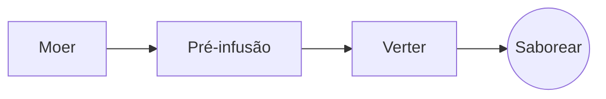

# O café de filtro perfeito

Um ritual lento de manhã, em poucos passos. Escreva-o no **código-fonte** à esquerda ou diretamente na *pré-visualização* à direita: ambos ficam sincronizados, e ==cada edição é uma alteração limpa== ao Markdown.

> [!TIP]
> Água mesmo depois de ferver, a cerca de 94 °C, realça a doçura sem amargor.

## A proporção

A maioria das receitas fixa-se numa parte de café para dezasseis partes de água:

$$
m_{\text{água}} = 16 \times m_{\text{café}}
$$

Assim, $20\,\text{g}$ de café pedem $320\,\text{g}$ de água.

## Passo a passo



## Métodos de preparação

| Método          | Moagem     |    Tempo |
|:----------------|:----------:|---------:|
| Café de filtro  | Média-fina | 3:30 min |
| Prensa francesa | Grossa     | 4:00 min |
| Espresso        | Fina       | 0:28 min |

## Antes de começar

- [x] Grãos acabados de torrar :coffee:
- [x] Um moinho de mós
- [ ] Uma chaleira com bico de cisne

```python
def water_for(coffee_g: float, ratio: int = 16) -> float:
    return coffee_g * ratio
```

Pré-infusão
: O primeiro jato de água, que deixa o café moído libertar o seu gás.[^1]

[^1]: Os grãos frescos fazem a maior pré-infusão; os velhos quase não sobem.
