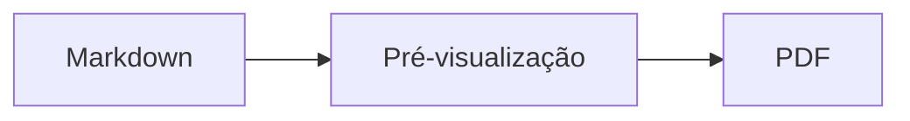

<p>&nbsp;&nbsp;&nbsp;</p>

# Splat

**O editor de Markdown para macOS que lhe permite escrever no código-fonte ou diretamente na pré-visualização.**

O Splat mostra à esquerda o seu código-fonte Markdown com cores de sintaxe e, à direita, uma pré-visualização em direto e totalmente editável. Escreva num dos dois lados: tudo o que escrever na pré-visualização torna-se uma alteração mínima no código-fonte, pelo que as linhas em que não tocou ficam idênticas byte a byte e os seus diffs do Git permanecem limpos. O Splat lê o Markdown que já utiliza: CommonMark e GitHub Flavored Markdown, alertas do GitHub, hiperligações wiki, incorporações e caixas de informação do Obsidian, extensões do Pandoc e do Typora, HTML incorporado, fórmulas LaTeX e diagramas Mermaid, Graphviz e PlantUML, tudo apresentado offline. Percorra e pesquise toda uma pasta de notas, veja o que mudou desde o último commit do Git, cole a partir do Word ou de uma página web como Markdown e exporte para PDF, HTML ou Word com um clique. Está escrito em Rust sobre controlos AppKit genuínos, fala 35 idiomas e não envia nada pela rede, a menos que lho peça.
 


[](https://github.com/sventmueller/splat/releases/latest/download/Splat.dmg)

**[Descarregar Splat.dmg](https://github.com/sventmueller/splat/releases/latest/download/Splat.dmg)**: assinado e notarizado pela Apple, para macOS 14 ou posterior em Apple Silicon e Intel.

**Encontrou um erro?** O Splat mantém idênticas byte a byte as linhas em que não tocou. Se mesmo assim alguma mudar, ou um ficheiro for apresentado incorretamente, [abra uma issue](https://github.com/sventmueller/splat/issues/new/choose) e anexe o ficheiro. Se o Splat lhe for útil, uma [estrela no GitHub](https://github.com/sventmueller/splat) ajuda outras pessoas a encontrá-lo.
 
 

[](https://www.rust-lang.org)
[](https://www.apple.com/macos/)

[](https://github.com/madsmtm/objc2)
[](https://webkit.org)
[](https://github.com/kivikakk/comrak)
[](https://github.github.com/gfm/)
[](https://www.mathjax.org)
[](https://cortexjs.io/mathlive/)
[](https://mermaid.js.org)
[](https://graphviz.org)
[](https://plantuml.com)


[](#licença)

[Bahasa Indonesia](../id/README.md) ·
[Bahasa Melayu](../ms/README.md) ·
[Català](../ca/README.md) ·
[Čeština](../cs/README.md) ·
[Dansk](../da/README.md) ·
[Deutsch](../de/README.md) ·
[English](../../../README.md) ·
[Español](../es/README.md) ·
[Français](../fr/README.md) ·
[Hrvatski](../hr/README.md) ·
[Italiano](../it/README.md) ·
[Magyar](../hu/README.md) ·
[Nederlands](../nl/README.md) ·
[Norsk](../no/README.md) ·
[Polski](../pl/README.md) ·
[Português (Brasil)](../pt_BR/README.md) ·
**Português (Portugal)** ·
[Română](../ro/README.md) ·
[Slovenčina](../sk/README.md) ·
[Slovenščina](../sl/README.md) ·
[Suomi](../fi/README.md) ·
[Svenska](../sv/README.md) ·
[Tiếng Việt](../vi/README.md) ·
[Türkçe](../tr/README.md) ·
[Ελληνικά](../el/README.md) ·
[Русский](../ru/README.md) ·
[Українська](../uk/README.md) ·
[עברית](../he/README.md)‎ ·
[العربية](../ar/README.md)‎ ·
[हिन्दी](../hi/README.md) ·
[ไทย](../th/README.md) ·
[한국어](../ko/README.md) ·
[日本語](../ja/README.md) ·
[简体中文](../zh-Hans/README.md) ·
[繁體中文](../zh-Hant/README.md)

## Índice

- [Funcionalidades em resumo](#funcionalidades-em-resumo)
- [Requisitos](#requisitos)
- [Instalação](#instalação)
- [Primeiros passos](#primeiros-passos)
- [Escrever](#escrever)
  - [No código-fonte](#no-código-fonte)
  - [Na pré-visualização](#na-pré-visualização)
  - [Comandos de formatação](#comandos-de-formatação)
  - [Listas e tarefas](#listas-e-tarefas)
  - [Tabelas](#tabelas)
  - [Colar texto formatado](#colar-texto-formatado)
  - [Metadados](#metadados)
- [Markdown suportado](#markdown-suportado)
  - [CommonMark e GitHub Flavored Markdown](#commonmark-e-github-flavored-markdown)
  - [Caixas de informação](#caixas-de-informação)
  - [Sintaxe alargada](#sintaxe-alargada)
  - [Obsidian](#obsidian)
  - [Citações e referências](#citações-e-referências)
  - [HTML incorporado](#html-incorporado)
  - [Pontuação tipográfica](#pontuação-tipográfica)
  - [Resumo da sintaxe](#resumo-da-sintaxe)
- [Fórmulas](#fórmulas)
- [Diagramas](#diagramas)
- [Imagens](#imagens)
- [Hiperligações e navegação](#hiperligações-e-navegação)
- [Notas numa pasta](#notas-numa-pasta)
- [Alterações desde o último commit](#alterações-desde-o-último-commit)
- [Exportar, imprimir e partilhar](#exportar-imprimir-e-partilhar)
- [Importar documentos Word](#importar-documentos-word)
- [Aparência e acessibilidade](#aparência-e-acessibilidade)
- [Idiomas](#idiomas)
- [Atalhos de teclado](#atalhos-de-teclado)
- [Privacidade e segurança](#privacidade-e-segurança)
- [Documentos grandes](#documentos-grandes)
- [Limitações conhecidas](#limitações-conhecidas)
- [Resolução de problemas](#resolução-de-problemas)
- [Para programadores](#para-programadores)
  - [Componentes de terceiros](#componentes-de-terceiros)
- [Licença](#licença)

## Funcionalidades em resumo

- **Duas formas de escrever, um só texto.** O código-fonte e a pré-visualização são ambos editáveis. O ficheiro Markdown é a única verdade: existe um só histórico de anulações por documento, e cada edição na pré-visualização é traduzida na menor alteração possível ao código-fonte.
- **O Markdown que já utiliza.** CommonMark, GitHub Flavored Markdown, alertas do GitHub, extensões do Obsidian, do Pandoc e do Typora, códigos curtos de emojis, spoilers, listas de definições, âncoras de títulos e HTML como nos README do GitHub.
- **Fórmulas e diagramas incluídos.** Fórmulas LaTeX através do MathJax, com um editor visual de fórmulas. Diagramas em Mermaid, Graphviz e PlantUML, apresentados no seu Mac sem Java, sem servidor e sem ligação à rede.
- **Um botão para tudo.** Cada elemento de Markdown tem um botão na barra de ferramentas e um item de menu, e os mais comuns também um atalho de teclado. As tabelas têm um menu próprio para linhas, colunas e alinhamento.
- **Uma pasta, não apenas um ficheiro.** A barra lateral lista as notas em torno de um documento e pesquisa em todas elas. Alterar o nome de uma nota altera as hiperligações para ela, e todos os bytes em redor mantêm-se.
- **Alterações num relance.** Num repositório Git, barras ao lado do texto marcam o que difere do último commit, nos dois painéis.
- **Do Word e da web para Markdown.** Cole texto formatado como Markdown, células de uma folha de cálculo como tabela, e importe documentos Word inteiros com as suas imagens.
- **Exportação sem perdas.** PDF, um único ficheiro HTML autónomo ou um documento Word com títulos, listas, tabelas, notas de rodapé e imagens verdadeiros. Acrescente números de página, cabeçalhos e uma página de rosto, ou use o modelo do Word da sua empresa.
- **Nativo até ao último pormenor.** Janelas, separadores, menus, popovers, Versões, Guardar automaticamente, o menu de partilha, modo escuro, verificação ortográfica, ditado e VoiceOver autênticos do AppKit. Sem Electron, sem vista web para o próprio texto.
- **Rápido com ficheiros grandes.** Renderizar uma tecla num documento de 10 MB demora cerca de 10 ms, antes do trabalho da própria vista.
- **Privado e cuidadoso.** As imagens da web só são carregadas depois de as permitir, as hiperligações para outras aplicações pedem confirmação, e tudo o que descodifica dados de imagem não fiáveis corre em processos auxiliares isolados numa sandbox.
- **No seu idioma.** A interface e a referência rápida de Markdown integrada existem em 35 idiomas: alemão, árabe, catalão, checo, chinês (simplificado), chinês (tradicional), coreano, croata, dinamarquês, eslovaco, esloveno, espanhol, finlandês, francês, grego, hebraico, hindi, húngaro, indonésio, inglês, italiano, japonês, malaio, neerlandês, norueguês, polaco, português (Brasil), português (Portugal), romeno, russo, sueco, tailandês, turco, ucraniano e vietnamita.

## Requisitos

- macOS 14 Sonoma ou posterior. O Splat é desenvolvido e testado no macOS 27, onde adota automaticamente o design Liquid Glass.
- Um Mac com Apple Silicon ou com processador Intel.
- Cerca de 45 MB de espaço em disco.

## Instalação

**A partir da imagem de disco.** Descarregue [`Splat.dmg`](https://github.com/sventmueller/splat/releases/latest/download/Splat.dmg), abra-a e arraste o Splat para a pasta Aplicações. A imagem está assinada com um Developer ID e notarizada pela Apple, pelo que abre sem avisos.

**Com o Homebrew.** O cask encontra-se num tap próprio:

```sh
brew install --cask sventmueller/tap/splat
```

`brew upgrade --cask splat` instala novas versões, e `brew uninstall --zap --cask splat` remove também as definições e as caches do Splat.

**Atualizações.** O Splat instalado a partir da imagem de disco ou do Homebrew mantém-se atualizado através do [Sparkle](https://sparkle-project.org). No segundo arranque, pergunta se pode procurar atualizações por si, uma vez por dia. **Splat › Procurar atualizações…** procura de imediato; **Procurar atualizações automaticamente** e **Descarregar e instalar atualizações automaticamente**, no mesmo menu, alteram mais tarde a sua escolha. O Splat só instala uma atualização se esta tiver a assinatura do programador. Uma compilação própria não tem atualizador.

**A partir do código-fonte.** Consulte [Compilação](../../../docs/development.md#building) para os pré-requisitos e depois execute:

```sh
make build
ditto target/release/Splat.app /Applications/Splat.app
open /Applications/Splat.app
```

Para abrir ficheiros Markdown com o Splat através de duplo clique, selecione qualquer ficheiro `.md` no Finder, escolha **Ficheiro › Informações**, selecione o Splat em **Abrir com** e clique em **Alterar todos…**. O Splat regista-se para ficheiros `.md`, `.markdown`, `.mdown` e `.mkd`.

## Primeiros passos

### A janela

Cada documento abre na sua própria janela ou, se preferir separadores, num separador:

- **À esquerda: o código-fonte.** O seu Markdown em SF Mono com cores de sintaxe.
- **À direita: a pré-visualização.** O documento apresentado, pronto a editar.
- **Barra lateral (opcional).** Todos os títulos em árvore, um clique num deles mostra-o nos dois painéis: **Visualização › Mostrar estrutura** (⌃⌘S). Outros dois separadores contêm as [notas da pasta](#notas-numa-pasta) e uma pesquisa nelas. O botão ao lado do título da janela mostra e oculta a barra, e as novas janelas abrem-na tal como a última janela a deixou.
- **Barra de ferramentas.** Botões agrupados pelo que alteram: carateres, parágrafos e elementos inseridos, depois pré-visualização ligada/desligada, Partilhar e Novo documento. Personalize-a com **Visualização › Personalizar barra de ferramentas…**.

Arraste o divisor para dar mais espaço a um dos lados. **Visualização › Ocultar pré-visualização** (⌥⌘P) deixa só o código-fonte; o Splat memoriza esta escolha por janela. Os dois painéis deslocam-se em conjunto, e a seleção num painel é realçada no outro.

O canto da janela mostra as palavras e os carateres do texto e quanto tempo demora a ler, e os da seleção enquanto existir uma. Os endereços de hiperligações, as etiquetas HTML, os metadados, os comentários, as fórmulas e os diagramas não contam. Esta informação fica oculta até que **Visualização › Mostrar contagem de palavras** a ative.

### Documentos, separadores e versões

O Splat é uma aplicação de documentos macOS normal:

- **Guardar automaticamente e Versões.** As alterações são guardadas no próprio ficheiro. **Ficheiro › Restabelecer › Percorrer todas as versões…** leva-o de volta no tempo.
- **Alterações feitas por outros programas.** Quando o Git, um script ou outro editor altera um documento aberto, o Splat volta a carregá-lo e mantém o cursor e a posição de deslocamento. Se tiver alterações suas por guardar, o Splat conserva-as, e o macOS pergunta antes de guardar por cima da outra versão.
- **Os comandos de ficheiro habituais.** Duplicar (⇧⌘S), Alterar nome…, Mover para… e **Ficheiro › Abrir documento recente**.
- **Separadores.** **Ficheiro › Novo separador** ou o botão **+** na barra de ferramentas abre um novo documento num separador; o menu Janela padrão agrupa, move e percorre os separadores.
- **Posição das janelas.** O tamanho e a posição da sua última janela são memorizados, inclusive após reiniciar. Se já houver uma janela nesse lugar, a nova abre ligeiramente deslocada.
- **O ícone do Dock.** Um clique nele, depois de fechar a última janela, abre um novo documento.
- **Abrir ficheiros Markdown no Splat.** **Splat › Definir como app predefinida para Markdown** faz com que um duplo clique num ficheiro `.md` ou `.markdown` abra o Splat; o macOS pede uma confirmação uma única vez. O item mostra uma marca de seleção enquanto o Splat for a aplicação predefinida.

Os ficheiros têm de ser texto UTF-8 ou UTF-16 com uma marca de ordem de bytes. O Splat recusa outras codificações em vez de adivinhar e corromper o texto. A marca de ordem de bytes mantém-se, o UTF-16 continua UTF-16 e, num ficheiro em que todas as linhas terminam em CRLF, as linhas que acrescentar também recebem CRLF.

**Após uma falha**, perdem-se no máximo os últimos segundos escritos: de cinco em cinco segundos, o Splat copia o texto por guardar para `~/Library/Application Support/Splat/Unsaved` e remove as cópias quando o documento é guardado ou o Splat termina normalmente. No arranque seguinte, o que uma falha deixou ali é movido para `~/Library/Application Support/Splat/Recovery`, e o Splat avisa uma única vez, com um botão que abre a pasta. Uma falha a que o Splat ainda consiga reagir escreve ali também o texto de todos os documentos abertos.

### Referência rápida

**Ajuda › Referência rápida de Markdown** abre uma folha de consulta no seu idioma como um novo documento sem título. É um documento normal, por isso experimente tudo ali mesmo, no código-fonte ou na pré-visualização.

## Escrever

### No código-fonte

O código-fonte é um editor de texto simples afinado para Markdown:

- **Cores de sintaxe** como no VS Code: títulos, ênfase, hiperligações, código, tabelas, HTML, front matter, e LaTeX e Mermaid dentro de fórmulas e diagramas. Existem paletas para claro, escuro e Aumentar contraste.
- **Blocos de código delimitados** têm realce para Bash, C, C++, C#, CSS (também SCSS e Less), Go, HTML, XML, Java, JavaScript, JSON, Kotlin, PHP, Python, Ruby, Rust, SQL, Swift, TypeScript, YAML, TeX e Mermaid, incluindo os nomes abreviados habituais, como `js`, `py` ou `sh`.
- **Sem substituições surpresa.** As aspas curvas, os traços formatados e a substituição de texto vêm desativados, porque estragam `--`, `---` e `"`. Ative-os em **Edição › Substituições**.
- **As ferramentas de escrita do sistema.** Verificação ortográfica e gramatical, ditado, Procurar e substituir (⌥⌘F) e Fala.
- **Arrastar e largar.** Largue um ficheiro de imagem para inserir ``, qualquer outro ficheiro para inserir uma hiperligação para ele e um URL para inserir `[url](url)`. Cada largada é um passo de anulação.
- **Colar imagens.** Uma imagem na área de transferência, como uma captura de ecrã, é guardada como ficheiro PNG junto do documento (`Imagem 2026-10-29 13.09.07.png`) e inserida como imagem. Para isso, o documento tem de estar guardado pelo menos uma vez.

### Na pré-visualização

A pré-visualização comporta-se como um processador de texto, mas tudo o que fizer nela acaba como Markdown:

- **Escrever.** Os carateres com significado em Markdown, como `*` ou `#`, recebem um escape para aparecerem tal como os escreveu.
- **Return** inicia um novo parágrafo ou item de lista. **⌥Return** ou **⌃Return** insere uma quebra de linha.
- **Formatação no cursor.** Com o cursor no fim de uma palavra, Negrito, Itálico e os outros formatos de carateres aplicam-se ao que escrever a seguir. Escolha o formato outra vez para o terminar. Dentro de uma palavra, é formatada a palavra inteira.
- **Linhas vazias.** Return numa linha vazia acrescenta outra linha vazia, e Delete remove-a. No código-fonte, cada linha vazia adicional corresponde a mais duas linhas em branco; outros programas de Markdown mostram-nas como espaçamento normal entre parágrafos.
- **Desfazer** funciona nos dois painéis. Os passos têm nome (“Desfazer Negrito”), o que se escreve conta como um passo por cada sequência contínua, e depois de Desfazer e Refazer os dois painéis deslocam-se até à alteração.
- **Fórmulas e diagramas** aparecem como gráficos acabados. Clique num, mova o cursor para cima dele ou prima Return sobre ele para abrir o respetivo editor (veja [Fórmulas](#fórmulas) e [Diagramas](#diagramas)).
- **HTML incorporado, notas incorporadas e front matter** são apresentados, mas edita-os no código-fonte. Um clique neles coloca ali o cursor no local correspondente.

Tudo o que o Markdown não consegue exprimir fica bloqueado na pré-visualização: os painéis Tipo de letra e Cores, a régua, e colar ou largar texto formatado e imagens. O HTML e o RTF colados chegam como texto simples, a menos que escolha [Colar como Markdown](#colar-texto-formatado).

### Comandos de formatação

Todos os comandos estão disponíveis na barra de ferramentas, na barra de menus e no menu de contexto dos dois painéis. Os itens de menu mostram uma marca de seleção para a formatação no cursor.

| Menu | Comandos |
|---|---|
| **Formatação › Tipo de letra** | Negrito, Itálico, Sublinhado, Riscado, Destaque, Código, Expoente, Índice |
| **Formatação › Título** | Corpo de texto, Título 1 a 6 |
| **Formatação › Lista** | Lista com marcas, Lista numerada, Lista de tarefas |
| **Formatação** | Citação, Bloco de código (Sem linguagem ou uma de 20 linguagens; altera também a linguagem de um bloco existente), Caixa de informação (Nota, Dica, Importante, Aviso, Cuidado; o mesmo tipo outra vez remove-a), Editar fórmula ou diagrama…, Limpar formatação |
| **Inserir** | Criar hiperligação…, Imagem…, Tabela…, Fórmula, Diagrama (Fluxograma, Diagrama de sequência, Gráfico de Gantt), Índice, Nota de rodapé, Linha divisória |
| **Tabela** | Inserir linha acima/abaixo, Inserir coluna à esquerda/à direita, Apagar linha, Apagar coluna, Alinhamento (À esquerda, Centrar, À direita, Predefinição), Alinhar colunas da tabela |
| **Visualização** | Ocultar/Mostrar pré-visualização, Mostrar/Ocultar estrutura, Pontuação tipográfica, Ampliar/Reduzir, Tamanho real, barra de ferramentas, barra de separadores, ecrã completo |

Sublinhado, destaque, expoente e índice são escritos como `<ins>`, `<mark>`, `<sup>` e `<sub>`, que o GitHub também apresenta. O Splat lê ainda `<u>`, que o GitHub remove, e as formas mais curtas `==destaque==`, `^exp^` e `~índice~`. O GitHub mostra `==` e `^` tal como escritos e `~índice~` como riscado.

### Listas e tarefas

- Return continua uma lista; Return num item vazio termina-a.
- **Tab** e **⇧Tab** indentam e removem a indentação dos itens de lista na pré-visualização.
- Um clique na caixa de uma tarefa na pré-visualização alterna entre `- [ ]` e `- [x]`.
- **Formatação › Lista** transforma os parágrafos selecionados numa lista ou altera o seu tipo.

### Tabelas

- **Inserir › Tabela…** pergunta o número de linhas (incluindo o cabeçalho) e de colunas.
- Na pré-visualização, **Tab** passa para a célula seguinte, **⇧Tab** para a anterior e **Return** para a célula abaixo. Tab na última célula acrescenta uma linha.
- O menu **Tabela** insere e apaga linhas e colunas e define o alinhamento de uma coluna (⌘{, ⌘|, ⌘}).
- **Tabela › Alinhar colunas da tabela** preenche o código-fonte com espaços para as colunas ficarem alinhadas.

### Colar texto formatado

**Edição › Colar como Markdown** (⌃⌘V), também no menu de contexto dos dois painéis, transforma o conteúdo da área de transferência em Markdown na seleção, como um único passo de anulação. ⌘V continua a inserir texto simples.

- **A partir de um navegador, Word, Google Docs, Confluence, Notas ou Pages:** títulos, negrito, itálico, sublinhado, riscado, expoente e índice, hiperligações, listas com o seu aninhamento, citações, código e tabelas são mantidos.
- **A partir de uma folha de cálculo:** as células tornam-se uma tabela com linha de cabeçalho e colunas de números alinhadas à direita. O mesmo acontece ao texto separado por tabulações, pontos e vírgulas ou vírgulas, se todas as linhas tiverem o mesmo número de colunas.
- **As imagens** com endereço web continuam a ser hiperligações. Uma imagem dentro do HTML colado torna-se um ficheiro junto do documento, que para isso tem de estar guardado pelo menos uma vez. Os ficheiros de imagem temporários do Word não são importados, e o seu texto alternativo mantém-se.
- **As hiperligações** só mantêm endereços `http`, `https`, `mailto`, relativos e `#`; de qualquer outra hiperligação fica o texto.

### Metadados

**Formatação › Editar metadados…**, ou um clique na linha de metadados no topo da pré-visualização, abre um formulário com os campos do front matter YAML. Os campos podem ser alterados, adicionados e removidos. Um campo com uma lista mantém-na como lista: os seus valores ficam uns a seguir aos outros, separados por vírgulas, e um valor com uma vírgula fica entre aspas. Um campo novo chamado `tags`, `aliases`, `keywords`, `categories`, `authors` ou `cssclasses` também se torna uma lista. Os campos aninhados e o texto em várias linhas podem ser vistos aí e editam-se no código-fonte.

O que o formulário altera é um único passo de anulação e só atinge as linhas dos campos que alterou: os comentários, a ordem, os espaçamentos invulgares, as aspas e os fins de linha de todos os outros ficam idênticos byte a byte. Um documento sem metadados recebe um bloco no início.

## Markdown suportado

O Splat analisa com o [comrak](https://github.com/kivikakk/comrak), um analisador compatível com CommonMark e GFM, e ativa a maior parte das suas extensões. Tudo o que se segue é apresentado na pré-visualização e em todas as exportações.

### CommonMark e GitHub Flavored Markdown

- Títulos (`#` e sublinhados), parágrafos, quebras de linha, ênfase, ênfase forte, código em linha, citações em bloco, linhas divisórias.
- Listas com marcas, numeradas e aninhadas; listas de tarefas.
- Hiperligações (em linha, de referência e automáticas), imagens, definições de referências de hiperligações.
- Blocos de código delimitados e indentados com cores de sintaxe.
- Tabelas com alinhamento de colunas.
- Riscado com `~~dois til~~`.
- Notas de rodapé: `texto[^1]` com `[^1]: A nota.` em qualquer ponto do documento. Um clique na marca salta para a nota.
- YAML front matter entre linhas `---` no início. A pré-visualização resume-o numa linha, como “Metadados: título, data, etiquetas”.

### Caixas de informação

Os alertas do GitHub são apresentados como caixas coloridas com ícone e título:

```markdown
> [!NOTE]
> Informação útil que os utilizadores devem conhecer.

> [!WARNING]
> Conteúdo crítico que exige atenção imediata.
```

Os cinco tipos são Nota, Dica, Importante, Aviso e Cuidado. **Formatação › Caixa de informação** transforma o parágrafo no cursor numa delas.

As caixas de informação do Obsidian também funcionam, com qualquer título e um estado de dobragem:

```markdown
> [!tip]- Clique em ▸ para expandir
> Oculto até ser aberto.

> [!question]+ Aberta por predefinição
> Um `+` começa expandida, um `-` recolhida.
```

Os outros tipos do Obsidian são mostrados na cor mais próxima das cinco: `success`, `check`, `done` e `hint` como Dica; `question`, `help` e `faq` como Importante; `attention` como Aviso; `failure`, `fail`, `missing`, `danger`, `error` e `bug` como Cuidado; todos os outros como Nota.

### Sintaxe alargada

| Funcionalidade | Sintaxe | Origem |
|---|---|---|
| Destaque | `==texto marcado==` | Obsidian, Typora |
| Expoente | `x^2^` | Pandoc, Typora |
| Índice | `H~2~O` | Pandoc, Typora |
| Código curto de emoji | `:rocket:` torna-se 🚀 | GitHub |
| Spoiler | `\|\|texto oculto\|\|`, selecione para ler | Discord |
| Nota de rodapé em linha | `texto^[a própria nota]` | Pandoc, Obsidian |
| Lista de definições | `Termo`, linha em branco, `: Explicação` | PHP Markdown Extra, Pandoc |
| Âncora de título | `## Instalar {#setup}`, ligue com `[ver](#setup)` | Pandoc, kramdown |

As listas de definições têm este aspeto no código-fonte:

```markdown
Termo

: Explicação do termo.
```

Sem uma âncora própria, cada título recebe uma derivada do seu texto, como no GitHub: `## Primeiros passos` fica acessível como `#primeiros-passos`.

### Obsidian

- **Hiperligações wiki.** `[[Nota]]` liga a `Nota.md` na mesma pasta ou numa pasta abaixo. `[[Nota|Texto apresentado]]` mostra o seu próprio texto, e `[[Nota#Título]]` abre a nota. ⌘-clique abre-a no Splat.
- **Incorporações.** `![[Nota]]` mostra a outra nota dentro desta; as notas incorporadas nela aparecem como hiperligações. `![[diagram.png]]` mostra uma imagem. Tal como no Obsidian, as incorporações indicam notas e imagens na pasta do documento ou abaixo, nunca por um caminho absoluto, e só os ficheiros Markdown aparecem como notas.
- **Comentários.** `%%Só no código-fonte%%` fica visível no código-fonte e é omitido da pré-visualização e de todas as exportações, tanto em linha como em linhas próprias.
- **Etiquetas.** `#ideia` ou `#projeto/splat` é realçada. ⌘-clique procura a etiqueta no documento e, na barra lateral, em toda a pasta.
- **Caixas de informação recolhíveis.** Veja [Caixas de informação](#caixas-de-informação).

### Citações e referências

- **Citações do Pandoc.** `[@doe2020]` ou `[@doe2020; @roe2021]` lê-se como “(Doe 2020; Roe 2021)”. As entradas vêm do ficheiro BibTeX que o front matter indica como `bibliography: refs.bib`. Sem essa indicação, o Splat usa `references.bib`, `literatur.bib` ou `bibliography.bib` junto do documento.
- **Referências do GitHub e do GitLab.** Se o documento estiver num repositório Git cujo remoto `origin` se encontre em github.com ou num servidor GitLab, `@nome`, `#12` (issue) e `!7` (merge request, só no GitLab) são realçados. ⌘-clique abre-os no navegador.

### HTML incorporado

O HTML tal como se encontra nos README do GitHub é apresentado, com um leitor próprio e não com um motor de navegador:

- parágrafos e blocos centrados (`<p align="center">`, `<div align="center">`)
- imagens com tamanho (``)
- hiperligações, `<kbd>⌘</kbd>`, `<br>`, `<u>`, `<ins>`, `<mark>`, `<sup>`, `<sub>`
- listas e tabelas, incluindo células que abrangem várias colunas (`colspan`)
- secções recolhíveis: `<details><summary>Mais</summary>…</details>`, abertas com um clique em ▸

O Markdown entre etiquetas HTML é apresentado como Markdown. Scripts, estilos, frames e formulários são totalmente omitidos, e as hiperligações e imagens só mantêm endereços `http`, `https`, `mailto` e relativos.

### Pontuação tipográfica

**Visualização › Pontuação tipográfica** mostra as aspas retas como as aspas do idioma da sua interface, `--` como travessão curto, `---` como travessão longo e `...` como reticências. Em alemão, `"Ja"` torna-se „Ja“, em francês «Oui», em japonês 「はい」, também onde o chinês e o japonês compõem as aspas sem espaço; as abreviaturas hebraicas como `צה"ל` recebem os seus gershayim, צה״ל. O código-fonte mantém os carateres simples; a pré-visualização e todas as exportações mostram os tipográficos. A opção vem desativada até a ligar.

### Resumo da sintaxe

| Elemento | Markdown |
|---|---|
| **Negrito** | `**Negrito**` |
| *Itálico* | `*Itálico*` |
| Sublinhado | `<ins>Sublinhado</ins>` ou `<u>Sublinhado</u>` |
| ~~Riscado~~ | `~~Riscado~~` |
| Destaque | `<mark>Destaque</mark>` ou `==Destaque==` |
| `Código` | `` `Código` `` |
| x² | `x<sup>2</sup>` ou `x^2^` |
| H₂O | `H<sub>2</sub>O` ou `H~2~O` |
| [Hiperligação](https://example.com) | `[Hiperligação](https://example.com)` |
| Título | `# Título` a `###### Título` |
| Citação | `> Citação` |
| Lista com marcas | `- Item` |
| Lista numerada | `1. Item` |
| Tarefa | `- [ ] Por fazer` e `- [x] Feito` |
| Bloco de código | ```` ```rust ```` … ```` ``` ```` |
| Tabela | `\| A \| B \|` com `\|---\|---\|` abaixo do cabeçalho |
| Nota de rodapé | `Texto[^1]` e `[^1]: Nota` |
| Linha divisória | `---` |
| Imagem | `` |
| Fórmula | `$E = mc^2$`, `$$ … $$` |
| Diagrama | ```` ```mermaid ````, ```` ```dot ````, ```` ```plantuml ```` |
| Caixa de informação | `> [!TIP]` |
| Hiperligação wiki | `[[Nota]]`, `[[Nota\|Texto]]` |
| Incorporação | `![[Nota]]`, `![[imagem.png]]` |
| Comentário | `%%Comentário%%` |
| Etiqueta | `#etiqueta` |
| Citação bibliográfica | `[@chave]` |
| Spoiler | `\|\|Spoiler\|\|` |
| Emoji | `:tada:` |

## Fórmulas

As fórmulas são apresentadas pelo [MathJax](https://www.mathjax.org) com o seu TeX e a matemática AMS, como gráficos vetoriais nítidos. O texto em `\text{…}` pode estar em qualquer sistema de escrita: o que falta aos tipos de letra do MathJax vem dos tipos de letra do seu Mac, com o árabe e o hebraico a correr da direita para a esquerda, e os emojis a cores.

| Tipo | Sintaxe |
|---|---|
| Em linha | `$E = mc^2$`, `` $`E = mc^2`$ `` (GitHub, GitLab), `\(E = mc^2\)` |
| Em bloco | `$$` … `$$`, `\[` … `\]`, ou um bloco de código marcado como `math` |

**Editar uma fórmula.** Clique numa fórmula na pré-visualização, faça duplo clique nela, prima Return sobre ela ou mova o cursor para cima dela para abrir o respetivo editor num popover. **Inserir › Fórmula** insere uma nova e abre logo o editor.

- **Visual ou LaTeX.** O seletor no topo alterna entre um editor visual ([MathLive](https://cortexjs.io/mathlive/)) e o código LaTeX. O Splat memoriza a sua escolha.
- **Blocos de construção** para fração, raiz quadrada, expoente e índice, somatório e integral com limites, limite, parênteses que crescem com o conteúdo, matriz 2×2, letras gregas, e relações, operadores e setas. Deixam marcadores □, e **Tab** salta para o seguinte.
- **Pré-visualização em direto.** As alterações aparecem no documento enquanto escreve. Os erros do MathJax surgem numa linha abaixo do código.
- **Confirmar ou descartar.** Clicar fora mantém a alteração como um único passo de anulação; **Esc** ou **Cancelar** descarta-a. Premir Esc numa fórmula nova e vazia remove-a de novo.
- O menu de contexto oferece **Editar fórmula…** para a fórmula sob o ponteiro.

O VoiceOver lê uma fórmula como o seu código LaTeX. O Splat apresenta fórmulas, não documentos LaTeX completos: não há pacotes, nem TikZ, nem `\documentclass`.

## Diagramas

Os diagramas são apresentados dentro do Splat, offline e numa variante clara e outra escura.

| Motor | Bloco de código | O que desenha |
|---|---|---|
| [Mermaid](https://mermaid.js.org) | ```` ```mermaid ```` | fluxogramas, diagramas de sequência, de classes, de estados, entidade-relação e de Gantt, gráficos circulares, mapas mentais, cronologias e todos os outros tipos do Mermaid |
| [Graphviz](https://graphviz.org) | ```` ```dot ```` ou ```` ```graphviz ```` | grafos na linguagem DOT |
| [PlantUML](https://plantuml.com) | ```` ```plantuml ```` ou ```` ```puml ```` | diagramas UML; funciona sem Java |



**Editar um diagrama** funciona como editar uma fórmula: clique nele para abrir o código num popover, com cores de sintaxe e mensagens de erro numa linha abaixo do código. **Inserir › Diagrama** parte de um modelo para um fluxograma, um diagrama de sequência ou um gráfico de Gantt. Os blocos de construção ajudam nos três tipos de Mermaid mais comuns:

- **Fluxograma:** Nó ▾ (retângulo, arredondado, círculo, losango, base de dados), Ligação, Ligação com etiqueta, Grupo, Direção ▾
- **Diagrama de sequência:** Participante, Mensagem, Resposta, Nota, Ciclo, Caminhos alternativos
- **Gráfico de Gantt:** Secção, Tarefa, Marco

Os outros tipos de diagrama são editados como código. O VoiceOver lê o título ou o texto alternativo de um diagrama.

O primeiro diagrama após o arranque demora cerca de um segundo, porque o motor de apresentação arranca em segundo plano. Um diagrama que demore mais de 10 segundos mostra um erro, e o motor de apresentação arranca de novo para o seguinte. O motor do PlantUML (3 MB) só é carregado com o primeiro diagrama PlantUML. Um `!include` do PlantUML a partir da web é bloqueado.

## Imagens

- **Imagens locais** usam caminhos relativos ao documento: ``. O Splat mostra PNG, JPEG, GIF, WebP, BMP, SVG, HEIC, TIFF, AVIF e PDF.
- **Imagens da web** ficam bloqueadas até as permitir: uma barra acima da pré-visualização explica que, ao carregá-las, os respetivos servidores ficam a saber que e quando abre o documento. **Carregar imagens** permite-as neste documento; o Splat memoriza a escolha por ficheiro.
- **Tamanho.** `` define o tamanho de uma imagem; caso contrário, as imagens ajustam-se à largura da pré-visualização.
- **Alterações no disco.** Uma imagem que substitua, ou uma que apareça depois de o documento a indicar, é mostrada sem voltar a abrir o documento. As imagens da web que falharam por causa da rede são tentadas de novo enquanto um documento as mostrar.
- **Memória.** As imagens são mostradas com até 2560 píxeis no lado mais comprido, o que também preenche uma página A4. São descodificadas em tamanho menor quando ocupam um oitavo da memória do Mac e enquanto o macOS indicar pressão de memória.
- **Modo escuro.** As imagens com fundo branco ficam ligeiramente esbatidas na pré-visualização escura.
- **Colar e largar.** Veja [No código-fonte](#no-código-fonte).

## Hiperligações e navegação

Na pré-visualização, um clique coloca o cursor para poder editar o texto da hiperligação; **⌘-clique** segue a hiperligação:

- `http`, `https` e `mailto` abrem no seu navegador ou na aplicação de correio.
- Os ficheiros Markdown abrem no Splat; os outros ficheiros e pastas são revelados no Finder.
- `#âncora` salta para o título no documento.
- Os endereços que abrem outra aplicação, como `slack://` ou `vscode://`, pedem confirmação primeiro e mostram o endereço completo e a aplicação. **Cancelar** vem pré-selecionado.

**Inserir › Índice** insere uma lista com hiperligações para todos os títulos. Com o cursor dentro dela, o mesmo comando atualiza-a. A barra lateral de estrutura (⌃⌘S) salta para qualquer título nos dois painéis.

## Notas numa pasta

Os botões no topo da barra lateral alternam entre a estrutura, os ficheiros e uma pesquisa.

- **Ficheiros** (**Visualização › Mostrar ficheiros**, ⌃⌘E). Todos os ficheiros Markdown da pasta do documento ou, se este estiver num repositório Git, de todo o repositório. Um clique ou Return abre uma nota como separador desta janela; se já estiver aberta, passa para a frente. O botão ao lado do nome da pasta mostra outra pasta nesta janela. Os ficheiros ocultos, `node_modules`, `target`, `Pods`, `DerivedData`, `__pycache__` e as pastas sem notas ficam de fora. Um documento diretamente na sua pasta pessoal só mostra as notas ao lado dele, para que o Splat não percorra todas as suas pastas a pedir autorização para cada uma.
- **Pesquisa** (**Edição › Procurar › Pesquisar em todas as notas…**, ⇧⌘F). Encontra texto em todas as notas, independentemente de maiúsculas e minúsculas e da forma como os acentos estão codificados. `#tag` encontra uma etiqueta, `#project` também `#project/splat`, e nada dentro de código. Um clique num resultado abre a nota nesse local.
- **Hiperligações para uma nota.** O menu de contexto de uma nota lista as notas que apontam para ela, por hiperligação wiki, incorporação, hiperligação relativa ou definição de referência de hiperligação.
- **Alterar o nome de uma nota.** O mesmo menu altera-lhe o nome e essas hiperligações. O Splat indica primeiro de quantas hiperligações em quantos ficheiros se trata. Em cada hiperligação muda apenas o nome, e todos os outros bytes do ficheiro mantêm-se. Os documentos abertos recebem a alteração como um passo de anulação; nos outros ficheiros, só o Git ou as Versões a podem reverter. Um ficheiro que outro programa tenha alterado entretanto interrompe a alteração de todas as hiperligações, e o Splat indica qual.

A lista acompanha a pasta quando a janela passa para a frente. A pesquisa vê os ficheiros tal como estão no disco, e o texto que ainda não guardou conta a partir da próxima gravação automática.

## Alterações desde o último commit

Num documento num repositório Git, barras ao lado do texto marcam o que difere do último commit, no código-fonte e na pré-visualização: verde para linhas adicionadas, azul para linhas alteradas e uma marca vermelha curta onde algo foi removido. Acompanham enquanto escreve e quando o ramo se move. **Visualização › Alterações desde o último commit** desativa-as, em todas as janelas.

As linhas que só diferem no fim de linha não contam, pelo que um ficheiro com CRLF perante um commit com LF não mostra qualquer alteração. Um ficheiro novo não tem marcas até ao primeiro commit, e um documento acima de 32 MB também não.

## Exportar, imprimir e partilhar

| Formato | Como | O que obtém |
|---|---|---|
| **PDF** | **Ficheiro › Exportar como PDF…** ou o menu Partilhar | Páginas do tamanho do papel, sempre na aparência clara, com fórmulas e diagramas como gráficos vetoriais. **Ficheiro › Configurar página…** define o papel. |
| **Imprimir** | **Ficheiro › Imprimir…** (⌘P) | O mesmo esquema do PDF. |
| **HTML** | **Ficheiro › Exportar como HTML…** ou o menu Partilhar | Um único ficheiro autónomo: imagens locais incorporadas, fórmulas e diagramas como imagens nítidas, âncoras de títulos para que o índice funcione. Sem scripts. |
| **Word** | **Ficheiro › Exportar como documento Word…** ou o menu Partilhar | Um `.docx` com os estilos de título do Word, listas e tabelas verdadeiras (incluindo células unidas), notas de rodapé como notas de rodapé do Word, imagens incorporadas, fórmulas e diagramas. |
| **Markdown** | O botão **Partilhar** na barra de ferramentas | O documento como ficheiro `.md` para o Mail, as Mensagens, o AirDrop e todos os outros serviços de partilha. |

O menu **Ficheiro › Partilhar** oferece tudo isto num só lugar. As exportações usam a opção de pontuação tipográfica e as imagens da web que permitiu; no HTML, as imagens da web continuam a ser hiperligações.

**Ficheiro › Opções de exportação…** define o que o PDF, a impressão e o Word acrescentam ao texto, para todos os documentos:

- **Números de página** no rodapé do PDF e da impressão, na forma `2 / 9`.
- **Cabeçalho e rodapé** para PDF e impressão. `{title}`, `{author}`, `{date}`, `{page}` e `{pages}` representam os respetivos valores, os três primeiros a partir dos metadados do documento.
- **Uma página de rosto** para PDF, impressão e Word, com `title`, `subtitle`, `author` e `date` dos metadados, ou o nome do documento como título. Não tem cabeçalho nem rodapé.
- **Um modelo do Word**, um `.docx` ou `.dotx` cujo aspeto a exportação adota: os seus estilos, incluindo com nomes localizados, o seu tema, o tamanho de página, as margens, os cabeçalhos e os rodapés. Um modelo que não se consegue ler interrompe a exportação e avisa, em vez de lhe dar um documento sem ele.

## Importar documentos Word

**Ficheiro › Importar documento Word…** pede um ficheiro `.docx` ou `.dotx` e o local para o seu Markdown, e depois abre o resultado. As imagens vão para uma pasta ao lado, com o nome do documento seguido de `-images`.

Os títulos e as listas chegam tal como os estilos e a numeração do Word os definem, também em documentos cujos estilos têm nomes localizados. Negrito, itálico, sublinhado, riscado, destaque, expoente e índice, hiperligações, citações, código, notas de rodapé, notas de fim e tabelas são mantidos, com as células que abrangem várias colunas como tabela HTML. As fórmulas tornam-se LaTeX. As alterações registadas contam como aceites, e um índice fica de fora, pois **Inserir › Índice** cria um novo. Os ficheiros `.doc` antigos e os documentos protegidos por palavra-passe são recusados.

## Aparência e acessibilidade

- O **modo escuro** acompanha o sistema. As fórmulas e os diagramas são apresentados para cada aparência.
- **Aumentar contraste** nas Definições do Sistema muda as cores de sintaxe para paletas de alto contraste.
- **Zoom.** ⌘+, ⌘− e ⌘0 redimensionam os dois painéis.
- **Ecrã completo, separadores e uma barra de ferramentas personalizável**, como em qualquer aplicação do Mac.
- **VoiceOver.** Os painéis chamam-se “Código-fonte Markdown” e “Pré-visualização”, as fórmulas são lidas como o seu código e os diagramas como o seu título. Todos os comandos são acessíveis pelo teclado.

O Splat não tem janela de definições: as poucas opções estão onde se aplicam, em **Visualização**, **Edição › Substituições** e **Ficheiro › Opções de exportação…**.

## Idiomas

A interface, os menus e a referência rápida de Markdown estão traduzidos em 35 idiomas:

Alemão, árabe, catalão, checo, chinês (simplificado), chinês (tradicional), coreano, croata, dinamarquês, eslovaco, esloveno, espanhol, finlandês, francês, grego, hebraico, hindi, húngaro, indonésio, inglês, italiano, japonês, malaio, neerlandês, norueguês, polaco, português (Brasil), português (Portugal), romeno, russo, sueco, tailandês, turco, ucraniano e vietnamita.

O Splat segue a ordem de idiomas em **Definições do Sistema › Geral › Idioma e região**; também pode escolher ali um idioma só para o Splat, em **Aplicações**. Sem tradução para o seu idioma, usa o inglês. Os termos dos menus seguem as traduções da própria Apple, para que o Splat se leia como o resto do seu Mac.

O texto em hebraico e em árabe lê-se da direita para a esquerda onde quer que apareça, qualquer que seja o idioma da interface: cada parágrafo, título e item de lista assume a direção da sua primeira letra, as citações e as caixas de informação desenham a barra à direita, e uma tabela cujo texto começa da direita para a esquerda dispõe as colunas a partir da direita. Os blocos de código continuam da esquerda para a direita. As exportações para PDF, HTML e Word mantêm estas direções. Com o hebraico ou o árabe como idioma do sistema, o macOS também espelha a janela, pelo que a pré-visualização fica à esquerda.

## Atalhos de teclado

| Ação | Atalho |
|---|---|
| Negrito, Itálico, Sublinhado | ⌘B, ⌘I, ⌘U |
| Riscado | ⇧⌘X |
| Código | ⌥⇧⌘C |
| Criar hiperligação… | ⌘K |
| Corpo de texto, Título 1 a 6 | ⌥⌘0, ⌥⌘1 a ⌥⌘6 |
| Alinhar a coluna da tabela à esquerda, ao centro, à direita | ⌘{, ⌘\|, ⌘} |
| Ocultar ou mostrar a pré-visualização | ⌥⌘P |
| Mostrar ou ocultar a estrutura | ⌃⌘S |
| Mostrar ou ocultar os ficheiros | ⌃⌘E |
| Pesquisar em todas as notas | ⇧⌘F |
| Colar como Markdown | ⌃⌘V |
| Ampliar, reduzir, tamanho real | ⌘+, ⌘−, ⌘0 |
| Novo documento, abrir, guardar, duplicar | ⌘N, ⌘O, ⌘S, ⇧⌘S |
| Configurar página, imprimir | ⇧⌘P, ⌘P |
| Procurar, procurar e substituir | ⌘F, ⌥⌘F |
| Procurar seguinte, anterior; procurar seleção; ir para seleção | ⌘G, ⇧⌘G; ⌘E; ⌘J |
| Mostrar ortografia e gramática; corrigir documento | ⌘:, ⌘; |
| Colar e manter estilo | ⌥⇧⌘V |
| Ocultar barra de ferramentas, mostrar todos os separadores, ecrã completo | ⌥⌘T, ⇧⌘\\, ⌃⌘F |
| Quebra de linha (pré-visualização) | ⌥Return ou ⌃Return |
| Célula seguinte / célula anterior numa tabela (pré-visualização) | Tab / ⇧Tab |
| Indentar / remover indentação de um item de lista (pré-visualização) | Tab / ⇧Tab |
| Marcador seguinte no editor de fórmulas | Tab |
| Fechar o editor de fórmulas ou de diagramas sem alterações | Esc |
| Seguir uma hiperligação, etiqueta ou referência (pré-visualização) | ⌘-clique |

O Splat deixa os atalhos padrão da Apple onde estão.

## Privacidade e segurança

Um ficheiro Markdown pode vir de qualquer pessoa, por isso o Splat trata cada documento como não fiável.

- **Sem rede por predefinição.** O Splat não tem telemetria. Só procura atualizações depois de o autorizar ou de escolher **Procurar atualizações…**: nesse caso, carrega um pequeno ficheiro de feed do GitHub, e o pedido indica apenas a aplicação e a sua versão. As fórmulas e os diagramas são apresentados localmente; as vistas web que o fazem não conseguem aceder à rede. **Ajuda › Comunicar um problema…** abre um formulário do GitHub no navegador; o endereço contém a versão do Splat, a do macOS e o tipo de Mac, nada dos seus documentos.
- **As imagens da web** só são carregadas com a sua autorização, apenas por `https`, nunca de anfitriões na sua rede local, com no máximo 10 MB cada e numa sessão privada sem cookies.
- **Descodificação isolada.** As imagens e os gráficos de fórmulas e diagramas são descodificados em processos auxiliares que fecham todos os ficheiros herdados e se fecham numa sandbox antes de lerem o primeiro byte: sem acesso a ficheiros nem à rede. Devolvem apenas píxeis, cujo tamanho é verificado, e são parados ao fim de 10 segundos. Os descodificadores de imagem da própria Apple só veem HEIC, TIFF, AVIF e PDF, e só quando os dados são mesmo desse formato; correm num auxiliar próprio, que pode ainda ler as pastas de tipos de letra do sistema e usar o descodificador de vídeo do sistema. Os SVG, as fórmulas e os diagramas também passam por esse auxiliar, pelo que no Splat são imagens com resolução fixa: quatro píxeis por ponto, até 2560 no lado mais comprido.
- **Os ficheiros locais** só chegam a um documento pelo caminho que ele indica. As incorporações mostram notas Markdown da pasta do documento e abaixo, e uma imagem em falta só é procurada aí. Um caminho de imagem noutro local, absoluto ou a começar por `~`, continua a ser carregado na pré-visualização; as exportações HTML e Word, a impressão e os PDF só levam o que está na pasta do documento ou no seu repositório Git, a menos que esse repositório também contenha a sua pasta pessoal, para que um documento de outra pessoa não arraste os seus ficheiros para uma exportação que reencaminhe.
- **As pastas de notas** só são lidas enquanto a barra lateral as mostra, e alterar o nome de uma nota só altera outros ficheiros depois de confirmar quantos.
- **Os repositórios Git** são lidos pelo próprio Splat. Nunca executa o programa `git`, cuja configuração num repositório alheio pode iniciar outros programas, e não lê mais do que a versão do documento aberto no último commit. Não escreve nada aí e não usa nenhuma rede.
- **Os documentos Word e o texto colado** são lidos pelos analisadores próprios do Splat, com limites de tamanho, de aninhamento e de quanto um ficheiro se pode descomprimir. As suas hiperligações só mantêm os endereços que o Splat permite noutros locais, e os nomes das imagens num ficheiro Word nunca decidem onde são escritas.
- **As cópias de texto por guardar** ficam neste Mac, na sua pasta Biblioteca, para a recuperação após uma falha. Desaparecem quando guarda ou o Splat termina normalmente; as cópias que uma falha deixou ficam na pasta de recuperação até as apagar.
- **As hiperligações** nunca iniciam um programa com um clique. As hiperligações web e de correio abrem como de costume; as que levam a outras aplicações pedem confirmação.
- **O HTML nos documentos** é lido pelo analisador próprio do Splat. Scripts, estilos, frames e formulários nunca são executados.
- **As exportações** não contêm scripts. As páginas HTML só mantêm uma lista fixa de etiquetas e atributos inofensivos, como o GitHub, mais uma política de segurança de conteúdo. Os ficheiros Word só ligam endereços `http`, `https` e `mailto`, exceto as hiperligações que vêm com um modelo do Word que tenha escolhido.
- **Assinatura de código** com o Hardened Runtime. O Splat corre sem a App Sandbox para poder mostrar imagens junto dos seus documentos sem pedir permissão para cada pasta; o isolamento de toda a descodificação compensa isto.

## Documentos grandes

O Splat continua a responder bem com documentos de vários megabytes:

- O código-fonte usa o TextKit 2, que só dispõe a parte visível.
- Enquanto escreve na pré-visualização, e no código-fonte de documentos até 2 MB, só os parágrafos afetados são analisados, coloridos e dispostos de novo. Num documento de 10 MB, analisar e colorir demora cerca de 3 ms, renderizar cerca de 10 ms, e uma tecla completa na sua pré-visualização cerca de 30 ms, incluindo o trabalho da própria vista.
- As pré-visualizações grandes apresentam primeiro a parte visível e o resto enquanto a aplicação está inativa. Os blocos que entram na área visível são apresentados antes de serem desenhados.
- No código-fonte de documentos maiores, a análise para a pré-visualização corre em segundo plano enquanto escreve.
- Um documento fica em texto simples quando precisaria de cerca de 4 GB de memória, ou seja, cerca de 50 a 120 MB de Markdown comum, mas apenas de 10 a 20 MB se tiver só tabelas ou títulos: o código-fonte não tem cores e a pré-visualização explica porque fica vazia. As exportações continuam a funcionar.
- A partir de cerca de 200 KB, um documento abre a janela antes de ser analisado; aos 5 MB, as cores e a pré-visualização seguem-se cerca de um quarto de segundo depois.
- Todas as imagens juntas, incluindo fórmulas e diagramas, ocupam no máximo um quarto da memória do Mac, e metade disso enquanto a memória escasseia. Para além disso, as restantes imagens aparecem como marcadores de posição até voltar a haver espaço.

Algumas alterações são processadas por inteiro, a cerca de 300 ms por tecla a 10 MB: as que afetam a definição ou as referências de uma nota de rodapé, junto de uma nota de rodapé em linha, no fim do documento junto de uma nota de rodapé, no front matter ou em definições de referências de hiperligações, e todas as alterações num documento com blocos de comentários `%%`, com uma nota de rodapé definida duas vezes ou dentro de uma citação ou lista, ou com mais de 1000 notas de rodapé em linha ou marcas de fórmula por fechar. A memória cresce com o ficheiro, para cerca de 115–160 MB por 1 MB de Markdown e 340–510 MB para 10 MB.

## Limitações conhecidas

- **Um único til significa índice.** `~texto~` é índice, como no Pandoc; para riscar é preciso `~~dois~~`. O GitHub também risca com um único til.
- **Só de leitura na pré-visualização:** o HTML incorporado e as notas incorporadas editam-se no código-fonte, o front matter no seu formulário ou no código-fonte.
- **Aninhamento muito profundo:** o HTML aninhado a mais de 64 níveis, e o HTML em linha a mais de 16, cede o lugar ao seu conteúdo.
- **As células de tabela unidas** existem apenas em tabelas HTML, e só entre colunas (`colspan`, sem `rowspan`). A sintaxe de tabelas do MultiMarkdown para células unidas não é suportada.
- **As bibliografias** são lidas só a partir de BibTeX, não de CSL JSON nem de YAML.
- **As referências** exigem um repositório em github.com ou num servidor GitLab; `!7` existe apenas no GitLab.
- **Pontuação tipográfica:** uma aspa simples de fecho alemã não se distingue de um apóstrofo e é composta como ’.
- **Fórmulas, não documentos:** sem pacotes LaTeX, TikZ nem documentos completos.
- **O editor visual de fórmulas** escreve LaTeX na notação do MathLive: os espaços desaparecem (`E = mc^2` passa a `E=mc^2`), e o resultado apresentado mantém-se igual.
- **Contagem de palavras:** o tailandês, o lao, o khmer e o birmanês escrevem-se sem espaços e contam-se por segmento de texto, não por palavra. `3.14` e `snake_case` são duas palavras cada.
- **Alterar o nome de uma nota** não altera hiperligações em HTML incorporado, e uma hiperligação wiki fica como está se o novo nome contiver `#`, `|`, `^`, `[`, `]` ou `\`.
- **As marcas de alterações** leem repositórios com objetos SHA-1 e refs simples ou compactadas; um com SHA-256 ou reftable não mostra nenhuma. Um ficheiro sob um filtro do Git como o LFS é comparado com o que o filtro guardou.
- **A importação de Word** deixa de fora o texto em cabeçalhos, rodapés e comentários, e as imagens em `.emz` ou SVG só mantêm o texto alternativo.
- **Colar como Markdown** lê o RTF como texto ocidental e, nele, só obtém títulos a partir dos tamanhos de letra. A maioria dos programas também oferece HTML, que tem preferência.
- **Por opção de conceção:** sem números de linha, sem janela de definições, sem Help Book, fora da App Store.
- **Menos testado em Intel.** Os autotestes de janela correm só em Apple Silicon; em Intel, o CI executa `cargo test`.

## Resolução de problemas

**A lista de documentos recentes está vazia depois de eu recompilar o Splat.** O macOS associa os documentos recentes e as permissões de pastas à assinatura de código da aplicação. As compilações locais são assinadas com o certificado “Splat Local Signing” no seu porta-chaves de início de sessão, pelo que as recompilações mantêm ambos. Se o certificado tiver sido apagado, a compilação seguinte cria um novo e as listas recomeçam uma vez.

**A aplicação da imagem de disco mostra outros documentos recentes que a minha própria compilação.** As duas têm assinaturas diferentes, por isso o macOS mantém uma lista e permissões de pastas separadas para cada uma.

**O HTML ou outra sintaxe aparece como código simples.** Pode ter sido uma cópia desatualizada do Splat a abrir o documento. Termine-a, escolha **Ficheiro › Informações** no documento, no Finder, e verifique se **Abrir com** indica o Splat da sua pasta Aplicações.

**Não há «Procurar atualizações…» no menu Splat.** Só a versão da imagem de disco ou do Homebrew se atualiza sozinha; uma compilação própria não tem atualizador.

**As imagens da web não aparecem.** Clique em **Carregar imagens** na barra acima da pré-visualização. Só são carregadas imagens `https` de anfitriões públicos.

**Ao colar uma captura de ecrã, pede-me para guardar primeiro.** As imagens coladas são guardadas como ficheiros junto do documento, o que exige um lugar no disco. Guarde-o e cole de novo.

**“O ficheiro não é texto UTF-8.”** O ficheiro está noutra codificação e não tem uma marca de ordem de bytes que a indique. Converta-o primeiro, por exemplo com `iconv -f ISO-8859-1 -t UTF-8 old.md > new.md`.

**Uma fórmula ou um diagrama mostra um erro.** Clique nele: o editor mostra a mensagem do MathJax, do Mermaid, do Graphviz ou do PlantUML abaixo do código.

## Para programadores

A compilação, os testes, a estrutura do código e as regras que segue estão descritos em [docs/development.md](../../../docs/development.md) (em inglês).

### Componentes de terceiros

| Componente | Versão | Utilização | Licença |
|---|---|---|---|
| [comrak](https://github.com/kivikakk/comrak) | 0.59 com [uma linha alterada](../../../vendor/comrak/PATCH.md) | analisador de Markdown | BSD-2-Clause |
| [objc2](https://github.com/madsmtm/objc2), objc2-foundation, block2 | 0.6 / 0.3 | runtime de Objective-C, Foundation, blocos | MIT |
| objc2-app-kit, objc2-web-kit, dispatch2 | 0.3 | ligações ao AppKit, ao WebKit e ao Grand Central Dispatch | Zlib, Apache-2.0 ou MIT |
| [krilla](https://github.com/LaurenzV/krilla), krilla-svg, [usvg](https://github.com/linebender/resvg) | 0.8 / 0.47 | fórmulas e imagens SVG como PDF vetorial | MIT ou Apache-2.0 |
| [image](https://github.com/image-rs/image) | 0.25 | descodificação de PNG, JPEG, GIF, WebP e BMP | MIT ou Apache-2.0 |
| [unicode-width](https://github.com/unicode-rs/unicode-width) | 0.2 | alinhamento de colunas de tabelas | MIT ou Apache-2.0 |
| [entities](https://github.com/p-jackson/entities) | 1 | os nomes das referências de carateres HTML | MIT |
| [miniz_oxide](https://github.com/Frommi/miniz_oxide) | 0.9 | descomprimir ficheiros Word e objetos do Git | MIT, Zlib ou Apache-2.0 |
| [roxmltree](https://github.com/RazrFalcon/roxmltree) | 0.21 | ler o XML de ficheiros Word | MIT ou Apache-2.0 |
| [encoding_rs](https://github.com/hsivonen/encoding_rs) | 0.8 | leitura de texto RTF escrito em páginas de código antigas | MIT ou Apache-2.0, BSD-3-Clause |
| [unicode-normalization](https://github.com/unicode-rs/unicode-normalization) | 0.1 | nomes e pesquisa entre letras compostas e decompostas | MIT ou Apache-2.0, Unicode-3.0 |
| [emojis](https://github.com/rossmacarthur/emojis) | 0.9 | manter literal o texto semelhante a `:shortcode:` em texto importado | MIT ou Apache-2.0, Unicode-3.0 |
| [MathJax](https://www.mathjax.org) | 4.1.3 | apresentação de fórmulas | Apache-2.0 |
| [MathLive](https://cortexjs.io/mathlive/) | 0.111.4 | editor visual de fórmulas, com tipos de letra KaTeX | MIT |
| [Mermaid](https://mermaid.js.org) | 12.3.0 | diagramas Mermaid | MIT |
| [Viz.js](https://github.com/mdaines/viz-js) | 3.24.0 | Graphviz compilado para WebAssembly, contém Graphviz (EPL-1.0) e Expat (MIT) | MIT |
| [PlantUML](https://github.com/plantuml/plantuml) (`@plantuml/core`) | 1.2026.9 | diagramas PlantUML, compilados para JavaScript | MIT |
| [Sparkle](https://sparkle-project.org) | 2.10.1 | atualizações da versão da imagem de disco | MIT, com partes sob licenças BSD e zlib |

As bibliotecas JavaScript estão guardadas em `resources/js/` exatamente como foram publicadas; [vendor.lock](../../../vendor.lock) regista as suas origens e somas de verificação SHA-256. Os textos das suas licenças, incluindo os do Graphviz e do Expat dentro do Viz.js, estão ao lado delas como `resources/js/LICENSE-*` e seguem dentro da aplicação. O Sparkle não está guardado no repositório: `cargo xtask dmg` descarrega a sua versão e verifica-a com a soma de verificação no xtask, e a sua licença segue dentro da aplicação como `LICENSE-sparkle`.

## Licença

O Splat está licenciado ao abrigo de uma das seguintes licenças

- Licença Apache, Versão 2.0 ([LICENSE-APACHE](../../../LICENSE-APACHE))
- Licença MIT ([LICENSE-MIT](../../../LICENSE-MIT))

à sua escolha.

Salvo indicação explícita em contrário, qualquer contribuição intencionalmente submetida por si para inclusão no Splat, tal como definida na licença Apache-2.0, será licenciada em licença dupla como acima, sem quaisquer termos ou condições adicionais.
