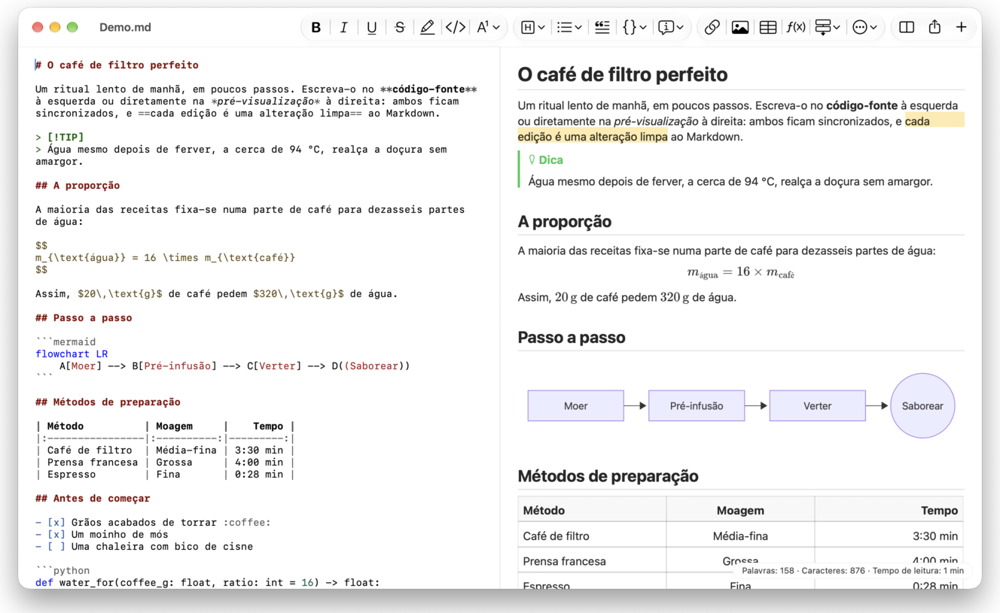
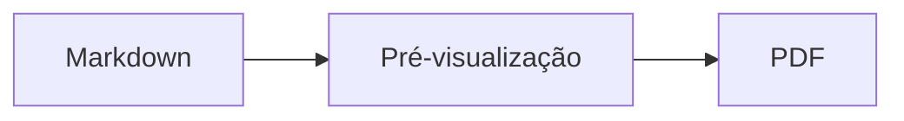

<p>&nbsp;&nbsp;&nbsp;</p>

# Splat

**O editor de Markdown para macOS que lhe permite escrever no código-fonte ou diretamente na pré-visualização.**

O Splat mostra à esquerda o seu código-fonte Markdown com cores de sintaxe e, à direita, uma pré-visualização em direto e totalmente editável. Escreva num dos dois lados: tudo o que escrever na pré-visualização torna-se uma alteração mínima no código-fonte, pelo que as linhas em que não tocou ficam idênticas byte a byte e os seus diffs do Git permanecem limpos. O Splat lê o Markdown que já utiliza: CommonMark e GitHub Flavored Markdown, alertas do GitHub, hiperligações wiki, incorporações e caixas de informação do Obsidian, extensões do Pandoc e do Typora, HTML incorporado, fórmulas LaTeX e diagramas Mermaid, Graphviz e PlantUML, tudo apresentado offline. Exporte para PDF, HTML ou Word com um clique. Está escrito em Rust sobre controlos AppKit genuínos, fala 35 idiomas e não envia nada pela rede, a menos que lho peça.
 


[](https://raw.githubusercontent.com/sventmueller/splat/main/dist/Splat-1.0.5.dmg)

**[Descarregar Splat-1.0.5.dmg](https://raw.githubusercontent.com/sventmueller/splat/main/dist/Splat-1.0.5.dmg)**: assinado e notarizado pela Apple, para macOS 14 ou posterior em Apple Silicon e Intel.
 
 

[](https://www.rust-lang.org)
[](https://www.apple.com/macos/)

[](https://github.com/madsmtm/objc2)
[](https://webkit.org)
[](https://github.com/kivikakk/comrak)
[](https://github.github.com/gfm/)
[](https://www.mathjax.org)
[](https://cortexjs.io/mathlive/)
[](https://mermaid.js.org)
[](https://graphviz.org)
[](https://plantuml.com)


[](#licença)

[Bahasa Indonesia](../id/README.md) ·
[Bahasa Melayu](../ms/README.md) ·
[Català](../ca/README.md) ·
[Čeština](../cs/README.md) ·
[Dansk](../da/README.md) ·
[Deutsch](../de/README.md) ·
[English](../../../README.md) ·
[Español](../es/README.md) ·
[Français](../fr/README.md) ·
[Hrvatski](../hr/README.md) ·
[Italiano](../it/README.md) ·
[Magyar](../hu/README.md) ·
[Nederlands](../nl/README.md) ·
[Norsk](../no/README.md) ·
[Polski](../pl/README.md) ·
[Português (Brasil)](../pt_BR/README.md) ·
**Português (Portugal)** ·
[Română](../ro/README.md) ·
[Slovenčina](../sk/README.md) ·
[Slovenščina](../sl/README.md) ·
[Suomi](../fi/README.md) ·
[Svenska](../sv/README.md) ·
[Tiếng Việt](../vi/README.md) ·
[Türkçe](../tr/README.md) ·
[Ελληνικά](../el/README.md) ·
[Русский](../ru/README.md) ·
[Українська](../uk/README.md) ·
[עברית](../he/README.md)‎ ·
[العربية](../ar/README.md)‎ ·
[हिन्दी](../hi/README.md) ·
[ไทย](../th/README.md) ·
[한국어](../ko/README.md) ·
[日本語](../ja/README.md) ·
[简体中文](../zh-Hans/README.md) ·
[繁體中文](../zh-Hant/README.md)

## Índice

- [Funcionalidades em resumo](#funcionalidades-em-resumo)
- [Requisitos](#requisitos)
- [Instalação](#instalação)
- [Primeiros passos](#primeiros-passos)
- [Escrever](#escrever)
  - [No código-fonte](#no-código-fonte)
  - [Na pré-visualização](#na-pré-visualização)
  - [Comandos de formatação](#comandos-de-formatação)
  - [Listas e tarefas](#listas-e-tarefas)
  - [Tabelas](#tabelas)
- [Markdown suportado](#markdown-suportado)
  - [CommonMark e GitHub Flavored Markdown](#commonmark-e-github-flavored-markdown)
  - [Caixas de informação](#caixas-de-informação)
  - [Sintaxe alargada](#sintaxe-alargada)
  - [Obsidian](#obsidian)
  - [Citações e referências](#citações-e-referências)
  - [HTML incorporado](#html-incorporado)
  - [Pontuação tipográfica](#pontuação-tipográfica)
  - [Resumo da sintaxe](#resumo-da-sintaxe)
- [Fórmulas](#fórmulas)
- [Diagramas](#diagramas)
- [Imagens](#imagens)
- [Hiperligações e navegação](#hiperligações-e-navegação)
- [Exportar, imprimir e partilhar](#exportar-imprimir-e-partilhar)
- [Aparência e acessibilidade](#aparência-e-acessibilidade)
- [Idiomas](#idiomas)
- [Atalhos de teclado](#atalhos-de-teclado)
- [Privacidade e segurança](#privacidade-e-segurança)
- [Documentos grandes](#documentos-grandes)
- [Limitações conhecidas](#limitações-conhecidas)
- [Resolução de problemas](#resolução-de-problemas)
- [Para programadores](#para-programadores)
  - [Compilação](#compilação)
  - [Distribuição](#distribuição)
  - [Testes](#testes)
  - [Estrutura do projeto](#estrutura-do-projeto)
  - [Fluxo de dados](#fluxo-de-dados)
  - [Regras no controlador](#regras-no-controlador)
  - [Acrescentar um comando](#acrescentar-um-comando)
  - [Traduções](#traduções)
  - [Componentes de terceiros](#componentes-de-terceiros)
- [Licença](#licença)

## Funcionalidades em resumo

- **Duas formas de escrever, um só texto.** O código-fonte e a pré-visualização são ambos editáveis. O ficheiro Markdown é a única verdade: existe um só histórico de anulações por documento, e cada edição na pré-visualização é traduzida na menor alteração possível ao código-fonte.
- **O Markdown que já utiliza.** CommonMark, GitHub Flavored Markdown, alertas do GitHub, extensões do Obsidian, do Pandoc e do Typora, códigos curtos de emojis, spoilers, listas de definições, âncoras de títulos e HTML como nos README do GitHub.
- **Fórmulas e diagramas incluídos.** Fórmulas LaTeX através do MathJax, com um editor visual de fórmulas. Diagramas em Mermaid, Graphviz e PlantUML, apresentados no seu Mac sem Java, sem servidor e sem ligação à rede.
- **Um botão para tudo.** Cada elemento de Markdown tem um botão na barra de ferramentas e um item de menu, e os mais comuns também um atalho de teclado. As tabelas têm um menu próprio para linhas, colunas e alinhamento.
- **Exportação sem perdas.** PDF, um único ficheiro HTML autónomo ou um documento Word com títulos, listas, tabelas, notas de rodapé e imagens verdadeiros.
- **Nativo até ao último pormenor.** Janelas, separadores, menus, popovers, Versões, Guardar automaticamente, o menu de partilha, modo escuro, verificação ortográfica, ditado e VoiceOver autênticos do AppKit. Sem Electron, sem vista web para o próprio texto.
- **Rápido com ficheiros grandes.** Uma tecla num documento de 10 MB demora cerca de 25 ms.
- **Privado e cuidadoso.** As imagens da web só são carregadas depois de as permitir, as hiperligações para outras aplicações pedem confirmação, e tudo o que descodifica dados de imagem não fiáveis corre em processos auxiliares isolados numa sandbox.
- **No seu idioma.** A interface e a referência rápida de Markdown integrada existem em 35 idiomas: alemão, árabe, catalão, checo, chinês (simplificado), chinês (tradicional), coreano, croata, dinamarquês, eslovaco, esloveno, espanhol, finlandês, francês, grego, hebraico, hindi, húngaro, indonésio, inglês, italiano, japonês, malaio, neerlandês, norueguês, polaco, português (Brasil), português (Portugal), romeno, russo, sueco, tailandês, turco, ucraniano e vietnamita.

## Requisitos

- macOS 14 Sonoma ou posterior. O Splat é desenvolvido e testado no macOS 27, onde adota automaticamente o design Liquid Glass.
- Um Mac com Apple Silicon ou com processador Intel.
- Cerca de 45 MB de espaço em disco.

## Instalação

**A partir da imagem de disco.** Descarregue [`dist/Splat-1.0.5.dmg`](https://raw.githubusercontent.com/sventmueller/splat/main/dist/Splat-1.0.5.dmg), abra-a e arraste o Splat para a pasta Aplicações. A imagem está assinada com um Developer ID e notarizada pela Apple, pelo que abre sem avisos.

**Com o Homebrew.** O cask encontra-se num tap próprio:

```sh
brew install --cask sventmueller/tap/splat
```

`brew upgrade --cask splat` instala novas versões, e `brew uninstall --zap --cask splat` remove também as definições e as caches do Splat.

**Atualizações.** O Splat instalado a partir da imagem de disco ou do Homebrew mantém-se atualizado através do [Sparkle](https://sparkle-project.org). No segundo arranque, pergunta se pode procurar atualizações por si, uma vez por dia. **Splat › Procurar atualizações…** procura de imediato; **Procurar atualizações automaticamente** e **Descarregar e instalar atualizações automaticamente**, no mesmo menu, alteram mais tarde a sua escolha. O Splat só instala uma atualização se esta tiver a assinatura do programador. Uma compilação própria não tem atualizador.

**A partir do código-fonte.** Consulte [Compilação](#compilação) para os pré-requisitos e depois execute:

```sh
make build
ditto target/release/Splat.app /Applications/Splat.app
open /Applications/Splat.app
```

Para abrir ficheiros Markdown com o Splat através de duplo clique, selecione qualquer ficheiro `.md` no Finder, escolha **Ficheiro › Informações**, selecione o Splat em **Abrir com** e clique em **Alterar todos…**. O Splat regista-se para ficheiros `.md`, `.markdown`, `.mdown` e `.mkd`.

## Primeiros passos

### A janela

Cada documento abre na sua própria janela ou, se preferir separadores, num separador:

- **À esquerda: o código-fonte.** O seu Markdown em SF Mono com cores de sintaxe.
- **À direita: a pré-visualização.** O documento apresentado, pronto a editar.
- **Barra lateral de estrutura (opcional).** Todos os títulos em árvore; um clique num deles mostra-o nos dois painéis. Ative-a com **Visualização › Mostrar estrutura** (⌃⌘S).
- **Barra de ferramentas.** Botões agrupados pelo que alteram: carateres, parágrafos e elementos inseridos, depois pré-visualização ligada/desligada, Partilhar e Novo documento. Personalize-a com **Visualização › Personalizar barra de ferramentas…**.

Arraste o divisor para dar mais espaço a um dos lados. **Visualização › Ocultar pré-visualização** (⌥⌘P) deixa só o código-fonte; o Splat memoriza esta escolha por janela. Os dois painéis deslocam-se em conjunto, e a seleção num painel é realçada no outro.

### Documentos, separadores e versões

O Splat é uma aplicação de documentos macOS normal:

- **Guardar automaticamente e Versões.** As alterações são guardadas no próprio ficheiro. **Ficheiro › Restabelecer › Percorrer todas as versões…** leva-o de volta no tempo.
- **Alterações feitas por outros programas.** Quando o Git, um script ou outro editor altera um documento aberto, o Splat volta a carregá-lo e mantém o cursor e a posição de deslocamento. Se tiver alterações suas por guardar, o Splat conserva-as, e o macOS pergunta antes de guardar por cima da outra versão.
- **Os comandos de ficheiro habituais.** Duplicar (⇧⌘S), Alterar nome…, Mover para… e **Ficheiro › Abrir documento recente**.
- **Separadores.** **Ficheiro › Novo separador** ou o botão **+** na barra de ferramentas abre um novo documento num separador; o menu Janela padrão agrupa, move e percorre os separadores.
- **Posição das janelas.** O tamanho e a posição da sua última janela são memorizados, inclusive após reiniciar. Se já houver uma janela nesse lugar, a nova abre ligeiramente deslocada.
- **O ícone do Dock.** Um clique nele, depois de fechar a última janela, abre um novo documento.
- **Abrir ficheiros Markdown no Splat.** **Splat › Definir como app predefinida para Markdown** faz com que um duplo clique num ficheiro `.md` ou `.markdown` abra o Splat; o macOS pede uma confirmação uma única vez. O item mostra uma marca de seleção enquanto o Splat for a aplicação predefinida.

Os ficheiros têm de ser texto UTF-8 ou UTF-16 com uma marca de ordem de bytes. O Splat recusa outras codificações em vez de adivinhar e corromper o texto. A marca de ordem de bytes mantém-se, o UTF-16 continua UTF-16 e, num ficheiro em que todas as linhas terminam em CRLF, as linhas que acrescentar também recebem CRLF.

**Após uma falha**, perdem-se no máximo os últimos segundos escritos: de cinco em cinco segundos, o Splat copia o texto por guardar para `~/Library/Application Support/Splat/Unsaved` e remove as cópias quando o documento é guardado ou o Splat termina normalmente. No arranque seguinte, o que uma falha deixou ali é movido para `~/Library/Application Support/Splat/Recovery`, e o Splat avisa uma única vez, com um botão que abre a pasta. Uma falha a que o Splat ainda consiga reagir escreve ali também o texto de todos os documentos abertos.

### Referência rápida

**Ajuda › Referência rápida de Markdown** abre uma folha de consulta no seu idioma como um novo documento sem título. É um documento normal, por isso experimente tudo ali mesmo, no código-fonte ou na pré-visualização.

## Escrever

### No código-fonte

O código-fonte é um editor de texto simples afinado para Markdown:

- **Cores de sintaxe** como no VS Code: títulos, ênfase, hiperligações, código, tabelas, HTML, front matter, e LaTeX e Mermaid dentro de fórmulas e diagramas. Existem paletas para claro, escuro e Aumentar contraste.
- **Blocos de código delimitados** têm realce para Bash, C, C++, C#, CSS (também SCSS e Less), Go, HTML, XML, Java, JavaScript, JSON, Kotlin, PHP, Python, Ruby, Rust, SQL, Swift, TypeScript, YAML, TeX e Mermaid, incluindo os nomes abreviados habituais, como `js`, `py` ou `sh`.
- **Sem substituições surpresa.** As aspas curvas, os traços formatados e a substituição de texto vêm desativados, porque estragam `--`, `---` e `"`. Ative-os em **Edição › Substituições**.
- **As ferramentas de escrita do sistema.** Verificação ortográfica e gramatical, ditado, Procurar e substituir (⌥⌘F) e Fala.
- **Arrastar e largar.** Largue um ficheiro de imagem para inserir ``, qualquer outro ficheiro para inserir uma hiperligação para ele e um URL para inserir `[url](url)`. Cada largada é um passo de anulação.
- **Colar imagens.** Uma imagem na área de transferência, como uma captura de ecrã, é guardada como ficheiro PNG junto do documento (`Imagem 2026-10-29 13.09.07.png`) e inserida como imagem. Para isso, o documento tem de estar guardado pelo menos uma vez.

### Na pré-visualização

A pré-visualização comporta-se como um processador de texto, mas tudo o que fizer nela acaba como Markdown:

- **Escrever.** Os carateres com significado em Markdown, como `*` ou `#`, recebem um escape para aparecerem tal como os escreveu.
- **Return** inicia um novo parágrafo ou item de lista. **⌥Return** ou **⌃Return** insere uma quebra de linha.
- **Formatação no cursor.** Com o cursor no fim de uma palavra, Negrito, Itálico e os outros formatos de carateres aplicam-se ao que escrever a seguir. Escolha o formato outra vez para o terminar. Dentro de uma palavra, é formatada a palavra inteira.
- **Linhas vazias.** Return numa linha vazia acrescenta outra linha vazia, e Delete remove-a. No código-fonte, cada linha vazia adicional corresponde a mais duas linhas em branco; outros programas de Markdown mostram-nas como espaçamento normal entre parágrafos.
- **Desfazer** funciona nos dois painéis. Os passos têm nome (“Desfazer Negrito”), o que se escreve conta como um passo por cada sequência contínua, e depois de Desfazer e Refazer os dois painéis deslocam-se até à alteração.
- **Fórmulas e diagramas** aparecem como gráficos acabados. Clique num, mova o cursor para cima dele ou prima Return sobre ele para abrir o respetivo editor (veja [Fórmulas](#fórmulas) e [Diagramas](#diagramas)).
- **HTML incorporado, notas incorporadas e front matter** são apresentados, mas edita-os no código-fonte. Um clique neles coloca ali o cursor no local correspondente.

Tudo o que o Markdown não consegue exprimir fica bloqueado na pré-visualização: os painéis Tipo de letra e Cores, a régua, e colar ou largar texto formatado e imagens. O HTML e o RTF colados chegam como texto simples.

### Comandos de formatação

Todos os comandos estão disponíveis na barra de ferramentas, na barra de menus e no menu de contexto dos dois painéis. Os itens de menu mostram uma marca de seleção para a formatação no cursor.

| Menu | Comandos |
|---|---|
| **Formatação › Tipo de letra** | Negrito, Itálico, Sublinhado, Riscado, Destaque, Código, Expoente, Índice |
| **Formatação › Título** | Corpo de texto, Título 1 a 6 |
| **Formatação › Lista** | Lista com marcas, Lista numerada, Lista de tarefas |
| **Formatação** | Citação, Bloco de código (Sem linguagem ou uma de 20 linguagens; altera também a linguagem de um bloco existente), Caixa de informação (Nota, Dica, Importante, Aviso, Cuidado; o mesmo tipo outra vez remove-a), Editar fórmula ou diagrama…, Limpar formatação |
| **Inserir** | Criar hiperligação…, Imagem…, Tabela…, Fórmula, Diagrama (Fluxograma, Diagrama de sequência, Gráfico de Gantt), Índice, Nota de rodapé, Linha divisória |
| **Tabela** | Inserir linha acima/abaixo, Inserir coluna à esquerda/à direita, Apagar linha, Apagar coluna, Alinhamento (À esquerda, Centrar, À direita, Predefinição), Alinhar colunas da tabela |
| **Visualização** | Ocultar/Mostrar pré-visualização, Mostrar/Ocultar estrutura, Pontuação tipográfica, Ampliar/Reduzir, Tamanho real, barra de ferramentas, barra de separadores, ecrã completo |

Sublinhado, destaque, expoente e índice são escritos como `<ins>`, `<mark>`, `<sup>` e `<sub>`, que o GitHub também apresenta. O Splat lê ainda `<u>`, que o GitHub remove, e as formas mais curtas `==destaque==`, `^exp^` e `~índice~`. O GitHub mostra `==` e `^` tal como escritos e `~índice~` como riscado.

### Listas e tarefas

- Return continua uma lista; Return num item vazio termina-a.
- **Tab** e **⇧Tab** indentam e removem a indentação dos itens de lista na pré-visualização.
- Um clique na caixa de uma tarefa na pré-visualização alterna entre `- [ ]` e `- [x]`.
- **Formatação › Lista** transforma os parágrafos selecionados numa lista ou altera o seu tipo.

### Tabelas

- **Inserir › Tabela…** pergunta o número de linhas (incluindo o cabeçalho) e de colunas.
- Na pré-visualização, **Tab** passa para a célula seguinte, **⇧Tab** para a anterior e **Return** para a célula abaixo. Tab na última célula acrescenta uma linha.
- O menu **Tabela** insere e apaga linhas e colunas e define o alinhamento de uma coluna (⌘{, ⌘|, ⌘}).
- **Tabela › Alinhar colunas da tabela** preenche o código-fonte com espaços para as colunas ficarem alinhadas.

## Markdown suportado

O Splat analisa com o [comrak](https://github.com/kivikakk/comrak), um analisador compatível com CommonMark e GFM, e ativa a maior parte das suas extensões. Tudo o que se segue é apresentado na pré-visualização e em todas as exportações.

### CommonMark e GitHub Flavored Markdown

- Títulos (`#` e sublinhados), parágrafos, quebras de linha, ênfase, ênfase forte, código em linha, citações em bloco, linhas divisórias.
- Listas com marcas, numeradas e aninhadas; listas de tarefas.
- Hiperligações (em linha, de referência e automáticas), imagens, definições de referências de hiperligações.
- Blocos de código delimitados e indentados com cores de sintaxe.
- Tabelas com alinhamento de colunas.
- Riscado com `~~dois til~~`.
- Notas de rodapé: `texto[^1]` com `[^1]: A nota.` em qualquer ponto do documento. Um clique na marca salta para a nota.
- YAML front matter entre linhas `---` no início. A pré-visualização resume-o numa linha, como “Metadados: título, data, etiquetas”.

### Caixas de informação

Os alertas do GitHub são apresentados como caixas coloridas com ícone e título:

```markdown
> [!NOTE]
> Informação útil que os utilizadores devem conhecer.

> [!WARNING]
> Conteúdo crítico que exige atenção imediata.
```

Os cinco tipos são Nota, Dica, Importante, Aviso e Cuidado. **Formatação › Caixa de informação** transforma o parágrafo no cursor numa delas.

As caixas de informação do Obsidian também funcionam, com qualquer título e um estado de dobragem:

```markdown
> [!tip]- Clique em ▸ para expandir
> Oculto até ser aberto.

> [!question]+ Aberta por predefinição
> Um `+` começa expandida, um `-` recolhida.
```

Os outros tipos do Obsidian são mostrados na cor mais próxima das cinco: `success`, `check`, `done` e `hint` como Dica; `question`, `help` e `faq` como Importante; `attention` como Aviso; `failure`, `fail`, `missing`, `danger`, `error` e `bug` como Cuidado; todos os outros como Nota.

### Sintaxe alargada

| Funcionalidade | Sintaxe | Origem |
|---|---|---|
| Destaque | `==texto marcado==` | Obsidian, Typora |
| Expoente | `x^2^` | Pandoc, Typora |
| Índice | `H~2~O` | Pandoc, Typora |
| Código curto de emoji | `:rocket:` torna-se 🚀 | GitHub |
| Spoiler | `\|\|texto oculto\|\|`, selecione para ler | Discord |
| Nota de rodapé em linha | `texto^[a própria nota]` | Pandoc, Obsidian |
| Lista de definições | `Termo`, linha em branco, `: Explicação` | PHP Markdown Extra, Pandoc |
| Âncora de título | `## Instalar {#setup}`, ligue com `[ver](#setup)` | Pandoc, kramdown |

As listas de definições têm este aspeto no código-fonte:

```markdown
Termo

: Explicação do termo.
```

Sem uma âncora própria, cada título recebe uma derivada do seu texto, como no GitHub: `## Primeiros passos` fica acessível como `#primeiros-passos`.

### Obsidian

- **Hiperligações wiki.** `[[Nota]]` liga a `Nota.md` na mesma pasta ou numa pasta abaixo. `[[Nota|Texto apresentado]]` mostra o seu próprio texto, e `[[Nota#Título]]` abre a nota. ⌘-clique abre-a no Splat.
- **Incorporações.** `![[Nota]]` mostra a outra nota dentro desta; as notas incorporadas nela aparecem como hiperligações. `![[diagram.png]]` mostra uma imagem. Tal como no Obsidian, as incorporações indicam notas e imagens na pasta do documento ou abaixo, nunca por um caminho absoluto, e só os ficheiros Markdown aparecem como notas.
- **Comentários.** `%%Só no código-fonte%%` fica visível no código-fonte e é omitido da pré-visualização e de todas as exportações, tanto em linha como em linhas próprias.
- **Etiquetas.** `#ideia` ou `#projeto/splat` é realçada. ⌘-clique procura a etiqueta no documento.
- **Caixas de informação recolhíveis.** Veja [Caixas de informação](#caixas-de-informação).

### Citações e referências

- **Citações do Pandoc.** `[@doe2020]` ou `[@doe2020; @roe2021]` lê-se como “(Doe 2020; Roe 2021)”. As entradas vêm do ficheiro BibTeX que o front matter indica como `bibliography: refs.bib`. Sem essa indicação, o Splat usa `references.bib`, `literatur.bib` ou `bibliography.bib` junto do documento.
- **Referências do GitHub e do GitLab.** Se o documento estiver num repositório Git cujo remoto `origin` se encontre em github.com ou num servidor GitLab, `@nome`, `#12` (issue) e `!7` (merge request, só no GitLab) são realçados. ⌘-clique abre-os no navegador.

### HTML incorporado

O HTML tal como se encontra nos README do GitHub é apresentado, com um leitor próprio e não com um motor de navegador:

- parágrafos e blocos centrados (`<p align="center">`, `<div align="center">`)
- imagens com tamanho (``)
- hiperligações, `<kbd>⌘</kbd>`, `<br>`, `<u>`, `<ins>`, `<mark>`, `<sup>`, `<sub>`
- listas e tabelas, incluindo células que abrangem várias colunas (`colspan`)
- secções recolhíveis: `<details><summary>Mais</summary>…</details>`, abertas com um clique em ▸

O Markdown entre etiquetas HTML é apresentado como Markdown. Scripts, estilos, frames e formulários são totalmente omitidos, e as hiperligações e imagens só mantêm endereços `http`, `https`, `mailto` e relativos.

### Pontuação tipográfica

**Visualização › Pontuação tipográfica** mostra as aspas retas como as aspas do idioma da sua interface, `--` como travessão curto, `---` como travessão longo e `...` como reticências. Em alemão, `"Ja"` torna-se „Ja“, em francês «Oui», em japonês 「はい」, também onde o chinês e o japonês compõem as aspas sem espaço; as abreviaturas hebraicas como `צה"ל` recebem os seus gershayim, צה״ל. O código-fonte mantém os carateres simples; a pré-visualização e todas as exportações mostram os tipográficos. A opção vem desativada até a ligar.

### Resumo da sintaxe

| Elemento | Markdown |
|---|---|
| **Negrito** | `**Negrito**` |
| *Itálico* | `*Itálico*` |
| Sublinhado | `<ins>Sublinhado</ins>` ou `<u>Sublinhado</u>` |
| ~~Riscado~~ | `~~Riscado~~` |
| Destaque | `<mark>Destaque</mark>` ou `==Destaque==` |
| `Código` | `` `Código` `` |
| x² | `x<sup>2</sup>` ou `x^2^` |
| H₂O | `H<sub>2</sub>O` ou `H~2~O` |
| [Hiperligação](https://example.com) | `[Hiperligação](https://example.com)` |
| Título | `# Título` a `###### Título` |
| Citação | `> Citação` |
| Lista com marcas | `- Item` |
| Lista numerada | `1. Item` |
| Tarefa | `- [ ] Por fazer` e `- [x] Feito` |
| Bloco de código | ```` ```rust ```` … ```` ``` ```` |
| Tabela | `\| A \| B \|` com `\|---\|---\|` abaixo do cabeçalho |
| Nota de rodapé | `Texto[^1]` e `[^1]: Nota` |
| Linha divisória | `---` |
| Imagem | `` |
| Fórmula | `$E = mc^2$`, `$$ … $$` |
| Diagrama | ```` ```mermaid ````, ```` ```dot ````, ```` ```plantuml ```` |
| Caixa de informação | `> [!TIP]` |
| Hiperligação wiki | `[[Nota]]`, `[[Nota\|Texto]]` |
| Incorporação | `![[Nota]]`, `![[imagem.png]]` |
| Comentário | `%%Comentário%%` |
| Etiqueta | `#etiqueta` |
| Citação bibliográfica | `[@chave]` |
| Spoiler | `\|\|Spoiler\|\|` |
| Emoji | `:tada:` |

## Fórmulas

As fórmulas são apresentadas pelo [MathJax](https://www.mathjax.org) com o seu TeX e a matemática AMS, como gráficos vetoriais nítidos. O texto em `\text{…}` pode estar em qualquer sistema de escrita: o que falta aos tipos de letra do MathJax vem dos tipos de letra do seu Mac, com o árabe e o hebraico a correr da direita para a esquerda, e os emojis a cores.

| Tipo | Sintaxe |
|---|---|
| Em linha | `$E = mc^2$`, `` $`E = mc^2`$ `` (GitHub, GitLab), `\(E = mc^2\)` |
| Em bloco | `$$` … `$$`, `\[` … `\]`, ou um bloco de código marcado como `math` |

**Editar uma fórmula.** Clique numa fórmula na pré-visualização, faça duplo clique nela, prima Return sobre ela ou mova o cursor para cima dela para abrir o respetivo editor num popover. **Inserir › Fórmula** insere uma nova e abre logo o editor.

- **Visual ou LaTeX.** O seletor no topo alterna entre um editor visual ([MathLive](https://cortexjs.io/mathlive/)) e o código LaTeX. O Splat memoriza a sua escolha.
- **Blocos de construção** para fração, raiz quadrada, expoente e índice, somatório e integral com limites, limite, parênteses que crescem com o conteúdo, matriz 2×2, letras gregas, e relações, operadores e setas. Deixam marcadores □, e **Tab** salta para o seguinte.
- **Pré-visualização em direto.** As alterações aparecem no documento enquanto escreve. Os erros do MathJax surgem numa linha abaixo do código.
- **Confirmar ou descartar.** Clicar fora mantém a alteração como um único passo de anulação; **Esc** ou **Cancelar** descarta-a. Premir Esc numa fórmula nova e vazia remove-a de novo.
- O menu de contexto oferece **Editar fórmula…** para a fórmula sob o ponteiro.

O VoiceOver lê uma fórmula como o seu código LaTeX. O Splat apresenta fórmulas, não documentos LaTeX completos: não há pacotes, nem TikZ, nem `\documentclass`.

## Diagramas

Os diagramas são apresentados dentro do Splat, offline e numa variante clara e outra escura.

| Motor | Bloco de código | O que desenha |
|---|---|---|
| [Mermaid](https://mermaid.js.org) | ```` ```mermaid ```` | fluxogramas, diagramas de sequência, de classes, de estados, entidade-relação e de Gantt, gráficos circulares, mapas mentais, cronologias e todos os outros tipos do Mermaid |
| [Graphviz](https://graphviz.org) | ```` ```dot ```` ou ```` ```graphviz ```` | grafos na linguagem DOT |
| [PlantUML](https://plantuml.com) | ```` ```plantuml ```` ou ```` ```puml ```` | diagramas UML; funciona sem Java |



**Editar um diagrama** funciona como editar uma fórmula: clique nele para abrir o código num popover, com cores de sintaxe e mensagens de erro numa linha abaixo do código. **Inserir › Diagrama** parte de um modelo para um fluxograma, um diagrama de sequência ou um gráfico de Gantt. Os blocos de construção ajudam nos três tipos de Mermaid mais comuns:

- **Fluxograma:** Nó ▾ (retângulo, arredondado, círculo, losango, base de dados), Ligação, Ligação com etiqueta, Grupo, Direção ▾
- **Diagrama de sequência:** Participante, Mensagem, Resposta, Nota, Ciclo, Caminhos alternativos
- **Gráfico de Gantt:** Secção, Tarefa, Marco

Os outros tipos de diagrama são editados como código. O VoiceOver lê o título ou o texto alternativo de um diagrama.

O primeiro diagrama após o arranque demora cerca de um segundo, porque o motor de apresentação arranca em segundo plano. Um diagrama que demore mais de 10 segundos mostra um erro, e o motor de apresentação arranca de novo para o seguinte. O motor do PlantUML (7 MB) só é carregado com o primeiro diagrama PlantUML. Um `!include` do PlantUML a partir da web é bloqueado.

## Imagens

- **Imagens locais** usam caminhos relativos ao documento: ``. O Splat mostra PNG, JPEG, GIF, WebP, BMP, SVG, HEIC, TIFF, AVIF e PDF.
- **Imagens da web** ficam bloqueadas até as permitir: uma barra acima da pré-visualização explica que, ao carregá-las, os respetivos servidores ficam a saber que e quando abre o documento. **Carregar imagens** permite-as neste documento; o Splat memoriza a escolha por ficheiro.
- **Tamanho.** `` define o tamanho de uma imagem; caso contrário, as imagens ajustam-se à largura da pré-visualização.
- **Alterações no disco.** Uma imagem que substitua, ou uma que apareça depois de o documento a indicar, é mostrada sem voltar a abrir o documento. As imagens da web que falharam por causa da rede são tentadas de novo enquanto um documento as mostrar.
- **Memória.** As imagens são mostradas com até 2560 píxeis no lado mais comprido, o que também preenche uma página A4. São descodificadas em tamanho menor quando ocupam um oitavo da memória do Mac e enquanto o macOS indicar pressão de memória.
- **Modo escuro.** As imagens com fundo branco ficam ligeiramente esbatidas na pré-visualização escura.
- **Colar e largar.** Veja [No código-fonte](#no-código-fonte).

## Hiperligações e navegação

Na pré-visualização, um clique coloca o cursor para poder editar o texto da hiperligação; **⌘-clique** segue a hiperligação:

- `http`, `https` e `mailto` abrem no seu navegador ou na aplicação de correio.
- Os ficheiros Markdown abrem no Splat; os outros ficheiros e pastas são revelados no Finder.
- `#âncora` salta para o título no documento.
- Os endereços que abrem outra aplicação, como `slack://` ou `vscode://`, pedem confirmação primeiro e mostram o endereço completo e a aplicação. **Cancelar** vem pré-selecionado.

**Inserir › Índice** insere uma lista com hiperligações para todos os títulos. Com o cursor dentro dela, o mesmo comando atualiza-a. A barra lateral de estrutura (⌃⌘S) salta para qualquer título nos dois painéis.

## Exportar, imprimir e partilhar

| Formato | Como | O que obtém |
|---|---|---|
| **PDF** | **Ficheiro › Exportar como PDF…** ou o menu Partilhar | Páginas do tamanho do papel, sempre na aparência clara, com fórmulas e diagramas como gráficos vetoriais. **Ficheiro › Configurar página…** define o papel. |
| **Imprimir** | **Ficheiro › Imprimir…** (⌘P) | O mesmo esquema do PDF. |
| **HTML** | **Ficheiro › Exportar como HTML…** ou o menu Partilhar | Um único ficheiro autónomo: imagens locais incorporadas, fórmulas e diagramas como imagens nítidas, âncoras de títulos para que o índice funcione. Sem scripts. |
| **Word** | **Ficheiro › Exportar como documento Word…** ou o menu Partilhar | Um `.docx` com os estilos de título do Word, listas e tabelas verdadeiras (incluindo células unidas), notas de rodapé como notas de rodapé do Word, imagens incorporadas, fórmulas e diagramas. |
| **Markdown** | O botão **Partilhar** na barra de ferramentas | O documento como ficheiro `.md` para o Mail, as Mensagens, o AirDrop e todos os outros serviços de partilha. |

O menu **Ficheiro › Partilhar** oferece tudo isto num só lugar. As exportações usam a opção de pontuação tipográfica e as imagens da web que permitiu; no HTML, as imagens da web continuam a ser hiperligações.

## Aparência e acessibilidade

- O **modo escuro** acompanha o sistema. As fórmulas e os diagramas são apresentados para cada aparência.
- **Aumentar contraste** nas Definições do Sistema muda as cores de sintaxe para paletas de alto contraste.
- **Zoom.** ⌘+, ⌘− e ⌘0 redimensionam os dois painéis.
- **Ecrã completo, separadores e uma barra de ferramentas personalizável**, como em qualquer aplicação do Mac.
- **VoiceOver.** Os painéis chamam-se “Código-fonte Markdown” e “Pré-visualização”, as fórmulas são lidas como o seu código e os diagramas como o seu título. Todos os comandos são acessíveis pelo teclado.

O Splat não tem janela de definições: as poucas opções estão onde se aplicam, em **Visualização** e **Edição › Substituições**.

## Idiomas

A interface, os menus e a referência rápida de Markdown estão traduzidos em 35 idiomas:

Alemão, árabe, catalão, checo, chinês (simplificado), chinês (tradicional), coreano, croata, dinamarquês, eslovaco, esloveno, espanhol, finlandês, francês, grego, hebraico, hindi, húngaro, indonésio, inglês, italiano, japonês, malaio, neerlandês, norueguês, polaco, português (Brasil), português (Portugal), romeno, russo, sueco, tailandês, turco, ucraniano e vietnamita.

O Splat segue a ordem de idiomas em **Definições do Sistema › Geral › Idioma e região**; também pode escolher ali um idioma só para o Splat, em **Aplicações**. Sem tradução para o seu idioma, usa o inglês. Os termos dos menus seguem as traduções da própria Apple, para que o Splat se leia como o resto do seu Mac.

O texto em hebraico e em árabe lê-se da direita para a esquerda onde quer que apareça, qualquer que seja o idioma da interface: cada parágrafo, título e item de lista assume a direção da sua primeira letra, as citações e as caixas de informação desenham a barra à direita, e uma tabela cujo texto começa da direita para a esquerda dispõe as colunas a partir da direita. Os blocos de código continuam da esquerda para a direita. As exportações para PDF, HTML e Word mantêm estas direções. Com o hebraico ou o árabe como idioma do sistema, o macOS também espelha a janela, pelo que a pré-visualização fica à esquerda.

## Atalhos de teclado

| Ação | Atalho |
|---|---|
| Negrito, Itálico, Sublinhado | ⌘B, ⌘I, ⌘U |
| Riscado | ⇧⌘X |
| Criar hiperligação… | ⌘K |
| Corpo de texto, Título 1 a 6 | ⌥⌘0, ⌥⌘1 a ⌥⌘6 |
| Alinhar a coluna da tabela à esquerda, ao centro, à direita | ⌘{, ⌘\|, ⌘} |
| Ocultar ou mostrar a pré-visualização | ⌥⌘P |
| Mostrar ou ocultar a estrutura | ⌃⌘S |
| Ampliar, reduzir, tamanho real | ⌘+, ⌘−, ⌘0 |
| Novo documento, abrir, guardar, duplicar | ⌘N, ⌘O, ⌘S, ⇧⌘S |
| Configurar página, imprimir | ⇧⌘P, ⌘P |
| Procurar, procurar e substituir | ⌘F, ⌥⌘F |
| Procurar seguinte, anterior; procurar seleção; ir para seleção | ⌘G, ⇧⌘G; ⌘E; ⌘J |
| Mostrar ortografia e gramática; corrigir documento | ⌘:, ⌘; |
| Colar e manter estilo | ⌥⇧⌘V |
| Ocultar barra de ferramentas, mostrar todos os separadores, ecrã completo | ⌥⌘T, ⇧⌘\\, ⌃⌘F |
| Quebra de linha (pré-visualização) | ⌥Return ou ⌃Return |
| Célula seguinte / célula anterior numa tabela (pré-visualização) | Tab / ⇧Tab |
| Indentar / remover indentação de um item de lista (pré-visualização) | Tab / ⇧Tab |
| Marcador seguinte no editor de fórmulas | Tab |
| Fechar o editor de fórmulas ou de diagramas sem alterações | Esc |
| Seguir uma hiperligação, etiqueta ou referência (pré-visualização) | ⌘-clique |

O Splat deixa os atalhos padrão da Apple onde estão.

## Privacidade e segurança

Um ficheiro Markdown pode vir de qualquer pessoa, por isso o Splat trata cada documento como não fiável.

- **Sem rede por predefinição.** O Splat não tem telemetria. Só procura atualizações depois de o autorizar ou de escolher **Procurar atualizações…**: nesse caso, carrega um pequeno ficheiro de feed do GitHub, e o pedido indica apenas a aplicação e a sua versão. As fórmulas e os diagramas são apresentados localmente; as vistas web que o fazem não conseguem aceder à rede.
- **As imagens da web** só são carregadas com a sua autorização, apenas por `https`, nunca de anfitriões na sua rede local, com no máximo 10 MB cada e numa sessão privada sem cookies.
- **Descodificação isolada.** As imagens e os gráficos de fórmulas e diagramas são descodificados em processos auxiliares que fecham todos os ficheiros herdados e se fecham numa sandbox antes de lerem o primeiro byte: sem acesso a ficheiros nem à rede. Devolvem apenas píxeis, cujo tamanho é verificado, e são parados ao fim de 10 segundos. Os descodificadores de imagem da própria Apple só veem HEIC, TIFF, AVIF e PDF, e só quando os dados são mesmo desse formato; correm num auxiliar próprio, que pode ainda ler as pastas de tipos de letra do sistema e usar o descodificador de vídeo do sistema. Os SVG, as fórmulas e os diagramas também passam por esse auxiliar, pelo que no Splat são imagens com resolução fixa: quatro píxeis por ponto, até 2560 no lado mais comprido.
- **Os ficheiros locais** só chegam a um documento pelo caminho que ele indica. As incorporações mostram notas Markdown da pasta do documento e abaixo, e uma imagem em falta só é procurada aí. Um caminho de imagem noutro local, absoluto ou a começar por `~`, continua a ser carregado, e as exportações HTML e Word incorporam-no: olhe para a exportação de um documento que não escreveu antes de a passar a outros.
- **As cópias de texto por guardar** ficam neste Mac, na sua pasta Biblioteca, para a recuperação após uma falha. Desaparecem quando guarda ou o Splat termina normalmente; as cópias que uma falha deixou ficam na pasta de recuperação até as apagar.
- **As hiperligações** nunca iniciam um programa com um clique. As hiperligações web e de correio abrem como de costume; as que levam a outras aplicações pedem confirmação.
- **O HTML nos documentos** é lido pelo analisador próprio do Splat. Scripts, estilos, frames e formulários nunca são executados.
- **As exportações** não contêm scripts. As páginas HTML só mantêm uma lista fixa de etiquetas e atributos inofensivos, como o GitHub, mais uma política de segurança de conteúdo. Os ficheiros Word só ligam endereços `http`, `https` e `mailto`.
- **Assinatura de código** com o Hardened Runtime. O Splat corre sem a App Sandbox para poder mostrar imagens junto dos seus documentos sem pedir permissão para cada pasta; o isolamento de toda a descodificação compensa isto.

## Documentos grandes

O Splat continua a responder bem com documentos de vários megabytes:

- O código-fonte usa o TextKit 2, que só dispõe a parte visível.
- Enquanto escreve na pré-visualização, e no código-fonte de documentos até 2 MB, só os parágrafos afetados são analisados, coloridos e dispostos de novo: cerca de 25 ms num documento de 10 MB e cerca de 50 ms por tecla na sua pré-visualização, incluindo o trabalho da própria vista.
- As pré-visualizações grandes apresentam primeiro a parte visível e o resto enquanto a aplicação está inativa. Os blocos que entram na área visível são apresentados antes de serem desenhados.
- No código-fonte de documentos maiores, a análise para a pré-visualização corre em segundo plano enquanto escreve.
- Um documento fica em texto simples quando precisaria de cerca de 4 GB de memória, ou seja, cerca de 50 a 120 MB de Markdown comum, mas apenas de 10 a 20 MB se tiver só tabelas ou títulos: o código-fonte não tem cores e a pré-visualização explica porque fica vazia. As exportações continuam a funcionar.
- A partir de cerca de 200 KB, um documento abre a janela antes de ser analisado; aos 5 MB, as cores e a pré-visualização seguem-se cerca de um quarto de segundo depois.

Algumas alterações são processadas por inteiro, a cerca de 300 ms por tecla a 10 MB: as que afetam a definição ou as referências de uma nota de rodapé, junto de uma nota de rodapé em linha, no fim do documento junto de uma nota de rodapé, no front matter ou perto de definições de referências de hiperligações, e todas as alterações num documento com blocos de comentários `%%` ou com uma nota de rodapé definida duas vezes ou dentro de uma citação ou lista. A memória cresce com o ficheiro, para cerca de 115–160 MB por 1 MB de Markdown e 340–510 MB para 10 MB.

## Limitações conhecidas

- **Um único til significa índice.** `~texto~` é índice, como no Pandoc; para riscar é preciso `~~dois~~`. O GitHub também risca com um único til.
- **Só de leitura na pré-visualização:** o HTML incorporado, as notas incorporadas e o front matter editam-se no código-fonte.
- **Aninhamento muito profundo:** o HTML aninhado a mais de 64 níveis, e o HTML em linha a mais de 16, cede o lugar ao seu conteúdo.
- **As células de tabela unidas** existem apenas em tabelas HTML, e só entre colunas (`colspan`, sem `rowspan`). A sintaxe de tabelas do MultiMarkdown para células unidas não é suportada.
- **As bibliografias** são lidas só a partir de BibTeX, não de CSL JSON nem de YAML.
- **As referências** exigem um repositório em github.com ou num servidor GitLab; `!7` existe apenas no GitLab.
- **Pontuação tipográfica:** uma aspa simples de fecho alemã não se distingue de um apóstrofo e é composta como ’.
- **Fórmulas, não documentos:** sem pacotes LaTeX, TikZ nem documentos completos.
- **O editor visual de fórmulas** escreve LaTeX na notação do MathLive: os espaços desaparecem (`E = mc^2` passa a `E=mc^2`), e o resultado apresentado mantém-se igual.
- **Por opção de conceção:** sem números de linha, sem janela de definições, sem Help Book, fora da App Store.
- **Menos testado em Intel.** Os autotestes de janela correm só em Apple Silicon; em Intel, o CI executa `cargo test`.

## Resolução de problemas

**A lista de documentos recentes está vazia depois de eu recompilar o Splat.** O macOS associa os documentos recentes e as permissões de pastas à assinatura de código da aplicação. As compilações locais são assinadas com o certificado “Splat Local Signing” no seu porta-chaves de início de sessão, pelo que as recompilações mantêm ambos. Se o certificado tiver sido apagado, a compilação seguinte cria um novo e as listas recomeçam uma vez.

**A aplicação da imagem de disco mostra outros documentos recentes que a minha própria compilação.** As duas têm assinaturas diferentes, por isso o macOS mantém uma lista e permissões de pastas separadas para cada uma.

**O HTML ou outra sintaxe aparece como código simples.** Pode ter sido uma cópia desatualizada do Splat a abrir o documento. Termine-a, escolha **Ficheiro › Informações** no documento, no Finder, e verifique se **Abrir com** indica o Splat da sua pasta Aplicações.

**Não há «Procurar atualizações…» no menu Splat.** Só a versão da imagem de disco ou do Homebrew se atualiza sozinha; uma compilação própria não tem atualizador.

**As imagens da web não aparecem.** Clique em **Carregar imagens** na barra acima da pré-visualização. Só são carregadas imagens `https` de anfitriões públicos.

**Ao colar uma captura de ecrã, pede-me para guardar primeiro.** As imagens coladas são guardadas como ficheiros junto do documento, o que exige um lugar no disco. Guarde-o e cole de novo.

**“O ficheiro não é texto UTF-8.”** O ficheiro está noutra codificação e não tem uma marca de ordem de bytes que a indique. Converta-o primeiro, por exemplo com `iconv -f ISO-8859-1 -t UTF-8 old.md > new.md`.

**Uma fórmula ou um diagrama mostra um erro.** Clique nele: o editor mostra a mensagem do MathJax, do Mermaid, do Graphviz ou do PlantUML abaixo do código.

## Para programadores

O Splat é uma aplicação Rust que fala diretamente com o AppKit e o WebKit através do [objc2](https://github.com/madsmtm/objc2). Não há Swift, nem Objective-C, nem projeto Xcode, nem ficheiro Interface Builder.

### Compilação

Pré-requisitos:

- macOS com as Command Line Tools (`xcode-select --install`). O Xcode não é necessário; o Splat compila sem `actool`, `ibtool` e `metal`.
- Rust 1.99 (`brew install rust`). [rust-toolchain.toml](../../../rust-toolchain.toml) indica a versão exata que o CI usa; o rustup instala-a sozinho, o Rust do Homebrew ignora o ficheiro. Subir a versão ali é a forma de os novos avisos do compilador e do clippy chegarem ao projeto.
- o rustup, para `make lint`, `make check` e `make universal`: `cargo xtask check-library` compila a biblioteca para Linux para mostrar que não precisa do macOS, e o Rust do Homebrew não tem outros alvos.

O [Makefile](../../../Makefile) reúne pontos de entrada curtos; `make help` lista-os todos:

```sh
make build                  # target/release/Splat.app, o mesmo que cargo xtask bundle --release
make universal              # target/splat-universal para Apple Silicon e Intel, tal como na imagem de disco
make check                  # formatação, clippy sem avisos, todos os testes, bibliotecas incluídas; o que o CI executa
make test                   # make check e depois o autoteste sem janela
make test-gui               # autotestes com janela; ocupam o Mac durante cerca de quatro minutos
make test-long              # pesquisa aleatória mais longa e a verificação da atualização parcial a 10 MB
make coverage               # cobertura de linhas de todos os testes e autotestes, com um mínimo por módulo
make coverage-library       # os mesmos mínimos para os módulos sem janela, como no CI
make bench FILE=<file.md>   # tempos de abertura, escrita e deslocamento num ficheiro grande
make release                # primeiro make test, depois a imagem de disco notarizada
```

A própria lógica de compilação está na crate Rust [xtask](../../../xtask/src/main.rs):

```sh
cargo xtask bundle --release   # target/release/Splat.app, Hardened Runtime, assinado com "Splat Local Signing"
cargo xtask bundle             # target/debug/Splat Debug.app, uma aplicação separada que nunca abre ficheiros Markdown
cargo xtask dmg                # dist/Splat-<version>.dmg para distribuição, Developer ID, notarizado
cargo xtask icon               # reconstrói assets/AppIcon.icns e o ícone do README a partir de assets/icon-1024.png
cargo xtask vendor check       # verifica o JavaScript incluído com vendor.lock
cargo xtask vendor fetch       # descarrega-o de novo depois de alterar uma versão em vendor.lock
```

`bundle` escreve o `Info.plist`, copia os recursos e as localizações e assina a aplicação com o certificado “Splat Local Signing”. A primeira compilação cria esse certificado no seu porta-chaves de início de sessão, válido por 20 anos. Enquanto ele existir, o Splat mantém os documentos recentes e as permissões de pastas entre recompilações; com uma assinatura ad hoc, cada compilação seria uma aplicação nova para o macOS. As compilações de depuração e de autoteste têm IDs de pacote próprios (`local.splat.debug`, `local.splat.selftest`) e não se registam para ficheiros Markdown, pelo que o Finder nunca abre um documento numa compilação desatualizada e elas deixam em paz as definições da aplicação normal.

A versão está em [VERSION](../../../VERSION) como `major.minor.build` e é a que a próxima compilação recebe. Cada compilação de lançamento bem-sucedida (`make build`, `cargo xtask bundle --release`, `make release`) aumenta o número de build em um; as compilações de depuração e de autoteste não lhe tocam. O major e o minor sobem-se à mão: defina VERSION como, por exemplo, `1.1.0`, e a próxima compilação recebe exatamente essa.

### Distribuição

`cargo xtask dmg` (ou `make release`, que executa primeiro `make test`) compila uma versão de lançamento, assina-a com o seu Developer ID, notariza a aplicação junto da Apple e agrafa o ticket, empacota-a numa imagem de disco comprimida e só de leitura com uma ligação para Aplicações, notariza e agrafa também a imagem e verifica o resultado com o Gatekeeper. A aplicação leva o seu próprio ticket para que uma cópia instalada sem o Finder, como o Homebrew faz, também abra offline no primeiro arranque; as duas rondas com o serviço de notarização demoram alguns minutos cada. Só uma imagem que passou todos os passos se torna `dist/Splat-<version>.dmg`, a cópia que vai para o commit: as ligações de descarga neste README e nas suas traduções acompanham-na, e o número de build sobe. A imagem anterior fica por mais uma versão, já que o servidor raw do GitHub pode continuar a entregar o feed de atualização antigo durante alguns minutos após um push; as mais antigas são movidas para o lixo. Uma execução falhada deixa `dist/`, os README e VERSION como estavam. Cada versão acrescenta ao histórico do repositório a imagem completa, com cerca de 16 MB. Só corre quando é chamada, nunca como parte de uma compilação normal, e precisa de:

- um certificado “Developer ID Application” no porta-chaves
- um início de sessão guardado para o serviço de notarização da Apple com uma palavra-passe específica da app, criado uma vez com `xcrun notarytool store-credentials notary --apple-id <Apple ID> --team-id <team ID>`
- a chave privada que assina as atualizações, no porta-chaves de início de sessão. O `generate_keys` do Sparkle criou-a; a sua metade pública é `UPDATE_KEY` em [xtask/src/main.rs](../../../xtask/src/main.rs) e está dentro de cada cópia instalada, que só aceita atualizações assinadas com ela. Guarde uma cópia de segurança num gestor de palavras-passe: `target/sparkle-2.10.1/bin/generate_keys -x <file>` exporta-a, `-f <file>` importa-a noutro Mac. Sem ela, as cópias instaladas nunca mais poderão ser atualizadas.
- o rustup (`brew install rustup`, que deixa o Rust do Homebrew como está)

Se faltar algum destes elementos, `dmg` pára antes de compilar. Na primeira execução, o macOS pergunta se o Terminal pode controlar o Finder; sem essa permissão, a imagem de disco não mostra o fundo nem a disposição dos ícones.

Só a imagem de disco leva o atualizador, o [Sparkle](https://sparkle-project.org), que a compilação descarrega uma vez para `target/` a partir da sua versão no GitHub e verifica com a soma de verificação no xtask. O hardened runtime só carrega a framework quando esta tem o Team ID da aplicação, que a assinatura Developer ID tem e o certificado local não tem; e uma atualização não deve substituir uma compilação própria. A compilação de autoteste também leva o Sparkle, para verificar o menu de atualizações com ele: com um feed que não existe, sem a pergunta do Sparkle no segundo arranque e com um entitlement que permite à aplicação assinada localmente carregar a framework. `dmg` assina a nova imagem com a chave de atualização e escreve `dist/appcast.xml`, o feed que as cópias instaladas leem do GitHub. Faça commit e push em conjunto a imagem, o feed e os README: a partir daí, as cópias instaladas oferecem a atualização.

A imagem de disco é um binário universal para Apple Silicon e Intel; as outras compilações destinam-se apenas ao processador do anfitrião. O Rust do Homebrew inclui a biblioteca padrão apenas para o processador do anfitrião, por isso `dmg` compila através do rustup, que instala na primeira utilização o toolchain e os alvos de [rust-toolchain.toml](../../../rust-toolchain.toml), e pára se o programa ou o Sparkle não tiverem o código para um dos processadores. `make universal` compila apenas o programa. A aplicação nela contida tem uma assinatura diferente da de uma compilação local, pelo que o macOS mantém documentos recentes e permissões de pastas separados para as duas.

### Testes

| Comando | Verifica |
|---|---|
| `cargo test --release` | testes unitários, aleatórios e de traduções |
| `SPLAT_FUZZ_ROUNDS=20000 cargo test --release` | uma pesquisa aleatória mais longa; `SPLAT_FUZZ_SEED` varia as entradas |
| `SPLAT_I18N_ONLY=fr cargo test --release i18n` | um só idioma, enquanto os outros estão incompletos |
| `cargo clippy --release --all-targets [--features selftest]` | lints, incluindo a justificação de cada bloco `unsafe`, o comprimento das funções e, na biblioteca, as conversões de números |
| `cargo xtask check-library` | a biblioteca compila para Linux, pelo que nada nela precisa do macOS |
| `cargo xtask vendor check` | as bibliotecas JavaScript coincidem com `vendor.lock` byte a byte |
| `cargo xtask selftest probe` | sem janela, cada um com o seu resultado esperado: fórmulas, diagramas, imagens da web contra um servidor dentro do processo, endereços bloqueados, o texto que cada comando escreve, cada formato de imagem através das duas exportações, uma página que deixa de responder e as defesas das vistas web contra uma página sem elas. Demora cerca de meio minuto. O que precisa da aplicação à frente do ecrã é ignorado com o ecrã bloqueado |
| `cargo xtask selftest gui [--stop-after "<check>"] [--scenarios]` | a aplicação em execução, clique a clique. Abre uma janela e escreve nela; o Mac fica ocupado durante cerca de quatro minutos. `--scenarios` executa só a segunda parte, em cerca de um minuto e meio |
| `cargo xtask selftest resize` | alarga a janela depois de mover o divisor: o código-fonte volta a quebrar as linhas enquanto a janela é redimensionada. Demora cerca de dez segundos |
| `cargo xtask selftest bench <file.md>` | tempos de abertura, escrita e deslocamento num ficheiro grande |
| `cargo test --release -- --ignored partial_updates` | uma tecla em 10 MB: atualização parcial contra completa, o mesmo resultado em, no máximo, um quarto do tempo |
| `cargo test --release --test hostile` | documentos construídos para rebentar a pilha ou levar tempo quadrático, cada um em dois tamanhos cujos tempos têm de crescer como o texto, através da análise, da disposição, das duas exportações, das teclas e dos comandos |
| `make mutants` | falhas introduzidas uma a uma em `src/markdown/` e `src/preview/`, através do [cargo-mutants](https://mutants.rs) (`cargo install cargo-mutants`); diz quais nenhum teste nota. Demora horas; `FILE=src/preview/bridge.rs` restringe |
| `cargo test --release --test decoder` | o processo descodificador descodifica imagens e não chega a ficheiros nem à rede |
| `make coverage` | cobertura de linhas de `cargo test` e de todos os autotestes, através do [cargo-llvm-cov](https://github.com/taiki-e/cargo-llvm-cov) (`brew install cargo-llvm-cov llvm`); falha abaixo dos mínimos. Ocupa o Mac durante cerca de cinco minutos |
| `make coverage-library` | `src/markdown/`, `src/preview/` e `i18n.rs` contra os seus mínimos mais altos, medidos apenas por `cargo test` |

Os testes unitários ficam junto do código que testam. `tests/` contém o que chega à biblioteca a partir do exterior: os testes aleatórios em `robustness.rs`, que partilham o gerador em `src/fuzz.rs` com os de `sync.rs`, os documentos construídos para magoar em `hostile.rs` e o teste do descodificador, que inicia o programa compilado. As decisões em `src/editor/` que não precisam de janela vivem em funções livres com testes próprios: tudo o que o controlador sabe e como isso muda em `state.rs`, as regras de apresentação em `render_queue.rs`, a cópia de texto em `sync.rs`, os estilos de parágrafo, os tipos de letra e as cores como valores em `render.rs`, o que os identificadores da barra de ferramentas significam em `toolbar.rs`, o que um clique numa hiperligação significa em `navigation.rs`.

Um passo do autoteste de janela espera por uma condição com nome, não por um tempo; só o que não dá sinal, como a ausência de algo, mantém uma pausa com o seu motivo. Esperar em vão é uma verificação falhada que nomeia o que nunca chegou, um passo que entra em pânico também é uma verificação falhada, e a execução continua nos dois casos. Uma verificação que nada pode dizer nesta execução comunica `SELFTEST SKIP`: o xtask lista-a, e ela nem passa nem falha. O xtask prende cada modo, e `--scenarios` por si, a cerca de nove décimos das suas verificações. O autoteste de janela executa uma segunda parte depois do seu percurso principal de cliques, em `src/editor/selftest/scenarios.rs`: todos os comandos de formatação e de tabelas, as caixas de diálogo, cliques em hiperligações, colar, largar, exportações, uma alteração grande, imagens a mudar no disco, pressão de memória, um documento enorme e a recuperação após uma falha.

A cobertura tem dois mínimos: cada módulo com pelo menos 84 % das suas linhas e todos os módulos em conjunto com pelo menos 96 %. `make coverage` mede `cargo test` em conjunto com os autotestes e falha abaixo de qualquer um deles; `make coverage-library` mantém o que não precisa de janela em 90 % e 97 %. Os mínimos e as poucas exceções, como o panic hook em `main.rs` que só corre numa falha, estão em [xtask](../../../xtask/src/coverage.rs) ao lado das suas razões. As compilações medidas vão para `target/coverage/`, por isso medir o código nunca chega a `target/release/` nem a uma imagem de disco. O auxiliar descodificador abre o seu ficheiro de medição antes de se fechar numa sandbox, pelo que também é medido.

O CI ([.github/workflows/ci.yml](../../../.github/workflows/ci.yml)) executa `make check`, `make coverage-library` e a compilação universal em Apple Silicon e `cargo test` em Intel a cada push para `main` e a cada pull request. Todas as noites, [.github/workflows/nightly.yml](../../../.github/workflows/nightly.yml) executa `make test-long` com novas entradas aleatórias. Os autotestes e a imagem de disco ficam no Mac do programador: precisam de um ecrã e dos certificados de assinatura no porta-chaves.

A saída dos autotestes vai para `target/selftest/`. O autoteste compila uma aplicação separada (`target/release/Splat Selftest.app`, ID de pacote `local.splat.selftest`) e deixa intactas as definições, os documentos recentes e as associações de ficheiros da aplicação normal.

### Estrutura do projeto

`src/lib.rs` faz de tudo o que não precisa de janela uma biblioteca própria, `splat`: `markdown/`, `preview/`, `i18n.rs` e o gerador de testes `fuzz.rs`. Compila sem o macOS. A aplicação em `src/main.rs` assenta nela.

- `src/markdown/`: a árvore que todos os consumidores leem, `Doc` em `doc/`, que é dona do seu texto, e a única ligação ao analisador em `reader/`: o comrak não é nomeado em mais lado nenhum, e `reader/assumptions.rs` reúne o que o código pressupõe sobre ele. As cores de sintaxe e todos os comandos como edições de texto puras (`Edit`) em `commands/`. Também a nova análise após uma edição (`incremental.rs`), o leitor do HTML incorporado (`markup.rs`), a tipografia, as etiquetas, as referências e as citações no texto corrido (`typography.rs`), o aspeto do texto e que Markdown e HTML o produzem (`style.rs`), o que um endereço pode ser (`url.rs`) e a exportação para HTML e Word (`html.rs`, `docx.rs` com `docx/html.rs` e `docx/xml.rs`). Uma posição tem o seu tipo: `Byte` no texto-fonte, `U16` na vista do código-fonte, `Shown` na vista da pré-visualização (`text.rs`). Sem AppKit.
- `src/preview/`: a disposição da pré-visualização em `layout/`, com o HTML incorporado em `layout/html.rs`, e a correspondência entre a pré-visualização e o código-fonte (`Bridge`, `Index`). Um `Bridge` recusa a disposição de outra versão do `Doc`. Sem AppKit.
- `src/editor/`: a janela. Um único objeto `EditorController` serve o AppKit como delegado das duas vistas e reencaminha para componentes, pequenas structs sobre o controlador e o estado que possuem, cujos campos os outros módulos não alcançam:

| Módulo | Responsabilidade |
|---|---|
| `mod.rs` | classe, métodos de delegado que reencaminham, `invalidate` |
| `panes.rs` | `Panes`: as vistas de texto, a estrutura, mostrar e ocultar os painéis, e o que dá acesso às vistas |
| `state.rs` | o que o controlador sabe sobre o documento e todas as formas de isso mudar; os seus campos são privados e não toca em nenhuma vista |
| `model.rs` | empresta o estado e a cópia de texto a closures que não alcançam uma vista |
| `actions.rs` | registo de comandos: seletor, título, atalho, símbolo, quando o comando se aplica |
| `editing.rs` | `Editing`: execução e validação de comandos, escrita na pré-visualização |
| `update.rs` | `Updater`: análise, colorização, atualização da pré-visualização; após uma edição, só os parágrafos afetados |
| `sync.rs` | cópia de texto e contabilidade de blocos, sem AppKit e com testes aleatórios |
| `progressive.rs` | `Progressive`: apresentação de pré-visualizações grandes passo a passo |
| `selection.rs`, `scroll.rs` | `Selection`, `ScrollSync`: seleção e posição de deslocamento dos dois painéis em sincronia |
| `atom.rs`, `atom/edit.rs` | `AtomEditor`: o editor de fórmulas e diagramas |
| `navigation.rs`, `links.rs` | `Links`: hiperligações, hiperligações wiki, etiquetas, caixas de tarefas, dobragem, notas de rodapé |
| `env.rs` | o que a pré-visualização lê de fora do texto: pontuação tipográfica, o repositório para `@name` e `#12`, o ficheiro BibTeX, notas incorporadas |
| `render.rs`, `images.rs`, `remote.rs`, `safe_image.rs` | texto da pré-visualização, imagens locais e remotas; `Pictures` em `images.rs` |
| `attributes.rs` | atributos de texto; cada chave só recebe um valor do tipo que espera |
| `shadow.rs` | cópias de texto por guardar para a recuperação após uma falha |
| `decoder.rs` | processos auxiliares isolados numa sandbox que descodificam imagens e gráficos |
| `export.rs`, `outline.rs` | `Sharing`: exportação para HTML e Word, o ficheiro de partilha, a impressão; a barra lateral de estrutura |
| `js.rs`, `mathfield.rs`, `render_queue.rs` | WebKit para MathJax, Mermaid, Graphviz, PlantUML e o editor visual de fórmulas; as regras sobre o que é apresentado quando, à parte do WebKit |
| `webkit.rs` | chamadas ao WebKit; só o tempo de vida do delegado de navegação fica com `js.rs` e `mathfield.rs` |
| `window.rs`, `toolbar.rs`, `views.rs`, `dialogs.rs`, `style.rs` | construção da janela, barra de ferramentas, vistas de texto, caixas de diálogo, cores |

- `src/menu.rs`, `src/app.rs`, `src/document.rs`: barra de menus, delegado da aplicação, documento (`MDDocument`, uma subclasse de `NSDocument`).
- `src/i18n.rs` com `resources/*.lproj`: 35 idiomas; as chaves são os textos alemães, e a aplicação instala a tabela do idioma da interface no arranque.
- `src/util/`: threads de trabalho (`lanes.rs`), volumes que podem deixar de responder (`volumes.rs`), auxiliares do AppKit, ficheiros e processos. `src/diag.rs`: o que corre mal fora da vista do utilizador vai para o registo do sistema, sem qualquer texto de um documento.
- `src/large_alloc.rs`: as alocações grandes vêm diretamente do kernel e voltam a ele quando libertadas, para que a memória seja devolvida após grandes edições.
- `resources/js/`: páginas web e bibliotecas; versões e somas de verificação em [vendor.lock](../../../vendor.lock).
- `xtask/`: empacotamento, assinatura, a imagem de disco, o ícone, a inclusão de bibliotecas, o executor de autotestes e os mínimos de cobertura.

### Fluxo de dados

O texto-fonte na vista de texto da esquerda é a única fonte de verdade.

1. Cada alteração de um carácter ali atualiza no próprio local a cópia do texto (`Snapshot`), sem voltar a ler o texto.
2. Uma atualização analisa a cópia, volta a colorir o código-fonte apenas onde as cores mudaram, dispõe a pré-visualização e substitui só os blocos cujo conteúdo mudou.
3. Após uma edição, só os parágrafos afetados são analisados, coloridos e dispostos de novo, desde que os vizinhos se mantenham iguais; `reparse_part_and_color` indica quando não se mantêm. Os documentos com blocos de comentários `%%`, as alterações ao front matter e, num documento com definições de referências de hiperligações, as alterações a uma parte que contém um parêntese reto são processados por inteiro. O comrak só reconhece uma referência de nota de rodapé com a sua definição na mesma análise e move as definições para trás do texto, por isso a parte é analisada com uma definição provisória por etiqueta e retira os seus números da árvore antiga; uma alteração às referências ou às definições na parte, ou junto de uma nota de rodapé em linha, é processada por inteiro.
4. Os blocos HTML que abrem `<details>` ou `<div align>` e o fecham mais tarde afetam os blocos Markdown entre os dois; um bloco reutilizado tem de ter a mesma envolvente.
5. Enquanto escreve no código-fonte de um documento até 2 MB, a atualização parcial corre de imediato; quando não se aplica, ou num documento maior, a análise e a disposição correm em segundo plano. Enquanto escreve na pré-visualização, correm de imediato, porque o cursor da pré-visualização depende do resultado.
6. A entrada na pré-visualização é traduzida pelo `Bridge` numa edição do código-fonte e segue daí o mesmo caminho. O Markdown tem demasiadas formas de transformar texto em sintaxe para bastarem regras, por isso `preview/verify.rs` volta a analisar a parte alterada e compara o que ela mostra com o que foi escrito; uma edição que não se sustenta recebe mais escapes ou é recusada.
7. As posições em linha do comrak falham em alguns casos, por exemplo atrás de uma definição de referência de hiperligação. `markdown/reader/positions.rs` verifica-as no código-fonte ao ler um bloco e volta a lê-las do código-fonte onde não coincidem.

### Regras no controlador

1. As alterações do próprio controlador às vistas correm dentro de `Panes::silently`; as chamadas de retorno do delegado ignoram-nas. Em todos os outros sítios as vistas só podem ser lidas, pelo que o compilador verifica isso. O que as chamadas de retorno devem ouvir, ou o que entrega uma vista ao AppKit, di-lo passando por `Panes::for_appkit`.
2. O estado só é emprestado para ler e calcular, nunca durante uma chamada que altere, disponha ou desloque uma vista: `Model` empresta-o a closures `Send`, e nenhuma vista é `Send`, pelo que o compilador verifica isso. Só muda através dos seus próprios métodos, cujos testes não precisam de janela.
3. As mensagens do exterior (uma imagem carregada, uma fórmula apresentada) chegam com atraso através de `renders_arrived` e `image_arrived`, nunca a meio de uma atualização.
4. Voltar a desenhar sem alteração de texto passa apenas por `invalidate(reason)`.
5. A cópia de texto não é mantida durante uma alteração do código-fonte, ou essa alteração copia o texto inteiro: `with_text` empresta-a apenas durante uma closure `Send`.
6. Um novo comando precisa de uma entrada em `actions.rs`, de um método em `mod.rs` e de um ramo em `Editing::perform`.
7. Cada bloco `unsafe` leva a sua justificação num comentário `// SAFETY:`. Os bytes chegam aos descodificadores de imagem do sistema apenas no processo auxiliar, através de `decoder::decode_native`; um teste procura nas fontes outras chamadas.
8. Nada na thread principal espera pelas pastas do utilizador, já que um volume de rede pode deixar de responder: os ficheiros são consultados na thread `DISK`, e a pré-visualização lê as respostas através de `Env::known`. Só uma ação por que o utilizador espera, como uma exportação ou guardar, pode tocar diretamente no disco.

### Acrescentar um comando

A barra de menus, a barra de ferramentas e o menu de contexto constroem os seus itens a partir do registo em [src/editor/actions.rs](../../../src/editor/actions.rs), e a validação de menus lê ali quando um comando se aplica e se mostra uma marca de seleção. Um novo comando precisa de:

1. uma variante de `Action` com o seu `Spec`: seletor, título, etiqueta da barra de ferramentas, dica (começa com um verbo, no máximo 75 carateres), atalho, símbolo SF e quando se aplica
2. o método em `src/editor/mod.rs`
3. um ramo em `Editing::perform`
4. os seus textos em cada `Localizable.strings`

O teste `every_command_has_a_method_and_every_method_a_command` verifica que o registo e os métodos coincidem. Os atalhos padrão da Apple, como ⌘E, ⌘J, ⌘T, ⌘;, ⇧⌘C, ⌥⌘C, ⌥⌘V, ⇧⌘P, ⌥⌘T, ⌃⌘F e ⌘, ficam intactos.

### Traduções

O código usa o texto alemão como chave: `t("Fett")` procura-o em tempo de execução, `n("Fett")` marca uma constante para consulta posterior. Cada `resources/<language>.lproj/` contém:

- `Localizable.strings`: todos os textos da interface, termos de menu segundo os glossários da própria Apple
- `InfoPlist.strings`: os nomes que o macOS mostra para a aplicação e o seu tipo de documento
- `QuickReference.md`: a referência rápida de Markdown

`cargo xtask bundle` lista cada pasta `.lproj` como uma localização, e `CFBundleDevelopmentRegion` é o inglês, pelo que os menus do sistema e a caixa de diálogo de guardar seguem o mesmo idioma. O teste i18n verifica que cada idioma tem todos os textos e que cada referência rápida tem a estrutura da alemã.

`assets/readme/<language>/` contém este README nesse idioma, a sua captura de ecrã e o documento de demonstração que a captura mostra. Uma alteração a este README também pertence a essas cópias.

### Componentes de terceiros

| Componente | Versão | Utilização | Licença |
|---|---|---|---|
| [comrak](https://github.com/kivikakk/comrak) | 0.59 | analisador de Markdown | BSD-2-Clause |
| [objc2](https://github.com/madsmtm/objc2), objc2-foundation, block2 | 0.6 / 0.3 | runtime de Objective-C, Foundation, blocos | MIT |
| objc2-app-kit, objc2-web-kit, dispatch2 | 0.3 | ligações ao AppKit, ao WebKit e ao Grand Central Dispatch | Zlib, Apache-2.0 ou MIT |
| [svg2pdf](https://github.com/typst/svg2pdf) | 0.13 | fórmulas e imagens SVG como PDF vetorial | MIT ou Apache-2.0 |
| [image](https://github.com/image-rs/image) | 0.25 | descodificação de PNG, JPEG, GIF, WebP e BMP | MIT ou Apache-2.0 |
| [unicode-width](https://github.com/unicode-rs/unicode-width) | 0.2 | alinhamento de colunas de tabelas | MIT ou Apache-2.0 |
| [entities](https://github.com/p-jackson/entities) | 1 | os nomes das referências de carateres HTML | MIT |
| [MathJax](https://www.mathjax.org) | 3.2.2 | apresentação de fórmulas | Apache-2.0 |
| [MathLive](https://cortexjs.io/mathlive/) | 0.111.1 | editor visual de fórmulas, com tipos de letra KaTeX | MIT |
| [Mermaid](https://mermaid.js.org) | 12.2.0 | diagramas Mermaid | MIT |
| [Viz.js](https://github.com/mdaines/viz-js) | 3.24.0 | Graphviz compilado para WebAssembly, contém Graphviz (EPL-1.0) e Expat (MIT) | MIT |
| [PlantUML](https://github.com/plantuml/plantuml) (`@plantuml/core`) | 1.2026.6 | diagramas PlantUML, compilados para JavaScript | MIT |
| [Sparkle](https://sparkle-project.org) | 2.10.1 | atualizações da versão da imagem de disco | MIT, com partes sob licenças BSD e zlib |

As bibliotecas JavaScript estão guardadas em `resources/js/` exatamente como foram publicadas; [vendor.lock](../../../vendor.lock) regista as suas origens e somas de verificação SHA-256. Os textos das suas licenças, incluindo os do Graphviz e do Expat dentro do Viz.js, estão ao lado delas como `resources/js/LICENSE-*` e seguem dentro da aplicação. O Sparkle não está guardado no repositório: `cargo xtask dmg` descarrega a sua versão e verifica-a com a soma de verificação no xtask, e a sua licença segue dentro da aplicação como `LICENSE-sparkle`.

## Licença

O Splat está licenciado ao abrigo de uma das seguintes licenças

- Licença Apache, Versão 2.0 ([LICENSE-APACHE](../../../LICENSE-APACHE))
- Licença MIT ([LICENSE-MIT](../../../LICENSE-MIT))

à sua escolha.

Salvo indicação explícita em contrário, qualquer contribuição intencionalmente submetida por si para inclusão no Splat, tal como definida na licença Apache-2.0, será licenciada em licença dupla como acima, sem quaisquer termos ou condições adicionais.
