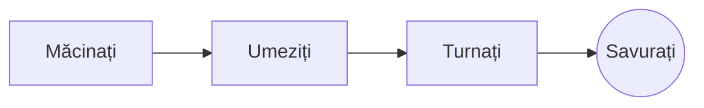

# Cafeaua perfectă la filtru

Un ritual lent de dimineață, în câțiva pași. Scrieți-l în **sursa** din stânga sau direct în *previzualizarea* din dreapta: cele două rămân sincronizate, iar ==fiecare modificare este una curată== în Markdown.

> [!TIP]
> Apa abia scoasă de pe foc, la circa 94 °C, scoate în evidență dulceața fără amăreală.

## Raportul

Majoritatea rețetelor se opresc la o parte de cafea la șaisprezece părți de apă:

$$
m_{\text{apă}} = 16 \times m_{\text{cafea}}
$$

Așadar, $20\,\text{g}$ de cafea cer $320\,\text{g}$ de apă.

## Pas cu pas



## Metode de preparare

| Metodă       | Măcinare   | Timp |
|:-------------|:----------:|-----:|
| Filtru       | Medie-fină | 3:30 |
| French press | Grosieră   | 4:00 |
| Espresso     | Fină       | 0:28 |

## Înainte de a începe

- [x] Boabe proaspăt prăjite :coffee:
- [x] O râșniță cu discuri
- [ ] Un fierbător cu gât de lebădă

```python
def water_for(coffee_g: float, ratio: int = 16) -> float:
    return coffee_g * ratio
```

Înflorire
: Prima stropire cu apă, care lasă zațul să-și elibereze gazele.[^1]

[^1]: Boabele proaspete înfloresc cel mai tare; cele vechi abia se umflă.
