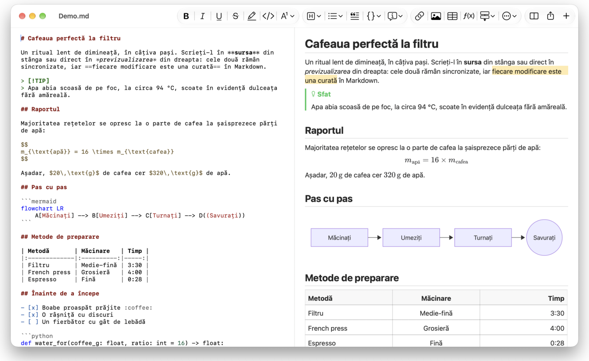
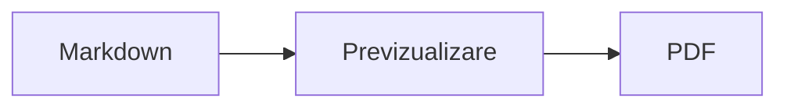

<p>&nbsp;&nbsp;&nbsp;</p>

# Splat

**Editorul Markdown pentru macOS în care scrieți în sursă sau direct în previzualizare.**

Splat afișează în stânga sursa Markdown, cu culori de sintaxă, iar în dreapta o previzualizare în direct, complet editabilă. Puteți scrie în oricare dintre ele: tot ce scrieți în previzualizare devine o modificare minimă a sursei, astfel că rândurile pe care nu le-ați atins rămân identice octet cu octet, iar diferențele din Git rămân curate. Splat citește Markdownul pe care îl folosiți deja: CommonMark și GitHub Flavored Markdown, alertele GitHub, linkurile wiki, încorporările și casetele informative din Obsidian, extensiile Pandoc și Typora, HTML încorporat, formule LaTeX și diagrame Mermaid, Graphviz și PlantUML, toate randate offline. Exportați în PDF, HTML sau Word dintr-un singur clic. Este scris în Rust, pe controale AppKit autentice, vorbește 35 de limbi și nu trimite nimic prin rețea decât dacă îi cereți.
 


[](https://raw.githubusercontent.com/sventmueller/splat/main/dist/Splat-1.0.6.dmg)

**[Descărcați Splat-1.0.6.dmg](https://raw.githubusercontent.com/sventmueller/splat/main/dist/Splat-1.0.6.dmg)**: semnat și notarizat de Apple, pentru macOS 14 sau mai nou, pe Apple Silicon și Intel.
 
 

[](https://www.rust-lang.org)
[](https://www.apple.com/macos/)

[](https://github.com/madsmtm/objc2)
[](https://webkit.org)
[](https://github.com/kivikakk/comrak)
[](https://github.github.com/gfm/)
[](https://www.mathjax.org)
[](https://cortexjs.io/mathlive/)
[](https://mermaid.js.org)
[](https://graphviz.org)
[](https://plantuml.com)


[](#licență)

[Bahasa Indonesia](../id/README.md) ·
[Bahasa Melayu](../ms/README.md) ·
[Català](../ca/README.md) ·
[Čeština](../cs/README.md) ·
[Dansk](../da/README.md) ·
[Deutsch](../de/README.md) ·
[English](../../../README.md) ·
[Español](../es/README.md) ·
[Français](../fr/README.md) ·
[Hrvatski](../hr/README.md) ·
[Italiano](../it/README.md) ·
[Magyar](../hu/README.md) ·
[Nederlands](../nl/README.md) ·
[Norsk](../no/README.md) ·
[Polski](../pl/README.md) ·
[Português (Brasil)](../pt_BR/README.md) ·
[Português (Portugal)](../pt_PT/README.md) ·
**Română** ·
[Slovenčina](../sk/README.md) ·
[Slovenščina](../sl/README.md) ·
[Suomi](../fi/README.md) ·
[Svenska](../sv/README.md) ·
[Tiếng Việt](../vi/README.md) ·
[Türkçe](../tr/README.md) ·
[Ελληνικά](../el/README.md) ·
[Русский](../ru/README.md) ·
[Українська](../uk/README.md) ·
[עברית](../he/README.md)‎ ·
[العربية](../ar/README.md)‎ ·
[हिन्दी](../hi/README.md) ·
[ไทย](../th/README.md) ·
[한국어](../ko/README.md) ·
[日本語](../ja/README.md) ·
[简体中文](../zh-Hans/README.md) ·
[繁體中文](../zh-Hant/README.md)

## Cuprins

- [Pe scurt](#pe-scurt)
- [Cerințe](#cerințe)
- [Instalare](#instalare)
- [Primii pași](#primii-pași)
- [Scrierea](#scrierea)
  - [În sursă](#în-sursă)
  - [În previzualizare](#în-previzualizare)
  - [Comenzi de formatare](#comenzi-de-formatare)
  - [Liste și sarcini](#liste-și-sarcini)
  - [Tabele](#tabele)
- [Markdown acceptat](#markdown-acceptat)
  - [CommonMark și GitHub Flavored Markdown](#commonmark-și-github-flavored-markdown)
  - [Casete informative](#casete-informative)
  - [Sintaxă extinsă](#sintaxă-extinsă)
  - [Obsidian](#obsidian)
  - [Citări și referințe](#citări-și-referințe)
  - [HTML încorporat](#html-încorporat)
  - [Punctuație tipografică](#punctuație-tipografică)
  - [Prezentare generală a sintaxei](#prezentare-generală-a-sintaxei)
- [Formule](#formule)
- [Diagrame](#diagrame)
- [Imagini](#imagini)
- [Linkuri și navigare](#linkuri-și-navigare)
- [Exportul, tipărirea și partajarea](#exportul-tipărirea-și-partajarea)
- [Aspect și accesibilitate](#aspect-și-accesibilitate)
- [Limbi](#limbi)
- [Scurtături de tastatură](#scurtături-de-tastatură)
- [Confidențialitate și securitate](#confidențialitate-și-securitate)
- [Documente mari](#documente-mari)
- [Limitări cunoscute](#limitări-cunoscute)
- [Depanare](#depanare)
- [Pentru dezvoltatori](#pentru-dezvoltatori)
  - [Compilare](#compilare)
  - [Distribuție](#distribuție)
  - [Testare](#testare)
  - [Structura proiectului](#structura-proiectului)
  - [Fluxul datelor](#fluxul-datelor)
  - [Reguli în controller](#reguli-în-controller)
  - [Adăugarea unei comenzi](#adăugarea-unei-comenzi)
  - [Traduceri](#traduceri)
  - [Componente terțe](#componente-terțe)
- [Licență](#licență)

## Pe scurt

- **Două moduri de a scrie, un singur text.** Sursa și previzualizarea sunt amândouă editabile. Fișierul Markdown este singurul adevăr: există un singur istoric de infirmări pentru fiecare document, iar fiecare modificare din previzualizare este tradusă în cea mai mică modificare posibilă a sursei.
- **Markdownul pe care îl folosiți deja.** CommonMark, GitHub Flavored Markdown, alertele GitHub, extensiile Obsidian, Pandoc și Typora, coduri scurte pentru emoji, spoilere, liste de definiții, ancore pentru titluri și HTML ca în fișierele README de pe GitHub.
- **Formule și diagrame integrate.** Formule LaTeX prin MathJax, cu un editor vizual de formule. Diagrame Mermaid, Graphviz și PlantUML, randate pe Mac-ul dumneavoastră, fără Java, fără server și fără conexiune la rețea.
- **Un buton pentru orice.** Fiecare construcție Markdown are un buton în bara de instrumente și un element de meniu, iar cele uzuale au și o scurtătură de tastatură. Tabelele au propriul meniu pentru rânduri, coloane și aliniere.
- **Export fără pierderi.** PDF, un singur fișier HTML autonom sau un document Word cu titluri, liste, tabele, note de subsol și imagini reale.
- **Nativ până în măduva oaselor.** Ferestre, file, meniuri, popovere, Versiuni, Salvare automată, meniul de partajare, modul întunecat, verificarea ortografică, dictarea și VoiceOver autentice AppKit. Fără Electron, fără vizualizare web pentru textul propriu-zis.
- **Rapid cu fișiere mari.** Randarea unei apăsări de tastă într-un document de 10 MB durează circa 10 ms, înainte de munca proprie a vizualizării.
- **Privat și atent.** Imaginile de pe web se încarcă doar după ce permiteți, linkurile către alte aplicații cer mai întâi confirmare, iar tot ce decodează date de imagine nesigure rulează în procese ajutătoare izolate într-un sandbox.
- **În limba dumneavoastră.** Interfața și referința rapidă Markdown integrată există în 35 de limbi: arabă, catalană, chineză (simplificată), chineză (tradițională), croată, cehă, daneză, olandeză, engleză, finlandeză, franceză, germană, greacă, ebraică, hindi, maghiară, indoneziană, italiană, japoneză, coreeană, malaeză, norvegiană, poloneză, portugheză (Brazilia), portugheză (Portugalia), română, rusă, slovacă, slovenă, spaniolă, suedeză, thailandeză, turcă, ucraineană și vietnameză.

## Cerințe

- macOS 14 Sonoma sau mai nou. Splat este dezvoltat și testat pe macOS 27, unde preia automat designul Liquid Glass.
- Un Mac cu Apple Silicon sau cu procesor Intel.
- Circa 45 MB de spațiu pe disc.

## Instalare

**Din imaginea de disc.** Descărcați [`dist/Splat-1.0.6.dmg`](https://raw.githubusercontent.com/sventmueller/splat/main/dist/Splat-1.0.6.dmg), deschideți-o și trageți Splat în dosarul Aplicații. Imaginea este semnată cu un Developer ID și notarizată de Apple, deci se deschide fără avertismente.

**Cu Homebrew.** Cask-ul se află într-un tap propriu:

```sh
brew install --cask sventmueller/tap/splat
```

`brew upgrade --cask splat` instalează versiunile noi, iar `brew uninstall --zap --cask splat` elimină și setările și cache-urile Splat.

**Actualizări.** Splat din imaginea de disc sau din Homebrew se actualizează singur prin [Sparkle](https://sparkle-project.org). La a doua pornire întreabă dacă are voie să caute singur actualizări, o dată pe zi. **Splat › Căutați actualizări…** caută imediat; **Căutați automat actualizări** și **Descărcați și instalați automat actualizările** din același meniu vă schimbă ulterior alegerea. Splat instalează o actualizare doar dacă are semnătura dezvoltatorului. O versiune compilată de dumneavoastră nu are mecanism de actualizare.

**Din sursă.** Vedeți [Compilare](#compilare) pentru cerințe, apoi:

```sh
make build
ditto target/release/Splat.app /Applications/Splat.app
open /Applications/Splat.app
```

Pentru a deschide fișierele Markdown cu Splat printr-un dublu clic, selectați orice fișier `.md` în Finder, alegeți **Fișier › Obțineți informații**, selectați Splat la **Deschideți cu** și faceți clic pe **Aplicați pentru toate…**. Splat se înregistrează singur pentru fișierele `.md`, `.markdown`, `.mdown` și `.mkd`.

## Primii pași

### Fereastra

Fiecare document se deschide în propria fereastră sau, dacă preferați filele, într-o filă:

- **Stânga: sursa.** Markdownul dumneavoastră în SF Mono, cu culori de sintaxă.
- **Dreapta: previzualizarea.** Documentul randat, gata de editat.
- **Bară laterală cu structura (opțional).** Toate titlurile sub formă de arbore; un clic pe unul îl afișează în ambele panouri. Comutați-o cu **Vizualizare › Afișați structura** (⌃⌘S).
- **Bara de instrumente.** Butoane grupate după ce modifică: caractere, paragrafe și elemente inserate, apoi previzualizare pornită/oprită, Partajare și Document nou. Personalizați-o cu **Vizualizare › Personalizare bară de instrumente…**.

Trageți separatorul pentru a da mai mult loc uneia dintre părți. **Vizualizare › Ascundeți previzualizarea** (⌥⌘P) lasă doar sursa; Splat reține această alegere pentru fiecare fereastră. Cele două panouri defilează împreună, iar o selecție dintr-un panou este evidențiată în celălalt.

### Documente, file și versiuni

Splat este o aplicație obișnuită de documente pentru macOS:

- **Salvare automată și Versiuni.** Modificările sunt salvate pe loc. **Fișier › Reveniți la › Explorați toate versiunile…** vă duce înapoi în timp.
- **Modificări din alte programe.** Când Git, un script sau un alt editor modifică un document deschis, Splat îl reîncarcă și păstrează cursorul și poziția de defilare. Dacă aveți modificări nesalvate, Splat le păstrează, iar macOS întreabă înainte de a le salva peste cealaltă versiune.
- **Comenzile obișnuite pentru fișiere.** Duplicați (⇧⌘S), Redenumiți…, Mutați în… și **Fișier › Deschideți recente**.
- **File.** **Fișier › Filă nouă** sau butonul **+** din bara de instrumente deschide un document nou într-o filă; meniul standard Fereastră comasează, mută și parcurge filele.
- **Poziția ferestrei.** Dimensiunea și poziția ultimei ferestre sunt reținute, inclusiv între reporniri. Dacă acolo se află deja o fereastră, cea nouă se deschide ușor decalată.
- **Pictograma din Dock.** Un clic pe ea după ce ați închis ultima fereastră deschide un document nou.
- **Deschiderea fișierelor Markdown în Splat.** **Splat › Setați ca aplicație implicită pentru Markdown** face ca un dublu clic pe un fișier `.md` sau `.markdown` să deschidă Splat; macOS cere o singură dată confirmarea. Elementul are o bifă cât timp Splat este aplicația implicită.

Fișierele trebuie să fie text UTF-8 sau UTF-16 cu marcaj de ordine a octeților. Splat refuză alte codificări, în loc să ghicească și să strice textul. Marcajul de ordine a octeților se păstrează, UTF-16 rămâne UTF-16, iar într-un fișier în care toate rândurile se termină cu CRLF, rândurile pe care le adăugați primesc și ele CRLF.

**După o închidere forțată** se pierd cel mult ultimele secunde de scris: la fiecare cinci secunde, Splat copiază textul nesalvat în `~/Library/Application Support/Splat/Unsaved` și șterge copiile după ce documentul este salvat sau Splat se închide normal. La pornirea următoare, ce a rămas acolo după o închidere forțată este mutat în `~/Library/Application Support/Splat/Recovery`, iar Splat anunță acest lucru o singură dată, cu un buton care deschide dosarul. O închidere forțată la care Splat mai poate reacționa scrie acolo și textul fiecărui document deschis.

### Referință rapidă

**Ajutor › Referință rapidă Markdown** deschide un memento în limba dumneavoastră, ca document nou, fără titlu. Este un document obișnuit, așa că încercați totul chiar acolo, în sursă sau în previzualizare.

## Scrierea

### În sursă

Sursa este un editor de text simplu, adaptat pentru Markdown:

- **Culori de sintaxă** ca în VS Code: titluri, accent, linkuri, cod, tabele, HTML, front matter, precum și LaTeX și Mermaid în interiorul formulelor și diagramelor. Există palete pentru modul luminos, cel întunecat și Creștere contrast.
- **Blocurile de cod delimitate** sunt evidențiate pentru Bash, C, C++, C#, CSS (și SCSS, Less), Go, HTML, XML, Java, JavaScript, JSON, Kotlin, PHP, Python, Ruby, Rust, SQL, Swift, TypeScript, YAML, TeX și Mermaid, inclusiv numele lor scurte uzuale, precum `js`, `py` sau `sh`.
- **Fără înlocuiri surpriză.** Ghilimelele inteligente, cratimele inteligente și înlocuirea textului sunt dezactivate implicit, pentru că strică `--`, `---` și `"`. Le activați la **Editare › Înlocuiri**.
- **Instrumentele de scriere ale sistemului.** Verificarea ortografiei și a gramaticii, dictarea, Găsiți și înlocuiți (⌥⌘F) și Enunțarea.
- **Tragere și plasare.** Plasați un fișier imagine pentru a insera ``, orice alt fișier pentru a insera un link către el și o adresă URL pentru a insera `[url](url)`. Fiecare plasare este un singur pas de infirmare.
- **Lipirea imaginilor.** O imagine din clipboard, de exemplu o captură de ecran, este salvată ca fișier PNG lângă document (`Imagine 2026-10-29 13.09.07.png`) și inserată ca imagine. Pentru aceasta, documentul trebuie salvat cel puțin o dată.

### În previzualizare

Previzualizarea se comportă ca un procesor de text, dar tot ce faceți în ea ajunge în Markdown:

- **Tastarea.** Caracterele care au o semnificație în Markdown, precum `*` sau `#`, sunt protejate prin escape, astfel încât să apară așa cum le-ați tastat.
- **Return** începe un paragraf sau un element de listă nou. **⌥Return** sau **⌃Return** inserează o întrerupere de linie.
- **Formatarea la cursor.** Când cursorul se află la sfârșitul unui cuvânt, Aldin, Cursiv și celelalte formate de caractere se aplică textului pe care îl tastați în continuare. Alegeți din nou formatul pentru a o opri. În interiorul unui cuvânt, se formatează întregul cuvânt.
- **Rânduri goale.** Return pe un rând gol adaugă încă un rând gol, iar Backspace îl elimină. În sursă, fiecare rând gol în plus înseamnă încă două rânduri goale; alte programe Markdown le afișează ca spațiere normală între paragrafe.
- Comanda **Infirmați** funcționează în ambele panouri. Pașii de infirmare au nume („Infirmați Aldin”), tastarea este un singur pas pe rafală, iar după Infirmați și Refaceți ambele panouri defilează până la modificare.
- **Formulele și diagramele** apar ca grafice finalizate. Faceți clic pe una, mutați cursorul pe ea sau apăsați Return pe ea pentru a-i deschide editorul (vedeți [Formule](#formule) și [Diagrame](#diagrame)).
- **HTML-ul încorporat, notele încorporate și front matter** sunt afișate, dar le editați în sursă. Un clic pe ele plasează cursorul în locul corespunzător din sursă.

Tot ce Markdown nu poate exprima este blocat în previzualizare: panourile Font și Culori, rigla, precum și lipirea sau plasarea de text îmbogățit și de imagini. HTML-ul și RTF-ul lipit ajung ca text simplu.

### Comenzi de formatare

Fiecare comandă este disponibilă din bara de instrumente, din bara de meniuri și din meniul contextual al ambelor panouri. Elementele de meniu afișează o bifă pentru formatarea de la cursor.

| Meniu | Comenzi |
|---|---|
| **Format › Font** | Aldin, Cursiv, Subliniat, Tăiat cu o linie, Evidențiere, Cod, Exponent, Indice |
| **Format › Titlu** | Corp text, Titlu 1 până la 6 |
| **Format › Listă** | Listă cu marcatori, Listă numerotată, Listă de sarcini |
| **Format** | Citat, Bloc de cod (Fără limbaj sau unul dintre cele 20 de limbaje; schimbă și limbajul unui bloc existent), Casetă informativă (Notă, Sfat, Important, Avertisment, Atenție; același tip din nou o elimină), Editați formula sau diagrama…, Eliminați formatarea |
| **Inserare** | Link…, Imagine…, Tabel…, Formulă, Diagramă (Diagramă de flux, Diagramă de secvență, Diagramă Gantt), Tablă de materii, Notă de subsol, Separator |
| **Tabel** | Inserați un rând deasupra/dedesubt, Inserați o coloană la stânga/dreapta, Ștergeți rândul, Ștergeți coloana, Aliniere (Stânga, Centrat, Dreapta, Implicit), Aliniați coloanele tabelului |
| **Vizualizare** | Ascundeți/Afișați previzualizarea, Afișați/Ascundeți structura, Punctuație tipografică, Zoom înainte/înapoi, Dimensiune efectivă, bara de instrumente, bara filelor, ecran complet |

Textul subliniat, evidențierea, exponentul și indicele se scriu `<ins>`, `<mark>`, `<sup>` și `<sub>`, pe care le afișează și GitHub. Splat citește și `<u>`, pe care GitHub îl elimină, precum și formele mai scurte `==evidențiere==`, `^exp^` și `~ind~`. GitHub afișează `==` și `^` așa cum sunt scrise, iar `~ind~` ca text tăiat cu o linie.

### Liste și sarcini

- Return continuă o listă; Return pe un element gol o încheie.
- **Tab** și **⇧Tab** indentează și anulează indentarea elementelor de listă în previzualizare.
- Un clic pe caseta unei sarcini din previzualizare comută între `- [ ]` și `- [x]`.
- **Format › Listă** transformă paragrafele selectate într-o listă sau îi schimbă tipul.

### Tabele

- **Inserare › Tabel…** cere numărul de rânduri (inclusiv antetul) și de coloane.
- În previzualizare, **Tab** trece la celula următoare, **⇧Tab** la cea anterioară, iar **Return** la celula de dedesubt. Tab în ultima celulă adaugă un rând.
- Meniul **Tabel** inserează și șterge rânduri și coloane și stabilește alinierea unei coloane (⌘{, ⌘|, ⌘}).
- **Tabel › Aliniați coloanele tabelului** completează cu spații sursa, astfel încât coloanele să se alinieze.

## Markdown acceptat

Splat analizează cu [comrak](https://github.com/kivikakk/comrak), un parser compatibil cu CommonMark și GFM, și activează majoritatea extensiilor sale. Tot ce urmează este randat în previzualizare și în toate exporturile.

### CommonMark și GitHub Flavored Markdown

- Titluri (`#` și cu subliniere), paragrafe, întreruperi de linie, accent, accent puternic, cod în linie, citate, separatoare.
- Liste cu marcatori, numerotate și imbricate; liste de sarcini.
- Linkuri (în linie, de referință și automate), imagini, definiții de referințe pentru linkuri.
- Blocuri de cod delimitate și indentate, cu culori de sintaxă.
- Tabele cu aliniere pe coloane.
- Text tăiat cu o linie prin `~~două tilde~~`.
- Note de subsol: `text[^1]` cu `[^1]: Nota.` oriunde în document. Un clic pe marcaj duce la notă.
- Front matter YAML între rândurile `---` de la începutul documentului. Previzualizarea îl rezumă într-un singur rând, de exemplu „Metadate: title, date, tags”.

### Casete informative

Alertele GitHub sunt randate ca niște casete colorate cu pictogramă și titlu:

```markdown
> [!NOTE]
> Informații utile pe care utilizatorii ar trebui să le cunoască.

> [!WARNING]
> Conținut critic, care cere atenție imediată.
```

Cele cinci tipuri sunt Notă, Sfat, Important, Avertisment și Atenție. **Format › Casetă informativă** transformă într-una paragraful de la cursor.

Casetele informative din Obsidian funcționează și ele, cu orice titlu și cu o stare de pliere:

```markdown
> [!tip]- Faceți clic pe ▸ pentru a extinde
> Ascuns până la deschidere.

> [!question]+ Deschis implicit
> Un `+` pornește extins, un `-` restrâns.
```

Celelalte tipuri din Obsidian sunt afișate în cea mai apropiată dintre cele cinci culori: `success`, `check`, `done` și `hint` ca Sfat; `question`, `help` și `faq` ca Important; `attention` ca Avertisment; `failure`, `fail`, `missing`, `danger`, `error` și `bug` ca Atenție; tot restul ca Notă.

### Sintaxă extinsă

| Funcție | Sintaxă | Din |
|---|---|---|
| Evidențiere | `==text marcat==` | Obsidian, Typora |
| Exponent | `x^2^` | Pandoc, Typora |
| Indice | `H~2~O` | Pandoc, Typora |
| Cod scurt pentru emoji | `:rocket:` devine 🚀 | GitHub |
| Spoiler | `\|\|text ascuns\|\|`, selectați-l pentru a-l citi | Discord |
| Notă de subsol în linie | `text^[nota însăși]` | Pandoc, Obsidian |
| Listă de definiții | `Termen`, rând gol, `: Explicație` | PHP Markdown Extra, Pandoc |
| Ancoră pentru titlu | `## Instalare {#setup}`, link cu `[vezi](#setup)` | Pandoc, kramdown |

Listele de definiții arată astfel în sursă:

```markdown
Termen

: Explicația termenului.
```

Fără o ancoră proprie, fiecare titlu primește una derivată din text, ca pe GitHub: `## Primii pași` poate fi atins ca `#primii-pași`.

### Obsidian

- **Linkuri wiki.** `[[Notă]]` trimite la `Notă.md` din același dosar sau dintr-unul mai jos. `[[Notă|Text afișat]]` afișează textul dumneavoastră, iar `[[Notă#Titlu]]` deschide nota. ⌘-clic o deschide în Splat.
- **Încorporări.** `![[Notă]]` afișează cealaltă notă în interiorul acesteia; notele încorporate în ea apar ca linkuri. `![[diagram.png]]` afișează o imagine. Ca în Obsidian, încorporările numesc note și imagini din dosarul documentului sau de mai jos, niciodată printr-o cale absolută, și doar fișierele Markdown apar ca note.
- **Comentarii.** `%%Doar în sursă%%` rămâne vizibil în sursă și este omis din previzualizare și din orice export, atât în linie, cât și pe rânduri separate.
- **Etichete.** `#idee` sau `#proiect/splat` este evidențiat. ⌘-clic caută eticheta în document.
- **Casete informative pliabile.** Vedeți [Casete informative](#casete-informative).

### Citări și referințe

- **Citări Pandoc.** `[@doe2020]` sau `[@doe2020; @roe2021]` apare ca „(Doe 2020; Roe 2021)”. Intrările provin din fișierul BibTeX pe care front matter îl numește prin `bibliography: refs.bib`. Fără acesta, Splat folosește `references.bib`, `literatur.bib` sau `bibliography.bib` de lângă document.
- **Referințe GitHub și GitLab.** Dacă documentul se află într-un depozit Git al cărui remote `origin` este pe github.com sau pe o gazdă GitLab, `@nume`, `#12` (issue) și `!7` (merge request, doar GitLab) sunt evidențiate. ⌘-clic le deschide în browser.

### HTML încorporat

HTML-ul așa cum îl găsiți în fișierele README de pe GitHub este randat, cu un cititor propriu, nu cu un motor de browser:

- paragrafe și blocuri centrate (`<p align="center">`, `<div align="center">`)
- imagini cu dimensiune (``)
- linkuri, `<kbd>⌘</kbd>`, `<br>`, `<u>`, `<ins>`, `<mark>`, `<sup>`, `<sub>`
- liste și tabele, inclusiv celule care se întind pe mai multe coloane (`colspan`)
- secțiuni pliabile: `<details><summary>Mai multe</summary>…</details>`, deschise printr-un clic pe ▸

Markdownul dintre etichetele HTML este randat ca Markdown. Scripturile, stilurile, cadrele și formularele sunt omise complet, iar linkurile și imaginile păstrează doar adresele `http`, `https`, `mailto` și relative.

### Punctuație tipografică

**Vizualizare › Punctuație tipografică** afișează ghilimelele drepte ca ghilimelele limbii interfeței, `--` ca liniuță en, `---` ca liniuță em și `...` ca puncte de suspensie. În germană, `"Ja"` devine „Ja“, în franceză «Oui», în japoneză 「はい」, inclusiv acolo unde chineza și japoneza așază ghilimelele fără spațiu; abrevierile ebraice precum `צה"ל` primesc gershayim, צה״ל. Sursa păstrează caracterele simple; previzualizarea și toate exporturile le afișează pe cele tipografice. Setarea este dezactivată până o activați.

### Prezentare generală a sintaxei

| Element | Markdown |
|---|---|
| **Aldin** | `**Aldin**` |
| *Cursiv* | `*Cursiv*` |
| Subliniat | `<ins>Subliniat</ins>` sau `<u>Subliniat</u>` |
| ~~Tăiat cu o linie~~ | `~~Tăiat cu o linie~~` |
| Evidențiere | `<mark>Evidențiere</mark>` sau `==Evidențiere==` |
| `Cod` | `` `Cod` `` |
| x² | `x<sup>2</sup>` sau `x^2^` |
| H₂O | `H<sub>2</sub>O` sau `H~2~O` |
| [Link](https://example.com) | `[Link](https://example.com)` |
| Titlu | `# Titlu` până la `###### Titlu` |
| Citat | `> Citat` |
| Listă cu marcatori | `- Element` |
| Listă numerotată | `1. Element` |
| Sarcină | `- [ ] Deschisă` și `- [x] Finalizată` |
| Bloc de cod | ```` ```rust ```` … ```` ``` ```` |
| Tabel | `\| A \| B \|` cu `\|---\|---\|` sub antet |
| Notă de subsol | `Text[^1]` și `[^1]: Notă` |
| Separator | `---` |
| Imagine | `` |
| Formulă | `$E = mc^2$`, `$$ … $$` |
| Diagramă | ```` ```mermaid ````, ```` ```dot ````, ```` ```plantuml ```` |
| Casetă informativă | `> [!TIP]` |
| Link wiki | `[[Notă]]`, `[[Notă\|Text]]` |
| Încorporare | `![[Notă]]`, `![[image.png]]` |
| Comentariu | `%%Comentariu%%` |
| Etichetă | `#etichetă` |
| Citare | `[@cheie]` |
| Spoiler | `\|\|Spoiler\|\|` |
| Emoji | `:tada:` |

## Formule

Formulele sunt randate de [MathJax](https://www.mathjax.org), cu matematica sa TeX și AMS, ca grafice vectoriale clare. Textul din `\text{…}` poate fi în orice scriere: ce lipsește fonturilor MathJax provine din fonturile Mac-ului dumneavoastră, cu arabă și ebraică scrise de la dreapta la stânga, iar emoji sunt în culori.

| Fel | Sintaxă |
|---|---|
| În linie | `$E = mc^2$`, `` $`E = mc^2`$ `` (GitHub, GitLab), `\(E = mc^2\)` |
| Afișată | `$$` … `$$`, `\[` … `\]` sau un bloc de cod marcat `math` |

**Editarea unei formule.** Faceți clic pe o formulă în previzualizare, faceți dublu clic pe ea, apăsați Return pe ea sau mutați cursorul pe ea pentru a-i deschide editorul într-un popover. **Inserare › Formulă** inserează una nouă și deschide imediat editorul.

- **Vizual sau LaTeX.** Comutatorul de sus alternează între un editor vizual ([MathLive](https://cortexjs.io/mathlive/)) și codul LaTeX. Splat reține alegerea dumneavoastră.
- **Blocuri** pentru fracție, rădăcină pătrată, exponent și indice, sumă și integrală cu limite, limită, paranteze care cresc odată cu conținutul, matrice 2×2, litere grecești, precum și relații, operatori și săgeți. Ele lasă substituenți □, iar **Tab** sare la următorul.
- **Previzualizare în direct.** Modificările apar în document pe măsură ce tastați. Erorile de la MathJax se afișează într-un rând sub cod.
- **Confirmare sau renunțare.** Un clic în afară păstrează modificarea ca un singur pas de infirmare; **Esc** sau **Anulați** o aruncă. Părăsirea cu Esc a unei formule noi, goale, o elimină din nou.
- Meniul contextual oferă **Editați formula…** pentru formula de sub indicator.

VoiceOver citește o formulă ca pe codul ei LaTeX. Splat randează formule, nu documente LaTeX complete: nu există pachete, nu există TikZ și nici `\documentclass`.

## Diagrame

Diagramele sunt randate în Splat, offline, într-o variantă luminoasă și una întunecată.

| Motor | Bloc de cod | Ce desenează |
|---|---|---|
| [Mermaid](https://mermaid.js.org) | ```` ```mermaid ```` | diagrame de flux, de secvență, de clase, de stări, entitate-relație, Gantt, circulare, hărți mentale, cronologii și orice alt tip Mermaid |
| [Graphviz](https://graphviz.org) | ```` ```dot ```` sau ```` ```graphviz ```` | grafuri în limbajul DOT |
| [PlantUML](https://plantuml.com) | ```` ```plantuml ```` sau ```` ```puml ```` | diagrame UML; rulează fără Java |



**Editarea unei diagrame** funcționează ca editarea unei formule: faceți clic pe ea pentru a deschide codul într-un popover, cu culori de sintaxă și mesaje de eroare într-un rând sub cod. **Inserare › Diagramă** pornește de la un șablon pentru o diagramă de flux, o diagramă de secvență sau o diagramă Gantt. Blocurile ajută la cele mai frecvente trei tipuri Mermaid:

- **Diagramă de flux:** Nod ▾ (dreptunghi, rotunjit, cerc, romb, bază de date), Conexiune, Conexiune cu etichetă, Grup, Direcție ▾
- **Diagramă de secvență:** Participant, Mesaj, Răspuns, Notă, Buclă, Căi alternative
- **Diagramă Gantt:** Secțiune, Sarcină, Reper

Celelalte tipuri de diagrame se editează ca cod. VoiceOver citește titlul sau textul alternativ al unei diagrame.

Prima diagramă de după pornire durează circa o secundă, pentru că motorul de randare pornește în fundal. O diagramă care durează mai mult de 10 secunde afișează o eroare, iar motorul de randare pornește din nou pentru următoarea. Motorul PlantUML (3 MB) se încarcă abia la prima diagramă PlantUML. Un `!include` PlantUML de pe web este blocat.

## Imagini

- **Imaginile locale** folosesc căi relative la document: ``. Splat afișează PNG, JPEG, GIF, WebP, BMP, SVG, HEIC, TIFF, AVIF și PDF.
- **Imaginile de pe web** rămân blocate până le permiteți: o bară deasupra previzualizării explică faptul că încărcarea lor anunță serverele lor că și când deschideți documentul. **Încărcați imaginile** le permite pentru acest document; Splat reține alegerea pentru fiecare fișier.
- **Dimensiunea.** `` stabilește dimensiunea unei imagini; altfel, imaginile se potrivesc lățimii previzualizării.
- **Modificări pe disc.** O imagine pe care o înlocuiți sau una care apare după ce documentul a numit-o este afișată fără a redeschide documentul. Imaginile de pe web care au eșuat din cauza rețelei sunt încercate din nou cât timp un document le afișează.
- **Memoria.** Imaginile sunt afișate cu cel mult 2560 de pixeli pe latura lungă, ceea ce umple și o pagină A4. Ele se decodează la dimensiuni mai mici odată ce ocupă o optime din memoria Mac-ului și cât timp macOS raportează presiune asupra memoriei.
- **Modul întunecat.** Imaginile cu fundal alb sunt ușor estompate în previzualizarea întunecată.
- **Lipirea și plasarea.** Vedeți [În sursă](#în-sursă).

## Linkuri și navigare

În previzualizare, un clic plasează cursorul pentru a putea edita textul linkului; **⌘-clic** urmează linkul:

- `http`, `https` și `mailto` se deschid în browser sau în aplicația de e-mail.
- Fișierele Markdown se deschid în Splat; celelalte fișiere și dosare sunt afișate în Finder.
- `#ancora` sare la titlul din document.
- Adresele care deschid o altă aplicație, precum `slack://` sau `vscode://`, întreabă mai întâi și afișează adresa completă și aplicația. **Anulați** este preselectat.

**Inserare › Tablă de materii** inserează o listă cu linkuri către toate titlurile. Cu cursorul în ea, aceeași comandă o actualizează. Bara laterală cu structura (⌃⌘S) sare la orice titlu în ambele panouri.

## Exportul, tipărirea și partajarea

| Format | Cum | Ce obțineți |
|---|---|---|
| **PDF** | **Fișier › Exportați ca PDF…** sau meniul Partajare | Pagini de dimensiunea hârtiei, mereu în aspectul luminos, formule și diagrame ca grafice vectoriale. **Fișier › Configurare pagină…** stabilește hârtia. |
| **Tipărire** | **Fișier › Tipăriți…** (⌘P) | Aceeași aranjare în pagină ca la PDF. |
| **HTML** | **Fișier › Exportați ca HTML…** sau meniul Partajare | Un singur fișier autonom: imagini locale încorporate, formule și diagrame ca imagini clare, ancore pentru titluri, astfel încât cuprinsul să funcționeze. Fără scripturi. |
| **Word** | **Fișier › Exportați ca document Word…** sau meniul Partajare | Un fișier `.docx` cu stilurile de titlu din Word, liste și tabele reale (inclusiv celule îmbinate), note de subsol ca note de subsol Word, imagini încorporate, formule și diagrame. |
| **Markdown** | Butonul **Partajați** din bara de instrumente | Documentul ca fișier `.md` pentru Mail, Mesaje, AirDrop și orice alt serviciu de partajare. |

Meniul **Fișier › Partajați** le oferă pe toate într-un singur loc. Exporturile țin cont de setarea pentru punctuația tipografică și de imaginile de pe web pe care le-ați permis; în HTML, imaginile de pe web rămân linkuri.

## Aspect și accesibilitate

- **Modul întunecat** urmează sistemul. Formulele și diagramele sunt randate pentru fiecare aspect.
- **Sporire contrast** din Configurări sistem trece culorile de sintaxă pe palete cu contrast ridicat.
- **Zoom.** ⌘+, ⌘− și ⌘0 scalează ambele panouri.
- **Ecran complet, file și o bară de instrumente personalizabilă**, ca în orice aplicație Mac.
- **VoiceOver.** Panourile se numesc „Sursă Markdown” și „Previzualizare”, formulele sunt citite ca cod, iar diagramele prin titlu. Fiecare comandă poate fi atinsă de la tastatură.

Splat nu are fereastră de setări: puținele opțiuni se află acolo unde se aplică, în **Vizualizare** și **Editare › Înlocuiri**.

## Limbi

Interfața, meniurile și referința rapidă Markdown sunt traduse în 35 de limbi:

arabă, catalană, chineză (simplificată), chineză (tradițională), croată, cehă, daneză, olandeză, engleză, finlandeză, franceză, germană, greacă, ebraică, hindi, maghiară, indoneziană, italiană, japoneză, coreeană, malaeză, norvegiană, poloneză, portugheză (Brazilia), portugheză (Portugalia), română, rusă, slovacă, slovenă, spaniolă, suedeză, thailandeză, turcă, ucraineană și vietnameză.

Splat urmează ordinea limbilor din **Configurări sistem › General › Limbă și regiune**; tot acolo puteți alege o limbă doar pentru Splat, la **Aplicații**. Fără o traducere în limba dumneavoastră, folosește engleza. Termenii din meniuri urmează traducerile Apple, astfel că Splat se citește ca restul Mac-ului dumneavoastră.

Textul în ebraică și în arabă se citește de la dreapta la stânga oriunde apare, indiferent de limba interfeței: fiecare paragraf, titlu și element de listă ia direcția primei sale litere, citatele și casetele informative își desenează bara în dreapta, iar un tabel al cărui text începe de la dreapta la stânga își aranjează coloanele începând din dreapta. Blocurile de cod rămân de la stânga la dreapta. Exporturile în PDF, HTML și Word păstrează aceste direcții. Cu ebraica sau araba ca limbă a sistemului, macOS oglindește și fereastra, astfel că previzualizarea se află în stânga.

## Scurtături de tastatură

| Acțiune | Scurtătură |
|---|---|
| Aldin, Cursiv, Subliniat | ⌘B, ⌘I, ⌘U |
| Tăiat cu o linie | ⇧⌘X |
| Link… | ⌘K |
| Corp text, Titlu 1 până la 6 | ⌥⌘0, ⌥⌘1 până la ⌥⌘6 |
| Aliniere coloană de tabel la stânga, centrat, la dreapta | ⌘{, ⌘\|, ⌘} |
| Ascundeți sau afișați previzualizarea | ⌥⌘P |
| Afișați sau ascundeți structura | ⌃⌘S |
| Zoom înainte, înapoi, dimensiune efectivă | ⌘+, ⌘−, ⌘0 |
| Document nou, deschidere, salvare, duplicare | ⌘N, ⌘O, ⌘S, ⇧⌘S |
| Configurare pagină, tipărire | ⇧⌘P, ⌘P |
| Găsire, găsire și înlocuire | ⌘F, ⌥⌘F |
| Găsiți următorul, anteriorul; folosiți selecția; salt la selecție | ⌘G, ⇧⌘G; ⌘E; ⌘J |
| Afișați ortografia și gramatica; verificați documentul | ⌘:, ⌘; |
| Lipiți și adaptați stilul | ⌥⇧⌘V |
| Ascundeți bara de instrumente, afișați toate filele, ecran complet | ⌥⌘T, ⇧⌘\\, ⌃⌘F |
| Întrerupere de linie (previzualizare) | ⌥Return sau ⌃Return |
| Celula următoare / anterioară dintr-un tabel (previzualizare) | Tab / ⇧Tab |
| Indentare / anularea indentării unui element de listă (previzualizare) | Tab / ⇧Tab |
| Următorul substituent din editorul de formule | Tab |
| Închiderea editorului de formule sau de diagrame fără modificări | Esc |
| Urmarea unui link, a unei etichete sau a unei referințe (previzualizare) | ⌘-clic |

Splat lasă scurtăturile standard Apple acolo unde sunt.

## Confidențialitate și securitate

Un fișier Markdown poate veni de la oricine, așa că Splat tratează fiecare document ca fiind nesigur.

- **Fără rețea implicit.** Splat nu are telemetrie. Caută actualizări doar după ce sunteți de acord sau alegeți **Căutați actualizări…**: atunci încarcă de pe GitHub un mic fișier de flux, iar cererea nu numește decât aplicația și versiunea ei. Formulele și diagramele se randează local; vizualizările web care o fac nu pot ajunge la rețea.
- **Imaginile de pe web** se încarcă doar cu permisiunea dumneavoastră, doar prin `https`, niciodată de la gazde din rețeaua locală, de cel mult 10 MB fiecare și într-o sesiune privată, fără cookie-uri.
- **Decodare izolată.** Imaginile și graficele formulelor și ale diagramelor sunt decodate în procese ajutătoare care închid toate fișierele moștenite și se blochează într-un sandbox înainte de a citi primul octet: fără acces la fișiere, fără rețea. Ele returnează doar pixeli, a căror dimensiune este verificată, și sunt oprite după 10 secunde. Decodoarele de imagini ale Apple văd doar HEIC, TIFF, AVIF și PDF, și numai când datele sunt într-adevăr în acel format; ele rulează într-un proces ajutător propriu, care poate în plus să citească dosarele de fonturi ale sistemului și să folosească decodorul video al sistemului. SVG-urile, formulele și diagramele trec și ele prin acel proces ajutător, deci în Splat sunt imagini cu rezoluție fixă: patru pixeli pe punct, până la 2560 pe latura mai lungă.
- **Fișierele locale** ajung într-un document doar prin calea pe care o numește. Încorporările afișează note Markdown din dosarul documentului și de mai jos, iar o imagine lipsă este căutată doar acolo. O cale de imagine în altă parte, absolută sau care începe cu `~`, se încarcă totuși în previzualizare; exporturile HTML și Word, tipărirea și fișierele PDF iau cu ele doar ce se află în dosarul documentului sau în depozitul său Git, cu excepția cazului în care acel depozit conține și dosarul tău de reședință, ca un document de la altcineva să nu poată trage fișierele tale într-un export pe care îl dai mai departe.
- **Copiile textului nesalvat** rămân pe acest Mac, în dosarul Bibliotecă, pentru recuperarea după o închidere forțată. Ele dispar odată cu salvarea sau cu închiderea normală a Splat; copiile lăsate de o închidere forțată rămân în dosarul de recuperare până le ștergeți.
- **Linkurile** nu pornesc niciodată un program printr-un clic. Linkurile web și de e-mail se deschid ca de obicei; linkurile către alte aplicații întreabă mai întâi.
- **HTML-ul din documente** este citit de parserul propriu al Splat. Scripturile, stilurile, cadrele și formularele nu rulează niciodată.
- **Exporturile** nu conțin scripturi. Paginile HTML păstrează doar o listă fixă de etichete și atribute inofensive, ca GitHub, plus o politică de securitate a conținutului. Fișierele Word leagă doar adrese `http`, `https` și `mailto`.
- **Semnarea codului** cu Hardened Runtime. Splat rulează fără App Sandbox, pentru a putea afișa imagini de lângă documentele dumneavoastră fără a cere acces pentru fiecare dosar; izolarea întregii decodări compensează acest lucru.

## Documente mari

Splat rămâne receptiv cu documente de câțiva megaocteți:

- Sursa folosește TextKit 2, care așază în pagină doar partea vizibilă.
- Cât timp tastați în previzualizare, și în sursa documentelor de până la 2 MB, doar paragrafele afectate sunt analizate, colorate și așezate din nou în pagină. Într-un document de 10 MB, analiza și colorarea durează circa 3 ms, randarea circa 10 ms, iar o apăsare de tastă completă în previzualizarea lui circa 30 ms, cu tot cu munca proprie a vizualizării.
- Previzualizările mari randează mai întâi partea vizibilă, iar restul cât timp aplicația este inactivă. Blocurile derulate în câmpul vizual sunt randate înainte de a fi desenate.
- În sursa documentelor mai mari, analiza pentru previzualizare rulează în fundal cât timp tastați.
- Un document rămâne text simplu când ar necesita circa 4 GB de memorie, adică circa 50–120 MB de Markdown obișnuit, dar doar 10–20 MB dacă are numai tabele sau titluri: sursa nu are culori, iar previzualizarea spune de ce rămâne goală. Exporturile funcționează în continuare.
- De la circa 200 KB, un document își deschide fereastra înainte de a fi analizat; la 5 MB, culorile și previzualizarea urmează după circa un sfert de secundă.
- Toate imaginile la un loc, inclusiv formulele și diagramele, ocupă cel mult un sfert din memoria Mac-ului și jumătate din atât cât timp memoria este insuficientă. Peste această limită, celelalte imagini apar ca substituenți până când există din nou loc.

Unele modificări sunt procesate integral, la circa 300 ms pe apăsare de tastă la 10 MB: cele la definiția sau la referințele unei note de subsol, lângă o notă de subsol în linie, chiar la sfârșitul unui document lângă o notă de subsol, la front matter sau la definițiile de referințe pentru linkuri, precum și orice modificare într-un document cu blocuri de comentarii `%%` sau cu o notă de subsol definită de două ori sau în interiorul unui citat sau al unei liste. Memoria crește odată cu fișierul, până la circa 115–160 MB pentru 1 MB de Markdown și 340–510 MB pentru 10 MB.

## Limitări cunoscute

- **O singură tildă înseamnă indice.** `~text~` este indice ca în Pandoc; textul tăiat cu o linie cere `~~two~~`. GitHub taie cu o linie și cu o singură tildă.
- **Doar pentru citire în previzualizare:** HTML-ul încorporat, notele încorporate și front matter se editează în sursă.
- **Imbricare foarte adâncă:** HTML imbricat mai adânc de 64 de niveluri și HTML în linie mai adânc de 16 cedează locul conținutului său.
- **Celulele de tabel îmbinate** există doar în tabelele HTML și doar pe mai multe coloane (`colspan`, fără `rowspan`). Sintaxa de tabel MultiMarkdown pentru celule îmbinate nu este acceptată.
- **Bibliografiile** sunt citite doar din BibTeX, nu din CSL JSON sau YAML.
- **Referințele** cer un depozit pe github.com sau pe o gazdă GitLab; `!7` există doar în GitLab.
- **Punctuația tipografică:** ghilimeaua simplă de închidere din germană nu poate fi deosebită de un apostrof și este pusă ca ’.
- **Formule, nu documente:** fără pachete LaTeX, TikZ sau documente complete.
- **Editorul vizual de formule** scrie LaTeX în notația MathLive: spațiile dispar (`E = mc^2` devine `E=mc^2`), randarea rămâne aceeași.
- **Prin concepție:** fără numere de rând, fără fereastră de setări, fără Help Book, fără App Store.
- **Testat mai puțin pe Intel.** Autotestele ferestrei rulează doar pe Apple Silicon; pe Intel, CI rulează `cargo test`.

## Depanare

**Lista documentelor recente este goală după ce am recompilat Splat.** macOS leagă documentele recente și permisiunile pentru dosare de semnătura de cod a aplicației. Versiunile locale sunt semnate cu certificatul „Splat Local Signing” din keychain-ul dumneavoastră de autentificare, astfel că recompilările păstrează ambele. Dacă certificatul a fost șters, următoarea compilare creează unul nou, iar listele o iau o singură dată de la capăt.

**Aplicația din imaginea de disc afișează alte documente recente decât versiunea mea compilată.** Cele două au semnături diferite, așa că macOS ține pentru fiecare o listă separată și permisiuni separate pentru dosare.

**HTML-ul sau altă sintaxă apare ca simplu cod.** Este posibil ca documentul să fi fost deschis de o copie veche a Splat. Închideți-o, alegeți **Fișier › Obțineți informații** pentru document în Finder și verificați că **Deschideți cu** indică Splat din dosarul Aplicații.

**Nu există Căutați actualizări… în meniul Splat.** Numai versiunea din imaginea de disc sau din Homebrew se actualizează singură; o versiune compilată de dumneavoastră nu are mecanism de actualizare.

**Imaginile de pe web nu apar.** Faceți clic pe **Încărcați imaginile** în bara de deasupra previzualizării. Se încarcă doar imaginile `https` de pe gazde publice.

**La lipirea unei capturi de ecran mi se cere să salvez mai întâi.** Imaginile lipite sunt stocate ca fișiere lângă document, ceea ce cere un loc pe disc. Salvați-l, apoi lipiți din nou.

**„Fișierul nu este text UTF-8.”** Fișierul este într-o altă codificare și nu are marcaj de ordine a octeților care să o numească. Convertiți-l mai întâi, de exemplu cu `iconv -f ISO-8859-1 -t UTF-8 old.md > new.md`.

**O formulă sau o diagramă afișează o eroare.** Faceți clic pe ea: editorul afișează sub cod mesajul de la MathJax, Mermaid, Graphviz sau PlantUML.

## Pentru dezvoltatori

Splat este o aplicație Rust care comunică direct cu AppKit și WebKit prin [objc2](https://github.com/madsmtm/objc2). Nu există Swift, nu există Objective-C, nu există proiect Xcode și nici fișier Interface Builder.

### Compilare

Cerințe:

- macOS cu Command Line Tools (`xcode-select --install`). Xcode nu este necesar; Splat se compilează fără `actool`, `ibtool` și `metal`.
- Rust 1.99 (`brew install rust`). [rust-toolchain.toml](../../../rust-toolchain.toml) numește versiunea exactă pe care o folosește CI; rustup o instalează singur, Rust din Homebrew ignoră fișierul. Ridicarea versiunii acolo este calea prin care avertismentele noi ale compilatorului și ale clippy ajung în proiect.
- rustup, pentru `make lint`, `make check` și `make universal`: `cargo xtask check-library` compilează biblioteca pentru Linux, ca să arate că nu are nevoie de macOS, iar Rust din Homebrew nu are alte ținte.

[Makefile](../../../Makefile) conține puncte de intrare scurte; `make help` le listează pe toate:

```sh
make build                  # target/release/Splat.app, la fel ca cargo xtask bundle --release
make universal              # target/splat-universal pentru Apple Silicon și Intel, așa cum îl conține imaginea de disc
make check                  # formatare, clippy fără avertismente, toate testele, biblioteci vendorizate; ce rulează CI
make test                   # make check, apoi autotestul fără fereastră
make test-gui               # autoteste cu fereastră; ocupă Mac-ul circa patru minute
make test-long              # căutare aleatorie mai lungă și verificarea actualizării parțiale la 10 MB
make fuzz                   # intrare aleatorie pentru analiza parțială și toate ieșirile
make coverage               # acoperirea liniilor pentru toate testele și autotestele, cu un prag pe modul
make coverage-library       # aceleași praguri pentru modulele fără fereastră, ca în CI
make bench FILE=<file.md>   # durate pentru deschiderea, tastarea și derularea unui fișier mare
make release                # mai întâi make test, apoi imaginea de disc notarizată
```

Logica de compilare propriu-zisă se află în crate-ul Rust [xtask](../../../xtask/src/main.rs):

```sh
cargo xtask bundle --release   # target/release/Splat.app, Hardened Runtime, semnat cu "Splat Local Signing"
cargo xtask bundle             # target/debug/Splat Debug.app, o aplicație separată care nu deschide niciodată fișiere Markdown
cargo xtask dmg                # dist/Splat-<version>.dmg pentru distribuție, Developer ID, notarizat
cargo xtask icon               # reconstruiește assets/AppIcon.icns și pictograma din README din assets/icon-1024.png
cargo xtask vendor check       # verifică JavaScriptul inclus față de vendor.lock
cargo xtask vendor fetch       # îl descarcă din nou după schimbarea unei versiuni în vendor.lock
```

`bundle` scrie `Info.plist`, copiază resursele și localizările și semnează aplicația cu certificatul „Splat Local Signing”. Prima compilare creează acel certificat în keychain-ul dumneavoastră de autentificare, valabil 20 de ani. Cât timp rămâne acolo, Splat își păstrează documentele recente și permisiunile pentru dosare între recompilări; cu o semnătură ad hoc, fiecare compilare ar fi o aplicație nouă pentru macOS. Versiunile de depanare și de autotest au ID-uri de bundle proprii (`local.splat.debug`, `local.splat.selftest`) și nu se înregistrează pentru fișiere Markdown, astfel că Finder nu deschide niciodată un document într-o versiune veche și ele nu ating setările aplicației normale.

Versiunea se află în [VERSION](../../../VERSION) ca `major.minor.build` și este cea pe care o primește următoarea compilare. Fiecare compilare de lansare reușită (`make build`, `cargo xtask bundle --release`, `make release`) mărește numărul de build cu unu; versiunile de depanare și de autotest îl lasă neatins. Major și minor se măresc manual: setați VERSION, să zicem, la `1.1.0`, iar următoarea compilare primește exact această valoare.

### Distribuție

`cargo xtask dmg` (sau `make release`, care rulează mai întâi `make test`) compilează o versiune de lansare, o semnează cu Developer ID, o notarizează la Apple și atașează tichetul, o împachetează într-o imagine de disc comprimată, doar pentru citire, cu un link către Aplicații, notarizează și atașează tichetul și la imagine, apoi verifică rezultatul cu Gatekeeper. Aplicația poartă propriul tichet, astfel că o copie instalată fără Finder, cum face Homebrew, se deschide offline și la prima pornire; cele două runde cu serviciul de notarizare durează câteva minute fiecare. Doar o imagine care a trecut prin toți pașii devine `dist/Splat-<version>.dmg`, copia care este comisă: linkurile de descărcare din acest README și din traducerile lui o urmează, iar numărul de build crește. Imaginea anterioară rămâne încă o lansare, deoarece serverul raw al GitHub poate servi vechiul flux de actualizări câteva minute după un push; cele mai vechi sunt mutate în coșul de gunoi. O rulare eșuată lasă `dist/`, fișierele README și VERSION așa cum erau.
Fiecare lansare adaugă imaginea completă, de circa 16 MB, la istoricul depozitului. Rulează doar când este apelat, niciodată ca parte dintr-o compilare normală, și are nevoie de:

- un certificat „Developer ID Application” în keychain
- o autentificare salvată pentru serviciul de notarizare Apple, cu o parolă specifică aplicației, creată o singură dată cu `xcrun notarytool store-credentials notary --apple-id <Apple ID> --team-id <team ID>`
- cheia privată care semnează actualizările, în keychain-ul de autentificare. A creat-o `generate_keys` de la Sparkle; jumătatea ei publică este `UPDATE_KEY` în [xtask/src/main.rs](../../../xtask/src/main.rs) și în fiecare copie instalată, care acceptă doar actualizări semnate cu ea. Păstrați o copie de rezervă într-un manager de parole: `target/sparkle-2.10.1/bin/generate_keys -x <file>` o exportă, `-f <file>` o importă pe alt Mac. Fără ea, copiile instalate nu mai pot fi actualizate niciodată.
- rustup (`brew install rustup`, care lasă Rust din Homebrew pe loc)

Dacă lipsește oricare dintre ele, `dmg` se oprește înainte de compilare. La prima rulare, macOS întreabă dacă Terminal are voie să controleze Finder; fără această permisiune, imaginea de disc nu afișează nici fundalul, nici aranjarea pictogramelor.

Doar imaginea de disc conține mecanismul de actualizare, [Sparkle](https://sparkle-project.org), pe care compilarea îl descarcă o singură dată în `target/` din lansarea sa de pe GitHub și îl verifică față de suma de control din xtask. Hardened runtime încarcă framework-ul doar când acesta poartă Team ID-ul aplicației, pe care îl are semnătura Developer ID și îl lipsește certificatul local; iar o actualizare nu trebuie să înlocuiască o versiune compilată de dumneavoastră. Versiunea de autotest conține și ea Sparkle, pentru a verifica meniul de actualizare cu ajutorul lui: cu un flux care nu există, fără întrebarea Sparkle la a doua pornire și cu un entitlement care permite aplicației semnate local să încarce framework-ul. `dmg` semnează imaginea nouă cu cheia de actualizare și scrie `dist/appcast.xml`, fluxul pe care copiile instalate îl citesc de pe GitHub. Comiteți și trimiteți împreună imaginea, fluxul și fișierele README: din acel moment, copiile instalate oferă actualizarea.

Imaginea de disc este un binar universal pentru Apple Silicon și Intel; celelalte compilări sunt doar pentru procesorul gazdă. Rust din Homebrew livrează biblioteca standard doar pentru procesorul gazdă, așa că `dmg` compilează prin rustup, care instalează la prima utilizare toolchain-ul și țintele din [rust-toolchain.toml](../../../rust-toolchain.toml) și se oprește dacă programul sau Sparkle nu are cod pentru oricare dintre procesoare. `make universal` compilează doar programul.
Aplicația din ea poartă o semnătură diferită de cea a unei versiuni locale, așa că macOS ține liste separate de documente recente și permisiuni separate pentru dosare pentru cele două.

### Testare

| Comandă | Verifică |
|---|---|
| `cargo test --release` | teste unitare, aleatorii și de traducere |
| `SPLAT_FUZZ_ROUNDS=20000 cargo test --release` | o căutare aleatorie mai lungă; `SPLAT_FUZZ_SEED` variază datele de intrare |
| `SPLAT_I18N_ONLY=fr cargo test --release i18n` | o singură limbă, cât timp celelalte sunt incomplete |
| `cargo clippy --release --all-targets [--features selftest]` | lint-uri, inclusiv justificarea fiecărui bloc `unsafe`, lungimea funcțiilor și, în bibliotecă, conversiile de numere |
| `cargo xtask check-library` | biblioteca se compilează pentru Linux, deci nimic din ea nu are nevoie de macOS |
| `cargo xtask vendor check` | bibliotecile JavaScript corespund cu `vendor.lock` octet cu octet |
| `cargo xtask selftest probe` | fără fereastră, fiecare cu rezultatul așteptat: formule, diagrame, imagini web față de un server din interiorul procesului, adrese blocate, textul pe care îl scrie fiecare comandă, fiecare format de imagine prin ambele exporturi, o pagină care nu mai răspunde și apărările vizualizărilor web față de o pagină fără ele. Durează circa o jumătate de minut. Ce are nevoie de aplicația în față este sărit pe un ecran blocat |
| `cargo xtask selftest gui [--stop-after "<check>"] [--scenarios] [--only "<group>"] [--in-back]` | aplicația în funcțiune, clic cu clic. Deschide o fereastră și scrie în ea; Mac-ul este ocupat circa patru minute. `--scenarios` rulează doar a doua parte, în circa un minut și jumătate. `--only` rulează un singur grup din acea parte, în propriul document, și pe un ecran blocat. `--in-back` lasă deoparte ce are nevoie de aplicație în față; fără el, o astfel de verificare eșuează |
| `cargo xtask selftest resize` | lărgește fereastra după mutarea separatorului: sursa își reface rândurile cât timp fereastra este redimensionată. Durează circa zece secunde |
| `cargo xtask selftest typing [--by-hand]` | tastează în timpul salvărilor, cu taste prin coada de evenimente a aplicației sau, cu `--by-hand`, de mână: ce se tastează rămâne și apare ca nesalvat. Durează cam un minut |
| `cargo xtask selftest bench <file.md> [--keystroke-ms <n>]` | durate pentru deschiderea, tastarea și derularea unui fișier mare; `--keystroke-ms` eșuează când cea mai rapidă apăsare durează mai mult |
| `cargo test --release -- --ignored partial_updates` | o apăsare de tastă la 10 MB: actualizare parțială față de cea completă, același rezultat în cel mult un sfert din timp |
| `cargo test --release --test hostile` | documente construite să depășească stiva sau să ia timp pătratic, fiecare la două dimensiuni ale căror durate trebuie să crească odată cu textul, prin analiză, aranjare în pagină, ambele exporturi, apăsări de taste și comenzi |
| `make mutants` | defecte introduse una câte una în `crates/splat-markdown`, `crates/splat-preview` și `crates/splat-file-state`, prin [cargo-mutants](https://mutants.rs) (`cargo install cargo-mutants`); arată pe care nu le observă niciun test. Durează ore; `FILE=crates/splat-preview/src/bridge/mod.rs` îl restrânge |
| `make fuzz` | intrare aleatorie prin [cargo-fuzz](https://github.com/rust-fuzz/cargo-fuzz), care are nevoie de nightly din rustup: apăsări de taste care trebuie să se citească la fel ca o analiză completă, toate ieșirile, editările din previzualizare, toate comenzile și un fișier care se salvează așa cum s-a deschis. `SECONDS=600` caută mai mult |
| `cargo test --release --test fuzz_seeds` | semințele din `fuzz/seeds/` prin verificările acelor ținte de fuzzing, fără fuzzer; parte din fiecare `cargo test` |
| `cargo test --profile checked --workspace` | testele cu ce mai verifică o compilare de depanare: după fiecare analiză parțială blocurile se potrivesc cu textul, iar ce duce mai departe este ce spune textul. Parte din `make test-long` |
| `cargo test --release --test entry_points --test structure` | din surse: tot ce apelează sistemul este protejat de panics, iar modulele depind doar în jos |
| `cargo test --release --test decoder` | procesul decodor decodează imagini și nu ajunge nici la fișiere, nici la rețea |
| `make coverage` | acoperirea liniilor pentru `cargo test` și toate autotestele, prin [cargo-llvm-cov](https://github.com/taiki-e/cargo-llvm-cov) (`brew install cargo-llvm-cov llvm`); eșuează sub praguri. Ocupă Mac-ul circa cinci minute |
| `make coverage-library` | crate-urile `splat-markdown`, `splat-preview`, `splat-file-state` și `splat-i18n` față de pragurile lor mai ridicate, măsurate numai de `cargo test` |

Testele unitare stau lângă codul pe care îl testează. `crates/splat-testkit/tests/` conține ce ajunge la model și la previzualizare din exterior: testele aleatorii din `robustness.rs`, care împart generatorul din `splat-testkit` cu cele din `sync.rs`, documentele construite să facă rău din `hostile.rs` și semințele țintelor de fuzzing din `fuzz_seeds.rs`. `tests/` conține ce privește întregul program: sursele sale, traducerile sale și testul decodorului, care pornește programul compilat. Deciziile din `src/editor/` care nu au nevoie de fereastră se află în funcții libere cu teste proprii: tot ce știe controllerul și cum se schimbă aceasta în `state.rs`, regulile de randare în `render_queue.rs`, copia textului în `sync.rs`, stilurile de paragraf, fonturile și culorile ca valori în `render.rs`, ce înseamnă identificatorii barei de instrumente în `toolbar.rs`, ce înseamnă un clic pe un link în `navigation.rs`.

Un pas al autotestului ferestrei așteaptă o condiție numită, nu un timp; doar ce nu dă niciun semnal, precum absența a ceva, păstrează o pauză cu motivul ei. A aștepta în zadar este o verificare eșuată care spune ce nu a venit niciodată, iar un pas care intră în panică este de asemenea o verificare eșuată, iar rularea continuă în ambele cazuri. O verificare care nu poate spune nimic în această rulare raportează `SELFTEST SKIP`: xtask o listează, iar ea nu trece și nu eșuează. xtask ține fiecare mod, iar `--scenarios` separat, la circa nouă zecimi din verificările sale. Autotestul ferestrei rulează o a doua parte după parcurgerea principală prin clicuri, în `src/editor/selftest/scenarios.rs`: fiecare comandă de formatare și de tabel, dialogurile, clicurile pe linkuri, lipirea, plasarea, exporturile, un fișier modificat de alt program, o modificare mare, imaginile care se schimbă pe disc, presiunea asupra memoriei, un document uriaș și recuperarea după o închidere forțată. Fiecare grup al ei deschide un document propriu, astfel încât un eșec într-unul să nu ajungă la următorul, și fiecare poate rula singur cu `--only`. Autotestul fără fereastră strică și salvarea intenționat: un dosar care nu acceptă nimic, un fișier doar pentru citire, un dosar care a dispărut, un disc plin și un panic în fiecare callback al unei salvări, și nimic din toate acestea nu are voie să coste text.

Acoperirea are două praguri: fiecare modul cel puțin 84% din rândurile sale, toate modulele împreună cel puțin 96%. `make coverage` măsoară `cargo test` împreună cu autotestele și eșuează sub oricare dintre ele; `make coverage-library` ține ce nu are nevoie de fereastră la 90% și 97%. Pragurile și puținele excepții, precum panic hook-ul din `main.rs`, care rulează doar la o închidere forțată, se află în [xtask](../../../xtask/src/coverage.rs), alături de motivele lor. Versiunile măsurate merg în `target/coverage/`, astfel că măsurarea codului nu ajunge niciodată în `target/release/` sau într-o imagine de disc. Procesul ajutător decodor își deschide fișierul de măsurare înainte de a se bloca, deci este măsurat și el.

CI ([.github/workflows/ci.yml](../../../.github/workflows/ci.yml)) rulează `make check`, `make coverage-library` și compilarea universală pe Apple Silicon și `cargo test` pe Intel la fiecare push în `main` și la fiecare pull request. În fiecare noapte, [.github/workflows/nightly.yml](../../../.github/workflows/nightly.yml) rulează `make test-long` cu date de intrare aleatorii noi. Autotestele și imaginea de disc rămân pe Mac-ul dezvoltatorului: au nevoie de un ecran și de certificatele de semnare din keychain.

Ieșirea autotestelor merge în `target/selftest/`. Autotestul compilează o aplicație separată (`target/release/Splat Selftest.app`, ID de bundle `local.splat.selftest`) și lasă neatinse setările, documentele recente și asocierile de fișiere ale aplicației normale.

### Structura proiectului

Tot ce nu are nevoie de fereastră este un crate propriu în `crates/`, care se compilează fără macOS, astfel încât compilatorul impune felul în care depind unele de altele. Aplicația din `src/` (pachetul `splat-app`, programul `splat`) se bazează pe ele.

- `crates/splat-markdown/`: arborele pe care îl citesc toți consumatorii, `Doc` în `doc/`, care își deține textul, și singura legătură cu parserul în `reader/`: comrak nu este numit nicăieri altundeva, iar `reader/assumptions.rs` conține ce presupune codul despre el. Culorile de sintaxă și toate comenzile ca editări pure de text (`Edit`) în `commands/`. De asemenea reanalizarea după o editare (`incremental.rs`), cititorul pentru HTML-ul încorporat (`markup.rs`), tipografia, etichetele, referințele și citările în textul curent (`typography.rs`), cum arată textul și ce Markdown și HTML îl fac să arate așa (`style.rs`), ce poate fi o adresă (`url.rs`) și exportul HTML și Word (`html.rs`, `docx.rs` cu `docx/html.rs` și `docx/xml.rs`). O poziție are tipul ei: `Byte` în textul sursă, `U16` în vizualizarea sursei, `Shown` în vizualizarea previzualizării (`text.rs`).
- `crates/splat-preview/`: aranjarea în pagină a previzualizării în `layout/`, cu HTML-ul încorporat în `layout/html.rs`, și corespondența dintre previzualizare și sursă (`Bridge`, `Index`). Un `Bridge` refuză o aranjare a altei versiuni a lui `Doc`.
- `crates/splat-file-state/`: ce text conține un fișier, în ce format și ce înseamnă o privire asupra lui.
- `crates/splat-i18n/` cu `resources/*.lproj`: 35 de limbi; cheile sunt textele în germană, iar aplicația instalează la pornire tabelul limbii interfeței.
- `crates/splat-testkit/`: generatorul testelor aleatorii și verificările țintelor de fuzzing.
- `src/editor/`: fereastra. Un singur obiect `EditorController` servește AppKit ca delegat al ambelor vizualizări și deleagă către componente, structuri mici peste controller și starea pe care o dețin, ale căror câmpuri celelalte module nu le pot atinge:

| Modul | Responsabilitate |
|---|---|
| `controller.rs` | clasa, metodele delegatului care deleagă mai departe, `invalidate` și ce îi spune restul programului unui editor; numai el ajunge la componente |
| `panes.rs` | `Panes`: vizualizările de text, structura, afișarea și ascunderea panourilor și ce dă acces la vizualizări |
| `controller/layers.rs` | cine poate ajunge la cine: o componentă primește un acces la controler care oferă ce se află sub ea, iar compilatorul impune asta |
| `state.rs` | ce știe controllerul despre document și toate modurile în care se schimbă; câmpurile sunt private și nu atinge nicio vizualizare |
| `model.rs` | împrumută starea și copia textului unor closure-uri care nu pot atinge o vizualizare |
| `actions.rs` | registrul de comenzi: selector, titlu, scurtătură, simbol, când se aplică comanda |
| `editing.rs` | `Editing`: rularea și validarea comenzilor, tastarea în previzualizare |
| `update.rs` | `Updater`: analiza, colorarea, actualizarea previzualizării; după o editare doar paragrafele afectate |
| `sync.rs` | copia textului și evidența blocurilor, fără AppKit și cu teste aleatorii |
| `progressive.rs` | `Progressive`: randarea previzualizărilor mari pas cu pas |
| `selection.rs`, `scroll.rs` | `Selection`, `ScrollSync`: selecția și poziția de defilare ale ambelor panouri, în pas una cu alta |
| `atom.rs`, `atom/edit.rs` | `AtomEditor`: editorul de formule și de diagrame |
| `navigation.rs`, `links.rs` | `Links`: linkuri, linkuri wiki, etichete, casete de sarcini, pliere, note de subsol |
| `env.rs` | ce citește previzualizarea din afara textului: punctuația tipografică, depozitul pentru `@name` și `#12`, fișierul BibTeX, notele încorporate |
| `render.rs`, `images.rs`, `picture.rs`, `remote.rs`, `safe_image.rs` | textul previzualizării, imagini locale și la distanță; `Pictures` în `images.rs` |
| `attributes.rs` | atributele textului; fiecare cheie primește doar o valoare de tipul pe care îl așteaptă |
| `shadow.rs` | copii ale textului nesalvat pentru recuperarea după o închidere forțată |
| `decoder.rs` | procese ajutătoare izolate într-un sandbox care decodează imagini și grafice |
| `export.rs`, `outline.rs` | `Sharing`: exportul HTML și Word; bara laterală cu structura |
| `js.rs`, `mathfield.rs`, `render_queue.rs` | WebKit pentru MathJax, Mermaid, Graphviz, PlantUML și editorul vizual de formule; regulile despre ce se randează când, separat de WebKit |
| `webkit.rs` | apeluri în WebKit; doar durata de viață a delegatului de navigare rămâne la `js.rs` și `mathfield.rs` |
| `controller/window.rs`, `toolbar.rs`, `views.rs`, `dialogs.rs`, `style.rs` | construirea ferestrei, bară de instrumente, vizualizări de text, dialoguri, culori |

- `src/menu.rs`, `src/app.rs`, `src/document.rs`: bara de meniuri, delegatul aplicației, documentul (`MDDocument`, o subclasă `NSDocument`).
- `src/util/`: fire de lucru (`lanes.rs`), volume care pot înceta să răspundă (`volumes.rs`), ajutoare AppKit, fișiere și procese. `src/diag.rs`: ce merge prost fără ca utilizatorul să vadă merge în jurnalul sistemului, fără niciun text dintr-un document.
- `src/large_alloc.rs`: alocările mari vin direct de la nucleu și se întorc la el când sunt eliberate, astfel că memoria se întoarce după editări mari.
- `resources/js/`: pagini web și biblioteci; versiunile și sumele de control în [vendor.lock](../../../vendor.lock).
- `xtask/`: împachetare, semnare, imaginea de disc, pictograma, vendorizare, rulerul de autoteste și pragurile de acoperire.

### Fluxul datelor

Textul sursă din vizualizarea de text din stânga este singura sursă de adevăr.

1. Fiecare modificare de caracter de acolo actualizează pe loc copia textului (`Snapshot`), fără a citi din nou textul.
2. O actualizare analizează copia, recolorează sursa doar acolo unde s-au schimbat culorile, așază în pagină previzualizarea și înlocuiește doar blocurile al căror conținut s-a schimbat.
3. După o editare, doar paragrafele afectate sunt analizate, colorate și așezate din nou în pagină, atât timp cât vecinii lor rămân la fel; [docs/partial-parse.md](../../../docs/partial-parse.md) spune de ce asta dă ce dă o analiză completă și la ce să te uiți când se schimbă comrak. Documentele cu blocuri de comentarii `%%`, modificările front matter și, într-un document cu definiții de referințe pentru linkuri, modificările unei părți care conține o paranteză pătrată sunt procesate integral. comrak recunoaște o referință la o notă de subsol doar cu definiția ei în aceeași analiză și mută definițiile după text, așa că partea este analizată cu o definiție de substituție pentru fiecare etichetă și își ia numerele din arborele vechi; o modificare a referințelor sau a definițiilor din parte, sau lângă o notă de subsol în linie, este procesată integral.
4. Blocurile HTML care deschid `<details>` sau `<div align>` și îl închid mai târziu afectează blocurile Markdown dintre ele; un bloc reutilizat trebuie să aibă aceleași împrejurimi.
5. Cât timp tastați în sursa unui document de până la 2 MB, actualizarea parțială rulează imediat; când nu se aplică, sau într-un document mai mare, analiza și aranjarea în pagină rulează în fundal. Cât timp tastați în previzualizare, rulează imediat, pentru că cursorul previzualizării depinde de rezultat.
6. Intrarea din previzualizare este tradusă de `Bridge` într-o editare a sursei și urmează de acolo același drum. Markdown are prea multe moduri de a transforma textul în sintaxă pentru a ajunge doar regulile, așa că `preview/verify.rs` analizează din nou partea modificată și compară ce afișează cu ce s-a tastat; o editare care nu se susține este protejată mai departe prin escape sau refuzată.
7. Pozițiile în linie din comrak greșesc în câteva locuri, de exemplu după o definiție de referință pentru link. `reader/positions.rs` le verifică față de sursă la citirea unui bloc și le citește din nou din sursă acolo unde nu se potrivesc.

### Reguli în controller

1. Modificările proprii ale controllerului asupra vizualizărilor rulează în `Panes::silently`; apelurile inverse ale delegatului le ignoră. În rest vizualizările pot fi doar citite, deci compilatorul verifică acest lucru. Ce trebuie să audă apelurile inverse, sau ce predă o vizualizare către AppKit, spune acest lucru trecând prin `Panes::for_appkit`.
2. Starea este împrumutată doar pentru citire și calcul, niciodată peste un apel care modifică, așază în pagină sau derulează o vizualizare: `Model` o împrumută unor closure-uri `Send`, iar nicio vizualizare nu este `Send`, deci compilatorul verifică acest lucru. Se schimbă numai prin metodele sale, ale căror teste nu au nevoie de fereastră.
3. Mesajele din exterior (o imagine încărcată, o formulă randată) sosesc cu întârziere prin `renders_arrived` și `image_arrived`, niciodată în mijlocul unei actualizări.
4. Redesenarea fără modificare de text trece doar prin `invalidate(reason)`.
5. Copia textului nu este ținută peste o modificare a sursei, altfel acea modificare copiază tot textul: `with_text` o împrumută doar pe durata unui closure `Send`.
6. O comandă nouă are nevoie de o intrare în `actions.rs`, o metodă în `controller.rs` și o ramură în `Editing::perform`.
7. Fiecare bloc `unsafe` poartă justificarea sub forma unui comentariu `// SAFETY:`. Octeții ajung la decodoarele de imagini ale sistemului doar în procesul ajutător, prin `decoder::decode_native`; un test scanează sursele după alte apeluri.
8. Nimic pe firul principal nu așteaptă dosarele utilizatorului, deoarece un volum de rețea poate înceta să răspundă: fișierele sunt consultate pe firul `DISK`, iar previzualizarea citește răspunsurile prin `Env::known`. Doar o acțiune pe care utilizatorul o așteaptă, precum un export sau o salvare, poate atinge direct discul.
9. Ce trebuie să se încheie se încheie și după un panic, deoarece firul principal supraviețuiește unuia: un indicator ridicat trece prin `with_raised`, o editare a stocării de text prin `editing`, iar ce nu trebuie să știe anularea prin `without_undo`. Un test le găsește pe cele scrise de mână.
10. O adresă dintr-un document are o singură citire, în `splat_markdown::url`; un test găsește schemele comparate de mână.

### Adăugarea unei comenzi

Bara de meniuri, bara de instrumente și meniul contextual își construiesc toate elementele din registrul din [src/editor/actions.rs](../../../src/editor/actions.rs), iar validarea meniurilor citește de acolo când se aplică o comandă și dacă afișează o bifă. O comandă nouă are nevoie de:

1. o variantă de `Action` cu `Spec`-ul ei: selector, titlu, etichetă pentru bara de instrumente, tooltip (care începe cu un verb, cel mult 75 de caractere), scurtătură, SF Symbol și când se aplică
2. metoda din `src/editor/controller.rs`
3. o ramură în `Editing::perform`
4. textele ei în fiecare `Localizable.strings`

Testul `every_command_has_a_method_and_every_method_a_command` verifică dacă registrul și metodele se potrivesc. Scurtăturile standard Apple, precum ⌘E, ⌘J, ⌘T, ⌘;, ⇧⌘C, ⌥⌘C, ⌥⌘V, ⇧⌘P, ⌥⌘T, ⌃⌘F și ⌘, rămân neatinse.

### Traduceri

Codul folosește textul german drept cheie: `t("Fett")` îl caută la rulare, `n("Fett")` marchează o constantă pentru căutare ulterioară. Fiecare `resources/<language>.lproj/` conține:

- `Localizable.strings`: fiecare text al interfeței, termenii din meniuri după glosarele Apple
- `InfoPlist.strings`: numele pe care macOS le afișează pentru aplicație și pentru tipul ei de document
- `QuickReference.md`: referința rapidă Markdown

`cargo xtask bundle` listează fiecare dosar `.lproj` ca localizare, iar `CFBundleDevelopmentRegion` este engleza, astfel că meniurile sistemului și dialogul de salvare urmează aceeași limbă. Testul i18n verifică dacă fiecare limbă are fiecare text și dacă fiecare referință rapidă are structura celei germane.

`assets/readme/<language>/` conține acest README în limba respectivă, captura sa de ecran și documentul demonstrativ pe care îl arată captura. O modificare a acestui README trebuie făcută și în aceste copii.

### Componente terțe

| Componentă | Versiune | Folosită pentru | Licență |
|---|---|---|---|
| [comrak](https://github.com/kivikakk/comrak) | 0.59 cu [o linie modificată](../../../vendor/comrak/PATCH.md) | parser Markdown | BSD-2-Clause |
| [objc2](https://github.com/madsmtm/objc2), objc2-foundation, block2 | 0.6 / 0.3 | runtime Objective-C, Foundation, blocuri | MIT |
| objc2-app-kit, objc2-web-kit, dispatch2 | 0.3 | legături pentru AppKit, WebKit și Grand Central Dispatch | Zlib, Apache-2.0 sau MIT |
| [svg2pdf](https://github.com/typst/svg2pdf) | 0.13 | formule și imagini SVG ca PDF vectorial | MIT sau Apache-2.0 |
| [image](https://github.com/image-rs/image) | 0.25 | decodarea PNG, JPEG, GIF, WebP și BMP | MIT sau Apache-2.0 |
| [unicode-width](https://github.com/unicode-rs/unicode-width) | 0.2 | alinierea coloanelor de tabel | MIT sau Apache-2.0 |
| [entities](https://github.com/p-jackson/entities) | 1 | numele referințelor de caractere HTML | MIT |
| [MathJax](https://www.mathjax.org) | 4.1.3 | randarea formulelor | Apache-2.0 |
| [MathLive](https://cortexjs.io/mathlive/) | 0.111.4 | editor vizual de formule, cu fonturi KaTeX | MIT |
| [Mermaid](https://mermaid.js.org) | 12.3.0 | diagrame Mermaid | MIT |
| [Viz.js](https://github.com/mdaines/viz-js) | 3.24.0 | Graphviz compilat în WebAssembly, conține Graphviz (EPL-1.0) și Expat (MIT) | MIT |
| [PlantUML](https://github.com/plantuml/plantuml) (`@plantuml/core`) | 1.2026.9 | diagrame PlantUML, compilate în JavaScript | MIT |
| [Sparkle](https://sparkle-project.org) | 2.10.1 | actualizările versiunii din imaginea de disc | MIT, cu părți sub licențe BSD și zlib |

Bibliotecile JavaScript sunt păstrate în `resources/js/` exact așa cum au fost publicate; [vendor.lock](../../../vendor.lock) înregistrează sursele și sumele lor de control SHA-256. Textele licențelor lor, inclusiv cele ale Graphviz și Expat din Viz.js, se află lângă ele ca `resources/js/LICENSE-*` și sunt livrate în aplicație. Sparkle nu este păstrat în depozit: `cargo xtask dmg` îi descarcă lansarea și o verifică față de suma de control din xtask, iar licența sa este livrată în aplicație ca `LICENSE-sparkle`.

## Licență

Splat este licențiat sub oricare dintre

- Licența Apache, versiunea 2.0 ([LICENSE-APACHE](../../../LICENSE-APACHE))
- Licența MIT ([LICENSE-MIT](../../../LICENSE-MIT))

la alegerea dumneavoastră.

Dacă nu declarați explicit altfel, orice contribuție trimisă în mod intenționat pentru includere în Splat de către dumneavoastră, așa cum este definită în licența Apache-2.0, va fi licențiată dublu ca mai sus, fără termeni sau condiții suplimentare.
