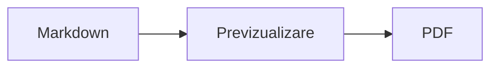

<p>&nbsp;&nbsp;&nbsp;</p>

# Splat

**Editorul Markdown pentru macOS în care scrieți în sursă sau direct în previzualizare.**

Splat afișează în stânga sursa Markdown, cu culori de sintaxă, iar în dreapta o previzualizare în direct, complet editabilă. Puteți scrie în oricare dintre ele: tot ce scrieți în previzualizare devine o modificare minimă a sursei, astfel că rândurile pe care nu le-ați atins rămân identice octet cu octet, iar diferențele din Git rămân curate. Splat citește Markdownul pe care îl folosiți deja: CommonMark și GitHub Flavored Markdown, alertele GitHub, linkurile wiki, încorporările și casetele informative din Obsidian, extensiile Pandoc și Typora, HTML încorporat, formule LaTeX și diagrame Mermaid, Graphviz și PlantUML, toate randate offline. Răsfoiți și căutați într-un dosar întreg de note, vedeți ce s-a schimbat de la ultimul commit Git, lipiți din Word sau dintr-o pagină web ca Markdown și exportați în PDF, HTML sau Word dintr-un singur clic. Este scris în Rust, pe controale AppKit autentice, vorbește 35 de limbi și nu trimite nimic prin rețea decât dacă îi cereți.
 


[](https://github.com/sventmueller/splat/releases/latest/download/Splat.dmg)

**[Descărcați Splat.dmg](https://github.com/sventmueller/splat/releases/latest/download/Splat.dmg)**: semnat și notarizat de Apple, pentru macOS 14 sau mai nou, pe Apple Silicon și Intel.

**Ați găsit o eroare?** Splat păstrează identice octet cu octet rândurile pe care nu le-ați atins. Dacă unul se schimbă totuși sau un fișier este afișat greșit, [deschideți un issue](https://github.com/sventmueller/splat/issues/new/choose) și atașați fișierul. Dacă Splat vă este util, o [stea pe GitHub](https://github.com/sventmueller/splat) îi ajută pe alții să îl găsească.
 
 

[](https://www.rust-lang.org)
[](https://www.apple.com/macos/)

[](https://github.com/madsmtm/objc2)
[](https://webkit.org)
[](https://github.com/kivikakk/comrak)
[](https://github.github.com/gfm/)
[](https://www.mathjax.org)
[](https://cortexjs.io/mathlive/)
[](https://mermaid.js.org)
[](https://graphviz.org)
[](https://plantuml.com)


[](#licență)

[Bahasa Indonesia](../id/README.md) ·
[Bahasa Melayu](../ms/README.md) ·
[Català](../ca/README.md) ·
[Čeština](../cs/README.md) ·
[Dansk](../da/README.md) ·
[Deutsch](../de/README.md) ·
[English](../../../README.md) ·
[Español](../es/README.md) ·
[Français](../fr/README.md) ·
[Hrvatski](../hr/README.md) ·
[Italiano](../it/README.md) ·
[Magyar](../hu/README.md) ·
[Nederlands](../nl/README.md) ·
[Norsk](../no/README.md) ·
[Polski](../pl/README.md) ·
[Português (Brasil)](../pt_BR/README.md) ·
[Português (Portugal)](../pt_PT/README.md) ·
**Română** ·
[Slovenčina](../sk/README.md) ·
[Slovenščina](../sl/README.md) ·
[Suomi](../fi/README.md) ·
[Svenska](../sv/README.md) ·
[Tiếng Việt](../vi/README.md) ·
[Türkçe](../tr/README.md) ·
[Ελληνικά](../el/README.md) ·
[Русский](../ru/README.md) ·
[Українська](../uk/README.md) ·
[עברית](../he/README.md)‎ ·
[العربية](../ar/README.md)‎ ·
[हिन्दी](../hi/README.md) ·
[ไทย](../th/README.md) ·
[한국어](../ko/README.md) ·
[日本語](../ja/README.md) ·
[简体中文](../zh-Hans/README.md) ·
[繁體中文](../zh-Hant/README.md)

## Cuprins

- [Pe scurt](#pe-scurt)
- [Cerințe](#cerințe)
- [Instalare](#instalare)
- [Primii pași](#primii-pași)
- [Scrierea](#scrierea)
  - [În sursă](#în-sursă)
  - [În previzualizare](#în-previzualizare)
  - [Comenzi de formatare](#comenzi-de-formatare)
  - [Liste și sarcini](#liste-și-sarcini)
  - [Tabele](#tabele)
  - [Lipirea textului formatat](#lipirea-textului-formatat)
  - [Metadate](#metadate)
- [Markdown acceptat](#markdown-acceptat)
  - [CommonMark și GitHub Flavored Markdown](#commonmark-și-github-flavored-markdown)
  - [Casete informative](#casete-informative)
  - [Sintaxă extinsă](#sintaxă-extinsă)
  - [Obsidian](#obsidian)
  - [Citări și referințe](#citări-și-referințe)
  - [HTML încorporat](#html-încorporat)
  - [Punctuație tipografică](#punctuație-tipografică)
  - [Prezentare generală a sintaxei](#prezentare-generală-a-sintaxei)
- [Formule](#formule)
- [Diagrame](#diagrame)
- [Imagini](#imagini)
- [Linkuri și navigare](#linkuri-și-navigare)
- [Note într-un dosar](#note-într-un-dosar)
- [Modificări de la ultimul commit](#modificări-de-la-ultimul-commit)
- [Exportul, tipărirea și partajarea](#exportul-tipărirea-și-partajarea)
- [Importul documentelor Word](#importul-documentelor-word)
- [Aspect și accesibilitate](#aspect-și-accesibilitate)
- [Limbi](#limbi)
- [Scurtături de tastatură](#scurtături-de-tastatură)
- [Confidențialitate și securitate](#confidențialitate-și-securitate)
- [Documente mari](#documente-mari)
- [Limitări cunoscute](#limitări-cunoscute)
- [Depanare](#depanare)
- [Pentru dezvoltatori](#pentru-dezvoltatori)
  - [Componente terțe](#componente-terțe)
- [Licență](#licență)

## Pe scurt

- **Două moduri de a scrie, un singur text.** Sursa și previzualizarea sunt amândouă editabile. Fișierul Markdown este singurul adevăr: există un singur istoric de infirmări pentru fiecare document, iar fiecare modificare din previzualizare este tradusă în cea mai mică modificare posibilă a sursei.
- **Markdownul pe care îl folosiți deja.** CommonMark, GitHub Flavored Markdown, alertele GitHub, extensiile Obsidian, Pandoc și Typora, coduri scurte pentru emoji, spoilere, liste de definiții, ancore pentru titluri și HTML ca în fișierele README de pe GitHub.
- **Formule și diagrame integrate.** Formule LaTeX prin MathJax, cu un editor vizual de formule. Diagrame Mermaid, Graphviz și PlantUML, randate pe Mac-ul dumneavoastră, fără Java, fără server și fără conexiune la rețea.
- **Un buton pentru orice.** Fiecare construcție Markdown are un buton în bara de instrumente și un element de meniu, iar cele uzuale au și o scurtătură de tastatură. Tabelele au propriul meniu pentru rânduri, coloane și aliniere.
- **Un dosar, nu doar un fișier.** Bara laterală listează notele din jurul unui document și caută în toate. Redenumirea unei note modifică linkurile către ea, iar fiecare octet din jurul lor rămâne neschimbat.
- **Modificări dintr-o privire.** Într-un depozit Git, bare lângă text marchează ce diferă față de ultimul commit, în ambele panouri.
- **Din Word și de pe web în Markdown.** Lipiți text formatat ca Markdown, celule dintr-o foaie de calcul ca tabel și importați documente Word întregi cu imaginile lor.
- **Export fără pierderi.** PDF, un singur fișier HTML autonom sau un document Word cu titluri, liste, tabele, note de subsol și imagini reale. Adăugați numere de pagină, antete și o pagină de titlu sau folosiți șablonul Word al companiei dumneavoastră.
- **Nativ până în măduva oaselor.** Ferestre, file, meniuri, popovere, Versiuni, Salvare automată, meniul de partajare, modul întunecat, verificarea ortografică, dictarea și VoiceOver autentice AppKit. Fără Electron, fără vizualizare web pentru textul propriu-zis.
- **Rapid cu fișiere mari.** Randarea unei apăsări de tastă într-un document de 10 MB durează circa 10 ms, înainte de munca proprie a vizualizării.
- **Privat și atent.** Imaginile de pe web se încarcă doar după ce permiteți, linkurile către alte aplicații cer mai întâi confirmare, iar tot ce decodează date de imagine nesigure rulează în procese ajutătoare izolate într-un sandbox.
- **În limba dumneavoastră.** Interfața și referința rapidă Markdown integrată există în 35 de limbi: arabă, catalană, chineză (simplificată), chineză (tradițională), croată, cehă, daneză, olandeză, engleză, finlandeză, franceză, germană, greacă, ebraică, hindi, maghiară, indoneziană, italiană, japoneză, coreeană, malaeză, norvegiană, poloneză, portugheză (Brazilia), portugheză (Portugalia), română, rusă, slovacă, slovenă, spaniolă, suedeză, thailandeză, turcă, ucraineană și vietnameză.

## Cerințe

- macOS 14 Sonoma sau mai nou. Splat este dezvoltat și testat pe macOS 27, unde preia automat designul Liquid Glass.
- Un Mac cu Apple Silicon sau cu procesor Intel.
- Circa 45 MB de spațiu pe disc.

## Instalare

**Din imaginea de disc.** Descărcați [`Splat.dmg`](https://github.com/sventmueller/splat/releases/latest/download/Splat.dmg), deschideți-o și trageți Splat în dosarul Aplicații. Imaginea este semnată cu un Developer ID și notarizată de Apple, deci se deschide fără avertismente.

**Cu Homebrew.** Cask-ul se află într-un tap propriu:

```sh
brew install --cask sventmueller/tap/splat
```

`brew upgrade --cask splat` instalează versiunile noi, iar `brew uninstall --zap --cask splat` elimină și setările și cache-urile Splat.

**Actualizări.** Splat din imaginea de disc sau din Homebrew se actualizează singur prin [Sparkle](https://sparkle-project.org). La a doua pornire întreabă dacă are voie să caute singur actualizări, o dată pe zi. **Splat › Căutați actualizări…** caută imediat; **Căutați automat actualizări** și **Descărcați și instalați automat actualizările** din același meniu vă schimbă ulterior alegerea. Splat instalează o actualizare doar dacă are semnătura dezvoltatorului. O versiune compilată de dumneavoastră nu are mecanism de actualizare.

**Din sursă.** Vedeți [Compilare](../../../docs/development.md#building) pentru cerințe, apoi:

```sh
make build
ditto target/release/Splat.app /Applications/Splat.app
open /Applications/Splat.app
```

Pentru a deschide fișierele Markdown cu Splat printr-un dublu clic, selectați orice fișier `.md` în Finder, alegeți **Fișier › Obțineți informații**, selectați Splat la **Deschideți cu** și faceți clic pe **Aplicați pentru toate…**. Splat se înregistrează singur pentru fișierele `.md`, `.markdown`, `.mdown` și `.mkd`.

## Primii pași

### Fereastra

Fiecare document se deschide în propria fereastră sau, dacă preferați filele, într-o filă:

- **Stânga: sursa.** Markdownul dumneavoastră în SF Mono, cu culori de sintaxă.
- **Dreapta: previzualizarea.** Documentul randat, gata de editat.
- **Bară laterală (opțional).** Toate titlurile sub formă de arbore, un clic pe unul îl afișează în ambele panouri: **Vizualizare › Afișați structura** (⌃⌘S). Alte două file conțin [notele din dosar](#note-într-un-dosar) și o căutare în ele.
- **Bara de instrumente.** Butoane grupate după ce modifică: caractere, paragrafe și elemente inserate, apoi previzualizare pornită/oprită, Partajare și Document nou. Personalizați-o cu **Vizualizare › Personalizare bară de instrumente…**.

Trageți separatorul pentru a da mai mult loc uneia dintre părți. **Vizualizare › Ascundeți previzualizarea** (⌥⌘P) lasă doar sursa; Splat reține această alegere pentru fiecare fereastră. Cele două panouri defilează împreună, iar o selecție dintr-un panou este evidențiată în celălalt.

Colțul ferestrei arată cuvintele și caracterele textului și cât durează citirea lui, iar cât timp există o selecție, și pe cele ale selecției. Adresele linkurilor, etichetele HTML, metadatele, comentariile, formulele și diagramele nu se numără. **Vizualizare › Ascundeți numărul de cuvinte** înlătură această informație.

### Documente, file și versiuni

Splat este o aplicație obișnuită de documente pentru macOS:

- **Salvare automată și Versiuni.** Modificările sunt salvate pe loc. **Fișier › Reveniți la › Explorați toate versiunile…** vă duce înapoi în timp.
- **Modificări din alte programe.** Când Git, un script sau un alt editor modifică un document deschis, Splat îl reîncarcă și păstrează cursorul și poziția de defilare. Dacă aveți modificări nesalvate, Splat le păstrează, iar macOS întreabă înainte de a le salva peste cealaltă versiune.
- **Comenzile obișnuite pentru fișiere.** Duplicați (⇧⌘S), Redenumiți…, Mutați în… și **Fișier › Deschideți recente**.
- **File.** **Fișier › Filă nouă** sau butonul **+** din bara de instrumente deschide un document nou într-o filă; meniul standard Fereastră comasează, mută și parcurge filele.
- **Poziția ferestrei.** Dimensiunea și poziția ultimei ferestre sunt reținute, inclusiv între reporniri. Dacă acolo se află deja o fereastră, cea nouă se deschide ușor decalată.
- **Pictograma din Dock.** Un clic pe ea după ce ați închis ultima fereastră deschide un document nou.
- **Deschiderea fișierelor Markdown în Splat.** **Splat › Setați ca aplicație implicită pentru Markdown** face ca un dublu clic pe un fișier `.md` sau `.markdown` să deschidă Splat; macOS cere o singură dată confirmarea. Elementul are o bifă cât timp Splat este aplicația implicită.

Fișierele trebuie să fie text UTF-8 sau UTF-16 cu marcaj de ordine a octeților. Splat refuză alte codificări, în loc să ghicească și să strice textul. Marcajul de ordine a octeților se păstrează, UTF-16 rămâne UTF-16, iar într-un fișier în care toate rândurile se termină cu CRLF, rândurile pe care le adăugați primesc și ele CRLF.

**După o închidere forțată** se pierd cel mult ultimele secunde de scris: la fiecare cinci secunde, Splat copiază textul nesalvat în `~/Library/Application Support/Splat/Unsaved` și șterge copiile după ce documentul este salvat sau Splat se închide normal. La pornirea următoare, ce a rămas acolo după o închidere forțată este mutat în `~/Library/Application Support/Splat/Recovery`, iar Splat anunță acest lucru o singură dată, cu un buton care deschide dosarul. O închidere forțată la care Splat mai poate reacționa scrie acolo și textul fiecărui document deschis.

### Referință rapidă

**Ajutor › Referință rapidă Markdown** deschide un memento în limba dumneavoastră, ca document nou, fără titlu. Este un document obișnuit, așa că încercați totul chiar acolo, în sursă sau în previzualizare.

## Scrierea

### În sursă

Sursa este un editor de text simplu, adaptat pentru Markdown:

- **Culori de sintaxă** ca în VS Code: titluri, accent, linkuri, cod, tabele, HTML, front matter, precum și LaTeX și Mermaid în interiorul formulelor și diagramelor. Există palete pentru modul luminos, cel întunecat și Creștere contrast.
- **Blocurile de cod delimitate** sunt evidențiate pentru Bash, C, C++, C#, CSS (și SCSS, Less), Go, HTML, XML, Java, JavaScript, JSON, Kotlin, PHP, Python, Ruby, Rust, SQL, Swift, TypeScript, YAML, TeX și Mermaid, inclusiv numele lor scurte uzuale, precum `js`, `py` sau `sh`.
- **Fără înlocuiri surpriză.** Ghilimelele inteligente, cratimele inteligente și înlocuirea textului sunt dezactivate implicit, pentru că strică `--`, `---` și `"`. Le activați la **Editare › Înlocuiri**.
- **Instrumentele de scriere ale sistemului.** Verificarea ortografiei și a gramaticii, dictarea, Găsiți și înlocuiți (⌥⌘F) și Enunțarea.
- **Tragere și plasare.** Plasați un fișier imagine pentru a insera ``, orice alt fișier pentru a insera un link către el și o adresă URL pentru a insera `[url](url)`. Fiecare plasare este un singur pas de infirmare.
- **Lipirea imaginilor.** O imagine din clipboard, de exemplu o captură de ecran, este salvată ca fișier PNG lângă document (`Imagine 2026-10-29 13.09.07.png`) și inserată ca imagine. Pentru aceasta, documentul trebuie salvat cel puțin o dată.

### În previzualizare

Previzualizarea se comportă ca un procesor de text, dar tot ce faceți în ea ajunge în Markdown:

- **Tastarea.** Caracterele care au o semnificație în Markdown, precum `*` sau `#`, sunt protejate prin escape, astfel încât să apară așa cum le-ați tastat.
- **Return** începe un paragraf sau un element de listă nou. **⌥Return** sau **⌃Return** inserează o întrerupere de linie.
- **Formatarea la cursor.** Când cursorul se află la sfârșitul unui cuvânt, Aldin, Cursiv și celelalte formate de caractere se aplică textului pe care îl tastați în continuare. Alegeți din nou formatul pentru a o opri. În interiorul unui cuvânt, se formatează întregul cuvânt.
- **Rânduri goale.** Return pe un rând gol adaugă încă un rând gol, iar Backspace îl elimină. În sursă, fiecare rând gol în plus înseamnă încă două rânduri goale; alte programe Markdown le afișează ca spațiere normală între paragrafe.
- Comanda **Infirmați** funcționează în ambele panouri. Pașii de infirmare au nume („Infirmați Aldin”), tastarea este un singur pas pe rafală, iar după Infirmați și Refaceți ambele panouri defilează până la modificare.
- **Formulele și diagramele** apar ca grafice finalizate. Faceți clic pe una, mutați cursorul pe ea sau apăsați Return pe ea pentru a-i deschide editorul (vedeți [Formule](#formule) și [Diagrame](#diagrame)).
- **HTML-ul încorporat, notele încorporate și front matter** sunt afișate, dar le editați în sursă. Un clic pe ele plasează cursorul în locul corespunzător din sursă.

Tot ce Markdown nu poate exprima este blocat în previzualizare: panourile Font și Culori, rigla, precum și lipirea sau plasarea de text îmbogățit și de imagini. HTML-ul și RTF-ul lipit ajung ca text simplu, în afară de cazul în care alegeți [Lipiți ca Markdown](#lipirea-textului-formatat).

### Comenzi de formatare

Fiecare comandă este disponibilă din bara de instrumente, din bara de meniuri și din meniul contextual al ambelor panouri. Elementele de meniu afișează o bifă pentru formatarea de la cursor.

| Meniu | Comenzi |
|---|---|
| **Format › Font** | Aldin, Cursiv, Subliniat, Tăiat cu o linie, Evidențiere, Cod, Exponent, Indice |
| **Format › Titlu** | Corp text, Titlu 1 până la 6 |
| **Format › Listă** | Listă cu marcatori, Listă numerotată, Listă de sarcini |
| **Format** | Citat, Bloc de cod (Fără limbaj sau unul dintre cele 20 de limbaje; schimbă și limbajul unui bloc existent), Casetă informativă (Notă, Sfat, Important, Avertisment, Atenție; același tip din nou o elimină), Editați formula sau diagrama…, Eliminați formatarea |
| **Inserare** | Link…, Imagine…, Tabel…, Formulă, Diagramă (Diagramă de flux, Diagramă de secvență, Diagramă Gantt), Tablă de materii, Notă de subsol, Separator |
| **Tabel** | Inserați un rând deasupra/dedesubt, Inserați o coloană la stânga/dreapta, Ștergeți rândul, Ștergeți coloana, Aliniere (Stânga, Centrat, Dreapta, Implicit), Aliniați coloanele tabelului |
| **Vizualizare** | Ascundeți/Afișați previzualizarea, Afișați/Ascundeți structura, Punctuație tipografică, Zoom înainte/înapoi, Dimensiune efectivă, bara de instrumente, bara filelor, ecran complet |

Textul subliniat, evidențierea, exponentul și indicele se scriu `<ins>`, `<mark>`, `<sup>` și `<sub>`, pe care le afișează și GitHub. Splat citește și `<u>`, pe care GitHub îl elimină, precum și formele mai scurte `==evidențiere==`, `^exp^` și `~ind~`. GitHub afișează `==` și `^` așa cum sunt scrise, iar `~ind~` ca text tăiat cu o linie.

### Liste și sarcini

- Return continuă o listă; Return pe un element gol o încheie.
- **Tab** și **⇧Tab** indentează și anulează indentarea elementelor de listă în previzualizare.
- Un clic pe caseta unei sarcini din previzualizare comută între `- [ ]` și `- [x]`.
- **Format › Listă** transformă paragrafele selectate într-o listă sau îi schimbă tipul.

### Tabele

- **Inserare › Tabel…** cere numărul de rânduri (inclusiv antetul) și de coloane.
- În previzualizare, **Tab** trece la celula următoare, **⇧Tab** la cea anterioară, iar **Return** la celula de dedesubt. Tab în ultima celulă adaugă un rând.
- Meniul **Tabel** inserează și șterge rânduri și coloane și stabilește alinierea unei coloane (⌘{, ⌘|, ⌘}).
- **Tabel › Aliniați coloanele tabelului** completează cu spații sursa, astfel încât coloanele să se alinieze.

### Lipirea textului formatat

**Editare › Lipiți ca Markdown** (⌃⌘V), disponibil și în meniul contextual al ambelor panouri, transformă conținutul din clipboard în Markdown în dreptul selecției, ca un singur pas de infirmare. ⌘V continuă să insereze text simplu.

- **Dintr-un browser, Word, Google Docs, Confluence, Notițe sau Pages:** titlurile, aldinul, cursivul, subliniatul, tăierea cu o linie, exponentul și indicele, linkurile, listele cu imbricarea lor, citatele, codul și tabelele sunt preluate.
- **Dintr-o foaie de calcul:** celulele devin un tabel cu un rând de antet și coloane de numere aliniate la dreapta. La fel și textul separat prin tabulatori, punct și virgulă sau virgule, dacă fiecare rând are același număr de coloane.
- **Imaginile** cu o adresă web rămân linkuri. O imagine din HTML-ul lipit devine un fișier lângă document, care pentru aceasta trebuie salvat cel puțin o dată. Fișierele de imagine temporare ale Word nu sunt preluate, iar textul lor alternativ rămâne.
- **Linkurile** păstrează doar adresele `http`, `https`, `mailto`, relative și `#`; din orice alt link rămâne textul.

### Metadate

**Format › Editați metadatele…** sau un clic pe rândul de metadate din partea de sus a previzualizării deschide un formular cu câmpurile din front matter YAML. Câmpurile pot fi modificate, adăugate și eliminate. Un câmp cu o listă o păstrează ca listă: valorile sale stau una după alta, separate prin virgule, iar o valoare care conține o virgulă stă între ghilimele. Un câmp nou numit `tags`, `aliases`, `keywords`, `categories`, `authors` sau `cssclasses` devine și el o listă. Câmpurile imbricate și textul pe mai multe rânduri pot fi văzute acolo și se editează în sursă.

Ce modifică formularul este un singur pas de infirmare și atinge doar rândurile câmpurilor pe care le-ați modificat: comentariile, ordinea, spațierea neobișnuită, ghilimelele și sfârșiturile de rând ale tuturor celorlalte rămân identice octet cu octet. Un document fără metadate primește un bloc la început.

## Markdown acceptat

Splat analizează cu [comrak](https://github.com/kivikakk/comrak), un parser compatibil cu CommonMark și GFM, și activează majoritatea extensiilor sale. Tot ce urmează este randat în previzualizare și în toate exporturile.

### CommonMark și GitHub Flavored Markdown

- Titluri (`#` și cu subliniere), paragrafe, întreruperi de linie, accent, accent puternic, cod în linie, citate, separatoare.
- Liste cu marcatori, numerotate și imbricate; liste de sarcini.
- Linkuri (în linie, de referință și automate), imagini, definiții de referințe pentru linkuri.
- Blocuri de cod delimitate și indentate, cu culori de sintaxă.
- Tabele cu aliniere pe coloane.
- Text tăiat cu o linie prin `~~două tilde~~`.
- Note de subsol: `text[^1]` cu `[^1]: Nota.` oriunde în document. Un clic pe marcaj duce la notă.
- Front matter YAML între rândurile `---` de la începutul documentului. Previzualizarea îl rezumă într-un singur rând, de exemplu „Metadate: title, date, tags”.

### Casete informative

Alertele GitHub sunt randate ca niște casete colorate cu pictogramă și titlu:

```markdown
> [!NOTE]
> Informații utile pe care utilizatorii ar trebui să le cunoască.

> [!WARNING]
> Conținut critic, care cere atenție imediată.
```

Cele cinci tipuri sunt Notă, Sfat, Important, Avertisment și Atenție. **Format › Casetă informativă** transformă într-una paragraful de la cursor.

Casetele informative din Obsidian funcționează și ele, cu orice titlu și cu o stare de pliere:

```markdown
> [!tip]- Faceți clic pe ▸ pentru a extinde
> Ascuns până la deschidere.

> [!question]+ Deschis implicit
> Un `+` pornește extins, un `-` restrâns.
```

Celelalte tipuri din Obsidian sunt afișate în cea mai apropiată dintre cele cinci culori: `success`, `check`, `done` și `hint` ca Sfat; `question`, `help` și `faq` ca Important; `attention` ca Avertisment; `failure`, `fail`, `missing`, `danger`, `error` și `bug` ca Atenție; tot restul ca Notă.

### Sintaxă extinsă

| Funcție | Sintaxă | Din |
|---|---|---|
| Evidențiere | `==text marcat==` | Obsidian, Typora |
| Exponent | `x^2^` | Pandoc, Typora |
| Indice | `H~2~O` | Pandoc, Typora |
| Cod scurt pentru emoji | `:rocket:` devine 🚀 | GitHub |
| Spoiler | `\|\|text ascuns\|\|`, selectați-l pentru a-l citi | Discord |
| Notă de subsol în linie | `text^[nota însăși]` | Pandoc, Obsidian |
| Listă de definiții | `Termen`, rând gol, `: Explicație` | PHP Markdown Extra, Pandoc |
| Ancoră pentru titlu | `## Instalare {#setup}`, link cu `[vezi](#setup)` | Pandoc, kramdown |

Listele de definiții arată astfel în sursă:

```markdown
Termen

: Explicația termenului.
```

Fără o ancoră proprie, fiecare titlu primește una derivată din text, ca pe GitHub: `## Primii pași` poate fi atins ca `#primii-pași`.

### Obsidian

- **Linkuri wiki.** `[[Notă]]` trimite la `Notă.md` din același dosar sau dintr-unul mai jos. `[[Notă|Text afișat]]` afișează textul dumneavoastră, iar `[[Notă#Titlu]]` deschide nota. ⌘-clic o deschide în Splat.
- **Încorporări.** `![[Notă]]` afișează cealaltă notă în interiorul acesteia; notele încorporate în ea apar ca linkuri. `![[diagram.png]]` afișează o imagine. Ca în Obsidian, încorporările numesc note și imagini din dosarul documentului sau de mai jos, niciodată printr-o cale absolută, și doar fișierele Markdown apar ca note.
- **Comentarii.** `%%Doar în sursă%%` rămâne vizibil în sursă și este omis din previzualizare și din orice export, atât în linie, cât și pe rânduri separate.
- **Etichete.** `#idee` sau `#proiect/splat` este evidențiat. ⌘-clic caută eticheta în document și, în bara laterală, în tot dosarul.
- **Casete informative pliabile.** Vedeți [Casete informative](#casete-informative).

### Citări și referințe

- **Citări Pandoc.** `[@doe2020]` sau `[@doe2020; @roe2021]` apare ca „(Doe 2020; Roe 2021)”. Intrările provin din fișierul BibTeX pe care front matter îl numește prin `bibliography: refs.bib`. Fără acesta, Splat folosește `references.bib`, `literatur.bib` sau `bibliography.bib` de lângă document.
- **Referințe GitHub și GitLab.** Dacă documentul se află într-un depozit Git al cărui remote `origin` este pe github.com sau pe o gazdă GitLab, `@nume`, `#12` (issue) și `!7` (merge request, doar GitLab) sunt evidențiate. ⌘-clic le deschide în browser.

### HTML încorporat

HTML-ul așa cum îl găsiți în fișierele README de pe GitHub este randat, cu un cititor propriu, nu cu un motor de browser:

- paragrafe și blocuri centrate (`<p align="center">`, `<div align="center">`)
- imagini cu dimensiune (``)
- linkuri, `<kbd>⌘</kbd>`, `<br>`, `<u>`, `<ins>`, `<mark>`, `<sup>`, `<sub>`
- liste și tabele, inclusiv celule care se întind pe mai multe coloane (`colspan`)
- secțiuni pliabile: `<details><summary>Mai multe</summary>…</details>`, deschise printr-un clic pe ▸

Markdownul dintre etichetele HTML este randat ca Markdown. Scripturile, stilurile, cadrele și formularele sunt omise complet, iar linkurile și imaginile păstrează doar adresele `http`, `https`, `mailto` și relative.

### Punctuație tipografică

**Vizualizare › Punctuație tipografică** afișează ghilimelele drepte ca ghilimelele limbii interfeței, `--` ca liniuță en, `---` ca liniuță em și `...` ca puncte de suspensie. În germană, `"Ja"` devine „Ja“, în franceză «Oui», în japoneză 「はい」, inclusiv acolo unde chineza și japoneza așază ghilimelele fără spațiu; abrevierile ebraice precum `צה"ל` primesc gershayim, צה״ל. Sursa păstrează caracterele simple; previzualizarea și toate exporturile le afișează pe cele tipografice. Setarea este dezactivată până o activați.

### Prezentare generală a sintaxei

| Element | Markdown |
|---|---|
| **Aldin** | `**Aldin**` |
| *Cursiv* | `*Cursiv*` |
| Subliniat | `<ins>Subliniat</ins>` sau `<u>Subliniat</u>` |
| ~~Tăiat cu o linie~~ | `~~Tăiat cu o linie~~` |
| Evidențiere | `<mark>Evidențiere</mark>` sau `==Evidențiere==` |
| `Cod` | `` `Cod` `` |
| x² | `x<sup>2</sup>` sau `x^2^` |
| H₂O | `H<sub>2</sub>O` sau `H~2~O` |
| [Link](https://example.com) | `[Link](https://example.com)` |
| Titlu | `# Titlu` până la `###### Titlu` |
| Citat | `> Citat` |
| Listă cu marcatori | `- Element` |
| Listă numerotată | `1. Element` |
| Sarcină | `- [ ] Deschisă` și `- [x] Finalizată` |
| Bloc de cod | ```` ```rust ```` … ```` ``` ```` |
| Tabel | `\| A \| B \|` cu `\|---\|---\|` sub antet |
| Notă de subsol | `Text[^1]` și `[^1]: Notă` |
| Separator | `---` |
| Imagine | `` |
| Formulă | `$E = mc^2$`, `$$ … $$` |
| Diagramă | ```` ```mermaid ````, ```` ```dot ````, ```` ```plantuml ```` |
| Casetă informativă | `> [!TIP]` |
| Link wiki | `[[Notă]]`, `[[Notă\|Text]]` |
| Încorporare | `![[Notă]]`, `![[image.png]]` |
| Comentariu | `%%Comentariu%%` |
| Etichetă | `#etichetă` |
| Citare | `[@cheie]` |
| Spoiler | `\|\|Spoiler\|\|` |
| Emoji | `:tada:` |

## Formule

Formulele sunt randate de [MathJax](https://www.mathjax.org), cu matematica sa TeX și AMS, ca grafice vectoriale clare. Textul din `\text{…}` poate fi în orice scriere: ce lipsește fonturilor MathJax provine din fonturile Mac-ului dumneavoastră, cu arabă și ebraică scrise de la dreapta la stânga, iar emoji sunt în culori.

| Fel | Sintaxă |
|---|---|
| În linie | `$E = mc^2$`, `` $`E = mc^2`$ `` (GitHub, GitLab), `\(E = mc^2\)` |
| Afișată | `$$` … `$$`, `\[` … `\]` sau un bloc de cod marcat `math` |

**Editarea unei formule.** Faceți clic pe o formulă în previzualizare, faceți dublu clic pe ea, apăsați Return pe ea sau mutați cursorul pe ea pentru a-i deschide editorul într-un popover. **Inserare › Formulă** inserează una nouă și deschide imediat editorul.

- **Vizual sau LaTeX.** Comutatorul de sus alternează între un editor vizual ([MathLive](https://cortexjs.io/mathlive/)) și codul LaTeX. Splat reține alegerea dumneavoastră.
- **Blocuri** pentru fracție, rădăcină pătrată, exponent și indice, sumă și integrală cu limite, limită, paranteze care cresc odată cu conținutul, matrice 2×2, litere grecești, precum și relații, operatori și săgeți. Ele lasă substituenți □, iar **Tab** sare la următorul.
- **Previzualizare în direct.** Modificările apar în document pe măsură ce tastați. Erorile de la MathJax se afișează într-un rând sub cod.
- **Confirmare sau renunțare.** Un clic în afară păstrează modificarea ca un singur pas de infirmare; **Esc** sau **Anulați** o aruncă. Părăsirea cu Esc a unei formule noi, goale, o elimină din nou.
- Meniul contextual oferă **Editați formula…** pentru formula de sub indicator.

VoiceOver citește o formulă ca pe codul ei LaTeX. Splat randează formule, nu documente LaTeX complete: nu există pachete, nu există TikZ și nici `\documentclass`.

## Diagrame

Diagramele sunt randate în Splat, offline, într-o variantă luminoasă și una întunecată.

| Motor | Bloc de cod | Ce desenează |
|---|---|---|
| [Mermaid](https://mermaid.js.org) | ```` ```mermaid ```` | diagrame de flux, de secvență, de clase, de stări, entitate-relație, Gantt, circulare, hărți mentale, cronologii și orice alt tip Mermaid |
| [Graphviz](https://graphviz.org) | ```` ```dot ```` sau ```` ```graphviz ```` | grafuri în limbajul DOT |
| [PlantUML](https://plantuml.com) | ```` ```plantuml ```` sau ```` ```puml ```` | diagrame UML; rulează fără Java |



**Editarea unei diagrame** funcționează ca editarea unei formule: faceți clic pe ea pentru a deschide codul într-un popover, cu culori de sintaxă și mesaje de eroare într-un rând sub cod. **Inserare › Diagramă** pornește de la un șablon pentru o diagramă de flux, o diagramă de secvență sau o diagramă Gantt. Blocurile ajută la cele mai frecvente trei tipuri Mermaid:

- **Diagramă de flux:** Nod ▾ (dreptunghi, rotunjit, cerc, romb, bază de date), Conexiune, Conexiune cu etichetă, Grup, Direcție ▾
- **Diagramă de secvență:** Participant, Mesaj, Răspuns, Notă, Buclă, Căi alternative
- **Diagramă Gantt:** Secțiune, Sarcină, Reper

Celelalte tipuri de diagrame se editează ca cod. VoiceOver citește titlul sau textul alternativ al unei diagrame.

Prima diagramă de după pornire durează circa o secundă, pentru că motorul de randare pornește în fundal. O diagramă care durează mai mult de 10 secunde afișează o eroare, iar motorul de randare pornește din nou pentru următoarea. Motorul PlantUML (3 MB) se încarcă abia la prima diagramă PlantUML. Un `!include` PlantUML de pe web este blocat.

## Imagini

- **Imaginile locale** folosesc căi relative la document: ``. Splat afișează PNG, JPEG, GIF, WebP, BMP, SVG, HEIC, TIFF, AVIF și PDF.
- **Imaginile de pe web** rămân blocate până le permiteți: o bară deasupra previzualizării explică faptul că încărcarea lor anunță serverele lor că și când deschideți documentul. **Încărcați imaginile** le permite pentru acest document; Splat reține alegerea pentru fiecare fișier.
- **Dimensiunea.** `` stabilește dimensiunea unei imagini; altfel, imaginile se potrivesc lățimii previzualizării.
- **Modificări pe disc.** O imagine pe care o înlocuiți sau una care apare după ce documentul a numit-o este afișată fără a redeschide documentul. Imaginile de pe web care au eșuat din cauza rețelei sunt încercate din nou cât timp un document le afișează.
- **Memoria.** Imaginile sunt afișate cu cel mult 2560 de pixeli pe latura lungă, ceea ce umple și o pagină A4. Ele se decodează la dimensiuni mai mici odată ce ocupă o optime din memoria Mac-ului și cât timp macOS raportează presiune asupra memoriei.
- **Modul întunecat.** Imaginile cu fundal alb sunt ușor estompate în previzualizarea întunecată.
- **Lipirea și plasarea.** Vedeți [În sursă](#în-sursă).

## Linkuri și navigare

În previzualizare, un clic plasează cursorul pentru a putea edita textul linkului; **⌘-clic** urmează linkul:

- `http`, `https` și `mailto` se deschid în browser sau în aplicația de e-mail.
- Fișierele Markdown se deschid în Splat; celelalte fișiere și dosare sunt afișate în Finder.
- `#ancora` sare la titlul din document.
- Adresele care deschid o altă aplicație, precum `slack://` sau `vscode://`, întreabă mai întâi și afișează adresa completă și aplicația. **Anulați** este preselectat.

**Inserare › Tablă de materii** inserează o listă cu linkuri către toate titlurile. Cu cursorul în ea, aceeași comandă o actualizează. Bara laterală cu structura (⌃⌘S) sare la orice titlu în ambele panouri.

## Note într-un dosar

Butoanele din partea de sus a barei laterale comută între structură, fișiere și o căutare.

- **Fișiere** (**Vizualizare › Afișați fișierele**, ⌃⌘E). Toate fișierele Markdown din dosarul documentului sau, dacă acesta se află într-un depozit Git, din întregul depozit. Un clic sau Return deschide o notă ca filă a acestei ferestre; dacă este deja deschisă, trece în prim-plan. Butonul de lângă numele dosarului afișează alt dosar în această fereastră. Fișierele ascunse, `node_modules`, `target`, `Pods`, `DerivedData`, `__pycache__` și dosarele fără note rămân în afară. Un document aflat direct în dosarul dumneavoastră de reședință afișează doar notele de lângă el, pentru ca Splat să nu parcurgă toate dosarele dumneavoastră și să ceară acces pentru fiecare.
- **Căutare** (**Editare › Găsiți › Căutați în toate notele…**, ⇧⌘F). Găsește text în toate notele, indiferent de majuscule și de felul în care îi sunt codificate accentele. `#tag` găsește o etichetă, `#project` și `#project/splat`, și nimic din cod. Un clic pe un rezultat deschide nota în acel loc.
- **Linkuri către o notă.** Meniul contextual al unei note listează notele care duc la ea, prin link wiki, încorporare, link relativ sau definiție de referință pentru link.
- **Redenumirea unei note.** Același meniu o redenumește și modifică acele linkuri. Splat spune mai întâi despre câte linkuri în câte fișiere este vorba. În fiecare link se schimbă doar numele, iar orice alt octet al fișierului rămâne neschimbat. Documentele deschise preiau modificarea ca pas de infirmare; în alte fișiere doar Git sau Versiuni o pot anula. Un fișier pe care alt program l-a modificat între timp oprește redenumirea tuturor linkurilor, iar Splat îl numește.

Lista urmează dosarul când fereastra trece în prim-plan. Căutarea vede fișierele așa cum sunt pe disc, iar textul pe care nu l-ați salvat încă se ia în calcul de la următoarea Salvare automată.

## Modificări de la ultimul commit

Într-un document dintr-un depozit Git, bare lângă text marchează ce diferă față de ultimul commit, în sursă și în previzualizare: verde pentru rândurile adăugate, albastru pentru rândurile modificate și un semn roșu scurt acolo unde s-a eliminat ceva. Ele urmează pe măsură ce tastați și când ramura se mută. **Vizualizare › Modificări de la ultimul commit** le dezactivează, pentru toate ferestrele.

Rândurile care diferă doar prin sfârșitul de rând nu se numără, așa că un fișier cu CRLF față de un commit cu LF nu arată nicio modificare. Un fișier nou nu are semne până la primul său commit, și nici un document de peste 32 MB.

## Exportul, tipărirea și partajarea

| Format | Cum | Ce obțineți |
|---|---|---|
| **PDF** | **Fișier › Exportați ca PDF…** sau meniul Partajare | Pagini de dimensiunea hârtiei, mereu în aspectul luminos, formule și diagrame ca grafice vectoriale. **Fișier › Configurare pagină…** stabilește hârtia. |
| **Tipărire** | **Fișier › Tipăriți…** (⌘P) | Aceeași aranjare în pagină ca la PDF. |
| **HTML** | **Fișier › Exportați ca HTML…** sau meniul Partajare | Un singur fișier autonom: imagini locale încorporate, formule și diagrame ca imagini clare, ancore pentru titluri, astfel încât cuprinsul să funcționeze. Fără scripturi. |
| **Word** | **Fișier › Exportați ca document Word…** sau meniul Partajare | Un fișier `.docx` cu stilurile de titlu din Word, liste și tabele reale (inclusiv celule îmbinate), note de subsol ca note de subsol Word, imagini încorporate, formule și diagrame. |
| **Markdown** | Butonul **Partajați** din bara de instrumente | Documentul ca fișier `.md` pentru Mail, Mesaje, AirDrop și orice alt serviciu de partajare. |

Meniul **Fișier › Partajați** le oferă pe toate într-un singur loc. Exporturile țin cont de setarea pentru punctuația tipografică și de imaginile de pe web pe care le-ați permis; în HTML, imaginile de pe web rămân linkuri.

**Fișier › Opțiuni de export…** stabilește ce adaugă la text PDF-ul, tipărirea și Word, pentru toate documentele:

- **Numere de pagină** în subsolul PDF-ului și al tipăririi, sub forma `2 / 9`.
- **Antet și subsol** pentru PDF și tipărire. `{title}`, `{author}`, `{date}`, `{page}` și `{pages}` țin locul valorilor lor, primele trei din metadatele documentului.
- **O pagină de titlu** pentru PDF, tipărire și Word, cu `title`, `subtitle`, `author` și `date` din metadate sau cu numele documentului ca titlu. Nu are nici antet, nici subsol.
- **Un șablon Word**, un `.docx` sau `.dotx` al cărui aspect îl preia exportul: stilurile, inclusiv cu nume localizate, tema, dimensiunea paginii, marginile, antetele și subsolurile. Un șablon care nu poate fi citit oprește exportul și spune acest lucru, în loc să vă dea un document fără el.

## Importul documentelor Word

**Fișier › Importați un document Word…** cere un fișier `.docx` sau `.dotx` și locul unde să meargă Markdownul lui, apoi deschide rezultatul. Imaginile ajung într-un dosar alături, numit după document cu `-images`.

Titlurile și listele ajung așa cum le definesc stilurile și numerotarea din Word, și în documentele ale căror stiluri au nume localizate. Aldinul, cursivul, subliniatul, tăierea cu o linie, evidențierea, exponentul și indicele, linkurile, citatele, codul, notele de subsol, notele de final și tabelele sunt preluate, celulele care se întind pe mai multe coloane ca tabel HTML. Formulele devin LaTeX. Modificările urmărite contează ca acceptate, iar o tablă de materii rămâne în afară, deoarece **Inserare › Tablă de materii** creează una nouă. Fișierele `.doc` vechi și documentele protejate cu parolă sunt refuzate.

## Aspect și accesibilitate

- **Modul întunecat** urmează sistemul. Formulele și diagramele sunt randate pentru fiecare aspect.
- **Sporire contrast** din Configurări sistem trece culorile de sintaxă pe palete cu contrast ridicat.
- **Zoom.** ⌘+, ⌘− și ⌘0 scalează ambele panouri.
- **Ecran complet, file și o bară de instrumente personalizabilă**, ca în orice aplicație Mac.
- **VoiceOver.** Panourile se numesc „Sursă Markdown” și „Previzualizare”, formulele sunt citite ca cod, iar diagramele prin titlu. Fiecare comandă poate fi atinsă de la tastatură.

Splat nu are fereastră de setări: puținele opțiuni se află acolo unde se aplică, în **Vizualizare**, **Editare › Înlocuiri** și **Fișier › Opțiuni de export…**.

## Limbi

Interfața, meniurile și referința rapidă Markdown sunt traduse în 35 de limbi:

arabă, catalană, chineză (simplificată), chineză (tradițională), croată, cehă, daneză, olandeză, engleză, finlandeză, franceză, germană, greacă, ebraică, hindi, maghiară, indoneziană, italiană, japoneză, coreeană, malaeză, norvegiană, poloneză, portugheză (Brazilia), portugheză (Portugalia), română, rusă, slovacă, slovenă, spaniolă, suedeză, thailandeză, turcă, ucraineană și vietnameză.

Splat urmează ordinea limbilor din **Configurări sistem › General › Limbă și regiune**; tot acolo puteți alege o limbă doar pentru Splat, la **Aplicații**. Fără o traducere în limba dumneavoastră, folosește engleza. Termenii din meniuri urmează traducerile Apple, astfel că Splat se citește ca restul Mac-ului dumneavoastră.

Textul în ebraică și în arabă se citește de la dreapta la stânga oriunde apare, indiferent de limba interfeței: fiecare paragraf, titlu și element de listă ia direcția primei sale litere, citatele și casetele informative își desenează bara în dreapta, iar un tabel al cărui text începe de la dreapta la stânga își aranjează coloanele începând din dreapta. Blocurile de cod rămân de la stânga la dreapta. Exporturile în PDF, HTML și Word păstrează aceste direcții. Cu ebraica sau araba ca limbă a sistemului, macOS oglindește și fereastra, astfel că previzualizarea se află în stânga.

## Scurtături de tastatură

| Acțiune | Scurtătură |
|---|---|
| Aldin, Cursiv, Subliniat | ⌘B, ⌘I, ⌘U |
| Tăiat cu o linie | ⇧⌘X |
| Link… | ⌘K |
| Corp text, Titlu 1 până la 6 | ⌥⌘0, ⌥⌘1 până la ⌥⌘6 |
| Aliniere coloană de tabel la stânga, centrat, la dreapta | ⌘{, ⌘\|, ⌘} |
| Ascundeți sau afișați previzualizarea | ⌥⌘P |
| Afișați sau ascundeți structura | ⌃⌘S |
| Afișați sau ascundeți fișierele | ⌃⌘E |
| Căutați în toate notele | ⇧⌘F |
| Lipiți ca Markdown | ⌃⌘V |
| Zoom înainte, înapoi, dimensiune efectivă | ⌘+, ⌘−, ⌘0 |
| Document nou, deschidere, salvare, duplicare | ⌘N, ⌘O, ⌘S, ⇧⌘S |
| Configurare pagină, tipărire | ⇧⌘P, ⌘P |
| Găsire, găsire și înlocuire | ⌘F, ⌥⌘F |
| Găsiți următorul, anteriorul; folosiți selecția; salt la selecție | ⌘G, ⇧⌘G; ⌘E; ⌘J |
| Afișați ortografia și gramatica; verificați documentul | ⌘:, ⌘; |
| Lipiți și adaptați stilul | ⌥⇧⌘V |
| Ascundeți bara de instrumente, afișați toate filele, ecran complet | ⌥⌘T, ⇧⌘\\, ⌃⌘F |
| Întrerupere de linie (previzualizare) | ⌥Return sau ⌃Return |
| Celula următoare / anterioară dintr-un tabel (previzualizare) | Tab / ⇧Tab |
| Indentare / anularea indentării unui element de listă (previzualizare) | Tab / ⇧Tab |
| Următorul substituent din editorul de formule | Tab |
| Închiderea editorului de formule sau de diagrame fără modificări | Esc |
| Urmarea unui link, a unei etichete sau a unei referințe (previzualizare) | ⌘-clic |

Splat lasă scurtăturile standard Apple acolo unde sunt.

## Confidențialitate și securitate

Un fișier Markdown poate veni de la oricine, așa că Splat tratează fiecare document ca fiind nesigur.

- **Fără rețea implicit.** Splat nu are telemetrie. Caută actualizări doar după ce sunteți de acord sau alegeți **Căutați actualizări…**: atunci încarcă de pe GitHub un mic fișier de flux, iar cererea nu numește decât aplicația și versiunea ei. Formulele și diagramele se randează local; vizualizările web care o fac nu pot ajunge la rețea. **Ajutor › Raportați o problemă…** deschide un formular pe GitHub în browser; adresa lui conține versiunea Splat, versiunea macOS și tipul de Mac, nimic din documentele dumneavoastră.
- **Imaginile de pe web** se încarcă doar cu permisiunea dumneavoastră, doar prin `https`, niciodată de la gazde din rețeaua locală, de cel mult 10 MB fiecare și într-o sesiune privată, fără cookie-uri.
- **Decodare izolată.** Imaginile și graficele formulelor și ale diagramelor sunt decodate în procese ajutătoare care închid toate fișierele moștenite și se blochează într-un sandbox înainte de a citi primul octet: fără acces la fișiere, fără rețea. Ele returnează doar pixeli, a căror dimensiune este verificată, și sunt oprite după 10 secunde. Decodoarele de imagini ale Apple văd doar HEIC, TIFF, AVIF și PDF, și numai când datele sunt într-adevăr în acel format; ele rulează într-un proces ajutător propriu, care poate în plus să citească dosarele de fonturi ale sistemului și să folosească decodorul video al sistemului. SVG-urile, formulele și diagramele trec și ele prin acel proces ajutător, deci în Splat sunt imagini cu rezoluție fixă: patru pixeli pe punct, până la 2560 pe latura mai lungă.
- **Fișierele locale** ajung într-un document doar prin calea pe care o numește. Încorporările afișează note Markdown din dosarul documentului și de mai jos, iar o imagine lipsă este căutată doar acolo. O cale de imagine în altă parte, absolută sau care începe cu `~`, se încarcă totuși în previzualizare; exporturile HTML și Word, tipărirea și fișierele PDF iau cu ele doar ce se află în dosarul documentului sau în depozitul său Git, cu excepția cazului în care acel depozit conține și dosarul tău de reședință, ca un document de la altcineva să nu poată trage fișierele tale într-un export pe care îl dai mai departe.
- **Dosarele de note** sunt citite doar cât timp bara laterală le afișează, iar redenumirea unei note modifică alte fișiere doar după ce ați confirmat câte.
- **Depozitele Git** sunt citite de Splat însuși. Nu rulează niciodată programul `git`, a cărui configurație dintr-un depozit străin poate porni alte programe, și nu citește mai mult decât versiunea documentului deschis din ultimul commit. Nu scrie nimic acolo și nu folosește nicio rețea.
- **Documentele Word și textul lipit** sunt citite de parserele proprii ale Splat, cu limite pentru dimensiune, imbricare și cât se poate despacheta un fișier. Linkurile din ele păstrează doar adresele pe care Splat le permite și în altă parte, iar numele imaginilor dintr-un fișier Word nu decid niciodată unde sunt scrise acestea.
- **Copiile textului nesalvat** rămân pe acest Mac, în dosarul Bibliotecă, pentru recuperarea după o închidere forțată. Ele dispar odată cu salvarea sau cu închiderea normală a Splat; copiile lăsate de o închidere forțată rămân în dosarul de recuperare până le ștergeți.
- **Linkurile** nu pornesc niciodată un program printr-un clic. Linkurile web și de e-mail se deschid ca de obicei; linkurile către alte aplicații întreabă mai întâi.
- **HTML-ul din documente** este citit de parserul propriu al Splat. Scripturile, stilurile, cadrele și formularele nu rulează niciodată.
- **Exporturile** nu conțin scripturi. Paginile HTML păstrează doar o listă fixă de etichete și atribute inofensive, ca GitHub, plus o politică de securitate a conținutului. Fișierele Word leagă doar adrese `http`, `https` și `mailto`.
- **Semnarea codului** cu Hardened Runtime. Splat rulează fără App Sandbox, pentru a putea afișa imagini de lângă documentele dumneavoastră fără a cere acces pentru fiecare dosar; izolarea întregii decodări compensează acest lucru.

## Documente mari

Splat rămâne receptiv cu documente de câțiva megaocteți:

- Sursa folosește TextKit 2, care așază în pagină doar partea vizibilă.
- Cât timp tastați în previzualizare, și în sursa documentelor de până la 2 MB, doar paragrafele afectate sunt analizate, colorate și așezate din nou în pagină. Într-un document de 10 MB, analiza și colorarea durează circa 3 ms, randarea circa 10 ms, iar o apăsare de tastă completă în previzualizarea lui circa 30 ms, cu tot cu munca proprie a vizualizării.
- Previzualizările mari randează mai întâi partea vizibilă, iar restul cât timp aplicația este inactivă. Blocurile derulate în câmpul vizual sunt randate înainte de a fi desenate.
- În sursa documentelor mai mari, analiza pentru previzualizare rulează în fundal cât timp tastați.
- Un document rămâne text simplu când ar necesita circa 4 GB de memorie, adică circa 50–120 MB de Markdown obișnuit, dar doar 10–20 MB dacă are numai tabele sau titluri: sursa nu are culori, iar previzualizarea spune de ce rămâne goală. Exporturile funcționează în continuare.
- De la circa 200 KB, un document își deschide fereastra înainte de a fi analizat; la 5 MB, culorile și previzualizarea urmează după circa un sfert de secundă.
- Toate imaginile la un loc, inclusiv formulele și diagramele, ocupă cel mult un sfert din memoria Mac-ului și jumătate din atât cât timp memoria este insuficientă. Peste această limită, celelalte imagini apar ca substituenți până când există din nou loc.

Unele modificări sunt procesate integral, la circa 300 ms pe apăsare de tastă la 10 MB: cele la definiția sau la referințele unei note de subsol, lângă o notă de subsol în linie, chiar la sfârșitul unui document lângă o notă de subsol, la front matter sau la definițiile de referințe pentru linkuri, precum și orice modificare într-un document cu blocuri de comentarii `%%` sau cu o notă de subsol definită de două ori sau în interiorul unui citat sau al unei liste. Memoria crește odată cu fișierul, până la circa 115–160 MB pentru 1 MB de Markdown și 340–510 MB pentru 10 MB.

## Limitări cunoscute

- **O singură tildă înseamnă indice.** `~text~` este indice ca în Pandoc; textul tăiat cu o linie cere `~~two~~`. GitHub taie cu o linie și cu o singură tildă.
- **Doar pentru citire în previzualizare:** HTML-ul încorporat și notele încorporate se editează în sursă, front matter în formularul său sau în sursă.
- **Imbricare foarte adâncă:** HTML imbricat mai adânc de 64 de niveluri și HTML în linie mai adânc de 16 cedează locul conținutului său.
- **Celulele de tabel îmbinate** există doar în tabelele HTML și doar pe mai multe coloane (`colspan`, fără `rowspan`). Sintaxa de tabel MultiMarkdown pentru celule îmbinate nu este acceptată.
- **Bibliografiile** sunt citite doar din BibTeX, nu din CSL JSON sau YAML.
- **Referințele** cer un depozit pe github.com sau pe o gazdă GitLab; `!7` există doar în GitLab.
- **Punctuația tipografică:** ghilimeaua simplă de închidere din germană nu poate fi deosebită de un apostrof și este pusă ca ’.
- **Formule, nu documente:** fără pachete LaTeX, TikZ sau documente complete.
- **Editorul vizual de formule** scrie LaTeX în notația MathLive: spațiile dispar (`E = mc^2` devine `E=mc^2`), randarea rămâne aceeași.
- **Numărul de cuvinte:** thailandeza, laoțiana, khmera și birmaneza se scriu fără spații și se numără pe secvență de text, nu pe cuvânt. `3.14` și `snake_case` sunt câte două cuvinte.
- **Redenumirea unei note** nu modifică linkurile din HTML-ul încorporat, iar un link wiki rămâne așa cum este dacă noul nume conține `#`, `|`, `^`, `[`, `]` sau `\`.
- **Semnele de modificare** citesc depozite cu obiecte SHA-1 și referințe simple sau împachetate; unul cu SHA-256 sau reftable nu afișează niciunul. Un fișier sub un filtru Git precum LFS este comparat cu ce a stocat filtrul.
- **Importul Word** nu preia textul din antete, subsoluri și comentarii, iar imaginile `.emz` sau SVG păstrează doar textul lor alternativ.
- **Lipiți ca Markdown** citește RTF ca text occidental și preia titlurile de acolo doar din dimensiunile fonturilor. Majoritatea programelor oferă și HTML, pe care îl preferă.
- **Prin concepție:** fără numere de rând, fără fereastră de setări, fără Help Book, fără App Store.
- **Testat mai puțin pe Intel.** Autotestele ferestrei rulează doar pe Apple Silicon; pe Intel, CI rulează `cargo test`.

## Depanare

**Lista documentelor recente este goală după ce am recompilat Splat.** macOS leagă documentele recente și permisiunile pentru dosare de semnătura de cod a aplicației. Versiunile locale sunt semnate cu certificatul „Splat Local Signing” din keychain-ul dumneavoastră de autentificare, astfel că recompilările păstrează ambele. Dacă certificatul a fost șters, următoarea compilare creează unul nou, iar listele o iau o singură dată de la capăt.

**Aplicația din imaginea de disc afișează alte documente recente decât versiunea mea compilată.** Cele două au semnături diferite, așa că macOS ține pentru fiecare o listă separată și permisiuni separate pentru dosare.

**HTML-ul sau altă sintaxă apare ca simplu cod.** Este posibil ca documentul să fi fost deschis de o copie veche a Splat. Închideți-o, alegeți **Fișier › Obțineți informații** pentru document în Finder și verificați că **Deschideți cu** indică Splat din dosarul Aplicații.

**Nu există Căutați actualizări… în meniul Splat.** Numai versiunea din imaginea de disc sau din Homebrew se actualizează singură; o versiune compilată de dumneavoastră nu are mecanism de actualizare.

**Imaginile de pe web nu apar.** Faceți clic pe **Încărcați imaginile** în bara de deasupra previzualizării. Se încarcă doar imaginile `https` de pe gazde publice.

**La lipirea unei capturi de ecran mi se cere să salvez mai întâi.** Imaginile lipite sunt stocate ca fișiere lângă document, ceea ce cere un loc pe disc. Salvați-l, apoi lipiți din nou.

**„Fișierul nu este text UTF-8.”** Fișierul este într-o altă codificare și nu are marcaj de ordine a octeților care să o numească. Convertiți-l mai întâi, de exemplu cu `iconv -f ISO-8859-1 -t UTF-8 old.md > new.md`.

**O formulă sau o diagramă afișează o eroare.** Faceți clic pe ea: editorul afișează sub cod mesajul de la MathJax, Mermaid, Graphviz sau PlantUML.

## Pentru dezvoltatori

Compilarea, testarea, structura codului și regulile pe care le urmează sunt descrise în [docs/development.md](../../../docs/development.md) (în engleză).

### Componente terțe

| Componentă | Versiune | Folosită pentru | Licență |
|---|---|---|---|
| [comrak](https://github.com/kivikakk/comrak) | 0.59 cu [o linie modificată](../../../vendor/comrak/PATCH.md) | parser Markdown | BSD-2-Clause |
| [objc2](https://github.com/madsmtm/objc2), objc2-foundation, block2 | 0.6 / 0.3 | runtime Objective-C, Foundation, blocuri | MIT |
| objc2-app-kit, objc2-web-kit, dispatch2 | 0.3 | legături pentru AppKit, WebKit și Grand Central Dispatch | Zlib, Apache-2.0 sau MIT |
| [krilla](https://github.com/LaurenzV/krilla), krilla-svg, [usvg](https://github.com/linebender/resvg) | 0.8 / 0.47 | formule și imagini SVG ca PDF vectorial | MIT sau Apache-2.0 |
| [image](https://github.com/image-rs/image) | 0.25 | decodarea PNG, JPEG, GIF, WebP și BMP | MIT sau Apache-2.0 |
| [unicode-width](https://github.com/unicode-rs/unicode-width) | 0.2 | alinierea coloanelor de tabel | MIT sau Apache-2.0 |
| [entities](https://github.com/p-jackson/entities) | 1 | numele referințelor de caractere HTML | MIT |
| [miniz_oxide](https://github.com/Frommi/miniz_oxide) | 0.9 | despachetarea fișierelor Word și a obiectelor Git | MIT, Zlib sau Apache-2.0 |
| [roxmltree](https://github.com/RazrFalcon/roxmltree) | 0.21 | citirea XML-ului din fișierele Word | MIT sau Apache-2.0 |
| [unicode-normalization](https://github.com/unicode-rs/unicode-normalization) | 0.1 | nume și căutare peste litere compuse și descompuse | MIT sau Apache-2.0, Unicode-3.0 |
| [emojis](https://github.com/rossmacarthur/emojis) | 0.9 | păstrarea literală a textului de tip `:shortcode:` în textul importat | MIT sau Apache-2.0, Unicode-3.0 |
| [MathJax](https://www.mathjax.org) | 4.1.3 | randarea formulelor | Apache-2.0 |
| [MathLive](https://cortexjs.io/mathlive/) | 0.111.4 | editor vizual de formule, cu fonturi KaTeX | MIT |
| [Mermaid](https://mermaid.js.org) | 12.3.0 | diagrame Mermaid | MIT |
| [Viz.js](https://github.com/mdaines/viz-js) | 3.24.0 | Graphviz compilat în WebAssembly, conține Graphviz (EPL-1.0) și Expat (MIT) | MIT |
| [PlantUML](https://github.com/plantuml/plantuml) (`@plantuml/core`) | 1.2026.9 | diagrame PlantUML, compilate în JavaScript | MIT |
| [Sparkle](https://sparkle-project.org) | 2.10.1 | actualizările versiunii din imaginea de disc | MIT, cu părți sub licențe BSD și zlib |

Bibliotecile JavaScript sunt păstrate în `resources/js/` exact așa cum au fost publicate; [vendor.lock](../../../vendor.lock) înregistrează sursele și sumele lor de control SHA-256. Textele licențelor lor, inclusiv cele ale Graphviz și Expat din Viz.js, se află lângă ele ca `resources/js/LICENSE-*` și sunt livrate în aplicație. Sparkle nu este păstrat în depozit: `cargo xtask dmg` îi descarcă lansarea și o verifică față de suma de control din xtask, iar licența sa este livrată în aplicație ca `LICENSE-sparkle`.

## Licență

Splat este licențiat sub oricare dintre

- Licența Apache, versiunea 2.0 ([LICENSE-APACHE](../../../LICENSE-APACHE))
- Licența MIT ([LICENSE-MIT](../../../LICENSE-MIT))

la alegerea dumneavoastră.

Dacă nu declarați explicit altfel, orice contribuție trimisă în mod intenționat pentru includere în Splat de către dumneavoastră, așa cum este definită în licența Apache-2.0, va fi licențiată dublu ca mai sus, fără termeni sau condiții suplimentare.
