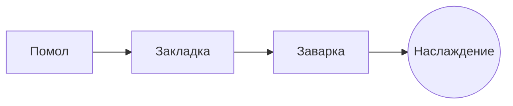

# Идеальный пуровер

Медленный утренний ритуал в несколько шагов. Пишите в **исходном тексте** слева или прямо в *окне просмотра* справа: обе части всегда совпадают, и ==каждая правка — чистое изменение== Markdown.

> [!TIP]
> Вода сразу после кипения, около 94 °C, раскрывает сладость без горечи.

## Пропорция

Большинство рецептов сходятся на одной части кофе на шестнадцать частей воды:

$$
m_{\text{воды}} = 16 \times m_{\text{кофе}}
$$

Так что $20\,\text{г}$ кофе требуют $320\,\text{г}$ воды.

## Шаг за шагом



## Способы заваривания

| Способ      | Помол         | Время |
|:------------|:-------------:|------:|
| Пуровер     | Средне-мелкий |  3:30 |
| Френч-пресс | Крупный       |  4:00 |
| Эспрессо    | Мелкий        |  0:28 |

## Перед началом

- [x] Свежеобжаренные зёрна :coffee:
- [x] Жерновая кофемолка
- [ ] Чайник с узким длинным носиком

```python
def water_for(coffee_g: float, ratio: int = 16) -> float:
    return coffee_g * ratio
```

Закладка
: Первая порция воды, из-за которой молотый кофе выпускает газ.[^1]

[^1]: Свежие зёрна «дышат» сильнее всего; старые почти не поднимаются.
