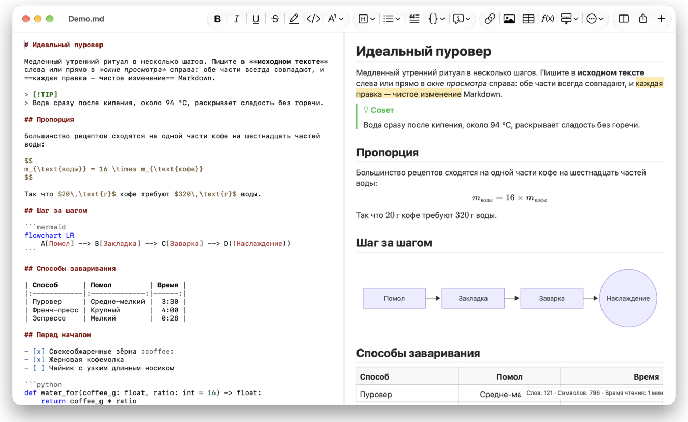
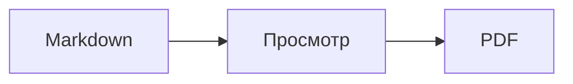

<p>&nbsp;&nbsp;&nbsp;</p>

# Splat

**Редактор Markdown для macOS: пишите в исходном тексте или прямо в окне просмотра.**

Splat показывает слева исходный текст Markdown с подсветкой синтаксиса, а справа — живое окно просмотра, в котором тоже можно редактировать. Печатайте где удобно: всё, что вы пишете в окне просмотра, превращается в минимальное изменение исходного текста, поэтому нетронутые строки остаются байт в байт прежними, а диффы в Git — чистыми. Splat понимает тот Markdown, которым вы уже пользуетесь: CommonMark и GitHub Flavored Markdown, GitHub alerts, вики-ссылки, встраивания и выноски Obsidian, расширения Pandoc и Typora, встроенный HTML, формулы LaTeX и диаграммы Mermaid, Graphviz и PlantUML — всё отображается без сети. Экспорт в PDF, HTML или Word одним щелчком. Приложение написано на Rust с настоящими элементами AppKit, переведено на 35 языков и ничего не отправляет по сети, пока вы сами об этом не попросите.
 


[](https://raw.githubusercontent.com/sventmueller/splat/main/dist/Splat-1.0.5.dmg)

**[Скачать Splat-1.0.5.dmg](https://raw.githubusercontent.com/sventmueller/splat/main/dist/Splat-1.0.5.dmg)**: подписан и заверен Apple, для macOS 14 и новее на Apple Silicon и Intel.
 
 

[](https://www.rust-lang.org)
[](https://www.apple.com/macos/)

[](https://github.com/madsmtm/objc2)
[](https://webkit.org)
[](https://github.com/kivikakk/comrak)
[](https://github.github.com/gfm/)
[](https://www.mathjax.org)
[](https://cortexjs.io/mathlive/)
[](https://mermaid.js.org)
[](https://graphviz.org)
[](https://plantuml.com)


[](#лицензия)

[Bahasa Indonesia](../id/README.md) ·
[Bahasa Melayu](../ms/README.md) ·
[Català](../ca/README.md) ·
[Čeština](../cs/README.md) ·
[Dansk](../da/README.md) ·
[Deutsch](../de/README.md) ·
[English](../../../README.md) ·
[Español](../es/README.md) ·
[Français](../fr/README.md) ·
[Hrvatski](../hr/README.md) ·
[Italiano](../it/README.md) ·
[Magyar](../hu/README.md) ·
[Nederlands](../nl/README.md) ·
[Norsk](../no/README.md) ·
[Polski](../pl/README.md) ·
[Português (Brasil)](../pt_BR/README.md) ·
[Português (Portugal)](../pt_PT/README.md) ·
[Română](../ro/README.md) ·
[Slovenčina](../sk/README.md) ·
[Slovenščina](../sl/README.md) ·
[Suomi](../fi/README.md) ·
[Svenska](../sv/README.md) ·
[Tiếng Việt](../vi/README.md) ·
[Türkçe](../tr/README.md) ·
[Ελληνικά](../el/README.md) ·
**Русский** ·
[Українська](../uk/README.md) ·
[עברית](../he/README.md)‎ ·
[العربية](../ar/README.md)‎ ·
[हिन्दी](../hi/README.md) ·
[ไทย](../th/README.md) ·
[한국어](../ko/README.md) ·
[日本語](../ja/README.md) ·
[简体中文](../zh-Hans/README.md) ·
[繁體中文](../zh-Hant/README.md)

## Содержание

- [Коротко о возможностях](#коротко-о-возможностях)
- [Требования](#требования)
- [Установка](#установка)
- [Начало работы](#начало-работы)
- [Письмо](#письмо)
  - [В исходном тексте](#в-исходном-тексте)
  - [В окне просмотра](#в-окне-просмотра)
  - [Команды форматирования](#команды-форматирования)
  - [Списки и задачи](#списки-и-задачи)
  - [Таблицы](#таблицы)
- [Поддерживаемый Markdown](#поддерживаемый-markdown)
  - [CommonMark и GitHub Flavored Markdown](#commonmark-и-github-flavored-markdown)
  - [Выноски](#выноски)
  - [Расширенный синтаксис](#расширенный-синтаксис)
  - [Obsidian](#obsidian)
  - [Цитаты и ссылки](#цитаты-и-ссылки)
  - [Встроенный HTML](#встроенный-html)
  - [Типографские знаки препинания](#типографские-знаки-препинания)
  - [Обзор синтаксиса](#обзор-синтаксиса)
- [Формулы](#формулы)
- [Диаграммы](#диаграммы)
- [Изображения](#изображения)
- [Ссылки и навигация](#ссылки-и-навигация)
- [Экспорт, печать и отправка](#экспорт-печать-и-отправка)
- [Оформление и универсальный доступ](#оформление-и-универсальный-доступ)
- [Языки](#языки)
- [Сочетания клавиш](#сочетания-клавиш)
- [Конфиденциальность и безопасность](#конфиденциальность-и-безопасность)
- [Большие документы](#большие-документы)
- [Известные ограничения](#известные-ограничения)
- [Устранение неполадок](#устранение-неполадок)
- [Для разработчиков](#для-разработчиков)
  - [Сборка](#сборка)
  - [Распространение](#распространение)
  - [Тестирование](#тестирование)
  - [Структура проекта](#структура-проекта)
  - [Поток данных](#поток-данных)
  - [Правила в контроллере](#правила-в-контроллере)
  - [Добавление команды](#добавление-команды)
  - [Переводы](#переводы)
  - [Сторонние компоненты](#сторонние-компоненты)
- [Лицензия](#лицензия)

## Коротко о возможностях

- **Два способа писать, один текст.** Исходный текст и окно просмотра одинаково редактируются. Единственный источник истины — файл Markdown: у документа одна история отмены, а каждая правка в окне просмотра превращается в наименьшее изменение исходного текста.
- **Тот Markdown, которым вы уже пользуетесь.** CommonMark, GitHub Flavored Markdown, GitHub alerts, Obsidian, расширения Pandoc и Typora, шорткоды эмодзи, спойлеры, списки определений, якоря заголовков и HTML, как в README на GitHub.
- **Формулы и диаграммы внутри.** Формулы LaTeX через MathJax с визуальным редактором формул. Диаграммы Mermaid, Graphviz и PlantUML отображаются на вашем Mac без Java, сервера и подключения к сети.
- **Кнопка на всё.** У каждой конструкции Markdown есть кнопка на панели инструментов и пункт меню, а у самых частых — ещё и сочетание клавиш. Для таблиц есть отдельное меню со строками, столбцами и выравниванием.
- **Экспорт без потерь.** PDF, один самодостаточный файл HTML или документ Word с настоящими заголовками, списками, таблицами, сносками и изображениями.
- **Родное для Mac до мелочей.** Настоящие окна, вкладки, меню и всплывающие окна AppKit, «Версии», автосохранение, меню «Поделиться», тёмное оформление, проверка правописания, диктовка и VoiceOver. Никакого Electron, никакого веб-представления для самого текста.
- **Быстро с большими файлами.** Отрисовка нажатия клавиши в документе на 10 МБ занимает около 25 мс, до собственной работы представления.
- **Приватно и осторожно.** Изображения из интернета загружаются только с вашего разрешения, ссылки на другие приложения сначала спрашивают, а всё, что декодирует недоверенные данные изображений, работает в изолированных вспомогательных процессах.
- **На вашем языке.** Интерфейс и встроенный краткий справочник по Markdown доступны на 35 языках: английском, арабском, венгерском, вьетнамском, голландском, греческом, датском, иврите, индонезийском, испанском, итальянском, каталанском, китайском (упрощённое письмо), китайском (традиционное письмо), корейском, малайском, немецком, норвежском, польском, португальском (Бразилия), португальском (Португалия), румынском, русском, словацком, словенском, тайском, турецком, украинском, финском, французском, хинди, хорватском, чешском, шведском и японском.

## Требования

- macOS 14 Sonoma или новее. Splat разрабатывается и тестируется в macOS 27, где он сам подхватывает оформление Liquid Glass.
- Mac с процессором Apple Silicon или Intel.
- Около 45 МБ места на диске.

## Установка

**Из образа диска.** Скачайте [`dist/Splat-1.0.5.dmg`](https://raw.githubusercontent.com/sventmueller/splat/main/dist/Splat-1.0.5.dmg), откройте его и перетащите Splat в папку «Программы». Образ подписан сертификатом Developer ID и заверен Apple, поэтому открывается без предупреждений.

**Через Homebrew.** Cask находится в собственном tap:

```sh
brew install --cask sventmueller/tap/splat
```

`brew upgrade --cask splat` устанавливает новые версии, а `brew uninstall --zap --cask splat` заодно удаляет настройки и кэш Splat.

**Обновления.** Splat из образа диска или из Homebrew обновляется сам с помощью [Sparkle](https://sparkle-project.org). При втором запуске он спрашивает, можно ли раз в день самостоятельно проверять наличие обновлений. **Splat › Проверить наличие обновлений…** проверяет сразу; **Автоматически проверять наличие обновлений** и **Автоматически загружать и устанавливать обновления** в том же меню позволяют потом изменить выбор. Splat устанавливает обновление, только если оно подписано разработчиком. В собственной сборке средства обновления нет.

**Из исходного кода.** Сначала прочитайте [Building](#сборка) о требованиях, затем выполните:

```sh
make build
ditto target/release/Splat.app /Applications/Splat.app
open /Applications/Splat.app
```

Чтобы файлы Markdown открывались в Splat двойным щелчком, выберите в Finder любой файл `.md`, затем **Файл › Свойства**, укажите Splat в разделе **Открывать в приложении** и нажмите **Настроить…**. Splat сам регистрируется для файлов `.md`, `.markdown`, `.mdown` и `.mkd`.

## Начало работы

### Окно

Каждый документ открывается в собственном окне или во вкладке, если вы предпочитаете вкладки:

- **Слева: исходный текст.** Ваш Markdown шрифтом SF Mono с подсветкой синтаксиса.
- **Справа: окно просмотра.** Готовый документ, который можно редактировать.
- **Боковая панель структуры (по желанию).** Все заголовки в виде дерева; щелчок по заголовку показывает его в обеих частях. Включается через **Вид › Показать структуру** (⌃⌘S).
- **Панель инструментов.** Кнопки сгруппированы по тому, что они меняют: символы, абзацы и вставляемые элементы, затем показ окна просмотра, «Поделиться» и «Новый документ». Настройка: **Вид › Настроить панель инструментов…**.

Перетащите разделитель, чтобы дать больше места любой из сторон. **Вид › Скрыть окно просмотра** (⌥⌘P) оставляет только исходный текст; Splat запоминает это для каждого окна. Обе части прокручиваются вместе, а выделение в одной из них подсвечивается в другой.

### Документы, вкладки и версии

Splat — обычное документное приложение macOS:

- **Автосохранение и «Версии».** Изменения сохраняются на месте. **Файл › Вернуть к версии › Просмотреть все версии…** возвращает во времени.
- **Изменения из других программ.** Когда Git, скрипт или другой редактор меняет открытый документ, Splat перезагружает его и сохраняет положение курсора и прокрутки. Если у вас есть собственные несохранённые изменения, Splat оставляет их, а macOS спрашивает, прежде чем перезаписать другую версию.
- **Обычные команды для файлов.** Дублировать (⇧⌘S), Переименовать…, Переместить в… и **Файл › Открытие недавних**.
- **Вкладки.** **Файл › Новая вкладка** или кнопка **+** на панели инструментов открывает новый документ во вкладке; стандартное меню «Окно» объединяет, перемещает и переключает вкладки.
- **Расположение окон.** Размер и положение последнего окна запоминаются, в том числе между запусками. Если там уже стоит окно, новое открывается с небольшим смещением.
- **Значок в Dock.** Щелчок по нему после закрытия последнего окна открывает новый документ.
- **Открывать файлы Markdown в Splat.** **Splat › Назначить приложением по умолчанию для Markdown** делает так, что двойной щелчок по файлу `.md` или `.markdown` открывает Splat; macOS один раз просит подтвердить. Пока Splat назначен по умолчанию, рядом с пунктом стоит галочка.

Файлы должны быть текстом в кодировке UTF-8 или UTF-16 с меткой порядка байтов. Другие кодировки Splat отклоняет, а не угадывает, чтобы не испортить текст. Метка порядка байтов сохраняется, UTF-16 остаётся UTF-16, а в файле, где все строки заканчиваются на CRLF, добавляемые вами строки тоже получают CRLF.

**После сбоя** теряются самое большее последние несколько секунд набора: каждые пять секунд Splat копирует несохранённый текст в `~/Library/Application Support/Splat/Unsaved` и удаляет копии, когда документ сохранён или Splat нормально завершил работу. При следующем запуске то, что сбой оставил в этой папке, переносится в `~/Library/Application Support/Splat/Recovery`, о чём один раз сообщается с кнопкой, открывающей папку. Если Splat при сбое ещё может отреагировать, он записывает туда и текст каждого открытого документа.

### Краткий справочник

**Справка › Краткий справочник по Markdown** открывает шпаргалку на вашем языке как новый документ без названия. Это обычный документ, поэтому всё можно попробовать прямо в нём, в исходном тексте или в окне просмотра.

## Письмо

### В исходном тексте

Исходный текст — это простой текстовый редактор, настроенный под Markdown:

- **Цвета синтаксиса** как в VS Code: заголовки, выделение, ссылки, код, таблицы, HTML, front matter, а также LaTeX и Mermaid внутри формул и диаграмм. Есть палитры для светлого и тёмного оформления и для режима «Увеличить контраст».
- **Ограждённые блоки кода** подсвечиваются для Bash, C, C++, C#, CSS (также SCSS и Less), Go, HTML, XML, Java, JavaScript, JSON, Kotlin, PHP, Python, Ruby, Rust, SQL, Swift, TypeScript, YAML, TeX и Mermaid, включая их привычные короткие названия, например `js`, `py` или `sh`.
- **Никаких неожиданных замен.** Смарт-кавычки, смарт-тире и замена текста по умолчанию выключены, потому что они портят `--`, `---` и `"`. Включить их можно в **Правка › Замены**.
- **Системные средства для письма.** Проверка правописания и грамматики, диктовка, «Найти и заменить…» (⌥⌘F) и проговаривание текста.
- **Перетаскивание.** Перетащите файл изображения, чтобы вставить ``, любой другой файл — чтобы вставить ссылку на него, а URL — чтобы вставить `[url](url)`. Каждое перетаскивание — один шаг отмены.
- **Вставка изображений.** Картинка из буфера обмена, например снимок экрана, сохраняется как файл PNG рядом с документом (`Изображение 2026-10-29 13.09.07.png`) и вставляется как изображение. Для этого документ нужно один раз сохранить.

### В окне просмотра

Окно просмотра работает как текстовый процессор, но всё, что вы в нём делаете, в итоге становится Markdown:

- **Набор текста.** Символы, имеющие в Markdown особый смысл, например `*` или `#`, экранируются, чтобы выглядеть так, как набраны.
- **Return** начинает новый абзац или пункт списка. **⌥Return** или **⌃Return** вставляет разрыв строки.
- **Форматирование у курсора.** Если курсор стоит в конце слова, «Жирный», «Курсив» и другие форматы символов применяются к тому, что вы напечатаете дальше. Выберите формат ещё раз, чтобы отключить его. Внутри слова форматируется всё слово.
- **Пустые строки.** Return на пустой строке добавляет ещё одну пустую строку, а Delete удаляет её. В исходном тексте каждая такая лишняя пустая строка — это две дополнительные пустые строки; другие программы для Markdown показывают их как обычный отступ между абзацами.
- **Отменить** действует в обеих частях. У пунктов отмены есть названия («Отменить: Жирный»), набор текста отменяется по одному шагу на непрерывный ввод, а после «Отменить» и «Повторить» обе части прокручиваются к изменению.
- **Формулы и диаграммы** отображаются как готовая графика. Нажмите на неё, переместите на неё курсор или нажмите на ней Return, чтобы открыть редактор (см. [Formulas](#формулы) и [Diagrams](#диаграммы)).
- **Встроенный HTML, встроенные заметки и front matter** показываются, но редактируются в исходном тексте. Щелчок по ним ставит курсор в соответствующее место там.

Всё, что Markdown выразить не может, в окне просмотра заблокировано: панели «Шрифты» и «Цвета», линейка, а также вставка и перетаскивание форматированного текста и изображений. Вставленные HTML и RTF попадают как простой текст.

### Команды форматирования

Каждая команда доступна на панели инструментов, в строке меню и в контекстном меню обеих частей. Пункты меню показывают галочку для форматирования у курсора.

| Меню | Команды |
|---|---|
| **Формат › Шрифт** | Жирный, Курсив, Подчеркнутый, Зачеркнутый, Выделить, Код, Надстрочный, Подстрочный |
| **Формат › Заголовок** | Основной текст, Заголовки 1–6 |
| **Формат › Список** | Маркированный список, Нумерованный список, Список задач |
| **Формат** | Цитата, Блок кода (Без языка или один из 20 языков; также меняет язык существующего блока), Выноска (Заметка, Совет, Важно, Внимание, Осторожно; тот же тип ещё раз убирает её), Изменить формулу или диаграмму…, Удалить форматирование |
| **Вставка** | Ссылка…, Изображение…, Таблица…, Формула, Диаграмма (Блок-схема, Диаграмма последовательности, Диаграмма Ганта), Оглавление, Сноска, Горизонтальная линия |
| **Таблица** | Вставить строку выше/ниже, Вставить столбец слева/справа, Удалить строку, Удалить столбец, Выравнивание (Выровнять по левому краю, Выровнять по центру, Выровнять по правому краю, По умолчанию), Выровнять столбцы таблицы |
| **Вид** | Скрыть/Показать окно просмотра, Показать/Скрыть структуру, Типографские знаки препинания, Увеличить/Уменьшить, Реальный размер, панель инструментов, панель вкладок, полноэкранный режим |

Подчёркивание, выделение, надстрочный и подстрочный текст записываются как `<ins>`, `<mark>`, `<sup>` и `<sub>`, которые GitHub тоже показывает. Splat читает также `<u>`, который GitHub удаляет, и более короткие `==выделение==`, `^над^` и `~под~`. GitHub показывает `==` и `^` как набрано, а `~под~` — как зачёркнутый текст.

### Списки и задачи

- Return продолжает список; Return на пустом пункте завершает его.
- **Tab** и **⇧Tab** увеличивают и уменьшают отступ пунктов списка в окне просмотра.
- Щелчок по флажку задачи в окне просмотра переключает `- [ ]` и `- [x]`.
- **Формат › Список** превращает выбранные абзацы в список или меняет его вид.

### Таблицы

- **Вставка › Таблица…** запрашивает число строк (включая заголовок) и столбцов.
- В окне просмотра **Tab** переходит к следующей ячейке, **⇧Tab** — к предыдущей, а **Return** — к ячейке ниже. Tab в последней ячейке добавляет строку.
- Меню **Таблица** вставляет и удаляет строки и столбцы и задаёт выравнивание столбца (⌘{, ⌘|, ⌘}).
- **Таблица › Выровнять столбцы таблицы** дополняет исходный текст пробелами, чтобы столбцы стояли ровно.

## Поддерживаемый Markdown

Splat разбирает текст с помощью [comrak](https://github.com/kivikakk/comrak) — парсера, совместимого с CommonMark и GFM, — и включает большинство его расширений. Всё перечисленное ниже отображается в окне просмотра и во всех видах экспорта.

### CommonMark и GitHub Flavored Markdown

- Заголовки (`#` и с подчёркиванием), абзацы, разрывы строк, выделение, усиленное выделение, код в строке, цитаты, горизонтальные линии.
- Маркированные, нумерованные и вложенные списки; списки задач.
- Ссылки (в строке, по ссылке-идентификатору и автоматические), изображения, определения ссылок.
- Ограждённые блоки кода и блоки кода с отступом, с подсветкой синтаксиса.
- Таблицы с выравниванием столбцов.
- Зачёркивание с помощью `~~двух тильд~~`.
- Сноски: `текст[^1]` и `[^1]: Примечание.` в любом месте документа. Щелчок по маркеру переходит к примечанию.
- YAML front matter между строками `---` в начале. Окно просмотра сводит его к одной строке, например «Метаданные: title, date, tags».

### Выноски

GitHub alerts отображаются как цветные блоки со значком и заголовком:

```markdown
> [!NOTE]
> Полезная информация, которую стоит знать пользователям.

> [!WARNING]
> Важное содержание, требующее немедленного внимания.
```

Пять типов — Заметка, Совет, Важно, Внимание и Осторожно. **Формат › Выноска** превращает в такой блок абзац у курсора.

Выноски Obsidian тоже работают, с любым заголовком и состоянием сворачивания:

```markdown
> [!tip]- Нажмите ▸, чтобы развернуть
> Скрыто, пока не откроете.

> [!question]+ Открыто по умолчанию
> `+` начинает в развёрнутом виде, `-` — в свёрнутом.
```

Остальные типы Obsidian показываются ближайшим из пяти цветов: `success`, `check`, `done` и `hint` как Совет; `question`, `help` и `faq` как Важно; `attention` как Внимание; `failure`, `fail`, `missing`, `danger`, `error` и `bug` как Осторожно; всё остальное как Заметка.

### Расширенный синтаксис

| Возможность | Синтаксис | Откуда |
|---|---|---|
| Выделение | `==выделенный текст==` | Obsidian, Typora |
| Надстрочный | `x^2^` | Pandoc, Typora |
| Подстрочный | `H~2~O` | Pandoc, Typora |
| Шорткод эмодзи | `:rocket:` превращается в 🚀 | GitHub |
| Спойлер | `\|\|скрытый текст\|\|`, выделите, чтобы прочитать | Discord |
| Сноска в строке | `текст^[сама сноска]` | Pandoc, Obsidian |
| Список определений | `Термин`, пустая строка, `: Пояснение` | PHP Markdown Extra, Pandoc |
| Якорь заголовка | `## Установка {#setup}`, ссылка `[см.](#setup)` | Pandoc, kramdown |

В исходном тексте списки определений выглядят так:

```markdown
Термин

: Пояснение термина.
```

Если собственного якоря нет, каждый заголовок получает якорь, образованный от его текста, как на GitHub: `## Начало работы` доступен как `#начало-работы`.

### Obsidian

- **Вики-ссылки.** `[[Заметка]]` ссылается на `Заметка.md` в той же папке или во вложенной. `[[Заметка|Отображаемый текст]]` показывает ваш собственный текст, а `[[Заметка#Заголовок]]` открывает заметку. Нажатие с ⌘ открывает её в Splat.
- **Встраивания.** `![[Заметка]]` показывает другую заметку внутри этой; заметки, встроенные в неё, отображаются как ссылки. `![[diagram.png]]` показывает изображение. Как и в Obsidian, встраивания называют заметки и изображения из папки документа или вложенных, но никогда не по абсолютному пути, а как заметки показываются только файлы Markdown.
- **Комментарии.** `%%Только в исходном тексте%%` остаётся видимым в исходном тексте и не попадает ни в окно просмотра, ни в какой-либо экспорт — как в строке, так и на отдельных строках.
- **Теги.** `#идея` или `#проект/splat` выделяются. Нажатие с ⌘ ищет тег в документе.
- **Сворачиваемые выноски.** См. [Callouts](#выноски).

### Цитаты и ссылки

- **Цитаты Pandoc.** `[@doe2020]` или `[@doe2020; @roe2021]` читается как «(Doe 2020; Roe 2021)». Записи берутся из файла BibTeX, который front matter называет как `bibliography: refs.bib`. Если его нет, Splat использует `references.bib`, `literatur.bib` или `bibliography.bib` рядом с документом.
- **Ссылки на GitHub и GitLab.** Если документ лежит в репозитории Git, у которого удалённый репозиторий `origin` находится на github.com или на хосте GitLab, выделяются `@name`, `#12` (задача) и `!7` (merge request, только GitLab). Нажатие с ⌘ открывает их в браузере.

### Встроенный HTML

HTML в том виде, в каком он встречается в README на GitHub, отображается собственным анализатором, а не движком браузера:

- абзацы и блоки по центру (`<p align="center">`, `<div align="center">`)
- изображения с размером (``)
- ссылки, `<kbd>⌘</kbd>`, `<br>`, `<u>`, `<ins>`, `<mark>`, `<sup>`, `<sub>`
- списки и таблицы, включая ячейки, объединяющие столбцы (`colspan`)
- сворачиваемые разделы: `<details><summary>Ещё</summary>…</details>`, открываются щелчком по ▸

Markdown между тегами HTML отображается как Markdown. Скрипты, стили, фреймы и формы полностью отбрасываются, а в ссылках и изображениях остаются только адреса `http`, `https`, `mailto` и относительные.

### Типографские знаки препинания

**Вид › Типографские знаки препинания** показывает прямые кавычки как кавычки языка интерфейса, `--` как короткое тире, `---` как длинное тире, а `...` как многоточие. В немецком `"Ja"` становится „Ja“, во французском «Oui», в японском 「はい」, в том числе там, где китайский и японский набирают кавычки без пробела; ивритские сокращения вроде `צה"ל` получают гершаим, צה״ל. Исходный текст сохраняет простые символы; окно просмотра и все виды экспорта показывают типографские. Пока вы не включите этот параметр, он выключен.

### Обзор синтаксиса

| Элемент | Markdown |
|---|---|
| **Жирный** | `**Жирный**` |
| *Курсив* | `*Курсив*` |
| Подчеркнутый | `<ins>Подчеркнутый</ins>` или `<u>Подчеркнутый</u>` |
| ~~Зачеркнутый~~ | `~~Зачеркнутый~~` |
| Выделение | `<mark>Выделение</mark>` или `==Выделение==` |
| `Код` | `` `Код` `` |
| x² | `x<sup>2</sup>` или `x^2^` |
| H₂O | `H<sub>2</sub>O` или `H~2~O` |
| [Ссылка](https://example.com) | `[Ссылка](https://example.com)` |
| Заголовок | `# Заголовок` до `###### Заголовок` |
| Цитата | `> Цитата` |
| Маркированный список | `- Пункт` |
| Нумерованный список | `1. Пункт` |
| Задача | `- [ ] Открыта` и `- [x] Выполнена` |
| Блок кода | ```` ```rust ```` … ```` ``` ```` |
| Таблица | `\| A \| B \|` и `\|---\|---\|` под заголовком |
| Сноска | `Текст[^1]` и `[^1]: Примечание` |
| Горизонтальная линия | `---` |
| Изображение | `` |
| Формула | `$E = mc^2$`, `$$ … $$` |
| Диаграмма | ```` ```mermaid ````, ```` ```dot ````, ```` ```plantuml ```` |
| Выноска | `> [!TIP]` |
| Вики-ссылка | `[[Заметка]]`, `[[Заметка\|Текст]]` |
| Встраивание | `![[Заметка]]`, `![[image.png]]` |
| Комментарий | `%%Комментарий%%` |
| Тег | `#тег` |
| Цитата из источника | `[@key]` |
| Спойлер | `\|\|Спойлер\|\|` |
| Эмодзи | `:tada:` |

## Формулы

Формулы отображаются с помощью [MathJax](https://www.mathjax.org) с его TeX и математикой AMS в виде чёткой векторной графики. Текст в `\text{…}` может быть на любом письме: чего не хватает шрифтам MathJax, берётся из шрифтов вашего Mac, причём арабский и иврит идут справа налево, а эмодзи — цветные.

| Вид | Синтаксис |
|---|---|
| В строке | `$E = mc^2$`, `` $`E = mc^2`$ `` (GitHub, GitLab), `\(E = mc^2\)` |
| Отдельной строкой | `$$` … `$$`, `\[` … `\]` или блок кода с пометкой `math` |

**Редактирование формулы.** Нажмите на формулу в окне просмотра, дважды щёлкните по ней, нажмите на ней Return или переместите на неё курсор, чтобы открыть редактор во всплывающем окне. **Вставка › Формула** вставляет новую и сразу открывает редактор.

- **Визуально или LaTeX.** Переключатель вверху меняет визуальный редактор ([MathLive](https://cortexjs.io/mathlive/)) на код LaTeX и обратно. Splat запоминает ваш выбор.
- **Готовые блоки** для дроби, квадратного корня, надстрочного и подстрочного индекса, суммы и интеграла с пределами, предела, скобок, растущих вместе с содержимым, матрицы 2×2, греческих букв, а также отношений, операторов и стрелок. Они оставляют заполнители □, и **Tab** переходит к следующему.
- **Живой просмотр.** Изменения появляются в документе во время набора. Ошибки MathJax показываются в строке под кодом.
- **Принять или отменить.** Щелчок снаружи сохраняет изменение как один шаг отмены; **Esc** или **Отменить** отбрасывает его. Esc на новой пустой формуле удаляет её.
- В контекстном меню для формулы под указателем есть **Изменить формулу…**.

VoiceOver читает формулу как её код LaTeX. Splat отображает формулы, а не целые документы LaTeX: пакетов, TikZ и `\documentclass` нет.

## Диаграммы

Диаграммы отображаются внутри Splat, без сети, в светлом и тёмном вариантах.

| Движок | Блок кода | Что рисует |
|---|---|---|
| [Mermaid](https://mermaid.js.org) | ```` ```mermaid ```` | блок-схемы, диаграммы последовательности, классов, состояний, «сущность — связь», Ганта, круговые, ментальные карты, временные шкалы и все остальные типы Mermaid |
| [Graphviz](https://graphviz.org) | ```` ```dot ```` или ```` ```graphviz ```` | графы на языке DOT |
| [PlantUML](https://plantuml.com) | ```` ```plantuml ```` или ```` ```puml ```` | диаграммы UML; работает без Java |



**Редактирование диаграммы** устроено как редактирование формулы: нажмите на неё, чтобы открыть код во всплывающем окне, с подсветкой синтаксиса и сообщениями об ошибках в строке под кодом. **Вставка › Диаграмма** начинает с шаблона блок-схемы, диаграммы последовательности или диаграммы Ганта. Готовые блоки помогают с тремя самыми частыми типами Mermaid:

- **Блок-схема:** Узел ▾ (прямоугольник, скруглённый, круг, ромб, база данных), Связь, Связь с подписью, Группа, Направление ▾
- **Диаграмма последовательности:** Участник, Сообщение, Ответ, Заметка, Цикл, Альтернативные пути
- **Диаграмма Ганта:** Раздел, Задача, Веха

Другие типы диаграмм редактируются как код. VoiceOver читает заголовок диаграммы или её альтернативный текст.

Первая диаграмма после запуска занимает около секунды, потому что движок отображения запускается в фоновом режиме. Диаграмма, которая отображается дольше 10 секунд, показывает ошибку, а движок для следующей запускается заново. Движок PlantUML (7 МБ) загружается только вместе с первой диаграммой PlantUML. PlantUML `!include` из интернета заблокирован.

## Изображения

- **Локальные изображения** используют пути относительно документа: ``. Splat показывает PNG, JPEG, GIF, WebP, BMP, SVG, HEIC, TIFF, AVIF и PDF.
- **Изображения из интернета** остаются заблокированными, пока вы их не разрешите: полоса над окном просмотра объясняет, что при их загрузке серверы узнают, что и когда вы открываете документ. **Загрузить изображения** разрешает их для этого документа; Splat запоминает выбор для каждого файла.
- **Размер.** `` задаёт размер изображения; в остальных случаях изображения вписываются в ширину окна просмотра.
- **Изменения на диске.** Изображение, которое вы заменили, или то, что появилось уже после того, как документ его назвал, показывается без повторного открытия документа. Изображения из интернета, которые не загрузились из-за сети, пробуются снова, пока документ их показывает.
- **Память.** Изображения показываются размером до 2560 пикселей по длинной стороне, чего хватает и для страницы A4. Они декодируются меньше, когда занимают восьмую часть памяти Mac, и пока macOS сообщает о нехватке памяти.
- **Тёмное оформление.** Изображения с белым фоном в тёмном окне просмотра слегка затемняются.
- **Вставка и перетаскивание.** См. [In the source](#в-исходном-тексте).

## Ссылки и навигация

В окне просмотра щелчок ставит курсор, чтобы можно было править текст ссылки; **нажатие с ⌘** переходит по ссылке:

- `http`, `https` и `mailto` открываются в браузере или почтовой программе.
- Файлы Markdown открываются в Splat; другие файлы и папки показываются в Finder.
- `#якорь` переходит к заголовку в документе.
- Адреса, открывающие другое приложение, например `slack://` или `vscode://`, сначала спрашивают и показывают полный адрес и приложение. Кнопка **Отменить** выбрана заранее.

**Вставка › Оглавление** вставляет список ссылок на все заголовки. Если курсор стоит внутри него, та же команда обновляет его. Боковая панель структуры (⌃⌘S) переходит к любому заголовку в обеих частях.

## Экспорт, печать и отправка

| Формат | Как | Что получится |
|---|---|---|
| **PDF** | **Файл › Экспортировать как PDF…** или меню «Поделиться» | Страницы формата бумаги, всегда в светлом оформлении, формулы и диаграммы как векторная графика. **Файл › Параметры страницы…** задаёт бумагу. |
| **Печать** | **Файл › Напечатать…** (⌘P) | Тот же макет, что и у PDF. |
| **HTML** | **Файл › Экспортировать как HTML…** или меню «Поделиться» | Один самодостаточный файл: локальные изображения встроены, формулы и диаграммы как чёткие изображения, якоря заголовков, чтобы работало оглавление. Без скриптов. |
| **Word** | **Файл › Экспортировать как документ Word…** или меню «Поделиться» | Файл `.docx` со стилями заголовков Word, настоящими списками и таблицами (включая объединённые ячейки), сносками как сноски Word, встроенными изображениями, формулами и диаграммами. |
| **Markdown** | Кнопка **Поделиться** на панели инструментов | Документ как файл `.md` для Почты, Сообщений, AirDrop и любой другой службы отправки. |

Меню **Файл › Поделиться** предлагает всё это в одном месте. Экспорт учитывает параметр типографских знаков препинания и изображения из интернета, которые вы разрешили; в HTML изображения из интернета остаются ссылками.

## Оформление и универсальный доступ

- **Тёмное оформление** следует системному. Формулы и диаграммы отображаются для каждого оформления.
- **Увеличить контрастность** в Системных настройках переключает цвета синтаксиса на высококонтрастные палитры.
- **Масштаб.** ⌘+, ⌘− и ⌘0 масштабируют обе части.
- **Полноэкранный режим, вкладки и настраиваемая панель инструментов**, как в любом приложении для Mac.
- **VoiceOver.** Части подписаны «Исходный текст Markdown» и «Просмотр», формулы читаются как их код, а диаграммы — как их заголовок. Любая команда доступна с клавиатуры.

В Splat нет окна настроек: немногочисленные параметры находятся там, где они применяются, — в меню **Вид** и **Правка › Замены**.

## Языки

Интерфейс, меню и краткий справочник по Markdown переведены на 35 языков:

английский, арабский, венгерский, вьетнамский, голландский, греческий, датский, иврит, индонезийский, испанский, итальянский, каталанский, китайский (упрощённое письмо), китайский (традиционное письмо), корейский, малайский, немецкий, норвежский, польский, португальский (Бразилия), португальский (Португалия), румынский, русский, словацкий, словенский, тайский, турецкий, украинский, финский, французский, хинди, хорватский, чешский, шведский и японский.

Splat следует порядку языков в **Системные настройки › Основные › Язык и регион**; там же в разделе **Приложения** можно выбрать язык только для Splat. Если вашего языка нет среди переводов, используется английский. Термины меню следуют переводам самой Apple, поэтому Splat читается как остальная часть вашего Mac.

Текст на иврите и арабском читается справа налево везде, где он встречается, независимо от языка интерфейса: каждый абзац, заголовок и пункт списка получает направление по первой букве, цитаты и выноски рисуют полосу справа, а таблица, текст которой начинается справа налево, перечисляет столбцы справа. Блоки кода остаются слева направо. Экспорт в PDF, HTML и Word сохраняет эти направления. Если системный язык — иврит или арабский, macOS зеркально отражает и окно, так что окно просмотра оказывается слева.

## Сочетания клавиш

| Действие | Сочетание |
|---|---|
| Жирный, курсив, подчёркнутый | ⌘B, ⌘I, ⌘U |
| Зачёркнутый | ⇧⌘X |
| Ссылка… | ⌘K |
| Основной текст, заголовки 1–6 | ⌥⌘0, от ⌥⌘1 до ⌥⌘6 |
| Выровнять столбец таблицы по левому краю, по центру, по правому краю | ⌘{, ⌘\|, ⌘} |
| Скрыть или показать окно просмотра | ⌥⌘P |
| Показать или скрыть структуру | ⌃⌘S |
| Увеличить, уменьшить, реальный размер | ⌘+, ⌘−, ⌘0 |
| Новый документ, открыть, сохранить, дублировать | ⌘N, ⌘O, ⌘S, ⇧⌘S |
| Параметры страницы, печать | ⇧⌘P, ⌘P |
| Найти, найти и заменить | ⌘F, ⌥⌘F |
| Найти далее, ранее; найти выбранное; перейти к выбранному | ⌘G, ⇧⌘G; ⌘E; ⌘J |
| Показать правописание и грамматику; проверить документ | ⌘:, ⌘; |
| Вставить и согласовать стиль | ⌥⇧⌘V |
| Скрыть панель инструментов, показать все вкладки, полноэкранный режим | ⌥⌘T, ⇧⌘\\, ⌃⌘F |
| Разрыв строки (окно просмотра) | ⌥Return или ⌃Return |
| Следующая / предыдущая ячейка в таблице (окно просмотра) | Tab / ⇧Tab |
| Увеличить / уменьшить отступ пункта списка (окно просмотра) | Tab / ⇧Tab |
| Следующий заполнитель в редакторе формул | Tab |
| Закрыть редактор формул или диаграмм без изменений | Esc |
| Перейти по ссылке, тегу или упоминанию (окно просмотра) | нажатие с ⌘ |

Стандартные сочетания клавиш Apple Splat оставляет на своих местах.

## Конфиденциальность и безопасность

Файл Markdown может прийти от кого угодно, поэтому Splat считает каждый документ недоверенным.

- **По умолчанию без сети.** В Splat нет телеметрии. Обновления он ищет только после вашего согласия или по команде **Проверить наличие обновлений…**: тогда он загружает с GitHub небольшой файл ленты, а запрос называет лишь приложение и его версию. Формулы и диаграммы отображаются локально; веб-представления, которые этим занимаются, не имеют доступа к сети.
- **Изображения из интернета** загружаются только с вашего разрешения, только по `https`, никогда с хостов вашей локальной сети, не больше 10 МБ каждое и в приватном сеансе без cookie.
- **Изолированное декодирование.** Изображения и графика формул и диаграмм декодируются во вспомогательных процессах, которые закрывают все унаследованные файлы и запираются в песочнице до чтения первого байта: ни доступа к файлам, ни сети. Они возвращают только пиксели, размер которых проверяется, и останавливаются через 10 секунд. Собственные декодеры изображений Apple видят только HEIC, TIFF, AVIF и PDF, и только когда данные действительно в этом формате; они работают в отдельном вспомогательном процессе, которому дополнительно разрешено читать системные папки шрифтов и использовать системный видеодекодер. SVG, формулы и диаграммы тоже проходят через этот процесс, поэтому в Splat они представляют собой картинки с фиксированным разрешением: четыре пикселя на пункт, до 2560 по длинной стороне.
- **Локальные файлы** попадают в документ только по пути, который он называет. Встраивания показывают заметки Markdown из папки документа и вложенных, а недостающую картинку ищут только там. Путь к изображению в другом месте, абсолютный или начинающийся с `~`, по-прежнему загружается, и экспорт в HTML и Word встраивает его: посмотрите на экспорт документа, который писали не вы, прежде чем передавать его дальше.
- **Копии несохранённого текста** остаются на этом Mac, в вашей папке «Библиотека», для восстановления после сбоя. Они исчезают при сохранении или нормальном завершении Splat; копии, оставленные сбоем, лежат в папке восстановления, пока вы их не удалите.
- **Ссылки** никогда не запускают программу по щелчку. Ссылки в интернет и на почту открываются как обычно; ссылки на другие приложения сначала спрашивают.
- **HTML в документах** читается собственным анализатором Splat. Скрипты, стили, фреймы и формы никогда не выполняются.
- **Экспорт** не содержит скриптов. Страницы HTML сохраняют только фиксированный список безвредных тегов и атрибутов, как на GitHub, а также политику безопасности содержимого. Файлы Word ссылаются только на адреса `http`, `https` и `mailto`.
- **Подпись кода** с Hardened Runtime. Splat работает без App Sandbox, чтобы показывать изображения рядом с вашими документами, не спрашивая про каждую папку; изоляция всего декодирования это компенсирует.

## Большие документы

Splat остаётся отзывчивым с документами в несколько мегабайт:

- Исходный текст использует TextKit 2, который размечает только видимую часть.
- Пока вы печатаете в окне просмотра, а также в исходном тексте документов до 2 МБ, заново разбираются, раскрашиваются и размечаются только затронутые абзацы. В документе на 10 МБ разбор и раскраска занимают около 20 мс, отрисовка около 25 мс, а нажатие клавиши целиком в его окне просмотра около 60 мс, вместе с собственной работой представления.
- Большие окна просмотра сначала отображают видимую часть, а остальное — пока приложение простаивает. Блоки, прокрученные в поле зрения, отображаются до того, как будут нарисованы.
- В исходном тексте больших документов разбор для окна просмотра идёт в фоне, пока вы печатаете.
- Документ остаётся простым текстом, если ему потребовалось бы около 4 ГБ памяти (примерно 50–120 МБ обычного Markdown, но всего 10–20 МБ, если в нём только таблицы или заголовки): у исходного текста нет цветов, а окно просмотра объясняет, почему оно остаётся пустым. Экспорт по-прежнему работает.
- Начиная примерно с 200 КБ документ открывает окно до разбора; при 5 МБ цвета и окно просмотра появляются примерно на четверть секунды позже.

Некоторые изменения обрабатываются целиком, примерно по 300 мс на нажатие клавиши при 10 МБ: это изменения определения или ссылок сноски, рядом со сноской в строке, в самом конце документа рядом со сноской, в front matter или рядом с определениями ссылок, а также любое изменение в документе с блоками комментариев `%%` или со сноской, определённой дважды или внутри цитаты или списка. Память растёт вместе с файлом: примерно 115–160 МБ на 1 МБ Markdown и 340–510 МБ на 10 МБ.

## Известные ограничения

- **Одинарная тильда означает подстрочный текст.** `~текст~` — подстрочный текст, как в Pandoc; для зачёркивания нужно `~~две~~`. GitHub зачёркивает и одной тильдой.
- **Только чтение в окне просмотра:** встроенный HTML, встроенные заметки и front matter редактируются в исходном тексте.
- **Очень глубокая вложенность:** HTML, вложенный глубже 64 уровней, и HTML в строке глубже 16 уступают место своему содержимому.
- **Объединённые ячейки таблицы** есть только в таблицах HTML и только по столбцам (`colspan`, без `rowspan`). Синтаксис таблиц MultiMarkdown для объединённых ячеек не поддерживается.
- **Библиографии** читаются только из BibTeX, не из CSL JSON и не из YAML.
- **Упоминания** требуют репозитория на github.com или на хосте GitLab; `!7` существует только в GitLab.
- **Типографские знаки препинания:** немецкую закрывающую одинарную кавычку нельзя отличить от апострофа, и она ставится как ’.
- **Формулы, а не документы:** никаких пакетов LaTeX, TikZ и целых документов.
- **Визуальный редактор формул** записывает LaTeX в нотации MathLive: пробелы исчезают (`E = mc^2` становится `E=mc^2`), отображение остаётся тем же.
- **По замыслу:** нет номеров строк, нет окна настроек, нет справочной книги Help Book, нет в App Store.
- **На Intel проверено меньше.** Самотесты окон идут только на Apple Silicon; на Intel CI запускает `cargo test`.

## Устранение неполадок

**Список недавних документов пуст после пересборки Splat.** macOS привязывает недавние документы и разрешения для папок к подписи кода приложения. Локальные сборки подписываются сертификатом «Splat Local Signing» в вашей связке ключей входа, поэтому при пересборке то и другое сохраняется. Если сертификат был удалён, следующая сборка создаст новый, и списки начнутся заново один раз.

**Приложение из образа диска показывает другие недавние документы, чем моя собственная сборка.** У них разные подписи, поэтому macOS ведёт для каждой отдельный список и отдельные разрешения для папок.

**HTML или другой синтаксис показывается как обычный код.** Возможно, документ открыла устаревшая копия Splat. Завершите её, выберите **Файл › Свойства** для документа в Finder и проверьте, что в разделе **Открывать в приложении** указан Splat из вашей папки «Программы».

**В меню Splat нет пункта «Проверить наличие обновлений…».** Сам обновляется только версия из образа диска или из Homebrew; в собственной сборке средства обновления нет.

**Изображения из интернета не появляются.** Нажмите **Загрузить изображения** в полосе над окном просмотра. Загружаются только изображения по `https` с публичных хостов.

**При вставке снимка экрана просят сначала сохранить документ.** Вставленные изображения сохраняются как файлы рядом с документом, для чего нужно место на диске. Сохраните документ и вставьте снова.

**«Файл не является текстом в кодировке UTF-8».** Файл в другой кодировке, и у него нет метки порядка байтов, которая бы её назвала. Сначала преобразуйте его, например так: `iconv -f ISO-8859-1 -t UTF-8 old.md > new.md`.

**Формула или диаграмма показывает ошибку.** Нажмите на неё: редактор покажет под кодом сообщение MathJax, Mermaid, Graphviz или PlantUML.

## Для разработчиков

Splat — приложение на Rust, которое обращается к AppKit и WebKit напрямую через [objc2](https://github.com/madsmtm/objc2). Здесь нет Swift, нет Objective-C, нет проекта Xcode и нет файлов Interface Builder.

### Сборка

Требования:

- macOS с Command Line Tools (`xcode-select --install`). Xcode не нужен; Splat собирается без `actool`, `ibtool` и `metal`.
- Rust 1.99 (`brew install rust`). [rust-toolchain.toml](../../../rust-toolchain.toml) называет точную версию, которую использует CI; rustup устанавливает её сам, Rust из Homebrew этот файл игнорирует. Повышение версии там — способ, которым в проект попадают новые предупреждения компилятора и clippy.
- rustup — для `make lint`, `make check` и `make universal`: `cargo xtask check-library` собирает библиотеку для Linux, чтобы показать, что ей не нужен macOS, а у Rust из Homebrew других целей нет.

В [Makefile](../../../Makefile) собраны короткие точки входа; `make help` перечисляет их все:

```sh
make build                  # target/release/Splat.app, то же, что cargo xtask bundle --release
make universal              # target/splat-universal для Apple Silicon и Intel, как в образе диска
make check                  # форматирование, clippy без предупреждений, все тесты, вендорные библиотеки; то, что запускает CI
make test                   # make check, затем самотест без окна
make test-gui               # самотесты с окном; занимают Mac примерно на четыре минуты
make test-long              # более долгий случайный поиск и проверка частичного обновления на 10 МБ
make coverage               # покрытие строк всеми тестами и самотестами, с нижней границей для каждого модуля
make coverage-library       # те же границы для модулей без окна, как в CI
make bench FILE=<file.md>   # время открытия, набора и прокрутки большого файла
make release                # сначала make test, затем заверенный образ диска
```

Сама логика сборки находится в крейте Rust [xtask](../../../xtask/src/main.rs):

```sh
cargo xtask bundle --release   # target/release/Splat.app, Hardened Runtime, подпись «Splat Local Signing»
cargo xtask bundle             # target/debug/Splat Debug.app, отдельное приложение, которое никогда не открывает файлы Markdown
cargo xtask dmg                # dist/Splat-<version>.dmg для распространения, Developer ID, с заверением
cargo xtask icon               # пересобрать assets/AppIcon.icns и значок для README из assets/icon-1024.png
cargo xtask vendor check       # проверить встроенный JavaScript по vendor.lock
cargo xtask vendor fetch       # загрузить его заново после смены версии в vendor.lock
```

`bundle` записывает `Info.plist`, копирует ресурсы и локализации и подписывает приложение сертификатом «Splat Local Signing». Первая сборка создаёт этот сертификат в вашей связке ключей входа сроком на 20 лет. Пока он на месте, Splat сохраняет недавние документы и разрешения для папок при пересборках; с ad hoc-подписью каждая сборка была бы для macOS новым приложением. Сборки отладки и самотестов несут собственные идентификаторы пакета (`local.splat.debug`, `local.splat.selftest`) и не регистрируются для файлов Markdown, поэтому Finder никогда не открывает документ в устаревшей сборке, а настройки обычного приложения они не затрагивают.

Версия хранится в [VERSION](../../../VERSION) как `major.minor.build` и именно её получит следующая сборка. Каждая успешная релизная сборка (`make build`, `cargo xtask bundle --release`, `make release`) увеличивает номер сборки на единицу; сборки отладки и самотестов его не трогают. Основной и дополнительный номера повышаются вручную: запишите в VERSION, скажем, `1.1.0`, и следующая сборка получит ровно его.

### Распространение

`cargo xtask dmg` (или `make release`, который сначала запускает `make test`) собирает релиз, подписывает его вашим Developer ID, отправляет приложение на заверение в Apple и прикрепляет тикет, упаковывает его в сжатый образ диска только для чтения со ссылкой на «Программы», заверяет и прикрепляет тикет и к образу, а результат проверяет через Gatekeeper. Приложение несёт собственный тикет, чтобы копия, установленная без Finder, как это делает Homebrew, открывалась без сети и при первом запуске; два обращения к службе заверения занимают по несколько минут. Только образ, прошедший все шаги, становится `dist/Splat-<version>.dmg` — копией, которая попадает в коммит: ссылки для скачивания в этом README и его переводах следуют за ним, а номер сборки растёт. Предыдущий образ остаётся ещё на один релиз, так как сервер raw на GitHub может несколько минут после пуша отдавать старую ленту обновлений; более старые отправляются в корзину. Неудачный запуск оставляет `dist/`, README и VERSION как были.
Каждый релиз добавляет в историю репозитория полный образ, около 16 МБ. Он запускается только по вызову, никогда не в составе обычной сборки, и требует:

- сертификат «Developer ID Application» в связке ключей
- сохранённый вход в службу заверения Apple с паролем приложения, созданный один раз командой `xcrun notarytool store-credentials notary --apple-id <Apple ID> --team-id <team ID>`
- закрытый ключ, которым подписываются обновления, в связке ключей входа. Его создал `generate_keys` из Sparkle; открытая половина — это `UPDATE_KEY` в [xtask/src/main.rs](../../../xtask/src/main.rs) и внутри каждой установленной копии, которая принимает только обновления, подписанные им. Храните резервную копию в менеджере паролей: `target/sparkle-2.10.1/bin/generate_keys -x <file>` экспортирует его, `-f <file>` импортирует на другом Mac. Без него установленные копии больше никогда не смогут обновиться.
- rustup (`brew install rustup`, он оставляет Rust из Homebrew на месте)

Если чего-то из этого нет, `dmg` останавливается до сборки. При первом запуске macOS спрашивает, может ли Терминал управлять Finder; без этого разрешения образ диска не показывает ни фон, ни расстановку значков.

Средство обновления [Sparkle](https://sparkle-project.org) несёт только образ диска; сборка один раз загружает его в `target/` из релиза на GitHub и проверяет по контрольной сумме в xtask. Усиленная среда выполнения загружает фреймворк, только если у него тот же Team ID, что у приложения, — он есть в подписи Developer ID и отсутствует у локального сертификата; а обновление не должно заменять вашу собственную сборку. Сборка самотестов тоже несёт Sparkle, чтобы проверить на нём меню обновлений: с лентой, которой не существует, без вопроса Sparkle при втором запуске и с разрешением, позволяющим локально подписанному приложению загрузить фреймворк. `dmg` подписывает новый образ ключом обновлений и записывает `dist/appcast.xml` — ленту, которую установленные копии читают с GitHub. Закоммитьте и отправьте образ, ленту и README вместе: с этого момента установленные копии предлагают обновление.

Образ диска — универсальный бинарный файл для Apple Silicon и Intel; остальные сборки предназначены только для процессора хоста. Rust из Homebrew поставляет стандартную библиотеку только для процессора хоста, поэтому `dmg` собирает через rustup, который при первом использовании устанавливает набор инструментов и целевые платформы из [rust-toolchain.toml](../../../rust-toolchain.toml), и останавливается, если в программе или в Sparkle нет кода для какого-либо из двух процессоров. `make universal` собирает только программу.
Приложение в нём несёт другую подпись, чем локальная сборка, поэтому macOS ведёт для них отдельные списки недавних документов и отдельные разрешения для папок.

### Тестирование

| Команда | Что проверяет |
|---|---|
| `cargo test --release` | модульные, случайные и переводческие тесты |
| `SPLAT_FUZZ_ROUNDS=20000 cargo test --release` | более долгий случайный поиск; `SPLAT_FUZZ_SEED` меняет входные данные |
| `SPLAT_I18N_ONLY=fr cargo test --release i18n` | один язык, пока остальные неполны |
| `cargo clippy --release --all-targets [--features selftest]` | линтеры, включая обоснование каждого блока `unsafe`, длину функций и, в библиотеке, преобразования чисел |
| `cargo xtask check-library` | библиотека собирается для Linux, значит, ничто в ней не требует macOS |
| `cargo xtask vendor check` | библиотеки JavaScript совпадают с `vendor.lock` байт в байт |
| `cargo xtask selftest probe` | без окна, каждая со своим ожидаемым результатом: формулы, диаграммы, веб-изображения при сервере внутри процесса, заблокированные адреса, текст, который пишет каждая команда, каждый формат изображений через оба экспорта, страница, которая перестаёт отвечать, и защита веб-представлений от страницы без неё. Занимает около 30 секунд. То, что требует приложения на переднем плане, при заблокированном экране пропускается |
| `cargo xtask selftest gui [--stop-after "<check>"] [--scenarios]` | работающее приложение, щелчок за щелчком. Открывает окно и вводит в него текст; Mac занят примерно четыре минуты. `--scenarios` запускает только вторую часть, примерно за полторы минуты |
| `cargo xtask selftest resize` | расширяет окно после перемещения разделителя: исходный текст переносится заново, пока размер окна меняется. Занимает около десяти секунд |
| `cargo xtask selftest bench <file.md>` | время открытия, набора и прокрутки большого файла |
| `cargo test --release -- --ignored partial_updates` | нажатие клавиши в 10 МБ: частичное обновление против полного, тот же результат не более чем за четверть времени |
| `cargo test --release --test hostile` | документы, построенные так, чтобы переполнить стек или потребовать квадратичного времени, каждый в двух размерах, время которых должно расти вместе с текстом, через разбор, раскладку, оба экспорта, нажатия клавиш и команды |
| `make mutants` | неисправности, по одной внесённые в `src/markdown/` и `src/preview/` через [cargo-mutants](https://mutants.rs) (`cargo install cargo-mutants`); показывает, какие из них не замечает ни один тест. Занимает часы; `FILE=src/preview/bridge.rs` сужает область |
| `cargo test --release --test decoder` | процесс-декодер декодирует изображения и не имеет доступа ни к файлам, ни к сети |
| `make coverage` | покрытие строк тестами `cargo test` и всеми самотестами через [cargo-llvm-cov](https://github.com/taiki-e/cargo-llvm-cov) (`brew install cargo-llvm-cov llvm`); завершается ошибкой ниже границ. Занимает Mac примерно на пять минут |
| `make coverage-library` | `src/markdown/`, `src/preview/` и `i18n.rs` против их более высоких границ, измеряемых одним `cargo test` |

Модульные тесты лежат рядом с кодом, который они проверяют. В `tests/` находится то, что обращается к библиотеке снаружи: случайные тесты в `robustness.rs`, которые делят генератор в `src/fuzz.rs` с тестами `sync.rs`, документы, построенные во вред, в `hostile.rs` и тест декодера, запускающий собранную программу. Решения в `src/editor/`, которым не нужно окно, живут в свободных функциях с собственными тестами: всё, что знает контроллер, и как оно меняется, — в `state.rs`, правила отображения — в `render_queue.rs`, копия текста — в `sync.rs`, стили абзацев, шрифты и цвета как значения — в `render.rs`, что означают идентификаторы панели инструментов, — в `toolbar.rs`, что значит щелчок по ссылке, — в `navigation.rs`.

Шаг самотеста окна ждёт именованного условия, а не времени; пауза с указанием причины остаётся только там, где нет сигнала, например при отсутствии чего-либо. Напрасное ожидание — проваленная проверка, называющая то, что так и не пришло, паника шага тоже проваленная проверка, и запуск продолжается в обоих случаях. Проверка, которой в этом запуске нечего сказать, сообщает `SELFTEST SKIP`: xtask перечисляет её, и она не проходит и не проваливается. xtask требует от каждого режима, и отдельно от `--scenarios`, около девяти десятых его проверок. Самотест окна выполняет вторую часть после основного прохода по щелчкам, в `src/editor/selftest/scenarios.rs`: каждую команду форматирования и таблиц, диалоги, щелчки по ссылкам, вставку, перетаскивание, экспорт, большое изменение, изменение изображений на диске, нехватку памяти, огромный документ и восстановление после сбоя.

У покрытия две границы: каждый модуль не менее 84 % строк, все модули вместе не менее 96 %. `make coverage` измеряет `cargo test` вместе с самотестами и завершается ошибкой ниже любой из них; `make coverage-library` держит то, что не требует окна, на 90 % и 97 %. Границы и немногочисленные исключения, такие как обработчик паники в `main.rs`, который срабатывает только при сбое, записаны в [xtask](../../../xtask/src/coverage.rs) рядом с их причинами. Измеряемые сборки попадают в `target/coverage/`, поэтому измерение кода никогда не доходит до `target/release/` или образа диска. Вспомогательный декодер открывает файл измерений до того, как запирается в песочнице, поэтому он тоже измеряется.

CI ([.github/workflows/ci.yml](../../../.github/workflows/ci.yml)) запускает `make check`, `make coverage-library` и универсальную сборку на Apple Silicon и `cargo test` на Intel для каждого пуша в `main` и каждого pull request. Каждую ночь [.github/workflows/nightly.yml](../../../.github/workflows/nightly.yml) запускает `make test-long` с новыми случайными входными данными. Самотесты и образ диска остаются на Mac разработчика: им нужны экран и сертификаты подписи в связке ключей.

Вывод самотестов попадает в `target/selftest/`. Самотест собирает отдельное приложение (`target/release/Splat Selftest.app`, идентификатор пакета `local.splat.selftest`) и не затрагивает настройки, недавние документы и сопоставления файлов обычного приложения.

### Структура проекта

`src/lib.rs` делает всё, что не требует окна, отдельной библиотекой `splat`: `markdown/`, `preview/`, `i18n.rs` и генератор тестов `fuzz.rs`. Она собирается без macOS. Приложение в `src/main.rs` строится на ней.

- `src/markdown/`: дерево, которое читают все потребители, `Doc` в `doc/`, владеющее своим текстом, и единственная привязка к парсеру в `reader/`: comrak не упоминается нигде больше, а `reader/assumptions.rs` хранит то, что код о нём предполагает. Цвета синтаксиса и все команды как чистые правки текста (`Edit`) в `commands/`. Также повторный разбор после правки (`incremental.rs`), читатель встроенного HTML (`markup.rs`), типографика, теги, ссылки и цитаты в тексте (`typography.rs`), как выглядит текст и какие Markdown и HTML так его делают (`style.rs`), что может быть адресом (`url.rs`), а также экспорт в HTML и Word (`html.rs`, `docx.rs` с `docx/html.rs` и `docx/xml.rs`). У позиции есть свой тип: `Byte` в исходном тексте, `U16` в представлении исходного текста, `Shown` в представлении окна просмотра (`text.rs`). Без AppKit.
- `src/preview/`: раскладка окна просмотра в `layout/`, со встроенным HTML в `layout/html.rs`, и соответствие между окном просмотра и исходным текстом (`Bridge`, `Index`). `Bridge` отвергает раскладку другой версии `Doc`. Без AppKit.
- `src/editor/`: окно. Один объект `EditorController` обслуживает AppKit как делегат обоих представлений и передаёт работу компонентам, небольшим структурам поверх контроллера и состояния, которым они владеют; их поля другие модули затронуть не могут:

| Модуль | Ответственность |
|---|---|
| `mod.rs` | класс, методы делегата, которые передают работу дальше, `invalidate` |
| `panes.rs` | `Panes`: текстовые представления, структура, показ и скрытие панелей и то, что даёт доступ к представлениям |
| `state.rs` | что контроллер знает о документе и все способы это изменить; его поля закрыты, и он не трогает ни одно представление |
| `model.rs` | одалживает состояние и копию текста замыканиям, которые не могут добраться до представления |
| `actions.rs` | реестр команд: селектор, название, сочетание клавиш, символ, когда команда применима |
| `editing.rs` | `Editing`: выполнение и проверка команд, набор текста в окне просмотра |
| `update.rs` | `Updater`: разбор, раскрашивание, обновление окна просмотра; после правки только затронутые абзацы |
| `sync.rs` | копия текста и учёт блоков, без AppKit и со случайными тестами |
| `progressive.rs` | `Progressive`: пошаговое отображение больших окон просмотра |
| `selection.rs`, `scroll.rs` | `Selection`, `ScrollSync`: согласованные выделение и положение прокрутки обеих частей |
| `atom.rs`, `atom/edit.rs` | `AtomEditor`: редактор формул и диаграмм |
| `navigation.rs`, `links.rs` | `Links`: ссылки, вики-ссылки, теги, флажки задач, сворачивание, сноски |
| `env.rs` | что окно просмотра читает вне текста: типографские знаки препинания, репозиторий для `@name` и `#12`, файл BibTeX, встроенные заметки |
| `render.rs`, `images.rs`, `remote.rs`, `safe_image.rs` | текст окна просмотра, локальные и удалённые изображения; `Pictures` в `images.rs` |
| `attributes.rs` | атрибуты текста; каждый ключ получает только значение ожидаемого им типа |
| `shadow.rs` | копии несохранённого текста для восстановления после сбоя |
| `decoder.rs` | вспомогательные процессы в песочнице, декодирующие изображения и графику |
| `export.rs`, `outline.rs` | `Sharing`: экспорт в HTML и Word; боковая панель структуры |
| `js.rs`, `mathfield.rs`, `render_queue.rs` | WebKit для MathJax, Mermaid, Graphviz, PlantUML и визуального редактора формул; правила того, что и когда отображается, отдельно от WebKit |
| `webkit.rs` | вызовы в WebKit; только время жизни делегата навигации остаётся в `js.rs` и `mathfield.rs` |
| `window.rs`, `toolbar.rs`, `views.rs`, `dialogs.rs`, `style.rs` | построение окна, панель инструментов, текстовые представления, диалоги, цвета |

- `src/menu.rs`, `src/app.rs`, `src/document.rs`: строка меню, делегат приложения, документ (`MDDocument`, подкласс `NSDocument`).
- `src/i18n.rs` с `resources/*.lproj`: 35 языков; ключи — немецкие тексты, а приложение при запуске устанавливает таблицу языка интерфейса.
- `src/util/`: рабочие потоки (`lanes.rs`), тома, которые могут перестать отвечать (`volumes.rs`), вспомогательные средства AppKit, файлы и процессы. `src/diag.rs`: то, что идёт не так вне поля зрения пользователя, попадает в системный журнал, без какого-либо текста документа.
- `src/large_alloc.rs`: большие выделения памяти идут напрямую от ядра и возвращаются ему при освобождении, поэтому память возвращается после больших правок.
- `resources/js/`: веб-страницы и библиотеки; версии и контрольные суммы в [vendor.lock](../../../vendor.lock).
- `xtask/`: сборка пакета, подпись, образ диска, значок, вендорные библиотеки, запуск самотестов и границы покрытия.

### Поток данных

Исходный текст в левом текстовом представлении — единственный источник истины.

1. Каждое изменение символа там обновляет копию текста (`Snapshot`) на месте, не читая текст заново.
2. Обновление разбирает копию, перекрашивает исходный текст только там, где цвета изменились, раскладывает окно просмотра и заменяет только блоки, содержимое которых изменилось.
3. После правки заново разбираются, раскрашиваются и раскладываются только затронутые абзацы, пока их соседи остаются прежними; когда это не так, говорит `reparse_part_and_color`. Документы с блоками комментариев `%%`, изменения front matter и, в документе с определениями ссылок, изменения части со скобкой обрабатываются целиком. comrak распознаёт ссылку на сноску только вместе с определением в том же разборе и переносит определения за текст, поэтому часть разбирается с подставным определением для каждой метки и берёт свои номера из старого дерева; изменение ссылок или определений в этой части, а также рядом со сноской в строке обрабатывается целиком.
4. Блоки HTML, которые открывают `<details>` или `<div align>` и закрывают его позже, влияют на блоки Markdown между ними; повторно используемый блок должен иметь то же окружение.
5. Пока вы печатаете в исходном тексте документа до 2 МБ, частичное обновление выполняется сразу; когда оно неприменимо или документ больше, разбор и раскладка идут в фоне. Пока вы печатаете в окне просмотра, они выполняются сразу, потому что курсор окна просмотра зависит от результата.
6. Ввод в окне просмотра `Bridge` переводит в правку исходного текста, и дальше она идёт тем же путём. В Markdown слишком много способов превратить текст в синтаксис, чтобы обойтись одними правилами, поэтому `preview/verify.rs` заново разбирает изменённую часть и сравнивает то, что она показывает, с тем, что было набрано; правка, которая не выдерживает проверки, экранируется дальше или отклоняется.
7. Позиции внутри строк у comrak в нескольких местах неверны, например после определения ссылки. `markdown/reader/positions.rs` сверяет их с исходным текстом при чтении блока и читает заново из исходного текста там, где они не подходят.

### Правила в контроллере

1. Собственные изменения контроллера в представлениях выполняются внутри `Panes::silently`; обратные вызовы делегата их игнорируют. Везде в остальном представления можно только читать, так что это проверяет компилятор. То, что обратные вызовы должны услышать, или то, что передаёт представление AppKit, говорит об этом тем, что идёт через `Panes::for_appkit`.
2. Состояние заимствуется только для чтения и вычислений, никогда через вызов, который изменяет, раскладывает или прокручивает представление: `Model` одалживает его замыканиям `Send`, а ни одно представление не является `Send`, так что это проверяет компилятор. Оно меняется только через собственные методы, тесты которых не требуют окна.
3. Сообщения извне (загруженное изображение, отображённая формула) приходят с задержкой через `renders_arrived` и `image_arrived`, никогда посреди обновления.
4. Перерисовка без изменения текста идёт только через `invalidate(reason)`.
5. Копия текста не удерживается через изменение исходного текста, иначе это изменение копирует весь текст: `with_text` одалживает её только на время замыкания `Send`.
6. Новой команде нужны запись в `actions.rs`, метод в `mod.rs` и ветка в `Editing::perform`.
7. Каждый блок `unsafe` несёт своё обоснование в комментарии `// SAFETY:`. Байты попадают в системные декодеры изображений только во вспомогательном процессе, через `decoder::decode_native`; тест просматривает исходники на предмет других вызовов.
8. Ничто в главном потоке не ждёт папок пользователя, поскольку сетевой том может перестать отвечать: файлы просматриваются в потоке `DISK`, а окно просмотра читает ответы через `Env::known`. Напрямую обращаться к диску может только действие, которого пользователь ждёт, например экспорт или сохранение.

### Добавление команды

Строка меню, панель инструментов и контекстное меню строят свои пункты из реестра в [src/editor/actions.rs](../../../src/editor/actions.rs), а проверка меню читает оттуда, когда команда применима и показывает ли она галочку. Новой команде нужны:

1. вариант `Action` с его `Spec`: селектор, название, подпись на панели инструментов, подсказка (начинается с глагола, не больше 75 символов), сочетание клавиш, символ SF и условие применимости
2. метод в `src/editor/mod.rs`
3. ветка в `Editing::perform`
4. её тексты в каждом `Localizable.strings`

Тест `every_command_has_a_method_and_every_method_a_command` проверяет, что реестр и методы совпадают. Стандартные сочетания клавиш Apple, такие как ⌘E, ⌘J, ⌘T, ⌘;, ⇧⌘C, ⌥⌘C, ⌥⌘V, ⇧⌘P, ⌥⌘T, ⌃⌘F и ⌘, остаются нетронутыми.

### Переводы

Код использует немецкий текст как ключ: `t("Fett")` ищет его во время работы, `n("Fett")` помечает константу для последующего поиска. Каждая папка `resources/<language>.lproj/` содержит:

- `Localizable.strings`: каждый текст интерфейса, термины меню по собственным глоссариям Apple
- `InfoPlist.strings`: названия, которые macOS показывает для приложения и типа его документов
- `QuickReference.md`: краткий справочник по Markdown

`cargo xtask bundle` перечисляет каждую папку `.lproj` как локализацию, а `CFBundleDevelopmentRegion` — английский, поэтому системные меню и диалог сохранения следуют тому же языку. Тест i18n проверяет, что в каждом языке есть каждый текст и что у каждого краткого справочника та же структура, что у немецкого.

`assets/readme/<language>/` содержит этот README на соответствующем языке, его снимок экрана и демонстрационный документ, который показан на снимке. Изменение этого README должно попасть и в эти копии.

### Сторонние компоненты

| Компонент | Версия | Для чего используется | Лицензия |
|---|---|---|---|
| [comrak](https://github.com/kivikakk/comrak) | 0.59 | парсер Markdown | BSD-2-Clause |
| [objc2](https://github.com/madsmtm/objc2), objc2-foundation, block2 | 0.6 / 0.3 | среда выполнения Objective-C, Foundation, блоки | MIT |
| objc2-app-kit, objc2-web-kit, dispatch2 | 0.3 | привязки к AppKit, WebKit и Grand Central Dispatch | Zlib, Apache-2.0 или MIT |
| [svg2pdf](https://github.com/typst/svg2pdf) | 0.13 | формулы и изображения SVG как векторный PDF | MIT или Apache-2.0 |
| [image](https://github.com/image-rs/image) | 0.25 | декодирование PNG, JPEG, GIF, WebP и BMP | MIT или Apache-2.0 |
| [unicode-width](https://github.com/unicode-rs/unicode-width) | 0.2 | выравнивание столбцов таблиц | MIT или Apache-2.0 |
| [entities](https://github.com/p-jackson/entities) | 1 | имена символьных ссылок HTML | MIT |
| [MathJax](https://www.mathjax.org) | 3.2.2 | отображение формул | Apache-2.0 |
| [MathLive](https://cortexjs.io/mathlive/) | 0.111.1 | визуальный редактор формул, со шрифтами KaTeX | MIT |
| [Mermaid](https://mermaid.js.org) | 12.2.0 | диаграммы Mermaid | MIT |
| [Viz.js](https://github.com/mdaines/viz-js) | 3.24.0 | Graphviz, скомпилированный в WebAssembly, содержит Graphviz (EPL-1.0) и Expat (MIT) | MIT |
| [PlantUML](https://github.com/plantuml/plantuml) (`@plantuml/core`) | 1.2026.6 | диаграммы PlantUML, скомпилированные в JavaScript | MIT |
| [Sparkle](https://sparkle-project.org) | 2.10.1 | обновления версии из образа диска | MIT, с частями под лицензиями BSD и zlib |

Библиотеки JavaScript хранятся в `resources/js/` ровно в том виде, в каком опубликованы; [vendor.lock](../../../vendor.lock) записывает их источники и контрольные суммы SHA-256. Тексты их лицензий, включая лицензии Graphviz и Expat внутри Viz.js, лежат рядом как `resources/js/LICENSE-*` и входят в состав приложения. Sparkle в репозитории не хранится: `cargo xtask dmg` загружает его релиз и проверяет по контрольной сумме в xtask, а его лицензия входит в состав приложения как `LICENSE-sparkle`.

## Лицензия

Splat распространяется по любой из следующих лицензий

- Лицензия Apache, версия 2.0 ([LICENSE-APACHE](../../../LICENSE-APACHE))
- Лицензия MIT ([LICENSE-MIT](../../../LICENSE-MIT))

на ваш выбор.

Если вы явно не указали иное, любой вклад, намеренно предоставленный вами для включения в Splat, как это определено в лицензии Apache-2.0, лицензируется на указанных выше двух условиях, без каких-либо дополнительных положений или условий.
