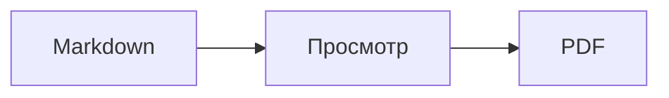

<p>&nbsp;&nbsp;&nbsp;</p>

# Splat

**Редактор Markdown для macOS: пишите в исходном тексте или прямо в окне просмотра.**

Splat показывает слева исходный текст Markdown с подсветкой синтаксиса, а справа — живое окно просмотра, в котором тоже можно редактировать. Печатайте где удобно: всё, что вы пишете в окне просмотра, превращается в минимальное изменение исходного текста, поэтому нетронутые строки остаются байт в байт прежними, а диффы в Git — чистыми. Splat понимает тот Markdown, которым вы уже пользуетесь: CommonMark и GitHub Flavored Markdown, GitHub alerts, вики-ссылки, встраивания и выноски Obsidian, расширения Pandoc и Typora, встроенный HTML, формулы LaTeX и диаграммы Mermaid, Graphviz и PlantUML — всё отображается без сети. Просматривайте целую папку заметок и ищите по ней, смотрите, что изменилось с последнего коммита Git, вставляйте из Word или с веб-страницы как Markdown и экспортируйте в PDF, HTML или Word одним щелчком. Приложение написано на Rust с настоящими элементами AppKit, переведено на 35 языков и ничего не отправляет по сети, пока вы сами об этом не попросите.
 


[](https://github.com/sventmueller/splat/releases/latest/download/Splat.dmg)

**[Скачать Splat.dmg](https://github.com/sventmueller/splat/releases/latest/download/Splat.dmg)**: подписан и заверен Apple, для macOS 14 и новее на Apple Silicon и Intel.

**Нашли ошибку?** Splat оставляет строки, которых вы не касались, байт в байт прежними. Если какая-то всё же изменилась или файл отображается неправильно, [откройте issue](https://github.com/sventmueller/splat/issues/new/choose) и приложите файл. Если Splat вам полезен, [звезда на GitHub](https://github.com/sventmueller/splat) поможет другим его найти.
 
 

[](https://www.rust-lang.org)
[](https://www.apple.com/macos/)

[](https://github.com/madsmtm/objc2)
[](https://webkit.org)
[](https://github.com/kivikakk/comrak)
[](https://github.github.com/gfm/)
[](https://www.mathjax.org)
[](https://cortexjs.io/mathlive/)
[](https://mermaid.js.org)
[](https://graphviz.org)
[](https://plantuml.com)


[](#лицензия)

[Bahasa Indonesia](../id/README.md) ·
[Bahasa Melayu](../ms/README.md) ·
[Català](../ca/README.md) ·
[Čeština](../cs/README.md) ·
[Dansk](../da/README.md) ·
[Deutsch](../de/README.md) ·
[English](../../../README.md) ·
[Español](../es/README.md) ·
[Français](../fr/README.md) ·
[Hrvatski](../hr/README.md) ·
[Italiano](../it/README.md) ·
[Magyar](../hu/README.md) ·
[Nederlands](../nl/README.md) ·
[Norsk](../no/README.md) ·
[Polski](../pl/README.md) ·
[Português (Brasil)](../pt_BR/README.md) ·
[Português (Portugal)](../pt_PT/README.md) ·
[Română](../ro/README.md) ·
[Slovenčina](../sk/README.md) ·
[Slovenščina](../sl/README.md) ·
[Suomi](../fi/README.md) ·
[Svenska](../sv/README.md) ·
[Tiếng Việt](../vi/README.md) ·
[Türkçe](../tr/README.md) ·
[Ελληνικά](../el/README.md) ·
**Русский** ·
[Українська](../uk/README.md) ·
[עברית](../he/README.md)‎ ·
[العربية](../ar/README.md)‎ ·
[हिन्दी](../hi/README.md) ·
[ไทย](../th/README.md) ·
[한국어](../ko/README.md) ·
[日本語](../ja/README.md) ·
[简体中文](../zh-Hans/README.md) ·
[繁體中文](../zh-Hant/README.md)

## Содержание

- [Коротко о возможностях](#коротко-о-возможностях)
- [Требования](#требования)
- [Установка](#установка)
- [Начало работы](#начало-работы)
- [Письмо](#письмо)
  - [В исходном тексте](#в-исходном-тексте)
  - [В окне просмотра](#в-окне-просмотра)
  - [Команды форматирования](#команды-форматирования)
  - [Списки и задачи](#списки-и-задачи)
  - [Таблицы](#таблицы)
  - [Вставка форматированного текста](#вставка-форматированного-текста)
  - [Метаданные](#метаданные)
- [Поддерживаемый Markdown](#поддерживаемый-markdown)
  - [CommonMark и GitHub Flavored Markdown](#commonmark-и-github-flavored-markdown)
  - [Выноски](#выноски)
  - [Расширенный синтаксис](#расширенный-синтаксис)
  - [Obsidian](#obsidian)
  - [Цитаты и ссылки](#цитаты-и-ссылки)
  - [Встроенный HTML](#встроенный-html)
  - [Типографские знаки препинания](#типографские-знаки-препинания)
  - [Обзор синтаксиса](#обзор-синтаксиса)
- [Формулы](#формулы)
- [Диаграммы](#диаграммы)
- [Изображения](#изображения)
- [Ссылки и навигация](#ссылки-и-навигация)
- [Заметки в папке](#заметки-в-папке)
- [Изменения с последнего коммита](#изменения-с-последнего-коммита)
- [Экспорт, печать и отправка](#экспорт-печать-и-отправка)
- [Импорт документов Word](#импорт-документов-word)
- [Оформление и универсальный доступ](#оформление-и-универсальный-доступ)
- [Языки](#языки)
- [Сочетания клавиш](#сочетания-клавиш)
- [Конфиденциальность и безопасность](#конфиденциальность-и-безопасность)
- [Большие документы](#большие-документы)
- [Известные ограничения](#известные-ограничения)
- [Устранение неполадок](#устранение-неполадок)
- [Для разработчиков](#для-разработчиков)
  - [Сторонние компоненты](#сторонние-компоненты)
- [Лицензия](#лицензия)

## Коротко о возможностях

- **Два способа писать, один текст.** Исходный текст и окно просмотра одинаково редактируются. Единственный источник истины — файл Markdown: у документа одна история отмены, а каждая правка в окне просмотра превращается в наименьшее изменение исходного текста.
- **Тот Markdown, которым вы уже пользуетесь.** CommonMark, GitHub Flavored Markdown, GitHub alerts, Obsidian, расширения Pandoc и Typora, шорткоды эмодзи, спойлеры, списки определений, якоря заголовков и HTML, как в README на GitHub.
- **Формулы и диаграммы внутри.** Формулы LaTeX через MathJax с визуальным редактором формул. Диаграммы Mermaid, Graphviz и PlantUML отображаются на вашем Mac без Java, сервера и подключения к сети.
- **Кнопка на всё.** У каждой конструкции Markdown есть кнопка на панели инструментов и пункт меню, а у самых частых — ещё и сочетание клавиш. Для таблиц есть отдельное меню со строками, столбцами и выравниванием.
- **Папка, а не только файл.** Боковая панель показывает заметки рядом с документом и ищет по всем ним. Переименование заметки меняет ссылки на неё, а все байты вокруг них остаются прежними.
- **Изменения сразу видны.** В репозитории Git полосы рядом с текстом отмечают то, что отличается от последнего коммита, в обеих частях.
- **Из Word и интернета в Markdown.** Вставляйте форматированный текст как Markdown, ячейки из электронной таблицы — как таблицу, а целые документы Word импортируйте вместе с изображениями.
- **Экспорт без потерь.** PDF, один самодостаточный файл HTML или документ Word с настоящими заголовками, списками, таблицами, сносками и изображениями. Можно добавить номера страниц, верхние колонтитулы и титульную страницу или использовать шаблон Word вашей компании.
- **Родное для Mac до мелочей.** Настоящие окна, вкладки, меню и всплывающие окна AppKit, «Версии», автосохранение, меню «Поделиться», тёмное оформление, проверка правописания, диктовка и VoiceOver. Никакого Electron, никакого веб-представления для самого текста.
- **Быстро с большими файлами.** Отрисовка нажатия клавиши в документе на 10 МБ занимает около 10 мс, до собственной работы представления.
- **Приватно и осторожно.** Splat работает в App Sandbox, изображения из интернета загружаются только с вашего разрешения, ссылки на другие приложения сначала спрашивают, а всё, что декодирует недоверенные данные изображений, работает в отдельной изолированной службе.
- **На вашем языке.** Интерфейс и встроенный краткий справочник по Markdown доступны на 35 языках: английском, арабском, венгерском, вьетнамском, голландском, греческом, датском, иврите, индонезийском, испанском, итальянском, каталанском, китайском (упрощённое письмо), китайском (традиционное письмо), корейском, малайском, немецком, норвежском, польском, португальском (Бразилия), португальском (Португалия), румынском, русском, словацком, словенском, тайском, турецком, украинском, финском, французском, хинди, хорватском, чешском, шведском и японском.

## Требования

- macOS 14 Sonoma или новее. Splat разрабатывается и тестируется в macOS 27, где он сам подхватывает оформление Liquid Glass.
- Mac с процессором Apple Silicon или Intel.
- Около 45 МБ места на диске.

## Установка

**Из образа диска.** Скачайте [`Splat.dmg`](https://github.com/sventmueller/splat/releases/latest/download/Splat.dmg), откройте его и перетащите Splat в папку «Программы». Образ подписан сертификатом Developer ID и заверен Apple, поэтому открывается без предупреждений.

**Через Homebrew.** Cask находится в собственном tap:

```sh
brew install --cask sventmueller/tap/splat
```

`brew upgrade --cask splat` устанавливает новые версии, а `brew uninstall --zap --cask splat` заодно удаляет настройки и кэш Splat.

**Обновления.** Splat из образа диска или из Homebrew обновляется сам с помощью [Sparkle](https://sparkle-project.org). При втором запуске он спрашивает, можно ли раз в день самостоятельно проверять наличие обновлений. **Splat › Проверить наличие обновлений…** проверяет сразу; **Автоматически проверять наличие обновлений** и **Автоматически загружать и устанавливать обновления** в том же меню позволяют потом изменить выбор. Splat устанавливает обновление, только если оно подписано разработчиком. В собственной сборке средства обновления нет.

**Из исходного кода.** Сначала прочитайте [Building](../../../docs/development.md#building) о требованиях, затем выполните:

```sh
make build
ditto target/release/Splat.app /Applications/Splat.app
open /Applications/Splat.app
```

Чтобы файлы Markdown открывались в Splat двойным щелчком, выберите в Finder любой файл `.md`, затем **Файл › Свойства**, укажите Splat в разделе **Открывать в приложении** и нажмите **Настроить…**. Splat сам регистрируется для файлов `.md`, `.markdown`, `.mdown` и `.mkd`.

## Начало работы

### Окно

Каждый документ открывается в собственном окне или во вкладке, если вы предпочитаете вкладки:

- **Слева: исходный текст.** Ваш Markdown шрифтом SF Mono с подсветкой синтаксиса.
- **Справа: окно просмотра.** Готовый документ, который можно редактировать.
- **Боковая панель (по желанию).** Все заголовки в виде дерева, щелчок по заголовку показывает его в обеих частях: **Вид › Показать структуру** (⌃⌘S). Ещё две вкладки содержат [заметки в папке](#заметки-в-папке) и поиск по ним. Кнопка рядом с заголовком окна показывает и скрывает её, а новые окна открывают её такой, какой её оставило последнее окно.
- **Панель инструментов.** Кнопки сгруппированы по тому, что они меняют: символы, абзацы и вставляемые элементы, затем показ окна просмотра, «Поделиться» и «Новый документ». Настройка: **Вид › Настроить панель инструментов…**.

Перетащите разделитель, чтобы дать больше места любой из сторон. **Вид › Скрыть окно просмотра** (⌥⌘P) оставляет только исходный текст; Splat запоминает это для каждого окна. Обе части прокручиваются вместе, а выделение в одной из них подсвечивается в другой.

В углу окна показано количество слов и символов в тексте и время чтения, а пока есть выделение — то же самое для него. Адреса ссылок, теги HTML, метаданные, комментарии, формулы и диаграммы не считаются. Сначала этот счётчик скрыт; его включает **Вид › Показать количество слов**.

### Документы, вкладки и версии

Splat — обычное документное приложение macOS:

- **Автосохранение и «Версии».** Изменения сохраняются на месте. **Файл › Вернуть к версии › Просмотреть все версии…** возвращает во времени.
- **Изменения из других программ.** Когда Git, скрипт или другой редактор меняет открытый документ, Splat перезагружает его и сохраняет положение курсора и прокрутки. Если у вас есть собственные несохранённые изменения, Splat оставляет их, а macOS спрашивает, прежде чем перезаписать другую версию.
- **Обычные команды для файлов.** Дублировать (⇧⌘S), Переименовать…, Переместить в… и **Файл › Открытие недавних**.
- **Вкладки.** **Файл › Новая вкладка** или кнопка **+** на панели инструментов открывает новый документ во вкладке; стандартное меню «Окно» объединяет, перемещает и переключает вкладки.
- **Расположение окон.** Размер и положение последнего окна запоминаются, в том числе между запусками. Если там уже стоит окно, новое открывается с небольшим смещением.
- **Значок в Dock.** Щелчок по нему после закрытия последнего окна открывает новый документ.
- **Открывать файлы Markdown в Splat.** **Splat › Назначить приложением по умолчанию для Markdown** делает так, что двойной щелчок по файлу `.md` или `.markdown` открывает Splat; macOS один раз просит подтвердить. Пока Splat назначен по умолчанию, рядом с пунктом стоит галочка.

Файлы должны быть текстом в кодировке UTF-8 или UTF-16 с меткой порядка байтов. Другие кодировки Splat отклоняет, а не угадывает, чтобы не испортить текст. Метка порядка байтов сохраняется, UTF-16 остаётся UTF-16, а в файле, где все строки заканчиваются на CRLF, добавляемые вами строки тоже получают CRLF.

**После сбоя** теряются самое большее последние несколько секунд набора: каждые пять секунд Splat копирует несохранённый текст в `~/Library/Application Support/Splat/Unsaved` и удаляет копии, когда документ сохранён или Splat нормально завершил работу. При следующем запуске то, что сбой оставил в этой папке, переносится в `~/Library/Application Support/Splat/Recovery`, о чём один раз сообщается с кнопкой, открывающей папку. Если Splat при сбое ещё может отреагировать, он записывает туда и текст каждого открытого документа.

### Краткий справочник

**Справка › Краткий справочник по Markdown** открывает шпаргалку на вашем языке как новый документ без названия. Это обычный документ, поэтому всё можно попробовать прямо в нём, в исходном тексте или в окне просмотра.

## Письмо

### В исходном тексте

Исходный текст — это простой текстовый редактор, настроенный под Markdown:

- **Цвета синтаксиса** как в VS Code: заголовки, выделение, ссылки, код, таблицы, HTML, front matter, а также LaTeX и Mermaid внутри формул и диаграмм. Есть палитры для светлого и тёмного оформления и для режима «Увеличить контраст».
- **Ограждённые блоки кода** подсвечиваются для Bash, C, C++, C#, CSS (также SCSS и Less), Go, HTML, XML, Java, JavaScript, JSON, Kotlin, PHP, Python, Ruby, Rust, SQL, Swift, TypeScript, YAML, TeX и Mermaid, включая их привычные короткие названия, например `js`, `py` или `sh`.
- **Никаких неожиданных замен.** Смарт-кавычки, смарт-тире и замена текста по умолчанию выключены, потому что они портят `--`, `---` и `"`. Включить их можно в **Правка › Замены**.
- **Системные средства для письма.** Проверка правописания и грамматики, диктовка, «Найти и заменить…» (⌥⌘F) и проговаривание текста.
- **Перетаскивание.** Перетащите файл изображения, чтобы вставить ``, любой другой файл — чтобы вставить ссылку на него, а URL — чтобы вставить `[url](url)`. Каждое перетаскивание — один шаг отмены.
- **Вставка изображений.** Картинка из буфера обмена, например снимок экрана, сохраняется как файл PNG рядом с документом (`Изображение 2026-10-29 13.09.07.png`) и вставляется как изображение. Для этого документ нужно один раз сохранить.

### В окне просмотра

Окно просмотра работает как текстовый процессор, но всё, что вы в нём делаете, в итоге становится Markdown:

- **Набор текста.** Символы, имеющие в Markdown особый смысл, например `*` или `#`, экранируются, чтобы выглядеть так, как набраны.
- **Return** начинает новый абзац или пункт списка. **⌥Return** или **⌃Return** вставляет разрыв строки.
- **Форматирование у курсора.** Если курсор стоит в конце слова, «Жирный», «Курсив» и другие форматы символов применяются к тому, что вы напечатаете дальше. Выберите формат ещё раз, чтобы отключить его. Внутри слова форматируется всё слово.
- **Пустые строки.** Return на пустой строке добавляет ещё одну пустую строку, а Delete удаляет её. В исходном тексте каждая такая лишняя пустая строка — это две дополнительные пустые строки; другие программы для Markdown показывают их как обычный отступ между абзацами.
- **Отменить** действует в обеих частях. У пунктов отмены есть названия («Отменить: Жирный»), набор текста отменяется по одному шагу на непрерывный ввод, а после «Отменить» и «Повторить» обе части прокручиваются к изменению.
- **Формулы и диаграммы** отображаются как готовая графика. Нажмите на неё, переместите на неё курсор или нажмите на ней Return, чтобы открыть редактор (см. [Formulas](#формулы) и [Diagrams](#диаграммы)).
- **Встроенный HTML, встроенные заметки и front matter** показываются, но редактируются в исходном тексте. Щелчок по ним ставит курсор в соответствующее место там.

Всё, что Markdown выразить не может, в окне просмотра заблокировано: панели «Шрифты» и «Цвета», линейка, а также вставка и перетаскивание форматированного текста и изображений. Вставленные HTML и RTF попадают как простой текст, если только вы не выберете [Вставить как Markdown](#вставка-форматированного-текста).

### Команды форматирования

Каждая команда доступна на панели инструментов, в строке меню и в контекстном меню обеих частей. Пункты меню показывают галочку для форматирования у курсора.

| Меню | Команды |
|---|---|
| **Формат › Шрифт** | Жирный, Курсив, Подчеркнутый, Зачеркнутый, Выделить, Код, Надстрочный, Подстрочный |
| **Формат › Заголовок** | Основной текст, Заголовки 1–6 |
| **Формат › Список** | Маркированный список, Нумерованный список, Список задач |
| **Формат** | Цитата, Блок кода (Без языка или один из 20 языков; также меняет язык существующего блока), Выноска (Заметка, Совет, Важно, Внимание, Осторожно; тот же тип ещё раз убирает её), Изменить формулу или диаграмму…, Удалить форматирование |
| **Вставка** | Ссылка…, Изображение…, Таблица…, Формула, Диаграмма (Блок-схема, Диаграмма последовательности, Диаграмма Ганта), Оглавление, Сноска, Горизонтальная линия |
| **Таблица** | Вставить строку выше/ниже, Вставить столбец слева/справа, Удалить строку, Удалить столбец, Выравнивание (Выровнять по левому краю, Выровнять по центру, Выровнять по правому краю, По умолчанию), Выровнять столбцы таблицы |
| **Вид** | Скрыть/Показать окно просмотра, Показать/Скрыть структуру, Типографские знаки препинания, Увеличить/Уменьшить, Реальный размер, панель инструментов, панель вкладок, полноэкранный режим |

Подчёркивание, выделение, надстрочный и подстрочный текст записываются как `<ins>`, `<mark>`, `<sup>` и `<sub>`, которые GitHub тоже показывает. Splat читает также `<u>`, который GitHub удаляет, и более короткие `==выделение==`, `^над^` и `~под~`. GitHub показывает `==` и `^` как набрано, а `~под~` — как зачёркнутый текст.

### Списки и задачи

- Return продолжает список; Return на пустом пункте завершает его.
- **Tab** и **⇧Tab** увеличивают и уменьшают отступ пунктов списка в окне просмотра.
- Щелчок по флажку задачи в окне просмотра переключает `- [ ]` и `- [x]`.
- **Формат › Список** превращает выбранные абзацы в список или меняет его вид.

### Таблицы

- **Вставка › Таблица…** запрашивает число строк (включая заголовок) и столбцов.
- В окне просмотра **Tab** переходит к следующей ячейке, **⇧Tab** — к предыдущей, а **Return** — к ячейке ниже. Tab в последней ячейке добавляет строку.
- Меню **Таблица** вставляет и удаляет строки и столбцы и задаёт выравнивание столбца (⌘{, ⌘|, ⌘}).
- **Таблица › Выровнять столбцы таблицы** дополняет исходный текст пробелами, чтобы столбцы стояли ровно.

### Вставка форматированного текста

**Правка › Вставить как Markdown** (⌃⌘V), также в контекстном меню обеих частей, превращает содержимое буфера обмена в Markdown на месте выделения, одним шагом отмены. ⌘V по-прежнему вставляет простой текст.

- **Из браузера, Word, Google Docs, Confluence, Заметок или Pages:** переносятся заголовки, жирный, курсив, подчёркивание, зачёркивание, надстрочный и подстрочный текст, ссылки, списки с их вложенностью, цитаты, код и таблицы.
- **Из электронной таблицы:** ячейки становятся таблицей со строкой заголовка и выровненными по правому краю столбцами чисел. То же происходит с текстом, разделённым табуляциями, точками с запятой или запятыми, если в каждой строке одинаковое число столбцов.
- **Изображения** с веб-адресом остаются ссылками. Изображение внутри вставленного HTML становится файлом рядом с документом, который для этого нужно один раз сохранить. Временные файлы изображений Word не переносятся, а их альтернативный текст сохраняется.
- **Ссылки** сохраняют только адреса `http`, `https`, `mailto`, относительные и `#`; от любой другой ссылки остаётся текст.

### Метаданные

**Формат › Изменить метаданные…** или щелчок по строке метаданных вверху окна просмотра открывает форму с полями YAML front matter. Поля можно менять, добавлять и удалять. Поле, содержащее список, остаётся списком: его значения идут друг за другом через запятую, а значение с запятой стоит в кавычках. Новое поле с именем `tags`, `aliases`, `keywords`, `categories`, `authors` или `cssclasses` тоже становится списком. Вложенные поля и многострочный текст там видны, а редактируются в исходном тексте.

То, что меняет форма, — один шаг отмены, и затрагивает он только строки изменённых вами полей: комментарии, порядок, необычные пробелы, кавычки и концы всех остальных строк остаются байт в байт прежними. Документ без метаданных получает блок в начале.

## Поддерживаемый Markdown

Splat разбирает текст с помощью [comrak](https://github.com/kivikakk/comrak) — парсера, совместимого с CommonMark и GFM, — и включает большинство его расширений. Всё перечисленное ниже отображается в окне просмотра и во всех видах экспорта.

### CommonMark и GitHub Flavored Markdown

- Заголовки (`#` и с подчёркиванием), абзацы, разрывы строк, выделение, усиленное выделение, код в строке, цитаты, горизонтальные линии.
- Маркированные, нумерованные и вложенные списки; списки задач.
- Ссылки (в строке, по ссылке-идентификатору и автоматические), изображения, определения ссылок.
- Ограждённые блоки кода и блоки кода с отступом, с подсветкой синтаксиса.
- Таблицы с выравниванием столбцов.
- Зачёркивание с помощью `~~двух тильд~~`.
- Сноски: `текст[^1]` и `[^1]: Примечание.` в любом месте документа. Щелчок по маркеру переходит к примечанию.
- YAML front matter между строками `---` в начале. Окно просмотра сводит его к одной строке, например «Метаданные: title, date, tags».

### Выноски

GitHub alerts отображаются как цветные блоки со значком и заголовком:

```markdown
> [!NOTE]
> Полезная информация, которую стоит знать пользователям.

> [!WARNING]
> Важное содержание, требующее немедленного внимания.
```

Пять типов — Заметка, Совет, Важно, Внимание и Осторожно. **Формат › Выноска** превращает в такой блок абзац у курсора.

Выноски Obsidian тоже работают, с любым заголовком и состоянием сворачивания:

```markdown
> [!tip]- Нажмите ▸, чтобы развернуть
> Скрыто, пока не откроете.

> [!question]+ Открыто по умолчанию
> `+` начинает в развёрнутом виде, `-` — в свёрнутом.
```

Остальные типы Obsidian показываются ближайшим из пяти цветов: `success`, `check`, `done` и `hint` как Совет; `question`, `help` и `faq` как Важно; `attention` как Внимание; `failure`, `fail`, `missing`, `danger`, `error` и `bug` как Осторожно; всё остальное как Заметка.

### Расширенный синтаксис

| Возможность | Синтаксис | Откуда |
|---|---|---|
| Выделение | `==выделенный текст==` | Obsidian, Typora |
| Надстрочный | `x^2^` | Pandoc, Typora |
| Подстрочный | `H~2~O` | Pandoc, Typora |
| Шорткод эмодзи | `:rocket:` превращается в 🚀 | GitHub |
| Спойлер | `\|\|скрытый текст\|\|`, выделите, чтобы прочитать | Discord |
| Сноска в строке | `текст^[сама сноска]` | Pandoc, Obsidian |
| Список определений | `Термин`, пустая строка, `: Пояснение` | PHP Markdown Extra, Pandoc |
| Якорь заголовка | `## Установка {#setup}`, ссылка `[см.](#setup)` | Pandoc, kramdown |

В исходном тексте списки определений выглядят так:

```markdown
Термин

: Пояснение термина.
```

Если собственного якоря нет, каждый заголовок получает якорь, образованный от его текста, как на GitHub: `## Начало работы` доступен как `#начало-работы`.

### Obsidian

- **Вики-ссылки.** `[[Заметка]]` ссылается на `Заметка.md` в той же папке или во вложенной. `[[Заметка|Отображаемый текст]]` показывает ваш собственный текст, а `[[Заметка#Заголовок]]` открывает заметку. Нажатие с ⌘ открывает её в Splat.
- **Встраивания.** `![[Заметка]]` показывает другую заметку внутри этой; заметки, встроенные в неё, отображаются как ссылки. `![[diagram.png]]` показывает изображение. Как и в Obsidian, встраивания называют заметки и изображения из папки документа или вложенных, но никогда не по абсолютному пути, а как заметки показываются только файлы Markdown.
- **Комментарии.** `%%Только в исходном тексте%%` остаётся видимым в исходном тексте и не попадает ни в окно просмотра, ни в какой-либо экспорт — как в строке, так и на отдельных строках.
- **Теги.** `#идея` или `#проект/splat` выделяются. Нажатие с ⌘ ищет тег в документе и, на боковой панели, во всей папке.
- **Сворачиваемые выноски.** См. [Callouts](#выноски).

### Цитаты и ссылки

- **Цитаты Pandoc.** `[@doe2020]` или `[@doe2020; @roe2021]` читается как «(Doe 2020; Roe 2021)». Записи берутся из файла BibTeX, который front matter называет как `bibliography: refs.bib`. Если его нет, Splat использует `references.bib`, `literatur.bib` или `bibliography.bib` рядом с документом.
- **Ссылки на GitHub и GitLab.** Если документ лежит в репозитории Git, у которого удалённый репозиторий `origin` находится на github.com или на хосте GitLab, выделяются `@name`, `#12` (задача) и `!7` (merge request, только GitLab). Нажатие с ⌘ открывает их в браузере.

### Встроенный HTML

HTML в том виде, в каком он встречается в README на GitHub, отображается собственным анализатором, а не движком браузера:

- абзацы и блоки по центру (`<p align="center">`, `<div align="center">`)
- изображения с размером (``)
- ссылки, `<kbd>⌘</kbd>`, `<br>`, `<u>`, `<ins>`, `<mark>`, `<sup>`, `<sub>`
- списки и таблицы, включая ячейки, объединяющие столбцы (`colspan`)
- сворачиваемые разделы: `<details><summary>Ещё</summary>…</details>`, открываются щелчком по ▸

Markdown между тегами HTML отображается как Markdown. Скрипты, стили, фреймы и формы полностью отбрасываются, а в ссылках и изображениях остаются только адреса `http`, `https`, `mailto` и относительные.

### Типографские знаки препинания

**Вид › Типографские знаки препинания** показывает прямые кавычки как кавычки языка интерфейса, `--` как короткое тире, `---` как длинное тире, а `...` как многоточие. В немецком `"Ja"` становится „Ja“, во французском «Oui», в японском 「はい」, в том числе там, где китайский и японский набирают кавычки без пробела; ивритские сокращения вроде `צה"ל` получают гершаим, צה״ל. Исходный текст сохраняет простые символы; окно просмотра и все виды экспорта показывают типографские. Пока вы не включите этот параметр, он выключен.

### Обзор синтаксиса

| Элемент | Markdown |
|---|---|
| **Жирный** | `**Жирный**` |
| *Курсив* | `*Курсив*` |
| Подчеркнутый | `<ins>Подчеркнутый</ins>` или `<u>Подчеркнутый</u>` |
| ~~Зачеркнутый~~ | `~~Зачеркнутый~~` |
| Выделение | `<mark>Выделение</mark>` или `==Выделение==` |
| `Код` | `` `Код` `` |
| x² | `x<sup>2</sup>` или `x^2^` |
| H₂O | `H<sub>2</sub>O` или `H~2~O` |
| [Ссылка](https://example.com) | `[Ссылка](https://example.com)` |
| Заголовок | `# Заголовок` до `###### Заголовок` |
| Цитата | `> Цитата` |
| Маркированный список | `- Пункт` |
| Нумерованный список | `1. Пункт` |
| Задача | `- [ ] Открыта` и `- [x] Выполнена` |
| Блок кода | ```` ```rust ```` … ```` ``` ```` |
| Таблица | `\| A \| B \|` и `\|---\|---\|` под заголовком |
| Сноска | `Текст[^1]` и `[^1]: Примечание` |
| Горизонтальная линия | `---` |
| Изображение | `` |
| Формула | `$E = mc^2$`, `$$ … $$` |
| Диаграмма | ```` ```mermaid ````, ```` ```dot ````, ```` ```plantuml ```` |
| Выноска | `> [!TIP]` |
| Вики-ссылка | `[[Заметка]]`, `[[Заметка\|Текст]]` |
| Встраивание | `![[Заметка]]`, `![[image.png]]` |
| Комментарий | `%%Комментарий%%` |
| Тег | `#тег` |
| Цитата из источника | `[@key]` |
| Спойлер | `\|\|Спойлер\|\|` |
| Эмодзи | `:tada:` |

## Формулы

Формулы отображаются с помощью [MathJax](https://www.mathjax.org) с его TeX и математикой AMS в виде чёткой векторной графики. Текст в `\text{…}` может быть на любом письме: чего не хватает шрифтам MathJax, берётся из шрифтов вашего Mac, причём арабский и иврит идут справа налево, а эмодзи — цветные.

| Вид | Синтаксис |
|---|---|
| В строке | `$E = mc^2$`, `` $`E = mc^2`$ `` (GitHub, GitLab), `\(E = mc^2\)` |
| Отдельной строкой | `$$` … `$$`, `\[` … `\]` или блок кода с пометкой `math` |

**Редактирование формулы.** Нажмите на формулу в окне просмотра, дважды щёлкните по ней, нажмите на ней Return или переместите на неё курсор, чтобы открыть редактор во всплывающем окне. **Вставка › Формула** вставляет новую и сразу открывает редактор.

- **Визуально или LaTeX.** Переключатель вверху меняет визуальный редактор ([MathLive](https://cortexjs.io/mathlive/)) на код LaTeX и обратно. Splat запоминает ваш выбор.
- **Готовые блоки** для дроби, квадратного корня, надстрочного и подстрочного индекса, суммы и интеграла с пределами, предела, скобок, растущих вместе с содержимым, матрицы 2×2, греческих букв, а также отношений, операторов и стрелок. Они оставляют заполнители □, и **Tab** переходит к следующему.
- **Живой просмотр.** Изменения появляются в документе во время набора. Ошибки MathJax показываются в строке под кодом.
- **Принять или отменить.** Щелчок снаружи сохраняет изменение как один шаг отмены; **Esc** или **Отменить** отбрасывает его. Esc на новой пустой формуле удаляет её.
- В контекстном меню для формулы под указателем есть **Изменить формулу…**.

VoiceOver читает формулу как её код LaTeX. Splat отображает формулы, а не целые документы LaTeX: пакетов, TikZ и `\documentclass` нет.

## Диаграммы

Диаграммы отображаются внутри Splat, без сети, в светлом и тёмном вариантах.

| Движок | Блок кода | Что рисует |
|---|---|---|
| [Mermaid](https://mermaid.js.org) | ```` ```mermaid ```` | блок-схемы, диаграммы последовательности, классов, состояний, «сущность — связь», Ганта, круговые, ментальные карты, временные шкалы и все остальные типы Mermaid |
| [Graphviz](https://graphviz.org) | ```` ```dot ```` или ```` ```graphviz ```` | графы на языке DOT |
| [PlantUML](https://plantuml.com) | ```` ```plantuml ```` или ```` ```puml ```` | диаграммы UML; работает без Java |



**Редактирование диаграммы** устроено как редактирование формулы: нажмите на неё, чтобы открыть код во всплывающем окне, с подсветкой синтаксиса и сообщениями об ошибках в строке под кодом. **Вставка › Диаграмма** начинает с шаблона блок-схемы, диаграммы последовательности или диаграммы Ганта. Готовые блоки помогают с тремя самыми частыми типами Mermaid:

- **Блок-схема:** Узел ▾ (прямоугольник, скруглённый, круг, ромб, база данных), Связь, Связь с подписью, Группа, Направление ▾
- **Диаграмма последовательности:** Участник, Сообщение, Ответ, Заметка, Цикл, Альтернативные пути
- **Диаграмма Ганта:** Раздел, Задача, Веха

Другие типы диаграмм редактируются как код. VoiceOver читает заголовок диаграммы или её альтернативный текст.

Первая диаграмма после запуска занимает около секунды, потому что движок отображения запускается в фоновом режиме. Диаграмма, которая отображается дольше 10 секунд, показывает ошибку, а движок для следующей запускается заново. Движок PlantUML (3 МБ) загружается только вместе с первой диаграммой PlantUML. PlantUML `!include` из интернета заблокирован.

## Изображения

- **Локальные изображения** используют пути относительно документа: ``. Splat показывает PNG, JPEG, GIF, WebP, BMP, SVG, HEIC, TIFF, AVIF и PDF.
- **Изображения из интернета** остаются заблокированными, пока вы их не разрешите: полоса над окном просмотра объясняет, что при их загрузке серверы узнают, что и когда вы открываете документ. **Загрузить изображения** разрешает их для этого документа; Splat запоминает выбор для каждого файла.
- **Размер.** `` задаёт размер изображения; в остальных случаях изображения вписываются в ширину окна просмотра.
- **Изменения на диске.** Изображение, которое вы заменили, или то, что появилось уже после того, как документ его назвал, показывается без повторного открытия документа. Изображения из интернета, которые не загрузились из-за сети, пробуются снова, пока документ их показывает.
- **Память.** Изображения показываются размером до 2560 пикселей по длинной стороне, чего хватает и для страницы A4. Они декодируются меньше, когда занимают восьмую часть памяти Mac, и пока macOS сообщает о нехватке памяти.
- **Тёмное оформление.** Изображения с белым фоном в тёмном окне просмотра слегка затемняются.
- **Вставка и перетаскивание.** См. [In the source](#в-исходном-тексте).

## Ссылки и навигация

В окне просмотра щелчок ставит курсор, чтобы можно было править текст ссылки; **нажатие с ⌘** переходит по ссылке:

- `http`, `https` и `mailto` открываются в браузере или почтовой программе.
- Файлы Markdown открываются в Splat; другие файлы и папки показываются в Finder.
- `#якорь` переходит к заголовку в документе.
- Адреса, открывающие другое приложение, например `slack://` или `vscode://`, сначала спрашивают и показывают полный адрес и приложение. Кнопка **Отменить** выбрана заранее.

**Вставка › Оглавление** вставляет список ссылок на все заголовки. Если курсор стоит внутри него, та же команда обновляет его. Боковая панель структуры (⌃⌘S) переходит к любому заголовку в обеих частях.

## Заметки в папке

Кнопки вверху боковой панели переключают между структурой, файлами и поиском.

- **Файлы** (**Вид › Показать файлы**, ⌃⌘E). Все файлы Markdown в папке документа или, если она лежит в репозитории Git, во всём репозитории. Щелчок или Return открывает заметку во вкладке этого окна; если она уже открыта, она выходит на передний план. Кнопка рядом с именем папки показывает другую папку в этом окне. Скрытые файлы, `node_modules`, `target`, `Pods`, `DerivedData`, `__pycache__` и папки без заметок не показываются. Документ прямо в вашей папке пользователя показывает только заметки рядом с ним, чтобы Splat не обходил все ваши папки и не спрашивал о каждой из них.
- **Поиск** (**Правка › Поиск › Поиск по всем заметкам…**, ⇧⌘F). Находит текст во всех заметках независимо от регистра и от того, как закодированы диакритические знаки. `#tag` находит тег, `#project` — также `#project/splat`, и ничего внутри кода. Щелчок по результату открывает заметку в этом месте.
- **Ссылки на заметку.** Контекстное меню заметки перечисляет заметки, которые ссылаются на неё вики-ссылкой, встраиванием, относительной ссылкой или определением ссылки.
- **Переименование заметки.** То же меню переименовывает её и меняет эти ссылки. Сначала Splat сообщает, сколько это ссылок и в скольких файлах. В каждой ссылке меняется только имя, а все остальные байты файла остаются прежними. Открытые документы принимают изменение как шаг отмены; в остальных файлах отменить его могут только Git или «Версии». Файл, который за это время изменила другая программа, останавливает переименование всех ссылок, и Splat называет этот файл.

Список следует за папкой, когда окно выходит на передний план. Поиск смотрит на файлы такими, какие они на диске, а ещё не сохранённый текст учитывается со следующего автосохранения.

## Изменения с последнего коммита

В документе из репозитория Git полосы рядом с текстом отмечают то, что отличается от последнего коммита, в исходном тексте и в окне просмотра: зелёные — добавленные строки, синие — изменённые строки, а короткая красная метка — место, где что-то было удалено. Они обновляются по мере набора и при перемещении ветки. **Вид › Изменения с последнего коммита** отключает их для всех окон.

Строки, различающиеся только концом строки, не считаются, поэтому файл с CRLF относительно коммита с LF не показывает изменений. У нового файла нет меток до первого коммита, как и у документа больше 32 МБ.

## Экспорт, печать и отправка

| Формат | Как | Что получится |
|---|---|---|
| **PDF** | **Файл › Экспортировать как PDF…** или меню «Поделиться» | Страницы формата бумаги, всегда в светлом оформлении, формулы и диаграммы как векторная графика. **Файл › Параметры страницы…** задаёт бумагу. |
| **Печать** | **Файл › Напечатать…** (⌘P) | Тот же макет, что и у PDF. |
| **HTML** | **Файл › Экспортировать как HTML…** или меню «Поделиться» | Один самодостаточный файл: локальные изображения встроены, формулы и диаграммы как чёткие изображения, якоря заголовков, чтобы работало оглавление. Без скриптов. |
| **Word** | **Файл › Экспортировать как документ Word…** или меню «Поделиться» | Файл `.docx` со стилями заголовков Word, настоящими списками и таблицами (включая объединённые ячейки), сносками как сноски Word, встроенными изображениями, формулами и диаграммами. |
| **Markdown** | Кнопка **Поделиться** на панели инструментов | Документ как файл `.md` для Почты, Сообщений, AirDrop и любой другой службы отправки. |

Меню **Файл › Поделиться** предлагает всё это в одном месте. Экспорт учитывает параметр типографских знаков препинания и изображения из интернета, которые вы разрешили; в HTML изображения из интернета остаются ссылками.

**Файл › Параметры экспорта…** задаёт для всех документов, что PDF, печать и Word добавляют к тексту:

- **Номера страниц** в нижнем колонтитуле PDF и печати, в виде `2 / 9`.
- **Верхний и нижний колонтитулы** для PDF и печати. `{title}`, `{author}`, `{date}`, `{page}` и `{pages}` заменяются своими значениями, первые три — из метаданных документа.
- **Титульная страница** для PDF, печати и Word, с `title`, `subtitle`, `author` и `date` из метаданных или с именем документа в качестве заголовка. На ней нет ни верхнего, ни нижнего колонтитула.
- **Шаблон Word** — файл `.docx` или `.dotx`, оформление которого перенимает экспорт: его стили, в том числе с локализованными именами, тема, размер страницы, поля, верхние и нижние колонтитулы. Шаблон, который не удаётся прочитать, останавливает экспорт и сообщает об этом, а не выдаёт документ без него.

## Импорт документов Word

**Файл › Импортировать документ Word…** запрашивает файл `.docx` или `.dotx` и место для его Markdown, затем открывает результат. Изображения попадают в папку рядом с ним, названную по имени документа с `-images`.

Заголовки и списки переносятся так, как их определяют стили и нумерация Word, в том числе в документах, стили которых имеют локализованные имена. Жирный, курсив, подчёркивание, зачёркивание, выделение, надстрочный и подстрочный текст, ссылки, цитаты, код, сноски, концевые сноски и таблицы тоже переносятся, ячейки на несколько столбцов — как таблица HTML. Формулы становятся LaTeX. Отслеживаемые изменения считаются принятыми, а оглавление не переносится, поскольку **Вставка › Оглавление** создаёт новое. Старые файлы `.doc` и документы, защищённые паролем, отклоняются.

## Оформление и универсальный доступ

- **Тёмное оформление** следует системному. Формулы и диаграммы отображаются для каждого оформления.
- **Увеличить контрастность** в Системных настройках переключает цвета синтаксиса на высококонтрастные палитры.
- **Масштаб.** ⌘+, ⌘− и ⌘0 масштабируют обе части.
- **Полноэкранный режим, вкладки и настраиваемая панель инструментов**, как в любом приложении для Mac.
- **VoiceOver.** Части подписаны «Исходный текст Markdown» и «Просмотр», формулы читаются как их код, а диаграммы — как их заголовок. Любая команда доступна с клавиатуры.

В Splat нет окна настроек: немногочисленные параметры находятся там, где они применяются, — в меню **Вид**, **Правка › Замены** и **Файл › Параметры экспорта…**.

## Языки

Интерфейс, меню и краткий справочник по Markdown переведены на 35 языков:

английский, арабский, венгерский, вьетнамский, голландский, греческий, датский, иврит, индонезийский, испанский, итальянский, каталанский, китайский (упрощённое письмо), китайский (традиционное письмо), корейский, малайский, немецкий, норвежский, польский, португальский (Бразилия), португальский (Португалия), румынский, русский, словацкий, словенский, тайский, турецкий, украинский, финский, французский, хинди, хорватский, чешский, шведский и японский.

Splat следует порядку языков в **Системные настройки › Основные › Язык и регион**; там же в разделе **Приложения** можно выбрать язык только для Splat. Если вашего языка нет среди переводов, используется английский. Термины меню следуют переводам самой Apple, поэтому Splat читается как остальная часть вашего Mac.

Текст на иврите и арабском читается справа налево везде, где он встречается, независимо от языка интерфейса: каждый абзац, заголовок и пункт списка получает направление по первой букве, цитаты и выноски рисуют полосу справа, а таблица, текст которой начинается справа налево, перечисляет столбцы справа. Блоки кода остаются слева направо. Экспорт в PDF, HTML и Word сохраняет эти направления. Если системный язык — иврит или арабский, macOS зеркально отражает и окно, так что окно просмотра оказывается слева.

## Сочетания клавиш

| Действие | Сочетание |
|---|---|
| Жирный, курсив, подчёркнутый | ⌘B, ⌘I, ⌘U |
| Зачёркнутый | ⇧⌘X |
| Код | ⌥⇧⌘C |
| Ссылка… | ⌘K |
| Основной текст, заголовки 1–6 | ⌥⌘0, от ⌥⌘1 до ⌥⌘6 |
| Выровнять столбец таблицы по левому краю, по центру, по правому краю | ⌘{, ⌘\|, ⌘} |
| Скрыть или показать окно просмотра | ⌥⌘P |
| Показать или скрыть структуру | ⌃⌘S |
| Показать или скрыть файлы | ⌃⌘E |
| Поиск по всем заметкам | ⇧⌘F |
| Вставить как Markdown | ⌃⌘V |
| Увеличить, уменьшить, реальный размер | ⌘+, ⌘−, ⌘0 |
| Новый документ, открыть, сохранить, дублировать | ⌘N, ⌘O, ⌘S, ⇧⌘S |
| Параметры страницы, печать | ⇧⌘P, ⌘P |
| Найти, найти и заменить | ⌘F, ⌥⌘F |
| Найти далее, ранее; найти выбранное; перейти к выбранному | ⌘G, ⇧⌘G; ⌘E; ⌘J |
| Показать правописание и грамматику; проверить документ | ⌘:, ⌘; |
| Вставить и согласовать стиль | ⌥⇧⌘V |
| Скрыть панель инструментов, показать все вкладки, полноэкранный режим | ⌥⌘T, ⇧⌘\\, ⌃⌘F |
| Разрыв строки (окно просмотра) | ⌥Return или ⌃Return |
| Следующая / предыдущая ячейка в таблице (окно просмотра) | Tab / ⇧Tab |
| Увеличить / уменьшить отступ пункта списка (окно просмотра) | Tab / ⇧Tab |
| Следующий заполнитель в редакторе формул | Tab |
| Закрыть редактор формул или диаграмм без изменений | Esc |
| Перейти по ссылке, тегу или упоминанию (окно просмотра) | нажатие с ⌘ |

Стандартные сочетания клавиш Apple Splat оставляет на своих местах.

## Конфиденциальность и безопасность

Файл Markdown может прийти от кого угодно, поэтому Splat считает каждый документ недоверенным.

- **По умолчанию без сети.** В Splat нет телеметрии. Обновления он ищет только после вашего согласия или по команде **Проверить наличие обновлений…**: тогда он загружает с GitHub небольшой файл ленты, а запрос называет лишь приложение и его версию. Формулы и диаграммы отображаются локально; веб-представления, которые этим занимаются, не имеют доступа к сети. **Справка › Сообщить о проблеме…** открывает в браузере форму на GitHub; её адрес содержит версию Splat, версию macOS и тип Mac, но ничего из ваших документов.
- **Изображения из интернета** загружаются только с вашего разрешения, только по `https`, никогда с хостов вашей локальной сети, не больше 10 МБ каждое и в приватном сеансе без cookie.
- **Изолированное декодирование.** Изображения и графика формул и диаграмм декодируются в отдельной службе, которую macOS запускает в её собственной песочнице: ни одного вашего файла, ни сети. Она возвращает только пиксели, размер которых проверяется, и сама завершается, если декодирование длится дольше 10 секунд или требует слишком много памяти. Собственные декодеры изображений Apple видят только HEIC, TIFF, AVIF и PDF, и только когда данные действительно в этом формате. SVG, формулы и диаграммы тоже проходят через эту службу, поэтому в Splat они представляют собой картинки с фиксированным разрешением: четыре пикселя на пункт, до 2560 по длинной стороне.
- **Локальные файлы** попадают в документ только по пути, который он называет, и только из папки, к которой вы предоставили доступ: Splat может читать открытый вами документ, но изображения, заметки, библиографию и репозиторий вокруг него — только после того, как вы предоставите доступ к их папке кнопкой **Предоставить доступ к папке…** в полосе над окном просмотра. Доступ распространяется на все вложенные папки и запоминается. Встраивания показывают заметки Markdown из папки документа и вложенных, а недостающую картинку ищут только там. Путь к изображению в другом месте, абсолютный или начинающийся с `~`, загружается в предпросмотре из папки, к которой предоставлен доступ; экспорт в HTML и Word, печать и PDF берут только то, что лежит в папке документа или в его репозитории Git, если только этот репозиторий не содержит ещё и вашу папку пользователя, поэтому чужой документ не может затянуть ваши файлы в экспорт, который вы передаёте дальше.
- **Папки с заметками** читаются только пока боковая панель их показывает, а переименование заметки меняет другие файлы только после того, как вы подтвердили, сколько их.
- **Репозитории Git** Splat читает сам. Он никогда не запускает программу `git`, конфигурация которой в чужом репозитории может запускать другие программы, и читает не больше, чем версию открытого документа из последнего коммита. Он ничего туда не пишет и не выходит в сеть.
- **Документы Word и вставленный текст** читаются собственными анализаторами Splat с ограничениями на размер, вложенность и на то, насколько файл может распаковаться. Ссылки в них сохраняют только те адреса, которые Splat разрешает и в других местах, а имена изображений в файле Word никогда не определяют, куда они записываются.
- **Копии несохранённого текста** остаются на этом Mac, в вашей папке «Библиотека», для восстановления после сбоя. Они исчезают при сохранении или нормальном завершении Splat; копии, оставленные сбоем, лежат в папке восстановления, пока вы их не удалите.
- **Ссылки** никогда не запускают программу по щелчку. Ссылки в интернет и на почту открываются как обычно; ссылки на другие приложения сначала спрашивают.
- **HTML в документах** читается собственным анализатором Splat. Скрипты, стили, фреймы и формы никогда не выполняются.
- **Экспорт** не содержит скриптов. Страницы HTML сохраняют только фиксированный список безвредных тегов и атрибутов, как на GitHub, а также политику безопасности содержимого. Файлы Word ссылаются только на адреса `http`, `https` и `mailto`, не считая ссылок, которые приносит с собой выбранный вами шаблон Word.
- **Подпись кода** с Hardened Runtime и App Sandbox. Splat может читать и записывать открытые вами документы и папки, к которым вы предоставили доступ, выходить в сеть за разрешёнными вами изображениями из интернета и за обновлениями, а также печатать; больше ничего.

## Большие документы

Splat остаётся отзывчивым с документами в несколько мегабайт:

- Исходный текст использует TextKit 2, который размечает только видимую часть.
- Пока вы печатаете в окне просмотра, а также в исходном тексте документов до 2 МБ, заново разбираются, раскрашиваются и размечаются только затронутые абзацы. В документе на 10 МБ разбор и раскраска занимают около 3 мс, отрисовка около 10 мс, а нажатие клавиши целиком в его окне просмотра около 30 мс, вместе с собственной работой представления.
- Большие окна просмотра сначала отображают видимую часть, а остальное — пока приложение простаивает. Блоки, прокрученные в поле зрения, отображаются до того, как будут нарисованы.
- В исходном тексте больших документов разбор для окна просмотра идёт в фоне, пока вы печатаете.
- Документ остаётся простым текстом, если ему потребовалось бы около 4 ГБ памяти (примерно 50–120 МБ обычного Markdown, но всего 10–20 МБ, если в нём только таблицы или заголовки): у исходного текста нет цветов, а окно просмотра объясняет, почему оно остаётся пустым. Экспорт по-прежнему работает.
- Начиная примерно с 200 КБ документ открывает окно до разбора; при 5 МБ цвета и окно просмотра появляются примерно на четверть секунды позже.
- Все изображения вместе, включая формулы и диаграммы, занимают не больше четверти памяти Mac, а пока памяти не хватает, вдвое меньше. Сверх этого следующие изображения показываются как заполнители, пока снова не появится место.

Некоторые изменения обрабатываются целиком, примерно по 300 мс на нажатие клавиши при 10 МБ: это изменения определения или ссылок сноски, рядом со сноской в строке, в самом конце документа рядом со сноской, в front matter или в определениях ссылок, а также любое изменение в документе с блоками комментариев `%%`, со сноской, определённой дважды или внутри цитаты или списка, или с более чем 1000 сносок в строке или незакрытых знаков формул. Память растёт вместе с файлом: примерно 115–160 МБ на 1 МБ Markdown и 340–510 МБ на 10 МБ.

## Известные ограничения

- **Одинарная тильда означает подстрочный текст.** `~текст~` — подстрочный текст, как в Pandoc; для зачёркивания нужно `~~две~~`. GitHub зачёркивает и одной тильдой.
- **Только чтение в окне просмотра:** встроенный HTML и встроенные заметки редактируются в исходном тексте, front matter — в его форме или в исходном тексте.
- **Очень глубокая вложенность:** HTML, вложенный глубже 64 уровней, и HTML в строке глубже 16 уступают место своему содержимому.
- **Объединённые ячейки таблицы** есть только в таблицах HTML и только по столбцам (`colspan`, без `rowspan`). Синтаксис таблиц MultiMarkdown для объединённых ячеек не поддерживается.
- **Библиографии** читаются только из BibTeX, не из CSL JSON и не из YAML.
- **Упоминания** требуют репозитория на github.com или на хосте GitLab; `!7` существует только в GitLab.
- **Типографские знаки препинания:** немецкую закрывающую одинарную кавычку нельзя отличить от апострофа, и она ставится как ’.
- **Формулы, а не документы:** никаких пакетов LaTeX, TikZ и целых документов.
- **Визуальный редактор формул** записывает LaTeX в нотации MathLive: пробелы исчезают (`E = mc^2` становится `E=mc^2`), отображение остаётся тем же.
- **Количество слов:** тайский, лаосский, кхмерский и бирманский пишутся без пробелов и считаются по отрезкам текста, а не по словам. `3.14` и `snake_case` — по два слова каждое.
- **Переименование заметки** не меняет ссылки во встроенном HTML, а вики-ссылка остаётся как есть, если новое имя содержит `#`, `|`, `^`, `[`, `]` или `\`.
- **Метки изменений** читают репозитории с объектами SHA-1 и обычными или упакованными refs; репозиторий с SHA-256 или reftable меток не показывает. Файл под фильтром Git, например LFS, сравнивается с тем, что сохранил фильтр.
- **Импорт Word** не переносит текст из верхних и нижних колонтитулов и примечаний, а изображения в `.emz` или SVG сохраняют только альтернативный текст.
- **Вставить как Markdown** читает RTF как западный текст и берёт там заголовки только из размеров шрифта. Большинство программ предлагают и HTML, которому эта команда отдаёт предпочтение.
- **По замыслу:** нет номеров строк, нет окна настроек, нет справочной книги Help Book, нет в App Store.
- **На Intel проверено меньше.** Самотесты окон идут только на Apple Silicon; на Intel CI запускает `cargo test`.

## Устранение неполадок

**Список недавних документов пуст после пересборки Splat.** macOS привязывает недавние документы и разрешения для папок к подписи кода приложения. Локальные сборки подписываются сертификатом «Splat Local Signing» в вашей связке ключей входа, поэтому при пересборке то и другое сохраняется. Если сертификат был удалён, следующая сборка создаст новый, и списки начнутся заново один раз.

**Приложение из образа диска показывает другие недавние документы, чем моя собственная сборка.** У них разные подписи, поэтому macOS ведёт для каждой отдельный список и отдельные разрешения для папок.

**HTML или другой синтаксис показывается как обычный код.** Возможно, документ открыла устаревшая копия Splat. Завершите её, выберите **Файл › Свойства** для документа в Finder и проверьте, что в разделе **Открывать в приложении** указан Splat из вашей папки «Программы».

**В меню Splat нет пункта «Проверить наличие обновлений…».** Сам обновляется только версия из образа диска или из Homebrew; в собственной сборке средства обновления нет.

**Изображения из интернета не появляются.** Нажмите **Загрузить изображения** в полосе над окном просмотра. Загружаются только изображения по `https` с публичных хостов.

**При вставке снимка экрана просят сначала сохранить документ.** Вставленные изображения сохраняются как файлы рядом с документом, для чего нужно место на диске. Сохраните документ и вставьте снова.

**«Файл не является текстом в кодировке UTF-8».** Файл в другой кодировке, и у него нет метки порядка байтов, которая бы её назвала. Сначала преобразуйте его, например так: `iconv -f ISO-8859-1 -t UTF-8 old.md > new.md`.

**Формула или диаграмма показывает ошибку.** Нажмите на неё: редактор покажет под кодом сообщение MathJax, Mermaid, Graphviz или PlantUML.

## Для разработчиков

Сборка, тестирование, устройство кода и правила, которым он следует, описаны в [docs/development.md](../../../docs/development.md) (на английском).

### Сторонние компоненты

| Компонент | Версия | Для чего используется | Лицензия |
|---|---|---|---|
| [comrak](https://github.com/kivikakk/comrak) | 0.59 с [одной изменённой строкой](../../../vendor/comrak/PATCH.md) | парсер Markdown | BSD-2-Clause |
| [objc2](https://github.com/madsmtm/objc2), objc2-foundation, block2 | 0.6 / 0.3 | среда выполнения Objective-C, Foundation, блоки | MIT |
| objc2-app-kit, objc2-web-kit, dispatch2 | 0.3 | привязки к AppKit, WebKit и Grand Central Dispatch | Zlib, Apache-2.0 или MIT |
| [krilla](https://github.com/LaurenzV/krilla), krilla-svg, [usvg](https://github.com/linebender/resvg) | 0.8 / 0.47 | формулы и изображения SVG как векторный PDF | MIT или Apache-2.0 |
| [image](https://github.com/image-rs/image) | 0.25 | декодирование PNG, JPEG, GIF, WebP и BMP | MIT или Apache-2.0 |
| [unicode-width](https://github.com/unicode-rs/unicode-width) | 0.2 | выравнивание столбцов таблиц | MIT или Apache-2.0 |
| [entities](https://github.com/p-jackson/entities) | 1 | имена символьных ссылок HTML | MIT |
| [miniz_oxide](https://github.com/Frommi/miniz_oxide) | 0.9 | распаковка файлов Word и объектов Git | MIT, Zlib или Apache-2.0 |
| [roxmltree](https://github.com/RazrFalcon/roxmltree) | 0.21 | чтение XML файлов Word | MIT или Apache-2.0 |
| [encoding_rs](https://github.com/hsivonen/encoding_rs) | 0.8 | чтение текста RTF в старых кодовых страницах | MIT или Apache-2.0, BSD-3-Clause |
| [unicode-normalization](https://github.com/unicode-rs/unicode-normalization) | 0.1 | имена и поиск независимо от составных и разложенных букв | MIT или Apache-2.0, Unicode-3.0 |
| [emojis](https://github.com/rossmacarthur/emojis) | 0.9 | сохранение текста вида `:shortcode:` буквально в импортированном тексте | MIT или Apache-2.0, Unicode-3.0 |
| [MathJax](https://www.mathjax.org) | 4.1.3 | отображение формул | Apache-2.0 |
| [MathLive](https://cortexjs.io/mathlive/) | 0.111.4 | визуальный редактор формул, со шрифтами KaTeX | MIT |
| [Mermaid](https://mermaid.js.org) | 12.3.0 | диаграммы Mermaid | MIT |
| [Viz.js](https://github.com/mdaines/viz-js) | 3.24.0 | Graphviz, скомпилированный в WebAssembly, содержит Graphviz (EPL-1.0) и Expat (MIT) | MIT |
| [PlantUML](https://github.com/plantuml/plantuml) (`@plantuml/core`) | 1.2026.9 | диаграммы PlantUML, скомпилированные в JavaScript | MIT |
| [Sparkle](https://sparkle-project.org) | 2.10.1 | обновления версии из образа диска | MIT, с частями под лицензиями BSD и zlib |

Библиотеки JavaScript хранятся в `resources/js/` ровно в том виде, в каком опубликованы; [vendor.lock](../../../vendor.lock) записывает их источники и контрольные суммы SHA-256. Тексты их лицензий, включая лицензии Graphviz и Expat внутри Viz.js, лежат рядом как `resources/js/LICENSE-*` и входят в состав приложения. Sparkle в репозитории не хранится: `cargo xtask dmg` загружает его релиз и проверяет по контрольной сумме в xtask, а его лицензия входит в состав приложения как `LICENSE-sparkle`.

## Лицензия

Splat распространяется по любой из следующих лицензий

- Лицензия Apache, версия 2.0 ([LICENSE-APACHE](../../../LICENSE-APACHE))
- Лицензия MIT ([LICENSE-MIT](../../../LICENSE-MIT))

на ваш выбор.

Если вы явно не указали иное, любой вклад, намеренно предоставленный вами для включения в Splat, как это определено в лицензии Apache-2.0, лицензируется на указанных выше двух условиях, без каких-либо дополнительных положений или условий.
