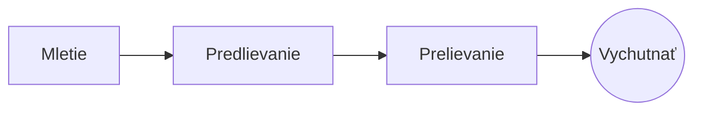

# Dokonalá prelievaná káva

Pomalý ranný rituál v niekoľkých krokoch. Píšte ho v **zdrojovom texte** vľavo alebo priamo v *náhľade* vpravo: oba zostávajú zosúladené a ==každá úprava je čistá zmena== v Markdowne.

> [!TIP]
> Voda tesne po varení, okolo 94 °C, vyťahuje sladkosť bez horkosti.

## Pomer

Väčšina receptov sa ustáli na jednom diele kávy na šestnásť dielov vody:

$$
m_{\text{voda}} = 16 \times m_{\text{káva}}
$$

Takže $20\,\text{g}$ kávy chce $320\,\text{g}$ vody.

## Krok za krokom



## Spôsoby prípravy

| Metóda       | Mletie        |  Čas |
|:-------------|:-------------:|-----:|
| Prelievanie  | Stredne jemné | 3:30 |
| French press | Hrubé         | 4:00 |
| Espresso     | Jemné         | 0:28 |

## Predtým než začnete

- [x] Čerstvo pražené zrná :coffee:
- [x] Žarnovkový mlynček
- [ ] Kanvica s labutím krkom

```python
def water_for(coffee_g: float, ratio: int = 16) -> float:
    return coffee_g * ratio
```

Predlievanie
: Prvé zaliatie vodou, vďaka ktorému mletá káva uvoľní plyn.[^1]

[^1]: Čerstvé zrná predlievaním nabobtnajú najviac; staré sotva stúpnu.
