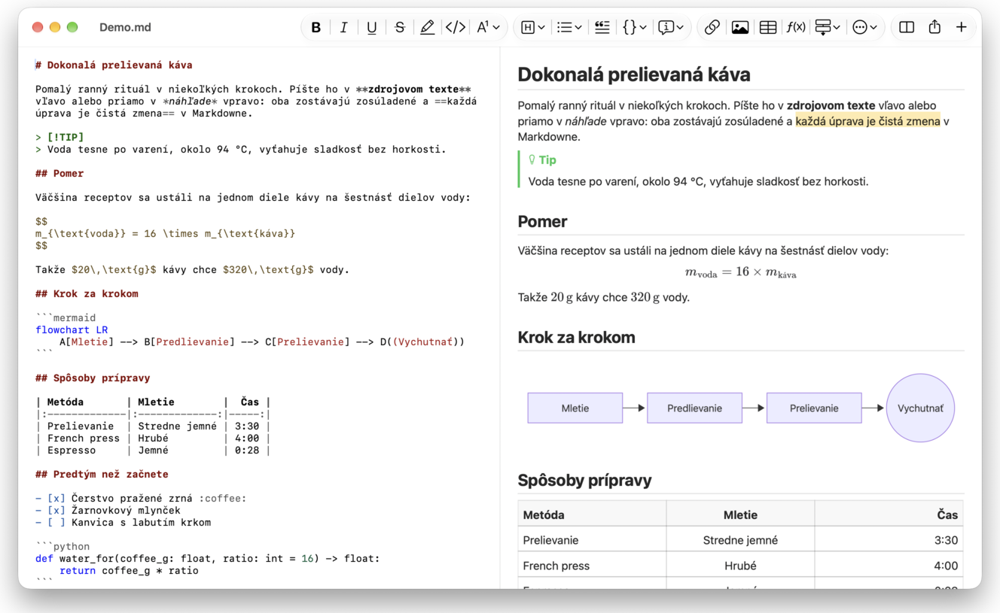
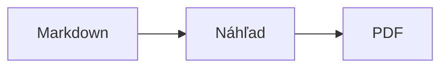

<p>&nbsp;&nbsp;&nbsp;</p>

# Splat

**Editor Markdownu pre macOS, v ktorom píšete v zdrojovom texte alebo priamo v náhľade.**

Splat zobrazuje váš zdrojový text Markdown so zvýraznením syntaxe vľavo a živý, plne upraviteľný náhľad vpravo. Písať môžete v ktoromkoľvek z nich: všetko, čo napíšete v náhľade, sa prenesie do zdrojového textu ako minimálna zmena, takže riadky, ktorých ste sa nedotkli, zostanú bajt po bajte rovnaké a vaše diffy v Gite zostanú čisté. Splat rozumie Markdownu, ktorý už používate: CommonMark a GitHub Flavored Markdown, upozornenia GitHubu, wiki odkazy, vloženia a informačné rámčeky z Obsidianu, rozšírenia Pandocu a Typory, vložené HTML, vzorce LaTeX a diagramy Mermaid, Graphviz a PlantUML, to všetko vykreslené offline. Prechádzajte a prehľadávajte celý priečinok poznámok, pozrite si, čo sa zmenilo od posledného commitu v Gite, vkladajte z Wordu alebo webovej stránky ako Markdown a exportujte do PDF, HTML alebo Wordu jedným kliknutím. Je napísaný v Ruste na skutočných ovládacích prvkoch AppKit, hovorí 35 jazykmi a nič neposiela po sieti, kým o to nepožiadate.
 


[](https://github.com/sventmueller/splat/releases/latest/download/Splat.dmg)

**[Stiahnuť Splat.dmg](https://github.com/sventmueller/splat/releases/latest/download/Splat.dmg)**: podpísaný a overený spoločnosťou Apple (notarizovaný), pre macOS 14 alebo novší na Apple Silicon aj Intel.

**Našli ste chybu?** Splat zachováva riadky, ktorých ste sa nedotkli, bajt po bajte rovnaké. Ak sa niektorý predsa zmení alebo sa súbor zobrazí nesprávne, [založte issue](https://github.com/sventmueller/splat/issues/new/choose) a priložte súbor. Ak je pre vás Splat užitočný, [hviezdička na GitHube](https://github.com/sventmueller/splat) pomôže ostatným nájsť ho.
 
 

[](https://www.rust-lang.org)
[](https://www.apple.com/macos/)

[](https://github.com/madsmtm/objc2)
[](https://webkit.org)
[](https://github.com/kivikakk/comrak)
[](https://github.github.com/gfm/)
[](https://www.mathjax.org)
[](https://cortexjs.io/mathlive/)
[](https://mermaid.js.org)
[](https://graphviz.org)
[](https://plantuml.com)


[](#licencia)

[Bahasa Indonesia](../id/README.md) ·
[Bahasa Melayu](../ms/README.md) ·
[Català](../ca/README.md) ·
[Čeština](../cs/README.md) ·
[Dansk](../da/README.md) ·
[Deutsch](../de/README.md) ·
[English](../../../README.md) ·
[Español](../es/README.md) ·
[Français](../fr/README.md) ·
[Hrvatski](../hr/README.md) ·
[Italiano](../it/README.md) ·
[Magyar](../hu/README.md) ·
[Nederlands](../nl/README.md) ·
[Norsk](../no/README.md) ·
[Polski](../pl/README.md) ·
[Português (Brasil)](../pt_BR/README.md) ·
[Português (Portugal)](../pt_PT/README.md) ·
[Română](../ro/README.md) ·
**Slovenčina** ·
[Slovenščina](../sl/README.md) ·
[Suomi](../fi/README.md) ·
[Svenska](../sv/README.md) ·
[Tiếng Việt](../vi/README.md) ·
[Türkçe](../tr/README.md) ·
[Ελληνικά](../el/README.md) ·
[Русский](../ru/README.md) ·
[Українська](../uk/README.md) ·
[עברית](../he/README.md)‎ ·
[العربية](../ar/README.md)‎ ·
[हिन्दी](../hi/README.md) ·
[ไทย](../th/README.md) ·
[한국어](../ko/README.md) ·
[日本語](../ja/README.md) ·
[简体中文](../zh-Hans/README.md) ·
[繁體中文](../zh-Hant/README.md)

## Obsah

- [Funkcie na prvý pohľad](#funkcie-na-prvý-pohľad)
- [Požiadavky](#požiadavky)
- [Inštalácia](#inštalácia)
- [Prvé kroky](#prvé-kroky)
- [Písanie](#písanie)
  - [V zdrojovom texte](#v-zdrojovom-texte)
  - [V náhľade](#v-náhľade)
  - [Príkazy formátovania](#príkazy-formátovania)
  - [Zoznamy a úlohy](#zoznamy-a-úlohy)
  - [Tabuľky](#tabuľky)
  - [Vkladanie formátovaného textu](#vkladanie-formátovaného-textu)
  - [Metadáta](#metadáta)
- [Podporovaný Markdown](#podporovaný-markdown)
  - [CommonMark a GitHub Flavored Markdown](#commonmark-a-github-flavored-markdown)
  - [Informačné rámčeky](#informačné-rámčeky)
  - [Rozšírená syntax](#rozšírená-syntax)
  - [Obsidian](#obsidian)
  - [Citácie a odkazy na zdroje](#citácie-a-odkazy-na-zdroje)
  - [Vložené HTML](#vložené-html)
  - [Typografická interpunkcia](#typografická-interpunkcia)
  - [Prehľad syntaxe](#prehľad-syntaxe)
- [Vzorce](#vzorce)
- [Diagramy](#diagramy)
- [Obrázky](#obrázky)
- [Odkazy a navigácia](#odkazy-a-navigácia)
- [Poznámky v priečinku](#poznámky-v-priečinku)
- [Zmeny od posledného commitu](#zmeny-od-posledného-commitu)
- [Export, tlač a zdieľanie](#export-tlač-a-zdieľanie)
- [Import dokumentov Word](#import-dokumentov-word)
- [Vzhľad a prístupnosť](#vzhľad-a-prístupnosť)
- [Jazyky](#jazyky)
- [Klávesové skratky](#klávesové-skratky)
- [Súkromie a zabezpečenie](#súkromie-a-zabezpečenie)
- [Veľké dokumenty](#veľké-dokumenty)
- [Známe obmedzenia](#známe-obmedzenia)
- [Riešenie problémov](#riešenie-problémov)
- [Pre vývojárov](#pre-vývojárov)
  - [Komponenty tretích strán](#komponenty-tretích-strán)
- [Licencia](#licencia)

## Funkcie na prvý pohľad

- **Dva spôsoby písania, jeden text.** Zdrojový text aj náhľad sa dajú upravovať. Jediným zdrojom pravdy je súbor Markdown: každý dokument má jednu históriu odvolania a každá úprava v náhľade sa premieta do zdrojového textu ako najmenšia možná zmena.
- **Markdown, ktorý už používate.** CommonMark, GitHub Flavored Markdown, upozornenia GitHubu, rozšírenia Obsidianu, Pandocu a Typory, emotikony zapísané skratkou, spoilery, zoznamy definícií, kotvy nadpisov a HTML ako v README na GitHube.
- **Vzorce a diagramy priamo v aplikácii.** Vzorce LaTeX cez MathJax s vizuálnym editorom vzorcov. Diagramy Mermaid, Graphviz a PlantUML sa vykresľujú na vašom Macu bez Javy, servera či pripojenia k sieti.
- **Tlačidlo pre všetko.** Každý prvok Markdownu má tlačidlo na paneli s nástrojmi a položku v menu, bežné aj klávesovú skratku. Tabuľky majú vlastné menu pre riadky, stĺpce a zarovnanie.
- **Priečinok, nielen súbor.** Bočný panel zobrazuje poznámky okolo dokumentu a prehľadáva ich všetky. Premenovanie poznámky zmení odkazy na ňu a každý bajt okolo nich zostane.
- **Zmeny na prvý pohľad.** V repozitári Git značia pruhy vedľa textu to, čo sa líši od posledného commitu, v oboch paneloch.
- **Z Wordu a webu do Markdownu.** Vkladajte formátovaný text ako Markdown a bunky z tabuľkového procesora ako tabuľku a importujte celé dokumenty Word aj s obrázkami.
- **Export bez straty.** PDF, jeden samostatný súbor HTML alebo dokument Word so skutočnými nadpismi, zoznamami, tabuľkami, poznámkami pod čiarou a obrázkami. Pridajte číslovanie strán, hlavičky a titulnú stranu alebo použite šablónu Word svojej firmy.
- **Natívny od základov.** Skutočné okná AppKit, taby, menu, popovery, Verzie, Automatické ukladanie, menu Zdieľať, tmavý režim, kontrola pravopisu, diktovanie a VoiceOver. Žiadny Electron, žiadny webový prvok pre samotný text.
- **Rýchly aj pri veľkých súboroch.** Vykreslenie stlačenia klávesu v dokumente s veľkosťou 10 MB trvá asi 10 ms, pred vlastnou prácou zobrazenia.
- **Súkromný a opatrný.** Splat beží v App Sandboxe, obrázky z webu sa načítajú, až keď ich povolíte, odkazy do iných aplikácií sa najprv pýtajú a všetko, čo dekóduje nedôveryhodné obrázkové dáta, beží vo vlastnej službe v sandboxe.
- **Vo vašom jazyku.** Rozhranie a vstavaný stručný prehľad Markdownu sú v 35 jazykoch: arabčina, katalánčina, čínština (zjednodušená), čínština (tradičná), chorvátčina, čeština, dánčina, holandčina, angličtina, fínčina, francúzština, nemčina, gréčtina, hebrejčina, hindčina, maďarčina, indonézština, taliančina, japončina, kórejčina, malajčina, nórčina, poľština, portugalčina (Brazília), portugalčina (Portugalsko), rumunčina, ruština, slovenčina, slovinčina, španielčina, švédčina, thajčina, turečtina, ukrajinčina a vietnamčina.

## Požiadavky

- macOS 14 Sonoma alebo novší. Splat sa vyvíja a testuje na macOS 27, kde automaticky preberá dizajn Liquid Glass.
- Mac s procesorom Apple Silicon alebo Intel.
- Asi 45 MB miesta na disku.

## Inštalácia

**Z obrazu disku.** Stiahnite si [`Splat.dmg`](https://github.com/sventmueller/splat/releases/latest/download/Splat.dmg), otvorte ho a pretiahnite Splat do priečinka Aplikácie. Obraz je podpísaný certifikátom Developer ID a overený spoločnosťou Apple (notarizovaný), takže sa otvorí bez upozornení.

**Cez Homebrew.** Cask je vo vlastnom tape:

```sh
brew install --cask sventmueller/tap/splat
```

`brew upgrade --cask splat` nainštaluje nové verzie a `brew uninstall --zap --cask splat` odstráni aj nastavenia a vyrovnávacie pamäte Splatu.

**Aktualizácie.** Splat z obrazu disku alebo z Homebrew sa aktualizuje sám cez [Sparkle](https://sparkle-project.org). Pri druhom spustení sa spýta, či môže raz denne sám vyhľadávať aktualizácie. **Splat › Vyhľadať aktualizácie…** vyhľadá ihneď; **Automaticky vyhľadávať aktualizácie** a **Automaticky sťahovať a inštalovať aktualizácie** v tom istom menu vašu voľbu neskôr zmenia. Splat nainštaluje aktualizáciu, iba ak nesie podpis vývojára. Vlastná zostavená verzia nemá aktualizátor.

**Zo zdrojového kódu.** Predpoklady nájdete v časti [Zostavenie](../../../docs/development.md#building), potom:

```sh
make build
ditto target/release/Splat.app /Applications/Splat.app
open /Applications/Splat.app
```

Ak chcete súbory Markdown otvárať v Splate dvojitým kliknutím, vyberte vo Finderi ľubovoľný súbor `.md`, zvoľte **Súbor › Informácie**, v časti **Otvoriť v aplikácii** vyberte Splat a kliknite na **Zmeniť všetky…**. Splat sa sám zaregistruje pre súbory `.md`, `.markdown`, `.mdown` a `.mkd`.

## Prvé kroky

### Okno

Každý dokument sa otvorí vo vlastnom okne alebo ako tab, ak máte radi taby:

- **Vľavo: zdrojový text.** Váš Markdown v písme SF Mono so zvýraznením syntaxe.
- **Vpravo: náhľad.** Vykreslený dokument pripravený na úpravy.
- **Bočný panel (voliteľný).** Všetky nadpisy ako strom, kliknutím na nadpis ho zobrazíte v oboch paneloch: **Zobraziť › Zobraziť osnovu** (⌃⌘S). Ďalšie dva taby obsahujú [poznámky v priečinku](#poznámky-v-priečinku) a ich prehľadávanie. Tlačidlo vedľa názvu okna ho zobrazí a skryje a nové okná ho otvoria tak, ako ho nechalo posledné okno.
- **Panel s nástrojmi.** Tlačidlá zoradené podľa toho, čo menia: znaky, odseky a vkladané prvky, potom zapnutie a vypnutie náhľadu, Zdieľať a Nový dokument. Prispôsobíte ho cez **Zobraziť › Prispôsobiť panel s nástrojmi…**.

Potiahnutím deliacej čiary dáte jednej strane viac miesta. **Zobraziť › Skryť náhľad** (⌥⌘P) nechá iba zdrojový text; Splat si to pamätá pre každé okno zvlášť. Oba panely sa posúvajú spolu a výber v jednom z nich sa zvýrazní aj v druhom.

V rohu okna sa zobrazuje počet slov a znakov textu a čas čítania, a kým existuje výber, to isté pre výber. Adresy odkazov, značky HTML, metadáta, komentáre, vzorce a diagramy sa nepočítajú. Údaj je spočiatku skrytý; zobrazí ho **Zobraziť › Zobraziť počet slov**.

### Dokumenty, taby a verzie

Splat je bežná dokumentová aplikácia pre macOS:

- **Automatické ukladanie a Verzie.** Zmeny sa ukladajú na mieste. **Súbor › Vrátiť na › Prechádzať všetky verzie…** vás vráti v čase.
- **Zmeny z iných programov.** Keď Git, skript alebo iný editor zmení otvorený dokument, Splat ho načíta znova a zachová kurzor aj pozíciu posunu. Ak máte vlastné neuložené zmeny, Splat ich zachová a macOS sa pred prepísaním druhej verzie opýta.
- **Bežné príkazy so súbormi.** Duplikovať (⇧⌘S), Premenovať…, Presunúť do… a **Súbor › Otvoriť posledné**.
- **Taby.** **Súbor › Nový tab** alebo tlačidlo **+** na paneli s nástrojmi otvorí nový dokument ako tab; štandardné menu Okno taby zlučuje, presúva a prepína.
- **Umiestnenie okna.** Veľkosť a poloha posledného okna sa si pamätá, aj po reštarte. Ak už na tom mieste okno stojí, nové sa otvorí mierne posunuté.
- **Ikona v Docku.** Kliknutie na ňu po zatvorení posledného okna otvorí nový dokument.
- **Otvárať súbory Markdown v Splate.** **Splat › Nastaviť ako predvolenú apku pre Markdown** spôsobí, že dvojité kliknutie na súbor `.md` alebo `.markdown` otvorí Splat; macOS sa raz opýta na potvrdenie. Kým je Splat predvolenou aplikáciou, položka má začiarknutie.

Súbory musia byť text v UTF-8 alebo UTF-16 so značkou poradia bajtov. Iné kódovania Splat odmietne, namiesto aby hádal a poškodil text. Značka poradia bajtov zostane, UTF-16 zostane UTF-16 a v súbore, ktorého všetky riadky končia CRLF, dostanú CRLF aj riadky, ktoré pridáte.

**Po páde** sa stratí najviac posledných pár sekúnd písania: Splat každých päť sekúnd kopíruje neuložený text do `~/Library/Application Support/Splat/Unsaved` a kópie odstráni, keď sa dokument uloží alebo Splat normálne skončí. Pri ďalšom spustení presunie to, čo tam pád zanechal, do `~/Library/Application Support/Splat/Recovery` a raz o tom informuje, s tlačidlom, ktoré otvorí priečinok. Pád, na ktorý Splat ešte dokáže zareagovať, tam zapíše aj text každého otvoreného dokumentu.

### Stručný prehľad

**Pomocník › Markdown – stručný prehľad** otvorí tahák vo vašom jazyku ako nový dokument bez názvu. Je to bežný dokument, takže si tam všetko vyskúšajte, v zdrojovom texte alebo v náhľade.

## Písanie

### V zdrojovom texte

Zdrojový text je editor čistého textu prispôsobený pre Markdown:

- **Zvýraznenie syntaxe** ako vo VS Code: nadpisy, zvýraznenie, odkazy, kód, tabuľky, HTML, front matter a LaTeX s Mermaidom vo vzorcoch a diagramoch. K dispozícii sú palety pre svetlý režim, tmavý režim a Zvýšiť kontrast.
- **Ohradené bloky kódu** sa zvýrazňujú pre Bash, C, C++, C#, CSS (aj SCSS a Less), Go, HTML, XML, Javu, JavaScript, JSON, Kotlin, PHP, Python, Ruby, Rust, SQL, Swift, TypeScript, YAML, TeX a Mermaid, vrátane ich bežných skrátených názvov, ako sú `js`, `py` alebo `sh`.
- **Žiadne neočakávané zámeny.** Dynamické úvodzovky, dynamické pomlčky a nahradenie textu sú predvolene vypnuté, pretože rozbíjajú `--`, `---` a `"`. Zapnete ich cez **Upraviť › Zámeny**.
- **Systémové nástroje na písanie.** Kontrola pravopisu a gramatiky, diktovanie, Nájsť a nahradiť (⌥⌘F) a Reč.
- **Pretiahnutie myšou.** Pustením súboru s obrázkom vložíte ``, pustením iného súboru odkaz naň a pustením adresy URL vložíte `[url](url)`. Každé pustenie je jeden krok odvolania.
- **Vkladanie obrázkov.** Obrázok v schránke, napríklad snímka obrazovky, sa uloží ako súbor PNG vedľa dokumentu (`Obrázok 2026-10-29 13.09.07.png`) a vloží sa ako obrázok. Dokument musí byť na to raz uložený.

### V náhľade

Náhľad sa správa ako textový procesor, ale všetko, čo v ňom urobíte, skončí ako Markdown:

- **Písanie.** Znaky, ktoré v Markdowne niečo znamenajú, ako `*` alebo `#`, sa ošetria, aby sa zobrazili tak, ako ste ich napísali.
- **Return** začne nový odsek alebo položku zoznamu. **⌥Return** alebo **⌃Return** vloží zlom riadku.
- **Formátovanie pri kurzore.** Ak je kurzor na konci slova, Tučné, Kurzíva a ďalšie formáty znakov platia pre to, čo napíšete ďalej. Ďalším výberom formátu to ukončíte. Vnútri slova sa naformátuje celé slovo.
- **Prázdne riadky.** Return na prázdnom riadku pridá ďalší prázdny riadok a Backspace ho odstráni. V zdrojovom texte sú na to dva prázdne riadky navyše; iné programy pre Markdown ich zobrazia ako bežnú medzeru medzi odsekmi.
- **Odvolať** funguje v oboch paneloch. Položky odvolania majú názvy („Odvolať Tučné“), písanie je jeden krok na jednu dávku a po odvolaní a obnovení sa oba panely posunú na zmenu.
- **Vzorce a diagramy** sa zobrazujú ako hotová grafika. Kliknutím na ne, presunutím kurzora na ne alebo stlačením Return na nich otvoríte ich editor (pozri [Vzorce](#vzorce) a [Diagramy](#diagramy)).
- **Vložené HTML, vložené poznámky a front matter** sa zobrazujú, ale upravujete ich v zdrojovom texte. Kliknutie na ne umiestni kurzor na zodpovedajúce miesto tam.

Všetko, čo Markdown nedokáže vyjadriť, je v náhľade zablokované: panely Písma a Farby, pravítko a vkladanie alebo púšťanie formátovaného textu a obrázkov. Vložené HTML a RTF sa vložia ako čistý text, pokiaľ nezvolíte [Vložiť ako Markdown](#vkladanie-formátovaného-textu).

### Príkazy formátovania

Každý príkaz je dostupný na paneli s nástrojmi, v lište menu a v kontextovom menu oboch panelov. Položky menu zobrazujú začiarknutie pre formátovanie pri kurzore.

| Menu | Príkazy |
|---|---|
| **Formát › Písmo** | Tučné, Kurzíva, Podčiarknuté, Preškrtnuté, Zvýrazniť, Kód, Horný index, Dolný index |
| **Formát › Nadpis** | Základný text, Nadpis 1 až 6 |
| **Formát › Zoznam** | Zoznam s odrážkami, Číslovaný zoznam, Zoznam úloh |
| **Formát** | Citácia, Blok kódu (Bez jazyka alebo jeden z 20 jazykov; zmení aj jazyk existujúceho bloku), Informačný rámček (Poznámka, Tip, Dôležité, Upozornenie, Pozor; rovnaký typ znova ho odstráni), Upraviť vzorec alebo diagram…, Odstrániť formátovanie |
| **Vložiť** | Odkaz…, Obrázok…, Tabuľka…, Vzorec, Diagram (Vývojový diagram, Sekvenčný diagram, Ganttov diagram), Obsah, Poznámka pod čiarou, Oddeľovač |
| **Tabuľka** | Vložiť riadok nad/pod, Vložiť stĺpec vľavo/vpravo, Vymazať riadok, Vymazať stĺpec, Zarovnanie (Vľavo, Na stred, Vpravo, Predvolené), Zarovnať stĺpce tabuľky |
| **Zobraziť** | Skryť/Zobraziť náhľad, Zobraziť/Skryť osnovu, Typografická interpunkcia, Zväčšiť/Zmenšiť, Skutočná veľkosť, panel s nástrojmi, lišta s tabmi, celá obrazovka |

Podčiarknutie, zvýraznenie, horný a dolný index sa zapisujú ako `<ins>`, `<mark>`, `<sup>` a `<sub>`, ktoré zobrazuje aj GitHub. Splat číta aj `<u>`, ktoré GitHub odstraňuje, a kratšie `==highlight==`, `^sup^` a `~sub~`. GitHub zobrazuje `==` a `^` tak, ako sú napísané, a `~sub~` ako preškrtnutie.

### Zoznamy a úlohy

- Return pokračuje v zozname; Return na prázdnej položke ho ukončí.
- **Tab** a **⇧Tab** v náhľade odsadzujú a zrušia odsadenie položiek zoznamu.
- Kliknutie na zaškrtávacie políčko úlohy v náhľade prepína `- [ ]` a `- [x]`.
- **Formát › Zoznam** zmení označené odseky na zoznam alebo zmení jeho druh.

### Tabuľky

- **Vložiť › Tabuľka…** sa opýta na počet riadkov (vrátane hlavičky) a stĺpcov.
- V náhľade sa **Tab** presunie na ďalšiu bunku, **⇧Tab** na predchádzajúcu a **Return** na bunku pod ňou. Tab v poslednej bunke pridá riadok.
- Menu **Tabuľka** vkladá a maže riadky a stĺpce a nastavuje zarovnanie stĺpca (⌘{, ⌘|, ⌘}).
- **Tabuľka › Zarovnať stĺpce tabuľky** doplní zdrojový text medzerami, aby stĺpce lícovali.

### Vkladanie formátovaného textu

**Upraviť › Vložiť ako Markdown** (⌃⌘V), aj v kontextovom menu oboch panelov, premení obsah schránky na Markdown v mieste výberu, ako jeden krok odvolania. ⌘V naďalej vkladá čistý text.

- **Z prehliadača, Wordu, Google Docs, Confluence, Poznámok alebo Pages:** prenesú sa nadpisy, tučné písmo, kurzíva, podčiarknutie, preškrtnutie, horný a dolný index, odkazy, zoznamy aj s vnorením, citácie, kód a tabuľky.
- **Z tabuľkového procesora:** z buniek vznikne tabuľka s riadkom hlavičky a stĺpcami čísel zarovnanými doprava. To isté platí pre text oddelený tabulátormi, bodkočiarkami alebo čiarkami, ak má každý riadok rovnaký počet stĺpcov.
- **Obrázky** s webovou adresou zostanú odkazmi. Obrázok vo vloženom HTML sa stane súborom vedľa dokumentu, ktorý musí byť na to raz uložený. Dočasné obrázkové súbory Wordu sa neprenesú, ich alternatívny text však zostane.
- **Odkazy** si ponechajú iba adresy `http`, `https`, `mailto`, relatívne a `#`; z každého iného odkazu zostane iba text.

### Metadáta

**Formát › Upraviť metadáta…** alebo kliknutie na riadok metadát hore v náhľade otvorí formulár s poľami YAML front matter. Polia možno meniť, pridávať a odstraňovať. Pole so zoznamom zostane zoznamom: jeho hodnoty nasledujú za sebou, oddelené čiarkami, a hodnota obsahujúca čiarku je v úvodzovkách. Nové pole s názvom `tags`, `aliases`, `keywords`, `categories`, `authors` alebo `cssclasses` sa tiež stane zoznamom. Vnorené polia a viacriadkový text tam uvidíte a upravíte ich v zdrojovom texte.

To, čo formulár zmení, je jeden krok odvolania a týka sa len riadkov polí, ktoré ste zmenili: komentáre, poradie, nezvyčajné medzery, úvodzovky a konce riadkov všetkých ostatných zostanú bajt po bajte rovnaké. Dokument bez metadát dostane blok na svojom začiatku.

## Podporovaný Markdown

Splat parsuje pomocou [comrak](https://github.com/kivikakk/comrak), parsera kompatibilného s CommonMark a GFM, a zapína väčšinu jeho rozšírení. Všetko nižšie sa vykreslí v náhľade aj vo všetkých exportoch.

### CommonMark a GitHub Flavored Markdown

- Nadpisy (`#` a podčiarknuté), odseky, zlomy riadkov, zvýraznenie, silné zvýraznenie, kód v texte, blokové citácie, oddeľovače.
- Zoznamy s odrážkami, číslované a vnorené; zoznamy úloh.
- Odkazy (v texte, referenčné a automatické), obrázky, definície referenčných odkazov.
- Ohradené a odsadené bloky kódu so zvýraznením syntaxe.
- Tabuľky so zarovnaním stĺpcov.
- Preškrtnutie pomocou `~~dvoch vlnoviek~~`.
- Poznámky pod čiarou: `text[^1]` s `[^1]: Poznámka.` kdekoľvek v dokumente. Kliknutie na značku prejde na poznámku.
- Front matter v YAML medzi riadkami `---` na začiatku. Náhľad ho zhrnie do jedného riadku, napríklad „Metadáta: title, date, tags“.

### Informačné rámčeky

Upozornenia GitHubu sa vykreslia ako farebné rámčeky s ikonou a názvom:

```markdown
> [!NOTE]
> Užitočná informácia, ktorú by mali používatelia poznať.

> [!WARNING]
> Kritický obsah, ktorý si vyžaduje okamžitú pozornosť.
```

Päť typov je Poznámka, Tip, Dôležité, Upozornenie a Pozor. **Formát › Informačný rámček** zmení odsek pri kurzore na jeden z nich.

Fungujú aj informačné rámčeky z Obsidianu, s ľubovoľným názvom a stavom zbalenia:

```markdown
> [!tip]- Kliknutím na ▸ rozbalíte
> Skryté, kým sa neotvorí.

> [!question]+ Predvolene otvorené
> Znak `+` začína rozbalený, znak `-` zbalený.
```

Ostatné typy z Obsidianu sa zobrazia v najbližšej z piatich farieb: `success`, `check`, `done` a `hint` ako Tip; `question`, `help` a `faq` ako Dôležité; `attention` ako Upozornenie; `failure`, `fail`, `missing`, `danger`, `error` a `bug` ako Pozor; všetko ostatné ako Poznámka.

### Rozšírená syntax

| Funkcia | Syntax | Pôvod |
|---|---|---|
| Zvýraznenie | `==označený text==` | Obsidian, Typora |
| Horný index | `x^2^` | Pandoc, Typora |
| Dolný index | `H~2~O` | Pandoc, Typora |
| Skratka emotikonu | `:rocket:` sa zmení na 🚀 | GitHub |
| Spoiler | `\|\|skrytý text\|\|`, na prečítanie ho označte | Discord |
| Poznámka pod čiarou v texte | `text^[samotná poznámka]` | Pandoc, Obsidian |
| Zoznam definícií | `Pojem`, prázdny riadok, `: Vysvetlenie` | PHP Markdown Extra, Pandoc |
| Kotva nadpisu | `## Inštalácia {#setup}`, odkaz cez `[pozri](#setup)` | Pandoc, kramdown |

Zoznamy definícií vyzerajú v zdrojovom texte takto:

```markdown
Pojem

: Vysvetlenie pojmu.
```

Bez vlastnej kotvy dostane každý nadpis kotvu odvodenú z jeho textu, ako na GitHube: `## Prvé kroky` je dostupný ako `#prvé-kroky`.

### Obsidian

- **Wiki odkazy.** `[[Note]]` odkazuje na `Note.md` v rovnakom priečinku alebo v priečinku pod ním. `[[Note|Zobrazený text]]` zobrazí váš vlastný text a `[[Note#Heading]]` otvorí poznámku. ⌘-kliknutie ju otvorí v Splate.
- **Vloženia.** `![[Note]]` zobrazí inú poznámku vo vnútri tejto; poznámky vložené v nej sa zobrazia ako odkazy. `![[diagram.png]]` zobrazí obrázok. Ako v Obsidiane, vloženia pomenúvajú poznámky a obrázky v priečinku dokumentu alebo pod ním, nikdy absolútnou cestou, a ako poznámky sa zobrazujú iba súbory Markdown.
- **Komentáre.** `%%Iba v zdrojovom texte%%` zostane viditeľný v zdrojovom texte a z náhľadu aj zo všetkých exportov sa vynechá, v texte aj na samostatných riadkoch.
- **Štítky.** `#idea` alebo `#project/splat` sa zvýrazní. ⌘-kliknutie vyhľadá štítok v dokumente a v bočnom paneli v celom priečinku.
- **Zbaliteľné informačné rámčeky.** Pozri [Informačné rámčeky](#informačné-rámčeky).

### Citácie a odkazy na zdroje

- **Citácie Pandocu.** `[@doe2020]` alebo `[@doe2020; @roe2021]` sa zobrazí ako „(Doe 2020; Roe 2021)“. Záznamy pochádzajú zo súboru BibTeX, ktorý front matter uvádza ako `bibliography: refs.bib`. Bez neho Splat použije `references.bib`, `literatur.bib` alebo `bibliography.bib` vedľa dokumentu.
- **Odkazy na GitHub a GitLab.** Ak dokument leží v repozitári Git, ktorého vzdialený repozitár `origin` je na github.com alebo na hostiteľovi GitLab, zvýraznia sa `@name`, `#12` (issue) a `!7` (merge request, iba GitLab). ⌘-kliknutie ich otvorí v prehliadači.

### Vložené HTML

HTML, aké nájdete v README na GitHube, sa vykresľuje vlastným čitateľom, nie enginom prehliadača:

- vycentrované odseky a bloky (`<p align="center">`, `<div align="center">`)
- obrázky s veľkosťou (``)
- odkazy, `<kbd>⌘</kbd>`, `<br>`, `<u>`, `<ins>`, `<mark>`, `<sup>`, `<sub>`
- zoznamy a tabuľky, vrátane buniek cez viac stĺpcov (`colspan`)
- zbaliteľné sekcie: `<details><summary>Viac</summary>…</details>`, otvorené kliknutím na ▸

Markdown medzi značkami HTML sa vykreslí ako Markdown. Skripty, štýly, rámce a formuláre sa úplne vynechajú a odkazy a obrázky si ponechajú iba adresy `http`, `https`, `mailto` a relatívne.

### Typografická interpunkcia

**Zobraziť › Typografická interpunkcia** zobrazí rovné úvodzovky ako úvodzovky jazyka vášho rozhrania, `--` ako polpomlčku, `---` ako pomlčku a `...` ako výpustku. V nemčine sa `"Ja"` zmení na „Ja“, vo francúzštine na «Oui», v japončine na 「はい」, aj tam, kde čínština a japončina píšu úvodzovky bez medzery; hebrejské skratky ako `צה"ל` dostanú gershayim, צה״ל. Zdrojový text si ponechá obyčajné znaky; náhľad a všetky exporty zobrazia typografické. Nastavenie je vypnuté, kým ho nezapnete.

### Prehľad syntaxe

| Prvok | Markdown |
|---|---|
| **Tučné** | `**Tučné**` |
| *Kurzíva* | `*Kurzíva*` |
| Podčiarknuté | `<ins>Podčiarknuté</ins>` alebo `<u>Podčiarknuté</u>` |
| ~~Preškrtnuté~~ | `~~Preškrtnuté~~` |
| Zvýraznenie | `<mark>Zvýraznenie</mark>` alebo `==Zvýraznenie==` |
| `Kód` | `` `Kód` `` |
| x² | `x<sup>2</sup>` alebo `x^2^` |
| H₂O | `H<sub>2</sub>O` alebo `H~2~O` |
| [Odkaz](https://example.com) | `[Odkaz](https://example.com)` |
| Nadpis | `# Nadpis` až `###### Nadpis` |
| Citácia | `> Citácia` |
| Zoznam s odrážkami | `- Položka` |
| Číslovaný zoznam | `1. Položka` |
| Úloha | `- [ ] Otvorená` a `- [x] Hotová` |
| Blok kódu | ```` ```rust ```` … ```` ``` ```` |
| Tabuľka | `\| A \| B \|` s `\|---\|---\|` pod hlavičkou |
| Poznámka pod čiarou | `Text[^1]` a `[^1]: Poznámka` |
| Oddeľovač | `---` |
| Obrázok | `` |
| Vzorec | `$E = mc^2$`, `$$ … $$` |
| Diagram | ```` ```mermaid ````, ```` ```dot ````, ```` ```plantuml ```` |
| Informačný rámček | `> [!TIP]` |
| Wiki odkaz | `[[Note]]`, `[[Note\|Text]]` |
| Vloženie | `![[Note]]`, `![[image.png]]` |
| Komentár | `%%Komentár%%` |
| Štítok | `#štítok` |
| Citácia zdroja | `[@key]` |
| Spoiler | `\|\|Spoiler\|\|` |
| Emotikon | `:tada:` |

## Vzorce

Vzorce vykresľuje [MathJax](https://www.mathjax.org) s matematikou TeX a AMS ako ostrú vektorovú grafiku. Text v `\text{…}` môže byť v ľubovoľnom písme: čo v písmach MathJaxu chýba, sa berie z písiem vášho Macu, pričom arabčina a hebrejčina sa píšu sprava doľava a emotikony sú farebné.

| Druh | Syntax |
|---|---|
| V texte | `$E = mc^2$`, `` $`E = mc^2`$ `` (GitHub, GitLab), `\(E = mc^2\)` |
| Samostatný | `$$` … `$$`, `\[` … `\]` alebo blok kódu označený `math` |

**Úprava vzorca.** Kliknutím na vzorec v náhľade, dvojitým kliknutím, stlačením Return na ňom alebo presunutím kurzora naň otvoríte jeho editor v popovere. **Vložiť › Vzorec** vloží nový a hneď otvorí editor.

- **Vizuálne alebo LaTeX.** Prepínač navrchu prepína medzi vizuálnym editorom ([MathLive](https://cortexjs.io/mathlive/)) a kódom LaTeX. Splat si vašu voľbu pamätá.
- **Stavebné bloky** pre zlomok, druhú odmocninu, horný a dolný index, súčet a integrál s hranicami, limitu, zátvorky, ktoré rastú s obsahom, maticu 2×2, grécke písmená a relácie, operátory a šípky. Zanechávajú zástupné symboly □ a **Tab** preskočí na ďalší.
- **Živý náhľad.** Zmeny sa v dokumente zobrazujú počas písania. Chyby z MathJaxu sa zobrazia v riadku pod kódom.
- **Potvrdiť alebo zahodiť.** Kliknutie mimo ponechá zmenu ako jeden krok odvolania; **Esc** alebo **Zrušiť** ju zahodí. Stlačenie Esc pri novom prázdnom vzorci ho opäť odstráni.
- Kontextové menu ponúka **Upraviť vzorec…** pre vzorec pod ukazovateľom.

VoiceOver číta vzorec ako jeho kód LaTeX. Splat vykresľuje vzorce, nie úplné dokumenty LaTeX: nie sú tu žiadne balíky, žiadny TikZ a žiadny `\documentclass`.

## Diagramy

Diagramy sa vykresľujú v Splate, offline a v svetlom aj tmavom variante.

| Nástroj | Blok kódu | Čo kreslí |
|---|---|---|
| [Mermaid](https://mermaid.js.org) | ```` ```mermaid ```` | vývojové diagramy, sekvenčné, triedne, stavové, diagramy vzťahov entít, Ganttove, koláčové, myšlienkové mapy, časové osi a všetky ostatné typy Mermaidu |
| [Graphviz](https://graphviz.org) | ```` ```dot ```` alebo ```` ```graphviz ```` | grafy v jazyku DOT |
| [PlantUML](https://plantuml.com) | ```` ```plantuml ```` alebo ```` ```puml ```` | diagramy UML; beží bez Javy |



**Úprava diagramu** funguje ako úprava vzorca: kliknutím naň otvoríte kód v popovere so zvýraznením syntaxe a chybovými hláseniami v riadku pod kódom. **Vložiť › Diagram** začína od šablóny pre vývojový diagram, sekvenčný diagram alebo Ganttov diagram. Stavebné bloky pomáhajú pri troch najčastejších typoch Mermaidu:

- **Vývojový diagram:** Uzol ▾ (obdĺžnik, zaoblený, kruh, kosoštvorec, databáza), Spojenie, Spojenie s popisom, Skupina, Smer ▾
- **Sekvenčný diagram:** Účastník, Správa, Odpoveď, Poznámka, Slučka, Alternatívne cesty
- **Ganttov diagram:** Sekcia, Úloha, Míľnik

Ostatné typy diagramov sa upravujú ako kód. VoiceOver číta názov diagramu alebo jeho alternatívny text.

Prvý diagram po spustení trvá asi sekundu, pretože vykresľovací engine sa spúšťa na pozadí. Diagram, ktorý trvá dlhšie ako 10 sekúnd, zobrazí chybu a vykresľovací engine sa pre ďalší spustí odznova. Engine PlantUML (3 MB) sa načíta až s prvým diagramom PlantUML. Príkaz `!include` z webu v PlantUML je zablokovaný.

## Obrázky

- **Lokálne obrázky** používajú cesty relatívne k dokumentu: ``. Splat zobrazí PNG, JPEG, GIF, WebP, BMP, SVG, HEIC, TIFF, AVIF a PDF.
- **Obrázky z webu** zostanú zablokované, kým ich nepovolíte: lišta nad náhľadom vysvetľuje, že ich načítaním sa ich servery dozvedia, že a kedy dokument otvárate. **Načítať obrázky** ich povolí pre tento dokument; Splat si voľbu pamätá pre každý súbor zvlášť.
- **Veľkosť.** `` nastaví veľkosť obrázka; inak sa obrázky prispôsobia šírke náhľadu.
- **Zmeny na disku.** Obrázok, ktorý nahradíte, alebo taký, ktorý sa objaví po tom, čo ho dokument uviedol, sa zobrazí bez opätovného otvorenia dokumentu. Obrázky z webu, ktoré zlyhali kvôli sieti, sa skúšajú znova, kým ich dokument zobrazuje.
- **Pamäť.** Obrázky sa zobrazujú do 2560 pixelov na dlhšej strane, čo vyplní aj stranu A4. Dekódujú sa menšie, keď zaberú osminu pamäte Macu a kým macOS hlási nedostatok pamäte.
- **Tmavý režim.** Obrázky s bielym pozadím sa v tmavom náhľade mierne stlmia.
- **Vkladanie a pretiahnutie.** Pozri [V zdrojovom texte](#v-zdrojovom-texte).

## Odkazy a navigácia

V náhľade kliknutie umiestni kurzor, aby ste mohli upraviť text odkazu; **⌘-kliknutie** odkaz otvorí:

- `http`, `https` a `mailto` sa otvoria vo vašom prehliadači alebo poštovej aplikácii.
- Súbory Markdown sa otvoria v Splate; ostatné súbory a priečinky sa zobrazia vo Finderi.
- `#anchor` prejde na nadpis v dokumente.
- Adresy, ktoré otvárajú inú aplikáciu, ako `slack://` alebo `vscode://`, sa najprv opýtajú a zobrazia úplnú adresu a aplikáciu. **Zrušiť** je predvolené.

**Vložiť › Obsah** vloží prepojený zoznam všetkých nadpisov. Ak je kurzor v ňom, ten istý príkaz ho aktualizuje. Bočný panel s osnovou (⌃⌘S) prejde na ľubovoľný nadpis v oboch paneloch.

## Poznámky v priečinku

Tlačidlá hore v bočnom paneli prepínajú medzi osnovou, súbormi a vyhľadávaním.

- **Súbory** (**Zobraziť › Zobraziť súbory**, ⌃⌘E). Všetky súbory Markdown v priečinku dokumentu alebo, ak dokument leží v repozitári Git, v celom repozitári. Kliknutie alebo Return otvorí poznámku ako tab tohto okna; ak už je otvorená, prejde do popredia. Tlačidlo vedľa názvu priečinka zobrazí v tomto okne iný priečinok. Skryté súbory, `node_modules`, `target`, `Pods`, `DerivedData`, `__pycache__` a priečinky bez poznámok zostanú mimo zoznamu. Dokument ležiaci priamo vo vašom domovskom priečinku zobrazí iba poznámky vedľa seba, aby Splat neprechádzal všetky vaše priečinky a nepýtal sa na každý z nich.
- **Vyhľadávanie** (**Upraviť › Nájsť › Vyhľadať vo všetkých poznámkach…**, ⇧⌘F). Nájde text vo všetkých poznámkach bez ohľadu na veľkosť písmen a na to, ako je zakódovaná diakritika. `#tag` nájde štítok, `#project` aj `#project/splat`, a nič vnútri kódu. Kliknutie na výsledok otvorí poznámku na tom mieste.
- **Odkazy na poznámku.** Kontextové menu poznámky uvádza poznámky, ktoré na ňu odkazujú, wiki odkazom, vložením, relatívnym odkazom alebo definíciou referenčného odkazu.
- **Premenovanie poznámky.** To isté menu ju premenuje a zmení tieto odkazy. Splat najprv povie, koľkých odkazov v koľkých súboroch sa to týka. V každom odkaze sa zmení iba názov a všetky ostatné bajty súboru zostanú. Otvorené dokumenty prijmú zmenu ako krok odvolania; v ostatných súboroch ju môže vrátiť iba Git alebo Verzie. Súbor, ktorý medzitým zmenil iný program, zastaví premenovanie všetkých odkazov a Splat ho uvedie.

Zoznam sleduje priečinok, keď sa okno dostane do popredia. Vyhľadávanie pracuje so súbormi tak, ako sú na disku, a text, ktorý ste ešte neuložili, sa počíta od ďalšieho automatického uloženia.

## Zmeny od posledného commitu

V dokumente v repozitári Git značia pruhy vedľa textu to, čo sa líši od posledného commitu, v zdrojovom texte aj v náhľade: zelená pre pridané riadky, modrá pre zmenené riadky a krátka červená značka tam, kde sa niečo odstránilo. Sledujú vaše písanie aj posun vetvy. **Zobraziť › Zmeny od posledného commitu** ich vypne pre všetky okná.

Riadky, ktoré sa líšia iba koncom riadka, sa nepočítajú, takže súbor s CRLF oproti commitu s LF neukáže žiadnu zmenu. Nový súbor nemá žiadne značky až do svojho prvého commitu a nemá ich ani dokument nad 32 MB.

## Export, tlač a zdieľanie

| Formát | Ako | Čo získate |
|---|---|---|
| **PDF** | **Súbor › Exportovať ako PDF…** alebo menu Zdieľať | Strany vo veľkosti papiera, vždy vo svetlom vzhľade, vzorce a diagramy ako vektorová grafika. **Súbor › Nastavenie strany…** nastaví papier. |
| **Tlač** | **Súbor › Tlačiť…** (⌘P) | Rovnaké rozloženie ako v PDF. |
| **HTML** | **Súbor › Exportovať ako HTML…** alebo menu Zdieľať | Jeden samostatný súbor: lokálne obrázky vložené, vzorce a diagramy ako ostré obrázky, kotvy nadpisov, aby fungoval obsah. Žiadne skripty. |
| **Word** | **Súbor › Exportovať ako dokument Word…** alebo menu Zdieľať | Súbor `.docx` so štýlmi nadpisov Wordu, skutočnými zoznamami a tabuľkami (vrátane zlúčených buniek), poznámkami pod čiarou ako poznámkami Wordu, vloženými obrázkami, vzorcami a diagramami. |
| **Markdown** | Tlačidlo **Zdieľať** na paneli s nástrojmi | Dokument ako súbor `.md` pre Mail, Správy, AirDrop a každú ďalšiu službu zdieľania. |

Menu **Súbor › Zdieľať** ponúka všetko z toho na jednom mieste. Exporty používajú nastavenie typografickej interpunkcie a obrázky z webu, ktoré ste povolili; obrázky z webu zostanú v HTML odkazmi.

**Súbor › Možnosti exportu…** nastavuje, čo PDF, tlač a Word pridajú k textu, pre všetky dokumenty:

- **Číslovanie strán** v pätičke PDF a tlače, v tvare `2 / 9`.
- **Hlavička a pätička** pre PDF a tlač. `{title}`, `{author}`, `{date}`, `{page}` a `{pages}` zastupujú svoje hodnoty, prvé tri z metadát dokumentu.
- **Titulná strana** pre PDF, tlač a Word, s `title`, `subtitle`, `author` a `date` z metadát alebo s názvom dokumentu ako titulom. Nemá hlavičku ani pätičku.
- **Šablóna Word**, súbor `.docx` alebo `.dotx`, ktorého vzhľad export prevezme: jeho štýly, aj s lokalizovanými názvami, motív, veľkosť strany, okraje, hlavičky a pätičky. Šablóna, ktorú nemožno prečítať, export zastaví a povie to, namiesto toho, aby vám dala dokument bez nej.

## Import dokumentov Word

**Súbor › Importovať dokument Word…** sa opýta na súbor `.docx` alebo `.dotx` a na to, kam pôjde jeho Markdown, a potom výsledok otvorí. Obrázky skončia v priečinku vedľa neho, pomenovanom podľa dokumentu s `-images`.

Nadpisy a zoznamy sa prenesú tak, ako ich definujú štýly a číslovanie Wordu, aj v dokumentoch, ktorých štýly majú lokalizované názvy. Tučné písmo, kurzíva, podčiarknutie, preškrtnutie, zvýraznenie, horný a dolný index, odkazy, citácie, kód, poznámky pod čiarou, vysvetlivky a tabuľky sa prenesú, bunky cez viac stĺpcov ako tabuľka HTML. Vzorce sa stanú LaTeXom. Sledované zmeny sa považujú za prijaté a obsah sa vynechá, pretože **Vložiť › Obsah** vytvorí nový. Staré súbory `.doc` a dokumenty chránené heslom sa odmietnu.

## Vzhľad a prístupnosť

- **Tmavý režim** sleduje systém. Vzorce a diagramy sa vykresľujú pre každý vzhľad.
- **Zvýšiť kontrast** v Nastaveniach systému prepne farby syntaxe na vysokokontrastné palety.
- **Zväčšenie a zmenšenie.** ⌘+, ⌘− a ⌘0 mení mierku oboch panelov.
- **Celá obrazovka, taby a prispôsobiteľný panel s nástrojmi**, ako v každej aplikácii pre Mac.
- **VoiceOver.** Panely sa volajú „Zdrojový text Markdown“ a „Náhľad“, vzorce sa čítajú ako ich kód a diagramy ako ich názov. Každý príkaz sa dá vyvolať z klávesnice.

Splat nemá okno s nastaveniami: niekoľko možností je tam, kde sa uplatňujú, v menu **Zobraziť**, **Upraviť › Zámeny** a **Súbor › Možnosti exportu…**.

## Jazyky

Rozhranie, menu a stručný prehľad Markdownu sú preložené do 35 jazykov:

Arabčina, katalánčina, čínština (zjednodušená), čínština (tradičná), chorvátčina, čeština, dánčina, holandčina, angličtina, fínčina, francúzština, nemčina, gréčtina, hebrejčina, hindčina, maďarčina, indonézština, taliančina, japončina, kórejčina, malajčina, nórčina, poľština, portugalčina (Brazília), portugalčina (Portugalsko), rumunčina, ruština, slovenčina, slovinčina, španielčina, švédčina, thajčina, turečtina, ukrajinčina a vietnamčina.

Splat sa riadi poradím jazykov v **Systémové nastavenia › Všeobecné › Jazyk a región**; tam v časti **Aplikácie** môžete vybrať jazyk aj iba pre Splat. Ak pre váš jazyk nie je preklad, použije angličtinu. Pojmy v menu vychádzajú z prekladov od Applu, takže Splat pôsobí ako zvyšok vášho Macu.

Hebrejský a arabský text sa čítajú sprava doľava všade, kde sa objavia, bez ohľadu na jazyk rozhrania: každý odsek, nadpis a položka zoznamu preberá smer svojho prvého písmena, citácie a informačné rámčeky kreslia pruh vpravo a tabuľka, ktorej text začína sprava doľava, radí stĺpce sprava. Bloky kódu zostávajú zľava doprava. Exporty do PDF, HTML a Wordu tieto smery zachovávajú. Ak je systémovým jazykom hebrejčina alebo arabčina, macOS zrkadlí aj okno, takže náhľad je vľavo.

## Klávesové skratky

| Akcia | Skratka |
|---|---|
| Tučné, Kurzíva, Podčiarknuté | ⌘B, ⌘I, ⌘U |
| Preškrtnuté | ⇧⌘X |
| Kód | ⌥⇧⌘C |
| Odkaz… | ⌘K |
| Základný text, Nadpis 1 až 6 | ⌥⌘0, ⌥⌘1 až ⌥⌘6 |
| Zarovnať stĺpec tabuľky vľavo, na stred, vpravo | ⌘{, ⌘\|, ⌘} |
| Skryť alebo zobraziť náhľad | ⌥⌘P |
| Zobraziť alebo skryť osnovu | ⌃⌘S |
| Zobraziť alebo skryť súbory | ⌃⌘E |
| Vyhľadať vo všetkých poznámkach | ⇧⌘F |
| Vložiť ako Markdown | ⌃⌘V |
| Zväčšiť, zmenšiť, skutočná veľkosť | ⌘+, ⌘−, ⌘0 |
| Nový dokument, otvoriť, uložiť, duplikovať | ⌘N, ⌘O, ⌘S, ⇧⌘S |
| Nastavenie strany, tlač | ⇧⌘P, ⌘P |
| Nájsť, nájsť a nahradiť | ⌘F, ⌥⌘F |
| Nájsť ďalšie, predchádzajúce; použiť výber; prejsť na výber | ⌘G, ⇧⌘G; ⌘E; ⌘J |
| Zobraziť pravopis a gramatiku; skontrolovať dokument | ⌘:, ⌘; |
| Vložiť a prispôsobiť štýl | ⌥⇧⌘V |
| Skryť panel s nástrojmi, zobraziť všetky taby, celá obrazovka | ⌥⌘T, ⇧⌘\\, ⌃⌘F |
| Zlom riadku (náhľad) | ⌥Return alebo ⌃Return |
| Ďalšia bunka / predchádzajúca bunka v tabuľke (náhľad) | Tab / ⇧Tab |
| Odsadiť / zrušiť odsadenie položky zoznamu (náhľad) | Tab / ⇧Tab |
| Ďalší zástupný symbol v editore vzorcov | Tab |
| Zavrieť editor vzorca alebo diagramu bez zmien | Esc |
| Otvoriť odkaz, štítok alebo odkaz na zdroj (náhľad) | ⌘-kliknutie |

Splat necháva štandardné skratky Applu tam, kde sú.

## Súkromie a zabezpečenie

Súbor Markdown môže pochádzať od kohokoľvek, preto Splat považuje každý dokument za nedôveryhodný.

- **Predvolene bez siete.** Splat nemá telemetriu. Aktualizácie vyhľadáva, až keď s tým súhlasíte alebo zvolíte **Vyhľadať aktualizácie…**: potom načíta malý súbor kanála z GitHubu a požiadavka uvádza len aplikáciu a jej verziu. Vzorce a diagramy sa vykresľujú lokálne; webové zobrazenia, ktoré to robia, nemajú prístup k sieti. **Pomocník › Nahlásiť problém…** otvorí v prehliadači formulár na GitHube; jeho adresa obsahuje verziu Splatu, verziu macOS a typ Macu, nič z vašich dokumentov.
- **Obrázky z webu** sa načítajú až s vaším povolením, len cez `https`, nikdy z hostiteľov vo vašej lokálnej sieti, najviac po 10 MB a v súkromnej relácii bez cookies.
- **Izolované dekódovanie.** Obrázky a grafiku vzorcov a diagramov dekóduje vlastná služba, ktorú macOS spúšťa vo vlastnom sandboxe: žiadny z vašich súborov, žiadna sieť. Vracia iba pixely, ktorých veľkosť sa kontroluje, a sama sa ukončí, keď dekódovanie trvá dlhšie ako 10 sekúnd alebo potrebuje príliš veľa pamäte. Dekodéry obrázkov od Applu vidia iba HEIC, TIFF, AVIF a PDF, a to len vtedy, keď dáta naozaj majú tento formát. Touto službou prechádzajú aj SVG, vzorce a diagramy, takže v Splate sú to obrázky s pevným rozlíšením: štyri pixely na bod, najviac 2560 na dlhšej strane.
- **Lokálne súbory** sa do dokumentu dostanú len cez cestu, ktorú uvádza, a len z priečinka, ku ktorému ste udelili prístup: Splat smie čítať dokument, ktorý otvoríte, ale obrázky, poznámky, bibliografiu a repozitár okolo neho až potom, čo k ich priečinku udelíte prístup tlačidlom **Udeliť prístup k priečinku…** v lište nad náhľadom. Udelený prístup platí pre všetky podpriečinky a zostane zapamätaný. Vloženia zobrazujú poznámky Markdown z priečinka dokumentu a pod ním a chýbajúci obrázok sa hľadá len tam. Cesta k obrázku inde, absolútna alebo začínajúca `~`, sa v náhľade načíta z priečinka, ku ktorému ste udelili prístup; exporty do HTML a Wordu, tlač a PDF berú len to, čo leží v priečinku dokumentu alebo v jeho repozitári Git, pokiaľ tento repozitár neobsahuje aj váš domovský priečinok, takže cudzí dokument nemôže vtiahnuť vaše súbory do exportu, ktorý odovzdáte ďalej.
- **Priečinky s poznámkami** sa čítajú iba vtedy, keď ich bočný panel zobrazuje, a premenovanie poznámky zmení iné súbory až potom, ako potvrdíte, koľko ich je.
- **Repozitáre Git** číta Splat sám. Nikdy nespúšťa program `git`, ktorého konfigurácia v cudzom repozitári môže spustiť iné programy, a nečíta viac než verziu otvoreného dokumentu z posledného commitu. Nič tam nezapisuje a nepristupuje k sieti.
- **Dokumenty Word a vložený text** čítajú vlastné parsery Splatu, s limitmi veľkosti, vnorenia a toho, ako veľmi sa súbor smie rozbaliť. Odkazy v nich si ponechajú iba adresy, ktoré Splat povoľuje aj inde, a názvy obrázkov v súbore Word nikdy nerozhodujú o tom, kam sa zapíšu.
- **Kópie neuloženého textu** zostávajú na tomto Macu, vo vašom priečinku Knižnica, na obnovenie po páde. Odídu s uložením alebo normálnym ukončením Splatu; kópie, ktoré zanechal pád, zostanú v priečinku obnovy, kým ich nevymažete.
- **Odkazy** nikdy nespustia program kliknutím. Webové a poštové odkazy sa otvoria ako zvyčajne; odkazy do iných aplikácií sa najprv opýtajú.
- **HTML v dokumentoch** číta vlastný parser Splatu. Skripty, štýly, rámce a formuláre sa nikdy nespustia.
- **Exporty** neobsahujú skripty. Stránky HTML si ponechajú iba pevný zoznam neškodných značiek a atribútov, ako na GitHube, plus politiku zabezpečenia obsahu. Súbory Word odkazujú iba na adresy `http`, `https` a `mailto`, okrem odkazov, ktoré so sebou prinesie vami zvolená šablóna Word.
- **Podpis kódu** s Hardened Runtime a App Sandboxom. Splat smie čítať a zapisovať dokumenty, ktoré otvoríte, a priečinky, ku ktorým udelíte prístup, pripájať sa k sieti kvôli obrázkom z webu, ktoré ste povolili, a kvôli aktualizáciám, a tlačiť; nič iné.

## Veľké dokumenty

Splat zostáva pohotový aj pri dokumentoch s veľkosťou niekoľkých megabajtov:

- Zdrojový text používa TextKit 2, ktorý rozvrhuje len viditeľnú časť.
- Počas písania v náhľade a v zdrojovom texte dokumentov do 2 MB sa len dotknuté odseky znova parsujú, farbia a rozvrhujú. V dokumente s veľkosťou 10 MB trvá parsovanie a farbenie asi 3 ms, vykreslenie asi 10 ms a celé stlačenie klávesu v jeho náhľade asi 30 ms s vlastnou prácou zobrazenia.
- Veľké náhľady vykresľujú najprv viditeľnú časť a zvyšok, keď aplikácia nič nerobí. Bloky, ktoré sa posunú do zobrazenia, sa vykreslia pred vykreslením na obrazovku.
- V zdrojovom texte väčších dokumentov beží parsovanie pre náhľad na pozadí, kým píšete.
- Dokument zostane čistým textom, keď by potreboval asi 4 GB pamäte, čo je približne 50 až 120 MB bežného Markdownu, ale len 10 až 20 MB samých tabuliek alebo nadpisov: zdrojový text nemá farby a náhľad uvádza, prečo zostáva prázdny. Exporty stále fungujú.
- Od približne 200 KB sa okno dokumentu otvorí pred parsovaním; pri 5 MB nasledujú farby a náhľad asi o štvrť sekundy neskôr.
- Všetky obrázky spolu, vrátane vzorcov a diagramov, zaberajú najviac štvrtinu pamäte Macu a polovicu z toho, kým je pamäte málo. Nad túto hranicu sa ďalšie obrázky zobrazujú ako zástupné symboly, kým nebude znova miesto.

Niektoré zmeny sa spracúvajú celé, pri 10 MB okolo 300 ms na stlačenie klávesu: zmeny definície alebo odkazov poznámky pod čiarou, vedľa poznámky pod čiarou v texte, na úplnom konci dokumentu vedľa poznámky pod čiarou, vo front matter alebo v definíciách referenčných odkazov a každá zmena v dokumente s blokmi komentárov `%%`, s dvakrát definovanou poznámkou pod čiarou alebo s poznámkou vnútri citácie či zoznamu, alebo s viac ako 1000 poznámkami pod čiarou v texte či neuzavretými značkami vzorcov. Pamäť rastie so súborom, zhruba na 115 – 160 MB pre 1 MB Markdownu a 340 – 510 MB pre 10 MB.

## Známe obmedzenia

- **Jedna vlnovka znamená dolný index.** `~text~` je dolný index ako v Pandocu; preškrtnutie vyžaduje `~~dve~~`. GitHub preškrtáva aj jednou vlnovkou.
- **Iba na čítanie v náhľade:** vložené HTML a vložené poznámky sa upravujú v zdrojovom texte, front matter vo svojom formulári alebo v zdrojovom texte.
- **Veľmi hlboké vnorenie:** HTML vnorené hlbšie ako 64 úrovní a HTML v texte hlbšie ako 16 ustúpi svojmu obsahu.
- **Zlúčené bunky tabuľky** existujú len v tabuľkách HTML a len cez stĺpce (`colspan`, nie `rowspan`). Syntax tabuliek MultiMarkdownu pre zlúčené bunky nie je podporovaná.
- **Bibliografie** sa čítajú iba z BibTeXu, nie z CSL JSON ani YAML.
- **Odkazy na zdroje** potrebujú repozitár na github.com alebo na hostiteľovi GitLab; `!7` existuje iba v GitLabe.
- **Typografická interpunkcia:** nemeckú zatváraciu jednoduchú úvodzovku nemožno odlíšiť od apostrofu a nastaví sa ako ’.
- **Vzorce, nie dokumenty:** žiadne balíky LaTeX, TikZ ani úplné dokumenty.
- **Vizuálny editor vzorcov** zapisuje LaTeX v zápise MathLive: medzery miznú (`E = mc^2` sa zmení na `E=mc^2`), vykreslenie zostane rovnaké.
- **Počet slov:** thajčina, laoština, khmérčina a barmčina sa píšu bez medzier a počítajú sa po úsekoch textu, nie po slovách. `3.14` a `snake_case` sú po dve slová.
- **Premenovanie poznámky** nemení odkazy vo vloženom HTML a wiki odkaz zostane, ako je, ak nový názov obsahuje `#`, `|`, `^`, `[`, `]` alebo `\`.
- **Značky zmien** čítajú repozitáre s objektmi SHA-1 a obyčajnými alebo zbalenými refmi; repozitár so SHA-256 alebo reftable žiadne neukáže. Súbor pod filtrom Gitu, ako je LFS, sa porovnáva s tým, čo filter uložil.
- **Import z Wordu** vynechá text v hlavičkách, pätičkách a komentároch a obrázky vo formáte `.emz` alebo SVG si ponechajú iba alternatívny text.
- **Vložiť ako Markdown** číta RTF ako západný text a nadpisy v ňom berie iba z veľkosti písma. Väčšina programov ponúka aj HTML, ktorému dáva prednosť.
- **Zámerne:** žiadne čísla riadkov, žiadne okno s nastaveniami, žiadny Help Book, nie v App Store.
- **Menej testované na Intele.** Testy okna bežia len na Apple Silicon; na Intele CI spúšťa `cargo test`.

## Riešenie problémov

**Zoznam nedávnych dokumentov je po novom zostavení Splatu prázdny.** macOS viaže nedávne dokumenty a oprávnenia priečinkov na podpis kódu aplikácie. Lokálne zostavenia sú podpísané certifikátom „Splat Local Signing“ vo vašej kľúčenke prihlásenia, takže si po novom zostavení zachovajú oboje. Ak sa certifikát vymazal, ďalšie zostavenie vytvorí nový a zoznamy začnú raz odznova.

**Aplikácia z obrazu disku zobrazuje iné nedávne dokumenty ako moje vlastné zostavenie.** Obe majú rôzne podpisy, takže macOS vedie pre každú samostatný zoznam a samostatné oprávnenia priečinkov.

**HTML alebo iná syntax sa zobrazuje ako obyčajný kód.** Dokument mohla otvoriť zastaraná kópia Splatu. Ukončite ju, vo Finderi zvoľte pre dokument **Súbor › Informácie** a skontrolujte, či **Otvoriť v aplikácii** uvádza Splat vo vašom priečinku Aplikácie.

**V menu Splat chýba Vyhľadať aktualizácie….** Sám sa aktualizuje len verzia z obrazu disku alebo z Homebrew; vlastné zostavenie nemá aktualizátor.

**Obrázky z webu sa nezobrazujú.** Kliknite na **Načítať obrázky** v lište nad náhľadom. Načítajú sa len obrázky `https` z verejných hostiteľov.

**Vloženie snímky obrazovky vyzýva najprv uložiť.** Vložené obrázky sa ukladajú ako súbory vedľa dokumentu, na čo treba miesto na disku. Uložte dokument a vložte znova.

**„Súbor neobsahuje text v kódovaní UTF-8.“** Súbor je v inom kódovaní a nemá značku poradia bajtov, ktorá by ho určovala. Najprv ho preveďte, napríklad pomocou `iconv -f ISO-8859-1 -t UTF-8 old.md > new.md`.

**Vzorec alebo diagram zobrazuje chybu.** Kliknite naň: editor pod kódom zobrazí hlásenie MathJaxu, Mermaidu, Graphvizu alebo PlantUML.

## Pre vývojárov

Zostavenie, testovanie, štruktúra kódu a pravidlá, ktorými sa riadi, sú opísané v [docs/development.md](../../../docs/development.md) (po anglicky).

### Komponenty tretích strán

| Komponent | Verzia | Na čo sa používa | Licencia |
|---|---|---|---|
| [comrak](https://github.com/kivikakk/comrak) | 0.59 s [jedným zmeneným riadkom](../../../vendor/comrak/PATCH.md) | parser Markdownu | BSD-2-Clause |
| [objc2](https://github.com/madsmtm/objc2), objc2-foundation, block2 | 0.6 / 0.3 | runtime Objective-C, Foundation, bloky | MIT |
| objc2-app-kit, objc2-web-kit, dispatch2 | 0.3 | väzby na AppKit, WebKit a Grand Central Dispatch | Zlib, Apache-2.0 alebo MIT |
| [krilla](https://github.com/LaurenzV/krilla), krilla-svg, [usvg](https://github.com/linebender/resvg) | 0.8 / 0.47 | vzorce a obrázky SVG ako vektorové PDF | MIT alebo Apache-2.0 |
| [image](https://github.com/image-rs/image) | 0.25 | dekódovanie PNG, JPEG, GIF, WebP a BMP | MIT alebo Apache-2.0 |
| [unicode-width](https://github.com/unicode-rs/unicode-width) | 0.2 | zarovnávanie stĺpcov tabuliek | MIT alebo Apache-2.0 |
| [entities](https://github.com/p-jackson/entities) | 1 | názvy odkazov na znaky HTML | MIT |
| [miniz_oxide](https://github.com/Frommi/miniz_oxide) | 0.9 | rozbaľovanie súborov Word a objektov Gitu | MIT, Zlib alebo Apache-2.0 |
| [roxmltree](https://github.com/RazrFalcon/roxmltree) | 0.21 | čítanie XML súborov Word | MIT alebo Apache-2.0 |
| [encoding_rs](https://github.com/hsivonen/encoding_rs) | 0.8 | čítanie textu RTF v starších kódových stránkach | MIT alebo Apache-2.0, BSD-3-Clause |
| [unicode-normalization](https://github.com/unicode-rs/unicode-normalization) | 0.1 | názvy a vyhľadávanie naprieč zloženými a rozloženými písmenami | MIT alebo Apache-2.0, Unicode-3.0 |
| [emojis](https://github.com/rossmacarthur/emojis) | 0.9 | ponechanie textu podobného `:shortcode:` doslovne v importovanom texte | MIT alebo Apache-2.0, Unicode-3.0 |
| [MathJax](https://www.mathjax.org) | 4.1.3 | vykresľovanie vzorcov | Apache-2.0 |
| [MathLive](https://cortexjs.io/mathlive/) | 0.111.4 | vizuálny editor vzorcov, s písmami KaTeX | MIT |
| [Mermaid](https://mermaid.js.org) | 12.3.0 | diagramy Mermaid | MIT |
| [Viz.js](https://github.com/mdaines/viz-js) | 3.24.0 | Graphviz skompilovaný do WebAssembly, obsahuje Graphviz (EPL-1.0) a Expat (MIT) | MIT |
| [PlantUML](https://github.com/plantuml/plantuml) (`@plantuml/core`) | 1.2026.9 | diagramy PlantUML, skompilované do JavaScriptu | MIT |
| [Sparkle](https://sparkle-project.org) | 2.10.1 | aktualizácie verzie z obrazu disku | MIT, s časťami pod licenciami BSD a zlib |

Knižnice JavaScriptu sú uložené v `resources/js/` presne tak, ako boli publikované; [vendor.lock](../../../vendor.lock) zaznamenáva ich zdroje a kontrolné súčty SHA-256. Texty ich licencií, vrátane licencií Graphvizu a Expatu vo vnútri Viz.js, sú vedľa nich ako `resources/js/LICENSE-*` a dodávajú sa v aplikácii. Sparkle nie je uložený v repozitári: `cargo xtask dmg` stiahne jeho vydanie a overí ho voči kontrolnému súčtu v xtasku a jeho licencia sa dodáva v aplikácii ako `LICENSE-sparkle`.

## Licencia

Splat je licencovaný podľa jednej z týchto licencií

- Licencia Apache, verzia 2.0 ([LICENSE-APACHE](../../../LICENSE-APACHE))
- Licencia MIT ([LICENSE-MIT](../../../LICENSE-MIT))

podľa vášho výberu.

Ak výslovne neuvediete inak, každý príspevok, ktorý ste zámerne odovzdali na zahrnutie do Splatu, ako je definované v licencii Apache-2.0, bude duálne licencovaný ako vyššie, bez ďalších podmienok.
