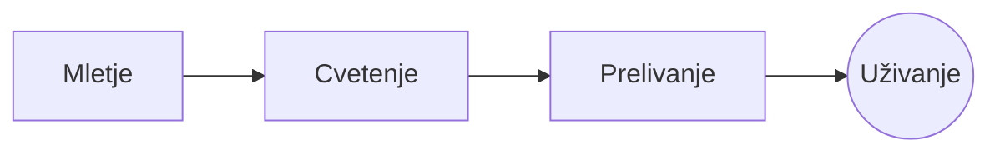

# Popolna prelivna kava

Počasen jutranji ritual v nekaj korakih. Napišite ga v **izvornem besedilu** na levi ali kar v *predogledu* na desni: oba ostaneta usklajena, ==vsako urejanje pa je čista sprememba== Markdowna.

> [!TIP]
> Voda, tik po vrenju, okoli 94 °C, izvabi sladkost brez grenkobe.

## Razmerje

Večina receptov se ustavi pri enem delu kave na šestnajst delov vode:

$$
m_{\text{voda}} = 16 \times m_{\text{kava}}
$$

Torej $20\,\text{g}$ kave potrebuje $320\,\text{g}$ vode.

## Korak za korakom



## Načini priprave

| Način                 | Mletje       |  Čas |
|:----------------------|:------------:|-----:|
| Prelivna              | Srednje fino | 3:30 |
| Francoska stiskalnica | Grobo        | 4:00 |
| Espresso              | Fino         | 0:28 |

## Preden začnete

- [x] Sveže pražena zrna :coffee:
- [x] Mlinček z žrnovi
- [ ] Kotliček z ozkim zavitim izlivom

```python
def water_for(coffee_g: float, ratio: int = 16) -> float:
    return coffee_g * ratio
```

Cvetenje
: Prvi curek vode, ki omogoči, da mleta kava sprosti plin.[^1]

[^1]: Sveža zrna cvetijo najbolj; stara se komaj dvignejo.
