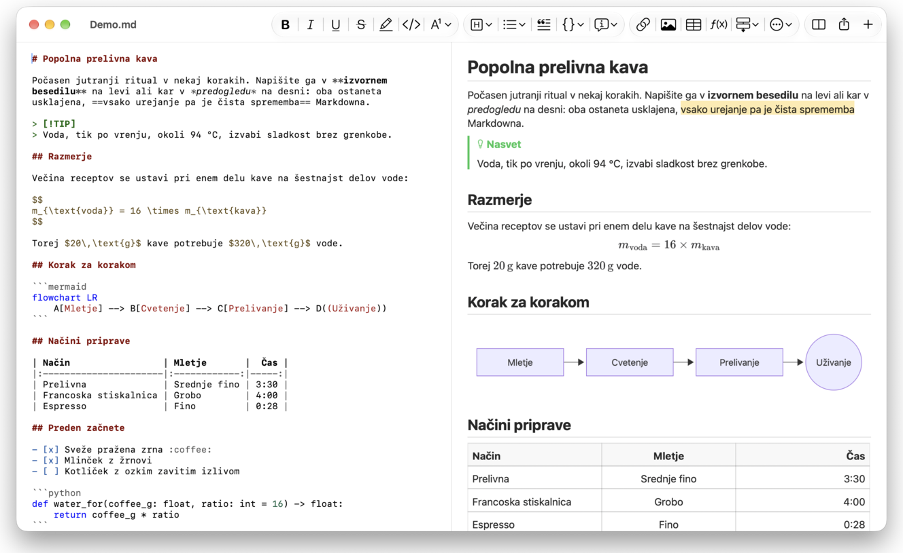
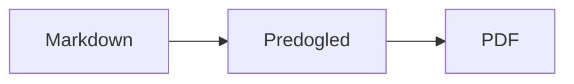

<p>&nbsp;&nbsp;&nbsp;</p>

# Splat

**Urejevalnik Markdown za macOS, v katerem pišete v izvornem besedilu ali kar v predogledu.**

Splat prikazuje izvorno besedilo Markdown z barvanjem sintakse na levi ter sprotni, popolnoma urejljiv predogled na desni. Tipkajte, kjer želite: vse, kar napišete v predogledu, se v izvornem besedilu pokaže kot najmanjša možna sprememba, zato vrstice, ki se jih niste dotaknili, ostanejo bajt za bajtom enake in so vaše razlike v Gitu pregledne. Splat bere Markdown, ki ga že uporabljate: CommonMark in GitHub Flavored Markdown, opozorila GitHub, wiki povezave, vdelave in informativne okvirje Obsidiana, razširitve Pandoc in Typora, vdelani HTML, formule LaTeX ter diagrame Mermaid, Graphviz in PlantUML, vse upodobljeno brez povezave. Izvoz v PDF, HTML ali Word z enim klikom. Napisan je v jeziku Rust na pravih kontrolnikih AppKit, govori 35 jezikov in po omrežju ne pošilja ničesar, razen če to zahtevate.
 


[](https://raw.githubusercontent.com/sventmueller/splat/main/dist/Splat-1.0.3.dmg)

**[Prenesite Splat-1.0.3.dmg](https://raw.githubusercontent.com/sventmueller/splat/main/dist/Splat-1.0.3.dmg)**: podpisan in overjen pri Applu, za macOS 14 ali novejši na Applovih čipih in procesorjih Intel.
 
 

[](https://www.rust-lang.org)
[](https://www.apple.com/macos/)

[](https://github.com/madsmtm/objc2)
[](https://webkit.org)
[](https://github.com/kivikakk/comrak)
[](https://github.github.com/gfm/)
[](https://www.mathjax.org)
[](https://cortexjs.io/mathlive/)
[](https://mermaid.js.org)
[](https://graphviz.org)
[](https://plantuml.com)


[](#licenca)

[Bahasa Indonesia](../id/README.md) ·
[Bahasa Melayu](../ms/README.md) ·
[Català](../ca/README.md) ·
[Čeština](../cs/README.md) ·
[Dansk](../da/README.md) ·
[Deutsch](../de/README.md) ·
[English](../../../README.md) ·
[Español](../es/README.md) ·
[Français](../fr/README.md) ·
[Hrvatski](../hr/README.md) ·
[Italiano](../it/README.md) ·
[Magyar](../hu/README.md) ·
[Nederlands](../nl/README.md) ·
[Norsk](../no/README.md) ·
[Polski](../pl/README.md) ·
[Português (Brasil)](../pt_BR/README.md) ·
[Português (Portugal)](../pt_PT/README.md) ·
[Română](../ro/README.md) ·
[Slovenčina](../sk/README.md) ·
**Slovenščina** ·
[Suomi](../fi/README.md) ·
[Svenska](../sv/README.md) ·
[Tiếng Việt](../vi/README.md) ·
[Türkçe](../tr/README.md) ·
[Ελληνικά](../el/README.md) ·
[Русский](../ru/README.md) ·
[Українська](../uk/README.md) ·
[עברית](../he/README.md)‎ ·
[العربية](../ar/README.md)‎ ·
[हिन्दी](../hi/README.md) ·
[ไทย](../th/README.md) ·
[한국어](../ko/README.md) ·
[日本語](../ja/README.md) ·
[简体中文](../zh-Hans/README.md) ·
[繁體中文](../zh-Hant/README.md)

## Vsebina

- [Zmožnosti na prvi pogled](#zmožnosti-na-prvi-pogled)
- [Zahteve](#zahteve)
- [Namestitev](#namestitev)
- [Prvi koraki](#prvi-koraki)
- [Pisanje](#pisanje)
  - [V izvornem besedilu](#v-izvornem-besedilu)
  - [V predogledu](#v-predogledu)
  - [Ukazi za oblikovanje](#ukazi-za-oblikovanje)
  - [Seznami in opravila](#seznami-in-opravila)
  - [Tabele](#tabele)
- [Podprti Markdown](#podprti-markdown)
  - [CommonMark in GitHub Flavored Markdown](#commonmark-in-github-flavored-markdown)
  - [Informativni okvirji](#informativni-okvirji)
  - [Razširjena skladnja](#razširjena-skladnja)
  - [Obsidian](#obsidian)
  - [Citati in sklici](#citati-in-sklici)
  - [Vdelani HTML](#vdelani-html)
  - [Tipografska ločila](#tipografska-ločila)
  - [Pregled skladnje](#pregled-skladnje)
- [Formule](#formule)
- [Diagrami](#diagrami)
- [Slike](#slike)
- [Povezave in krmarjenje](#povezave-in-krmarjenje)
- [Izvoz, tiskanje in deljenje](#izvoz-tiskanje-in-deljenje)
- [Videz in dostopnost](#videz-in-dostopnost)
- [Jeziki](#jeziki)
- [Bližnjice na tipkovnici](#bližnjice-na-tipkovnici)
- [Zasebnost in varnost](#zasebnost-in-varnost)
- [Veliki dokumenti](#veliki-dokumenti)
- [Znane omejitve](#znane-omejitve)
- [Odpravljanje težav](#odpravljanje-težav)
- [Za razvijalce](#za-razvijalce)
  - [Gradnja](#gradnja)
  - [Distribucija](#distribucija)
  - [Testiranje](#testiranje)
  - [Zgradba projekta](#zgradba-projekta)
  - [Pretok podatkov](#pretok-podatkov)
  - [Pravila v krmilniku](#pravila-v-krmilniku)
  - [Dodajanje ukaza](#dodajanje-ukaza)
  - [Prevodi](#prevodi)
  - [Komponente tretjih oseb](#komponente-tretjih-oseb)
- [Licenca](#licenca)

## Zmožnosti na prvi pogled

- **Dva načina pisanja, eno besedilo.** Izvorno besedilo in predogled sta oba urejljiva. Datoteka Markdown je edina resnica: vsak dokument ima eno zgodovino razveljavitev, vsako urejanje v predogledu pa se prevede v najmanjšo možno spremembo izvornega besedila.
- **Markdown, ki ga že uporabljate.** CommonMark, GitHub Flavored Markdown, opozorila GitHub, Obsidian, razširitve Pandoc in Typora, kratke kode za emoji, spoilerji, seznami definicij, sidra naslovov in HTML, kot ga poznate iz datotek README na GitHubu.
- **Vgrajene formule in diagrami.** Formule LaTeX prek MathJax z vizualnim urejevalnikom formul. Diagrami Mermaid, Graphviz in PlantUML, upodobljeni na vašem Macu brez Jave, strežnika ali omrežne povezave.
- **Gumb za vse.** Vsak element Markdown ima gumb v orodni vrstici in ukaz v meniju, pogosti tudi bližnjico na tipkovnici. Tabele imajo svoj meni za vrstice, stolpce in poravnavo.
- **Izvoz brez izgub.** PDF, ena sama samostojna datoteka HTML ali dokument Word s pravimi naslovi, seznami, tabelami, sprotnimi opombami in slikami.
- **Domač na Macu skozi in skozi.** Prava okna AppKit, zavihki, meniji, pojavna okna, različice, samodejno shranjevanje, meni za deljenje, temni način, preverjanje črkovanja, narekovanje in VoiceOver. Brez Electrona, brez spletnega pogleda za samo besedilo.
- **Hiter z velikimi datotekami.** Pritisk tipke v dokumentu velikosti 10 MB traja okoli 25 ms.
- **Zasebnost in previdnost.** Slike iz spleta se naložijo šele, ko jih dovolite, povezave do drugih aplikacij vprašajo za dovoljenje, vse, kar dekodira nezaupane slikovne podatke, pa teče v pomožnih procesih v peskovniku.
- **V vašem jeziku.** Vmesnik in vgrajeni hitri priročnik za Markdown sta na voljo v 35 jezikih: arabščini, katalonščini, kitajščini (poenostavljeni), kitajščini (tradicionalni), hrvaščini, češčini, danščini, nizozemščini, angleščini, finščini, francoščini, nemščini, grščini, hebrejščini, hindijščini, madžarščini, indonezijščini, italijanščini, japonščini, korejščini, malajščini, norveščini, poljščini, portugalščini (Brazilija), portugalščini (Portugalska), romunščini, ruščini, slovaščini, slovenščini, španščini, švedščini, tajščini, turščini, ukrajinščini in vietnamščini.

## Zahteve

- macOS 14 Sonoma ali novejši. Splat je razvit in preizkušen v macOS 27, kjer samodejno prevzame videz Liquid Glass.
- Mac z Applovim čipom ali procesorjem Intel.
- Približno 45 MB prostora na disku.

## Namestitev

**Z diskovne slike.** Prenesite [`dist/Splat-1.0.3.dmg`](https://raw.githubusercontent.com/sventmueller/splat/main/dist/Splat-1.0.3.dmg), jo odprite in povlecite Splat v mapo Aplikacije. Slika je podpisana z ID-jem razvijalca in overjena pri Applu, zato se odpre brez opozoril.

**S Homebrewom.** Cask je v lastnem tapu:

```sh
brew install --cask sventmueller/tap/splat
```

`brew upgrade --cask splat` namesti nove različice, `brew uninstall --zap --cask splat` pa odstrani tudi nastavitve in predpomnilnike aplikacije Splat.

**Posodobitve.** Splat z diskovne slike ali iz Homebrewa se posodablja sam s pomočjo [Sparkla](https://sparkle-project.org). Ob drugem zagonu vpraša, ali sme enkrat na dan sam preveriti, ali so na voljo posodobitve. **Splat › Preveri, ali so na voljo posodobitve …** preveri takoj; **Samodejno preverjaj, ali so na voljo posodobitve** in **Samodejno prenesi in namesti posodobitve** v istem meniju pozneje spremenita vašo izbiro. Splat namesti posodobitev le, če nosi podpis razvijalca. Vaša lastna zgradba nima posodabljalnika.

**Iz izvorne kode.** Predpogoje najdete v razdelku [Gradnja](#gradnja), nato:

```sh
make build
ditto target/release/Splat.app /Applications/Splat.app
open /Applications/Splat.app
```

Če želite datoteke Markdown odpirati s Splatom z dvoklikom, v Finderju izberite poljubno datoteko `.md`, izberite **Datoteka › Pridobi informacije**, pod **Odpri v aplikaciji** izberite Splat in kliknite **Spremeni vse …**. Splat se sam registrira za datoteke `.md`, `.markdown`, `.mdown` in `.mkd`.

## Prvi koraki

### Okno

Vsak dokument se odpre v svojem oknu ali, če imate raje zavihke, v zavihku:

- **Levo: izvorno besedilo.** Vaš Markdown v pisavi SF Mono z barvanjem sintakse.
- **Desno: predogled.** Upodobljeni dokument, pripravljen za urejanje.
- **Stranska vrstica z orisom (izbirno).** Vsi naslovi kot drevo; klik na naslov ga prikaže v obeh podoknih. Vklopite jo z **Prikaz › Prikaži oris** (⌃⌘S).
- **Orodna vrstica.** Gumbi, razvrščeni po tem, kaj spreminjajo: znake, odstavke in vstavljene elemente, nato vklop in izklop predogleda, deljenje in nov dokument. Prilagodite jo z **Prikaz › Prilagodi orodno vrstico …**.

Z vlečenjem razdelilnika dajte eni ali drugi strani več prostora. **Prikaz › Skrij predogled** (⌥⌘P) pusti samo izvorno besedilo; Splat si to zapomni za vsako okno posebej. Obe podokni se pomikata skupaj, izbor v enem podoknu pa je označen tudi v drugem.

### Dokumenti, zavihki in različice

Splat je običajna dokumentna aplikacija za macOS:

- **Samodejno shranjevanje in različice.** Spremembe se shranjujejo sproti. **Datoteka › Povrni na › Prebrskaj po vseh različicah …** vas popelje nazaj v času.
- **Spremembe iz drugih programov.** Ko Git, skripta ali drug urejevalnik spremeni odprt dokument, ga Splat ponovno naloži in ohrani kazalko ter položaj pomikanja. Če imate lastne neshranjene spremembe, jih Splat obdrži, macOS pa vpraša, preden se druga različica prepiše.
- **Običajni ukazi za datoteke.** Podvoji (⇧⌘S), Preimenuj …, Premakni v … in **Datoteka › Odpri nedavno**.
- **Zavihki.** **Datoteka › Nov zavihek** ali gumb **+** v orodni vrstici odpre nov dokument v zavihku; običajni meni Okno zavihke združuje, premika in izmenjuje.
- **Postavitev oken.** Velikost in položaj vašega zadnjega okna se zapomnita, tudi čez ponovne zagone. Če tam že stoji okno, se novo odpre malce zamaknjeno.
- **Ikona v Docku.** Klik nanjo po zaprtju zadnjega okna odpre nov dokument.
- **Odpiranje datotek Markdown v Splatu.** **Splat › Nastavi kot privzeto aplikacijo za Markdown** poskrbi, da dvoklik na datoteko `.md` ali `.markdown` odpre Splat; macOS enkrat vpraša za potrditev. Ukaz ima kljukico, dokler je Splat privzeta aplikacija.

Datoteke morajo biti besedilo UTF-8 ali UTF-16 z oznako vrstnega reda bajtov. Splat druge kodirne tabele zavrne, namesto da bi ugibal in pokvaril besedilo. Oznaka vrstnega reda bajtov ostane, UTF-16 ostane UTF-16, v datoteki, v kateri se vse vrstice končajo s CRLF, pa tudi dodane vrstice dobijo CRLF.

**Po zrušitvi** se izgubi kvečjemu zadnjih nekaj sekund tipkanja: Splat vsakih pet sekund kopira neshranjeno besedilo v `~/Library/Application Support/Splat/Unsaved` in kopije odstrani, ko je dokument shranjen ali ko se Splat normalno zapre. Ob naslednjem zagonu premakne, kar je zrušitev pustila tam, v `~/Library/Application Support/Splat/Recovery` in to enkrat sporoči z gumbom, ki odpre mapo. Zrušitev, na katero se Splat še lahko odzove, tja zapiše tudi besedilo vseh odprtih dokumentov.

### Hitri priročnik

**Pomoč › Markdown – hitri priročnik** odpre pregled v vašem jeziku kot nov dokument brez naslova. Je običajen dokument, zato vse preizkusite kar tam, v izvornem besedilu ali v predogledu.

## Pisanje

### V izvornem besedilu

Izvorno besedilo je urejevalnik navadnega besedila, prirejen za Markdown:

- **Barvanje sintakse** kot v VS Code: naslovi, poudarki, povezave, koda, tabele, HTML, front matter ter LaTeX in Mermaid znotraj formul in diagramov. Na voljo so palete za svetli in temni videz ter za možnost Povečaj kontrast.
- **Ograjeni bloki kode** so obarvani za Bash, C, C++, C#, CSS (tudi SCSS in Less), Go, HTML, XML, Java, JavaScript, JSON, Kotlin, PHP, Python, Ruby, Rust, SQL, Swift, TypeScript, YAML, TeX in Mermaid, vključno z običajnimi kratkimi imeni, kot so `js`, `py` ali `sh`.
- **Brez nepričakovanih zamenjav.** Pametne navednice, pametni pomišljaji in zamenjava besedila so privzeto izklopljeni, ker pokvarijo `--`, `---` in `"`. Vklopite jih pod **Urejanje › Nadomestitve**.
- **Sistemska orodja za pisanje.** Preverjanje črkovanja in slovnice, narekovanje, Poišči in zamenjaj (⌥⌘F) ter govor.
- **Povleci in spusti.** Spustite slikovno datoteko, da vstavite ``, katero koli drugo datoteko, da vstavite povezavo nanjo, in naslov URL, da vstavite `[url](url)`. Vsak spust je en korak razveljavitve.
- **Lepljenje slik.** Slika v odložišču, na primer posnetek zaslona, se shrani kot datoteka PNG poleg dokumenta (`Slika 2026-10-29 13.09.07.png`) in vstavi kot slika. Dokument mora biti za to enkrat shranjen.

### V predogledu

Predogled se obnaša kot urejevalnik besedil, a vse, kar storite v njem, konča kot Markdown:

- **Tipkanje.** Znaki, ki v Markdownu nekaj pomenijo, kot sta `*` ali `#`, so označeni z vzvratno poševnico, da se prikažejo, kot ste jih natipkali.
- **Return** začne nov odstavek ali novo točko seznama. **⌥Return** ali **⌃Return** vstavi prelom vrstice.
- **Oblikovanje pri kazalki.** Ko je kazalka na koncu besede, Krepko, Ležeče in drugi znakovni formati veljajo za to, kar boste natipkali v nadaljevanju. Format izberite znova, da ga ustavite. Znotraj besede se oblikuje cela beseda.
- **Prazne vrstice.** Return v prazni vrstici doda še eno prazno vrstico, Backspace jo odstrani. V izvornem besedilu je vsaka dodatna prazna vrstica dve dodatni prazni vrstici; drugi programi za Markdown ju prikažejo kot običajen razmik med odstavki.
- **Razveljavitev** deluje v obeh podoknih. Ukazi za razveljavitev imajo imena (»Razveljavi Krepko«), tipkanje je en korak na sapo, po razveljavitvi in uveljavitvi pa se obe podokni pomakneta do spremembe.
- **Formule in diagrami** so videti kot dokončane grafike. Kliknite jih, premaknite kazalko nanje ali pritisnite Return na njih, da odprete njihov urejevalnik (glejte [Formule](#formule) in [Diagrami](#diagrami)).
- **Vdelani HTML, vdelani zapiski in front matter** so prikazani, urejate pa jih v izvornem besedilu. Klik nanje postavi kazalko na ustrezno mesto tam.

Vse, česar Markdown ne zna izraziti, je v predogledu blokirano: plošči Pisava in Barve, ravnilo ter lepljenje ali spuščanje obogatenega besedila in slik. Prilepljeni HTML in RTF prispeta kot navadno besedilo.

### Ukazi za oblikovanje

Vsak ukaz je na voljo v orodni vrstici, v menijski vrstici in v kontekstnem meniju obeh podoknov. Ukazi v menijih kažejo kljukico za oblikovanje pri kazalki.

| Meni | Ukazi |
|---|---|
| **Oblikovanje › Pisava** | Krepko, Ležeče, Podčrtano, Prečrtano, Označi, Koda, Nadpisano, Podpisano |
| **Oblikovanje › Naslov** | Navadno besedilo, Naslov 1 do 6 |
| **Oblikovanje › Seznam** | Seznam s pikami, Seznam s številkami, Seznam opravil |
| **Oblikovanje** | Citat, Blok kode (Brez jezika ali eden od 20 jezikov; spremeni tudi jezik obstoječega bloka), Informativni okvir (Opomba, Nasvet, Pomembno, Opozorilo, Previdno; ista vrsta še enkrat ga odstrani), Uredi formulo ali diagram …, Odstrani oblikovanje |
| **Vstavi** | Povezava …, Slika …, Tabela …, Formula, Diagram (Diagram poteka, Diagram zaporedja, Ganttov diagram), Kazalo vsebine, Sprotna opomba, Ločilo |
| **Tabela** | Vstavi vrstico zgoraj/spodaj, Vstavi stolpec levo/desno, Izbriši vrstico, Izbriši stolpec, Poravnava (Levo, Na sredino, Desno, Privzeto), Poravnaj stolpce tabele |
| **Prikaz** | Skrij/Prikaži predogled, Prikaži/Skrij oris, Tipografska ločila, Povečaj/Pomanjšaj, Dejanska velikost, orodna vrstica, vrstica z zavihki, celoten zaslon |

Podčrtano, označeno, nadpisano in podpisano besedilo se zapiše kot `<ins>`, `<mark>`, `<sup>` in `<sub>`, kar prikaže tudi GitHub. Splat bere tudi `<u>`, ki ga GitHub odstrani, ter krajše `==označeno==`, `^nadp^` in `~podp~`. GitHub prikaže `==` in `^` tako, kot sta natipkana, `~podp~` pa kot prečrtano besedilo.

### Seznami in opravila

- Return nadaljuje seznam; Return na prazni točki ga konča.
- **Tab** in **⇧Tab** v predogledu zamakneta in primakneta točke seznama.
- Klik na potrditveno polje opravila v predogledu preklopi `- [ ]` in `- [x]`.
- **Oblikovanje › Seznam** izbrane odstavke spremeni v seznam ali spremeni njegovo vrsto.

### Tabele

- **Vstavi › Tabela …** vpraša za število vrstic (vključno z glavo) in stolpcev.
- V predogledu **Tab** premakne v naslednjo celico, **⇧Tab** v prejšnjo, **Return** pa v celico spodaj. Tab v zadnji celici doda vrstico.
- Meni **Tabela** vstavlja in briše vrstice ter stolpce ter določa poravnavo stolpca (⌘{, ⌘|, ⌘}).
- **Tabela › Poravnaj stolpce tabele** dopolni izvorno besedilo s presledki, da se stolpci poravnajo.

## Podprti Markdown

Splat razčlenjuje z [comrakom](https://github.com/kivikakk/comrak), razčlenjevalnikom, združljivim s CommonMark in GFM, in vklopi večino njegovih razširitev. Vse spodaj se upodobi v predogledu in v vseh izvozih.

### CommonMark in GitHub Flavored Markdown

- Naslovi (`#` in podčrtani), odstavki, prelomi vrstic, poudarek, močan poudarek, koda v vrstici, bloki citatov, ločila.
- Seznami s pikami, s številkami in gnezdeni; seznami opravil.
- Povezave (v vrstici, sklicne in samodejne), slike, definicije sklicev na povezave.
- Ograjeni in zamaknjeni bloki kode z barvanjem sintakse.
- Tabele s poravnavo stolpcev.
- Prečrtano besedilo z `~~dvema tildama~~`.
- Sprotne opombe: `besedilo[^1]` z `[^1]: Opomba.` kjer koli v dokumentu. Klik na oznako skoči na opombo.
- YAML front matter med vrsticama `---` na vrhu. Predogled ga povzame v eni vrstici, na primer »Metapodatki: title, date, tags«.

### Informativni okvirji

Opozorila GitHub se upodobijo kot barvni okvirji z ikono in naslovom:

```markdown
> [!NOTE]
> Koristna informacija, ki bi jo uporabniki morali poznati.

> [!WARNING]
> Ključna vsebina, ki zahteva takojšnjo pozornost.
```

Pet vrst je Opomba, Nasvet, Pomembno, Opozorilo in Previdno. **Oblikovanje › Informativni okvir** odstavek pri kazalki spremeni v enega od njih.

Informativni okvirji Obsidiana delujejo tudi, in sicer s poljubnim naslovom ter stanjem zloženosti:

```markdown
> [!tip]- Kliknite ▸ za razširitev
> Skrito, dokler ni odprto.

> [!question]+ Privzeto odprto
> `+` začne razširjeno, `-` strnjeno.
```

Druge vrste Obsidiana so prikazane v najbližji od petih barv: `success`, `check`, `done` in `hint` kot Nasvet; `question`, `help` in `faq` kot Pomembno; `attention` kot Opozorilo; `failure`, `fail`, `missing`, `danger`, `error` in `bug` kot Previdno; vse ostalo kot Opomba.

### Razširjena skladnja

| Možnost | Skladnja | Od kod |
|---|---|---|
| Označeno | `==označeno besedilo==` | Obsidian, Typora |
| Nadpisano | `x^2^` | Pandoc, Typora |
| Podpisano | `H~2~O` | Pandoc, Typora |
| Kratka koda za emoji | `:rocket:` postane 🚀 | GitHub |
| Spoiler | `\|\|skrito besedilo\|\|`, izberite ga za branje | Discord |
| Opomba v vrstici | `besedilo^[sama opomba]` | Pandoc, Obsidian |
| Seznam definicij | `Pojem`, prazna vrstica, `: Razlaga` | PHP Markdown Extra, Pandoc |
| Sidro naslova | `## Namestitev {#setup}`, povezava z `[glej](#setup)` | Pandoc, kramdown |

Seznami definicij so v izvornem besedilu videti takole:

```markdown
Pojem

: Razlaga pojma.
```

Brez lastnega sidra dobi vsak naslov sidro, izpeljano iz njegovega besedila, kot na GitHubu: `## Prvi koraki` je dosegljiv kot `#prvi-koraki`.

### Obsidian

- **Wiki povezave.** `[[Zapisek]]` povezuje na `Zapisek.md` v isti mapi ali mapi pod njo. `[[Zapisek|Prikazano besedilo]]` prikaže vaše besedilo, `[[Zapisek#Naslov]]` pa odpre zapisek. ⌘-klik ga odpre v Splatu.
- **Vdelave.** `![[Zapisek]]` prikaže drug zapisek znotraj tega; zapiski, vdelani v njem, se pojavijo kot povezave. `![[diagram.png]]` prikaže sliko. Tako kot v Obsidianu vdelave poimenujejo zapiske in slike v mapi dokumenta ali pod njo, nikoli z absolutno potjo, kot zapiski pa se prikažejo le datoteke Markdown.
- **Komentarji.** `%%Samo v izvornem besedilu%%` ostane viden v izvornem besedilu in je izpuščen iz predogleda in vseh izvozov, tako v vrstici kot v samostojnih vrsticah.
- **Oznake.** `#ideja` ali `#projekt/splat` je poudarjena. ⌘-klik poišče oznako v dokumentu.
- **Zložljivi informativni okvirji.** Glejte [Informativni okvirji](#informativni-okvirji).

### Citati in sklici

- **Citati Pandoc.** `[@doe2020]` ali `[@doe2020; @roe2021]` se bere kot »(Doe 2020; Roe 2021)«. Vnosi prihajajo iz datoteke BibTeX, ki jo front matter navede kot `bibliography: refs.bib`. Brez tega Splat uporabi `references.bib`, `literatur.bib` ali `bibliography.bib` poleg dokumenta.
- **Sklici na GitHub in GitLab.** Če dokument leži v repozitoriju Git, katerega oddaljeni repozitorij `origin` je na github.com ali gostitelju GitLab, so `@ime`, `#12` (težava) in `!7` (zahteva za združitev, samo GitLab) poudarjeni. ⌘-klik jih odpre v brskalniku.

### Vdelani HTML

HTML, kakršnega najdete v datotekah README na GitHubu, se upodobi z lastnim bralnikom in ne z brskalniškim pogonom:

- na sredino poravnani odstavki in bloki (`<p align="center">`, `<div align="center">`)
- slike z velikostjo (``)
- povezave, `<kbd>⌘</kbd>`, `<br>`, `<u>`, `<ins>`, `<mark>`, `<sup>`, `<sub>`
- seznami in tabele, vključno s celicami, ki se razprostirajo čez stolpce (`colspan`)
- zložljivi razdelki: `<details><summary>Več</summary>…</details>`, odprti s klikom na ▸

Markdown med oznakami HTML se upodobi kot Markdown. Skripte, slogi, okvirji in obrazci so povsem izpuščeni, povezave in slike pa obdržijo le naslove `http`, `https`, `mailto` in relativne naslove.

### Tipografska ločila

**Prikaz › Tipografska ločila** prikaže ravne navednice kot narekovaje jezika vašega vmesnika, `--` kot polpomišljaj, `---` kot pomišljaj in `...` kot tropičje. V nemščini `"Ja"` postane „Ja“, v francoščini «Oui», v japonščini 「はい」, tudi tam, kjer kitajščina in japonščina postavljata navednice brez presledka; hebrejske okrajšave, kot je `צה"ל`, dobijo gershayim, צה״ל. Izvorno besedilo ohrani navadne znake; predogled in vsi izvozi prikažejo tipografske. Nastavitev je izklopljena, dokler je ne vklopite.

### Pregled skladnje

| Element | Markdown |
|---|---|
| **Krepko** | `**Krepko**` |
| *Ležeče* | `*Ležeče*` |
| Podčrtano | `<ins>Podčrtano</ins>` ali `<u>Podčrtano</u>` |
| ~~Prečrtano~~ | `~~Prečrtano~~` |
| Označi | `<mark>Označi</mark>` ali `==Označi==` |
| `Koda` | `` `Koda` `` |
| x² | `x<sup>2</sup>` ali `x^2^` |
| H₂O | `H<sub>2</sub>O` ali `H~2~O` |
| [Povezava](https://example.com) | `[Povezava](https://example.com)` |
| Naslov | `# Naslov` do `###### Naslov` |
| Citat | `> Citat` |
| Seznam s pikami | `- Točka` |
| Seznam s številkami | `1. Točka` |
| Opravilo | `- [ ] Odprto` in `- [x] Opravljeno` |
| Blok kode | ```` ```rust ```` … ```` ``` ```` |
| Tabela | `\| A \| B \|` z `\|---\|---\|` pod glavo |
| Sprotna opomba | `Besedilo[^1]` in `[^1]: Opomba` |
| Ločilo | `---` |
| Slika | `` |
| Formula | `$E = mc^2$`, `$$ … $$` |
| Diagram | ```` ```mermaid ````, ```` ```dot ````, ```` ```plantuml ```` |
| Informativni okvir | `> [!TIP]` |
| Wiki povezava | `[[Zapisek]]`, `[[Zapisek\|Besedilo]]` |
| Vdelava | `![[Zapisek]]`, `![[slika.png]]` |
| Komentar | `%%Komentar%%` |
| Oznaka | `#oznaka` |
| Citat iz literature | `[@ključ]` |
| Spoiler | `\|\|Spoiler\|\|` |
| Emoji | `:tada:` |

## Formule

Formule upodobi [MathJax](https://www.mathjax.org) s svojo matematiko TeX in AMS, kot ostre vektorske grafike. Besedilo v `\text{…}` je lahko v katerem koli pisavnem sistemu: česar pisavam MathJax manjka, pride iz pisav vašega Maca, arabščina in hebrejščina tečeta od desne proti levi, emoji pa so barvni.

| Vrsta | Skladnja |
|---|---|
| V vrstici | `$E = mc^2$`, `` $`E = mc^2`$ `` (GitHub, GitLab), `\(E = mc^2\)` |
| Samostojna | `$$` … `$$`, `\[` … `\]` ali blok kode z oznako `math` |

**Urejanje formule.** Kliknite formulo v predogledu, dvokliknite nanjo, pritisnite Return na njej ali premaknite kazalko nanjo, da se njen urejevalnik odpre v pojavnem oknu. **Vstavi › Formula** vstavi novo in takoj odpre urejevalnik.

- **Vizualno ali LaTeX.** Stikalo na vrhu preklaplja med vizualnim urejevalnikom ([MathLive](https://cortexjs.io/mathlive/)) in kodo LaTeX. Splat si zapomni vašo izbiro.
- **Gradniki** za ulomek, kvadratni koren, nadpisano in podpisano, vsoto in integral z mejami, limito, oklepaje, ki rastejo z vsebino, matriko 2×2, grške črke ter relacije, operatorje in puščice. Pustijo nadomestna mesta □, **Tab** pa skoči na naslednje.
- **Sprotni predogled.** Spremembe se v dokumentu pojavljajo med tipkanjem. Napake MathJaxa se prikažejo v vrstici pod kodo.
- **Potrdi ali zavrzi.** Klik zunaj ohrani spremembo kot en korak razveljavitve; **Esc** ali **Prekliči** jo zavrže. Esc pri novi, prazni formuli jo spet odstrani.
- Kontekstni meni ponuja **Uredi formulo …** za formulo pod kazalcem.

VoiceOver prebere formulo kot njeno kodo LaTeX. Splat upodablja formule, ne celotnih dokumentov LaTeX: ni paketov, ni TikZ in ni `\documentclass`.

## Diagrami

Diagrami se upodobijo znotraj Splata, brez povezave in v svetli ter temni različici.

| Pogon | Blok kode | Kaj nariše |
|---|---|---|
| [Mermaid](https://mermaid.js.org) | ```` ```mermaid ```` | diagrame poteka, zaporedja, razredov, stanj, entitetnih razmerij, Ganttove diagrame, tortne diagrame, miselne vzorce, časovnice in vse druge vrste Mermaid |
| [Graphviz](https://graphviz.org) | ```` ```dot ```` ali ```` ```graphviz ```` | grafe v jeziku DOT |
| [PlantUML](https://plantuml.com) | ```` ```plantuml ```` ali ```` ```puml ```` | diagrame UML; deluje brez Jave |



**Urejanje diagrama** deluje kot urejanje formule: kliknite ga, da se koda odpre v pojavnem oknu z barvanjem sintakse in sporočili o napakah v vrstici pod kodo. **Vstavi › Diagram** začne s predlogo za diagram poteka, diagram zaporedja ali Ganttov diagram. Gradniki pomagajo pri treh najpogostejših vrstah Mermaid:

- **Diagram poteka:** Vozlišče ▾ (pravokotnik, zaobljen, krog, romb, podatkovna zbirka), Povezava, Povezava z oznako, Skupina, Smer ▾
- **Diagram zaporedja:** Udeleženec, Sporočilo, Odgovor, Opomba, Zanka, Alternativne poti
- **Ganttov diagram:** Razdelek, Opravilo, Mejnik

Druge vrste diagramov se urejajo kot koda. VoiceOver prebere naslov ali nadomestno besedilo diagrama.

Prvi diagram po zagonu traja približno sekundo, ker se pogon za upodabljanje zažene v ozadju. Diagram, ki traja dlje kot 10 sekund, prikaže napako, pogon za upodabljanje pa se za naslednjega zažene znova. Pogon PlantUML (7 MB) se naloži šele s prvim diagramom PlantUML. `!include` v PlantUML iz spleta je blokiran.

## Slike

- **Lokalne slike** uporabljajo poti glede na dokument: ``. Splat prikaže PNG, JPEG, GIF, WebP, BMP, SVG, HEIC, TIFF, AVIF in PDF.
- **Slike iz spleta** ostanejo blokirane, dokler jih ne dovolite: vrstica nad predogledom pojasni, da njihovo nalaganje njihovim strežnikom izda, da in kdaj odprete dokument. **Naloži slike** jih dovoli za ta dokument; Splat si izbiro zapomni za vsako datoteko posebej.
- **Velikost.** `` določi velikost slike; sicer se slike prilegajo širini predogleda.
- **Spremembe na disku.** Slika, ki jo zamenjate, ali slika, ki se pojavi, potem ko jo je dokument poimenoval, se prikaže brez ponovnega odpiranja dokumenta. Slike iz spleta, ki zaradi omrežja niso uspele, se poskusijo znova, dokler jih dokument prikazuje.
- **Pomnilnik.** Slike se prikažejo z do 2560 slikovnimi pikami na daljši strani, kar zapolni tudi stran A4. Dekodirajo se manjše, ko zapolnijo osmino pomnilnika Maca in dokler macOS poroča o pomanjkanju pomnilnika.
- **Temni način.** Slike z belim ozadjem so v temnem predogledu rahlo zatemnjene.
- **Lepljenje in spuščanje.** Glejte [V izvornem besedilu](#v-izvornem-besedilu).

## Povezave in krmarjenje

V predogledu klik postavi kazalko, da lahko urejate besedilo povezave; **⌘-klik** sledi povezavi:

- `http`, `https` in `mailto` se odprejo v brskalniku ali poštnem odjemalcu.
- Datoteke Markdown se odprejo v Splatu; druge datoteke in mape se pokažejo v Finderju.
- `#sidro` skoči na naslov v dokumentu.
- Naslovi, ki odprejo drugo aplikacijo, kot sta `slack://` ali `vscode://`, najprej vprašajo ter pokažejo celoten naslov in aplikacijo. **Prekliči** je vnaprej izbran.

**Vstavi › Kazalo vsebine** vstavi povezan seznam vseh naslovov. S kazalko znotraj njega isti ukaz kazalo posodobi. Stranska vrstica z orisom (⌃⌘S) skoči na kateri koli naslov v obeh podoknih.

## Izvoz, tiskanje in deljenje

| Oblika | Kako | Kaj dobite |
|---|---|---|
| **PDF** | **Datoteka › Izvozi kot PDF …** ali meni Deli | Strani v velikosti papirja, vedno v svetlem videzu, formule in diagrami kot vektorske grafike. **Datoteka › Priprava strani …** določi papir. |
| **Tiskanje** | **Datoteka › Natisni …** (⌘P) | Enaka postavitev kot pri PDF. |
| **HTML** | **Datoteka › Izvozi kot HTML …** ali meni Deli | Ena samostojna datoteka: lokalne slike vdelane, formule in diagrami kot ostre slike, sidra naslovov, da kazalo vsebine deluje. Brez skript. |
| **Word** | **Datoteka › Izvozi kot dokument Word …** ali meni Deli | Datoteka `.docx` z Wordovimi slogi naslovov, pravimi seznami in tabelami (vključno z združenimi celicami), sprotnimi opombami kot Wordovimi opombami, vdelanimi slikami, formulami in diagrami. |
| **Markdown** | Gumb **Deli** v orodni vrstici | Dokument kot datoteka `.md` za Pošto, Sporočila, AirDrop in vse druge storitve deljenja. |

Meni **Datoteka › Deli** ponuja vse naštete možnosti na enem mestu. Izvozi upoštevajo nastavitev tipografskih ločil in slike iz spleta, ki ste jih dovolili; slike iz spleta ostanejo v HTML povezave.

## Videz in dostopnost

- **Temni način** sledi sistemu. Formule in diagrami se upodobijo za vsak videz.
- **Povečaj kontrast** v Sistemskih nastavitvah preklopi barve sintakse na paleti z visokim kontrastom.
- **Povečava.** ⌘+, ⌘− in ⌘0 prilagodijo obe podokni.
- **Celozaslonski način, zavihki in orodna vrstica, ki jo lahko prilagodite**, kot v vsaki aplikaciji za Mac.
- **VoiceOver.** Podokni sta poimenovani »Izvorno besedilo Markdown« in »Predogled«, formule se preberejo kot njihova koda, diagrami pa kot njihov naslov. Vsak ukaz je dosegljiv s tipkovnice.

Splat nima okna z nastavitvami: peščica možnosti je tam, kjer veljajo, v meniju **Prikaz** in **Urejanje › Nadomestitve**.

## Jeziki

Vmesnik, meniji in hitri priročnik za Markdown so prevedeni v 35 jezikov:

arabščino, katalonščino, kitajščino (poenostavljeno), kitajščino (tradicionalno), hrvaščino, češčino, danščino, nizozemščino, angleščino, finščino, francoščino, nemščino, grščino, hebrejščino, hindijščino, madžarščino, indonezijščino, italijanščino, japonščino, korejščino, malajščino, norveščino, poljščino, portugalščino (Brazilija), portugalščino (Portugalska), romunščino, ruščino, slovaščino, slovenščino, španščino, švedščino, tajščino, turščino, ukrajinščino in vietnamščino.

Splat sledi vrstnemu redu jezikov v **Nastavitve sistema › Splošno › Jezik in regija**; tam lahko pod **Aplikacije** izberete tudi jezik samo za Splat. Če za vaš jezik ni prevoda, uporabi angleščino. Izrazi v menijih sledijo Applovim lastnim prevodom, zato se Splat bere kot preostanek vašega Maca.

Hebrejsko in arabsko besedilo se vedno bere od desne proti levi, ne glede na jezik vmesnika: vsak odstavek, naslov in točka seznama privzame smer svoje prve črke, citati in informativni okvirji črto narišejo na desni, tabela, katere besedilo se začne od desne proti levi, pa našteva stolpce z desne. Bloki kode ostanejo od leve proti desni. Izvozi v PDF, HTML in Word te smeri ohranijo. S hebrejščino ali arabščino kot sistemskim jezikom macOS prezrcali tudi okno, zato je predogled na levi.

## Bližnjice na tipkovnici

| Dejanje | Bližnjica |
|---|---|
| Krepko, ležeče, podčrtano | ⌘B, ⌘I, ⌘U |
| Prečrtano | ⇧⌘X |
| Povezava … | ⌘K |
| Navadno besedilo, naslov 1 do 6 | ⌥⌘0, ⌥⌘1 do ⌥⌘6 |
| Poravnava stolpca tabele levo, na sredino, desno | ⌘{, ⌘\|, ⌘} |
| Skrij ali prikaži predogled | ⌥⌘P |
| Prikaži ali skrij oris | ⌃⌘S |
| Povečaj, pomanjšaj, dejanska velikost | ⌘+, ⌘−, ⌘0 |
| Nov dokument, odpri, shrani, podvoji | ⌘N, ⌘O, ⌘S, ⇧⌘S |
| Priprava strani, natisni | ⇧⌘P, ⌘P |
| Poišči, poišči in zamenjaj | ⌘F, ⌥⌘F |
| Poišči naslednje, prejšnje; uporabi izbor; skoči na izbor | ⌘G, ⇧⌘G; ⌘E; ⌘J |
| Prikaži črkovanje in slovnico; preglej dokument | ⌘:, ⌘; |
| Prilepi in uskladi slog | ⌥⇧⌘V |
| Skrij orodno vrstico, prikaži vse zavihke, celoten zaslon | ⌥⌘T, ⇧⌘\\, ⌃⌘F |
| Prelom vrstice (predogled) | ⌥Return ali ⌃Return |
| Naslednja celica / prejšnja celica v tabeli (predogled) | Tab / ⇧Tab |
| Zamik / primik točke seznama (predogled) | Tab / ⇧Tab |
| Naslednje nadomestno mesto v urejevalniku formul | Tab |
| Zapri urejevalnik formul ali diagramov brez sprememb | Esc |
| Sledenje povezavi, oznaki ali sklicu (predogled) | ⌘-klik |

Splat pušča Applove standardne bližnjice tam, kjer so.

## Zasebnost in varnost

Datoteka Markdown lahko pride od kogar koli, zato Splat ne zaupa nobenemu dokumentu.

- **Privzeto brez omrežja.** Splat nima telemetrije. Posodobitve išče šele, ko se strinjate ali izberete **Preveri, ali so na voljo posodobitve …**: nato z GitHuba naloži majhno datoteko vira, zahteva pa ne navaja ničesar razen aplikacije in njene različice. Formule in diagrami se upodobijo lokalno; spletni pogledi, ki to počnejo, ne dosežejo omrežja.
- **Slike iz spleta** se naložijo šele z vašim dovoljenjem, samo prek `https`, nikoli z gostiteljev v vašem lokalnem omrežju, največ 10 MB vsaka in v zasebni seji brez piškotkov.
- **Izolirano dekodiranje.** Slike ter grafike formul in diagramov se dekodirajo v pomožnih procesih, ki zaprejo vsako datoteko, ki so jo podedovali, in se pred branjem prvega bajta zaklenejo v peskovnik: brez dostopa do datotek, brez omrežja. Vrnejo samo piksle, katerih velikost se preveri, in se po 10 sekundah ustavijo. Applovi lastni dekodirniki slik vidijo samo HEIC, TIFF, AVIF in PDF, in to le, kadar so podatki res v tej obliki; tečejo v svojem pomožnem procesu, ki sme poleg tega brati sistemske mape s pisavami in uporabljati sistemski video dekodirnik. Tudi SVG-ji, formule in diagrami gredo skozenj, zato so v Splatu slike s fiksno ločljivostjo: štiri slikovne pike na točko, do 2560 na daljši strani.
- **Lokalne datoteke** dosežejo dokument samo po poti, ki jo ta navaja. Vdelave prikažejo zapiske Markdown iz mape dokumenta in niže, manjkajoča slika pa se išče samo tam. Pot do slike drugje, absolutna ali z začetkom `~`, se še vedno naloži, izvoza v HTML in Word pa jo vdelata: oglejte si izvoz dokumenta, ki ga niste napisali vi, preden ga posredujete naprej.
- **Kopije neshranjenega besedila** ostanejo na tem Macu, v vaši mapi Knjižnica, za obnovitev po zrušitvi. Odidejo s shranjevanjem ali običajnim koncem Splata; kopije, ki jih je pustila zrušitev, ostanejo v mapi za obnovitev, dokler jih ne izbrišete.
- **Povezave** nikoli ne zaženejo programa s klikom. Spletne in poštne povezave se odprejo kot običajno; povezave do drugih aplikacij najprej vprašajo.
- **HTML v dokumentih** bere Splatov lastni razčlenjevalnik. Skripte, slogi, okvirji in obrazci se nikoli ne izvedejo.
- **Izvozi** ne vsebujejo skript. Strani HTML obdržijo le določen seznam neškodljivih oznak in atributov, kot to počne GitHub, ter politiko varnosti vsebine. Datoteke Word povezujejo samo naslove `http`, `https` in `mailto`.
- **Podpisovanje kode** s Hardened Runtime. Splat teče brez App Sandboxa, da lahko prikaže slike poleg vaših dokumentov, ne da bi vprašal za vsako mapo; izolacija vsega dekodiranja to odtehta.

## Veliki dokumenti

Splat ostaja odziven tudi pri dokumentih z več megabajti:

- Izvorno besedilo uporablja TextKit 2, ki razporedi samo vidni del.
- Medtem ko tipkate v predogledu in v izvornem besedilu dokumentov do 2 MB, se znova razčlenijo, obarvajo in razporedijo samo prizadeti odstavki: okoli 25 ms v dokumentu velikosti 10 MB in okoli 50 ms za pritisk tipke v njegovem predogledu, z lastnim delom pogleda.
- Veliki predogledi najprej upodobijo vidni del, preostalo pa, ko je aplikacija nedejavna. Bloki, ki jih pomaknete v vidno polje, se upodobijo, preden se narišejo.
- V izvornem besedilu večjih dokumentov razčlenjevanje za predogled med tipkanjem teče v ozadju.
- Od 64 MB naprej dokument ostane navadno besedilo: izvorno besedilo nima barv, predogled pa pove, zakaj ostaja prazen. Izvozi še vedno delujejo.
- Od približno 200 KB naprej dokument odpre okno, preden je razčlenjen; pri 5 MB barve in predogled sledijo približno četrt sekunde pozneje.

Nekatere spremembe se obdelajo v celoti, pri okoli 300 ms na pritisk tipke pri 10 MB: spremembe definicije ali sklicev sprotne opombe, ob opombi v vrstici, čisto na koncu dokumenta ob sprotni opombi, spremembe front matterja ali blizu definicij sklicev na povezave ter vsaka sprememba v dokumentu z bloki komentarjev `%%` ali s sprotno opombo, definirano dvakrat ali znotraj citata ali seznama. Pomnilnik raste z datoteko, na približno 115–160 MB za 1 MB Markdowna in 340–510 MB za 10 MB.

## Znane omejitve

- **Posamezne tilde pomenijo podpisano.** `~besedilo~` je podpisano besedilo kot v Pandocu; prečrtano zahteva `~~dve~~`. GitHub prečrta tudi z eno tildo.
- **Samo za branje v predogledu:** vdelani HTML, vdelani zapiski in front matter se urejajo v izvornem besedilu.
- **Zelo globoko gnezdenje:** HTML, gnezden globlje od 64 ravni, in HTML v vrstici globlje od 16 se umakne svoji vsebini.
- **Združene celice tabel** obstajajo samo v tabelah HTML in samo čez stolpce (`colspan`, brez `rowspan`). Skladnja tabel MultiMarkdown za združene celice ni podprta.
- **Bibliografije** se berejo samo iz BibTeX, ne iz CSL JSON ali YAML.
- **Sklici** potrebujejo repozitorij na github.com ali gostitelju GitLab; `!7` obstaja samo na GitLabu.
- **Tipografska ločila:** nemškega zaključnega enojnega narekovaja ni mogoče ločiti od opuščaja in je postavljen kot ’.
- **Formule, ne dokumenti:** brez paketov LaTeX, TikZ ali celotnih dokumentov.
- **Vizualni urejevalnik formul** piše LaTeX v zapisu MathLive: presledki izginejo (`E = mc^2` postane `E=mc^2`), upodobitev ostane enaka.
- **Po zasnovi:** brez številk vrstic, brez okna z nastavitvami, brez Help Booka, ne v App Storu.
- **Manj preizkušen na Intelu.** Samotesti oken tečejo samo na Applovih čipih; na Intelu CI požene `cargo test`.

## Odpravljanje težav

**Seznam nedavnih dokumentov je po ponovni gradnji Splata prazen.** macOS veže nedavne dokumente in dovoljenja za mape na podpis kode aplikacije. Lokalne zgradbe so podpisane s certifikatom »Splat Local Signing« v vaši verigi ključev za prijavo, zato ponovne gradnje ohranijo oboje. Če je bil certifikat izbrisan, naslednja gradnja ustvari novega, seznami pa se enkrat začnejo znova.

**Aplikacija z diskovne slike kaže druge nedavne dokumente kot moja zgradba.** Imata različna podpisa, zato macOS za vsako vodi ločen seznam in ločena dovoljenja za mape.

**HTML ali druga skladnja je prikazana kot navadna koda.** Dokument je morda odprla zastarela kopija Splata. Zaprite jo, v Finderju za dokument izberite **Datoteka › Pridobi informacije** in preverite, da **Odpri v aplikaciji** navaja Splat v vaši mapi Aplikacije.

**V meniju Splat ni ukaza Preveri, ali so na voljo posodobitve ….** Samo različica z diskovne slike ali iz Homebrewa se posodablja sama; vaša lastna zgradba nima posodabljalnika.

**Slike iz spleta se ne prikažejo.** Kliknite **Naloži slike** v vrstici nad predogledom. Naložijo se samo slike `https` z javnih gostiteljev.

**Lepljenje posnetka zaslona zahteva, da najprej shranim.** Prilepljene slike se shranijo kot datoteke poleg dokumenta, kar zahteva mesto na disku. Shranite dokument in nato znova prilepite.

**»Datoteka ni besedilo UTF-8.«** Datoteka je v drugi kodirni tabeli in nima oznake vrstnega reda bajtov, ki bi jo imenovala. Najprej jo pretvorite, na primer z `iconv -f ISO-8859-1 -t UTF-8 old.md > new.md`.

**Formula ali diagram prikaže napako.** Kliknite nanj: urejevalnik pod kodo pokaže sporočilo MathJaxa, Mermaida, Graphviza ali PlantUML.

## Za razvijalce

Splat je aplikacija v jeziku Rust, ki z AppKit in WebKit govori neposredno prek [objc2](https://github.com/madsmtm/objc2). Ni Swifta, ni Objective-C, ni projekta Xcode in ni datoteke Interface Builder.

### Gradnja

Predpogoji:

- macOS z Command Line Tools (`xcode-select --install`). Xcode ni potreben; Splat se zgradi brez `actool`, `ibtool` in `metal`.
- Rust 1.99 (`brew install rust`). [rust-toolchain.toml](../../../rust-toolchain.toml) navaja natančno različico, ki jo uporablja CI; rustup jo namesti sam, Rust iz Homebrewa datoteko ignorira. Z dvigom različice tam do projekta pridejo nova opozorila prevajalnika in clippyja.

[Makefile](../../../Makefile) vsebuje kratke vstopne točke; `make help` našteje vse:

```sh
make build                  # target/release/Splat.app, enako kot cargo xtask bundle --release
make universal              # target/splat-universal za Applove čipe in Intel, kot ga nosi diskovna slika
make check                  # oblikovanje, clippy brez opozoril, vsi testi, vendorirane knjižnice; kar požene CI
make test                   # make check, nato samotest brez okna
make test-gui               # samotesti z oknom; Mac zasedejo za okoli štiri minute
make test-long              # daljše naključno iskanje in preverjanje delnih posodobitev pri 10 MB
make coverage               # pokritost vrstic vseh testov in samotestov, z mejo za vsak modul
make coverage-library       # enake meje za module brez okna, kot v CI
make bench FILE=<file.md>   # časi odpiranja, tipkanja in pomikanja po veliki datoteki
make release                # najprej make test, nato overjena diskovna slika
```

Sama logika gradnje je v Rustovem paketu [xtask](../../../xtask/src/main.rs):

```sh
cargo xtask bundle --release   # target/release/Splat.app, Hardened Runtime, podpisan s »Splat Local Signing«
cargo xtask bundle             # target/debug/Splat Debug.app, ločena aplikacija, ki nikoli ne odpira datotek Markdown
cargo xtask dmg                # dist/Splat-<version>.dmg za distribucijo, Developer ID, overjen
cargo xtask icon               # ponovno zgradi assets/AppIcon.icns in ikono za README iz assets/icon-1024.png
cargo xtask vendor check       # preveri priložen JavaScript glede na vendor.lock
cargo xtask vendor fetch       # ponovno ga prenese po spremembi različice v vendor.lock
```

`bundle` zapiše `Info.plist`, kopira vire in lokalizacije ter podpiše aplikacijo s certifikatom »Splat Local Signing«. Prva gradnja ta certifikat ustvari v vaši verigi ključev za prijavo, veljaven 20 let. Dokler obstaja, Splat ohrani nedavne dokumente in dovoljenja za mape čez ponovne gradnje; z začasnim podpisom ad hoc bi bila vsaka gradnja za macOS nova aplikacija. Razhroščevalne zgradbe in zgradbe samotestov imajo lastna ID-ja svežnja (`local.splat.debug`, `local.splat.selftest`) in se ne registrirajo za datoteke Markdown, zato Finder nikoli ne odpre dokumenta v zastareli zgradbi, nastavitev običajne aplikacije pa pustijo pri miru.

Različica je v [VERSION](../../../VERSION) kot `major.minor.build` in je tista, ki jo dobi naslednja gradnja. Vsaka uspešna izdajna gradnja (`make build`, `cargo xtask bundle --release`, `make release`) poveča številko gradnje za ena; razhroščevalne zgradbe in zgradbe samotestov je ne spremenijo. Glavna in stranska številka se povečata ročno: nastavite VERSION na, recimo, `1.1.0`, in naslednja gradnja dobi natanko to.

### Distribucija

`cargo xtask dmg` (ali `make release`, ki najprej požene `make test`) zgradi izdajno različico, jo podpiše z vašim Developer ID, pri Applu overi aplikacijo in pripne listek, jo zapakira v stisnjeno diskovno sliko samo za branje s povezavo na mapo Aplikacije, overi in opremi z listkom še sliko ter rezultat preveri z Gatekeeperjem. Aplikacija nosi lasten listek, da se kopija, nameščena mimo Finderja, kot to počne Homebrew, ob prvem zagonu odpre tudi brez povezave; dva kroga s storitvijo za overitev trajata po nekaj minut. Samo slika, ki je prestala vse korake, postane `dist/Splat-<version>.dmg`, kopija, ki se zabeleži v repozitorij: povezave za prenos v tem README in njegovih prevodih ji sledijo, številka gradnje pa se poveča. Prejšnja slika ostane še za eno izdajo, ker lahko strežnik raw GitHuba nekaj minut po potisku še vedno ponudi star vir posodobitev; starejše se premaknejo v smeti. Neuspel zagon pusti `dist/`, README-je in VERSION, kakršni so bili.
Vsaka izdaja v zgodovino repozitorija doda polno sliko, okoli 16 MB. Zažene se samo na zahtevo, nikoli kot del običajne gradnje, in potrebuje:

- certifikat »Developer ID Application« v verigi ključev
- shranjeno prijavo v Applovo storitev za overitev z geslom za posamezno aplikacijo, ustvarjeno enkrat z `xcrun notarytool store-credentials notary --apple-id <Apple ID> --team-id <team ID>`
- zasebni ključ, ki podpisuje posodobitve, v verigi ključev za prijavo. Ustvaril ga je Sparklov `generate_keys`; njegova javna polovica je `UPDATE_KEY` v [xtask/src/main.rs](../../../xtask/src/main.rs) in znotraj vsake nameščene kopije, ki sprejme samo posodobitve, podpisane z njim. Hranite varnostno kopijo v upravitelju gesel: `target/sparkle-2.10.1/bin/generate_keys -x <file>` ga izvozi, `-f <file>` ga uvozi na drugem Macu. Brez njega nameščenih kopij ni več mogoče posodobiti.
- rustup (`brew install rustup`, ki pusti Rust iz Homebrewa na mestu)

Če kaj od tega manjka, se `dmg` ustavi pred gradnjo. Ob prvem zagonu macOS vpraša, ali sme Terminal nadzorovati Finder; brez tega dovoljenja diskovna slika ne kaže ne ozadja ne razporeditve ikon.

Posodabljalnik, [Sparkle](https://sparkle-project.org), nosi samo diskovna slika; gradnja ga enkrat prenese v `target/` iz njegove izdaje na GitHubu in preveri glede na kontrolno vsoto v xtask. Hardened runtime naloži ogrodje samo, če nosi Team ID aplikacije, ki ga podpis Developer ID ima, lokalni certifikat pa ne; posodobitev pa ne sme nadomestiti vaše lastne zgradbe. Zgradba samotesta nosi Sparkle tudi sama, da z njim preveri meni za posodobitve: z virom, ki ne obstaja, brez Sparklovega vprašanja ob drugem zagonu in z entitlementom, ki lokalno podpisani aplikaciji omogoči nalaganje ogrodja. `dmg` novo sliko podpiše s ključem za posodobitve in zapiše `dist/appcast.xml`, vir, ki ga nameščene kopije berejo z GitHuba. Sliko, vir in README-je potrdite in potisnite skupaj: od takrat nameščene kopije ponudijo posodobitev.

Diskovna slika je univerzalna binarna datoteka za Applove čipe in Intel; druge gradnje so samo za procesor gostitelja. Rust iz Homebrewa vsebuje standardno knjižnico samo za procesor gostitelja, zato `dmg` gradi prek rustupa, ki ob prvi uporabi namesti orodno verigo in cilje iz [rust-toolchain.toml](../../../rust-toolchain.toml) ter se ustavi, če programu ali Sparklu manjka koda za kateri koli procesor. `make universal` zgradi samo program.
Aplikacija v njej nosi drugačen podpis kot lokalna zgradba, zato macOS za obe vodi ločene nedavne dokumente in dovoljenja za mape.

### Testiranje

| Ukaz | Preverja |
|---|---|
| `cargo test --release` | enotne, naključnostne in prevajalske teste |
| `SPLAT_FUZZ_ROUNDS=20000 cargo test --release` | daljše naključno iskanje; `SPLAT_FUZZ_SEED` spreminja vhode |
| `SPLAT_I18N_ONLY=fr cargo test --release i18n` | en jezik, dokler drugi niso popolni |
| `cargo clippy --release --all-targets [--features selftest]` | opozorila, vključno z utemeljitvijo vsakega bloka `unsafe`, dolžino funkcij in v knjižnici pretvorbami števil |
| `cargo xtask vendor check` | knjižnice JavaScript se bajt za bajtom ujemajo z `vendor.lock` |
| `cargo xtask selftest probe` | brez okna, vsak z pričakovanim rezultatom: formule, diagrami, spletne slike proti strežniku znotraj procesa, blokirani naslovi, obrambe spletnih pogledov |
| `cargo xtask selftest gui [--stop-after "<check>"] [--scenarios]` | delujoča aplikacija, klik za klikom. Odpre okno in tipka vanj; Mac je zaseden okoli štiri minute. `--scenarios` požene samo drugi del, v okoli minuti in pol |
| `cargo xtask selftest resize` | razširi okno po premiku razdelilnika: izvorno besedilo se ponovno prelomi, medtem ko se velikost okna spreminja. Traja okoli deset sekund |
| `cargo xtask selftest bench <file.md>` | časi odpiranja, tipkanja in pomikanja po veliki datoteki |
| `cargo test --release -- --ignored partial_updates` | pritisk tipke pri 10 MB: delna proti polni posodobitvi, rezultat in časovna meja |
| `cargo test --release --test hostile` | dokumenti, zgrajeni za prelivanje sklada ali kvadratni čas, prek razčlenjevanja, postavitve, obeh izvozov, pritiskov tipk in ukazov |
| `make mutants` | napake, vgrajene v `src/markdown/` in `src/preview/` ena za drugo, prek [cargo-mutants](https://mutants.rs) (`cargo install cargo-mutants`); pove, katerih ne opazi noben test. Traja ure; `FILE=src/preview/bridge.rs` zoži izbor |
| `cargo test --release --test decoder` | proces dekodirnika dekodira slike in ne doseže ne datotek ne omrežja |
| `make coverage` | pokritost vrstic za `cargo test` in vseh samotestov, prek [cargo-llvm-cov](https://github.com/taiki-e/cargo-llvm-cov) (`brew install cargo-llvm-cov llvm`); ne uspe pod mejami. Mac zasede za okoli pet minut |
| `make coverage-library` | meje za `src/markdown/`, `src/preview/` in `i18n.rs`, izmerjene samo s `cargo test` |

Enotni testi stojijo ob kodi, ki jo testirajo. `tests/` vsebuje tisto, kar knjižnico doseže od zunaj: naključnostne teste v `robustness.rs`, ki z `sync.rs` delijo generator v `src/fuzz.rs`, dokumente, zgrajene za škodovanje, v `hostile.rs`, in test dekodirnika, ki zažene zgrajeni program. Odločitve v `src/editor/`, ki ne potrebujejo okna, živijo v prostih funkcijah z lastnimi testi: vse, kar krmilnik ve, in kako se to spreminja, v `state.rs`, pravila upodabljanja v `render_queue.rs`, kopija besedila v `sync.rs`. Korak samotesta okna, ki zaman čaka, povzroči neuspeh celotnega zagona. Samotest okna po svojem glavnem prehodu s kliki požene drugi del, v `src/editor/selftest/scenarios.rs`: vsak ukaz za oblikovanje in tabele, pogovorna okna, klike na povezave, lepljenje, spuščanje, izvoze, veliko spremembo, slike, ki se spreminjajo na disku, pomanjkanje pomnilnika, ogromen dokument in obnovitev po zrušitvi.

Pokritost ima dve meji: vsak modul vsaj 80 % vrstic, vsi moduli skupaj vsaj 85 %. `make coverage` meri `cargo test` skupaj s samotesti in ne uspe pod katero koli; meje in redke izjeme, kot je panic hook v `main.rs`, ki teče samo ob zrušitvi, so v [xtask](../../../xtask/src/coverage.rs) ob svojih razlogih. Izmerjene zgradbe gredo v `target/coverage/`, zato merilna koda nikoli ne doseže `target/release/` ali diskovne slike. Pomožni dekodirnik odpre svojo merilno datoteko, preden se zaklene, zato je izmerjen tudi on.

CI ([.github/workflows/ci.yml](../../../.github/workflows/ci.yml)) ob vsakem potisku v `main` in vsaki zahtevi za združitev požene `make check`, `make coverage-library` in univerzalno gradnjo na Applovih čipih ter `cargo test` na Intelu. Vsako noč [.github/workflows/nightly.yml](../../../.github/workflows/nightly.yml) požene `make test-long` z novimi naključnimi vhodi. Samotesti in diskovna slika ostanejo na Macu razvijalca: potrebujejo zaslon in podpisna potrdila v verigi ključev.

Izhod samotestov gre v `target/selftest/`. Samotest zgradi ločeno aplikacijo (`target/release/Splat Selftest.app`, ID svežnja `local.splat.selftest`) in pusti nastavitve, nedavne dokumente in povezave z datotekami običajne aplikacije nedotaknjene.

### Zgradba projekta

`src/lib.rs` vse, kar ne potrebuje okna, spremeni v knjižnico zase, `splat`: `markdown/`, `preview/`, `i18n.rs` in testni generator `fuzz.rs`. Aplikacija v `src/main.rs` gradi na njej.

- `src/markdown/`: povezava z razčlenjevalnikom (comrak), barve sintakse in vsi ukazi kot čiste urejevalne operacije nad besedilom (`Edit`). Tudi ponovno razčlenjevanje po urejanju (`incremental.rs`), bralnik za vdelani HTML (`markup.rs`), tipografija, oznake, sklici in citati v tekočem besedilu (`typography.rs`), kako je besedilo videti ter kateri Markdown in HTML to povzročata (`style.rs`), kaj je lahko naslov (`url.rs`) ter izvoz v HTML in Word (`html.rs`, `docx.rs` z `docx/html.rs` in `docx/xml.rs`). Predogled in oba izvoza berejo isto drevo, `Doc`. Brez AppKit.
- `src/preview/`: postavitev predogleda, vdelani HTML v njem (`layout/html.rs`) ter preslikava med predogledom in izvornim besedilom (`Bridge`, `Index`). Brez AppKit.
- `src/editor/`: okno. En objekt `EditorController` streže AppKit kot delegat obeh pogledov; njegovo delo je razdeljeno po odgovornosti:

| Modul | Odgovornost |
|---|---|
| `mod.rs` | razred, metode delegata, `invalidate` |
| `state.rs` | kar krmilnik ve o dokumentu in vsi načini, kako se to spreminja; njegova polja so zasebna in se ne dotika nobenega pogleda |
| `actions.rs` | register ukazov: selektor, naslov, bližnjica, simbol, kdaj ukaz velja |
| `editing.rs` | izvajanje in preverjanje ukazov, tipkanje v predogledu |
| `update.rs` | razčlenjevanje, barvanje, posodabljanje predogleda; po urejanju samo prizadeti odstavki |
| `sync.rs` | kopija besedila in knjigovodstvo blokov, brez AppKit in z naključnostnimi testi |
| `progressive.rs` | korakoma upodabljanje velikih predogledov |
| `selection.rs`, `scroll.rs` | izbor in položaj pomikanja obeh podoken usklajeno |
| `atom.rs`, `atom_edit.rs` | urejevalnik formul in diagramov |
| `navigation.rs`, `links.rs` | povezave, wiki povezave, oznake, potrditvena polja opravil, zlaganje, sprotne opombe |
| `env.rs` | kar predogled bere od zunaj besedila: tipografska ločila, repozitorij za `@name` in `#12`, datoteka BibTeX, vdelani zapiski |
| `render.rs`, `images.rs`, `remote.rs`, `safe_image.rs` | besedilo predogleda, lokalne in oddaljene slike |
| `attributes.rs` | atributi besedila; vsak ključ dobi samo vrednost tipa, ki ga pričakuje |
| `shadow.rs` | kopije neshranjenega besedila za obnovitev po zrušitvi |
| `decoder.rs` | pomožni procesi v peskovniku, ki dekodirajo slike in grafike |
| `export.rs`, `outline.rs` | izvoz v HTML in Word; stranska vrstica z orisom |
| `js.rs`, `mathfield.rs`, `render_queue.rs` | WebKit za MathJax, Mermaid, Graphviz, PlantUML in vizualni urejevalnik formul; pravila, kaj se kdaj upodobi, ločeno od WebKita |
| `webkit.rs` | klici v WebKit; samo življenjska doba navigacijskega delegata ostane pri `js.rs` in `mathfield.rs` |
| `window.rs`, `toolbar.rs`, `views.rs`, `dialogs.rs`, `style.rs` | okno, orodna vrstica, besedilni pogledi, pogovorna okna, barve |

- `src/menu.rs`, `src/app.rs`, `src/document.rs`: menijska vrstica, delegat aplikacije, dokument (`MDDocument`, podrazred `NSDocument`).
- `src/i18n.rs` z `resources/*.lproj`: 35 jezikov; ključi so nemška besedila.
- `src/large_alloc.rs`: velike dodelitve pridejo naravnost iz jedra in se ob sprostitvi vrnejo vanj, zato se pomnilnik po velikih urejanjih vrne.
- `resources/js/`: spletne strani in knjižnice; različice in kontrolne vsote v [vendor.lock](../../../vendor.lock).
- `xtask/`: pakiranje, podpisovanje, diskovna slika, ikona, vendoriranje, zaganjalnik samotestov in meje pokritosti.

### Pretok podatkov

Izvorno besedilo v levem besedilnem pogledu je edini vir resnice.

1. Vsaka sprememba znaka tam sproti posodobi kopijo besedila (`Snapshot`), ne da bi besedilo ponovno prebral.
2. Posodobitev razčleni kopijo, ponovno obarva izvorno besedilo samo tam, kjer so se barve spremenile, razporedi predogled in zamenja samo bloke, katerih vsebina se je spremenila.
3. Po urejanju se ponovno razčlenijo, obarvajo in razporedijo samo prizadeti odstavki, dokler njihovi sosedje ostanejo enaki; `reparse_part_and_color` pove, kdaj ne ostanejo. Dokumenti z bloki komentarjev `%%`, spremembe front matterja in spremembe blizu definicij sklicev na povezave se obdelajo v celoti. comrak prepozna sklic na sprotno opombo samo z definicijo v istem razčlenjevanju in definicije premakne za besedilo, zato se del razčleni z nadomestno definicijo za vsako oznako in številke vzame iz starega drevesa; sprememba sklicev ali definicij v delu ali ob opombi v vrstici se obdela v celoti.
4. Bloki HTML, ki odprejo `<details>` ali `<div align>` in ga zaprejo pozneje, vplivajo na bloke Markdown vmes; ponovno uporabljen blok mora imeti enako okolico.
5. Medtem ko tipkate v izvornem besedilu dokumenta do 2 MB, delna posodobitev teče takoj; kadar ne velja ali pri večjem dokumentu, razčlenjevanje in postavitev tečeta v ozadju. Medtem ko tipkate v predogledu, tečeta takoj, ker je kazalka predogleda odvisna od rezultata.
6. Vnos v predogledu `Bridge` prevede v urejanje izvornega besedila in od tam naprej gre po isti poti. Markdown ima preveč načinov, kako besedilo spremeniti v skladnjo, da bi zadoščala samo pravila, zato `preview/verify.rs` ponovno razčleni spremenjeni del in primerja, kaj prikazuje, s tistim, kar je bilo natipkano; urejanje, ki ne zdrži, se dodatno označi z vzvratno poševnico ali zavrne.
7. Položaji comrakovih vrstičnih elementov so na nekaj mestih napačni, na primer za definicijo sklica na povezavo. `markdown/positions.rs` jih ob branju bloka preveri glede na izvorno besedilo in jih tam, kjer se ne ujemajo, ponovno prebere iz izvornega besedila.

### Pravila v krmilniku

1. Lastne spremembe krmilnika v pogledih tečejo znotraj `silently()`; povratni klici delegata jih ignorirajo.
2. `state` se izposodi samo za branje in računanje, nikoli čez klic, ki spremeni, razporedi ali pomakne pogled. Spreminja se samo prek lastnih metod, katerih testi ne potrebujejo okna.
3. Sporočila od zunaj (naložena slika, upodobljena formula) prispejo z zamikom prek `renders_arrived` in `image_arrived`, nikoli sredi posodobitve.
4. Ponovno risanje brez spremembe besedila poteka samo prek `invalidate(reason)`.
5. `Rc<Snapshot>` se ne drži čez spremembo izvornega besedila, sicer ta sprememba skopira vse besedilo.
6. Nov ukaz potrebuje vnos v `actions.rs`, metodo v `mod.rs` in vejo v `editing::perform`.
7. Vsak blok `unsafe` nosi svojo utemeljitev kot komentar `// SAFETY:`. Bajti do sistemskih dekodirnikov slik v aplikaciji pridejo samo prek `decoder::system_image`.
8. Nič na glavni niti ne čaka na uporabnikove mape, ker lahko omrežni nosilec preneha odgovarjati: datoteke se pregledujejo na niti `DISK`, predogled pa odgovore bere prek `Env::known`. Samo dejanje, na katero uporabnik čaka, kot sta izvoz ali shranjevanje, se sme dotakniti diska neposredno.

### Dodajanje ukaza

Menijska vrstica, orodna vrstica in kontekstni meni gradijo svoje elemente iz registra v [src/editor/actions.rs](../../../src/editor/actions.rs), preverjanje menijev pa tam bere, kdaj ukaz velja in ali kaže kljukico. Nov ukaz potrebuje:

1. različico `Action` z njegovim `Spec`: selektor, naslov, oznaka v orodni vrstici, namig (ki se začne z glagolom, največ 75 znakov), bližnjica, simbol SF Symbol in kdaj velja
2. metodo v `src/editor/mod.rs`
3. vejo v `editing::perform`
4. njegova besedila v vsaki datoteki `Localizable.strings`

Test `every_command_has_a_method_and_every_method_a_command` preveri, da se register in metode ujemajo. Applove standardne bližnjice, kot so ⌘E, ⌘J, ⌘T, ⌘;, ⇧⌘C, ⌥⌘C, ⌥⌘V, ⇧⌘P, ⌥⌘T, ⌃⌘F in ⌘, ostanejo nedotaknjene.

### Prevodi

Koda uporablja nemško besedilo kot ključ: `t("Fett")` ga poišče med izvajanjem, `n("Fett")` označi konstanto za poznejše iskanje. Vsak `resources/<language>.lproj/` vsebuje:

- `Localizable.strings`: vsako besedilo vmesnika, izrazi v menijih po Applovih lastnih glosarjih
- `InfoPlist.strings`: imena, ki jih macOS prikazuje za aplikacijo in njeno vrsto dokumenta
- `QuickReference.md`: hitri priročnik za Markdown

`cargo xtask bundle` vsako mapo `.lproj` navede kot lokalizacijo, `CFBundleDevelopmentRegion` pa je angleščina, zato sistemski meniji in pogovorno okno za shranjevanje sledijo istemu jeziku. Test i18n preveri, da ima vsak jezik vsako besedilo in da ima vsak hitri priročnik zgradbo nemškega.

`assets/readme/<language>/` vsebuje ta README v tistem jeziku, njegov posnetek zaslona in demo dokument, ki ga posnetek prikazuje. Sprememba tega README-ja sodi tudi v te kopije.

### Komponente tretjih oseb

| Komponenta | Različica | Za kaj se uporablja | Licenca |
|---|---|---|---|
| [comrak](https://github.com/kivikakk/comrak) | 0.59 | razčlenjevalnik Markdown | BSD-2-Clause |
| [objc2](https://github.com/madsmtm/objc2), objc2-foundation, block2 | 0.6 / 0.3 | izvajalno okolje Objective-C, Foundation, bloki | MIT |
| objc2-app-kit, objc2-web-kit, dispatch2 | 0.3 | povezave za AppKit, WebKit in Grand Central Dispatch | Zlib, Apache-2.0 ali MIT |
| [svg2pdf](https://github.com/typst/svg2pdf) | 0.13 | formule in slike SVG kot vektorski PDF | MIT ali Apache-2.0 |
| [image](https://github.com/image-rs/image) | 0.25 | dekodiranje PNG, JPEG, GIF, WebP in BMP | MIT ali Apache-2.0 |
| [unicode-width](https://github.com/unicode-rs/unicode-width) | 0.2 | poravnavanje stolpcev tabel | MIT ali Apache-2.0 |
| [entities](https://github.com/p-jackson/entities) | 1 | imena znakovnih sklicev HTML | MIT |
| [MathJax](https://www.mathjax.org) | 3.2.2 | upodabljanje formul | Apache-2.0 |
| [MathLive](https://cortexjs.io/mathlive/) | 0.111.1 | vizualni urejevalnik formul, s pisavami KaTeX | MIT |
| [Mermaid](https://mermaid.js.org) | 12.2.0 | diagrami Mermaid | MIT |
| [Viz.js](https://github.com/mdaines/viz-js) | 3.24.0 | Graphviz, prevedan v WebAssembly, vsebuje Graphviz (EPL-1.0) in Expat (MIT) | MIT |
| [PlantUML](https://github.com/plantuml/plantuml) (`@plantuml/core`) | 1.2026.6 | diagrami PlantUML, prevedeni v JavaScript | MIT |
| [Sparkle](https://sparkle-project.org) | 2.10.1 | posodobitve različice z diskovne slike | MIT, z deli pod licencama BSD in zlib |

Knjižnice JavaScript so v `resources/js/` shranjene natanko tako, kot so izdane; [vendor.lock](../../../vendor.lock) beleži njihove vire in kontrolne vsote SHA-256. Besedila njihovih licenc, vključno z licencama Graphviza in Expata znotraj Viz.js, so ob njih kot `resources/js/LICENSE-*` in so del aplikacije. Sparkle ni shranjen v repozitoriju: `cargo xtask dmg` prenese njegovo izdajo in jo preveri glede na kontrolno vsoto v xtask, njegova licenca pa je del aplikacije kot `LICENSE-sparkle`.

## Licenca

Splat je licenciran po eni od naslednjih licenc

- Licenca Apache, različica 2.0 ([LICENSE-APACHE](../../../LICENSE-APACHE))
- Licenca MIT ([LICENSE-MIT](../../../LICENSE-MIT))

po vaši izbiri.

Če izrecno ne navedete drugače, je vsak prispevek, ki ga za vključitev v Splat namenoma predložite, kot je opredeljeno v licenci Apache-2.0, dvojno licenciran kot zgoraj, brez dodatnih pogojev.
