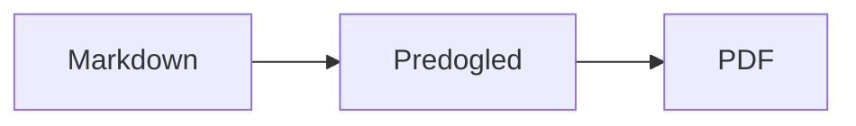

<p>&nbsp;&nbsp;&nbsp;</p>

# Splat

**Urejevalnik Markdown za macOS, v katerem pišete v izvornem besedilu ali kar v predogledu.**

Splat prikazuje izvorno besedilo Markdown z barvanjem sintakse na levi ter sprotni, popolnoma urejljiv predogled na desni. Tipkajte, kjer želite: vse, kar napišete v predogledu, se v izvornem besedilu pokaže kot najmanjša možna sprememba, zato vrstice, ki se jih niste dotaknili, ostanejo bajt za bajtom enake in so vaše razlike v Gitu pregledne. Splat bere Markdown, ki ga že uporabljate: CommonMark in GitHub Flavored Markdown, opozorila GitHub, wiki povezave, vdelave in informativne okvirje Obsidiana, razširitve Pandoc in Typora, vdelani HTML, formule LaTeX ter diagrame Mermaid, Graphviz in PlantUML, vse upodobljeno brez povezave. Brskajte po celotni mapi zapiskov in jih preiskujte, oglejte si, kaj se je spremenilo od zadnjega commita v Gitu, prilepite iz Worda ali spletne strani kot Markdown ter izvozite v PDF, HTML ali Word z enim klikom. Napisan je v jeziku Rust na pravih kontrolnikih AppKit, govori 35 jezikov in po omrežju ne pošilja ničesar, razen če to zahtevate.
 


[](https://github.com/sventmueller/splat/releases/latest/download/Splat.dmg)

**[Prenesite Splat.dmg](https://github.com/sventmueller/splat/releases/latest/download/Splat.dmg)**: podpisan in overjen pri Applu, za macOS 14 ali novejši na Applovih čipih in procesorjih Intel.

**Ste našli napako?** Splat vrstice, ki se jih niste dotaknili, ohrani bajt za bajtom enake. Če se katera vseeno spremeni ali se datoteka prikaže napačno, [odprite issue](https://github.com/sventmueller/splat/issues/new/choose) in priložite datoteko. Če vam je Splat koristen, [zvezdica na GitHubu](https://github.com/sventmueller/splat) pomaga drugim, da ga najdejo.
 
 

[](https://www.rust-lang.org)
[](https://www.apple.com/macos/)

[](https://github.com/madsmtm/objc2)
[](https://webkit.org)
[](https://github.com/kivikakk/comrak)
[](https://github.github.com/gfm/)
[](https://www.mathjax.org)
[](https://cortexjs.io/mathlive/)
[](https://mermaid.js.org)
[](https://graphviz.org)
[](https://plantuml.com)


[](#licenca)

[Bahasa Indonesia](../id/README.md) ·
[Bahasa Melayu](../ms/README.md) ·
[Català](../ca/README.md) ·
[Čeština](../cs/README.md) ·
[Dansk](../da/README.md) ·
[Deutsch](../de/README.md) ·
[English](../../../README.md) ·
[Español](../es/README.md) ·
[Français](../fr/README.md) ·
[Hrvatski](../hr/README.md) ·
[Italiano](../it/README.md) ·
[Magyar](../hu/README.md) ·
[Nederlands](../nl/README.md) ·
[Norsk](../no/README.md) ·
[Polski](../pl/README.md) ·
[Português (Brasil)](../pt_BR/README.md) ·
[Português (Portugal)](../pt_PT/README.md) ·
[Română](../ro/README.md) ·
[Slovenčina](../sk/README.md) ·
**Slovenščina** ·
[Suomi](../fi/README.md) ·
[Svenska](../sv/README.md) ·
[Tiếng Việt](../vi/README.md) ·
[Türkçe](../tr/README.md) ·
[Ελληνικά](../el/README.md) ·
[Русский](../ru/README.md) ·
[Українська](../uk/README.md) ·
[עברית](../he/README.md)‎ ·
[العربية](../ar/README.md)‎ ·
[हिन्दी](../hi/README.md) ·
[ไทย](../th/README.md) ·
[한국어](../ko/README.md) ·
[日本語](../ja/README.md) ·
[简体中文](../zh-Hans/README.md) ·
[繁體中文](../zh-Hant/README.md)

## Vsebina

- [Zmožnosti na prvi pogled](#zmožnosti-na-prvi-pogled)
- [Zahteve](#zahteve)
- [Namestitev](#namestitev)
- [Prvi koraki](#prvi-koraki)
- [Pisanje](#pisanje)
  - [V izvornem besedilu](#v-izvornem-besedilu)
  - [V predogledu](#v-predogledu)
  - [Ukazi za oblikovanje](#ukazi-za-oblikovanje)
  - [Seznami in opravila](#seznami-in-opravila)
  - [Tabele](#tabele)
  - [Lepljenje oblikovanega besedila](#lepljenje-oblikovanega-besedila)
  - [Metapodatki](#metapodatki)
- [Podprti Markdown](#podprti-markdown)
  - [CommonMark in GitHub Flavored Markdown](#commonmark-in-github-flavored-markdown)
  - [Informativni okvirji](#informativni-okvirji)
  - [Razširjena skladnja](#razširjena-skladnja)
  - [Obsidian](#obsidian)
  - [Citati in sklici](#citati-in-sklici)
  - [Vdelani HTML](#vdelani-html)
  - [Tipografska ločila](#tipografska-ločila)
  - [Pregled skladnje](#pregled-skladnje)
- [Formule](#formule)
- [Diagrami](#diagrami)
- [Slike](#slike)
- [Povezave in krmarjenje](#povezave-in-krmarjenje)
- [Zapiski v mapi](#zapiski-v-mapi)
- [Spremembe od zadnjega commita](#spremembe-od-zadnjega-commita)
- [Izvoz, tiskanje in deljenje](#izvoz-tiskanje-in-deljenje)
- [Uvoz dokumentov Word](#uvoz-dokumentov-word)
- [Videz in dostopnost](#videz-in-dostopnost)
- [Jeziki](#jeziki)
- [Bližnjice na tipkovnici](#bližnjice-na-tipkovnici)
- [Zasebnost in varnost](#zasebnost-in-varnost)
- [Veliki dokumenti](#veliki-dokumenti)
- [Znane omejitve](#znane-omejitve)
- [Odpravljanje težav](#odpravljanje-težav)
- [Za razvijalce](#za-razvijalce)
  - [Komponente tretjih oseb](#komponente-tretjih-oseb)
- [Licenca](#licenca)

## Zmožnosti na prvi pogled

- **Dva načina pisanja, eno besedilo.** Izvorno besedilo in predogled sta oba urejljiva. Datoteka Markdown je edina resnica: vsak dokument ima eno zgodovino razveljavitev, vsako urejanje v predogledu pa se prevede v najmanjšo možno spremembo izvornega besedila.
- **Markdown, ki ga že uporabljate.** CommonMark, GitHub Flavored Markdown, opozorila GitHub, Obsidian, razširitve Pandoc in Typora, kratke kode za emoji, spoilerji, seznami definicij, sidra naslovov in HTML, kot ga poznate iz datotek README na GitHubu.
- **Vgrajene formule in diagrami.** Formule LaTeX prek MathJax z vizualnim urejevalnikom formul. Diagrami Mermaid, Graphviz in PlantUML, upodobljeni na vašem Macu brez Jave, strežnika ali omrežne povezave.
- **Gumb za vse.** Vsak element Markdown ima gumb v orodni vrstici in ukaz v meniju, pogosti tudi bližnjico na tipkovnici. Tabele imajo svoj meni za vrstice, stolpce in poravnavo.
- **Mapa, ne le datoteka.** Stranska vrstica navede zapiske okoli dokumenta in jih vse preišče. Preimenovanje zapiska spremeni povezave nanj, vsak bajt okoli njih pa ostane.
- **Spremembe na prvi pogled.** V repozitoriju Git črte ob besedilu označujejo, kar se razlikuje od zadnjega commita, v obeh podoknih.
- **Iz Worda in spleta v Markdown.** Prilepite oblikovano besedilo kot Markdown, celice iz preglednice kot tabelo in uvozite cele dokumente Word skupaj s slikami.
- **Izvoz brez izgub.** PDF, ena sama samostojna datoteka HTML ali dokument Word s pravimi naslovi, seznami, tabelami, sprotnimi opombami in slikami. Dodajte številke strani, glave in naslovno stran ali uporabite predlogo Word svojega podjetja.
- **Domač na Macu skozi in skozi.** Prava okna AppKit, zavihki, meniji, pojavna okna, različice, samodejno shranjevanje, meni za deljenje, temni način, preverjanje črkovanja, narekovanje in VoiceOver. Brez Electrona, brez spletnega pogleda za samo besedilo.
- **Hiter z velikimi datotekami.** Izris pritiska tipke v dokumentu velikosti 10 MB traja okoli 10 ms, pred lastnim delom pogleda.
- **Zasebnost in previdnost.** Slike iz spleta se naložijo šele, ko jih dovolite, povezave do drugih aplikacij vprašajo za dovoljenje, vse, kar dekodira nezaupane slikovne podatke, pa teče v pomožnih procesih v peskovniku.
- **V vašem jeziku.** Vmesnik in vgrajeni hitri priročnik za Markdown sta na voljo v 35 jezikih: arabščini, katalonščini, kitajščini (poenostavljeni), kitajščini (tradicionalni), hrvaščini, češčini, danščini, nizozemščini, angleščini, finščini, francoščini, nemščini, grščini, hebrejščini, hindijščini, madžarščini, indonezijščini, italijanščini, japonščini, korejščini, malajščini, norveščini, poljščini, portugalščini (Brazilija), portugalščini (Portugalska), romunščini, ruščini, slovaščini, slovenščini, španščini, švedščini, tajščini, turščini, ukrajinščini in vietnamščini.

## Zahteve

- macOS 14 Sonoma ali novejši. Splat je razvit in preizkušen v macOS 27, kjer samodejno prevzame videz Liquid Glass.
- Mac z Applovim čipom ali procesorjem Intel.
- Približno 45 MB prostora na disku.

## Namestitev

**Z diskovne slike.** Prenesite [`Splat.dmg`](https://github.com/sventmueller/splat/releases/latest/download/Splat.dmg), jo odprite in povlecite Splat v mapo Aplikacije. Slika je podpisana z ID-jem razvijalca in overjena pri Applu, zato se odpre brez opozoril.

**S Homebrewom.** Cask je v lastnem tapu:

```sh
brew install --cask sventmueller/tap/splat
```

`brew upgrade --cask splat` namesti nove različice, `brew uninstall --zap --cask splat` pa odstrani tudi nastavitve in predpomnilnike aplikacije Splat.

**Posodobitve.** Splat z diskovne slike ali iz Homebrewa se posodablja sam s pomočjo [Sparkla](https://sparkle-project.org). Ob drugem zagonu vpraša, ali sme enkrat na dan sam preveriti, ali so na voljo posodobitve. **Splat › Preveri, ali so na voljo posodobitve …** preveri takoj; **Samodejno preverjaj, ali so na voljo posodobitve** in **Samodejno prenesi in namesti posodobitve** v istem meniju pozneje spremenita vašo izbiro. Splat namesti posodobitev le, če nosi podpis razvijalca. Vaša lastna zgradba nima posodabljalnika.

**Iz izvorne kode.** Predpogoje najdete v razdelku [Gradnja](../../../docs/development.md#building), nato:

```sh
make build
ditto target/release/Splat.app /Applications/Splat.app
open /Applications/Splat.app
```

Če želite datoteke Markdown odpirati s Splatom z dvoklikom, v Finderju izberite poljubno datoteko `.md`, izberite **Datoteka › Pridobi informacije**, pod **Odpri v aplikaciji** izberite Splat in kliknite **Spremeni vse …**. Splat se sam registrira za datoteke `.md`, `.markdown`, `.mdown` in `.mkd`.

## Prvi koraki

### Okno

Vsak dokument se odpre v svojem oknu ali, če imate raje zavihke, v zavihku:

- **Levo: izvorno besedilo.** Vaš Markdown v pisavi SF Mono z barvanjem sintakse.
- **Desno: predogled.** Upodobljeni dokument, pripravljen za urejanje.
- **Stranska vrstica (izbirno).** Vsi naslovi kot drevo, klik na naslov ga prikaže v obeh podoknih: **Prikaz › Prikaži oris** (⌃⌘S). Še dva zavihka vsebujeta [zapiske v mapi](#zapiski-v-mapi) in iskanje po njih. Gumb ob naslovu okna jo prikaže in skrije, nova okna pa jo odprejo tako, kot jo je pustilo zadnje okno.
- **Orodna vrstica.** Gumbi, razvrščeni po tem, kaj spreminjajo: znake, odstavke in vstavljene elemente, nato vklop in izklop predogleda, deljenje in nov dokument. Prilagodite jo z **Prikaz › Prilagodi orodno vrstico …**.

Z vlečenjem razdelilnika dajte eni ali drugi strani več prostora. **Prikaz › Skrij predogled** (⌥⌘P) pusti samo izvorno besedilo; Splat si to zapomni za vsako okno posebej. Obe podokni se pomikata skupaj, izbor v enem podoknu pa je označen tudi v drugem.

V kotu okna so prikazane besede in znaki besedila ter čas branja, dokler obstaja izbor, pa enaki podatki tudi za izbor. Naslovi povezav, oznake HTML, metapodatki, komentarji, formule in diagrami se ne štejejo. Sprva je skrito; **Prikaz › Prikaži število besed** to vklopi.

### Dokumenti, zavihki in različice

Splat je običajna dokumentna aplikacija za macOS:

- **Samodejno shranjevanje in različice.** Spremembe se shranjujejo sproti. **Datoteka › Povrni na › Prebrskaj po vseh različicah …** vas popelje nazaj v času.
- **Spremembe iz drugih programov.** Ko Git, skripta ali drug urejevalnik spremeni odprt dokument, ga Splat ponovno naloži in ohrani kazalko ter položaj pomikanja. Če imate lastne neshranjene spremembe, jih Splat obdrži, macOS pa vpraša, preden se druga različica prepiše.
- **Običajni ukazi za datoteke.** Podvoji (⇧⌘S), Preimenuj …, Premakni v … in **Datoteka › Odpri nedavno**.
- **Zavihki.** **Datoteka › Nov zavihek** ali gumb **+** v orodni vrstici odpre nov dokument v zavihku; običajni meni Okno zavihke združuje, premika in izmenjuje.
- **Postavitev oken.** Velikost in položaj vašega zadnjega okna se zapomnita, tudi čez ponovne zagone. Če tam že stoji okno, se novo odpre malce zamaknjeno.
- **Ikona v Docku.** Klik nanjo po zaprtju zadnjega okna odpre nov dokument.
- **Odpiranje datotek Markdown v Splatu.** **Splat › Nastavi kot privzeto aplikacijo za Markdown** poskrbi, da dvoklik na datoteko `.md` ali `.markdown` odpre Splat; macOS enkrat vpraša za potrditev. Ukaz ima kljukico, dokler je Splat privzeta aplikacija.

Datoteke morajo biti besedilo UTF-8 ali UTF-16 z oznako vrstnega reda bajtov. Splat druge kodirne tabele zavrne, namesto da bi ugibal in pokvaril besedilo. Oznaka vrstnega reda bajtov ostane, UTF-16 ostane UTF-16, v datoteki, v kateri se vse vrstice končajo s CRLF, pa tudi dodane vrstice dobijo CRLF.

**Po zrušitvi** se izgubi kvečjemu zadnjih nekaj sekund tipkanja: Splat vsakih pet sekund kopira neshranjeno besedilo v `~/Library/Application Support/Splat/Unsaved` in kopije odstrani, ko je dokument shranjen ali ko se Splat normalno zapre. Ob naslednjem zagonu premakne, kar je zrušitev pustila tam, v `~/Library/Application Support/Splat/Recovery` in to enkrat sporoči z gumbom, ki odpre mapo. Zrušitev, na katero se Splat še lahko odzove, tja zapiše tudi besedilo vseh odprtih dokumentov.

### Hitri priročnik

**Pomoč › Markdown – hitri priročnik** odpre pregled v vašem jeziku kot nov dokument brez naslova. Je običajen dokument, zato vse preizkusite kar tam, v izvornem besedilu ali v predogledu.

## Pisanje

### V izvornem besedilu

Izvorno besedilo je urejevalnik navadnega besedila, prirejen za Markdown:

- **Barvanje sintakse** kot v VS Code: naslovi, poudarki, povezave, koda, tabele, HTML, front matter ter LaTeX in Mermaid znotraj formul in diagramov. Na voljo so palete za svetli in temni videz ter za možnost Povečaj kontrast.
- **Ograjeni bloki kode** so obarvani za Bash, C, C++, C#, CSS (tudi SCSS in Less), Go, HTML, XML, Java, JavaScript, JSON, Kotlin, PHP, Python, Ruby, Rust, SQL, Swift, TypeScript, YAML, TeX in Mermaid, vključno z običajnimi kratkimi imeni, kot so `js`, `py` ali `sh`.
- **Brez nepričakovanih zamenjav.** Pametne navednice, pametni pomišljaji in zamenjava besedila so privzeto izklopljeni, ker pokvarijo `--`, `---` in `"`. Vklopite jih pod **Urejanje › Nadomestitve**.
- **Sistemska orodja za pisanje.** Preverjanje črkovanja in slovnice, narekovanje, Poišči in zamenjaj (⌥⌘F) ter govor.
- **Povleci in spusti.** Spustite slikovno datoteko, da vstavite ``, katero koli drugo datoteko, da vstavite povezavo nanjo, in naslov URL, da vstavite `[url](url)`. Vsak spust je en korak razveljavitve.
- **Lepljenje slik.** Slika v odložišču, na primer posnetek zaslona, se shrani kot datoteka PNG poleg dokumenta (`Slika 2026-10-29 13.09.07.png`) in vstavi kot slika. Dokument mora biti za to enkrat shranjen.

### V predogledu

Predogled se obnaša kot urejevalnik besedil, a vse, kar storite v njem, konča kot Markdown:

- **Tipkanje.** Znaki, ki v Markdownu nekaj pomenijo, kot sta `*` ali `#`, so označeni z vzvratno poševnico, da se prikažejo, kot ste jih natipkali.
- **Return** začne nov odstavek ali novo točko seznama. **⌥Return** ali **⌃Return** vstavi prelom vrstice.
- **Oblikovanje pri kazalki.** Ko je kazalka na koncu besede, Krepko, Ležeče in drugi znakovni formati veljajo za to, kar boste natipkali v nadaljevanju. Format izberite znova, da ga ustavite. Znotraj besede se oblikuje cela beseda.
- **Prazne vrstice.** Return v prazni vrstici doda še eno prazno vrstico, Backspace jo odstrani. V izvornem besedilu je vsaka dodatna prazna vrstica dve dodatni prazni vrstici; drugi programi za Markdown ju prikažejo kot običajen razmik med odstavki.
- **Razveljavitev** deluje v obeh podoknih. Ukazi za razveljavitev imajo imena (»Razveljavi Krepko«), tipkanje je en korak na sapo, po razveljavitvi in uveljavitvi pa se obe podokni pomakneta do spremembe.
- **Formule in diagrami** so videti kot dokončane grafike. Kliknite jih, premaknite kazalko nanje ali pritisnite Return na njih, da odprete njihov urejevalnik (glejte [Formule](#formule) in [Diagrami](#diagrami)).
- **Vdelani HTML, vdelani zapiski in front matter** so prikazani, urejate pa jih v izvornem besedilu. Klik nanje postavi kazalko na ustrezno mesto tam.

Vse, česar Markdown ne zna izraziti, je v predogledu blokirano: plošči Pisava in Barve, ravnilo ter lepljenje ali spuščanje obogatenega besedila in slik. Prilepljeni HTML in RTF prispeta kot navadno besedilo, razen če izberete [Prilepi kot Markdown](#lepljenje-oblikovanega-besedila).

### Ukazi za oblikovanje

Vsak ukaz je na voljo v orodni vrstici, v menijski vrstici in v kontekstnem meniju obeh podoknov. Ukazi v menijih kažejo kljukico za oblikovanje pri kazalki.

| Meni | Ukazi |
|---|---|
| **Oblikovanje › Pisava** | Krepko, Ležeče, Podčrtano, Prečrtano, Označi, Koda, Nadpisano, Podpisano |
| **Oblikovanje › Naslov** | Navadno besedilo, Naslov 1 do 6 |
| **Oblikovanje › Seznam** | Seznam s pikami, Seznam s številkami, Seznam opravil |
| **Oblikovanje** | Citat, Blok kode (Brez jezika ali eden od 20 jezikov; spremeni tudi jezik obstoječega bloka), Informativni okvir (Opomba, Nasvet, Pomembno, Opozorilo, Previdno; ista vrsta še enkrat ga odstrani), Uredi formulo ali diagram …, Odstrani oblikovanje |
| **Vstavi** | Povezava …, Slika …, Tabela …, Formula, Diagram (Diagram poteka, Diagram zaporedja, Ganttov diagram), Kazalo vsebine, Sprotna opomba, Ločilo |
| **Tabela** | Vstavi vrstico zgoraj/spodaj, Vstavi stolpec levo/desno, Izbriši vrstico, Izbriši stolpec, Poravnava (Levo, Na sredino, Desno, Privzeto), Poravnaj stolpce tabele |
| **Prikaz** | Skrij/Prikaži predogled, Prikaži/Skrij oris, Tipografska ločila, Povečaj/Pomanjšaj, Dejanska velikost, orodna vrstica, vrstica z zavihki, celoten zaslon |

Podčrtano, označeno, nadpisano in podpisano besedilo se zapiše kot `<ins>`, `<mark>`, `<sup>` in `<sub>`, kar prikaže tudi GitHub. Splat bere tudi `<u>`, ki ga GitHub odstrani, ter krajše `==označeno==`, `^nadp^` in `~podp~`. GitHub prikaže `==` in `^` tako, kot sta natipkana, `~podp~` pa kot prečrtano besedilo.

### Seznami in opravila

- Return nadaljuje seznam; Return na prazni točki ga konča.
- **Tab** in **⇧Tab** v predogledu zamakneta in primakneta točke seznama.
- Klik na potrditveno polje opravila v predogledu preklopi `- [ ]` in `- [x]`.
- **Oblikovanje › Seznam** izbrane odstavke spremeni v seznam ali spremeni njegovo vrsto.

### Tabele

- **Vstavi › Tabela …** vpraša za število vrstic (vključno z glavo) in stolpcev.
- V predogledu **Tab** premakne v naslednjo celico, **⇧Tab** v prejšnjo, **Return** pa v celico spodaj. Tab v zadnji celici doda vrstico.
- Meni **Tabela** vstavlja in briše vrstice ter stolpce ter določa poravnavo stolpca (⌘{, ⌘|, ⌘}).
- **Tabela › Poravnaj stolpce tabele** dopolni izvorno besedilo s presledki, da se stolpci poravnajo.

### Lepljenje oblikovanega besedila

**Urejanje › Prilepi kot Markdown** (⌃⌘V), tudi v kontekstnem meniju obeh podoknov, spremeni vsebino odložišča v Markdown na mestu izbora, kot en korak razveljavitve. ⌘V še naprej vstavlja navadno besedilo.

- **Iz brskalnika, Worda, Google Docs, Confluencea, Zapiskov ali Pagesa:** prenesejo se naslovi, krepko, ležeče, podčrtano, prečrtano, nadpisano in podpisano, povezave, seznami z gnezdenjem, citati, koda in tabele.
- **Iz preglednice:** celice postanejo tabela z naslovno vrstico in desno poravnanimi stolpci števil. Enako velja za besedilo, ločeno s tabulatorji, podpičji ali vejicami, če ima vsaka vrstica enako število stolpcev.
- **Slike** s spletnim naslovom ostanejo povezave. Slika znotraj prilepljenega HTML postane datoteka poleg dokumenta, ki mora biti za to enkrat shranjen. Začasne slikovne datoteke Worda se ne prenesejo, njihovo nadomestno besedilo pa ostane.
- **Povezave** obdržijo le naslove `http`, `https`, `mailto`, relativne naslove in naslove `#`; od vseh drugih povezav ostane le besedilo.

### Metapodatki

**Oblikovanje › Uredi metapodatke …** ali klik na vrstico metapodatkov na vrhu predogleda odpre obrazec s polji YAML front matter. Polja je mogoče spreminjati, dodajati in odstranjevati. Polje s seznamom ostane seznam: njegove vrednosti si sledijo druga za drugo, ločene z vejicami, vrednost z vejico pa je v narekovajih. Novo polje z imenom `tags`, `aliases`, `keywords`, `categories`, `authors` ali `cssclasses` prav tako postane seznam. Gnezdena polja in večvrstično besedilo je tam mogoče videti, urejajo pa se v izvornem besedilu.

Kar spremeni obrazec, je en korak razveljavitve in seže samo do vrstic polj, ki ste jih spremenili: komentarji, vrstni red, nenavadni presledki, narekovaji in konci vrstic vseh drugih ostanejo bajt za bajtom enaki. Dokument brez metapodatkov dobi blok na začetku.

## Podprti Markdown

Splat razčlenjuje z [comrakom](https://github.com/kivikakk/comrak), razčlenjevalnikom, združljivim s CommonMark in GFM, in vklopi večino njegovih razširitev. Vse spodaj se upodobi v predogledu in v vseh izvozih.

### CommonMark in GitHub Flavored Markdown

- Naslovi (`#` in podčrtani), odstavki, prelomi vrstic, poudarek, močan poudarek, koda v vrstici, bloki citatov, ločila.
- Seznami s pikami, s številkami in gnezdeni; seznami opravil.
- Povezave (v vrstici, sklicne in samodejne), slike, definicije sklicev na povezave.
- Ograjeni in zamaknjeni bloki kode z barvanjem sintakse.
- Tabele s poravnavo stolpcev.
- Prečrtano besedilo z `~~dvema tildama~~`.
- Sprotne opombe: `besedilo[^1]` z `[^1]: Opomba.` kjer koli v dokumentu. Klik na oznako skoči na opombo.
- YAML front matter med vrsticama `---` na vrhu. Predogled ga povzame v eni vrstici, na primer »Metapodatki: title, date, tags«.

### Informativni okvirji

Opozorila GitHub se upodobijo kot barvni okvirji z ikono in naslovom:

```markdown
> [!NOTE]
> Koristna informacija, ki bi jo uporabniki morali poznati.

> [!WARNING]
> Ključna vsebina, ki zahteva takojšnjo pozornost.
```

Pet vrst je Opomba, Nasvet, Pomembno, Opozorilo in Previdno. **Oblikovanje › Informativni okvir** odstavek pri kazalki spremeni v enega od njih.

Informativni okvirji Obsidiana delujejo tudi, in sicer s poljubnim naslovom ter stanjem zloženosti:

```markdown
> [!tip]- Kliknite ▸ za razširitev
> Skrito, dokler ni odprto.

> [!question]+ Privzeto odprto
> `+` začne razširjeno, `-` strnjeno.
```

Druge vrste Obsidiana so prikazane v najbližji od petih barv: `success`, `check`, `done` in `hint` kot Nasvet; `question`, `help` in `faq` kot Pomembno; `attention` kot Opozorilo; `failure`, `fail`, `missing`, `danger`, `error` in `bug` kot Previdno; vse ostalo kot Opomba.

### Razširjena skladnja

| Možnost | Skladnja | Od kod |
|---|---|---|
| Označeno | `==označeno besedilo==` | Obsidian, Typora |
| Nadpisano | `x^2^` | Pandoc, Typora |
| Podpisano | `H~2~O` | Pandoc, Typora |
| Kratka koda za emoji | `:rocket:` postane 🚀 | GitHub |
| Spoiler | `\|\|skrito besedilo\|\|`, izberite ga za branje | Discord |
| Opomba v vrstici | `besedilo^[sama opomba]` | Pandoc, Obsidian |
| Seznam definicij | `Pojem`, prazna vrstica, `: Razlaga` | PHP Markdown Extra, Pandoc |
| Sidro naslova | `## Namestitev {#setup}`, povezava z `[glej](#setup)` | Pandoc, kramdown |

Seznami definicij so v izvornem besedilu videti takole:

```markdown
Pojem

: Razlaga pojma.
```

Brez lastnega sidra dobi vsak naslov sidro, izpeljano iz njegovega besedila, kot na GitHubu: `## Prvi koraki` je dosegljiv kot `#prvi-koraki`.

### Obsidian

- **Wiki povezave.** `[[Zapisek]]` povezuje na `Zapisek.md` v isti mapi ali mapi pod njo. `[[Zapisek|Prikazano besedilo]]` prikaže vaše besedilo, `[[Zapisek#Naslov]]` pa odpre zapisek. ⌘-klik ga odpre v Splatu.
- **Vdelave.** `![[Zapisek]]` prikaže drug zapisek znotraj tega; zapiski, vdelani v njem, se pojavijo kot povezave. `![[diagram.png]]` prikaže sliko. Tako kot v Obsidianu vdelave poimenujejo zapiske in slike v mapi dokumenta ali pod njo, nikoli z absolutno potjo, kot zapiski pa se prikažejo le datoteke Markdown.
- **Komentarji.** `%%Samo v izvornem besedilu%%` ostane viden v izvornem besedilu in je izpuščen iz predogleda in vseh izvozov, tako v vrstici kot v samostojnih vrsticah.
- **Oznake.** `#ideja` ali `#projekt/splat` je poudarjena. ⌘-klik poišče oznako v dokumentu in v stranski vrstici v celotni mapi.
- **Zložljivi informativni okvirji.** Glejte [Informativni okvirji](#informativni-okvirji).

### Citati in sklici

- **Citati Pandoc.** `[@doe2020]` ali `[@doe2020; @roe2021]` se bere kot »(Doe 2020; Roe 2021)«. Vnosi prihajajo iz datoteke BibTeX, ki jo front matter navede kot `bibliography: refs.bib`. Brez tega Splat uporabi `references.bib`, `literatur.bib` ali `bibliography.bib` poleg dokumenta.
- **Sklici na GitHub in GitLab.** Če dokument leži v repozitoriju Git, katerega oddaljeni repozitorij `origin` je na github.com ali gostitelju GitLab, so `@ime`, `#12` (težava) in `!7` (zahteva za združitev, samo GitLab) poudarjeni. ⌘-klik jih odpre v brskalniku.

### Vdelani HTML

HTML, kakršnega najdete v datotekah README na GitHubu, se upodobi z lastnim bralnikom in ne z brskalniškim pogonom:

- na sredino poravnani odstavki in bloki (`<p align="center">`, `<div align="center">`)
- slike z velikostjo (``)
- povezave, `<kbd>⌘</kbd>`, `<br>`, `<u>`, `<ins>`, `<mark>`, `<sup>`, `<sub>`
- seznami in tabele, vključno s celicami, ki se razprostirajo čez stolpce (`colspan`)
- zložljivi razdelki: `<details><summary>Več</summary>…</details>`, odprti s klikom na ▸

Markdown med oznakami HTML se upodobi kot Markdown. Skripte, slogi, okvirji in obrazci so povsem izpuščeni, povezave in slike pa obdržijo le naslove `http`, `https`, `mailto` in relativne naslove.

### Tipografska ločila

**Prikaz › Tipografska ločila** prikaže ravne navednice kot narekovaje jezika vašega vmesnika, `--` kot polpomišljaj, `---` kot pomišljaj in `...` kot tropičje. V nemščini `"Ja"` postane „Ja“, v francoščini «Oui», v japonščini 「はい」, tudi tam, kjer kitajščina in japonščina postavljata navednice brez presledka; hebrejske okrajšave, kot je `צה"ל`, dobijo gershayim, צה״ל. Izvorno besedilo ohrani navadne znake; predogled in vsi izvozi prikažejo tipografske. Nastavitev je izklopljena, dokler je ne vklopite.

### Pregled skladnje

| Element | Markdown |
|---|---|
| **Krepko** | `**Krepko**` |
| *Ležeče* | `*Ležeče*` |
| Podčrtano | `<ins>Podčrtano</ins>` ali `<u>Podčrtano</u>` |
| ~~Prečrtano~~ | `~~Prečrtano~~` |
| Označi | `<mark>Označi</mark>` ali `==Označi==` |
| `Koda` | `` `Koda` `` |
| x² | `x<sup>2</sup>` ali `x^2^` |
| H₂O | `H<sub>2</sub>O` ali `H~2~O` |
| [Povezava](https://example.com) | `[Povezava](https://example.com)` |
| Naslov | `# Naslov` do `###### Naslov` |
| Citat | `> Citat` |
| Seznam s pikami | `- Točka` |
| Seznam s številkami | `1. Točka` |
| Opravilo | `- [ ] Odprto` in `- [x] Opravljeno` |
| Blok kode | ```` ```rust ```` … ```` ``` ```` |
| Tabela | `\| A \| B \|` z `\|---\|---\|` pod glavo |
| Sprotna opomba | `Besedilo[^1]` in `[^1]: Opomba` |
| Ločilo | `---` |
| Slika | `` |
| Formula | `$E = mc^2$`, `$$ … $$` |
| Diagram | ```` ```mermaid ````, ```` ```dot ````, ```` ```plantuml ```` |
| Informativni okvir | `> [!TIP]` |
| Wiki povezava | `[[Zapisek]]`, `[[Zapisek\|Besedilo]]` |
| Vdelava | `![[Zapisek]]`, `![[slika.png]]` |
| Komentar | `%%Komentar%%` |
| Oznaka | `#oznaka` |
| Citat iz literature | `[@ključ]` |
| Spoiler | `\|\|Spoiler\|\|` |
| Emoji | `:tada:` |

## Formule

Formule upodobi [MathJax](https://www.mathjax.org) s svojo matematiko TeX in AMS, kot ostre vektorske grafike. Besedilo v `\text{…}` je lahko v katerem koli pisavnem sistemu: česar pisavam MathJax manjka, pride iz pisav vašega Maca, arabščina in hebrejščina tečeta od desne proti levi, emoji pa so barvni.

| Vrsta | Skladnja |
|---|---|
| V vrstici | `$E = mc^2$`, `` $`E = mc^2`$ `` (GitHub, GitLab), `\(E = mc^2\)` |
| Samostojna | `$$` … `$$`, `\[` … `\]` ali blok kode z oznako `math` |

**Urejanje formule.** Kliknite formulo v predogledu, dvokliknite nanjo, pritisnite Return na njej ali premaknite kazalko nanjo, da se njen urejevalnik odpre v pojavnem oknu. **Vstavi › Formula** vstavi novo in takoj odpre urejevalnik.

- **Vizualno ali LaTeX.** Stikalo na vrhu preklaplja med vizualnim urejevalnikom ([MathLive](https://cortexjs.io/mathlive/)) in kodo LaTeX. Splat si zapomni vašo izbiro.
- **Gradniki** za ulomek, kvadratni koren, nadpisano in podpisano, vsoto in integral z mejami, limito, oklepaje, ki rastejo z vsebino, matriko 2×2, grške črke ter relacije, operatorje in puščice. Pustijo nadomestna mesta □, **Tab** pa skoči na naslednje.
- **Sprotni predogled.** Spremembe se v dokumentu pojavljajo med tipkanjem. Napake MathJaxa se prikažejo v vrstici pod kodo.
- **Potrdi ali zavrzi.** Klik zunaj ohrani spremembo kot en korak razveljavitve; **Esc** ali **Prekliči** jo zavrže. Esc pri novi, prazni formuli jo spet odstrani.
- Kontekstni meni ponuja **Uredi formulo …** za formulo pod kazalcem.

VoiceOver prebere formulo kot njeno kodo LaTeX. Splat upodablja formule, ne celotnih dokumentov LaTeX: ni paketov, ni TikZ in ni `\documentclass`.

## Diagrami

Diagrami se upodobijo znotraj Splata, brez povezave in v svetli ter temni različici.

| Pogon | Blok kode | Kaj nariše |
|---|---|---|
| [Mermaid](https://mermaid.js.org) | ```` ```mermaid ```` | diagrame poteka, zaporedja, razredov, stanj, entitetnih razmerij, Ganttove diagrame, tortne diagrame, miselne vzorce, časovnice in vse druge vrste Mermaid |
| [Graphviz](https://graphviz.org) | ```` ```dot ```` ali ```` ```graphviz ```` | grafe v jeziku DOT |
| [PlantUML](https://plantuml.com) | ```` ```plantuml ```` ali ```` ```puml ```` | diagrame UML; deluje brez Jave |



**Urejanje diagrama** deluje kot urejanje formule: kliknite ga, da se koda odpre v pojavnem oknu z barvanjem sintakse in sporočili o napakah v vrstici pod kodo. **Vstavi › Diagram** začne s predlogo za diagram poteka, diagram zaporedja ali Ganttov diagram. Gradniki pomagajo pri treh najpogostejših vrstah Mermaid:

- **Diagram poteka:** Vozlišče ▾ (pravokotnik, zaobljen, krog, romb, podatkovna zbirka), Povezava, Povezava z oznako, Skupina, Smer ▾
- **Diagram zaporedja:** Udeleženec, Sporočilo, Odgovor, Opomba, Zanka, Alternativne poti
- **Ganttov diagram:** Razdelek, Opravilo, Mejnik

Druge vrste diagramov se urejajo kot koda. VoiceOver prebere naslov ali nadomestno besedilo diagrama.

Prvi diagram po zagonu traja približno sekundo, ker se pogon za upodabljanje zažene v ozadju. Diagram, ki traja dlje kot 10 sekund, prikaže napako, pogon za upodabljanje pa se za naslednjega zažene znova. Pogon PlantUML (3 MB) se naloži šele s prvim diagramom PlantUML. `!include` v PlantUML iz spleta je blokiran.

## Slike

- **Lokalne slike** uporabljajo poti glede na dokument: ``. Splat prikaže PNG, JPEG, GIF, WebP, BMP, SVG, HEIC, TIFF, AVIF in PDF.
- **Slike iz spleta** ostanejo blokirane, dokler jih ne dovolite: vrstica nad predogledom pojasni, da njihovo nalaganje njihovim strežnikom izda, da in kdaj odprete dokument. **Naloži slike** jih dovoli za ta dokument; Splat si izbiro zapomni za vsako datoteko posebej.
- **Velikost.** `` določi velikost slike; sicer se slike prilegajo širini predogleda.
- **Spremembe na disku.** Slika, ki jo zamenjate, ali slika, ki se pojavi, potem ko jo je dokument poimenoval, se prikaže brez ponovnega odpiranja dokumenta. Slike iz spleta, ki zaradi omrežja niso uspele, se poskusijo znova, dokler jih dokument prikazuje.
- **Pomnilnik.** Slike se prikažejo z do 2560 slikovnimi pikami na daljši strani, kar zapolni tudi stran A4. Dekodirajo se manjše, ko zapolnijo osmino pomnilnika Maca in dokler macOS poroča o pomanjkanju pomnilnika.
- **Temni način.** Slike z belim ozadjem so v temnem predogledu rahlo zatemnjene.
- **Lepljenje in spuščanje.** Glejte [V izvornem besedilu](#v-izvornem-besedilu).

## Povezave in krmarjenje

V predogledu klik postavi kazalko, da lahko urejate besedilo povezave; **⌘-klik** sledi povezavi:

- `http`, `https` in `mailto` se odprejo v brskalniku ali poštnem odjemalcu.
- Datoteke Markdown se odprejo v Splatu; druge datoteke in mape se pokažejo v Finderju.
- `#sidro` skoči na naslov v dokumentu.
- Naslovi, ki odprejo drugo aplikacijo, kot sta `slack://` ali `vscode://`, najprej vprašajo ter pokažejo celoten naslov in aplikacijo. **Prekliči** je vnaprej izbran.

**Vstavi › Kazalo vsebine** vstavi povezan seznam vseh naslovov. S kazalko znotraj njega isti ukaz kazalo posodobi. Stranska vrstica z orisom (⌃⌘S) skoči na kateri koli naslov v obeh podoknih.

## Zapiski v mapi

Gumbi na vrhu stranske vrstice preklapljajo med orisom, datotekami in iskanjem.

- **Datoteke** (**Prikaz › Prikaži datoteke**, ⌃⌘E). Vse datoteke Markdown v mapi dokumenta ali, če je dokument v repozitoriju Git, v celotnem repozitoriju. Klik ali Return odpre zapisek kot zavihek tega okna; če je že odprt, pride v ospredje. Gumb ob imenu mape prikaže drugo mapo v tem oknu. Skrite datoteke, `node_modules`, `target`, `Pods`, `DerivedData`, `__pycache__` in mape brez zapiskov ostanejo zunaj seznama. Dokument neposredno v vaši domači mapi prikaže samo zapiske poleg sebe, da Splat ne bi hodil po vseh vaših mapah in spraševal za vsako od njih.
- **Iskanje** (**Urejanje › Iskanje › Išči v vseh zapiskih …**, ⇧⌘F). Najde besedilo v vseh zapiskih ne glede na velike in male črke in ne glede na to, kako so kodirani naglasi. `#tag` najde oznako, `#project` tudi `#project/splat`, in nič znotraj kode. Klik na rezultat odpre zapisek na tem mestu.
- **Povezave do zapiska.** Kontekstni meni zapiska navede zapiske, ki povezujejo nanj, z wiki povezavo, vdelavo, relativno povezavo ali definicijo sklica na povezavo.
- **Preimenovanje zapiska.** Isti meni ga preimenuje in spremeni te povezave. Splat najprej pove, koliko povezav v koliko datotekah to pomeni. V vsaki povezavi se spremeni samo ime, vsi drugi bajti datoteke pa ostanejo. Odprti dokumenti sprejmejo spremembo kot korak razveljavitve; v drugih datotekah jo lahko povrne samo Git ali različice. Datoteka, ki jo je medtem spremenil drug program, ustavi preimenovanje vseh povezav, Splat pa jo navede.

Seznam sledi mapi, ko pride okno v ospredje. Iskanje upošteva datoteke, kakršne so na disku, besedilo, ki ga še niste shranili, pa šteje od naslednjega samodejnega shranjevanja.

## Spremembe od zadnjega commita

V dokumentu v repozitoriju Git črte ob besedilu označujejo, kar se razlikuje od zadnjega commita, v izvornem besedilu in v predogledu: zelena za dodane vrstice, modra za spremenjene vrstice in kratka rdeča oznaka tam, kjer je bilo nekaj odstranjeno. Sledijo tipkanju in premikom veje. **Prikaz › Spremembe od zadnjega commita** jih izklopi za vsa okna.

Vrstice, ki se razlikujejo le v koncu vrstice, se ne štejejo, zato datoteka s CRLF proti commitu z LF ne pokaže spremembe. Nova datoteka nima oznak do svojega prvega commita, prav tako jih nima dokument, večji od 32 MB.

## Izvoz, tiskanje in deljenje

| Oblika | Kako | Kaj dobite |
|---|---|---|
| **PDF** | **Datoteka › Izvozi kot PDF …** ali meni Deli | Strani v velikosti papirja, vedno v svetlem videzu, formule in diagrami kot vektorske grafike. **Datoteka › Priprava strani …** določi papir. |
| **Tiskanje** | **Datoteka › Natisni …** (⌘P) | Enaka postavitev kot pri PDF. |
| **HTML** | **Datoteka › Izvozi kot HTML …** ali meni Deli | Ena samostojna datoteka: lokalne slike vdelane, formule in diagrami kot ostre slike, sidra naslovov, da kazalo vsebine deluje. Brez skript. |
| **Word** | **Datoteka › Izvozi kot dokument Word …** ali meni Deli | Datoteka `.docx` z Wordovimi slogi naslovov, pravimi seznami in tabelami (vključno z združenimi celicami), sprotnimi opombami kot Wordovimi opombami, vdelanimi slikami, formulami in diagrami. |
| **Markdown** | Gumb **Deli** v orodni vrstici | Dokument kot datoteka `.md` za Pošto, Sporočila, AirDrop in vse druge storitve deljenja. |

Meni **Datoteka › Deli** ponuja vse naštete možnosti na enem mestu. Izvozi upoštevajo nastavitev tipografskih ločil in slike iz spleta, ki ste jih dovolili; slike iz spleta ostanejo v HTML povezave.

**Datoteka › Možnosti izvoza …** nastavi, kaj PDF, tiskanje in Word dodajo besedilu, za vse dokumente:

- **Številke strani** v nogi PDF-ja in natisa, v obliki `2 / 9`.
- **Glava in noga** za PDF in natis. `{title}`, `{author}`, `{date}`, `{page}` in `{pages}` pomenijo svoje vrednosti, prve tri iz metapodatkov dokumenta.
- **Naslovna stran** za PDF, natis in Word, s `title`, `subtitle`, `author` in `date` iz metapodatkov ali z imenom dokumenta kot naslovom. Nima ne glave ne noge.
- **Predloga Word**, datoteka `.docx` ali `.dotx`, katere videz prevzame izvoz: njene sloge, tudi z lokaliziranimi imeni, temo, velikost strani, robove, glave in noge. Predloga, ki je ni mogoče prebrati, ustavi izvoz in to pove, namesto da bi vam dala dokument brez nje.

## Uvoz dokumentov Word

**Datoteka › Uvozi dokument Word …** vpraša za datoteko `.docx` ali `.dotx` in kam gre njen Markdown, nato pa odpre rezultat. Slike končajo v mapi poleg njega, poimenovani po dokumentu z `-images`.

Naslovi in seznami se prenesejo tako, kot jih določajo slogi in oštevilčenje Worda, tudi v dokumentih, katerih slogi imajo lokalizirana imena. Krepko, ležeče, podčrtano, prečrtano, označeno, nadpisano in podpisano, povezave, citati, koda, sprotne opombe, končne opombe in tabele se prenesejo, celice čez več stolpcev kot tabela HTML. Formule postanejo LaTeX. Sledene spremembe štejejo kot sprejete, kazalo vsebine pa je izpuščeno, ker **Vstavi › Kazalo vsebine** naredi novo. Stare datoteke `.doc` in dokumenti, zaščiteni z geslom, so zavrnjeni.

## Videz in dostopnost

- **Temni način** sledi sistemu. Formule in diagrami se upodobijo za vsak videz.
- **Povečaj kontrast** v Sistemskih nastavitvah preklopi barve sintakse na paleti z visokim kontrastom.
- **Povečava.** ⌘+, ⌘− in ⌘0 prilagodijo obe podokni.
- **Celozaslonski način, zavihki in orodna vrstica, ki jo lahko prilagodite**, kot v vsaki aplikaciji za Mac.
- **VoiceOver.** Podokni sta poimenovani »Izvorno besedilo Markdown« in »Predogled«, formule se preberejo kot njihova koda, diagrami pa kot njihov naslov. Vsak ukaz je dosegljiv s tipkovnice.

Splat nima okna z nastavitvami: peščica možnosti je tam, kjer veljajo, v meniju **Prikaz**, **Urejanje › Nadomestitve** in **Datoteka › Možnosti izvoza …**.

## Jeziki

Vmesnik, meniji in hitri priročnik za Markdown so prevedeni v 35 jezikov:

arabščino, katalonščino, kitajščino (poenostavljeno), kitajščino (tradicionalno), hrvaščino, češčino, danščino, nizozemščino, angleščino, finščino, francoščino, nemščino, grščino, hebrejščino, hindijščino, madžarščino, indonezijščino, italijanščino, japonščino, korejščino, malajščino, norveščino, poljščino, portugalščino (Brazilija), portugalščino (Portugalska), romunščino, ruščino, slovaščino, slovenščino, španščino, švedščino, tajščino, turščino, ukrajinščino in vietnamščino.

Splat sledi vrstnemu redu jezikov v **Nastavitve sistema › Splošno › Jezik in regija**; tam lahko pod **Aplikacije** izberete tudi jezik samo za Splat. Če za vaš jezik ni prevoda, uporabi angleščino. Izrazi v menijih sledijo Applovim lastnim prevodom, zato se Splat bere kot preostanek vašega Maca.

Hebrejsko in arabsko besedilo se vedno bere od desne proti levi, ne glede na jezik vmesnika: vsak odstavek, naslov in točka seznama privzame smer svoje prve črke, citati in informativni okvirji črto narišejo na desni, tabela, katere besedilo se začne od desne proti levi, pa našteva stolpce z desne. Bloki kode ostanejo od leve proti desni. Izvozi v PDF, HTML in Word te smeri ohranijo. S hebrejščino ali arabščino kot sistemskim jezikom macOS prezrcali tudi okno, zato je predogled na levi.

## Bližnjice na tipkovnici

| Dejanje | Bližnjica |
|---|---|
| Krepko, ležeče, podčrtano | ⌘B, ⌘I, ⌘U |
| Prečrtano | ⇧⌘X |
| Povezava … | ⌘K |
| Navadno besedilo, naslov 1 do 6 | ⌥⌘0, ⌥⌘1 do ⌥⌘6 |
| Poravnava stolpca tabele levo, na sredino, desno | ⌘{, ⌘\|, ⌘} |
| Skrij ali prikaži predogled | ⌥⌘P |
| Prikaži ali skrij oris | ⌃⌘S |
| Prikaži ali skrij datoteke | ⌃⌘E |
| Išči v vseh zapiskih | ⇧⌘F |
| Prilepi kot Markdown | ⌃⌘V |
| Povečaj, pomanjšaj, dejanska velikost | ⌘+, ⌘−, ⌘0 |
| Nov dokument, odpri, shrani, podvoji | ⌘N, ⌘O, ⌘S, ⇧⌘S |
| Priprava strani, natisni | ⇧⌘P, ⌘P |
| Poišči, poišči in zamenjaj | ⌘F, ⌥⌘F |
| Poišči naslednje, prejšnje; uporabi izbor; skoči na izbor | ⌘G, ⇧⌘G; ⌘E; ⌘J |
| Prikaži črkovanje in slovnico; preglej dokument | ⌘:, ⌘; |
| Prilepi in uskladi slog | ⌥⇧⌘V |
| Skrij orodno vrstico, prikaži vse zavihke, celoten zaslon | ⌥⌘T, ⇧⌘\\, ⌃⌘F |
| Prelom vrstice (predogled) | ⌥Return ali ⌃Return |
| Naslednja celica / prejšnja celica v tabeli (predogled) | Tab / ⇧Tab |
| Zamik / primik točke seznama (predogled) | Tab / ⇧Tab |
| Naslednje nadomestno mesto v urejevalniku formul | Tab |
| Zapri urejevalnik formul ali diagramov brez sprememb | Esc |
| Sledenje povezavi, oznaki ali sklicu (predogled) | ⌘-klik |

Splat pušča Applove standardne bližnjice tam, kjer so.

## Zasebnost in varnost

Datoteka Markdown lahko pride od kogar koli, zato Splat ne zaupa nobenemu dokumentu.

- **Privzeto brez omrežja.** Splat nima telemetrije. Posodobitve išče šele, ko se strinjate ali izberete **Preveri, ali so na voljo posodobitve …**: nato z GitHuba naloži majhno datoteko vira, zahteva pa ne navaja ničesar razen aplikacije in njene različice. Formule in diagrami se upodobijo lokalno; spletni pogledi, ki to počnejo, ne dosežejo omrežja. **Pomoč › Prijavi težavo …** v brskalniku odpre obrazec na GitHubu; njegov naslov vsebuje različico Splata, različico macOS in vrsto Maca, nič iz vaših dokumentov.
- **Slike iz spleta** se naložijo šele z vašim dovoljenjem, samo prek `https`, nikoli z gostiteljev v vašem lokalnem omrežju, največ 10 MB vsaka in v zasebni seji brez piškotkov.
- **Izolirano dekodiranje.** Slike ter grafike formul in diagramov se dekodirajo v pomožnih procesih, ki zaprejo vsako datoteko, ki so jo podedovali, in se pred branjem prvega bajta zaklenejo v peskovnik: brez dostopa do datotek, brez omrežja. Vrnejo samo piksle, katerih velikost se preveri, in se po 10 sekundah ustavijo. Applovi lastni dekodirniki slik vidijo samo HEIC, TIFF, AVIF in PDF, in to le, kadar so podatki res v tej obliki; tečejo v svojem pomožnem procesu, ki sme poleg tega brati sistemske mape s pisavami in uporabljati sistemski video dekodirnik. Tudi SVG-ji, formule in diagrami gredo skozenj, zato so v Splatu slike s fiksno ločljivostjo: štiri slikovne pike na točko, do 2560 na daljši strani.
- **Lokalne datoteke** dosežejo dokument samo po poti, ki jo ta navaja. Vdelave prikažejo zapiske Markdown iz mape dokumenta in niže, manjkajoča slika pa se išče samo tam. Pot do slike drugje, absolutna ali z začetkom `~`, se v predogledu še vedno naloži; izvoza v HTML in Word, tiskanje in PDF-ji vzamejo le tisto, kar je v mapi dokumenta ali v njegovem repozitoriju Git, razen če ta repozitorij vsebuje tudi vašo domačo mapo, zato tuj dokument ne more povleči vaših datotek v izvoz, ki ga posredujete naprej.
- **Mape z zapiski** se berejo samo, dokler jih stranska vrstica prikazuje, preimenovanje zapiska pa spremeni druge datoteke šele, ko potrdite, koliko jih je.
- **Repozitorije Git** bere Splat sam. Nikoli ne zažene programa `git`, katerega nastavitve v tujem repozitoriju lahko zaženejo druge programe, in ne prebere več kot različico odprtega dokumenta iz zadnjega commita. Tja ne zapiše ničesar in ne dostopa do omrežja.
- **Dokumente Word in prilepljeno besedilo** berejo Splatovi lastni razčlenjevalniki, z omejitvami velikosti, gnezdenja in tega, kako zelo se sme datoteka razširiti. Povezave v njih obdržijo le naslove, ki jih Splat dovoli tudi drugje, imena slik v datoteki Word pa nikoli ne odločajo o tem, kam se zapišejo.
- **Kopije neshranjenega besedila** ostanejo na tem Macu, v vaši mapi Knjižnica, za obnovitev po zrušitvi. Odidejo s shranjevanjem ali običajnim koncem Splata; kopije, ki jih je pustila zrušitev, ostanejo v mapi za obnovitev, dokler jih ne izbrišete.
- **Povezave** nikoli ne zaženejo programa s klikom. Spletne in poštne povezave se odprejo kot običajno; povezave do drugih aplikacij najprej vprašajo.
- **HTML v dokumentih** bere Splatov lastni razčlenjevalnik. Skripte, slogi, okvirji in obrazci se nikoli ne izvedejo.
- **Izvozi** ne vsebujejo skript. Strani HTML obdržijo le določen seznam neškodljivih oznak in atributov, kot to počne GitHub, ter politiko varnosti vsebine. Datoteke Word povezujejo samo naslove `http`, `https` in `mailto`.
- **Podpisovanje kode** s Hardened Runtime. Splat teče brez App Sandboxa, da lahko prikaže slike poleg vaših dokumentov, ne da bi vprašal za vsako mapo; izolacija vsega dekodiranja to odtehta.

## Veliki dokumenti

Splat ostaja odziven tudi pri dokumentih z več megabajti:

- Izvorno besedilo uporablja TextKit 2, ki razporedi samo vidni del.
- Medtem ko tipkate v predogledu in v izvornem besedilu dokumentov do 2 MB, se znova razčlenijo, obarvajo in razporedijo samo prizadeti odstavki. V dokumentu velikosti 10 MB razčlenjevanje in barvanje trajata okoli 3 ms, izris okoli 10 ms, celoten pritisk tipke v njegovem predogledu pa okoli 30 ms z lastnim delom pogleda.
- Veliki predogledi najprej upodobijo vidni del, preostalo pa, ko je aplikacija nedejavna. Bloki, ki jih pomaknete v vidno polje, se upodobijo, preden se narišejo.
- V izvornem besedilu večjih dokumentov razčlenjevanje za predogled med tipkanjem teče v ozadju.
- Dokument ostane navadno besedilo, ko bi potreboval približno 4 GB pomnilnika, kar je približno 50 do 120 MB običajnega Markdowna, a le 10 do 20 MB, če vsebuje samo tabele ali naslove: izvorno besedilo nima barv, predogled pa pove, zakaj ostaja prazen. Izvozi še vedno delujejo.
- Od približno 200 KB naprej dokument odpre okno, preden je razčlenjen; pri 5 MB barve in predogled sledijo približno četrt sekunde pozneje.
- Vse slike skupaj, vključno s formulami in diagrami, zasedejo največ četrtino pomnilnika Maca in polovico tega, dokler je pomnilnika malo. Nad tem se nadaljnje slike prikažejo kot nadomestni znaki, dokler spet ni prostora.

Nekatere spremembe se obdelajo v celoti, pri okoli 300 ms na pritisk tipke pri 10 MB: spremembe definicije ali sklicev sprotne opombe, ob opombi v vrstici, čisto na koncu dokumenta ob sprotni opombi, spremembe front matterja ali definicij sklicev na povezave ter vsaka sprememba v dokumentu z bloki komentarjev `%%` ali s sprotno opombo, definirano dvakrat ali znotraj citata ali seznama. Pomnilnik raste z datoteko, na približno 115–160 MB za 1 MB Markdowna in 340–510 MB za 10 MB.

## Znane omejitve

- **Posamezne tilde pomenijo podpisano.** `~besedilo~` je podpisano besedilo kot v Pandocu; prečrtano zahteva `~~dve~~`. GitHub prečrta tudi z eno tildo.
- **Samo za branje v predogledu:** vdelani HTML in vdelani zapiski se urejajo v izvornem besedilu, front matter v svojem obrazcu ali v izvornem besedilu.
- **Zelo globoko gnezdenje:** HTML, gnezden globlje od 64 ravni, in HTML v vrstici globlje od 16 se umakne svoji vsebini.
- **Združene celice tabel** obstajajo samo v tabelah HTML in samo čez stolpce (`colspan`, brez `rowspan`). Skladnja tabel MultiMarkdown za združene celice ni podprta.
- **Bibliografije** se berejo samo iz BibTeX, ne iz CSL JSON ali YAML.
- **Sklici** potrebujejo repozitorij na github.com ali gostitelju GitLab; `!7` obstaja samo na GitLabu.
- **Tipografska ločila:** nemškega zaključnega enojnega narekovaja ni mogoče ločiti od opuščaja in je postavljen kot ’.
- **Formule, ne dokumenti:** brez paketov LaTeX, TikZ ali celotnih dokumentov.
- **Vizualni urejevalnik formul** piše LaTeX v zapisu MathLive: presledki izginejo (`E = mc^2` postane `E=mc^2`), upodobitev ostane enaka.
- **Število besed:** tajščina, laoščina, kmerščina in burmanščina se pišejo brez presledkov in se štejejo po odsekih besedila, ne po besedah. `3.14` in `snake_case` sta vsak po dve besedi.
- **Preimenovanje zapiska** ne spremeni povezav v vdelanem HTML, wiki povezava pa ostane, kakršna je, če novo ime vsebuje `#`, `|`, `^`, `[`, `]` ali `\`.
- **Oznake sprememb** berejo repozitorije z objekti SHA-1 in navadnimi ali pakiranimi referencami; repozitorij s SHA-256 ali reftable ne pokaže nobene. Datoteka pod filtrom Git, kot je LFS, se primerja s tem, kar je shranil filter.
- **Uvoz iz Worda** izpusti besedilo v glavah, nogah in komentarjih, slike kot `.emz` ali SVG pa obdržijo le nadomestno besedilo.
- **Prilepi kot Markdown** bere RTF kot zahodno besedilo, naslove v njem pa jemlje samo iz velikosti pisave. Večina programov ponuja tudi HTML, ki mu daje prednost.
- **Po zasnovi:** brez številk vrstic, brez okna z nastavitvami, brez Help Booka, ne v App Storu.
- **Manj preizkušen na Intelu.** Samotesti oken tečejo samo na Applovih čipih; na Intelu CI požene `cargo test`.

## Odpravljanje težav

**Seznam nedavnih dokumentov je po ponovni gradnji Splata prazen.** macOS veže nedavne dokumente in dovoljenja za mape na podpis kode aplikacije. Lokalne zgradbe so podpisane s certifikatom »Splat Local Signing« v vaši verigi ključev za prijavo, zato ponovne gradnje ohranijo oboje. Če je bil certifikat izbrisan, naslednja gradnja ustvari novega, seznami pa se enkrat začnejo znova.

**Aplikacija z diskovne slike kaže druge nedavne dokumente kot moja zgradba.** Imata različna podpisa, zato macOS za vsako vodi ločen seznam in ločena dovoljenja za mape.

**HTML ali druga skladnja je prikazana kot navadna koda.** Dokument je morda odprla zastarela kopija Splata. Zaprite jo, v Finderju za dokument izberite **Datoteka › Pridobi informacije** in preverite, da **Odpri v aplikaciji** navaja Splat v vaši mapi Aplikacije.

**V meniju Splat ni ukaza Preveri, ali so na voljo posodobitve ….** Samo različica z diskovne slike ali iz Homebrewa se posodablja sama; vaša lastna zgradba nima posodabljalnika.

**Slike iz spleta se ne prikažejo.** Kliknite **Naloži slike** v vrstici nad predogledom. Naložijo se samo slike `https` z javnih gostiteljev.

**Lepljenje posnetka zaslona zahteva, da najprej shranim.** Prilepljene slike se shranijo kot datoteke poleg dokumenta, kar zahteva mesto na disku. Shranite dokument in nato znova prilepite.

**»Datoteka ni besedilo UTF-8.«** Datoteka je v drugi kodirni tabeli in nima oznake vrstnega reda bajtov, ki bi jo imenovala. Najprej jo pretvorite, na primer z `iconv -f ISO-8859-1 -t UTF-8 old.md > new.md`.

**Formula ali diagram prikaže napako.** Kliknite nanj: urejevalnik pod kodo pokaže sporočilo MathJaxa, Mermaida, Graphviza ali PlantUML.

## Za razvijalce

Gradnja, testiranje, zgradba kode in pravila, ki jim sledi, so opisani v [docs/development.md](../../../docs/development.md) (v angleščini).

### Komponente tretjih oseb

| Komponenta | Različica | Za kaj se uporablja | Licenca |
|---|---|---|---|
| [comrak](https://github.com/kivikakk/comrak) | 0.59 z [eno spremenjeno vrstico](../../../vendor/comrak/PATCH.md) | razčlenjevalnik Markdown | BSD-2-Clause |
| [objc2](https://github.com/madsmtm/objc2), objc2-foundation, block2 | 0.6 / 0.3 | izvajalno okolje Objective-C, Foundation, bloki | MIT |
| objc2-app-kit, objc2-web-kit, dispatch2 | 0.3 | povezave za AppKit, WebKit in Grand Central Dispatch | Zlib, Apache-2.0 ali MIT |
| [krilla](https://github.com/LaurenzV/krilla), krilla-svg, [usvg](https://github.com/linebender/resvg) | 0.8 / 0.47 | formule in slike SVG kot vektorski PDF | MIT ali Apache-2.0 |
| [image](https://github.com/image-rs/image) | 0.25 | dekodiranje PNG, JPEG, GIF, WebP in BMP | MIT ali Apache-2.0 |
| [unicode-width](https://github.com/unicode-rs/unicode-width) | 0.2 | poravnavanje stolpcev tabel | MIT ali Apache-2.0 |
| [entities](https://github.com/p-jackson/entities) | 1 | imena znakovnih sklicev HTML | MIT |
| [miniz_oxide](https://github.com/Frommi/miniz_oxide) | 0.9 | razširjanje datotek Word in objektov Git | MIT, Zlib ali Apache-2.0 |
| [roxmltree](https://github.com/RazrFalcon/roxmltree) | 0.21 | branje XML datotek Word | MIT ali Apache-2.0 |
| [unicode-normalization](https://github.com/unicode-rs/unicode-normalization) | 0.1 | imena in iskanje prek sestavljenih in razstavljenih črk | MIT ali Apache-2.0, Unicode-3.0 |
| [emojis](https://github.com/rossmacarthur/emojis) | 0.9 | ohranjanje besedila, podobnega `:shortcode:`, dobesedno v uvoženem besedilu | MIT ali Apache-2.0, Unicode-3.0 |
| [MathJax](https://www.mathjax.org) | 4.1.3 | upodabljanje formul | Apache-2.0 |
| [MathLive](https://cortexjs.io/mathlive/) | 0.111.4 | vizualni urejevalnik formul, s pisavami KaTeX | MIT |
| [Mermaid](https://mermaid.js.org) | 12.3.0 | diagrami Mermaid | MIT |
| [Viz.js](https://github.com/mdaines/viz-js) | 3.24.0 | Graphviz, prevedan v WebAssembly, vsebuje Graphviz (EPL-1.0) in Expat (MIT) | MIT |
| [PlantUML](https://github.com/plantuml/plantuml) (`@plantuml/core`) | 1.2026.9 | diagrami PlantUML, prevedeni v JavaScript | MIT |
| [Sparkle](https://sparkle-project.org) | 2.10.1 | posodobitve različice z diskovne slike | MIT, z deli pod licencama BSD in zlib |

Knjižnice JavaScript so v `resources/js/` shranjene natanko tako, kot so izdane; [vendor.lock](../../../vendor.lock) beleži njihove vire in kontrolne vsote SHA-256. Besedila njihovih licenc, vključno z licencama Graphviza in Expata znotraj Viz.js, so ob njih kot `resources/js/LICENSE-*` in so del aplikacije. Sparkle ni shranjen v repozitoriju: `cargo xtask dmg` prenese njegovo izdajo in jo preveri glede na kontrolno vsoto v xtask, njegova licenca pa je del aplikacije kot `LICENSE-sparkle`.

## Licenca

Splat je licenciran po eni od naslednjih licenc

- Licenca Apache, različica 2.0 ([LICENSE-APACHE](../../../LICENSE-APACHE))
- Licenca MIT ([LICENSE-MIT](../../../LICENSE-MIT))

po vaši izbiri.

Če izrecno ne navedete drugače, je vsak prispevek, ki ga za vključitev v Splat namenoma predložite, kot je opredeljeno v licenci Apache-2.0, dvojno licenciran kot zgoraj, brez dodatnih pogojev.
