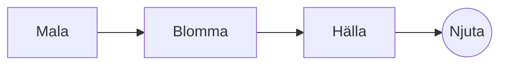

# Den perfekta bryggningen med handuppslag

En långsam morgonritual i några steg. Skriv den i **källtexten** till vänster eller direkt i *förhandsvisningen* till höger: båda hålls synkroniserade, och ==varje ändring blir en ren ändring== i Markdown.

> [!TIP]
> Vatten strax under kokpunkten, runt 94 °C, lyfter fram sötman utan bitterhet.

## Förhållandet

De flesta recept landar i en del kaffe till sexton delar vatten:

$$
m_{\text{vatten}} = 16 \times m_{\text{kaffe}}
$$

Så $20\,\text{g}$ kaffe vill ha $320\,\text{g}$ vatten.

## Steg för steg



## Bryggmetoder

| Metod        | Malning  |  Tid |
|:-------------|:--------:|-----:|
| Handuppslag  | Medelfin | 3:30 |
| Fransk press | Grov     | 4:00 |
| Espresso     | Fin      | 0:28 |

## Innan du börjar

- [x] Nyrostade bönor :coffee:
- [x] En kvarn med kvarnstenar
- [ ] En vattenkokare med svanhals

```python
def water_for(coffee_g: float, ratio: int = 16) -> float:
    return coffee_g * ratio
```

Blomning
: Den första skvätten vatten som får kaffesumpen att släppa sin gas.[^1]

[^1]: Färska bönor blommar mest; gamla höjer sig knappt.
