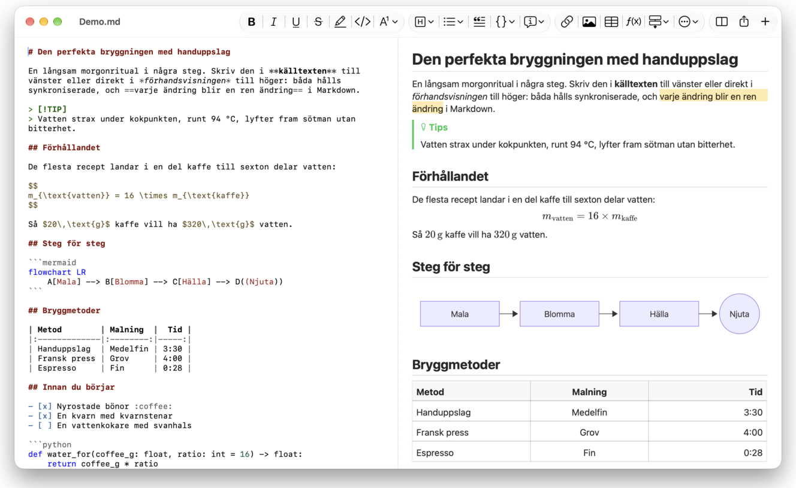
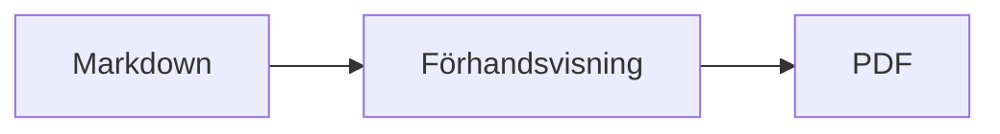

<p>&nbsp;&nbsp;&nbsp;</p>

# Splat

**Markdown-editorn för macOS där du skriver i källtexten eller direkt i förhandsvisningen.**

Splat visar din Markdown-källtext med syntaxfärger till vänster och en levande, helt redigerbar förhandsvisning till höger. Skriv i
någon av dem: allt du skriver i förhandsvisningen blir en minimal ändring i källtexten, så rader du inte rört
förblir identiska byte för byte och dina Git-diffar hålls rena. Splat läser den Markdown du redan använder: CommonMark och
GitHub Flavored Markdown, GitHub-alerts, Obsidians wikilänkar, inbäddningar och inforutor, tillägg från Pandoc och Typora,
inbäddad HTML, LaTeX-formler samt diagram i Mermaid, Graphviz och PlantUML, allt renderat offline. Exportera till PDF, HTML
eller Word med ett klick. Splat är skrivet i Rust med äkta AppKit-kontroller, finns på 35 språk och skickar ingenting över
nätverket om du inte ber om det.
 


[](https://raw.githubusercontent.com/sventmueller/splat/main/dist/Splat-1.0.3.dmg)

**[Ladda ner Splat-1.0.3.dmg](https://raw.githubusercontent.com/sventmueller/splat/main/dist/Splat-1.0.3.dmg)**: signerad och notariserad av Apple, för macOS 14 eller senare på Apple Silicon och Intel.
 
 

[](https://www.rust-lang.org)
[](https://www.apple.com/macos/)

[](https://github.com/madsmtm/objc2)
[](https://webkit.org)
[](https://github.com/kivikakk/comrak)
[](https://github.github.com/gfm/)
[](https://www.mathjax.org)
[](https://cortexjs.io/mathlive/)
[](https://mermaid.js.org)
[](https://graphviz.org)
[](https://plantuml.com)


[](#licens)

[Bahasa Indonesia](../id/README.md) ·
[Bahasa Melayu](../ms/README.md) ·
[Català](../ca/README.md) ·
[Čeština](../cs/README.md) ·
[Dansk](../da/README.md) ·
[Deutsch](../de/README.md) ·
[English](../../../README.md) ·
[Español](../es/README.md) ·
[Français](../fr/README.md) ·
[Hrvatski](../hr/README.md) ·
[Italiano](../it/README.md) ·
[Magyar](../hu/README.md) ·
[Nederlands](../nl/README.md) ·
[Norsk](../no/README.md) ·
[Polski](../pl/README.md) ·
[Português (Brasil)](../pt_BR/README.md) ·
[Português (Portugal)](../pt_PT/README.md) ·
[Română](../ro/README.md) ·
[Slovenčina](../sk/README.md) ·
[Slovenščina](../sl/README.md) ·
[Suomi](../fi/README.md) ·
**Svenska** ·
[Tiếng Việt](../vi/README.md) ·
[Türkçe](../tr/README.md) ·
[Ελληνικά](../el/README.md) ·
[Русский](../ru/README.md) ·
[Українська](../uk/README.md) ·
[עברית](../he/README.md)‎ ·
[العربية](../ar/README.md)‎ ·
[हिन्दी](../hi/README.md) ·
[ไทย](../th/README.md) ·
[한국어](../ko/README.md) ·
[日本語](../ja/README.md) ·
[简体中文](../zh-Hans/README.md) ·
[繁體中文](../zh-Hant/README.md)

## Innehåll

- [Funktioner i korthet](#funktioner-i-korthet)
- [Krav](#krav)
- [Installation](#installation)
- [Komma igång](#komma-igång)
- [Skriva](#skriva)
  - [I källtexten](#i-källtexten)
  - [I förhandsvisningen](#i-förhandsvisningen)
  - [Formateringskommandon](#formateringskommandon)
  - [Listor och uppgifter](#listor-och-uppgifter)
  - [Tabeller](#tabeller)
- [Markdown som stöds](#markdown-som-stöds)
  - [CommonMark och GitHub Flavored Markdown](#commonmark-och-github-flavored-markdown)
  - [Inforutor](#inforutor)
  - [Utökad syntax](#utökad-syntax)
  - [Obsidian](#obsidian)
  - [Citat och referenser](#citat-och-referenser)
  - [Inbäddad HTML](#inbäddad-html)
  - [Typografiska skiljetecken](#typografiska-skiljetecken)
  - [Syntaxöversikt](#syntaxöversikt)
- [Formler](#formler)
- [Diagram](#diagram)
- [Bilder](#bilder)
- [Länkar och navigering](#länkar-och-navigering)
- [Exportera, skriva ut och dela](#exportera-skriva-ut-och-dela)
- [Utseende och tillgänglighet](#utseende-och-tillgänglighet)
- [Språk](#språk)
- [Kortkommandon](#kortkommandon)
- [Integritet och säkerhet](#integritet-och-säkerhet)
- [Stora dokument](#stora-dokument)
- [Kända begränsningar](#kända-begränsningar)
- [Felsökning](#felsökning)
- [För utvecklare](#för-utvecklare)
  - [Bygga](#bygga)
  - [Distribution](#distribution)
  - [Testa](#testa)
  - [Projektstruktur](#projektstruktur)
  - [Dataflöde](#dataflöde)
  - [Regler i styrenheten](#regler-i-styrenheten)
  - [Lägga till ett kommando](#lägga-till-ett-kommando)
  - [Översättningar](#översättningar)
  - [Komponenter från tredje part](#komponenter-från-tredje-part)
- [Licens](#licens)

## Funktioner i korthet

- **Två sätt att skriva, en text.** Källtext och förhandsvisning går båda att redigera. Markdown-filen är den enda sanningen: det
  finns en ångrahistorik per dokument, och varje ändring i förhandsvisningen översätts till den minsta möjliga ändringen i källtexten.
- **Den Markdown du redan använder.** CommonMark, GitHub Flavored Markdown, GitHub-alerts, Obsidian, tillägg från Pandoc och Typora,
  emoji-kortkoder, spoilers, definitionslistor, rubrikankare och HTML som i GitHubs README-filer.
- **Formler och diagram inbyggda.** LaTeX-formler via MathJax, med en visuell formelredigerare. Diagram i Mermaid,
  Graphviz och PlantUML, renderade på din Mac utan Java, server eller nätverksanslutning.
- **En knapp för allt.** Varje Markdown-konstruktion har en knapp i verktygsfältet och ett menyalternativ, de vanliga dessutom ett
  kortkommando. Tabeller har en egen meny för rader, kolumner och justering.
- **Exportera utan att förlora något.** PDF, en enda fristående HTML-fil eller ett Word-dokument med riktiga rubriker,
  listor, tabeller, fotnoter och bilder.
- **Native in i märgen.** Äkta AppKit-fönster, flikar, menyer, popovers, Versioner, Spara automatiskt, delningsmenyn, mörkt läge,
  stavningskontroll, diktering och VoiceOver. Inget Electron, ingen webbvy för själva texten.
- **Snabb med stora filer.** En tangenttryckning i ett dokument på 10 MB tar cirka 25 ms.
- **Privat och försiktig.** Bilder från webben läses in först när du tillåter det, länkar till andra appar frågar först, och
  allt som avkodar opålitliga bilddata körs i hjälpprocesser i en sandlåda.
- **På ditt språk.** Gränssnittet och den inbyggda Markdown-snabbreferensen finns på 35 språk: arabiska, katalanska,
  kinesiska (förenklad), kinesiska (traditionell), kroatiska, tjeckiska, danska, nederländska, engelska, finska, franska,
  tyska, grekiska, hebreiska, hindi, ungerska, indonesiska, italienska, japanska, koreanska, malajiska, norska, polska, portugisiska (Brasilien),
  portugisiska (Portugal), rumänska, ryska, slovakiska, slovenska, spanska, svenska, thailändska, turkiska, ukrainska och
  vietnamesiska.

## Krav

- macOS 14 Sonoma eller senare. Splat utvecklas och testas på macOS 27, där appen automatiskt får designen Liquid Glass.
- En Mac med Apple Silicon eller en Intel-processor.
- Cirka 45 MB diskutrymme.

## Installation

**Från skivavbilden.** Ladda ner [`dist/Splat-1.0.3.dmg`](https://raw.githubusercontent.com/sventmueller/splat/main/dist/Splat-1.0.3.dmg), öppna den och dra Splat till mappen Appar. Avbilden är signerad med ett
Developer ID och notariserad av Apple, så den öppnas utan varningar.

**Med Homebrew.** Cask-paketet finns i en egen tap:

```sh
brew install --cask sventmueller/tap/splat
```

`brew upgrade --cask splat` installerar nya versioner, och `brew uninstall --zap --cask splat` tar dessutom bort Splats inställningar
och cacheminnen.

**Uppdateringar.** Splat från skivavbilden eller Homebrew håller sig uppdaterat med [Sparkle](https://sparkle-project.org).
Vid andra starten frågar appen om den får leta efter uppdateringar på egen hand, en gång om dagen. **Splat › Leta efter uppdateringar…**
letar direkt; **Leta efter uppdateringar automatiskt** och **Hämta och installera uppdateringar automatiskt** i samma
meny ändrar ditt val senare. Splat installerar en uppdatering bara om den bär utvecklarens signatur. En egen
build har ingen uppdateringsfunktion.

**Från källkod.** Se [Building](#bygga) för förutsättningarna och kör sedan:

```sh
make build
ditto target/release/Splat.app /Applications/Splat.app
open /Applications/Splat.app
```

För att öppna Markdown-filer med Splat genom dubbelklick markerar du en valfri `.md`-fil i Finder, väljer **Arkiv › Visa info**,
väljer Splat under **Öppna med** och klickar på **Ändra alla…**. Splat registrerar sig för filerna `.md`, `.markdown`, `.mdown` och
`.mkd`.

## Komma igång

### Fönstret

Varje dokument öppnas i ett eget fönster, eller som flik om du föredrar flikar:

- **Vänster: källtexten.** Din Markdown i SF Mono med syntaxfärger.
- **Höger: förhandsvisningen.** Det renderade dokumentet, redo att redigeras.
- **Dispositionspanel (valfri).** Alla rubriker som ett träd; ett klick på en visar den i båda rutorna. Slå på och av med
  **Innehåll › Visa disposition** (⌃⌘S).
- **Verktygsfält.** Knappar grupperade efter vad de ändrar: tecken, stycken och infogade element, därefter förhandsvisning på/av,
  Dela och Nytt dokument. Anpassa det med **Innehåll › Anpassa verktygsfältet…**.

Dra i avgränsaren för att ge någon sida mer utrymme. **Innehåll › Göm förhandsvisning** (⌥⌘P) lämnar bara källtexten kvar; Splat
minns detta per fönster. Båda rutorna rullar tillsammans, och en markering i den ena rutan framhävs i den andra.

### Dokument, flikar och versioner

Splat är en vanlig dokumentapp för macOS:

- **Spara automatiskt och Versioner.** Ändringar sparas på plats. **Arkiv › Återgå till › Bläddra bland alla versioner…** tar dig tillbaka
  i tiden.
- **Ändringar från andra program.** När Git, ett skript eller en annan editor ändrar ett öppet dokument läser Splat in det på nytt
  och behåller markören och rullningsläget. Har du egna osparade ändringar behåller Splat dem, och macOS
  frågar innan den andra versionen skrivs över.
- **De vanliga filkommandona.** Duplicera (⇧⌘S), Byt namn…, Flytta till… och **Arkiv › Öppna senaste**.
- **Flikar.** **Arkiv › Ny flik** eller knappen **+** i verktygsfältet öppnar ett nytt dokument som flik; den vanliga menyn
  Fönster slår ihop, flyttar och växlar mellan flikar.
- **Fönsterplacering.** Storleken och placeringen på ditt senaste fönster minns appen, även efter omstarter. Om ett fönster
  redan står där öppnas det nya något förskjutet.
- **Dockikonen.** Ett klick på den, sedan du stängt det sista fönstret, öppnar ett nytt dokument.
- **Öppna Markdown-filer i Splat.** **Splat › Ställ in som förvald app för Markdown** gör att ett dubbelklick på en `.md`- eller
  `.markdown`-fil öppnar Splat; macOS ber om bekräftelse en gång. Alternativet har en bockmarkering så länge Splat är förvald app.

Filer måste vara UTF-8-text eller UTF-16 med byteordningsmärke. Splat vägrar andra teckenkodningar i stället för att gissa
och förstöra texten. Ett byteordningsmärke ligger kvar, UTF-16 förblir UTF-16, och i en fil där alla rader slutar med CRLF
får de rader du lägger till också CRLF.

**Efter en krasch** går som mest de senaste sekundernas skrivande förlorat: var femte sekund kopierar Splat osparad text till
`~/Library/Application Support/Splat/Unsaved` och tar bort kopiorna när ett dokument sparas eller Splat avslutas normalt.
Vid nästa start flyttas det en krasch lämnat där till `~/Library/Application Support/Splat/Recovery`, och Splat säger till om det en gång, med en
knapp som öppnar mappen. En krasch som Splat ännu hinner reagera på skriver dessutom texten i alla öppna dokument dit.

### Snabbreferens

**Hjälp › Markdown-snabbreferens** öppnar ett fusklapp på ditt språk som ett nytt, namnlöst dokument. Det är ett
vanligt dokument, så prova allt direkt där, i källtexten eller i förhandsvisningen.

## Skriva

### I källtexten

Källtexten är en ren textredigerare som är anpassad för Markdown:

- **Syntaxfärger** som i VS Code: rubriker, betoning, länkar, kod, tabeller, HTML, front matter samt LaTeX och
  Mermaid inuti formler och diagram. Det finns paletter för ljust och mörkt läge samt för Öka kontrast.
- **Kodblock med staket** färgmarkeras för Bash, C, C++, C#, CSS (även SCSS och Less), Go, HTML, XML, Java,
  JavaScript, JSON, Kotlin, PHP, Python, Ruby, Rust, SQL, Swift, TypeScript, YAML, TeX och Mermaid, även med deras
  vanliga korta namn som `js`, `py` eller `sh`.
- **Inga överraskande ersättningar.** Smarta citationstecken, smarta streck och textersättning är avstängda som standard, eftersom de
  förstör `--`, `---` och `"`. Slå på dem under **Redigera › Ersättningar**.
- **Systemets skrivverktyg.** Stavnings- och grammatikkontroll, diktering, Sök och ersätt (⌥⌘F) samt Tal.
- **Dra och släpp.** Släpp en bildfil för att infoga ``, en annan fil för att infoga en länk till den
  och en URL för att infoga `[url](url)`. Varje släpp är ett ångrasteg.
- **Klistra in bilder.** En bild i urklipp, till exempel en skärmavbild, sparas som en PNG-fil bredvid dokumentet
  (`Bild 2026-10-29 13.09.07.png`) och infogas som bild. Dokumentet måste ha sparats en gång för det.

### I förhandsvisningen

Förhandsvisningen beter sig som ett ordbehandlingsprogram, men allt du gör i den hamnar som Markdown:

- **Skriva.** Tecken som betyder något i Markdown, till exempel `*` eller `#`, skyddas med omvänt snedstreck så att de visas som du skrev dem.
- **Return** påbörjar ett nytt stycke eller en ny listpunkt. **⌥Return** eller **⌃Return** infogar en radbrytning.
- **Formatering vid markören.** Står markören i slutet av ett ord gäller Fet, Kursiv och de andra teckenformaten
  det du skriver därefter. Välj formatet igen för att avsluta. Inuti ett ord formateras hela ordet.
- **Tomma rader.** Return på en tom rad lägger till ytterligare en tom rad, och backstegstangenten tar bort den. I källtexten blir varje
  extra tom rad två tomma rader till; andra Markdown-program visar dem som vanligt styckeavstånd.
- **Ångra** fungerar över båda rutorna. Ångra-åtgärderna har namn (”Ångra Fet”), skrivande är ett steg per skrivsvit, och efter Ångra
  och Gör om rullar båda rutorna till ändringen.
- **Formler och diagram** visas som färdig grafik. Klicka på en, flytta markören dit eller tryck Return på den för att
  öppna dess redigerare (se [Formulas](#formler) och [Diagrams](#diagram)).
- **Inbäddad HTML, inbäddade anteckningar och front matter** visas, men redigeras i källtexten. Ett klick på dem sätter
  markören på motsvarande ställe där.

Allt som Markdown inte kan uttrycka blockeras i förhandsvisningen: panelerna Typsnitt och Färger, linjalen samt inklistring
eller släpp av formaterad text och bilder. Inklistrad HTML och RTF kommer in som oformaterad text.

### Formateringskommandon

Varje kommando finns i verktygsfältet, i menyraden och i snabbmenyn i båda rutorna. Menyalternativen visar en
bockmarkering för formateringen vid markören.

| Meny | Kommandon |
|---|---|
| **Format › Typsnitt** | Fet, Kursiv, Understrykning, Genomstrykning, Markera, Kod, Upphöjd, Nedsänkt |
| **Format › Rubrik** | Brödtext, Rubrik 1 till 6 |
| **Format › Lista** | Lista i punktformat, Numrerad lista, Uppgiftslista |
| **Format** | Citat, Kodblock (Inget språk eller ett av 20 språk; ändrar även språket i ett befintligt block), Inforuta (Anteckning, Tips, Viktigt, Varning, Försiktighet; samma typ igen tar bort den), Redigera formel eller diagram…, Ta bort formatering |
| **Infoga** | Länka…, Bild…, Tabell…, Formel, Diagram (Flödesschema, Sekvensdiagram, Gantt-schema), Innehållsförteckning, Fotnot, Avgränsare |
| **Tabell** | Infoga rad ovanför/nedanför, Infoga kolumn till vänster/höger, Radera rad, Radera kolumn, Justering (Vänster, Centrera, Höger, Förval), Justera tabellkolumner |
| **Innehåll** | Göm/Visa förhandsvisning, Visa/Göm disposition, Typografiska skiljetecken, Zooma in/ut, Verklig storlek, verktygsfält, flikfält, helskärmsläge |

Understrykning, markering, upphöjd och nedsänkt text skrivs som `<ins>`, `<mark>`, `<sup>` och `<sub>`, vilket GitHub
också visar. Splat läser även `<u>`, som GitHub tar bort, och de kortare `==highlight==`, `^sup^` och `~sub~`.
GitHub visar `==` och `^` som de skrivits och `~sub~` som genomstrykning.

### Listor och uppgifter

- Return fortsätter en lista; Return på en tom listpunkt avslutar den.
- **Tab** och **⇧Tab** drar in och minskar indrag för listpunkter i förhandsvisningen.
- Ett klick på en uppgifts kryssruta i förhandsvisningen växlar mellan `- [ ]` och `- [x]`.
- **Format › Lista** gör om de markerade styckena till en lista eller byter dess slag.

### Tabeller

- **Infoga › Tabell…** frågar efter antalet rader (inklusive rubrikraden) och kolumner.
- I förhandsvisningen flyttar **Tab** till nästa cell, **⇧Tab** till föregående och **Return** till cellen nedanför. Tab
  i den sista cellen lägger till en rad.
- Menyn **Tabell** infogar och raderar rader och kolumner och anger en kolumns justering (⌘{, ⌘|, ⌘}).
- **Tabell › Justera tabellkolumner** fyller ut källtexten så att kolumnerna hamnar under varandra.

## Markdown som stöds

Splat tolkar med [comrak](https://github.com/kivikakk/comrak), en parser som är kompatibel med CommonMark och GFM, och slår på
de flesta av dess tillägg. Allt nedan renderas i förhandsvisningen och i alla exporter.

### CommonMark och GitHub Flavored Markdown

- Rubriker (`#` och understrukna), stycken, radbrytningar, betoning, stark betoning, kod i löpande text, blockcitat,
  avgränsare.
- Punktlistor, numrerade och nästlade listor; uppgiftslistor.
- Länkar (i texten, referenser och automatiska), bilder, definitioner av länkreferenser.
- Kodblock med staket och indragna kodblock med syntaxfärger.
- Tabeller med kolumnjustering.
- Genomstrykning med `~~two tildes~~`.
- Fotnoter: `text[^1]` med `[^1]: The note.` var som helst i dokumentet. Ett klick på markören hoppar till fotnoten.
- YAML front matter mellan `---`-rader överst. Förhandsvisningen sammanfattar den på en rad, till exempel
  ”Metadata: title, date, tags”.

### Inforutor

GitHub-alerts renderas som färgade rutor med ikon och titel:

```markdown
> [!NOTE]
> Användbar information som användare bör känna till.

> [!WARNING]
> Kritiskt innehåll som kräver omedelbar uppmärksamhet.
```

De fem typerna är Anteckning, Tips, Viktigt, Varning och Försiktighet. **Format › Inforuta** gör om stycket vid markören
till en sådan.

Obsidians inforutor fungerar också, med valfri titel och utfällningsläge:

```markdown
> [!tip]- Klicka på ▸ för att fälla ut
> Dold tills den öppnas.

> [!question]+ Öppen från början
> Ett `+` börjar utfälld, ett `-` hopfälld.
```

Obsidians övriga typer visas i den närmaste av de fem färgerna: `success`, `check`, `done` och `hint` som Tips;
`question`, `help` och `faq` som Viktigt; `attention` som Varning; `failure`, `fail`, `missing`, `danger`, `error` och
`bug` som Försiktighet; allt annat som Anteckning.

### Utökad syntax

| Funktion | Syntax | Från |
|---|---|---|
| Markering | `==marked text==` | Obsidian, Typora |
| Upphöjd text | `x^2^` | Pandoc, Typora |
| Nedsänkt text | `H~2~O` | Pandoc, Typora |
| Emoji-kortkod | `:rocket:` blir 🚀 | GitHub |
| Spoiler | `\|\|hidden text\|\|`, markera den för att läsa | Discord |
| Fotnot i texten | `text^[the note itself]` | Pandoc, Obsidian |
| Definitionslista | `Term`, tom rad, `: Explanation` | PHP Markdown Extra, Pandoc |
| Rubrikankare | `## Install {#setup}`, länka med `[see](#setup)` | Pandoc, kramdown |

Definitionslistor ser ut så här i källtexten:

```markdown
Begrepp

: Förklaring av begreppet.
```

Utan eget ankare får varje rubrik ett som härleds ur texten, som på GitHub: `## Komma igång` nås som `#komma-igång`.

### Obsidian

- **Wikilänkar.** `[[Anteckning]]` länkar till `Anteckning.md` i samma mapp eller en mapp längre ned. `[[Anteckning|Visad text]]` visar
  din egen text, och `[[Anteckning#Rubrik]]` öppnar anteckningen. ⌘-klick öppnar den i Splat.
- **Inbäddningar.** `![[Anteckning]]` visar den andra anteckningen inuti denna; anteckningar som är inbäddade i den visas som länkar.
  `![[diagram.png]]` visar en bild. Som i Obsidian pekar inbäddningar ut anteckningar och bilder i dokumentets mapp eller längre ned,
  aldrig med en absolut sökväg, och bara Markdown-filer visas som anteckningar.
- **Kommentarer.** `%%Bara i källtexten%%` förblir synlig i källtexten och utelämnas ur förhandsvisningen och alla exporter,
  både i löpande text och på egna rader.
- **Taggar.** `#idea` eller `#project/splat` markeras. ⌘-klick söker efter taggen i dokumentet.
- **Hopfällbara inforutor.** Se [Callouts](#inforutor).

### Citat och referenser

- **Pandoc-citat.** `[@doe2020]` eller `[@doe2020; @roe2021]` visas som ”(Doe 2020; Roe 2021)”. Posterna hämtas
  från den BibTeX-fil som front matter anger som `bibliography: refs.bib`. Utan den använder Splat
  `references.bib`, `literatur.bib` eller `bibliography.bib` bredvid dokumentet.
- **Referenser till GitHub och GitLab.** Om dokumentet ligger i ett Git-arkiv vars fjärrarkiv `origin` finns på github.com
  eller en GitLab-värd markeras `@name`, `#12` (ärende) och `!7` (merge request, bara GitLab). ⌘-klick öppnar dem
  i webbläsaren.

### Inbäddad HTML

HTML som den ser ut i GitHubs README-filer renderas, med en egen läsare i stället för en webbläsarmotor:

- centrerade stycken och block (`<p align="center">`, `<div align="center">`)
- bilder med storlek (``)
- länkar, `<kbd>⌘</kbd>`, `<br>`, `<u>`, `<ins>`, `<mark>`, `<sup>`, `<sub>`
- listor och tabeller, även celler som spänner över flera kolumner (`colspan`)
- hopfällbara avsnitt: `<details><summary>Mer</summary>…</details>`, som öppnas med ett klick på ▸

Markdown mellan HTML-taggar renderas som Markdown. Skript, stilar, ramar och formulär utelämnas helt, och länkar
och bilder behåller bara adresser med `http`, `https`, `mailto` samt relativa adresser.

### Typografiska skiljetecken

**Innehåll › Typografiska skiljetecken** visar raka citationstecken som citattecknen i ditt gränssnittsspråk, `--` som
tankstreck (kort), `---` som långt tankstreck och `...` som tre punkter. På tyska blir `"Ja"` „Ja“, på franska «Oui», på japanska
「はい」, också där kinesiska och japanska sätter citattecken utan mellanslag; hebreiska förkortningar som `צה"ל` får sina
gershayim, צה״ל. Källtexten behåller de enkla tecknen; förhandsvisningen och alla exporter visar de typografiska. Inställningen
är avstängd tills du slår på den.

### Syntaxöversikt

| Element | Markdown |
|---|---|
| **Fet** | `**Fet**` |
| *Kursiv* | `*Kursiv*` |
| Understrykning | `<ins>Understrykning</ins>` eller `<u>Understrykning</u>` |
| ~~Genomstrykning~~ | `~~Genomstrykning~~` |
| Markering | `<mark>Markering</mark>` eller `==Markering==` |
| `Kod` | `` `Kod` `` |
| x² | `x<sup>2</sup>` eller `x^2^` |
| H₂O | `H<sub>2</sub>O` eller `H~2~O` |
| [Länk](https://example.com) | `[Länk](https://example.com)` |
| Rubrik | `# Rubrik` till `###### Rubrik` |
| Citat | `> Citat` |
| Punktlista | `- Punkt` |
| Numrerad lista | `1. Punkt` |
| Uppgift | `- [ ] Öppen` och `- [x] Klar` |
| Kodblock | ```` ```rust ```` … ```` ``` ```` |
| Tabell | `\| A \| B \|` med `\|---\|---\|` under rubrikraden |
| Fotnot | `Text[^1]` och `[^1]: Anmärkning` |
| Avgränsare | `---` |
| Bild | `` |
| Formel | `$E = mc^2$`, `$$ … $$` |
| Diagram | ```` ```mermaid ````, ```` ```dot ````, ```` ```plantuml ```` |
| Inforuta | `> [!TIP]` |
| Wikilänk | `[[Anteckning]]`, `[[Anteckning\|Text]]` |
| Inbäddning | `![[Anteckning]]`, `![[image.png]]` |
| Kommentar | `%%Kommentar%%` |
| Tagg | `#tagg` |
| Citat (källa) | `[@key]` |
| Spoiler | `\|\|Spoiler\|\|` |
| Emoji | `:tada:` |

## Formler

Formler renderas av [MathJax](https://www.mathjax.org) med dess TeX- och AMS-matematik, som skarp vektorgrafik. Text i
`\text{…}` kan vara på vilket skriftsystem som helst: det som MathJax typsnitt saknar hämtas från typsnitten på din Mac, med arabiska och hebreiska
från höger till vänster, och emoji i färg.

| Slag | Syntax |
|---|---|
| I texten | `$E = mc^2$`, `` $`E = mc^2`$ `` (GitHub, GitLab), `\(E = mc^2\)` |
| Fristående | `$$` … `$$`, `\[` … `\]`, eller ett kodblock markerat `math` |

**Redigera en formel.** Klicka på en formel i förhandsvisningen, dubbelklicka på den, tryck Return på den eller flytta markören dit
för att öppna dess redigerare i en popover. **Infoga › Formel** infogar en ny och öppnar redigeraren direkt.

- **Visuell eller LaTeX.** Omkopplaren överst växlar mellan en visuell redigerare ([MathLive](https://cortexjs.io/mathlive/))
  och LaTeX-koden. Splat minns ditt val.
- **Byggblock** för bråk, kvadratrot, upphöjd och nedsänkt text, summa och integral med gränser, gränsvärde,
  parenteser som växer med innehållet, 2×2-matris, grekiska bokstäver samt relationer, operatorer och pilar. De lämnar
  platshållare □, och **Tab** hoppar till nästa.
- **Direkt förhandsvisning.** Ändringar syns i dokumentet medan du skriver. Fel från MathJax visas på en rad under koden.
- **Spara eller förkasta.** Ett klick utanför behåller ändringen som ett enda ångrasteg; **Esc** eller **Avbryt** kastar bort den.
  Esc på en ny, tom formel tar bort den igen.
- Snabbmenyn erbjuder **Redigera formel…** för formeln under pekaren.

VoiceOver läser upp en formel som dess LaTeX-kod. Splat renderar formler, inte kompletta LaTeX-dokument: det finns inga
paket, ingen TikZ och inget `\documentclass`.

## Diagram

Diagram renderas inuti Splat, offline och i en ljus och en mörk variant.

| Motor | Kodblock | Vad den ritar |
|---|---|---|
| [Mermaid](https://mermaid.js.org) | ```` ```mermaid ```` | flödesscheman, sekvens-, klass-, tillstånds-, entitetsrelations-, Gantt-, cirkeldiagram, tankekartor, tidslinjer och alla andra Mermaid-typer |
| [Graphviz](https://graphviz.org) | ```` ```dot ```` eller ```` ```graphviz ```` | grafer i DOT-språket |
| [PlantUML](https://plantuml.com) | ```` ```plantuml ```` eller ```` ```puml ```` | UML-diagram; körs utan Java |



**Att redigera ett diagram** fungerar som att redigera en formel: klicka på det för att öppna koden i en popover, med syntaxfärger och
felmeddelanden på en rad under koden. **Infoga › Diagram** utgår från en mall för ett flödesschema, ett sekvensdiagram
eller ett Gantt-schema. Byggblock hjälper till med de tre vanligaste Mermaid-typerna:

- **Flödesschema:** Nod ▾ (rektangel, rundad, cirkel, romb, databas), Koppling, Koppling med etikett, Grupp,
  Riktning ▾
- **Sekvensdiagram:** Deltagare, Meddelande, Svar, Anteckning, Slinga, Alternativa flöden
- **Gantt-schema:** Sektion, Uppgift, Milstolpe

Andra diagramtyper redigeras som kod. VoiceOver läser upp ett diagrams titel eller alternativtext.

Det första diagrammet efter start tar cirka en sekund, eftersom renderingsmotorn startar i bakgrunden. Ett diagram
som tar längre tid än 10 sekunder visar ett fel, och renderingsmotorn startar om för nästa.
PlantUML:s motor (7 MB) läses in först med det första PlantUML-diagrammet. En PlantUML-`!include` från webben blockeras.

## Bilder

- **Lokala bilder** använder sökvägar relativa till dokumentet: ``. Splat visar PNG, JPEG, GIF, WebP,
  BMP, SVG, HEIC, TIFF, AVIF och PDF.
- **Bilder från webben** förblir blockerade tills du tillåter dem: ett fält ovanför förhandsvisningen förklarar att när de läses in får
  deras servrar veta att och när du öppnar dokumentet. **Läs in bilder** tillåter dem för det här dokumentet; Splat minns
  valet per fil.
- **Storlek.** `` anger en bilds storlek; annars anpassas bilder efter förhandsvisningens bredd.
- **Ändringar på disk.** En bild som du byter ut, eller en som dyker upp sedan dokumentet nämnt den, visas utan att dokumentet
  öppnas igen. Bilder från webben som misslyckades på grund av nätverket provas på nytt medan ett dokument visar
  dem.
- **Minne.** Bilder visas med upp till 2560 pixlar på den längsta sidan, vilket också fyller en A4-sida. De avkodas i mindre storlek
  när de fyller en åttondel av Macens minne, och så länge macOS rapporterar minnesbrist.
- **Mörkt läge.** Bilder med vit bakgrund dämpas något i den mörka förhandsvisningen.
- **Klistra in och släppa.** Se [In the source](#i-källtexten).

## Länkar och navigering

I förhandsvisningen placerar ett klick markören så att du kan redigera länktexten; **⌘-klick** följer länken:

- `http`, `https` och `mailto` öppnas i din webbläsare eller e-postapp.
- Markdown-filer öppnas i Splat; andra filer och mappar visas i Finder.
- `#anchor` hoppar till rubriken i dokumentet.
- Adresser som öppnar en annan app, till exempel `slack://` eller `vscode://`, frågar först och visar den fullständiga adressen och appen.
  **Avbryt** är förvalt.

**Infoga › Innehållsförteckning** infogar en länkad lista över alla rubriker. Står markören i den uppdaterar samma kommando
den. Dispositionspanelen (⌃⌘S) hoppar till vilken rubrik som helst i båda rutorna.

## Exportera, skriva ut och dela

| Format | Så här | Det här får du |
|---|---|---|
| **PDF** | **Arkiv › Exportera som PDF…** eller menyn Dela | Sidor i pappersformat, alltid i ljust utseende, formler och diagram som vektorgrafik. **Arkiv › Utskriftsformat…** anger papperet. |
| **Utskrift** | **Arkiv › Skriv ut…** (⌘P) | Samma layout som PDF-filen. |
| **HTML** | **Arkiv › Exportera som HTML…** eller menyn Dela | En fristående fil: lokala bilder inbäddade, formler och diagram som skarpa bilder, rubrikankare så att innehållsförteckningen fungerar. Inga skript. |
| **Word** | **Arkiv › Exportera som Word-dokument…** eller menyn Dela | En `.docx` med Words rubrikformat, riktiga listor och tabeller (även sammanslagna celler), fotnoter som Word-fotnoter, inbäddade bilder, formler och diagram. |
| **Markdown** | Knappen **Dela** i verktygsfältet | Dokumentet som en `.md`-fil för Mail, Meddelanden, AirDrop och alla andra delningstjänster. |

Menyn **Arkiv › Dela** erbjuder alla dessa på ett ställe. Exporterna använder inställningen för typografiska skiljetecken och de
bilder från webben som du tillåtit; bilder från webben förblir länkar i HTML.

## Utseende och tillgänglighet

- **Mörkt läge** följer systemet. Formler och diagram renderas för varje utseende.
- **Öka kontrast** i Systeminställningar växlar syntaxfärgerna till paletter med hög kontrast.
- **Zoom.** ⌘+, ⌘− och ⌘0 skalar båda rutorna.
- **Helskärmsläge, flikar och ett anpassningsbart verktygsfält**, som i alla Mac-appar.
- **VoiceOver.** Rutorna heter ”Markdown-källtext” och ”Förhandsvisning”, formler läses upp som sin kod och diagram som
  sin titel. Varje kommando går att nå från tangentbordet.

Splat har inget inställningsfönster: de få alternativen finns där de gäller, i **Innehåll** och **Redigera › Ersättningar**.

## Språk

Gränssnittet, menyerna och Markdown-snabbreferensen är översatta till 35 språk:

arabiska, katalanska, kinesiska (förenklad), kinesiska (traditionell), kroatiska, tjeckiska, danska, nederländska, engelska, finska, franska,
tyska, grekiska, hebreiska, hindi, ungerska, indonesiska, italienska, japanska, koreanska, malajiska, norska, polska, portugisiska
(Brasilien), portugisiska (Portugal), rumänska, ryska, slovakiska, slovenska, spanska, svenska, thailändska, turkiska, ukrainska och
vietnamesiska.

Splat följer språkordningen under **Systeminställningar › Allmänt › Språk och region**; där kan du också välja ett språk
enbart för Splat under **Appar**. Saknas en översättning till ditt språk används engelska. Menytermerna
följer Apples egna översättningar, så Splat låter som resten av din Mac.

Hebreisk och arabisk text läses från höger till vänster överallt där den förekommer, oavsett gränssnittsspråk: varje stycke,
rubrik och listpunkt tar riktningen från sin första bokstav, citat och inforutor ritar sitt streck till höger, och en
tabell vars text börjar från höger till vänster listar sina kolumner från höger. Kodblock förblir från vänster till höger. PDF-, HTML-
och Word-exporterna behåller dessa riktningar. Med hebreiska eller arabiska som systemspråk speglar macOS också fönstret,
så förhandsvisningen hamnar till vänster.

## Kortkommandon

| Åtgärd | Kortkommando |
|---|---|
| Fet, Kursiv, Understrykning | ⌘B, ⌘I, ⌘U |
| Genomstrykning | ⇧⌘X |
| Länka… | ⌘K |
| Brödtext, Rubrik 1 till 6 | ⌥⌘0, ⌥⌘1 till ⌥⌘6 |
| Justera tabellkolumn vänster, centrerat, höger | ⌘{, ⌘\|, ⌘} |
| Göm eller visa förhandsvisningen | ⌥⌘P |
| Visa eller göm dispositionen | ⌃⌘S |
| Zooma in, ut, verklig storlek | ⌘+, ⌘−, ⌘0 |
| Nytt dokument, öppna, spara, duplicera | ⌘N, ⌘O, ⌘S, ⇧⌘S |
| Utskriftsformat, skriv ut | ⇧⌘P, ⌘P |
| Sök, sök och ersätt | ⌘F, ⌥⌘F |
| Sök nästa, föregående; använd markering; gå till markering | ⌘G, ⇧⌘G; ⌘E; ⌘J |
| Visa stavning och grammatik; kontrollera dokument | ⌘:, ⌘; |
| Klistra in och matcha stilen | ⌥⇧⌘V |
| Göm verktygsfältet, visa alla flikar, helskärm | ⌥⌘T, ⇧⌘\\, ⌃⌘F |
| Radbrytning (förhandsvisning) | ⌥Return eller ⌃Return |
| Nästa cell / föregående cell i en tabell (förhandsvisning) | Tab / ⇧Tab |
| Öka / minska indrag för en listpunkt (förhandsvisning) | Tab / ⇧Tab |
| Nästa platshållare i formelredigeraren | Tab |
| Stäng formel- eller diagramredigeraren utan ändringar | Esc |
| Följ en länk, tagg eller referens (förhandsvisning) | ⌘-klick |

Splat lämnar Apples standardkortkommandon som de är.

## Integritet och säkerhet

En Markdown-fil kan komma från vem som helst, så Splat behandlar varje dokument som opålitligt.

- **Inget nätverk som standard.** Splat har ingen telemetri. Appen letar efter uppdateringar först när du går med på det eller väljer **Leta efter
  uppdateringar…**: den läser då in en liten flödesfil från GitHub, och förfrågan innehåller bara appens namn och version.
  Formler och diagram renderas lokalt; webbvyerna som gör det kan inte nå nätverket.
- **Bilder från webben** läses in först efter ditt tillstånd, bara över `https`, aldrig från värdar i ditt lokala nätverk,
  högst 10 MB vardera och i en privat session utan cookies.
- **Isolerad avkodning.** Bilder och grafiken i formler och diagram avkodas i hjälpprocesser som stänger
  varje fil de ärvt och låser in sig i en sandlåda innan de läser den första byten: ingen filåtkomst, inget
  nätverk. De lämnar bara tillbaka pixlar, vars storlek kontrolleras, och stoppas efter 10 sekunder. Apples egna bildavkodare
  får bara se HEIC, TIFF, AVIF och PDF, och bara när datan verkligen har det formatet; de körs i en egen hjälpprocess, som dessutom får
  läsa systemets typsnittsmappar och använda systemets videoavkodare. SVG-filer, formler
  och diagram passerar också den hjälpprocessen, så de är bilder med fast upplösning i Splat: fyra pixlar per punkt,
  upp till 2560 på den längre sidan.
- **Lokala filer** når ett dokument bara via den sökväg det anger. Inbäddningar visar Markdown-anteckningar från dokumentets mapp
  och längre ned, och en saknad bild eftersöks bara där. En bildsökväg någon annanstans, absolut eller med början på `~`,
  läses ändå in, och HTML- och Word-exporterna bäddar in den: titta på exporten av ett dokument du inte skrivit själv innan du
  skickar vidare den.
- **Kopior av osparad text** stannar på den här Macen, i din Library-mapp, för återställning efter en krasch. De försvinner
  vid sparning eller när Splat avslutas normalt; de kopior en krasch lämnat kvar ligger kvar i återställningsmappen tills du raderar
  dem.
- **Länkar** startar aldrig ett program med ett klick. Webb- och e-postlänkar öppnas som vanligt; länkar till andra appar frågar först.
- **HTML i dokument** läses av Splats egen parser. Skript, stilar, ramar och formulär körs aldrig.
- **Exporter** innehåller inga skript. HTML-sidor behåller bara en fast lista över ofarliga taggar och attribut, som GitHub gör, plus
  en innehållssäkerhetspolicy. Word-filer länkar bara adresser med `http`, `https` och `mailto`.
- **Kodsignering** med Hardened Runtime. Splat körs utan App Sandbox så att appen kan visa bilder bredvid
  dina dokument utan att fråga om varje mapp; isoleringen av all avkodning väger upp det.

## Stora dokument

Splat förblir responsivt med dokument på flera megabyte:

- Källtexten använder TextKit 2, som bara lägger ut den synliga delen.
- Medan du skriver i förhandsvisningen, och i källtexten i dokument upp till 2 MB, tolkas, färgläggs och läggs bara de berörda
  styckena ut på nytt: cirka 25 ms i ett dokument på 10 MB och cirka 50 ms för en tangenttryckning i dess förhandsvisning, med
  vyns eget arbete.
- Stora förhandsvisningar renderar den synliga delen först och resten medan appen är overksam. Block som rullas in i bild renderas
  innan de ritas.
- I källtexten i större dokument sker tolkningen för förhandsvisningen i bakgrunden medan du skriver.
- Från 64 MB förblir ett dokument ren text: källtexten har inga färger och förhandsvisningen förklarar varför den förblir tom. Exporter
  fungerar fortfarande.
- Från cirka 200 KB öppnar ett dokument sitt fönster innan det tolkats; vid 5 MB följer färgerna och förhandsvisningen
  cirka en kvarts sekund senare.

Vissa ändringar behandlas i sin helhet, med cirka 300 ms per tangenttryckning vid 10 MB: ändringar i en fotnots definition eller
hänvisningar, intill en fotnot i texten, allra sist i ett dokument intill en fotnot, i front matter eller nära
definitioner av länkreferenser, och varje ändring i ett dokument med `%%`-kommentarsblock eller med en fotnot som definierats två gånger
eller inuti ett citat eller en lista. Minnet växer med filen, till ungefär 115–160 MB för 1 MB Markdown och 340–510 MB för 10 MB.

## Kända begränsningar

- **Enkla tilden betyder nedsänkt text.** `~text~` är nedsänkt text som i Pandoc; genomstrykning kräver `~~two~~`. GitHub
  stryker också över med en enda tilde.
- **Skrivskyddat i förhandsvisningen:** inbäddad HTML, inbäddade anteckningar och front matter redigeras i källtexten.
- **Mycket djup nästling:** HTML som är nästlad djupare än 64 nivåer, och HTML i löpande text djupare än 16, ger vika för sitt innehåll.
- **Sammanslagna tabellceller** finns bara i HTML-tabeller, och bara över kolumner (`colspan`, inget `rowspan`). MultiMarkdowns
  tabellsyntax för sammanslagna celler stöds inte.
- **Litteraturlistor** läses bara från BibTeX, inte från CSL JSON eller YAML.
- **Referenser** kräver ett arkiv på github.com eller en GitLab-värd; `!7` finns bara på GitLab.
- **Typografiska skiljetecken:** ett tyskt avslutande enkelt citattecken kan inte skiljas från en apostrof och sätts som ’.
- **Formler, inte dokument:** inga LaTeX-paket, ingen TikZ och inga fullständiga dokument.
- **Den visuella formelredigeraren** skriver LaTeX i MathLives notation: mellanslag försvinner (`E = mc^2` blir `E=mc^2`),
  renderingen förblir densamma.
- **Av design:** inga radnummer, inget inställningsfönster, ingen Help Book, inte i App Store.
- **Mindre testat på Intel.** Fönstertesterna körs bara på Apple Silicon; på Intel kör CI `cargo test`.

## Felsökning

**Listan över senaste dokument är tom efter att jag byggt om Splat.** macOS knyter senaste dokument och mappbehörigheter till
appens kodsignatur. Lokala byggen signeras med certifikatet ”Splat Local Signing” i din inloggningsnyckelring,
så ombyggen behåller båda. Om certifikatet har raderats skapar nästa build ett nytt och listorna börjar om en gång.

**Appen från skivavbilden visar andra senaste dokument än min egen build.** De två har olika signaturer,
så macOS för en separat lista och separata mappbehörigheter för vardera.

**HTML eller annan syntax visas som vanlig kod.** En föråldrad kopia av Splat kan ha öppnat dokumentet. Avsluta den,
välj **Arkiv › Visa info** på dokumentet i Finder och kontrollera att **Öppna med** anger Splat i din
mapp Appar.

**Det finns ingen Leta efter uppdateringar… i Splat-menyn.** Bara versionen från skivavbilden eller Homebrew uppdaterar
sig själv; en egen build har ingen uppdateringsfunktion.

**Bilder från webben visas inte.** Klicka på **Läs in bilder** i fältet ovanför förhandsvisningen. Bara `https`-bilder från
offentliga värdar läses in.

**När jag klistrar in en skärmavbild ombeds jag spara först.** Inklistrade bilder sparas som filer bredvid dokumentet, vilket kräver en
plats på disken. Spara det och klistra sedan in igen.

**”Filen är inte UTF-8-text.”** Filen har en annan teckenkodning och saknar byteordningsmärke som skulle ange den.
Konvertera den först, till exempel med `iconv -f ISO-8859-1 -t UTF-8 old.md > new.md`.

**En formel eller ett diagram visar ett fel.** Klicka på det: redigeraren visar meddelandet från MathJax, Mermaid, Graphviz eller
PlantUML under koden.

## För utvecklare

Splat är ett Rust-program som talar direkt med AppKit och WebKit genom
[objc2](https://github.com/madsmtm/objc2). Det finns ingen Swift, ingen Objective-C, inget Xcode-projekt och ingen Interface
Builder-fil.

### Bygga

Förutsättningar:

- macOS med Command Line Tools (`xcode-select --install`). Xcode behövs inte; Splat byggs utan `actool`,
  `ibtool` och `metal`.
- Rust 1.99 (`brew install rust`). [rust-toolchain.toml](../../../rust-toolchain.toml) anger den exakta version som CI använder;
  rustup installerar den på egen hand, Homebrews Rust ignorerar filen. Att höja versionen där är hur nya varningar från kompilatorn och clippy
  når projektet.

[Makefile](../../../Makefile) innehåller korta ingångar; `make help` listar alla:

```sh
make build                  # target/release/Splat.app, samma som cargo xtask bundle --release
make universal              # target/splat-universal för Apple Silicon och Intel, som skivavbilden innehåller den
make check                  # formatering, clippy utan varningar, alla tester, medföljande bibliotek; det CI kör
make test                   # make check, därefter självtestet utan fönster
make test-gui               # självtester med fönster; de upptar Macen i cirka fyra minuter
make test-long              # längre slumpmässig sökning och kontrollen av delvis uppdatering vid 10 MB
make coverage               # radtäckning för alla tester och självtester, med ett golv per modul
make coverage-library       # samma golv för modulerna utan fönster, som i CI
make bench FILE=<file.md>   # tider för att öppna, skriva i och rulla en stor fil
make release                # först make test, därefter den notariserade skivavbilden
```

Själva bygglogiken finns i Rust-craten [xtask](../../../xtask/src/main.rs):

```sh
cargo xtask bundle --release   # target/release/Splat.app, Hardened Runtime, signerad med "Splat Local Signing"
cargo xtask bundle             # target/debug/Splat Debug.app, en separat app som aldrig öppnar Markdown-filer
cargo xtask dmg                # dist/Splat-<version>.dmg för distribution, Developer ID, notariserad
cargo xtask icon               # bygg om assets/AppIcon.icns och README-ikonen från assets/icon-1024.png
cargo xtask vendor check       # kontrollera den medföljande JavaScript-koden mot vendor.lock
cargo xtask vendor fetch       # ladda ner den igen efter att en version ändrats i vendor.lock
```

`bundle` skriver `Info.plist`, kopierar resurserna och lokaliseringarna och signerar appen med certifikatet
”Splat Local Signing”. Den första builden skapar certifikatet i din inloggningsnyckelring, giltigt i 20 år. Så länge
det finns kvar behåller Splat sina senaste dokument och mappbehörigheter över ombyggen; med en ad hoc-signatur skulle varje
build vara en ny app för macOS. Debug- och självtestbyggen har egna bundle-ID:n (`local.splat.debug`,
`local.splat.selftest`) och registrerar sig inte för Markdown-filer, så Finder öppnar aldrig ett dokument i ett föråldrat
bygge och de lämnar den vanliga appens inställningar ifred.

Versionen finns i [VERSION](../../../VERSION) som `major.minor.build` och är den som nästa build får. Varje lyckat release-bygge
(`make build`, `cargo xtask bundle --release`, `make release`) höjer buildnumret med ett;
debug- och självtestbyggen lämnar det ifred. Major och minor höjs för hand: sätt VERSION till till exempel `1.1.0`, så
får nästa build exakt den.

### Distribution

`cargo xtask dmg` (eller `make release`, som kör `make test` först) bygger en release, signerar den med ditt Developer ID,
notariserar appen hos Apple och fäster biljetten, packar den i en komprimerad, skrivskyddad skivavbild med en länk till
Appar, notariserar och fäster biljetten på avbilden också och kontrollerar resultatet med Gatekeeper. Appen bär sin egen
biljett så att en kopia som installerats utan Finder, som Homebrew gör, öppnas offline vid första starten också; de två
omgångarna med notariseringstjänsten tar några minuter vardera. Bara en avbild som klarat varje steg blir
`dist/Splat-<version>.dmg`, den kopia som checkas in: nedladdningslänkarna i den här README-filen och dess översättningar följer den, och buildnumret
höjs. Den föregående avbilden ligger kvar en release till, eftersom GitHubs råserver kan lämna ut det gamla uppdateringsflödet
några minuter efter en push; äldre flyttas till papperskorgen. En misslyckad körning lämnar `dist/`, README-filerna och
VERSION som de var.
Varje release lägger till hela avbilden, cirka 16 MB, i arkivets historik. Den körs bara när den anropas, aldrig som del av ett vanligt bygge, och kräver:

- ett certifikat av typen ”Developer ID Application” i nyckelringen
- en sparad inloggning till Apples notariseringstjänst med ett appspecifikt lösenord, skapad en gång med
  `xcrun notarytool store-credentials notary --apple-id <Apple ID> --team-id <team ID>`
- den privata nyckel som signerar uppdateringar, i inloggningsnyckelringen. Sparkles `generate_keys` skapade den; dess publika del är
  `UPDATE_KEY` i [xtask/src/main.rs](../../../xtask/src/main.rs) och inuti varje installerad kopia, som bara godtar uppdateringar
  signerade med den. Behåll en säkerhetskopia i en lösenordshanterare: `target/sparkle-2.10.1/bin/generate_keys -x <file>` exporterar
  den, `-f <file>` importerar den på en annan Mac. Utan den kan installerade kopior aldrig uppdateras igen.
- rustup (`brew install rustup`, som lämnar Homebrews Rust kvar)

Saknas något av dem stannar `dmg` innan bygget. Vid första körningen frågar macOS om Terminal får styra
Finder; utan det tillståndet visar skivavbilden varken sin bakgrund eller ikonarrangemanget.

Bara skivavbilden bär uppdateraren, [Sparkle](https://sparkle-project.org), som bygget laddar ner en gång till
`target/` från dess GitHub-release och kontrollerar mot kontrollsumman i xtask. Det härdade körmiljöläget läser in ramverket
bara när det bär appens Team ID, vilket Developer ID-signaturen har och det lokala certifikatet saknar; och en
uppdatering får inte ersätta en egen build. Självtestbygget bär också Sparkle, för att kontrollera uppdateringsmenyn
mot det: med ett flöde som inte finns, utan Sparkles fråga vid andra starten och med en rättighet
som låter den lokalt signerade appen läsa in ramverket. `dmg` signerar den nya avbilden med uppdateringsnyckeln och skriver
`dist/appcast.xml`, det flöde som installerade kopior läser från GitHub. Checka in och pusha avbilden, flödet och README-filerna
tillsammans: från och med då erbjuder installerade kopior uppdateringen.

Skivavbilden är en universell binär för Apple Silicon och Intel; andra byggen gäller bara värdprocessorn.
Homebrews Rust levereras med standardbiblioteket bara för värdprocessorn, så `dmg` bygger via rustup, som installerar
verktygskedjan och målen i [rust-toolchain.toml](../../../rust-toolchain.toml) vid första användningen, och stannar om programmet eller
Sparkle saknar kod för någon av processorerna. `make universal` bygger bara programmet.
Appen i den bär en annan signatur än ett lokalt bygge, så macOS för separata senaste dokument och mappbehörigheter
för de två.

### Testa

| Kommando | Kontrollerar |
|---|---|
| `cargo test --release` | enhets-, slumpmässiga och översättningstester |
| `SPLAT_FUZZ_ROUNDS=20000 cargo test --release` | en längre slumpmässig sökning; `SPLAT_FUZZ_SEED` varierar indata |
| `SPLAT_I18N_ONLY=fr cargo test --release i18n` | ett språk, medan andra är ofullständiga |
| `cargo clippy --release --all-targets [--features selftest]` | lintregler, inklusive motiveringen för varje `unsafe`-block, funktionernas längd och, i biblioteket, talkonverteringar |
| `cargo xtask vendor check` | JavaScript-biblioteken stämmer byte för byte med `vendor.lock` |
| `cargo xtask selftest probe` | utan fönster, var och en med sitt förväntade resultat: formler, diagram, webbilder mot en server inuti processen, blockerade adresser, webbvyernas försvar |
| `cargo xtask selftest gui [--stop-after "<check>"] [--scenarios]` | den körande appen, klick för klick. Öppnar ett fönster och skriver i det; Macen är upptagen i cirka fyra minuter. `--scenarios` kör bara den andra delen, på cirka en och en halv minut |
| `cargo xtask selftest resize` | gör fönstret bredare efter att avgränsaren flyttats: källtexten radbryts på nytt medan fönstrets storlek ändras. Tar cirka tio sekunder |
| `cargo xtask selftest bench <file.md>` | tider för att öppna, skriva i och rulla en stor fil |
| `cargo test --release -- --ignored partial_updates` | en tangenttryckning i 10 MB: delvis mot full uppdatering, resultat och tidsgräns |
| `cargo test --release --test hostile` | dokument byggda för att överfylla stacken eller ta kvadratisk tid, genom tolkning, layout, båda exporterna, tangenttryckningar och kommandon |
| `make mutants` | fel som byggs in i `src/markdown/` och `src/preview/` ett i taget, med [cargo-mutants](https://mutants.rs) (`cargo install cargo-mutants`); visar vilka som inget test märker. Tar timmar; `FILE=src/preview/bridge.rs` avgränsar |
| `cargo test --release --test decoder` | avkodningsprocessen avkodar bilder och når varken filer eller nätverket |
| `make coverage` | radtäckning för `cargo test` och alla självtester, med [cargo-llvm-cov](https://github.com/taiki-e/cargo-llvm-cov) (`brew install cargo-llvm-cov llvm`); misslyckas under golvet. Upptar Macen i cirka fem minuter |
| `make coverage-library` | golven för `src/markdown/`, `src/preview/` och `i18n.rs`, mätta enbart med `cargo test` |

Enhetstester ligger bredvid koden de testar. `tests/` innehåller det som når biblioteket utifrån: de slumpmässiga testerna
i `robustness.rs`, som delar generatorn i `src/fuzz.rs` med dem i `sync.rs`, de dokument som är byggda för att skada i
`hostile.rs`, och avkodartestet, som startar det byggda programmet. Beslut i `src/editor/` som inte behöver något fönster ligger i fria funktioner med egna
tester: allt som styrenheten känner till och hur det ändras i `state.rs`, reglerna för rendering i `render_queue.rs`, textkopian i `sync.rs`. Ett steg i fönstertestet som väntar förgäves gör att körningen misslyckas. Fönstertestet
kör en andra del efter sin huvudsakliga genomklickning, i `src/editor/selftest/scenarios.rs`: varje format- och
tabellkommando, dialogerna, länkklick, inklistring, släpp, exporter, en stor ändring, bilder som ändras på disk, minnesbrist,
ett enormt dokument och återställningen efter en krasch.

Täckningen har två golv: varje modul minst 80 % av sina rader, alla moduler tillsammans minst 85 %. `make coverage`
mäter `cargo test` tillsammans med självtesterna och misslyckas under någotdera; golven och de få undantagen, till exempel
panikhanteraren i `main.rs` som bara körs vid en krasch, finns i [xtask](../../../xtask/src/coverage.rs) bredvid sina skäl.
Uppmätta byggen hamnar i `target/coverage/`, så mätkoden når aldrig `target/release/` eller en skivavbild. Avkodarens
hjälpprocess öppnar sin mätfil innan den låser in sig, så den mäts också.

CI ([.github/workflows/ci.yml](../../../.github/workflows/ci.yml)) kör `make check`, `make coverage-library` och det universella
bygget på Apple Silicon samt `cargo test` på Intel för varje push till `main` och varje pull request. Varje natt kör
[.github/workflows/nightly.yml](../../../.github/workflows/nightly.yml) `make test-long` med nya slumpmässiga indata. Självtesterna och skivavbilden stannar på utvecklarens Mac: de behöver en skärm och
signeringscertifikaten i nyckelringen.

Självtestets utdata hamnar i `target/selftest/`. Självtestet bygger en separat app (`target/release/Splat Selftest.app`,
bundle-ID `local.splat.selftest`) och lämnar den vanliga appens inställningar, senaste dokument och filassociationer
orörda.

### Projektstruktur

`src/lib.rs` gör allt som inte behöver något fönster till ett eget bibliotek, `splat`: `markdown/`, `preview/`,
`i18n.rs` och testgeneratorn `fuzz.rs`. Appen i `src/main.rs` bygger på det.

- `src/markdown/`: parserbindningen (comrak), syntaxfärger och alla kommandon som rena textändringar (`Edit`). Även
  ny tolkning efter en ändring (`incremental.rs`), läsaren för inbäddad HTML (`markup.rs`), typografi, taggar,
  referenser och citat i löpande text (`typography.rs`), hur text ser ut och vilken Markdown och HTML som ger det
  (`style.rs`), vad en adress får vara (`url.rs`), samt HTML- och Word-exporten (`html.rs`, `docx.rs` med `docx/html.rs`
  och `docx/xml.rs`). Förhandsvisningen och båda exporterna läser samma träd, `Doc`. Ingen AppKit.
- `src/preview/`: förhandsvisningens layout, inbäddad HTML i den (`layout/html.rs`) och mappningen mellan förhandsvisning och
  källtext (`Bridge`, `Index`). Ingen AppKit.
- `src/editor/`: fönstret. Ett `EditorController`-objekt betjänar AppKit som delegat för båda vyerna; arbetet är uppdelat
  efter ansvar:

| Modul | Ansvar |
|---|---|
| `mod.rs` | klass, delegatmetoder, `invalidate` |
| `state.rs` | vad styrenheten känner till om dokumentet och alla sätt att ändra det; dess fält är privata, och den rör ingen vy |
| `actions.rs` | kommandoregister: selektor, titel, kortkommando, symbol, när kommandot gäller |
| `editing.rs` | köra och validera kommandon, skriva i förhandsvisningen |
| `update.rs` | tolkning, färgläggning, uppdatering av förhandsvisningen; efter en ändring bara de berörda styckena |
| `sync.rs` | textkopia och blockbokföring, utan AppKit och med slumpmässiga tester |
| `progressive.rs` | rendering av stora förhandsvisningar steg för steg |
| `selection.rs`, `scroll.rs` | markering och rullningsläge i båda rutorna i takt |
| `atom.rs`, `atom_edit.rs` | formel- och diagramredigeraren |
| `navigation.rs`, `links.rs` | länkar, wikilänkar, taggar, uppgifters kryssrutor, hopfällning, fotnoter |
| `env.rs` | vad förhandsvisningen läser utanför texten: typografiska skiljetecken, arkivet för `@name` och `#12`, BibTeX-filen, inbäddade anteckningar |
| `render.rs`, `images.rs`, `remote.rs`, `safe_image.rs` | text i förhandsvisningen, lokala och fjärrbilder |
| `attributes.rs` | textattribut; varje nyckel får bara ett värde av den typ den väntar sig |
| `shadow.rs` | kopior av osparad text för återställning efter en krasch |
| `decoder.rs` | hjälpprocesser i sandlåda som avkodar bilder och grafik |
| `export.rs`, `outline.rs` | HTML- och Word-export; dispositionspanelen |
| `js.rs`, `mathfield.rs`, `render_queue.rs` | WebKit för MathJax, Mermaid, Graphviz, PlantUML och den visuella formelredigeraren; reglerna för vad som renderas när, fristående från WebKit |
| `webkit.rs` | anrop till WebKit; bara navigeringsdelegatens livstid stannar hos `js.rs` och `mathfield.rs` |
| `window.rs`, `toolbar.rs`, `views.rs`, `dialogs.rs`, `style.rs` | fönster, verktygsfält, textvyer, dialoger, färger |

- `src/menu.rs`, `src/app.rs`, `src/document.rs`: menyrad, appdelegat, dokument (`MDDocument`, en underklass till
  `NSDocument`).
- `src/i18n.rs` med `resources/*.lproj`: 35 språk; nycklarna är de tyska texterna.
- `src/large_alloc.rs`: stora allokeringar kommer direkt från kärnan och går tillbaka dit när de frigörs, så minnet
  återvänder efter stora ändringar.
- `resources/js/`: webbsidor och bibliotek; versioner och kontrollsummor i [vendor.lock](../../../vendor.lock).
- `xtask/`: paketering, signering, skivavbilden, ikonen, vendring, självtestkörningen och täckningsgolven.

### Dataflöde

Källtexten i den vänstra textvyn är den enda sanningen.

1. Varje teckenändring där uppdaterar textkopian (`Snapshot`) på plats, utan att läsa texten igen.
2. En uppdatering tolkar kopian, färgar om källtexten bara där färgerna ändrats, lägger ut förhandsvisningen och ersätter bara
   de block vars innehåll ändrats.
3. Efter en ändring tolkas, färgläggs och läggs bara de berörda styckena ut på nytt, så länge deras grannar
   är desamma; `reparse_part_and_color` avgör när de inte är det. Dokument med `%%`-kommentarsblock, ändringar i
   front matter och ändringar nära definitioner av länkreferenser behandlas i sin helhet. comrak känner igen en fotnotshänvisning
   bara med sin definition i samma tolkning och flyttar definitioner bakom texten, så delen tolkas
   med en ersättningsdefinition per etikett och hämtar sina nummer från det gamla trädet; en ändring av hänvisningarna eller
   definitionerna i delen, eller intill en fotnot i texten, behandlas i sin helhet.
4. HTML-block som öppnar `<details>` eller `<div align>` och stänger det senare påverkar Markdown-blocken däremellan; ett
   återanvänt block måste ha samma omgivning.
5. Medan du skriver i källtexten i ett dokument upp till 2 MB körs den delvisa uppdateringen direkt; när den inte kan tillämpas,
   eller i ett större dokument, körs tolkning och layout i bakgrunden. Medan du skriver i förhandsvisningen körs de
   direkt, eftersom förhandsvisningens markör beror på resultatet.
6. Inmatning i förhandsvisningen översätts av `Bridge` till en ändring av källtexten och tar samma väg därifrån.
   Markdown har för många sätt att göra text till syntax för att enbart regler ska räcka, så `preview/verify.rs` tolkar den ändrade delen
   på nytt och jämför det den visar med det som skrevs; en ändring som inte håller skyddas ytterligare eller vägras.
7. comraks positioner i löpande text blir fel på några ställen, till exempel bakom en definition av en länkreferens. `markdown/positions.rs`
   kontrollerar dem mot källtexten när ett block läses och läser dem på nytt från källtexten där de inte stämmer.

### Regler i styrenheten

1. Styrenhetens egna ändringar av vyerna körs inuti `silently()`; delegatanropen ignorerar dem.
2. `state` lånas bara för att läsa och beräkna, aldrig över ett anrop som ändrar, lägger ut eller rullar en vy. Den
   ändras bara genom sina egna metoder, vars tester inte behöver något fönster.
3. Meddelanden utifrån (en bild har lästs in, en formel har renderats) kommer fördröjt via `renders_arrived` och `image_arrived`, aldrig
   mitt i en uppdatering.
4. Omritning utan textändring går bara genom `invalidate(reason)`.
5. En `Rc<Snapshot>` hålls inte över en ändring av källtexten, annars kopierar den ändringen hela texten.
6. Ett nytt kommando behöver en post i `actions.rs`, en metod i `mod.rs` och en gren i `editing::perform`.
7. Varje `unsafe`-block har sin motivering som en `// SAFETY:`-kommentar. Bytes når systemets bildavkodare i
   appen bara genom `decoder::system_image`.
8. Ingenting i huvudtråden väntar på användarens mappar, eftersom en nätverksvolym kan sluta svara: filer
   undersöks i tråden `DISK`, och förhandsvisningen läser svaren genom `Env::known`. Bara en åtgärd som användaren
   väntar på, som en export eller sparning, får röra disken direkt.

### Lägga till ett kommando

Menyraden, verktygsfältet och snabbmenyn bygger alla sina alternativ från registret i
[src/editor/actions.rs](../../../src/editor/actions.rs), och menyvalideringen läser där när ett kommando gäller och om det
visar en bockmarkering. Ett nytt kommando behöver:

1. en variant av `Action` med sin `Spec`: selektor, titel, verktygsfältsetikett, verktygstips (börjar med ett verb, högst 75
   tecken), kortkommando, SF Symbol och när det gäller
2. metoden i `src/editor/mod.rs`
3. en gren i `editing::perform`
4. dess texter i varje `Localizable.strings`

Testet `every_command_has_a_method_and_every_method_a_command` kontrollerar att register och metoder stämmer överens. Apples
standardkortkommandon som ⌘E, ⌘J, ⌘T, ⌘;, ⇧⌘C, ⌥⌘C, ⌥⌘V, ⇧⌘P, ⌥⌘T, ⌃⌘F och ⌘, förblir orörda.

### Översättningar

Koden använder den tyska texten som nyckel: `t("Fett")` slår upp den vid körning, `n("Fett")` markerar en konstant för senare
uppslagning. Varje `resources/<language>.lproj/` innehåller:

- `Localizable.strings`: alla gränssnittstexter, menytermer efter Apples egna ordlistor
- `InfoPlist.strings`: de namn som macOS visar för appen och dess dokumenttyp
- `QuickReference.md`: Markdown-snabbreferensen

`cargo xtask bundle` listar varje `.lproj`-mapp som en lokalisering, och `CFBundleDevelopmentRegion` är engelska, så
systemmenyerna och sparadialogen följer samma språk. i18n-testet kontrollerar att varje språk har varje
text och att varje snabbreferens har samma disposition som den tyska.

`assets/readme/<language>/` innehåller den här README-filen på det språket, dess skärmavbild och demodokumentet som skärmavbilden
visar. En ändring av den här README-filen hör hemma i de kopiorna också.

### Komponenter från tredje part

| Komponent | Version | Används för | Licens |
|---|---|---|---|
| [comrak](https://github.com/kivikakk/comrak) | 0.59 | Markdown-parser | BSD-2-Clause |
| [objc2](https://github.com/madsmtm/objc2), objc2-foundation, block2 | 0.6 / 0.3 | Objective-C-körtid, Foundation, block | MIT |
| objc2-app-kit, objc2-web-kit, dispatch2 | 0.3 | bindningar till AppKit, WebKit och Grand Central Dispatch | Zlib, Apache-2.0 eller MIT |
| [svg2pdf](https://github.com/typst/svg2pdf) | 0.13 | formler och SVG-bilder som vektor-PDF | MIT eller Apache-2.0 |
| [image](https://github.com/image-rs/image) | 0.25 | avkodning av PNG, JPEG, GIF, WebP och BMP | MIT eller Apache-2.0 |
| [unicode-width](https://github.com/unicode-rs/unicode-width) | 0.2 | justering av tabellkolumner | MIT eller Apache-2.0 |
| [entities](https://github.com/p-jackson/entities) | 1 | namnen på HTML-teckenreferenser | MIT |
| [MathJax](https://www.mathjax.org) | 3.2.2 | rendering av formler | Apache-2.0 |
| [MathLive](https://cortexjs.io/mathlive/) | 0.111.1 | visuell formelredigerare, med KaTeX-typsnitt | MIT |
| [Mermaid](https://mermaid.js.org) | 12.2.0 | Mermaid-diagram | MIT |
| [Viz.js](https://github.com/mdaines/viz-js) | 3.24.0 | Graphviz kompilerat till WebAssembly, innehåller Graphviz (EPL-1.0) och Expat (MIT) | MIT |
| [PlantUML](https://github.com/plantuml/plantuml) (`@plantuml/core`) | 1.2026.6 | PlantUML-diagram, kompilerade till JavaScript | MIT |
| [Sparkle](https://sparkle-project.org) | 2.10.1 | uppdateringar av skivavbildsversionen | MIT, med delar under BSD- och zlib-licenser |

JavaScript-biblioteken lagras i `resources/js/` precis som de publicerats; [vendor.lock](../../../vendor.lock) anger deras
källor och SHA-256-kontrollsummor. Deras licenstexter, inklusive Graphviz och Expat inuti Viz.js, ligger bredvid
dem som `resources/js/LICENSE-*` och levereras i appen. Sparkle lagras inte i arkivet: `cargo xtask dmg`
laddar ner dess release och kontrollerar den mot kontrollsumman i xtask, och dess licens levereras i appen som
`LICENSE-sparkle`.

## Licens

Splat är licensierat under någondera av

- Apache-licensen, version 2.0 ([LICENSE-APACHE](../../../LICENSE-APACHE))
- MIT-licensen ([LICENSE-MIT](../../../LICENSE-MIT))

efter eget val.

Om du inte uttryckligen anger något annat ska varje bidrag som du avsiktligt lämnar in för att ingå i Splat, enligt definitionen i licensen Apache-2.0,
dubbellicensieras som ovan, utan ytterligare villkor.
