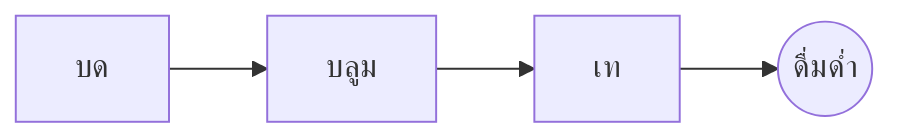

# กาแฟดริปที่สมบูรณ์แบบ

พิธีกรรมยามเช้าอันช้าๆ ในไม่กี่ขั้นตอน เขียนใน**ข้อความต้นฉบับ**ทางซ้าย หรือเขียนตรงๆ ใน*ส่วนแสดงตัวอย่าง*ทางขวา ทั้งสองฝั่งตรงกันเสมอ และ ==ทุกการแก้ไขคือการเปลี่ยนแปลงที่สะอาด== ใน Markdown

> [!TIP]
> น้ำที่เพิ่งเดือด ประมาณ 94 °C ช่วยดึงความหวานออกมาโดยไม่ขม

## อัตราส่วน

สูตรส่วนใหญ่ลงตัวที่กาแฟหนึ่งส่วนต่อน้ำสิบหกส่วน:

$$
m_{\text{น้ำ}} = 16 \times m_{\text{กาแฟ}}
$$

ดังนั้นกาแฟ $20\,\text{ก.}$ ต้องใช้น้ำ $320\,\text{ก.}$

## ทีละขั้นตอน



## วิธีชง

| วิธี        | ระดับบด        | เวลา |
|:----------|:-------------:|-----:|
| ดริป       | ละเอียดปานกลาง | 3:30 |
| เฟรนช์เพรส | หยาบ          | 4:00 |
| เอสเพรสโซ | ละเอียด        | 0:28 |

## ก่อนเริ่ม

- [x] เมล็ดกาแฟคั่วใหม่ :coffee:
- [x] เครื่องบดแบบใบมีด
- [ ] กาต้มน้ำคอห่าน

```python
def water_for(coffee_g: float, ratio: int = 16) -> float:
    return coffee_g * ratio
```

บลูม
: น้ำที่เทลงไปครั้งแรกเพื่อให้กาแฟบดปล่อยแก๊สออกมา[^1]

[^1]: เมล็ดสดบลูมมากที่สุด เมล็ดเก่าแทบไม่ฟู
