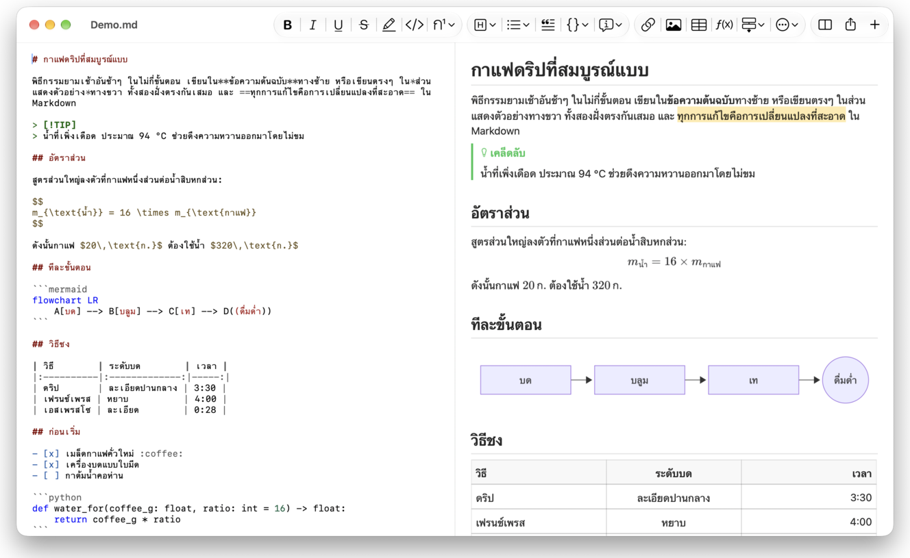
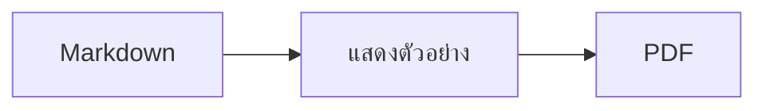

<p>&nbsp;&nbsp;&nbsp;</p>

# Splat

**โปรแกรมแก้ไข Markdown สำหรับ macOS ที่ให้คุณเขียนในข้อความต้นฉบับหรือเขียนตรงๆ ในส่วนแสดงตัวอย่างก็ได้**

Splat แสดงข้อความต้นฉบับ Markdown พร้อมสีไวยากรณ์ไว้ทางซ้าย และแสดงตัวอย่างสดที่แก้ไขได้เต็มรูปแบบไว้ทางขวา คุณพิมพ์ในฝั่งใดก็ได้
สิ่งที่เขียนในส่วนแสดงตัวอย่างจะกลายเป็นการเปลี่ยนแปลงขั้นต่ำในข้อความต้นฉบับ บรรทัดที่คุณไม่ได้แตะต้องจึงเหมือนเดิมทุกไบต์
และ Git diff ของคุณก็ยังสะอาด Splat อ่าน Markdown ที่คุณใช้อยู่แล้วได้ ทั้ง CommonMark และ GitHub Flavored Markdown,
GitHub alert, ลิงก์วิกิ การฝัง และกล่องหมายเหตุของ Obsidian, ส่วนขยายของ Pandoc และ Typora, HTML ที่ฝังอยู่, สูตร LaTeX
และแผนภาพ Mermaid, Graphviz และ PlantUML ทั้งหมดแสดงผลแบบออฟไลน์ ส่งออกเป็น PDF, HTML หรือ Word ได้ในคลิกเดียว
Splat เขียนด้วย Rust บนตัวควบคุม AppKit แท้ รองรับ 35 ภาษา และไม่ส่งอะไรผ่านเครือข่ายเลย เว้นแต่คุณสั่ง
 


[](https://raw.githubusercontent.com/sventmueller/splat/main/dist/Splat-1.0.3.dmg)

**[ดาวน์โหลด Splat-1.0.3.dmg](https://raw.githubusercontent.com/sventmueller/splat/main/dist/Splat-1.0.3.dmg)**: ลงนามและผ่านการรับรองโดย Apple สำหรับ macOS 14 ขึ้นไป บน Apple Silicon และ Intel
 
 

[](https://www.rust-lang.org)
[](https://www.apple.com/macos/)

[](https://github.com/madsmtm/objc2)
[](https://webkit.org)
[](https://github.com/kivikakk/comrak)
[](https://github.github.com/gfm/)
[](https://www.mathjax.org)
[](https://cortexjs.io/mathlive/)
[](https://mermaid.js.org)
[](https://graphviz.org)
[](https://plantuml.com)


[](#สัญญาอนุญาต)

[Bahasa Indonesia](../id/README.md) ·
[Bahasa Melayu](../ms/README.md) ·
[Català](../ca/README.md) ·
[Čeština](../cs/README.md) ·
[Dansk](../da/README.md) ·
[Deutsch](../de/README.md) ·
[English](../../../README.md) ·
[Español](../es/README.md) ·
[Français](../fr/README.md) ·
[Hrvatski](../hr/README.md) ·
[Italiano](../it/README.md) ·
[Magyar](../hu/README.md) ·
[Nederlands](../nl/README.md) ·
[Norsk](../no/README.md) ·
[Polski](../pl/README.md) ·
[Português (Brasil)](../pt_BR/README.md) ·
[Português (Portugal)](../pt_PT/README.md) ·
[Română](../ro/README.md) ·
[Slovenčina](../sk/README.md) ·
[Slovenščina](../sl/README.md) ·
[Suomi](../fi/README.md) ·
[Svenska](../sv/README.md) ·
[Tiếng Việt](../vi/README.md) ·
[Türkçe](../tr/README.md) ·
[Ελληνικά](../el/README.md) ·
[Русский](../ru/README.md) ·
[Українська](../uk/README.md) ·
[עברית](../he/README.md)‎ ·
[العربية](../ar/README.md)‎ ·
[हिन्दी](../hi/README.md) ·
**ไทย** ·
[한국어](../ko/README.md) ·
[日本語](../ja/README.md) ·
[简体中文](../zh-Hans/README.md) ·
[繁體中文](../zh-Hant/README.md)

## สารบัญ

- [ภาพรวมความสามารถ](#ภาพรวมความสามารถ)
- [ความต้องการของระบบ](#ความต้องการของระบบ)
- [การติดตั้ง](#การติดตั้ง)
- [เริ่มต้นใช้งาน](#เริ่มต้นใช้งาน)
- [การเขียน](#การเขียน)
  - [ในข้อความต้นฉบับ](#ในข้อความต้นฉบับ)
  - [ในส่วนแสดงตัวอย่าง](#ในส่วนแสดงตัวอย่าง)
  - [คำสั่งจัดรูปแบบ](#คำสั่งจัดรูปแบบ)
  - [รายการและงาน](#รายการและงาน)
  - [ตาราง](#ตาราง)
- [Markdown ที่รองรับ](#markdown-ที่รองรับ)
  - [CommonMark และ GitHub Flavored Markdown](#commonmark-และ-github-flavored-markdown)
  - [กล่องหมายเหตุ](#กล่องหมายเหตุ)
  - [ไวยากรณ์ขยาย](#ไวยากรณ์ขยาย)
  - [Obsidian](#obsidian)
  - [การอ้างอิงและเอกสารอ้างอิง](#การอ้างอิงและเอกสารอ้างอิง)
  - [HTML ที่ฝัง](#html-ที่ฝัง)
  - [เครื่องหมายวรรคตอนแบบงานพิมพ์](#เครื่องหมายวรรคตอนแบบงานพิมพ์)
  - [ภาพรวมไวยากรณ์](#ภาพรวมไวยากรณ์)
- [สูตร](#สูตร)
- [แผนภาพ](#แผนภาพ)
- [ภาพ](#ภาพ)
- [ลิงก์และการนำทาง](#ลิงก์และการนำทาง)
- [การส่งออก การพิมพ์ และการแชร์](#การส่งออก-การพิมพ์-และการแชร์)
- [หน้าตาและการช่วยการเข้าถึง](#หน้าตาและการช่วยการเข้าถึง)
- [ภาษา](#ภาษา)
- [ปุ่มลัด](#ปุ่มลัด)
- [ความเป็นส่วนตัวและความปลอดภัย](#ความเป็นส่วนตัวและความปลอดภัย)
- [เอกสารขนาดใหญ่](#เอกสารขนาดใหญ่)
- [ข้อจำกัดที่ทราบ](#ข้อจำกัดที่ทราบ)
- [การแก้ปัญหา](#การแก้ปัญหา)
- [สำหรับนักพัฒนา](#สำหรับนักพัฒนา)
  - [การสร้าง](#การสร้าง)
  - [การแจกจ่าย](#การแจกจ่าย)
  - [การทดสอบ](#การทดสอบ)
  - [โครงสร้างโปรเจกต์](#โครงสร้างโปรเจกต์)
  - [การไหลของข้อมูล](#การไหลของข้อมูล)
  - [กฎใน controller](#กฎใน-controller)
  - [การเพิ่มคำสั่ง](#การเพิ่มคำสั่ง)
  - [คำแปล](#คำแปล)
  - [ส่วนประกอบของบุคคลที่สาม](#ส่วนประกอบของบุคคลที่สาม)
- [สัญญาอนุญาต](#สัญญาอนุญาต)

## ภาพรวมความสามารถ

- **เขียนได้สองทาง แต่เป็นข้อความเดียว** ข้อความต้นฉบับและส่วนแสดงตัวอย่างแก้ไขได้ทั้งคู่ ไฟล์ Markdown คือต้นฉบับเดียวที่เป็นความจริง
  แต่ละเอกสารมีประวัติการเลิกทำเพียงชุดเดียว และทุกการแก้ไขในส่วนแสดงตัวอย่างจะถูกแปลงเป็นการเปลี่ยนแปลงที่เล็กที่สุดในข้อความต้นฉบับ
- **Markdown ที่คุณใช้อยู่แล้ว** CommonMark, GitHub Flavored Markdown, GitHub alert, Obsidian, ส่วนขยายของ Pandoc และ Typora,
  รหัสย่ออีโมจิ, สปอยล์, รายการคำนิยาม, จุดยึดของหัวข้อ และ HTML แบบที่พบใน README บน GitHub
- **มีสูตรและแผนภาพในตัว** สูตร LaTeX ผ่าน MathJax พร้อมตัวแก้ไขสูตรแบบภาพ แผนภาพ Mermaid, Graphviz และ PlantUML
  แสดงผลบน Mac ของคุณโดยไม่ต้องใช้ Java เซิร์ฟเวอร์ หรือการเชื่อมต่อเครือข่าย
- **มีปุ่มให้ทุกอย่าง** ทุกองค์ประกอบของ Markdown มีทั้งปุ่มบนแถบเครื่องมือและรายการในเมนู ส่วนที่ใช้บ่อยยังมีปุ่มลัดด้วย
  ตารางมีเมนูของตัวเองสำหรับแถว คอลัมน์ และการจัดแนว
- **ส่งออกโดยไม่สูญเสียอะไร** PDF, ไฟล์ HTML เดียวที่ครบในตัว หรือเอกสาร Word ที่มีหัวข้อ รายการ ตาราง เชิงอรรถ และภาพจริง
- **เป็นเนทีฟอย่างแท้จริง** หน้าต่าง แถบ เมนู ป๊อปโอเวอร์ เวอร์ชั่น บันทึกอัตโนมัติ เมนูแชร์ โหมดมืด การตรวจการสะกด
  การป้อนด้วยเสียง และ VoiceOver แบบ AppKit แท้ ไม่มี Electron และไม่ใช้เว็บวิวกับตัวข้อความเอง
- **เร็วแม้กับไฟล์ใหญ่** การกดแป้นหนึ่งครั้งในเอกสารขนาด 10 MB ใช้เวลาราว 25 มิลลิวินาที
- **เป็นส่วนตัวและรอบคอบ** ภาพจากเว็บจะโหลดก็ต่อเมื่อคุณอนุญาต ลิงก์ไปยังแอปอื่นจะถามก่อน
  และทุกอย่างที่ถอดรหัสข้อมูลภาพที่ไม่น่าไว้ใจจะทำงานในโพรเซสผู้ช่วยที่อยู่ในแซนด์บอกซ์
- **ในภาษาของคุณ** อินเทอร์เฟซและคู่มืออ้างอิงด่วน Markdown ในตัวมีให้ใน 35 ภาษา ได้แก่ อาหรับ คาตาลัน
  จีน (ตัวย่อ) จีน (ตัวเต็ม) โครเอเชีย เช็ก เดนมาร์ก ดัตช์ อังกฤษ ฟินแลนด์ ฝรั่งเศส เยอรมัน กรีก
  ฮีบรู ฮินดี ฮังการี อินโดนีเซีย อิตาลี ญี่ปุ่น เกาหลี มาเลย์ นอร์เวย์ โปแลนด์ โปรตุเกส (บราซิล)
  โปรตุเกส (โปรตุเกส) โรมาเนีย รัสเซีย สโลวัก สโลวีเนีย สเปน สวีเดน ไทย ตุรกี ยูเครน และเวียดนาม

## ความต้องการของระบบ

- macOS 14 Sonoma ขึ้นไป Splat พัฒนาและทดสอบบน macOS 27 ซึ่งจะใช้ดีไซน์ Liquid Glass โดยอัตโนมัติ
- Mac ที่ใช้ Apple Silicon หรือโปรเซสเซอร์ Intel
- พื้นที่ดิสก์ประมาณ 45 MB

## การติดตั้ง

**จากดิสก์อิมเมจ** ดาวน์โหลด [`dist/Splat-1.0.3.dmg`](https://raw.githubusercontent.com/sventmueller/splat/main/dist/Splat-1.0.3.dmg) เปิดไฟล์ แล้วลาก Splat ไปวางบนโฟลเดอร์แอปพลิเคชัน อิมเมจนี้ลงนามด้วย
Developer ID และผ่านการรับรองโดย Apple จึงเปิดได้โดยไม่มีคำเตือน

**ผ่าน Homebrew** cask อยู่ใน tap ของตัวเอง:

```sh
brew install --cask sventmueller/tap/splat
```

`brew upgrade --cask splat` ติดตั้งเวอร์ชั่นใหม่ และ `brew uninstall --zap --cask splat` จะลบการตั้งค่าและแคชของ Splat ออกด้วย

**การอัปเดต** Splat ที่ติดตั้งจากดิสก์อิมเมจหรือ Homebrew อัปเดตตัวเองผ่าน [Sparkle](https://sparkle-project.org)
เมื่อเปิดครั้งที่สอง Splat จะถามว่าอนุญาตให้ตรวจหารายการอัปเดตเองวันละครั้งหรือไม่ **Splat › ตรวจหารายการอัปเดต…**
จะตรวจทันที ส่วน **ตรวจหารายการอัปเดตโดยอัตโนมัติ** และ **ดาวน์โหลดและติดตั้งรายการอัปเดตโดยอัตโนมัติ** ในเมนูเดียวกัน
ใช้เปลี่ยนการตัดสินใจของคุณภายหลัง Splat จะติดตั้งการอัปเดตก็ต่อเมื่อมีลายเซ็นของนักพัฒนาเท่านั้น บิลด์ที่คุณสร้างเอง
ไม่มีตัวอัปเดต

**จากซอร์สโค้ด** ดูสิ่งที่ต้องมีก่อนได้ที่ [การสร้าง](#การสร้าง) จากนั้น:

```sh
make build
ditto target/release/Splat.app /Applications/Splat.app
open /Applications/Splat.app
```

หากต้องการเปิดไฟล์ Markdown ด้วย Splat ด้วยการดับเบิลคลิก ให้เลือกไฟล์ `.md` ใดก็ได้ใน Finder เลือก **ไฟล์ › ขอรายละเอียด**
เลือก Splat ใต้ **เปิดด้วย** แล้วคลิก **เปลี่ยนทั้งหมด…** Splat ลงทะเบียนตัวเองสำหรับไฟล์ `.md`, `.markdown`, `.mdown` และ
`.mkd`

## เริ่มต้นใช้งาน

### หน้าต่าง

แต่ละเอกสารเปิดในหน้าต่างของตัวเอง หรือเป็นแถบหากคุณชอบใช้แถบ:

- **ซ้าย: ข้อความต้นฉบับ** Markdown ของคุณด้วยฟอนต์ SF Mono พร้อมสีไวยากรณ์
- **ขวา: ส่วนแสดงตัวอย่าง** เอกสารที่แสดงผลแล้ว พร้อมให้แก้ไข
- **แถบด้านข้างโครงร่าง (ไม่บังคับ)** หัวข้อทั้งหมดในรูปแบบต้นไม้ คลิกหัวข้อหนึ่งเพื่อแสดงในทั้งสองส่วน สลับได้ด้วย
  **มุมมอง › แสดงโครงร่าง** (⌃⌘S)
- **แถบเครื่องมือ** ปุ่มที่จัดกลุ่มตามสิ่งที่เปลี่ยน ได้แก่ อักขระ ย่อหน้า และองค์ประกอบที่แทรก ตามด้วยเปิดหรือปิดส่วนแสดงตัวอย่าง
  แชร์ และเอกสารใหม่ กำหนดเองได้ด้วย **มุมมอง › กำหนดแถบเครื่องมือเอง…**

ลากตัวแบ่งเพื่อให้ฝั่งใดฝั่งหนึ่งกว้างขึ้น **มุมมอง › ซ่อนแสดงตัวอย่าง** (⌥⌘P) จะเหลือไว้แต่ข้อความต้นฉบับ Splat
จำค่านี้แยกตามหน้าต่าง ทั้งสองส่วนเลื่อนไปพร้อมกัน และข้อความที่เลือกในส่วนหนึ่งจะถูกไฮไลท์ในอีกส่วนหนึ่ง

### เอกสาร แถบ และเวอร์ชั่น

Splat เป็นแอปเอกสารของ macOS ตามปกติ:

- **บันทึกอัตโนมัติและเวอร์ชั่น** การเปลี่ยนแปลงถูกบันทึกลงในไฟล์เดิม **ไฟล์ › แปลงกลับเป็น › เลือกดูทุกเวอร์ชั่น…** พาคุณย้อนเวลากลับไปได้
- **การเปลี่ยนแปลงจากโปรแกรมอื่น** เมื่อ Git สคริปต์ หรือโปรแกรมแก้ไขอื่นเปลี่ยนเอกสารที่เปิดอยู่ Splat จะโหลดใหม่
  และคงตำแหน่งเคอร์เซอร์กับตำแหน่งการเลื่อนไว้ หากคุณมีการเปลี่ยนแปลงของตัวเองที่ยังไม่ได้บันทึก Splat จะเก็บไว้ และ macOS
  จะถามก่อนบันทึกทับอีกเวอร์ชั่นหนึ่ง
- **คำสั่งไฟล์ตามปกติ** ทำสำเนา (⇧⌘S), เปลี่ยนชื่อ…, ย้ายไปยัง… และ **ไฟล์ › เปิดล่าสุด**
- **แถบ** **ไฟล์ › แถบใหม่** หรือปุ่ม **+** บนแถบเครื่องมือจะเปิดเอกสารใหม่เป็นแถบ เมนูหน้าต่างมาตรฐานใช้ผสาน ย้าย
  และสลับแถบ
- **ตำแหน่งหน้าต่าง** ขนาดและตำแหน่งของหน้าต่างล่าสุดจะถูกจำไว้ แม้เปิดแอปใหม่ ถ้ามีหน้าต่างอยู่ที่ตำแหน่งนั้นแล้ว
  หน้าต่างใหม่จะเปิดเยื้องออกไปเล็กน้อย
- **ไอคอนบน Dock** การคลิกไอคอนหลังปิดหน้าต่างสุดท้ายไปแล้วจะเปิดเอกสารใหม่
- **เปิดไฟล์ Markdown ใน Splat** **Splat › ตั้งเป็นแอปเริ่มต้นสำหรับ Markdown** ทำให้การดับเบิลคลิกไฟล์ `.md` หรือ
  `.markdown` เปิด Splat macOS จะถามให้ยืนยันหนึ่งครั้ง รายการนี้จะมีเครื่องหมายถูกเมื่อ Splat เป็นแอปเริ่มต้น

ไฟล์ต้องเป็นข้อความ UTF-8 หรือ UTF-16 ที่มี byte order mark Splat ปฏิเสธการเข้ารหัสอื่นแทนที่จะเดาแล้วทำให้ข้อความเสียหาย
byte order mark จะคงอยู่ UTF-16 ยังเป็น UTF-16 และในไฟล์ที่ทุกบรรทัดลงท้ายด้วย CRLF บรรทัดที่คุณเพิ่มก็จะลงท้ายด้วย CRLF ด้วย

**หลังเกิดข้อขัดข้อง** จะเสียการพิมพ์อย่างมากเพียงไม่กี่วินาทีสุดท้าย เพราะทุกห้าวินาที Splat จะคัดลอกข้อความที่ยังไม่ได้บันทึกไปไว้ที่
`~/Library/Application Support/Splat/Unsaved` และลบสำเนาเมื่อบันทึกเอกสารหรือ Splat ปิดตามปกติ
การเปิดครั้งถัดไปจะย้ายสิ่งที่ข้อขัดข้องทิ้งไว้ที่นั่นไปยัง `~/Library/Application Support/Splat/Recovery` และแจ้งหนึ่งครั้ง พร้อมปุ่มที่เปิดโฟลเดอร์นั้น
ถ้าข้อขัดข้องนั้น Splat ยังตอบสนองได้ Splat จะเขียนข้อความของทุกเอกสารที่เปิดอยู่ไว้ที่นั่นด้วย

### คู่มืออ้างอิงด่วน

**วิธีใช้ › คู่มืออ้างอิงด่วน Markdown** เปิดเอกสารสรุปในภาษาของคุณเป็นเอกสารใหม่ที่ยังไม่มีชื่อ เป็นเอกสารธรรมดา
คุณจึงลองทุกอย่างได้ที่นั่นเลย ทั้งในข้อความต้นฉบับและในส่วนแสดงตัวอย่าง

## การเขียน

### ในข้อความต้นฉบับ

ข้อความต้นฉบับคือโปรแกรมแก้ไขข้อความธรรมดาที่ปรับมาสำหรับ Markdown โดยเฉพาะ:

- **สีไวยากรณ์** แบบใน VS Code: หัวข้อ ตัวเน้น ลิงก์ โค้ด ตาราง HTML front matter และ LaTeX กับ Mermaid
  ภายในสูตรและแผนภาพ มีชุดสีสำหรับโหมดสว่าง โหมดมืด และเพิ่มความเปรียบต่าง
- **บล็อกโค้ดแบบ fenced** ไฮไลท์ไวยากรณ์ให้กับ Bash, C, C++, C#, CSS (รวม SCSS และ Less), Go, HTML, XML, Java,
  JavaScript, JSON, Kotlin, PHP, Python, Ruby, Rust, SQL, Swift, TypeScript, YAML, TeX และ Mermaid รวมถึงชื่อย่อที่ใช้กันทั่วไป
  เช่น `js`, `py` หรือ `sh`
- **ไม่มีการเปลี่ยนแทนที่แบบไม่คาดคิด** อัญประกาศอัจฉริยะ ขีดกลางอัจฉริยะ และการแทนที่ข้อความปิดอยู่เป็นค่าเริ่มต้น เพราะทำให้
  `--`, `---` และ `"` เพี้ยน เปิดได้ที่ **แก้ไข › การเปลี่ยนแทนที่**
- **เครื่องมือเขียนของระบบ** การตรวจการสะกดและไวยากรณ์ การป้อนด้วยเสียง ค้นหาและแทนที่ (⌥⌘F) และเสียงพูด
- **ลากและวาง** วางไฟล์ภาพเพื่อแทรก `` วางไฟล์อื่นเพื่อแทรกลิงก์ไปยังไฟล์นั้น
  และวาง URL เพื่อแทรก `[url](url)` การวางแต่ละครั้งเป็นการเลิกทำหนึ่งขั้น
- **วางภาพ** ภาพในคลิปบอร์ด เช่น ภาพหน้าจอ จะถูกบันทึกเป็นไฟล์ PNG ไว้ข้างเอกสาร
  (`ภาพ 2026-10-29 13.09.07.png`) และแทรกเป็นภาพ เอกสารต้องเคยบันทึกอย่างน้อยหนึ่งครั้ง

### ในส่วนแสดงตัวอย่าง

ส่วนแสดงตัวอย่างทำงานเหมือนโปรแกรมประมวลผลคำ แต่ทุกอย่างที่คุณทำในนั้นจะกลายเป็น Markdown:

- **การพิมพ์** อักขระที่มีความหมายใน Markdown เช่น `*` หรือ `#` จะถูกเอสเคปเพื่อให้แสดงตามที่พิมพ์
- **Return** เริ่มย่อหน้าหรือรายการใหม่ **⌥Return** หรือ **⌃Return** แทรกการแบ่งบรรทัด
- **การจัดรูปแบบที่เคอร์เซอร์** เมื่อเคอร์เซอร์อยู่ท้ายคำ ตัวหนา ตัวเอียง และรูปแบบอักขระอื่นๆ
  จะมีผลกับสิ่งที่คุณพิมพ์ต่อจากนั้น เลือกรูปแบบนั้นอีกครั้งเพื่อหยุด ถ้าเคอร์เซอร์อยู่กลางคำ ทั้งคำจะถูกจัดรูปแบบ
- **บรรทัดว่าง** กด Return บนบรรทัดว่างจะเพิ่มบรรทัดว่างอีกหนึ่งบรรทัด และปุ่ม Delete จะลบออก ในข้อความต้นฉบับ
  บรรทัดว่างที่เพิ่มแต่ละบรรทัดจะเป็นบรรทัดว่างเพิ่มอีกสองบรรทัด ส่วนโปรแกรม Markdown อื่นจะแสดงเป็นระยะห่างระหว่างย่อหน้าตามปกติ
- **เลิกทำ** ใช้ได้ข้ามทั้งสองส่วน รายการเลิกทำมีชื่อกำกับ (“เลิกทำตัวหนา”) การพิมพ์เป็นหนึ่งขั้นต่อหนึ่งช่วงที่พิมพ์ต่อเนื่อง
  และหลังเลิกทำหรือทำกลับมาใหม่ ทั้งสองส่วนจะเลื่อนไปยังจุดที่เปลี่ยน
- **สูตรและแผนภาพ** ปรากฏเป็นภาพกราฟิกที่เสร็จแล้ว คลิกที่ภาพ ย้ายเคอร์เซอร์ไปบนภาพ หรือกด Return บนภาพ
  เพื่อเปิดตัวแก้ไข (ดู [สูตร](#สูตร) และ [แผนภาพ](#แผนภาพ))
- **HTML ที่ฝัง โน้ตที่ฝัง และ front matter** แสดงให้เห็น แต่ต้องแก้ไขในข้อความต้นฉบับ การคลิกจะวางเคอร์เซอร์
  ที่ตำแหน่งที่ตรงกันในข้อความต้นฉบับ

สิ่งที่ Markdown ไม่สามารถแสดงได้จะถูกบล็อกในส่วนแสดงตัวอย่าง ได้แก่ แผงแบบอักษรและสี ไม้บรรทัด และการวางหรือการลากข้อความที่มีรูปแบบและภาพลงไป HTML และ RTF ที่วางจะกลายเป็นข้อความธรรมดา

### คำสั่งจัดรูปแบบ

ทุกคำสั่งใช้ได้จากแถบเครื่องมือ แถบเมนู และเมนูตามบริบทของทั้งสองส่วน รายการในเมนูมีเครื่องหมายถูกสำหรับการจัดรูปแบบที่เคอร์เซอร์

| เมนู | คำสั่ง |
|---|---|
| **รูปแบบ › แบบอักษร** | ตัวหนา, ตัวเอียง, ขีดเส้นใต้, ขีดทับ, ไฮไลท์, โค้ด, ตัวยก, ตัวห้อย |
| **รูปแบบ › หัวข้อ** | เนื้อความ, หัวข้อ 1 ถึง 6 |
| **รูปแบบ › รายการ** | รายการแบบจุด, รายการแบบตัวเลข, รายการงาน |
| **รูปแบบ** | คำอ้างอิง, บล็อกโค้ด (ไม่ระบุภาษา หรือหนึ่งใน 20 ภาษา และเปลี่ยนภาษาของบล็อกที่มีอยู่แล้วได้ด้วย), กล่องหมายเหตุ (โน้ต, เคล็ดลับ, สำคัญ, คำเตือน, ข้อควรระวัง และเลือกชนิดเดิมอีกครั้งเพื่อเอาออก), แก้ไขสูตรหรือแผนภาพ…, ล้างการจัดรูปแบบ |
| **แทรก** | ลิงก์…, ภาพ…, ตาราง…, สูตร, แผนภาพ (ผังงาน, แผนภาพลำดับ, แผนภูมิแกนต์), ตารางสารบัญ, เชิงอรรถ, เส้นคั่น |
| **ตาราง** | แทรกแถวด้านบน/ด้านล่าง, แทรกคอลัมน์ทางซ้าย/ทางขวา, ลบแถว, ลบคอลัมน์, การจัดแนว (จัดชิดซ้าย, กึ่งกลาง, จัดชิดขวา, ค่าเริ่มต้น), จัดแนวคอลัมน์ตาราง |
| **มุมมอง** | ซ่อน/แสดงตัวอย่าง, แสดง/ซ่อนโครงร่าง, เครื่องหมายวรรคตอนแบบงานพิมพ์, ซูมเข้า/ออก, ขนาดจริง, แถบเครื่องมือ, รายการแถบ, เต็มหน้าจอ |

ขีดเส้นใต้ ไฮไลท์ ตัวยก และตัวห้อยเขียนเป็น `<ins>`, `<mark>`, `<sup>` และ `<sub>` ซึ่ง GitHub แสดงผลได้เช่นกัน
Splat อ่าน `<u>` ซึ่ง GitHub ตัดทิ้งได้ด้วย รวมถึงรูปแบบสั้น `==highlight==`, `^sup^` และ `~sub~`
GitHub แสดง `==` และ `^` ตามที่พิมพ์ และแสดง `~sub~` เป็นขีดทับ

### รายการและงาน

- Return ต่อรายการ ส่วน Return บนรายการว่างจะจบรายการ
- **Tab** และ **⇧Tab** เยื้องเข้าและเยื้องออกรายการในส่วนแสดงตัวอย่าง
- การคลิกช่องทำเครื่องหมายของงานในส่วนแสดงตัวอย่างจะสลับ `- [ ]` และ `- [x]`
- **รูปแบบ › รายการ** แปลงย่อหน้าที่เลือกให้เป็นรายการ หรือเปลี่ยนชนิดของรายการ

### ตาราง

- **แทรก › ตาราง…** จะถามจำนวนแถว (รวมแถวหัวตาราง) และคอลัมน์
- ในส่วนแสดงตัวอย่าง **Tab** ย้ายไปเซลล์ถัดไป **⇧Tab** ย้ายไปเซลล์ก่อนหน้า และ **Return** ย้ายไปเซลล์ด้านล่าง กด Tab
  ในเซลล์สุดท้ายเพื่อเพิ่มแถว
- เมนู **ตาราง** แทรกและลบแถวกับคอลัมน์ และตั้งการจัดแนวของคอลัมน์ (⌘{, ⌘|, ⌘})
- **ตาราง › จัดแนวคอลัมน์ตาราง** เติมช่องว่างในข้อความต้นฉบับเพื่อให้คอลัมน์ตรงกัน

## Markdown ที่รองรับ

Splat แยกวิเคราะห์ด้วย [comrak](https://github.com/kivikakk/comrak) ซึ่งเป็นตัวแยกวิเคราะห์ที่เข้ากันได้กับ CommonMark และ GFM
และเปิดใช้ส่วนขยายส่วนใหญ่ของมัน ทุกอย่างด้านล่างนี้แสดงผลในส่วนแสดงตัวอย่างและในการส่งออกทุกแบบ

### CommonMark และ GitHub Flavored Markdown

- หัวข้อ (`#` และแบบขีดเส้นใต้), ย่อหน้า, การแบ่งบรรทัด, ตัวเน้น, ตัวเน้นแบบหนา, โค้ดในบรรทัด, บล็อกคำอ้างอิง,
  เส้นคั่น
- รายการแบบจุด แบบตัวเลข และแบบซ้อนกัน รวมถึงรายการงาน
- ลิงก์ (แบบในบรรทัด แบบอ้างอิง และแบบอัตโนมัติ), ภาพ, คำนิยามการอ้างอิงลิงก์
- บล็อกโค้ดแบบ fenced และแบบเยื้อง พร้อมสีไวยากรณ์
- ตารางที่จัดแนวคอลัมน์ได้
- ขีดทับด้วย `~~two tildes~~`
- เชิงอรรถ: `text[^1]` กับ `[^1]: The note.` ที่ตำแหน่งใดก็ได้ในเอกสาร การคลิกเครื่องหมายจะข้ามไปยังโน้ต
- YAML front matter ระหว่างบรรทัด `---` ที่ส่วนบนสุด ส่วนแสดงตัวอย่างสรุปไว้ในบรรทัดเดียว เช่น
  “ข้อมูลเมตา: title, date, tags”

### กล่องหมายเหตุ

GitHub alert แสดงผลเป็นกล่องสีพร้อมไอคอนและชื่อเรื่อง:

```markdown
> [!NOTE]
> ข้อมูลที่เป็นประโยชน์ซึ่งผู้ใช้ควรทราบ

> [!WARNING]
> เนื้อหาสำคัญที่ต้องให้ความสนใจทันที
```

ทั้งห้าชนิดคือ โน้ต เคล็ดลับ สำคัญ คำเตือน และข้อควรระวัง **รูปแบบ › กล่องหมายเหตุ** แปลงย่อหน้าที่เคอร์เซอร์อยู่ให้เป็นกล่องหมายเหตุ

กล่องหมายเหตุของ Obsidian ก็ใช้ได้เช่นกัน โดยตั้งชื่อเรื่องอะไรก็ได้และกำหนดสถานะการยุบได้:

```markdown
> [!tip]- คลิก ▸ เพื่อขยาย
> ซ่อนอยู่จนกว่าจะเปิด

> [!question]+ เปิดไว้ตั้งแต่แรก
> เครื่องหมาย `+` เริ่มต้นแบบขยาย ส่วน `-` เริ่มต้นแบบยุบ
```

ชนิดอื่นๆ ของ Obsidian จะแสดงด้วยสีที่ใกล้เคียงที่สุดจากทั้งห้าสี: `success`, `check`, `done` และ `hint` เป็นเคล็ดลับ
`question`, `help` และ `faq` เป็นสำคัญ `attention` เป็นคำเตือน `failure`, `fail`, `missing`, `danger`, `error` และ
`bug` เป็นข้อควรระวัง ส่วนที่เหลือทั้งหมดเป็นโน้ต

### ไวยากรณ์ขยาย

| ความสามารถ | ไวยากรณ์ | มาจาก |
|---|---|---|
| ไฮไลท์ | `==ข้อความที่มาร์ก==` | Obsidian, Typora |
| ตัวยก | `x^2^` | Pandoc, Typora |
| ตัวห้อย | `H~2~O` | Pandoc, Typora |
| รหัสย่ออีโมจิ | `:rocket:` กลายเป็น 🚀 | GitHub |
| สปอยล์ | `\|\|ข้อความที่ซ่อน\|\|` เลือกเพื่ออ่าน | Discord |
| เชิงอรรถในบรรทัด | `text^[ตัวโน้ตเอง]` | Pandoc, Obsidian |
| รายการคำนิยาม | `คำศัพท์` บรรทัดว่าง `: คำอธิบาย` | PHP Markdown Extra, Pandoc |
| จุดยึดของหัวข้อ | `## ติดตั้ง {#setup}` ลิงก์ด้วย `[ดู](#setup)` | Pandoc, kramdown |

รายการคำนิยามมีหน้าตาแบบนี้ในข้อความต้นฉบับ:

```markdown
คำศัพท์

: คำอธิบายของคำศัพท์
```

หากไม่ได้กำหนดจุดยึดเอง ทุกหัวข้อจะได้จุดยึดที่สร้างจากข้อความของหัวข้อ เหมือนบน GitHub: `## เริ่มต้นใช้งาน` เข้าถึงได้ด้วย
`#เริ่มต้นใช้งาน`

### Obsidian

- **ลิงก์วิกิ** `[[Note]]` ลิงก์ไปยัง `Note.md` ในโฟลเดอร์เดียวกันหรือโฟลเดอร์ย่อย `[[Note|ข้อความที่แสดง]]` แสดงข้อความของคุณเอง
  และ `[[Note#Heading]]` เปิดโน้ต ⌘-คลิกเพื่อเปิดใน Splat
- **การฝัง** `![[Note]]` แสดงโน้ตอื่นไว้ภายในโน้ตนี้ โน้ตที่ฝังอยู่ในนั้นจะปรากฏเป็นลิงก์
  `![[diagram.png]]` แสดงภาพ เช่นเดียวกับใน Obsidian การฝังระบุชื่อโน้ตและภาพในโฟลเดอร์ของเอกสารหรือโฟลเดอร์ย่อย
  ไม่ระบุด้วยพาธสัมบูรณ์ และมีเพียงไฟล์ Markdown เท่านั้นที่แสดงเป็นโน้ต
- **ความคิดเห็น** `%%เฉพาะในข้อความต้นฉบับ%%` ยังมองเห็นได้ในข้อความต้นฉบับ และถูกตัดออกจากส่วนแสดงตัวอย่างและการส่งออกทุกแบบ
  ทั้งในบรรทัดและบนบรรทัดของตัวเอง
- **แท็ก** `#idea` หรือ `#project/splat` จะถูกไฮไลท์ ⌘-คลิกเพื่อค้นหาแท็กนั้นในเอกสาร
- **กล่องหมายเหตุที่ยุบได้** ดู [กล่องหมายเหตุ](#กล่องหมายเหตุ)

### การอ้างอิงและเอกสารอ้างอิง

- **การอ้างอิงแบบ Pandoc** `[@doe2020]` หรือ `[@doe2020; @roe2021]` แสดงเป็น “(Doe 2020; Roe 2021)” รายการมาจาก
  ไฟล์ BibTeX ที่ front matter ระบุไว้ด้วย `bibliography: refs.bib` หากไม่ระบุ Splat จะใช้
  `references.bib`, `literatur.bib` หรือ `bibliography.bib` ที่อยู่ข้างเอกสาร
- **การอ้างอิง GitHub และ GitLab** หากเอกสารอยู่ในที่เก็บ Git ที่รีโมต `origin` ชี้ไปที่ github.com
  หรือโฮสต์ GitLab ระบบจะไฮไลท์ `@name`, `#12` (issue) และ `!7` (merge request เฉพาะ GitLab) ⌘-คลิกเพื่อเปิดในเบราว์เซอร์

### HTML ที่ฝัง

HTML แบบที่พบใน README บน GitHub แสดงผลได้ โดยใช้ตัวอ่านของ Splat เองแทนเอนจินเบราว์เซอร์:

- ย่อหน้าและบล็อกที่จัดกึ่งกลาง (`<p align="center">`, `<div align="center">`)
- ภาพที่กำหนดขนาด (``)
- ลิงก์, `<kbd>⌘</kbd>`, `<br>`, `<u>`, `<ins>`, `<mark>`, `<sup>`, `<sub>`
- รายการและตาราง รวมถึงเซลล์ที่ครอบหลายคอลัมน์ (`colspan`)
- ส่วนที่ยุบได้: `<details><summary>เพิ่มเติม</summary>…</details>` เปิดด้วยการคลิก ▸

Markdown ที่อยู่ระหว่างแท็ก HTML จะแสดงผลเป็น Markdown สคริปต์ สไตล์ เฟรม และฟอร์มจะถูกตัดออกทั้งหมด และลิงก์กับภาพ
จะคงไว้เฉพาะที่อยู่แบบ `http`, `https`, `mailto` และแบบสัมพัทธ์

### เครื่องหมายวรรคตอนแบบงานพิมพ์

**มุมมอง › เครื่องหมายวรรคตอนแบบงานพิมพ์** แสดงอัญประกาศตรงเป็นอัญประกาศของภาษาอินเทอร์เฟซของคุณ `--` เป็นเครื่องหมายขีดกลางสั้น
`---` เป็นขีดกลางยาว และ `...` เป็นจุดไข่ปลา ในภาษาเยอรมัน `"Ja"` จะเป็น „Ja“ ในภาษาฝรั่งเศสเป็น «Oui» ในภาษาญี่ปุ่นเป็น
「はい」 รวมถึงในภาษาจีนและญี่ปุ่นที่ไม่เว้นวรรครอบอัญประกาศ ตัวย่อภาษาฮีบรูอย่าง `צה"ל` จะได้เครื่องหมาย
gershayim เป็น צה״ל ข้อความต้นฉบับยังคงอักขระธรรมดา ส่วนแสดงตัวอย่างและการส่งออกทุกแบบจะแสดงแบบงานพิมพ์
การตั้งค่านี้ปิดอยู่จนกว่าคุณจะเปิด

### ภาพรวมไวยากรณ์

| องค์ประกอบ | Markdown |
|---|---|
| **ตัวหนา** | `**ตัวหนา**` |
| *ตัวเอียง* | `*ตัวเอียง*` |
| ขีดเส้นใต้ | `<ins>ขีดเส้นใต้</ins>` หรือ `<u>ขีดเส้นใต้</u>` |
| ~~ขีดทับ~~ | `~~ขีดทับ~~` |
| ไฮไลท์ | `<mark>ไฮไลท์</mark>` หรือ `==ไฮไลท์==` |
| `โค้ด` | `` `โค้ด` `` |
| x² | `x<sup>2</sup>` หรือ `x^2^` |
| H₂O | `H<sub>2</sub>O` หรือ `H~2~O` |
| [ลิงก์](https://example.com) | `[ลิงก์](https://example.com)` |
| หัวข้อ | `# หัวข้อ` ถึง `###### หัวข้อ` |
| คำอ้างอิง | `> คำอ้างอิง` |
| รายการแบบจุด | `- รายการ` |
| รายการแบบตัวเลข | `1. รายการ` |
| งาน | `- [ ] ยังไม่เสร็จ` และ `- [x] เสร็จแล้ว` |
| บล็อกโค้ด | ```` ```rust ```` … ```` ``` ```` |
| ตาราง | `\| A \| B \|` โดยมี `\|---\|---\|` อยู่ใต้แถวหัวตาราง |
| เชิงอรรถ | `ข้อความ[^1]` และ `[^1]: โน้ต` |
| เส้นคั่น | `---` |
| ภาพ | `` |
| สูตร | `$E = mc^2$`, `$$ … $$` |
| แผนภาพ | ```` ```mermaid ````, ```` ```dot ````, ```` ```plantuml ```` |
| กล่องหมายเหตุ | `> [!TIP]` |
| ลิงก์วิกิ | `[[โน้ต]]`, `[[โน้ต\|ข้อความ]]` |
| การฝัง | `![[โน้ต]]`, `![[image.png]]` |
| ความคิดเห็น | `%%ความคิดเห็น%%` |
| แท็ก | `#แท็ก` |
| การอ้างอิง | `[@key]` |
| สปอยล์ | `\|\|สปอยล์\|\|` |
| อีโมจิ | `:tada:` |

## สูตร

[MathJax](https://www.mathjax.org) แสดงผลสูตรด้วยคณิตศาสตร์ TeX และ AMS เป็นกราฟิกเวกเตอร์ที่คมชัด ข้อความใน
`\text{…}` เป็นอักษรระบบใดก็ได้ ตัวอักษรที่ฟอนต์ของ MathJax ไม่มีจะใช้จากฟอนต์ของ Mac ของคุณ โดยภาษาอาหรับและฮีบรูเรียงจากขวาไปซ้าย
และอีโมจิแสดงเป็นสี

| ชนิด | ไวยากรณ์ |
|---|---|
| ในบรรทัด | `$E = mc^2$`, `` $`E = mc^2`$ `` (GitHub, GitLab), `\(E = mc^2\)` |
| แสดงเป็นบล็อก | `$$` … `$$`, `\[` … `\]` หรือบล็อกโค้ดที่ระบุ `math` |

**การแก้ไขสูตร** คลิกสูตรในส่วนแสดงตัวอย่าง ดับเบิลคลิก กด Return บนสูตร หรือย้ายเคอร์เซอร์ไปบนสูตร
เพื่อเปิดตัวแก้ไขในป๊อปโอเวอร์ **แทรก › สูตร** แทรกสูตรใหม่และเปิดตัวแก้ไขทันที

- **แบบภาพหรือ LaTeX** สวิตช์ด้านบนสลับระหว่างตัวแก้ไขแบบภาพ ([MathLive](https://cortexjs.io/mathlive/))
  กับโค้ด LaTeX Splat จำตัวเลือกของคุณไว้
- **บล็อกสำเร็จรูป** สำหรับเศษส่วน รากที่สอง ตัวยกและตัวห้อย ผลรวมและอินทิกรัลพร้อมขอบเขต ลิมิต
  วงเล็บที่ขยายตามเนื้อหา เมทริกซ์ 2×2 อักษรกรีก และความสัมพันธ์ ตัวดำเนินการ และลูกศร บล็อกเหล่านี้ทิ้งตัวยึดตำแหน่ง □ ไว้
  และ **Tab** จะข้ามไปยังตัวถัดไป
- **ตัวอย่างสด** การเปลี่ยนแปลงปรากฏในเอกสารขณะที่คุณพิมพ์ ข้อผิดพลาดจาก MathJax แสดงในบรรทัดใต้โค้ด
- **ยืนยันหรือทิ้ง** การคลิกนอกตัวแก้ไขจะเก็บการเปลี่ยนแปลงไว้เป็นการเลิกทำหนึ่งขั้น ส่วน **Esc** หรือ **ยกเลิก** จะทิ้งไป
  การกด Esc บนสูตรใหม่ที่ว่างเปล่าจะลบสูตรนั้นออกอีกครั้ง
- เมนูตามบริบทมี **แก้ไขสูตร…** สำหรับสูตรที่ตัวชี้อยู่

VoiceOver อ่านสูตรเป็นโค้ด LaTeX ของมัน Splat แสดงผลสูตร ไม่ใช่เอกสาร LaTeX ทั้งฉบับ: ไม่มีแพ็กเกจ ไม่มี TikZ และไม่มี `\documentclass`

## แผนภาพ

แผนภาพแสดงผลภายใน Splat แบบออฟไลน์ และมีทั้งแบบสว่างและแบบมืด

| เอนจิน | บล็อกโค้ด | สิ่งที่วาด |
|---|---|---|
| [Mermaid](https://mermaid.js.org) | ```` ```mermaid ```` | ผังงาน แผนภาพลำดับ คลาส สถานะ ความสัมพันธ์ของเอนทิตี แกนต์ วงกลม แผนที่ความคิด ไทม์ไลน์ และแผนภาพ Mermaid ชนิดอื่นทั้งหมด |
| [Graphviz](https://graphviz.org) | ```` ```dot ```` หรือ ```` ```graphviz ```` | กราฟในภาษา DOT |
| [PlantUML](https://plantuml.com) | ```` ```plantuml ```` หรือ ```` ```puml ```` | แผนภาพ UML ทำงานได้โดยไม่ต้องใช้ Java |



**การแก้ไขแผนภาพ** ทำงานเหมือนการแก้ไขสูตร: คลิกที่แผนภาพเพื่อเปิดโค้ดในป๊อปโอเวอร์ พร้อมสีไวยากรณ์และข้อความแสดงข้อผิดพลาด
ในบรรทัดใต้โค้ด **แทรก › แผนภาพ** เริ่มจากแม่แบบของผังงาน แผนภาพลำดับ หรือแผนภูมิแกนต์ บล็อกสำเร็จรูปช่วยกับแผนภาพ Mermaid
สามชนิดที่ใช้บ่อยที่สุด:

- **ผังงาน:** โหนด ▾ (สี่เหลี่ยมผืนผ้า, สี่เหลี่ยมมุมมน, วงกลม, ข้าวหลามตัด, ฐานข้อมูล), เส้นเชื่อม, เส้นเชื่อมพร้อมป้ายกำกับ, หมวด,
  ทิศทาง ▾
- **แผนภาพลำดับ:** ผู้เข้าร่วม, ข้อความ, ตอบกลับ, โน้ต, วนซ้ำ, แยกกรณีตามเงื่อนไข
- **แผนภูมิแกนต์:** ส่วน, งาน, หมุดหมาย

แผนภาพชนิดอื่นแก้ไขเป็นโค้ด VoiceOver อ่านชื่อเรื่องหรือข้อความแทนของแผนภาพ

แผนภาพแรกหลังเปิดแอปใช้เวลาราวหนึ่งวินาที เพราะเอนจินแสดงผลเริ่มทำงานในเบื้องหลัง แผนภาพที่ใช้เวลานานกว่า 10 วินาที
จะแสดงข้อผิดพลาด และเอนจินแสดงผลจะเริ่มใหม่สำหรับแผนภาพถัดไป
เอนจินของ PlantUML (7 MB) จะโหลดเมื่อมีแผนภาพ PlantUML แรกเท่านั้น `!include` ของ PlantUML จากเว็บถูกบล็อก

## ภาพ

- **ภาพในเครื่อง** ใช้พาธสัมพัทธ์กับเอกสาร: `` Splat แสดง PNG, JPEG, GIF, WebP,
  BMP, SVG, HEIC, TIFF, AVIF และ PDF
- **ภาพจากเว็บ** ถูกบล็อกไว้จนกว่าคุณจะอนุญาต แถบเหนือส่วนแสดงตัวอย่างอธิบายว่าการโหลดภาพทำให้
  เซิร์ฟเวอร์ของภาพรู้ว่าคุณเปิดเอกสารและเปิดเมื่อใด **โหลดภาพ** จะอนุญาตสำหรับเอกสารนี้ Splat จำตัวเลือกไว้
  แยกตามไฟล์
- **ขนาด** `` กำหนดขนาดของภาพ หากไม่กำหนด ภาพจะพอดีกับความกว้างของส่วนแสดงตัวอย่าง
- **การเปลี่ยนแปลงบนดิสก์** ภาพที่คุณแทนที่ หรือภาพที่ปรากฏหลังจากเอกสารอ้างถึงแล้ว จะแสดงโดยไม่ต้องเปิดเอกสารใหม่
  ภาพจากเว็บที่โหลดไม่สำเร็จเพราะเครือข่ายจะถูกลองใหม่ขณะที่เอกสารยังแสดงภาพนั้นอยู่
- **หน่วยความจำ** ภาพแสดงที่ด้านยาวสุดไม่เกิน 2560 พิกเซล ซึ่งเต็มหน้า A4 ด้วย ภาพจะถอดรหัสให้เล็กลง
  เมื่อภาพเต็มหนึ่งในแปดของหน่วยความจำของ Mac และขณะที่ macOS รายงานว่าหน่วยความจำตึง
- **โหมดมืด** ภาพที่มีพื้นหลังสีขาวจะถูกหรี่ลงเล็กน้อยในส่วนแสดงตัวอย่างแบบมืด
- **การวางและการลากวาง** ดู [ในข้อความต้นฉบับ](#ในข้อความต้นฉบับ)

## ลิงก์และการนำทาง

ในส่วนแสดงตัวอย่าง การคลิกจะวางเคอร์เซอร์เพื่อให้คุณแก้ไขข้อความลิงก์ได้ ส่วน **⌘-คลิก** จะตามลิงก์ไป:

- `http`, `https` และ `mailto` เปิดในเบราว์เซอร์หรือแอปเมลของคุณ
- ไฟล์ Markdown เปิดใน Splat ส่วนไฟล์และโฟลเดอร์อื่นจะแสดงใน Finder
- `#anchor` ข้ามไปยังหัวข้อในเอกสาร
- ที่อยู่ที่เปิดแอปอื่น เช่น `slack://` หรือ `vscode://` จะถามก่อน และแสดงที่อยู่เต็มกับชื่อแอป
  **ยกเลิก** ถูกเลือกไว้ล่วงหน้า

**แทรก › ตารางสารบัญ** แทรกรายการลิงก์ของหัวข้อทั้งหมด เมื่อเคอร์เซอร์อยู่ในตารางสารบัญ คำสั่งเดียวกันจะอัปเดตตารางนั้น
แถบด้านข้างโครงร่าง (⌃⌘S) ข้ามไปยังหัวข้อใดก็ได้ในทั้งสองส่วน

## การส่งออก การพิมพ์ และการแชร์

| รูปแบบ | วิธีทำ | สิ่งที่ได้ |
|---|---|---|
| **PDF** | **ไฟล์ › ส่งออกเป็น PDF…** หรือเมนูแชร์ | หน้าขนาดกระดาษ ใช้โหมดสว่างเสมอ สูตรและแผนภาพเป็นกราฟิกเวกเตอร์ **ไฟล์ › ตั้งค่าหน้ากระดาษ…** ใช้ตั้งกระดาษ |
| **พิมพ์** | **ไฟล์ › พิมพ์…** (⌘P) | เลย์เอาต์เดียวกับ PDF |
| **HTML** | **ไฟล์ › ส่งออกเป็น HTML…** หรือเมนูแชร์ | ไฟล์เดียวที่ครบในตัว: ฝังภาพในเครื่อง สูตรและแผนภาพเป็นภาพคมชัด มีจุดยึดของหัวข้อเพื่อให้สารบัญใช้งานได้ ไม่มีสคริปต์ |
| **Word** | **ไฟล์ › ส่งออกเป็นเอกสาร Word…** หรือเมนูแชร์ | ไฟล์ `.docx` ที่ใช้สไตล์หัวข้อของ Word รายการและตารางจริง (รวมเซลล์ที่ผสาน) เชิงอรรถเป็นเชิงอรรถของ Word ภาพที่ฝัง สูตร และแผนภาพ |
| **Markdown** | ปุ่ม **แชร์** บนแถบเครื่องมือ | เอกสารเป็นไฟล์ `.md` สำหรับเมล ข้อความ AirDrop และบริการแชร์อื่นทั้งหมด |

เมนู **ไฟล์ › แชร์** รวมทุกอย่างนี้ไว้ในที่เดียว การส่งออกใช้การตั้งค่าเครื่องหมายวรรคตอนแบบงานพิมพ์และ
ภาพจากเว็บที่คุณอนุญาตไว้ ภาพจากเว็บจะยังเป็นลิงก์ใน HTML

## หน้าตาและการช่วยการเข้าถึง

- **โหมดมืด** เป็นไปตามระบบ สูตรและแผนภาพแสดงผลให้เหมาะกับแต่ละลักษณะ
- **เพิ่มความต่างระดับสี** ใน การตั้งค่าระบบ จะเปลี่ยนสีไวยากรณ์เป็นชุดสีที่ตัดกันสูง
- **ซูม** ⌘+, ⌘− และ ⌘0 ย่อขยายทั้งสองส่วน
- **เต็มหน้าจอ แถบ และแถบเครื่องมือที่กำหนดเองได้** เหมือนในทุกแอปบน Mac
- **VoiceOver** แต่ละส่วนมีป้ายกำกับว่า “ข้อความต้นฉบับ Markdown” และ “แสดงตัวอย่าง” สูตรอ่านเป็นโค้ดของมัน และแผนภาพอ่านเป็น
  ชื่อเรื่อง ทุกคำสั่งใช้ได้จากแป้นพิมพ์

Splat ไม่มีหน้าต่างการตั้งค่า ตัวเลือกไม่กี่อย่างอยู่ตรงที่ใช้งาน คือใน **มุมมอง** และ **แก้ไข › การเปลี่ยนแทนที่**

## ภาษา

อินเทอร์เฟซ เมนู และคู่มืออ้างอิงด่วน Markdown แปลเป็น 35 ภาษา:

อาหรับ คาตาลัน จีน (ตัวย่อ) จีน (ตัวเต็ม) โครเอเชีย เช็ก เดนมาร์ก ดัตช์ อังกฤษ ฟินแลนด์ ฝรั่งเศส
เยอรมัน กรีก ฮีบรู ฮินดี ฮังการี อินโดนีเซีย อิตาลี ญี่ปุ่น เกาหลี มาเลย์ นอร์เวย์ โปแลนด์ โปรตุเกส
(บราซิล) โปรตุเกส (โปรตุเกส) โรมาเนีย รัสเซีย สโลวัก สโลวีเนีย สเปน สวีเดน ไทย ตุรกี ยูเครน และ
เวียดนาม

Splat ทำตามลำดับภาษาใน **การตั้งค่าระบบ › ทั่วไป › ภาษาและภูมิภาค** และคุณยังเลือกภาษาสำหรับ Splat โดยเฉพาะได้ที่นั่นใต้ **แอปพลิเคชัน**
หากไม่มีคำแปลของภาษาคุณ Splat จะใช้ภาษาอังกฤษ คำในเมนูเป็นไปตามคำแปลของ Apple เอง Splat จึงอ่านง่ายเหมือนส่วนอื่นของ Mac

ข้อความภาษาฮีบรูและอาหรับอ่านจากขวาไปซ้ายทุกที่ที่ปรากฏ ไม่ว่าภาษาอินเทอร์เฟซจะเป็นภาษาใด: แต่ละย่อหน้า
หัวข้อ และรายการจะใช้ทิศทางของตัวอักษรตัวแรก คำอ้างอิงและกล่องหมายเหตุวาดแถบไว้ทางขวา และตาราง
ที่ข้อความขึ้นต้นจากขวาไปซ้ายจะเรียงคอลัมน์จากทางขวา บล็อกโค้ดยังคงเรียงจากซ้ายไปขวา การส่งออกเป็น PDF, HTML
และ Word คงทิศทางเหล่านี้ไว้ เมื่อภาษาของระบบเป็นฮีบรูหรืออาหรับ macOS จะสลับด้านของหน้าต่างด้วย
ส่วนแสดงตัวอย่างจึงอยู่ทางซ้าย

## ปุ่มลัด

| การทำงาน | ปุ่มลัด |
|---|---|
| ตัวหนา, ตัวเอียง, ขีดเส้นใต้ | ⌘B, ⌘I, ⌘U |
| ขีดทับ | ⇧⌘X |
| ลิงก์… | ⌘K |
| เนื้อความ, หัวข้อ 1 ถึง 6 | ⌥⌘0, ⌥⌘1 ถึง ⌥⌘6 |
| จัดคอลัมน์ตารางชิดซ้าย กึ่งกลาง ชิดขวา | ⌘{, ⌘\|, ⌘} |
| ซ่อนหรือแสดงส่วนแสดงตัวอย่าง | ⌥⌘P |
| แสดงหรือซ่อนโครงร่าง | ⌃⌘S |
| ซูมเข้า ซูมออก ขนาดจริง | ⌘+, ⌘−, ⌘0 |
| เอกสารใหม่, เปิด, บันทึก, ทำสำเนา | ⌘N, ⌘O, ⌘S, ⇧⌘S |
| ตั้งค่าหน้ากระดาษ, พิมพ์ | ⇧⌘P, ⌘P |
| ค้นหา, ค้นหาและแทนที่ | ⌘F, ⌥⌘F |
| ค้นหาถัดไป ก่อนหน้า; ใช้การเลือกสำหรับค้นหา; ข้ามไปยังการเลือก | ⌘G, ⇧⌘G; ⌘E; ⌘J |
| แสดงการสะกดและไวยากรณ์; ตรวจสอบเอกสาร | ⌘:, ⌘; |
| วางและปรับลักษณะให้ตรงกัน | ⌥⇧⌘V |
| ซ่อนแถบเครื่องมือ, แสดงแถบทั้งหมด, เต็มหน้าจอ | ⌥⌘T, ⇧⌘\\, ⌃⌘F |
| แบ่งบรรทัด (ส่วนแสดงตัวอย่าง) | ⌥Return หรือ ⌃Return |
| เซลล์ถัดไป / เซลล์ก่อนหน้าในตาราง (ส่วนแสดงตัวอย่าง) | Tab / ⇧Tab |
| เยื้องเข้า / เยื้องออกรายการ (ส่วนแสดงตัวอย่าง) | Tab / ⇧Tab |
| ตัวยึดตำแหน่งถัดไปในตัวแก้ไขสูตร | Tab |
| ปิดตัวแก้ไขสูตรหรือแผนภาพโดยไม่เปลี่ยนแปลง | Esc |
| ตามลิงก์ แท็ก หรือการอ้างอิง (ส่วนแสดงตัวอย่าง) | ⌘-คลิก |

Splat คงปุ่มลัดมาตรฐานของ Apple ไว้ตามเดิม

## ความเป็นส่วนตัวและความปลอดภัย

ไฟล์ Markdown อาจมาจากใครก็ได้ Splat จึงถือว่าทุกเอกสารไม่น่าไว้ใจ

- **ไม่ใช้เครือข่ายเป็นค่าเริ่มต้น** Splat ไม่มีการเก็บข้อมูลการใช้งาน Splat ตรวจหารายการอัปเดตก็ต่อเมื่อคุณยินยอมหรือเลือก **ตรวจหารายการอัปเดต…**
  โดยจะโหลดไฟล์ฟีดขนาดเล็กจาก GitHub และคำขอระบุเพียงแอปกับเวอร์ชั่นของแอป
  สูตรและแผนภาพแสดงผลในเครื่อง และเว็บวิวที่ทำหน้าที่นี้เข้าถึงเครือข่ายไม่ได้
- **ภาพจากเว็บ** โหลดก็ต่อเมื่อคุณอนุญาต ผ่าน `https` เท่านั้น ไม่โหลดจากโฮสต์ในเครือข่ายภายในของคุณ
  ไฟล์ละไม่เกิน 10 MB และอยู่ในเซสชันส่วนตัวที่ไม่มีคุกกี้
- **การถอดรหัสแบบแยกส่วน** ภาพและกราฟิกของสูตรและแผนภาพถูกถอดรหัสในโพรเซสผู้ช่วยที่ปิดทุกไฟล์ที่รับสืบทอดมา
  และขังตัวเองไว้ในแซนด์บอกซ์ก่อนอ่านไบต์แรก: เข้าถึงไฟล์ไม่ได้ ใช้เครือข่ายไม่ได้ โพรเซสเหล่านี้ส่งคืนเฉพาะพิกเซล
  ซึ่งจะถูกตรวจสอบขนาด และจะถูกหยุดหลังผ่านไป 10 วินาที ตัวถอดรหัสภาพของ Apple เห็นเฉพาะ HEIC, TIFF, AVIF และ PDF
  และเฉพาะเมื่อข้อมูลเป็นรูปแบบนั้นจริง โดยทำงานในโพรเซสผู้ช่วยของตัวเอง ซึ่งอ่านโฟลเดอร์ฟอนต์ของระบบและใช้ตัวถอดรหัสวิดีโอของระบบได้เพิ่มเติม
  SVG สูตร และแผนภาพก็ผ่านโพรเซสผู้ช่วยนี้ด้วย จึงเป็นภาพที่มีความละเอียดคงที่ใน Splat: สี่พิกเซลต่อจุด
  สูงสุด 2560 ที่ด้านยาว
- **ไฟล์ในเครื่อง** เข้าถึงเอกสารได้ตามพาธที่เอกสารระบุเท่านั้น การฝังแสดงโน้ต Markdown จากโฟลเดอร์ของเอกสาร
  และโฟลเดอร์ย่อย และภาพที่หายไปจะถูกค้นหาที่นั่นเท่านั้น พาธภาพที่อื่น ไม่ว่าจะเป็นพาธสัมบูรณ์หรือขึ้นต้นด้วย `~`
  ก็ยังโหลดได้ และการส่งออก HTML และ Word จะฝังภาพนั้น: ตรวจดูผลการส่งออกของเอกสารที่คุณไม่ได้เขียนเองก่อนส่งต่อ
- **สำเนาของข้อความที่ยังไม่ได้บันทึก** อยู่ใน Mac เครื่องนี้ ในโฟลเดอร์ Library ของคุณ เพื่อใช้กู้คืนหลังเกิดข้อขัดข้อง
  สำเนาเหล่านั้นจะหายไปเมื่อบันทึกหรือเมื่อ Splat ปิดตามปกติ ส่วนสำเนาที่ข้อขัดข้องทิ้งไว้จะอยู่ในโฟลเดอร์กู้คืนจนกว่าคุณจะลบ
- **ลิงก์** ไม่เริ่มโปรแกรมใดด้วยการคลิก ลิงก์เว็บและอีเมลเปิดตามปกติ ลิงก์ไปยังแอปอื่นจะถามก่อน
- **HTML ในเอกสาร** อ่านด้วยตัวแยกวิเคราะห์ของ Splat เอง สคริปต์ สไตล์ เฟรม และฟอร์มจะไม่ทำงานเลย
- **การส่งออก** ไม่มีสคริปต์ หน้า HTML คงไว้เฉพาะรายการแท็กและแอตทริบิวต์ที่ไม่เป็นอันตรายซึ่งกำหนดตายตัว เหมือนที่ GitHub ทำ
  พร้อมนโยบายความปลอดภัยของเนื้อหา ไฟล์ Word เชื่อมโยงเฉพาะที่อยู่แบบ `http`, `https` และ `mailto`
- **การลงนามโค้ด** ด้วย Hardened Runtime Splat ทำงานโดยไม่ใช้ App Sandbox เพื่อให้แสดงภาพที่อยู่ข้างเอกสารของคุณได้
  โดยไม่ต้องถามทุกโฟลเดอร์ การแยกส่วนของการถอดรหัสทั้งหมดช่วยชดเชยข้อนี้

## เอกสารขนาดใหญ่

Splat ยังตอบสนองได้ดีกับเอกสารขนาดหลายเมกะไบต์:

- ข้อความต้นฉบับใช้ TextKit 2 ซึ่งจัดวางเฉพาะส่วนที่มองเห็น
- ขณะที่คุณพิมพ์ในส่วนแสดงตัวอย่าง และในข้อความต้นฉบับของเอกสารไม่เกิน 2 MB จะแยกวิเคราะห์ ใส่สี และจัดวางใหม่เฉพาะย่อหน้าที่ได้รับผลกระทบ:
  ราว 25 มิลลิวินาทีในเอกสาร 10 MB และราว 50 มิลลิวินาทีต่อการกดแป้นหนึ่งครั้งในส่วนแสดงตัวอย่างของเอกสารนั้น
  รวมงานของวิวเอง
- ส่วนแสดงตัวอย่างขนาดใหญ่จะแสดงผลส่วนที่มองเห็นก่อน และส่วนที่เหลือขณะที่แอปว่าง บล็อกที่เลื่อนเข้ามาในมุมมองจะถูก
  แสดงผลก่อนวาด
- ในข้อความต้นฉบับของเอกสารที่ใหญ่กว่านั้น การแยกวิเคราะห์สำหรับส่วนแสดงตัวอย่างทำงานในเบื้องหลังขณะที่คุณพิมพ์
- ตั้งแต่ 64 MB ขึ้นไป เอกสารจะเป็นข้อความธรรมดา: ข้อความต้นฉบับไม่มีสี และส่วนแสดงตัวอย่างบอกเหตุผลที่ว่างเปล่า การส่งออก
  ยังใช้งานได้
- ตั้งแต่ราว 200 KB เอกสารจะเปิดหน้าต่างก่อนแยกวิเคราะห์ ที่ 5 MB สีและส่วนแสดงตัวอย่างจะตามมา
  ประมาณหนึ่งในสี่วินาทีต่อมา

การเปลี่ยนแปลงบางแบบถูกประมวลผลทั้งหมด ราว 300 มิลลิวินาทีต่อการกดแป้นหนึ่งครั้งที่ 10 MB ได้แก่ การเปลี่ยนคำนิยามหรือ
การอ้างอิงของเชิงอรรถ ที่ติดกับเชิงอรรถในบรรทัด ที่ท้ายสุดของเอกสารติดกับเชิงอรรถ ที่ front matter หรือใกล้
คำนิยามการอ้างอิงลิงก์ และทุกการเปลี่ยนแปลงในเอกสารที่มีบล็อกความคิดเห็น `%%` หรือมีเชิงอรรถที่นิยามซ้ำสองครั้ง
หรืออยู่ภายในคำอ้างอิงหรือรายการ หน่วยความจำเพิ่มตามขนาดไฟล์ เป็นราว 115–160 MB สำหรับ Markdown 1 MB และ 340–510 MB สำหรับ 10 MB

## ข้อจำกัดที่ทราบ

- **เครื่องหมาย tilde ตัวเดียวหมายถึงตัวห้อย** `~text~` เป็นตัวห้อยเหมือนใน Pandoc ส่วนขีดทับต้องใช้ `~~two~~` GitHub ก็ขีดทับด้วย tilde ตัวเดียวเช่นกัน
- **อ่านอย่างเดียวในส่วนแสดงตัวอย่าง:** HTML ที่ฝัง โน้ตที่ฝัง และ front matter ต้องแก้ไขในข้อความต้นฉบับ
- **ซ้อนลึกมาก:** HTML ที่ซ้อนลึกเกิน 64 ระดับ และ HTML ในบรรทัดที่ซ้อนลึกเกิน 16 ระดับ จะถูกแทนด้วยเนื้อหาของมัน
- **เซลล์ตารางที่ผสาน** มีเฉพาะในตาราง HTML และผสานข้ามคอลัมน์เท่านั้น (`colspan` ไม่มี `rowspan`) ไวยากรณ์ตารางของ MultiMarkdown
  สำหรับเซลล์ที่ผสานไม่รองรับ
- **บรรณานุกรม** อ่านจาก BibTeX เท่านั้น ไม่อ่านจาก CSL JSON หรือ YAML
- **การอ้างอิง** ต้องมีที่เก็บบน github.com หรือโฮสต์ GitLab; `!7` มีเฉพาะบน GitLab
- **เครื่องหมายวรรคตอนแบบงานพิมพ์:** อัญประกาศเดี่ยวปิดของภาษาเยอรมันแยกจากอะพอสทรอฟีไม่ได้ จึงแสดงเป็น ’
- **สูตร ไม่ใช่เอกสาร:** ไม่มีแพ็กเกจ LaTeX, TikZ หรือเอกสารทั้งฉบับ
- **ตัวแก้ไขสูตรแบบภาพ** เขียน LaTeX ในสัญกรณ์ของ MathLive: ช่องว่างหายไป (`E = mc^2` กลายเป็น `E=mc^2`)
  ผลที่แสดงยังเหมือนเดิม
- **โดยการออกแบบ:** ไม่มีหมายเลขบรรทัด ไม่มีหน้าต่างการตั้งค่า ไม่มี Help Book และไม่อยู่ใน App Store
- **ทดสอบบน Intel น้อยกว่า** การทดสอบตัวเองของหน้าต่างรันบน Apple Silicon เท่านั้น บน Intel CI รัน `cargo test`

## การแก้ปัญหา

**รายการเอกสารล่าสุดว่างเปล่าหลังจากที่ฉันสร้าง Splat ใหม่** macOS ผูกเอกสารล่าสุดและสิทธิ์ของโฟลเดอร์เข้ากับลายเซ็นโค้ดของแอป
บิลด์ในเครื่องลงนามด้วยใบรับรอง “Splat Local Signing” ในพวงกุญแจล็อกอินของคุณ การสร้างใหม่จึงคงทั้งสองอย่างไว้
หากใบรับรองถูกลบ บิลด์ครั้งถัดไปจะสร้างใบใหม่ และรายการจะเริ่มใหม่หนึ่งครั้ง

**แอปจากดิสก์อิมเมจแสดงเอกสารล่าสุดต่างจากบิลด์ของฉันเอง** ทั้งสองมีลายเซ็นต่างกัน
macOS จึงเก็บรายการและสิทธิ์ของโฟลเดอร์แยกกันสำหรับแต่ละตัว

**HTML หรือไวยากรณ์อื่นแสดงเป็นโค้ดธรรมดา** อาจเป็น Splat รุ่นเก่าที่เปิดเอกสาร ให้ออกจากแอปนั้น
เลือก **ไฟล์ › ขอรายละเอียด** ที่เอกสารใน Finder แล้วตรวจสอบว่า **เปิดด้วย** ระบุ Splat ในโฟลเดอร์
แอปพลิเคชันของคุณ

**ไม่มี “ตรวจหารายการอัปเดต…” ในเมนู Splat** มีเพียงเวอร์ชั่นจากดิสก์อิมเมจหรือ Homebrew เท่านั้นที่อัปเดตตัวเอง
บิลด์ที่คุณสร้างเองไม่มีตัวอัปเดต

**ภาพจากเว็บไม่ปรากฏ** คลิก **โหลดภาพ** ในแถบเหนือส่วนแสดงตัวอย่าง เฉพาะภาพ `https` จากโฮสต์สาธารณะเท่านั้นที่โหลดได้

**การวางภาพหน้าจอให้ฉันบันทึกก่อน** ภาพที่วางจะถูกเก็บเป็นไฟล์ไว้ข้างเอกสาร ซึ่งต้องมี
ที่อยู่บนดิสก์ ให้บันทึกเอกสาร แล้ววางอีกครั้ง

**“ไฟล์นี้ไม่ใช่ข้อความ UTF-8”** ไฟล์อยู่ในการเข้ารหัสอื่นและไม่มี byte order mark ที่ระบุการเข้ารหัสนั้น
ให้แปลงก่อน เช่นด้วย `iconv -f ISO-8859-1 -t UTF-8 old.md > new.md`

**สูตรหรือแผนภาพแสดงข้อผิดพลาด** คลิกที่สูตรหรือแผนภาพนั้น: ตัวแก้ไขจะแสดงข้อความของ MathJax, Mermaid, Graphviz หรือ
PlantUML ใต้โค้ด

## สำหรับนักพัฒนา

Splat เป็นแอปพลิเคชัน Rust ที่เรียก AppKit และ WebKit โดยตรงผ่าน
[objc2](https://github.com/madsmtm/objc2) ไม่มี Swift ไม่มี Objective-C ไม่มีโปรเจกต์ Xcode และไม่มีไฟล์ Interface
Builder

### การสร้าง

สิ่งที่ต้องมีก่อน:

- macOS พร้อม Command Line Tools (`xcode-select --install`) ไม่ต้องใช้ Xcode: Splat สร้างได้โดยไม่ต้องมี `actool`,
  `ibtool` และ `metal`
- Rust 1.99 (`brew install rust`) [rust-toolchain.toml](../../../rust-toolchain.toml) ระบุเวอร์ชั่นที่แน่นอนซึ่ง CI ใช้
  rustup ติดตั้งเวอร์ชั่นนั้นให้เอง ส่วน Rust ของ Homebrew ไม่สนใจไฟล์นี้ การปรับเวอร์ชั่นในไฟล์นั้นคือวิธีที่คำเตือนใหม่ของคอมไพเลอร์และ clippy
  เข้ามาสู่โปรเจกต์

[Makefile](../../../Makefile) รวมคำสั่งทางลัดสั้นๆ; `make help` แสดงทั้งหมด:

```sh
make build                  # target/release/Splat.app เหมือน cargo xtask bundle --release
make universal              # target/splat-universal สำหรับ Apple Silicon และ Intel ตามที่ดิสก์อิมเมจใช้
make check                  # การจัดรูปแบบ clippy ที่ไม่มีคำเตือน การทดสอบทั้งหมด ไลบรารีที่รวมมา; สิ่งที่ CI รัน
make test                   # make check แล้วตามด้วยการทดสอบตัวเองแบบไม่มีหน้าต่าง
make test-gui               # การทดสอบตัวเองแบบมีหน้าต่าง; ใช้ Mac เต็มเครื่องประมาณสี่นาที
make test-long              # การค้นหาแบบสุ่มที่นานขึ้น และการตรวจการอัปเดตบางส่วนที่ 10 MB
make coverage               # ความครอบคลุมระดับบรรทัดของการทดสอบและการทดสอบตัวเองทั้งหมด โดยมีเกณฑ์ขั้นต่ำต่อโมดูล
make coverage-library       # เกณฑ์ขั้นต่ำเดียวกันสำหรับโมดูลที่ไม่มีหน้าต่าง เหมือนใน CI
make bench FILE=<file.md>   # เวลาในการเปิด พิมพ์ และเลื่อนไฟล์ขนาดใหญ่
make release                # รัน make test ก่อน แล้วสร้างดิสก์อิมเมจที่ผ่านการรับรอง
```

ตรรกะการสร้างอยู่ในเครต Rust [xtask](../../../xtask/src/main.rs):

```sh
cargo xtask bundle --release   # target/release/Splat.app, Hardened Runtime, ลงนามด้วย "Splat Local Signing"
cargo xtask bundle             # target/debug/Splat Debug.app แอปแยกต่างหากที่ไม่เปิดไฟล์ Markdown
cargo xtask dmg                # dist/Splat-<version>.dmg สำหรับแจกจ่าย, Developer ID, ผ่านการรับรอง
cargo xtask icon               # สร้าง assets/AppIcon.icns และไอคอนของ README ใหม่จาก assets/icon-1024.png
cargo xtask vendor check       # ตรวจสอบ JavaScript ที่รวมมากับ vendor.lock
cargo xtask vendor fetch       # ดาวน์โหลดอีกครั้งหลังเปลี่ยนเวอร์ชั่นใน vendor.lock
```

`bundle` เขียน `Info.plist` คัดลอกทรัพยากรและไฟล์แปลภาษา และลงนามแอปด้วยใบรับรอง
“Splat Local Signing” การสร้างครั้งแรกจะสร้างใบรับรองนั้นในพวงกุญแจล็อกอินของคุณ มีอายุ 20 ปี ตราบใดที่
ใบรับรองยังอยู่ Splat จะคงเอกสารล่าสุดและสิทธิ์ของโฟลเดอร์ไว้ข้ามการสร้างใหม่ ถ้าใช้ลายเซ็น ad hoc ทุก
บิลด์จะเป็นแอปใหม่สำหรับ macOS บิลด์ดีบักและบิลด์ทดสอบตัวเองมี bundle ID ของตัวเอง (`local.splat.debug`,
`local.splat.selftest`) และไม่ลงทะเบียนสำหรับไฟล์ Markdown Finder จึงไม่เปิดเอกสารในบิลด์ที่ล้าสมัย
และบิลด์เหล่านี้ไม่แตะต้องการตั้งค่าของแอปปกติ

เวอร์ชั่นอยู่ในไฟล์ [VERSION](../../../VERSION) ในรูป `major.minor.build` และเป็นเวอร์ชั่นที่บิลด์ถัดไปจะได้รับ ทุกบิลด์รุ่นเผยแพร่
ที่สำเร็จ (`make build`, `cargo xtask bundle --release`, `make release`) จะเพิ่มหมายเลขบิลด์ขึ้นหนึ่ง
บิลด์ดีบักและบิลด์ทดสอบตัวเองไม่แตะต้องหมายเลขนี้ major และ minor เพิ่มด้วยมือ: ตั้ง VERSION เป็น เช่น `1.1.0` แล้ว
บิลด์ถัดไปจะได้เวอร์ชั่นนั้นพอดี

### การแจกจ่าย

`cargo xtask dmg` (หรือ `make release` ซึ่งรัน `make test` ก่อน) สร้างรุ่นเผยแพร่ ลงนามด้วย Developer ID ของคุณ
ส่งแอปให้ Apple รับรอง แล้วติดตั๋วรับรองเข้ากับแอป จากนั้นแพ็กเป็นดิสก์อิมเมจแบบบีบอัดที่อ่านได้อย่างเดียวพร้อมลิงก์ไปยัง
แอปพลิเคชัน ส่งอิมเมจให้รับรองและติดตั๋วเช่นกัน และตรวจผลด้วย Gatekeeper แอปมีตั๋วของตัวเอง
เพื่อให้สำเนาที่ติดตั้งโดยไม่ผ่าน Finder เหมือนที่ Homebrew ทำ เปิดแบบออฟไลน์ได้ในการเปิดครั้งแรกด้วย; การติดต่อบริการรับรองสองรอบ
ใช้เวลารอบละไม่กี่นาที เฉพาะอิมเมจที่ผ่านทุกขั้นตอนเท่านั้นที่กลายเป็น
`dist/Splat-<version>.dmg` ซึ่งเป็นสำเนาที่คอมมิตไว้: ลิงก์ดาวน์โหลดใน README นี้และคำแปลของมันตามอิมเมจนั้น และหมายเลข
บิลด์จะเพิ่มขึ้น อิมเมจก่อนหน้าอยู่ต่ออีกหนึ่งรุ่น เพราะเซิร์ฟเวอร์ raw ของ GitHub อาจส่งฟีดอัปเดตเก่า
อยู่ไม่กี่นาทีหลังการพุช อิมเมจที่เก่ากว่านั้นถูกย้ายไปถังขยะ การรันที่ล้มเหลวจะปล่อย `dist/` README และ
VERSION ไว้ตามเดิม
ทุกรุ่นเผยแพร่เพิ่มอิมเมจเต็มราว 16 MB เข้าสู่ประวัติของที่เก็บ คำสั่งนี้ทำงานเมื่อถูกเรียกเท่านั้น ไม่เคยเป็นส่วนของบิลด์ปกติ และต้องมี:

- ใบรับรอง “Developer ID Application” ในพวงกุญแจ
- ข้อมูลล็อกอินที่บันทึกไว้สำหรับบริการรับรองของ Apple พร้อมรหัสผ่านเฉพาะแอป สร้างครั้งเดียวด้วย
  `xcrun notarytool store-credentials notary --apple-id <Apple ID> --team-id <team ID>`
- คีย์ส่วนตัวที่ใช้ลงนามการอัปเดต ในพวงกุญแจล็อกอิน `generate_keys` ของ Sparkle สร้างคีย์นี้ ส่วนคีย์สาธารณะคือ
  `UPDATE_KEY` ใน [xtask/src/main.rs](../../../xtask/src/main.rs) และอยู่ภายในทุกสำเนาที่ติดตั้ง ซึ่งรับเฉพาะการอัปเดตที่
  ลงนามด้วยคีย์นี้ ควรสำรองไว้ในตัวจัดการรหัสผ่าน: `target/sparkle-2.10.1/bin/generate_keys -x <file>` ส่งออก
  คีย์ และ `-f <file>` นำเข้าบน Mac เครื่องอื่น หากไม่มีคีย์นี้ สำเนาที่ติดตั้งไว้จะอัปเดตอีกไม่ได้เลย
- rustup (`brew install rustup` ซึ่งไม่แตะต้อง Rust ของ Homebrew)

หากขาดสิ่งใดสิ่งหนึ่ง `dmg` จะหยุดก่อนสร้าง ในการรันครั้งแรก macOS จะถามว่า Terminal ควบคุม
Finder ได้หรือไม่ หากไม่ให้สิทธิ์ ดิสก์อิมเมจจะไม่แสดงทั้งพื้นหลังและการจัดวางไอคอน

มีเพียงดิสก์อิมเมจเท่านั้นที่มีตัวอัปเดต [Sparkle](https://sparkle-project.org) ซึ่งบิลด์จะดาวน์โหลดหนึ่งครั้งไปไว้ใน
`target/` จากรุ่นเผยแพร่บน GitHub และตรวจกับค่าตรวจสอบใน xtask Hardened runtime จะโหลดเฟรมเวิร์ก
เมื่อมี Team ID ของแอปเท่านั้น ซึ่งลายเซ็น Developer ID มี แต่ใบรับรองในเครื่องไม่มี และการ
อัปเดตต้องไม่แทนที่บิลด์ที่คุณสร้างเอง บิลด์ทดสอบตัวเองก็มี Sparkle ด้วย เพื่อตรวจเมนูอัปเดต
กับมัน: โดยใช้ฟีดที่ไม่มีอยู่จริง ไม่มีคำถามของ Sparkle ในการเปิดครั้งที่สอง และมี entitlement
ที่ให้แอปซึ่งลงนามในเครื่องโหลดเฟรมเวิร์กได้ `dmg` ลงนามอิมเมจใหม่ด้วยคีย์อัปเดตและเขียน
`dist/appcast.xml` ซึ่งเป็นฟีดที่สำเนาที่ติดตั้งไว้อ่านจาก GitHub ให้คอมมิตและพุชอิมเมจ ฟีด และ README
พร้อมกัน: จากนั้นสำเนาที่ติดตั้งไว้จะเสนอการอัปเดต

ดิสก์อิมเมจเป็นไบนารี universal สำหรับ Apple Silicon และ Intel ส่วนบิลด์อื่นสร้างสำหรับโปรเซสเซอร์ของเครื่องเท่านั้น
Rust ของ Homebrew มีไลบรารีมาตรฐานสำหรับโปรเซสเซอร์ของเครื่องเท่านั้น `dmg` จึงสร้างผ่าน rustup ซึ่งติดตั้ง
toolchain และเป้าหมายตาม [rust-toolchain.toml](../../../rust-toolchain.toml) เมื่อใช้ครั้งแรก และหยุดหากโปรแกรมหรือ
Sparkle ขาดโค้ดสำหรับโปรเซสเซอร์ใดตัวหนึ่ง `make universal` สร้างเฉพาะตัวโปรแกรม
แอปในอิมเมจมีลายเซ็นต่างจากบิลด์ในเครื่อง macOS จึงเก็บเอกสารล่าสุดและสิทธิ์ของโฟลเดอร์แยกกันสำหรับทั้งสองแบบ

### การทดสอบ

| คำสั่ง | สิ่งที่ตรวจ |
|---|---|
| `cargo test --release` | การทดสอบหน่วย การทดสอบแบบสุ่ม และการทดสอบคำแปล |
| `SPLAT_FUZZ_ROUNDS=20000 cargo test --release` | การค้นหาแบบสุ่มที่นานขึ้น; `SPLAT_FUZZ_SEED` ทำให้อินพุตต่างกัน |
| `SPLAT_I18N_ONLY=fr cargo test --release i18n` | ภาษาเดียว ในช่วงที่ภาษาอื่นยังไม่ครบ |
| `cargo clippy --release --all-targets [--features selftest]` | lint รวมถึงเหตุผลของทุกบล็อก `unsafe` ความยาวของฟังก์ชัน และในไลบรารี การแปลงตัวเลข |
| `cargo xtask vendor check` | ไลบรารี JavaScript ตรงกับ `vendor.lock` ทุกไบต์ |
| `cargo xtask selftest probe` | แบบไม่มีหน้าต่าง แต่ละรายการมีผลลัพธ์ที่คาดไว้: สูตร แผนภาพ ภาพจากเว็บกับเซิร์ฟเวอร์ภายในโพรเซส ที่อยู่ที่ถูกบล็อก การป้องกันของเว็บวิว |
| `cargo xtask selftest gui [--stop-after "<check>"] [--scenarios]` | แอปที่กำลังทำงาน คลิกต่อคลิก เปิดหน้าต่างและพิมพ์ลงไป; Mac ไม่ว่างราวสี่นาที `--scenarios` รันเฉพาะส่วนที่สอง ใช้เวลาราวหนึ่งนาทีครึ่ง |
| `cargo xtask selftest resize` | ขยายหน้าต่างหลังเลื่อนตัวแบ่ง: ข้อความต้นฉบับตัดบรรทัดใหม่ขณะที่ปรับขนาดหน้าต่าง ใช้เวลาราวสิบวินาที |
| `cargo xtask selftest bench <file.md>` | เวลาในการเปิด พิมพ์ และเลื่อนไฟล์ขนาดใหญ่ |
| `cargo test --release -- --ignored partial_updates` | การกดแป้นหนึ่งครั้งที่ 10 MB: การอัปเดตบางส่วนเทียบกับการอัปเดตทั้งหมด ผลลัพธ์ และขีดจำกัดเวลา |
| `cargo test --release --test hostile` | เอกสารที่สร้างให้สแตกล้นหรือใช้เวลาแบบกำลังสอง ผ่านการแยกวิเคราะห์ การจัดวาง การส่งออกทั้งสองแบบ การกดแป้น และคำสั่ง |
| `make mutants` | ใส่ข้อบกพร่องลงใน `src/markdown/` และ `src/preview/` ทีละจุดผ่าน [cargo-mutants](https://mutants.rs) (`cargo install cargo-mutants`) และบอกว่าจุดใดที่ไม่มีการทดสอบใดสังเกตเห็น ใช้เวลาหลายชั่วโมง; `FILE=src/preview/bridge.rs` จำกัดขอบเขตให้แคบลง |
| `cargo test --release --test decoder` | โพรเซสถอดรหัสถอดรหัสภาพได้ และเข้าถึงไฟล์หรือเครือข่ายไม่ได้ |
| `make coverage` | ความครอบคลุมระดับบรรทัดของ `cargo test` และการทดสอบตัวเองทั้งหมด ผ่าน [cargo-llvm-cov](https://github.com/taiki-e/cargo-llvm-cov) (`brew install cargo-llvm-cov llvm`); ล้มเหลวหากต่ำกว่าเกณฑ์ขั้นต่ำ ใช้ Mac เต็มเครื่องราวห้านาที |
| `make coverage-library` | เกณฑ์ขั้นต่ำสำหรับ `src/markdown/`, `src/preview/` และ `i18n.rs` วัดด้วย `cargo test` อย่างเดียว |

การทดสอบหน่วยอยู่ข้างโค้ดที่ทดสอบ `tests/` เก็บสิ่งที่เข้าถึงไลบรารีจากภายนอก: การทดสอบแบบสุ่ม
ใน `robustness.rs` ซึ่งใช้ตัวสร้างใน `src/fuzz.rs` ร่วมกับของ `sync.rs` เอกสารที่สร้างขึ้นเพื่อทำให้ระบบพัง
ใน `hostile.rs` และการทดสอบตัวถอดรหัส ซึ่งเริ่มโปรแกรมที่สร้างแล้ว การตัดสินใจใน `src/editor/` ที่ไม่ต้องใช้หน้าต่างอยู่ในฟังก์ชันอิสระที่มีการทดสอบ
ของตัวเอง: ทุกอย่างที่ controller รู้และวิธีที่สิ่งนั้นเปลี่ยนอยู่ใน `state.rs` กฎการแสดงผลอยู่ใน `render_queue.rs` สำเนาข้อความอยู่ใน `sync.rs` ขั้นตอนของการทดสอบตัวเองของหน้าต่างที่รอเก้อจะทำให้การรันล้มเหลว การทดสอบตัวเองของหน้าต่าง
รันส่วนที่สองต่อจากการคลิกผ่านหลัก ใน `src/editor/selftest/scenarios.rs`: ทุกคำสั่งจัดรูปแบบและ
ตาราง กล่องโต้ตอบ การคลิกลิงก์ การวาง การลากวาง การส่งออก การเปลี่ยนแปลงขนาดใหญ่ ภาพที่เปลี่ยนบนดิสก์ ภาวะหน่วยความจำ
ตึง เอกสารขนาดมหึมา และการกู้คืนหลังเกิดข้อขัดข้อง

ความครอบคลุมมีเกณฑ์ขั้นต่ำสองข้อ: ทุกโมดูลอย่างน้อย 80 % ของบรรทัด และทุกโมดูลรวมกันอย่างน้อย 85 % `make coverage`
วัด `cargo test` ร่วมกับการทดสอบตัวเอง และล้มเหลวหากต่ำกว่าข้อใดข้อหนึ่ง เกณฑ์และข้อยกเว้นไม่กี่ข้อ เช่น
panic hook ใน `main.rs` ที่ทำงานเฉพาะเมื่อเกิดข้อขัดข้อง อยู่ใน [xtask](../../../xtask/src/coverage.rs) พร้อมเหตุผลของแต่ละข้อ
บิลด์ที่ใช้วัดไปอยู่ที่ `target/coverage/` โค้ดที่ใช้วัดจึงไม่เข้าไปใน `target/release/` หรือดิสก์อิมเมจ ตัว
ช่วยถอดรหัสเปิดไฟล์ผลการวัดก่อนขังตัวเอง จึงถูกวัดด้วยเช่นกัน

CI ([.github/workflows/ci.yml](../../../.github/workflows/ci.yml)) รัน `make check`, `make coverage-library` และบิลด์ universal
บน Apple Silicon และ `cargo test` บน Intel ทุกครั้งที่พุชไปยัง `main` และทุก pull request ทุกคืน
[.github/workflows/nightly.yml](../../../.github/workflows/nightly.yml) รัน `make test-long` ด้วยอินพุตสุ่มชุดใหม่ การทดสอบตัวเองและดิสก์อิมเมจอยู่บน Mac ของนักพัฒนา: ต้องใช้หน้าจอและ
ใบรับรองสำหรับลงนามในพวงกุญแจ

ผลลัพธ์ของการทดสอบตัวเองไปอยู่ที่ `target/selftest/` การทดสอบตัวเองสร้างแอปแยกต่างหาก (`target/release/Splat Selftest.app`
bundle ID `local.splat.selftest`) และไม่แตะต้องการตั้งค่า เอกสารล่าสุด และการเชื่อมโยงไฟล์ของแอปปกติ

### โครงสร้างโปรเจกต์

`src/lib.rs` ทำให้ทุกอย่างที่ไม่ต้องใช้หน้าต่างเป็นไลบรารีของตัวเอง คือ `splat`: `markdown/`, `preview/`,
`i18n.rs` และตัวสร้างข้อมูลทดสอบ `fuzz.rs` แอปใน `src/main.rs` สร้างต่อยอดจากไลบรารีนี้

- `src/markdown/`: ตัวผูกกับตัวแยกวิเคราะห์ (comrak) สีไวยากรณ์ และทุกคำสั่งในรูปการแก้ไขข้อความล้วนๆ (`Edit`) รวมถึง
  การแยกวิเคราะห์ใหม่หลังการแก้ไข (`incremental.rs`) ตัวอ่าน HTML ที่ฝัง (`markup.rs`) การจัดพิมพ์ แท็ก
  การอ้างอิงและเอกสารอ้างอิงในเนื้อความ (`typography.rs`) ลักษณะที่ข้อความปรากฏและ Markdown กับ HTML ที่ทำให้เป็นเช่นนั้น
  (`style.rs`) สิ่งที่ที่อยู่หนึ่งๆ เป็นได้ (`url.rs`) และการส่งออก HTML และ Word (`html.rs`, `docx.rs` พร้อม `docx/html.rs`
  และ `docx/xml.rs`) ส่วนแสดงตัวอย่างและการส่งออกทั้งสองแบบอ่านต้นไม้เดียวกัน คือ `Doc` ไม่ใช้ AppKit
- `src/preview/`: การจัดวางส่วนแสดงตัวอย่าง HTML ที่ฝังอยู่ในนั้น (`layout/html.rs`) และการจับคู่ระหว่างส่วนแสดงตัวอย่างกับ
  ข้อความต้นฉบับ (`Bridge`, `Index`) ไม่ใช้ AppKit
- `src/editor/`: หน้าต่าง ออบเจกต์ `EditorController` ตัวเดียวทำหน้าที่ให้ AppKit ในฐานะ delegate ของทั้งสองวิว; งานของมัน
  แบ่งตามหน้าที่:

| โมดูล | หน้าที่ |
|---|---|
| `mod.rs` | คลาส เมธอด delegate `invalidate` |
| `state.rs` | สิ่งที่ controller รู้เกี่ยวกับเอกสารและทุกวิธีที่สิ่งนั้นเปลี่ยน; ฟิลด์เป็นแบบ private และไม่แตะวิวใดเลย |
| `actions.rs` | ทะเบียนคำสั่ง: selector ชื่อเรื่อง ปุ่มลัด สัญลักษณ์ และเงื่อนไขที่คำสั่งใช้ได้ |
| `editing.rs` | การรันและตรวจสอบคำสั่ง การพิมพ์ในส่วนแสดงตัวอย่าง |
| `update.rs` | การแยกวิเคราะห์ ใส่สี อัปเดตส่วนแสดงตัวอย่าง; หลังการแก้ไขจะทำเฉพาะย่อหน้าที่ได้รับผลกระทบ |
| `sync.rs` | สำเนาข้อความและการบันทึกบล็อก ไม่ใช้ AppKit และมีการทดสอบแบบสุ่ม |
| `progressive.rs` | การแสดงผลส่วนแสดงตัวอย่างขนาดใหญ่ทีละขั้น |
| `selection.rs`, `scroll.rs` | การเลือกและตำแหน่งการเลื่อนของทั้งสองส่วนให้ตรงกัน |
| `atom.rs`, `atom_edit.rs` | ตัวแก้ไขสูตรและแผนภาพ |
| `navigation.rs`, `links.rs` | ลิงก์ ลิงก์วิกิ แท็ก ช่องทำเครื่องหมายของงาน การยุบ เชิงอรรถ |
| `env.rs` | สิ่งที่ส่วนแสดงตัวอย่างอ่านจากภายนอกข้อความ: เครื่องหมายวรรคตอนแบบงานพิมพ์ ที่เก็บสำหรับ `@name` และ `#12` ไฟล์ BibTeX โน้ตที่ฝัง |
| `render.rs`, `images.rs`, `remote.rs`, `safe_image.rs` | ข้อความในส่วนแสดงตัวอย่าง ภาพในเครื่องและภาพระยะไกล |
| `attributes.rs` | แอตทริบิวต์ของข้อความ; แต่ละคีย์ได้ค่าชนิดที่มันคาดหวังเท่านั้น |
| `shadow.rs` | สำเนาของข้อความที่ยังไม่ได้บันทึกสำหรับการกู้คืนหลังเกิดข้อขัดข้อง |
| `decoder.rs` | โพรเซสผู้ช่วยในแซนด์บอกซ์ที่ถอดรหัสภาพและกราฟิก |
| `export.rs`, `outline.rs` | การส่งออก HTML และ Word; แถบด้านข้างโครงร่าง |
| `js.rs`, `mathfield.rs`, `render_queue.rs` | WebKit สำหรับ MathJax, Mermaid, Graphviz, PlantUML และตัวแก้ไขสูตรแบบภาพ; กฎว่าอะไรแสดงผลเมื่อใด แยกจาก WebKit |
| `webkit.rs` | การเรียกเข้า WebKit; มีเพียงอายุการใช้งานของ navigation delegate ที่ยังอยู่กับ `js.rs` และ `mathfield.rs` |
| `window.rs`, `toolbar.rs`, `views.rs`, `dialogs.rs`, `style.rs` | หน้าต่าง แถบเครื่องมือ text view กล่องโต้ตอบ สี |

- `src/menu.rs`, `src/app.rs`, `src/document.rs`: แถบเมนู app delegate เอกสาร (`MDDocument` ซับคลาสของ `NSDocument`)
- `src/i18n.rs` กับ `resources/*.lproj`: 35 ภาษา; คีย์คือข้อความภาษาเยอรมัน
- `src/large_alloc.rs`: การจองหน่วยความจำก้อนใหญ่มาจากเคอร์เนลโดยตรงและคืนให้เมื่อปล่อย หน่วยความจำจึง
  คืนกลับหลังการแก้ไขครั้งใหญ่
- `resources/js/`: หน้าเว็บและไลบรารี; เวอร์ชั่นและค่าตรวจสอบอยู่ใน [vendor.lock](../../../vendor.lock)
- `xtask/`: การรวมแอป การลงนาม ดิสก์อิมเมจ ไอคอน การรวมไลบรารี ตัวรันการทดสอบตัวเอง และเกณฑ์ขั้นต่ำของความครอบคลุม

### การไหลของข้อมูล

ข้อความต้นฉบับในวิวข้อความทางซ้ายคือแหล่งความจริงเพียงแหล่งเดียว

1. ทุกการเปลี่ยนอักขระที่นั่นจะอัปเดตสำเนาข้อความ (`Snapshot`) ในที่เดิม โดยไม่ต้องอ่านข้อความซ้ำ
2. การอัปเดตจะแยกวิเคราะห์สำเนา ใส่สีใหม่ให้ข้อความต้นฉบับเฉพาะจุดที่สีเปลี่ยน จัดวางส่วนแสดงตัวอย่าง และแทนที่เฉพาะ
   บล็อกที่เนื้อหาเปลี่ยน
3. หลังการแก้ไข จะแยกวิเคราะห์ ใส่สี และจัดวางใหม่เฉพาะย่อหน้าที่ได้รับผลกระทบ ตราบใดที่ย่อหน้าข้างเคียง
   ยังเหมือนเดิม; `reparse_part_and_color` บอกว่าเมื่อใดที่ไม่เหมือน เอกสารที่มีบล็อกความคิดเห็น `%%` การเปลี่ยนแปลงที่
   front matter และการเปลี่ยนแปลงใกล้คำนิยามการอ้างอิงลิงก์จะถูกประมวลผลทั้งหมด comrak จะรู้จักการอ้างอิงเชิงอรรถ
   ก็ต่อเมื่อมีคำนิยามอยู่ในการแยกวิเคราะห์เดียวกัน และย้ายคำนิยามไปไว้หลังข้อความ ส่วนนั้นจึงถูกแยกวิเคราะห์
   พร้อมคำนิยามตัวแทนหนึ่งรายการต่อป้ายกำกับ และรับหมายเลขจากต้นไม้เดิม; การเปลี่ยนการอ้างอิงหรือ
   คำนิยามในส่วนนั้น หรือที่ติดกับเชิงอรรถในบรรทัด จะถูกประมวลผลทั้งหมด
4. บล็อก HTML ที่เปิด `<details>` หรือ `<div align>` และปิดภายหลังส่งผลต่อบล็อก Markdown ที่อยู่ระหว่างกัน; บล็อกที่
   นำกลับมาใช้ต้องมีสภาพแวดล้อมรอบตัวเหมือนเดิม
5. ขณะที่คุณพิมพ์ในข้อความต้นฉบับของเอกสารไม่เกิน 2 MB การอัปเดตบางส่วนจะรันทันที; เมื่อใช้ไม่ได้
   หรือในเอกสารที่ใหญ่กว่า การแยกวิเคราะห์และการจัดวางจะรันในเบื้องหลัง ขณะที่คุณพิมพ์ในส่วนแสดงตัวอย่าง ทั้งสองจะรัน
   ทันที เพราะเคอร์เซอร์ของส่วนแสดงตัวอย่างขึ้นอยู่กับผลลัพธ์
6. `Bridge` แปลงอินพุตในส่วนแสดงตัวอย่างเป็นการแก้ไขข้อความต้นฉบับ และจากนั้นเดินตามเส้นทางเดียวกัน
   Markdown มีวิธีเปลี่ยนข้อความให้เป็นไวยากรณ์มากเกินกว่ากฎเพียงอย่างเดียวจะรับมือได้ `preview/verify.rs` จึงแยกวิเคราะห์ส่วนที่เปลี่ยน
   อีกครั้งและเทียบสิ่งที่แสดงกับสิ่งที่พิมพ์ การแก้ไขที่ไม่ตรงจะถูกเอสเคปเพิ่มหรือถูกปฏิเสธ
7. ตำแหน่งในบรรทัดของ comrak ผิดพลาดในบางจุด เช่น หลังคำนิยามการอ้างอิงลิงก์ `markdown/positions.rs`
   ตรวจสอบกับข้อความต้นฉบับเมื่ออ่านบล็อก และอ่านใหม่จากข้อความต้นฉบับในจุดที่ไม่ตรงกัน

### กฎใน controller

1. การเปลี่ยนวิวโดย controller เองรันภายใน `silently()`; callback ของ delegate จะเมินการเปลี่ยนเหล่านั้น
2. `state` ถูกยืมเพื่ออ่านและคำนวณเท่านั้น ไม่ยืมข้ามการเรียกที่เปลี่ยน จัดวาง หรือเลื่อนวิว มันเปลี่ยนผ่าน
   เมธอดของตัวเองเท่านั้น ซึ่งการทดสอบไม่ต้องใช้หน้าต่าง
3. ข้อความจากภายนอก (ภาพที่โหลดเสร็จ สูตรที่แสดงผลเสร็จ) มาถึงแบบเลื่อนเวลาผ่าน `renders_arrived` และ `image_arrived` ไม่เคยมา
   กลางการอัปเดต
4. การวาดใหม่โดยไม่มีการเปลี่ยนข้อความต้องผ่าน `invalidate(reason)` เท่านั้น
5. `Rc<Snapshot>` จะไม่ถูกถือข้ามการเปลี่ยนของข้อความต้นฉบับ มิฉะนั้นการเปลี่ยนนั้นจะคัดลอกข้อความทั้งหมด
6. คำสั่งใหม่ต้องมีรายการใน `actions.rs` เมธอดใน `mod.rs` และ branch ใน `editing::perform`
7. ทุกบล็อก `unsafe` มีเหตุผลกำกับเป็นคอมเมนต์ `// SAFETY:` ไบต์จะเข้าถึงตัวถอดรหัสภาพของระบบในแอป
   ผ่าน `decoder::system_image` เท่านั้น
8. ไม่มีสิ่งใดบนเธรดหลักที่รอโฟลเดอร์ของผู้ใช้ เพราะวอลุ่มเครือข่ายอาจหยุดตอบสนอง: ไฟล์จะถูกตรวจ
   บนเธรด `DISK` และส่วนแสดงตัวอย่างอ่านคำตอบผ่าน `Env::known` เฉพาะการกระทำที่ผู้ใช้
   รออยู่ เช่นการส่งออกหรือการบันทึก เท่านั้นที่แตะดิสก์โดยตรงได้

### การเพิ่มคำสั่ง

แถบเมนู แถบเครื่องมือ และเมนูตามบริบทสร้างรายการของตัวเองจากทะเบียนใน
[src/editor/actions.rs](../../../src/editor/actions.rs) และการตรวจสอบเมนูอ่านจากที่นั่นว่าคำสั่งใช้ได้เมื่อใดและมี
เครื่องหมายถูกหรือไม่ คำสั่งใหม่ต้องมี:

1. ตัวแปรของ `Action` พร้อม `Spec`: selector ชื่อเรื่อง ป้ายกำกับบนแถบเครื่องมือ ทูลทิป (ขึ้นต้นด้วยคำกริยา ยาวไม่เกิน 75
   อักขระ) ปุ่มลัด SF Symbol และเงื่อนไขที่ใช้ได้
2. เมธอดใน `src/editor/mod.rs`
3. branch ใน `editing::perform`
4. ข้อความของคำสั่งในทุกไฟล์ `Localizable.strings`

การทดสอบ `every_command_has_a_method_and_every_method_a_command` ตรวจว่าทะเบียนและเมธอดตรงกัน ปุ่มลัดมาตรฐานของ Apple
เช่น ⌘E, ⌘J, ⌘T, ⌘;, ⇧⌘C, ⌥⌘C, ⌥⌘V, ⇧⌘P, ⌥⌘T, ⌃⌘F และ ⌘, ไม่ถูกแตะต้อง

### คำแปล

โค้ดใช้ข้อความภาษาเยอรมันเป็นคีย์: `t("Fett")` ค้นหาตอนรันไทม์ `n("Fett")` ทำเครื่องหมายค่าคงที่เพื่อค้นหาภายหลัง
แต่ละโฟลเดอร์ `resources/<language>.lproj/` มี:

- `Localizable.strings`: ข้อความอินเทอร์เฟซทั้งหมด คำในเมนูตามอภิธานศัพท์ของ Apple เอง
- `InfoPlist.strings`: ชื่อที่ macOS แสดงสำหรับแอปและชนิดเอกสารของแอป
- `QuickReference.md`: คู่มืออ้างอิงด่วน Markdown

`cargo xtask bundle` ระบุทุกโฟลเดอร์ `.lproj` เป็นภาษาท้องถิ่น และ `CFBundleDevelopmentRegion` เป็นภาษาอังกฤษ
เมนูของระบบและกล่องโต้ตอบบันทึกจึงใช้ภาษาเดียวกัน การทดสอบ i18n ตรวจว่าทุกภาษามีครบทุก
ข้อความ และคู่มืออ้างอิงด่วนทุกฉบับมีโครงร่างเหมือนฉบับภาษาเยอรมัน

`assets/readme/<language>/` เก็บ README นี้ในภาษานั้น ภาพหน้าจอ และเอกสารสาธิตที่ภาพหน้าจอ
แสดง การเปลี่ยนแปลงใน README นี้ต้องทำในสำเนาเหล่านั้นด้วย

### ส่วนประกอบของบุคคลที่สาม

| ส่วนประกอบ | เวอร์ชั่น | ใช้สำหรับ | สัญญาอนุญาต |
|---|---|---|---|
| [comrak](https://github.com/kivikakk/comrak) | 0.59 | ตัวแยกวิเคราะห์ Markdown | BSD-2-Clause |
| [objc2](https://github.com/madsmtm/objc2), objc2-foundation, block2 | 0.6 / 0.3 | รันไทม์ Objective-C, Foundation, บล็อก | MIT |
| objc2-app-kit, objc2-web-kit, dispatch2 | 0.3 | การผูกกับ AppKit, WebKit และ Grand Central Dispatch | Zlib, Apache-2.0 หรือ MIT |
| [svg2pdf](https://github.com/typst/svg2pdf) | 0.13 | สูตรและภาพ SVG เป็น PDF แบบเวกเตอร์ | MIT หรือ Apache-2.0 |
| [image](https://github.com/image-rs/image) | 0.25 | ถอดรหัส PNG, JPEG, GIF, WebP และ BMP | MIT หรือ Apache-2.0 |
| [unicode-width](https://github.com/unicode-rs/unicode-width) | 0.2 | จัดแนวคอลัมน์ตาราง | MIT หรือ Apache-2.0 |
| [entities](https://github.com/p-jackson/entities) | 1 | ชื่อของการอ้างอิงอักขระ HTML | MIT |
| [MathJax](https://www.mathjax.org) | 3.2.2 | แสดงผลสูตร | Apache-2.0 |
| [MathLive](https://cortexjs.io/mathlive/) | 0.111.1 | ตัวแก้ไขสูตรแบบภาพ พร้อมฟอนต์ KaTeX | MIT |
| [Mermaid](https://mermaid.js.org) | 12.2.0 | แผนภาพ Mermaid | MIT |
| [Viz.js](https://github.com/mdaines/viz-js) | 3.24.0 | Graphviz ที่คอมไพล์เป็น WebAssembly มี Graphviz (EPL-1.0) และ Expat (MIT) อยู่ภายใน | MIT |
| [PlantUML](https://github.com/plantuml/plantuml) (`@plantuml/core`) | 1.2026.6 | แผนภาพ PlantUML ที่คอมไพล์เป็น JavaScript | MIT |
| [Sparkle](https://sparkle-project.org) | 2.10.1 | การอัปเดตเวอร์ชั่นดิสก์อิมเมจ | MIT โดยบางส่วนอยู่ภายใต้สัญญาอนุญาต BSD และ zlib |

ไลบรารี JavaScript เก็บไว้ใน `resources/js/` ตามที่เผยแพร่ทุกประการ; [vendor.lock](../../../vendor.lock) บันทึกแหล่งที่มา
และค่าตรวจสอบ SHA-256 ของไลบรารีเหล่านั้น ข้อความสัญญาอนุญาตของไลบรารี รวมถึงของ Graphviz และ Expat ภายใน Viz.js อยู่ข้างๆ
ในชื่อ `resources/js/LICENSE-*` และรวมอยู่ในแอป Sparkle ไม่ได้เก็บไว้ในที่เก็บ: `cargo xtask dmg`
ดาวน์โหลดรุ่นเผยแพร่ของมันและตรวจกับค่าตรวจสอบใน xtask และสัญญาอนุญาตของมันรวมอยู่ในแอปในชื่อ
`LICENSE-sparkle`

## สัญญาอนุญาต

Splat ได้รับอนุญาตภายใต้สัญญาอนุญาตอย่างใดอย่างหนึ่งต่อไปนี้

- สัญญาอนุญาต Apache เวอร์ชั่น 2.0 ([LICENSE-APACHE](../../../LICENSE-APACHE))
- สัญญาอนุญาต MIT ([LICENSE-MIT](../../../LICENSE-MIT))

ตามที่คุณเลือก

เว้นแต่คุณจะระบุไว้เป็นอย่างอื่นอย่างชัดเจน ผลงานใดที่คุณตั้งใจส่งเข้ามาเพื่อรวมไว้ใน Splat ตามที่นิยามไว้ในสัญญาอนุญาต Apache-2.0
จะได้รับอนุญาตแบบคู่ตามข้างต้น โดยไม่มีข้อกำหนดหรือเงื่อนไขเพิ่มเติม
