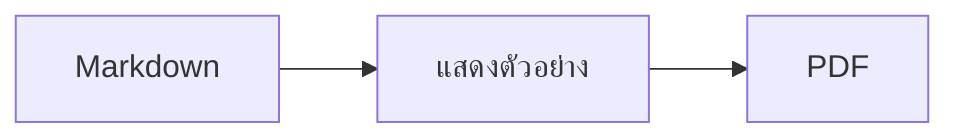

<p>&nbsp;&nbsp;&nbsp;</p>

# Splat

**โปรแกรมแก้ไข Markdown สำหรับ macOS ที่ให้คุณเขียนในข้อความต้นฉบับหรือเขียนตรงๆ ในส่วนแสดงตัวอย่างก็ได้**

Splat แสดงข้อความต้นฉบับ Markdown พร้อมสีไวยากรณ์ไว้ทางซ้าย และแสดงตัวอย่างสดที่แก้ไขได้เต็มรูปแบบไว้ทางขวา คุณพิมพ์ในฝั่งใดก็ได้
สิ่งที่เขียนในส่วนแสดงตัวอย่างจะกลายเป็นการเปลี่ยนแปลงขั้นต่ำในข้อความต้นฉบับ บรรทัดที่คุณไม่ได้แตะต้องจึงเหมือนเดิมทุกไบต์
และ Git diff ของคุณก็ยังสะอาด Splat อ่าน Markdown ที่คุณใช้อยู่แล้วได้ ทั้ง CommonMark และ GitHub Flavored Markdown,
GitHub alert, ลิงก์วิกิ การฝัง และกล่องหมายเหตุของ Obsidian, ส่วนขยายของ Pandoc และ Typora, HTML ที่ฝังอยู่, สูตร LaTeX
และแผนภาพ Mermaid, Graphviz และ PlantUML ทั้งหมดแสดงผลแบบออฟไลน์ เรียกดูและค้นหาโน้ตทั้งโฟลเดอร์ ดูสิ่งที่เปลี่ยนตั้งแต่ Git Commit ล่าสุด
วางจาก Word หรือหน้าเว็บเป็น Markdown และส่งออกเป็น PDF, HTML หรือ Word ได้ในคลิกเดียว
Splat เขียนด้วย Rust บนตัวควบคุม AppKit แท้ รองรับ 35 ภาษา และไม่ส่งอะไรผ่านเครือข่ายเลย เว้นแต่คุณสั่ง
 


[](https://github.com/sventmueller/splat/releases/latest/download/Splat.dmg)

**[ดาวน์โหลด Splat.dmg](https://github.com/sventmueller/splat/releases/latest/download/Splat.dmg)**: ลงนามและผ่านการรับรองโดย Apple สำหรับ macOS 14 ขึ้นไป บน Apple Silicon และ Intel

**พบข้อบกพร่องหรือไม่** Splat รักษาบรรทัดที่คุณไม่ได้แตะต้องให้เหมือนเดิมทุกไบต์ หากมีบรรทัดเปลี่ยนไป หรือไฟล์แสดงผลไม่ถูกต้อง โปรด[เปิด issue](https://github.com/sventmueller/splat/issues/new/choose) และแนบไฟล์มาด้วย หาก Splat มีประโยชน์กับคุณ [การกดดาวบน GitHub](https://github.com/sventmueller/splat) จะช่วยให้ผู้อื่นพบ Splat
 
 

[](https://www.rust-lang.org)
[](https://www.apple.com/macos/)

[](https://github.com/madsmtm/objc2)
[](https://webkit.org)
[](https://github.com/kivikakk/comrak)
[](https://github.github.com/gfm/)
[](https://www.mathjax.org)
[](https://cortexjs.io/mathlive/)
[](https://mermaid.js.org)
[](https://graphviz.org)
[](https://plantuml.com)


[](#สัญญาอนุญาต)

[Bahasa Indonesia](../id/README.md) ·
[Bahasa Melayu](../ms/README.md) ·
[Català](../ca/README.md) ·
[Čeština](../cs/README.md) ·
[Dansk](../da/README.md) ·
[Deutsch](../de/README.md) ·
[English](../../../README.md) ·
[Español](../es/README.md) ·
[Français](../fr/README.md) ·
[Hrvatski](../hr/README.md) ·
[Italiano](../it/README.md) ·
[Magyar](../hu/README.md) ·
[Nederlands](../nl/README.md) ·
[Norsk](../no/README.md) ·
[Polski](../pl/README.md) ·
[Português (Brasil)](../pt_BR/README.md) ·
[Português (Portugal)](../pt_PT/README.md) ·
[Română](../ro/README.md) ·
[Slovenčina](../sk/README.md) ·
[Slovenščina](../sl/README.md) ·
[Suomi](../fi/README.md) ·
[Svenska](../sv/README.md) ·
[Tiếng Việt](../vi/README.md) ·
[Türkçe](../tr/README.md) ·
[Ελληνικά](../el/README.md) ·
[Русский](../ru/README.md) ·
[Українська](../uk/README.md) ·
[עברית](../he/README.md)‎ ·
[العربية](../ar/README.md)‎ ·
[हिन्दी](../hi/README.md) ·
**ไทย** ·
[한국어](../ko/README.md) ·
[日本語](../ja/README.md) ·
[简体中文](../zh-Hans/README.md) ·
[繁體中文](../zh-Hant/README.md)

## สารบัญ

- [ภาพรวมความสามารถ](#ภาพรวมความสามารถ)
- [ความต้องการของระบบ](#ความต้องการของระบบ)
- [การติดตั้ง](#การติดตั้ง)
- [เริ่มต้นใช้งาน](#เริ่มต้นใช้งาน)
- [การเขียน](#การเขียน)
  - [ในข้อความต้นฉบับ](#ในข้อความต้นฉบับ)
  - [ในส่วนแสดงตัวอย่าง](#ในส่วนแสดงตัวอย่าง)
  - [คำสั่งจัดรูปแบบ](#คำสั่งจัดรูปแบบ)
  - [รายการและงาน](#รายการและงาน)
  - [ตาราง](#ตาราง)
  - [การวางข้อความที่มีรูปแบบ](#การวางข้อความที่มีรูปแบบ)
  - [ข้อมูลเมตา](#ข้อมูลเมตา)
- [Markdown ที่รองรับ](#markdown-ที่รองรับ)
  - [CommonMark และ GitHub Flavored Markdown](#commonmark-และ-github-flavored-markdown)
  - [กล่องหมายเหตุ](#กล่องหมายเหตุ)
  - [ไวยากรณ์ขยาย](#ไวยากรณ์ขยาย)
  - [Obsidian](#obsidian)
  - [การอ้างอิงและเอกสารอ้างอิง](#การอ้างอิงและเอกสารอ้างอิง)
  - [HTML ที่ฝัง](#html-ที่ฝัง)
  - [เครื่องหมายวรรคตอนแบบงานพิมพ์](#เครื่องหมายวรรคตอนแบบงานพิมพ์)
  - [ภาพรวมไวยากรณ์](#ภาพรวมไวยากรณ์)
- [สูตร](#สูตร)
- [แผนภาพ](#แผนภาพ)
- [ภาพ](#ภาพ)
- [ลิงก์และการนำทาง](#ลิงก์และการนำทาง)
- [โน้ตในโฟลเดอร์](#โน้ตในโฟลเดอร์)
- [การเปลี่ยนแปลงตั้งแต่ Commit ล่าสุด](#การเปลี่ยนแปลงตั้งแต่-commit-ล่าสุด)
- [การส่งออก การพิมพ์ และการแชร์](#การส่งออก-การพิมพ์-และการแชร์)
- [การนำเข้าเอกสาร Word](#การนำเข้าเอกสาร-word)
- [หน้าตาและการช่วยการเข้าถึง](#หน้าตาและการช่วยการเข้าถึง)
- [ภาษา](#ภาษา)
- [ปุ่มลัด](#ปุ่มลัด)
- [ความเป็นส่วนตัวและความปลอดภัย](#ความเป็นส่วนตัวและความปลอดภัย)
- [เอกสารขนาดใหญ่](#เอกสารขนาดใหญ่)
- [ข้อจำกัดที่ทราบ](#ข้อจำกัดที่ทราบ)
- [การแก้ปัญหา](#การแก้ปัญหา)
- [สำหรับนักพัฒนา](#สำหรับนักพัฒนา)
  - [ส่วนประกอบของบุคคลที่สาม](#ส่วนประกอบของบุคคลที่สาม)
- [สัญญาอนุญาต](#สัญญาอนุญาต)

## ภาพรวมความสามารถ

- **เขียนได้สองทาง แต่เป็นข้อความเดียว** ข้อความต้นฉบับและส่วนแสดงตัวอย่างแก้ไขได้ทั้งคู่ ไฟล์ Markdown คือต้นฉบับเดียวที่เป็นความจริง
  แต่ละเอกสารมีประวัติการเลิกทำเพียงชุดเดียว และทุกการแก้ไขในส่วนแสดงตัวอย่างจะถูกแปลงเป็นการเปลี่ยนแปลงที่เล็กที่สุดในข้อความต้นฉบับ
- **Markdown ที่คุณใช้อยู่แล้ว** CommonMark, GitHub Flavored Markdown, GitHub alert, Obsidian, ส่วนขยายของ Pandoc และ Typora,
  รหัสย่ออีโมจิ, สปอยล์, รายการคำนิยาม, จุดยึดของหัวข้อ และ HTML แบบที่พบใน README บน GitHub
- **มีสูตรและแผนภาพในตัว** สูตร LaTeX ผ่าน MathJax พร้อมตัวแก้ไขสูตรแบบภาพ แผนภาพ Mermaid, Graphviz และ PlantUML
  แสดงผลบน Mac ของคุณโดยไม่ต้องใช้ Java เซิร์ฟเวอร์ หรือการเชื่อมต่อเครือข่าย
- **มีปุ่มให้ทุกอย่าง** ทุกองค์ประกอบของ Markdown มีทั้งปุ่มบนแถบเครื่องมือและรายการในเมนู ส่วนที่ใช้บ่อยยังมีปุ่มลัดด้วย
  ตารางมีเมนูของตัวเองสำหรับแถว คอลัมน์ และการจัดแนว
- **ทั้งโฟลเดอร์ ไม่ใช่แค่ไฟล์เดียว** แถบด้านข้างแสดงรายการโน้ตรอบ ๆ เอกสารและค้นหาได้ทั้งหมด การเปลี่ยนชื่อโน้ตจะเปลี่ยนลิงก์ที่มายังโน้ตนั้น
  และทุกไบต์รอบ ๆ ลิงก์ยังคงเดิม
- **เห็นการเปลี่ยนแปลงได้ทันที** ในที่เก็บ Git แถบสีข้างข้อความจะทำเครื่องหมายสิ่งที่ต่างจาก Commit ล่าสุด ในทั้งสองส่วน
- **จาก Word และเว็บสู่ Markdown** วางข้อความที่มีรูปแบบเป็น Markdown วางเซลล์จากสเปรดชีตเป็นตาราง
  และนำเข้าเอกสาร Word ทั้งฉบับพร้อมภาพ
- **ส่งออกโดยไม่สูญเสียอะไร** PDF, ไฟล์ HTML เดียวที่ครบในตัว หรือเอกสาร Word ที่มีหัวข้อ รายการ ตาราง เชิงอรรถ และภาพจริง
  เพิ่มเลขหน้า หัวกระดาษ และหน้าชื่อเรื่องได้ หรือใช้แม่แบบ Word ของบริษัทคุณ
- **เป็นเนทีฟอย่างแท้จริง** หน้าต่าง แถบ เมนู ป๊อปโอเวอร์ เวอร์ชั่น บันทึกอัตโนมัติ เมนูแชร์ โหมดมืด การตรวจการสะกด
  การป้อนด้วยเสียง และ VoiceOver แบบ AppKit แท้ ไม่มี Electron และไม่ใช้เว็บวิวกับตัวข้อความเอง
- **เร็วแม้กับไฟล์ใหญ่** การเรนเดอร์การกดแป้นหนึ่งครั้งในเอกสารขนาด 10 MB ใช้เวลาราว 10 มิลลิวินาที ก่อนงานของวิวเอง
- **เป็นส่วนตัวและรอบคอบ** Splat ทำงานใน App Sandbox ภาพจากเว็บจะโหลดก็ต่อเมื่อคุณอนุญาต ลิงก์ไปยังแอปอื่นจะถามก่อน
  และทุกอย่างที่ถอดรหัสข้อมูลภาพที่ไม่น่าไว้ใจจะทำงานในบริการแยกของตัวเองที่อยู่ในแซนด์บอกซ์
- **ในภาษาของคุณ** อินเทอร์เฟซและคู่มืออ้างอิงด่วน Markdown ในตัวมีให้ใน 35 ภาษา ได้แก่ อาหรับ คาตาลัน
  จีน (ตัวย่อ) จีน (ตัวเต็ม) โครเอเชีย เช็ก เดนมาร์ก ดัตช์ อังกฤษ ฟินแลนด์ ฝรั่งเศส เยอรมัน กรีก
  ฮีบรู ฮินดี ฮังการี อินโดนีเซีย อิตาลี ญี่ปุ่น เกาหลี มาเลย์ นอร์เวย์ โปแลนด์ โปรตุเกส (บราซิล)
  โปรตุเกส (โปรตุเกส) โรมาเนีย รัสเซีย สโลวัก สโลวีเนีย สเปน สวีเดน ไทย ตุรกี ยูเครน และเวียดนาม

## ความต้องการของระบบ

- macOS 14 Sonoma ขึ้นไป Splat พัฒนาและทดสอบบน macOS 27 ซึ่งจะใช้ดีไซน์ Liquid Glass โดยอัตโนมัติ
- Mac ที่ใช้ Apple Silicon หรือโปรเซสเซอร์ Intel
- พื้นที่ดิสก์ประมาณ 45 MB

## การติดตั้ง

**จากดิสก์อิมเมจ** ดาวน์โหลด [`Splat.dmg`](https://github.com/sventmueller/splat/releases/latest/download/Splat.dmg) เปิดไฟล์ แล้วลาก Splat ไปวางบนโฟลเดอร์แอปพลิเคชัน อิมเมจนี้ลงนามด้วย
Developer ID และผ่านการรับรองโดย Apple จึงเปิดได้โดยไม่มีคำเตือน

**ผ่าน Homebrew** cask อยู่ใน tap ของตัวเอง:

```sh
brew install --cask sventmueller/tap/splat
```

`brew upgrade --cask splat` ติดตั้งเวอร์ชั่นใหม่ และ `brew uninstall --zap --cask splat` จะลบการตั้งค่าและแคชของ Splat ออกด้วย

**การอัปเดต** Splat ที่ติดตั้งจากดิสก์อิมเมจหรือ Homebrew อัปเดตตัวเองผ่าน [Sparkle](https://sparkle-project.org)
เมื่อเปิดครั้งที่สอง Splat จะถามว่าอนุญาตให้ตรวจหารายการอัปเดตเองวันละครั้งหรือไม่ **Splat › ตรวจหารายการอัปเดต…**
จะตรวจทันที ส่วน **ตรวจหารายการอัปเดตโดยอัตโนมัติ** และ **ดาวน์โหลดและติดตั้งรายการอัปเดตโดยอัตโนมัติ** ในเมนูเดียวกัน
ใช้เปลี่ยนการตัดสินใจของคุณภายหลัง Splat จะติดตั้งการอัปเดตก็ต่อเมื่อมีลายเซ็นของนักพัฒนาเท่านั้น บิลด์ที่คุณสร้างเอง
ไม่มีตัวอัปเดต

**จากซอร์สโค้ด** ดูสิ่งที่ต้องมีก่อนได้ที่ [การสร้าง](../../../docs/development.md#building) จากนั้น:

```sh
make build
ditto target/release/Splat.app /Applications/Splat.app
open /Applications/Splat.app
```

หากต้องการเปิดไฟล์ Markdown ด้วย Splat ด้วยการดับเบิลคลิก ให้เลือกไฟล์ `.md` ใดก็ได้ใน Finder เลือก **ไฟล์ › ขอรายละเอียด**
เลือก Splat ใต้ **เปิดด้วย** แล้วคลิก **เปลี่ยนทั้งหมด…** Splat ลงทะเบียนตัวเองสำหรับไฟล์ `.md`, `.markdown`, `.mdown` และ
`.mkd`

## เริ่มต้นใช้งาน

### หน้าต่าง

แต่ละเอกสารเปิดในหน้าต่างของตัวเอง หรือเป็นแถบหากคุณชอบใช้แถบ:

- **ซ้าย: ข้อความต้นฉบับ** Markdown ของคุณด้วยฟอนต์ SF Mono พร้อมสีไวยากรณ์
- **ขวา: ส่วนแสดงตัวอย่าง** เอกสารที่แสดงผลแล้ว พร้อมให้แก้ไข
- **แถบด้านข้าง (ไม่บังคับ)** หัวข้อทั้งหมดในรูปแบบต้นไม้ คลิกหัวข้อหนึ่งเพื่อแสดงในทั้งสองส่วน: **มุมมอง › แสดงโครงร่าง** (⌃⌘S)
  อีกสองแถบมี [โน้ตในโฟลเดอร์](#โน้ตในโฟลเดอร์) และการค้นหาในโน้ตเหล่านั้น
  ปุ่มข้างชื่อหน้าต่างใช้แสดงและซ่อนแถบด้านข้าง และหน้าต่างใหม่จะเปิดแถบด้านข้างตามสถานะที่หน้าต่างล่าสุดทิ้งไว้
- **แถบเครื่องมือ** ปุ่มที่จัดกลุ่มตามสิ่งที่เปลี่ยน ได้แก่ อักขระ ย่อหน้า และองค์ประกอบที่แทรก ตามด้วยเปิดหรือปิดส่วนแสดงตัวอย่าง
  แชร์ และเอกสารใหม่ กำหนดเองได้ด้วย **มุมมอง › กำหนดแถบเครื่องมือเอง…**

ลากตัวแบ่งเพื่อให้ฝั่งใดฝั่งหนึ่งกว้างขึ้น **มุมมอง › ซ่อนแสดงตัวอย่าง** (⌥⌘P) จะเหลือไว้แต่ข้อความต้นฉบับ Splat
จำค่านี้แยกตามหน้าต่าง ทั้งสองส่วนเลื่อนไปพร้อมกัน และข้อความที่เลือกในส่วนหนึ่งจะถูกไฮไลท์ในอีกส่วนหนึ่ง

มุมของหน้าต่างแสดงจำนวนคำและอักขระของข้อความ และเวลาที่ใช้อ่าน รวมถึงของส่วนที่เลือกเมื่อมีการเลือกอยู่ ที่อยู่ลิงก์ แท็ก HTML ข้อมูลเมตา
ความคิดเห็น สูตร และแผนภาพไม่นับรวม ส่วนนี้ซ่อนอยู่ตั้งแต่แรก **มุมมอง › แสดงจำนวนคำ** จะแสดงส่วนนี้

### เอกสาร แถบ และเวอร์ชั่น

Splat เป็นแอปเอกสารของ macOS ตามปกติ:

- **บันทึกอัตโนมัติและเวอร์ชั่น** การเปลี่ยนแปลงถูกบันทึกลงในไฟล์เดิม **ไฟล์ › แปลงกลับเป็น › เลือกดูทุกเวอร์ชั่น…** พาคุณย้อนเวลากลับไปได้
- **การเปลี่ยนแปลงจากโปรแกรมอื่น** เมื่อ Git สคริปต์ หรือโปรแกรมแก้ไขอื่นเปลี่ยนเอกสารที่เปิดอยู่ Splat จะโหลดใหม่
  และคงตำแหน่งเคอร์เซอร์กับตำแหน่งการเลื่อนไว้ หากคุณมีการเปลี่ยนแปลงของตัวเองที่ยังไม่ได้บันทึก Splat จะเก็บไว้ และ macOS
  จะถามก่อนบันทึกทับอีกเวอร์ชั่นหนึ่ง
- **คำสั่งไฟล์ตามปกติ** ทำสำเนา (⇧⌘S), เปลี่ยนชื่อ…, ย้ายไปยัง… และ **ไฟล์ › เปิดล่าสุด**
- **แถบ** **ไฟล์ › แถบใหม่** หรือปุ่ม **+** บนแถบเครื่องมือจะเปิดเอกสารใหม่เป็นแถบ เมนูหน้าต่างมาตรฐานใช้ผสาน ย้าย
  และสลับแถบ
- **ตำแหน่งหน้าต่าง** ขนาดและตำแหน่งของหน้าต่างล่าสุดจะถูกจำไว้ แม้เปิดแอปใหม่ ถ้ามีหน้าต่างอยู่ที่ตำแหน่งนั้นแล้ว
  หน้าต่างใหม่จะเปิดเยื้องออกไปเล็กน้อย
- **ไอคอนบน Dock** การคลิกไอคอนหลังปิดหน้าต่างสุดท้ายไปแล้วจะเปิดเอกสารใหม่
- **เปิดไฟล์ Markdown ใน Splat** **Splat › ตั้งเป็นแอปเริ่มต้นสำหรับ Markdown** ทำให้การดับเบิลคลิกไฟล์ `.md` หรือ
  `.markdown` เปิด Splat macOS จะถามให้ยืนยันหนึ่งครั้ง รายการนี้จะมีเครื่องหมายถูกเมื่อ Splat เป็นแอปเริ่มต้น

ไฟล์ต้องเป็นข้อความ UTF-8 หรือ UTF-16 ที่มี byte order mark Splat ปฏิเสธการเข้ารหัสอื่นแทนที่จะเดาแล้วทำให้ข้อความเสียหาย
byte order mark จะคงอยู่ UTF-16 ยังเป็น UTF-16 และในไฟล์ที่ทุกบรรทัดลงท้ายด้วย CRLF บรรทัดที่คุณเพิ่มก็จะลงท้ายด้วย CRLF ด้วย

**หลังเกิดข้อขัดข้อง** จะเสียการพิมพ์อย่างมากเพียงไม่กี่วินาทีสุดท้าย เพราะทุกห้าวินาที Splat จะคัดลอกข้อความที่ยังไม่ได้บันทึกไปไว้ที่
`~/Library/Application Support/Splat/Unsaved` และลบสำเนาเมื่อบันทึกเอกสารหรือ Splat ปิดตามปกติ
การเปิดครั้งถัดไปจะย้ายสิ่งที่ข้อขัดข้องทิ้งไว้ที่นั่นไปยัง `~/Library/Application Support/Splat/Recovery` และแจ้งหนึ่งครั้ง พร้อมปุ่มที่เปิดโฟลเดอร์นั้น
ถ้าข้อขัดข้องนั้น Splat ยังตอบสนองได้ Splat จะเขียนข้อความของทุกเอกสารที่เปิดอยู่ไว้ที่นั่นด้วย

### คู่มืออ้างอิงด่วน

**วิธีใช้ › คู่มืออ้างอิงด่วน Markdown** เปิดเอกสารสรุปในภาษาของคุณเป็นเอกสารใหม่ที่ยังไม่มีชื่อ เป็นเอกสารธรรมดา
คุณจึงลองทุกอย่างได้ที่นั่นเลย ทั้งในข้อความต้นฉบับและในส่วนแสดงตัวอย่าง

## การเขียน

### ในข้อความต้นฉบับ

ข้อความต้นฉบับคือโปรแกรมแก้ไขข้อความธรรมดาที่ปรับมาสำหรับ Markdown โดยเฉพาะ:

- **สีไวยากรณ์** แบบใน VS Code: หัวข้อ ตัวเน้น ลิงก์ โค้ด ตาราง HTML front matter และ LaTeX กับ Mermaid
  ภายในสูตรและแผนภาพ มีชุดสีสำหรับโหมดสว่าง โหมดมืด และเพิ่มความเปรียบต่าง
- **บล็อกโค้ดแบบ fenced** ไฮไลท์ไวยากรณ์ให้กับ Bash, C, C++, C#, CSS (รวม SCSS และ Less), Go, HTML, XML, Java,
  JavaScript, JSON, Kotlin, PHP, Python, Ruby, Rust, SQL, Swift, TypeScript, YAML, TeX และ Mermaid รวมถึงชื่อย่อที่ใช้กันทั่วไป
  เช่น `js`, `py` หรือ `sh`
- **ไม่มีการเปลี่ยนแทนที่แบบไม่คาดคิด** อัญประกาศอัจฉริยะ ขีดกลางอัจฉริยะ และการแทนที่ข้อความปิดอยู่เป็นค่าเริ่มต้น เพราะทำให้
  `--`, `---` และ `"` เพี้ยน เปิดได้ที่ **แก้ไข › การเปลี่ยนแทนที่**
- **เครื่องมือเขียนของระบบ** การตรวจการสะกดและไวยากรณ์ การป้อนด้วยเสียง ค้นหาและแทนที่ (⌥⌘F) และเสียงพูด
- **ลากและวาง** วางไฟล์ภาพเพื่อแทรก `` วางไฟล์อื่นเพื่อแทรกลิงก์ไปยังไฟล์นั้น
  และวาง URL เพื่อแทรก `[url](url)` การวางแต่ละครั้งเป็นการเลิกทำหนึ่งขั้น
- **วางภาพ** ภาพในคลิปบอร์ด เช่น ภาพหน้าจอ จะถูกบันทึกเป็นไฟล์ PNG ไว้ข้างเอกสาร
  (`ภาพ 2026-10-29 13.09.07.png`) และแทรกเป็นภาพ เอกสารต้องเคยบันทึกอย่างน้อยหนึ่งครั้ง

### ในส่วนแสดงตัวอย่าง

ส่วนแสดงตัวอย่างทำงานเหมือนโปรแกรมประมวลผลคำ แต่ทุกอย่างที่คุณทำในนั้นจะกลายเป็น Markdown:

- **การพิมพ์** อักขระที่มีความหมายใน Markdown เช่น `*` หรือ `#` จะถูกเอสเคปเพื่อให้แสดงตามที่พิมพ์
- **Return** เริ่มย่อหน้าหรือรายการใหม่ **⌥Return** หรือ **⌃Return** แทรกการแบ่งบรรทัด
- **การจัดรูปแบบที่เคอร์เซอร์** เมื่อเคอร์เซอร์อยู่ท้ายคำ ตัวหนา ตัวเอียง และรูปแบบอักขระอื่นๆ
  จะมีผลกับสิ่งที่คุณพิมพ์ต่อจากนั้น เลือกรูปแบบนั้นอีกครั้งเพื่อหยุด ถ้าเคอร์เซอร์อยู่กลางคำ ทั้งคำจะถูกจัดรูปแบบ
- **บรรทัดว่าง** กด Return บนบรรทัดว่างจะเพิ่มบรรทัดว่างอีกหนึ่งบรรทัด และปุ่ม Delete จะลบออก ในข้อความต้นฉบับ
  บรรทัดว่างที่เพิ่มแต่ละบรรทัดจะเป็นบรรทัดว่างเพิ่มอีกสองบรรทัด ส่วนโปรแกรม Markdown อื่นจะแสดงเป็นระยะห่างระหว่างย่อหน้าตามปกติ
- **เลิกทำ** ใช้ได้ข้ามทั้งสองส่วน รายการเลิกทำมีชื่อกำกับ (“เลิกทำตัวหนา”) การพิมพ์เป็นหนึ่งขั้นต่อหนึ่งช่วงที่พิมพ์ต่อเนื่อง
  และหลังเลิกทำหรือทำกลับมาใหม่ ทั้งสองส่วนจะเลื่อนไปยังจุดที่เปลี่ยน
- **สูตรและแผนภาพ** ปรากฏเป็นภาพกราฟิกที่เสร็จแล้ว คลิกที่ภาพ ย้ายเคอร์เซอร์ไปบนภาพ หรือกด Return บนภาพ
  เพื่อเปิดตัวแก้ไข (ดู [สูตร](#สูตร) และ [แผนภาพ](#แผนภาพ))
- **HTML ที่ฝัง โน้ตที่ฝัง และ front matter** แสดงให้เห็น แต่ต้องแก้ไขในข้อความต้นฉบับ การคลิกจะวางเคอร์เซอร์
  ที่ตำแหน่งที่ตรงกันในข้อความต้นฉบับ

สิ่งที่ Markdown ไม่สามารถแสดงได้จะถูกบล็อกในส่วนแสดงตัวอย่าง ได้แก่ แผงแบบอักษรและสี ไม้บรรทัด และการวางหรือการลากข้อความที่มีรูปแบบและภาพลงไป HTML และ RTF ที่วางจะกลายเป็นข้อความธรรมดา เว้นแต่คุณเลือก [วางเป็น Markdown](#การวางข้อความที่มีรูปแบบ)

### คำสั่งจัดรูปแบบ

ทุกคำสั่งใช้ได้จากแถบเครื่องมือ แถบเมนู และเมนูตามบริบทของทั้งสองส่วน รายการในเมนูมีเครื่องหมายถูกสำหรับการจัดรูปแบบที่เคอร์เซอร์

| เมนู | คำสั่ง |
|---|---|
| **รูปแบบ › แบบอักษร** | ตัวหนา, ตัวเอียง, ขีดเส้นใต้, ขีดทับ, ไฮไลท์, โค้ด, ตัวยก, ตัวห้อย |
| **รูปแบบ › หัวข้อ** | เนื้อความ, หัวข้อ 1 ถึง 6 |
| **รูปแบบ › รายการ** | รายการแบบจุด, รายการแบบตัวเลข, รายการงาน |
| **รูปแบบ** | คำอ้างอิง, บล็อกโค้ด (ไม่ระบุภาษา หรือหนึ่งใน 20 ภาษา และเปลี่ยนภาษาของบล็อกที่มีอยู่แล้วได้ด้วย), กล่องหมายเหตุ (โน้ต, เคล็ดลับ, สำคัญ, คำเตือน, ข้อควรระวัง และเลือกชนิดเดิมอีกครั้งเพื่อเอาออก), แก้ไขสูตรหรือแผนภาพ…, ล้างการจัดรูปแบบ |
| **แทรก** | ลิงก์…, ภาพ…, ตาราง…, สูตร, แผนภาพ (ผังงาน, แผนภาพลำดับ, แผนภูมิแกนต์), ตารางสารบัญ, เชิงอรรถ, เส้นคั่น |
| **ตาราง** | แทรกแถวด้านบน/ด้านล่าง, แทรกคอลัมน์ทางซ้าย/ทางขวา, ลบแถว, ลบคอลัมน์, การจัดแนว (จัดชิดซ้าย, กึ่งกลาง, จัดชิดขวา, ค่าเริ่มต้น), จัดแนวคอลัมน์ตาราง |
| **มุมมอง** | ซ่อน/แสดงตัวอย่าง, แสดง/ซ่อนโครงร่าง, เครื่องหมายวรรคตอนแบบงานพิมพ์, ซูมเข้า/ออก, ขนาดจริง, แถบเครื่องมือ, รายการแถบ, เต็มหน้าจอ |

ขีดเส้นใต้ ไฮไลท์ ตัวยก และตัวห้อยเขียนเป็น `<ins>`, `<mark>`, `<sup>` และ `<sub>` ซึ่ง GitHub แสดงผลได้เช่นกัน
Splat อ่าน `<u>` ซึ่ง GitHub ตัดทิ้งได้ด้วย รวมถึงรูปแบบสั้น `==highlight==`, `^sup^` และ `~sub~`
GitHub แสดง `==` และ `^` ตามที่พิมพ์ และแสดง `~sub~` เป็นขีดทับ

### รายการและงาน

- Return ต่อรายการ ส่วน Return บนรายการว่างจะจบรายการ
- **Tab** และ **⇧Tab** เยื้องเข้าและเยื้องออกรายการในส่วนแสดงตัวอย่าง
- การคลิกช่องทำเครื่องหมายของงานในส่วนแสดงตัวอย่างจะสลับ `- [ ]` และ `- [x]`
- **รูปแบบ › รายการ** แปลงย่อหน้าที่เลือกให้เป็นรายการ หรือเปลี่ยนชนิดของรายการ

### ตาราง

- **แทรก › ตาราง…** จะถามจำนวนแถว (รวมแถวหัวตาราง) และคอลัมน์
- ในส่วนแสดงตัวอย่าง **Tab** ย้ายไปเซลล์ถัดไป **⇧Tab** ย้ายไปเซลล์ก่อนหน้า และ **Return** ย้ายไปเซลล์ด้านล่าง กด Tab
  ในเซลล์สุดท้ายเพื่อเพิ่มแถว
- เมนู **ตาราง** แทรกและลบแถวกับคอลัมน์ และตั้งการจัดแนวของคอลัมน์ (⌘{, ⌘|, ⌘})
- **ตาราง › จัดแนวคอลัมน์ตาราง** เติมช่องว่างในข้อความต้นฉบับเพื่อให้คอลัมน์ตรงกัน

### การวางข้อความที่มีรูปแบบ

**แก้ไข › วางเป็น Markdown** (⌃⌘V) ซึ่งมีในเมนูตามบริบทของทั้งสองส่วนด้วย จะแปลงสิ่งที่อยู่ในคลิปบอร์ดเป็น Markdown ตรงส่วนที่เลือก
เป็นการเลิกทำหนึ่งขั้น ⌘V ยังคงแทรกข้อความธรรมดาเหมือนเดิม

- **จากเบราว์เซอร์, Word, Google Docs, Confluence, โน้ต หรือ Pages:** หัวข้อ ตัวหนา ตัวเอียง ขีดเส้นใต้ ขีดทับ ตัวยกและตัวห้อย ลิงก์
  รายการพร้อมการซ้อน คำอ้างอิง โค้ด และตารางจะติดมาด้วย
- **จากสเปรดชีต:** เซลล์จะกลายเป็นตารางที่มีแถวหัวตาราง และคอลัมน์ตัวเลขจัดชิดขวา ข้อความที่คั่นด้วยแท็บ อัฒภาค หรือจุลภาคก็เช่นกัน
  หากทุกบรรทัดมีจำนวนคอลัมน์เท่ากัน
- **ภาพ** ที่มีที่อยู่เว็บยังคงเป็นลิงก์ ภาพภายใน HTML ที่วางจะกลายเป็นไฟล์ข้างเอกสาร ซึ่งเอกสารต้องเคยบันทึกอย่างน้อยหนึ่งครั้ง
  ไฟล์ภาพชั่วคราวของ Word จะไม่ติดมาด้วย แต่ข้อความแทนภาพยังคงอยู่
- **ลิงก์** คงไว้เฉพาะที่อยู่แบบ `http`, `https`, `mailto`, แบบสัมพัทธ์ และแบบ `#` ส่วนลิงก์อื่นจะเหลือเฉพาะข้อความ

### ข้อมูลเมตา

**รูปแบบ › แก้ไขข้อมูลเมตา…** หรือการคลิกบรรทัดข้อมูลเมตาที่ส่วนบนของส่วนแสดงตัวอย่าง จะเปิดแบบฟอร์มที่มีช่องของ YAML front matter
เปลี่ยน เพิ่ม และเอาช่องออกได้ ช่องที่มีรายการจะยังเป็นรายการ: ค่าต่างๆ เรียงต่อกันคั่นด้วยจุลภาค และค่าที่มีจุลภาคจะอยู่ในอัญประกาศ
ช่องใหม่ชื่อ `tags`, `aliases`, `keywords`, `categories`, `authors` หรือ `cssclasses` จะเป็นรายการเช่นกัน
ช่องที่ซ้อนกันและข้อความหลายบรรทัดมองเห็นได้ในแบบฟอร์ม และแก้ไขในข้อความต้นฉบับ

สิ่งที่แบบฟอร์มเปลี่ยนเป็นการเลิกทำหนึ่งขั้น และมีผลเฉพาะบรรทัดของช่องที่คุณเปลี่ยน: ความคิดเห็น ลำดับ ระยะห่างที่แปลกไป อัญประกาศ
และท้ายบรรทัดของช่องอื่นทั้งหมดยังเหมือนเดิมทุกไบต์ เอกสารที่ไม่มีข้อมูลเมตาจะได้บล็อกใหม่ที่จุดเริ่มต้น

## Markdown ที่รองรับ

Splat แยกวิเคราะห์ด้วย [comrak](https://github.com/kivikakk/comrak) ซึ่งเป็นตัวแยกวิเคราะห์ที่เข้ากันได้กับ CommonMark และ GFM
และเปิดใช้ส่วนขยายส่วนใหญ่ของมัน ทุกอย่างด้านล่างนี้แสดงผลในส่วนแสดงตัวอย่างและในการส่งออกทุกแบบ

### CommonMark และ GitHub Flavored Markdown

- หัวข้อ (`#` และแบบขีดเส้นใต้), ย่อหน้า, การแบ่งบรรทัด, ตัวเน้น, ตัวเน้นแบบหนา, โค้ดในบรรทัด, บล็อกคำอ้างอิง,
  เส้นคั่น
- รายการแบบจุด แบบตัวเลข และแบบซ้อนกัน รวมถึงรายการงาน
- ลิงก์ (แบบในบรรทัด แบบอ้างอิง และแบบอัตโนมัติ), ภาพ, คำนิยามการอ้างอิงลิงก์
- บล็อกโค้ดแบบ fenced และแบบเยื้อง พร้อมสีไวยากรณ์
- ตารางที่จัดแนวคอลัมน์ได้
- ขีดทับด้วย `~~two tildes~~`
- เชิงอรรถ: `text[^1]` กับ `[^1]: The note.` ที่ตำแหน่งใดก็ได้ในเอกสาร การคลิกเครื่องหมายจะข้ามไปยังโน้ต
- YAML front matter ระหว่างบรรทัด `---` ที่ส่วนบนสุด ส่วนแสดงตัวอย่างสรุปไว้ในบรรทัดเดียว เช่น
  “ข้อมูลเมตา: title, date, tags”

### กล่องหมายเหตุ

GitHub alert แสดงผลเป็นกล่องสีพร้อมไอคอนและชื่อเรื่อง:

```markdown
> [!NOTE]
> ข้อมูลที่เป็นประโยชน์ซึ่งผู้ใช้ควรทราบ

> [!WARNING]
> เนื้อหาสำคัญที่ต้องให้ความสนใจทันที
```

ทั้งห้าชนิดคือ โน้ต เคล็ดลับ สำคัญ คำเตือน และข้อควรระวัง **รูปแบบ › กล่องหมายเหตุ** แปลงย่อหน้าที่เคอร์เซอร์อยู่ให้เป็นกล่องหมายเหตุ

กล่องหมายเหตุของ Obsidian ก็ใช้ได้เช่นกัน โดยตั้งชื่อเรื่องอะไรก็ได้และกำหนดสถานะการยุบได้:

```markdown
> [!tip]- คลิก ▸ เพื่อขยาย
> ซ่อนอยู่จนกว่าจะเปิด

> [!question]+ เปิดไว้ตั้งแต่แรก
> เครื่องหมาย `+` เริ่มต้นแบบขยาย ส่วน `-` เริ่มต้นแบบยุบ
```

ชนิดอื่นๆ ของ Obsidian จะแสดงด้วยสีที่ใกล้เคียงที่สุดจากทั้งห้าสี: `success`, `check`, `done` และ `hint` เป็นเคล็ดลับ
`question`, `help` และ `faq` เป็นสำคัญ `attention` เป็นคำเตือน `failure`, `fail`, `missing`, `danger`, `error` และ
`bug` เป็นข้อควรระวัง ส่วนที่เหลือทั้งหมดเป็นโน้ต

### ไวยากรณ์ขยาย

| ความสามารถ | ไวยากรณ์ | มาจาก |
|---|---|---|
| ไฮไลท์ | `==ข้อความที่มาร์ก==` | Obsidian, Typora |
| ตัวยก | `x^2^` | Pandoc, Typora |
| ตัวห้อย | `H~2~O` | Pandoc, Typora |
| รหัสย่ออีโมจิ | `:rocket:` กลายเป็น 🚀 | GitHub |
| สปอยล์ | `\|\|ข้อความที่ซ่อน\|\|` เลือกเพื่ออ่าน | Discord |
| เชิงอรรถในบรรทัด | `text^[ตัวโน้ตเอง]` | Pandoc, Obsidian |
| รายการคำนิยาม | `คำศัพท์` บรรทัดว่าง `: คำอธิบาย` | PHP Markdown Extra, Pandoc |
| จุดยึดของหัวข้อ | `## ติดตั้ง {#setup}` ลิงก์ด้วย `[ดู](#setup)` | Pandoc, kramdown |

รายการคำนิยามมีหน้าตาแบบนี้ในข้อความต้นฉบับ:

```markdown
คำศัพท์

: คำอธิบายของคำศัพท์
```

หากไม่ได้กำหนดจุดยึดเอง ทุกหัวข้อจะได้จุดยึดที่สร้างจากข้อความของหัวข้อ เหมือนบน GitHub: `## เริ่มต้นใช้งาน` เข้าถึงได้ด้วย
`#เริ่มต้นใช้งาน`

### Obsidian

- **ลิงก์วิกิ** `[[Note]]` ลิงก์ไปยัง `Note.md` ในโฟลเดอร์เดียวกันหรือโฟลเดอร์ย่อย `[[Note|ข้อความที่แสดง]]` แสดงข้อความของคุณเอง
  และ `[[Note#Heading]]` เปิดโน้ต ⌘-คลิกเพื่อเปิดใน Splat
- **การฝัง** `![[Note]]` แสดงโน้ตอื่นไว้ภายในโน้ตนี้ โน้ตที่ฝังอยู่ในนั้นจะปรากฏเป็นลิงก์
  `![[diagram.png]]` แสดงภาพ เช่นเดียวกับใน Obsidian การฝังระบุชื่อโน้ตและภาพในโฟลเดอร์ของเอกสารหรือโฟลเดอร์ย่อย
  ไม่ระบุด้วยพาธสัมบูรณ์ และมีเพียงไฟล์ Markdown เท่านั้นที่แสดงเป็นโน้ต
- **ความคิดเห็น** `%%เฉพาะในข้อความต้นฉบับ%%` ยังมองเห็นได้ในข้อความต้นฉบับ และถูกตัดออกจากส่วนแสดงตัวอย่างและการส่งออกทุกแบบ
  ทั้งในบรรทัดและบนบรรทัดของตัวเอง
- **แท็ก** `#idea` หรือ `#project/splat` จะถูกไฮไลท์ ⌘-คลิกเพื่อค้นหาแท็กนั้นในเอกสาร และในแถบด้านข้างจะค้นหาทั้งโฟลเดอร์
- **กล่องหมายเหตุที่ยุบได้** ดู [กล่องหมายเหตุ](#กล่องหมายเหตุ)

### การอ้างอิงและเอกสารอ้างอิง

- **การอ้างอิงแบบ Pandoc** `[@doe2020]` หรือ `[@doe2020; @roe2021]` แสดงเป็น “(Doe 2020; Roe 2021)” รายการมาจาก
  ไฟล์ BibTeX ที่ front matter ระบุไว้ด้วย `bibliography: refs.bib` หากไม่ระบุ Splat จะใช้
  `references.bib`, `literatur.bib` หรือ `bibliography.bib` ที่อยู่ข้างเอกสาร
- **การอ้างอิง GitHub และ GitLab** หากเอกสารอยู่ในที่เก็บ Git ที่รีโมต `origin` ชี้ไปที่ github.com
  หรือโฮสต์ GitLab ระบบจะไฮไลท์ `@name`, `#12` (issue) และ `!7` (merge request เฉพาะ GitLab) ⌘-คลิกเพื่อเปิดในเบราว์เซอร์

### HTML ที่ฝัง

HTML แบบที่พบใน README บน GitHub แสดงผลได้ โดยใช้ตัวอ่านของ Splat เองแทนเอนจินเบราว์เซอร์:

- ย่อหน้าและบล็อกที่จัดกึ่งกลาง (`<p align="center">`, `<div align="center">`)
- ภาพที่กำหนดขนาด (``)
- ลิงก์, `<kbd>⌘</kbd>`, `<br>`, `<u>`, `<ins>`, `<mark>`, `<sup>`, `<sub>`
- รายการและตาราง รวมถึงเซลล์ที่ครอบหลายคอลัมน์ (`colspan`)
- ส่วนที่ยุบได้: `<details><summary>เพิ่มเติม</summary>…</details>` เปิดด้วยการคลิก ▸

Markdown ที่อยู่ระหว่างแท็ก HTML จะแสดงผลเป็น Markdown สคริปต์ สไตล์ เฟรม และฟอร์มจะถูกตัดออกทั้งหมด และลิงก์กับภาพ
จะคงไว้เฉพาะที่อยู่แบบ `http`, `https`, `mailto` และแบบสัมพัทธ์

### เครื่องหมายวรรคตอนแบบงานพิมพ์

**มุมมอง › เครื่องหมายวรรคตอนแบบงานพิมพ์** แสดงอัญประกาศตรงเป็นอัญประกาศของภาษาอินเทอร์เฟซของคุณ `--` เป็นเครื่องหมายขีดกลางสั้น
`---` เป็นขีดกลางยาว และ `...` เป็นจุดไข่ปลา ในภาษาเยอรมัน `"Ja"` จะเป็น „Ja“ ในภาษาฝรั่งเศสเป็น «Oui» ในภาษาญี่ปุ่นเป็น
「はい」 รวมถึงในภาษาจีนและญี่ปุ่นที่ไม่เว้นวรรครอบอัญประกาศ ตัวย่อภาษาฮีบรูอย่าง `צה"ל` จะได้เครื่องหมาย
gershayim เป็น צה״ל ข้อความต้นฉบับยังคงอักขระธรรมดา ส่วนแสดงตัวอย่างและการส่งออกทุกแบบจะแสดงแบบงานพิมพ์
การตั้งค่านี้ปิดอยู่จนกว่าคุณจะเปิด

### ภาพรวมไวยากรณ์

| องค์ประกอบ | Markdown |
|---|---|
| **ตัวหนา** | `**ตัวหนา**` |
| *ตัวเอียง* | `*ตัวเอียง*` |
| ขีดเส้นใต้ | `<ins>ขีดเส้นใต้</ins>` หรือ `<u>ขีดเส้นใต้</u>` |
| ~~ขีดทับ~~ | `~~ขีดทับ~~` |
| ไฮไลท์ | `<mark>ไฮไลท์</mark>` หรือ `==ไฮไลท์==` |
| `โค้ด` | `` `โค้ด` `` |
| x² | `x<sup>2</sup>` หรือ `x^2^` |
| H₂O | `H<sub>2</sub>O` หรือ `H~2~O` |
| [ลิงก์](https://example.com) | `[ลิงก์](https://example.com)` |
| หัวข้อ | `# หัวข้อ` ถึง `###### หัวข้อ` |
| คำอ้างอิง | `> คำอ้างอิง` |
| รายการแบบจุด | `- รายการ` |
| รายการแบบตัวเลข | `1. รายการ` |
| งาน | `- [ ] ยังไม่เสร็จ` และ `- [x] เสร็จแล้ว` |
| บล็อกโค้ด | ```` ```rust ```` … ```` ``` ```` |
| ตาราง | `\| A \| B \|` โดยมี `\|---\|---\|` อยู่ใต้แถวหัวตาราง |
| เชิงอรรถ | `ข้อความ[^1]` และ `[^1]: โน้ต` |
| เส้นคั่น | `---` |
| ภาพ | `` |
| สูตร | `$E = mc^2$`, `$$ … $$` |
| แผนภาพ | ```` ```mermaid ````, ```` ```dot ````, ```` ```plantuml ```` |
| กล่องหมายเหตุ | `> [!TIP]` |
| ลิงก์วิกิ | `[[โน้ต]]`, `[[โน้ต\|ข้อความ]]` |
| การฝัง | `![[โน้ต]]`, `![[image.png]]` |
| ความคิดเห็น | `%%ความคิดเห็น%%` |
| แท็ก | `#แท็ก` |
| การอ้างอิง | `[@key]` |
| สปอยล์ | `\|\|สปอยล์\|\|` |
| อีโมจิ | `:tada:` |

## สูตร

[MathJax](https://www.mathjax.org) แสดงผลสูตรด้วยคณิตศาสตร์ TeX และ AMS เป็นกราฟิกเวกเตอร์ที่คมชัด ข้อความใน
`\text{…}` เป็นอักษรระบบใดก็ได้ ตัวอักษรที่ฟอนต์ของ MathJax ไม่มีจะใช้จากฟอนต์ของ Mac ของคุณ โดยภาษาอาหรับและฮีบรูเรียงจากขวาไปซ้าย
และอีโมจิแสดงเป็นสี

| ชนิด | ไวยากรณ์ |
|---|---|
| ในบรรทัด | `$E = mc^2$`, `` $`E = mc^2`$ `` (GitHub, GitLab), `\(E = mc^2\)` |
| แสดงเป็นบล็อก | `$$` … `$$`, `\[` … `\]` หรือบล็อกโค้ดที่ระบุ `math` |

**การแก้ไขสูตร** คลิกสูตรในส่วนแสดงตัวอย่าง ดับเบิลคลิก กด Return บนสูตร หรือย้ายเคอร์เซอร์ไปบนสูตร
เพื่อเปิดตัวแก้ไขในป๊อปโอเวอร์ **แทรก › สูตร** แทรกสูตรใหม่และเปิดตัวแก้ไขทันที

- **แบบภาพหรือ LaTeX** สวิตช์ด้านบนสลับระหว่างตัวแก้ไขแบบภาพ ([MathLive](https://cortexjs.io/mathlive/))
  กับโค้ด LaTeX Splat จำตัวเลือกของคุณไว้
- **บล็อกสำเร็จรูป** สำหรับเศษส่วน รากที่สอง ตัวยกและตัวห้อย ผลรวมและอินทิกรัลพร้อมขอบเขต ลิมิต
  วงเล็บที่ขยายตามเนื้อหา เมทริกซ์ 2×2 อักษรกรีก และความสัมพันธ์ ตัวดำเนินการ และลูกศร บล็อกเหล่านี้ทิ้งตัวยึดตำแหน่ง □ ไว้
  และ **Tab** จะข้ามไปยังตัวถัดไป
- **ตัวอย่างสด** การเปลี่ยนแปลงปรากฏในเอกสารขณะที่คุณพิมพ์ ข้อผิดพลาดจาก MathJax แสดงในบรรทัดใต้โค้ด
- **ยืนยันหรือทิ้ง** การคลิกนอกตัวแก้ไขจะเก็บการเปลี่ยนแปลงไว้เป็นการเลิกทำหนึ่งขั้น ส่วน **Esc** หรือ **ยกเลิก** จะทิ้งไป
  การกด Esc บนสูตรใหม่ที่ว่างเปล่าจะลบสูตรนั้นออกอีกครั้ง
- เมนูตามบริบทมี **แก้ไขสูตร…** สำหรับสูตรที่ตัวชี้อยู่

VoiceOver อ่านสูตรเป็นโค้ด LaTeX ของมัน Splat แสดงผลสูตร ไม่ใช่เอกสาร LaTeX ทั้งฉบับ: ไม่มีแพ็กเกจ ไม่มี TikZ และไม่มี `\documentclass`

## แผนภาพ

แผนภาพแสดงผลภายใน Splat แบบออฟไลน์ และมีทั้งแบบสว่างและแบบมืด

| เอนจิน | บล็อกโค้ด | สิ่งที่วาด |
|---|---|---|
| [Mermaid](https://mermaid.js.org) | ```` ```mermaid ```` | ผังงาน แผนภาพลำดับ คลาส สถานะ ความสัมพันธ์ของเอนทิตี แกนต์ วงกลม แผนที่ความคิด ไทม์ไลน์ และแผนภาพ Mermaid ชนิดอื่นทั้งหมด |
| [Graphviz](https://graphviz.org) | ```` ```dot ```` หรือ ```` ```graphviz ```` | กราฟในภาษา DOT |
| [PlantUML](https://plantuml.com) | ```` ```plantuml ```` หรือ ```` ```puml ```` | แผนภาพ UML ทำงานได้โดยไม่ต้องใช้ Java |



**การแก้ไขแผนภาพ** ทำงานเหมือนการแก้ไขสูตร: คลิกที่แผนภาพเพื่อเปิดโค้ดในป๊อปโอเวอร์ พร้อมสีไวยากรณ์และข้อความแสดงข้อผิดพลาด
ในบรรทัดใต้โค้ด **แทรก › แผนภาพ** เริ่มจากแม่แบบของผังงาน แผนภาพลำดับ หรือแผนภูมิแกนต์ บล็อกสำเร็จรูปช่วยกับแผนภาพ Mermaid
สามชนิดที่ใช้บ่อยที่สุด:

- **ผังงาน:** โหนด ▾ (สี่เหลี่ยมผืนผ้า, สี่เหลี่ยมมุมมน, วงกลม, ข้าวหลามตัด, ฐานข้อมูล), เส้นเชื่อม, เส้นเชื่อมพร้อมป้ายกำกับ, หมวด,
  ทิศทาง ▾
- **แผนภาพลำดับ:** ผู้เข้าร่วม, ข้อความ, ตอบกลับ, โน้ต, วนซ้ำ, แยกกรณีตามเงื่อนไข
- **แผนภูมิแกนต์:** ส่วน, งาน, หมุดหมาย

แผนภาพชนิดอื่นแก้ไขเป็นโค้ด VoiceOver อ่านชื่อเรื่องหรือข้อความแทนของแผนภาพ

แผนภาพแรกหลังเปิดแอปใช้เวลาราวหนึ่งวินาที เพราะเอนจินแสดงผลเริ่มทำงานในเบื้องหลัง แผนภาพที่ใช้เวลานานกว่า 10 วินาที
จะแสดงข้อผิดพลาด และเอนจินแสดงผลจะเริ่มใหม่สำหรับแผนภาพถัดไป
เอนจินของ PlantUML (3 MB) จะโหลดเมื่อมีแผนภาพ PlantUML แรกเท่านั้น `!include` ของ PlantUML จากเว็บถูกบล็อก

## ภาพ

- **ภาพในเครื่อง** ใช้พาธสัมพัทธ์กับเอกสาร: `` Splat แสดง PNG, JPEG, GIF, WebP,
  BMP, SVG, HEIC, TIFF, AVIF และ PDF
- **ภาพจากเว็บ** ถูกบล็อกไว้จนกว่าคุณจะอนุญาต แถบเหนือส่วนแสดงตัวอย่างอธิบายว่าการโหลดภาพทำให้
  เซิร์ฟเวอร์ของภาพรู้ว่าคุณเปิดเอกสารและเปิดเมื่อใด **โหลดภาพ** จะอนุญาตสำหรับเอกสารนี้ Splat จำตัวเลือกไว้
  แยกตามไฟล์
- **ขนาด** `` กำหนดขนาดของภาพ หากไม่กำหนด ภาพจะพอดีกับความกว้างของส่วนแสดงตัวอย่าง
- **การเปลี่ยนแปลงบนดิสก์** ภาพที่คุณแทนที่ หรือภาพที่ปรากฏหลังจากเอกสารอ้างถึงแล้ว จะแสดงโดยไม่ต้องเปิดเอกสารใหม่
  ภาพจากเว็บที่โหลดไม่สำเร็จเพราะเครือข่ายจะถูกลองใหม่ขณะที่เอกสารยังแสดงภาพนั้นอยู่
- **หน่วยความจำ** ภาพแสดงที่ด้านยาวสุดไม่เกิน 2560 พิกเซล ซึ่งเต็มหน้า A4 ด้วย ภาพจะถอดรหัสให้เล็กลง
  เมื่อภาพเต็มหนึ่งในแปดของหน่วยความจำของ Mac และขณะที่ macOS รายงานว่าหน่วยความจำตึง
- **โหมดมืด** ภาพที่มีพื้นหลังสีขาวจะถูกหรี่ลงเล็กน้อยในส่วนแสดงตัวอย่างแบบมืด
- **การวางและการลากวาง** ดู [ในข้อความต้นฉบับ](#ในข้อความต้นฉบับ)

## ลิงก์และการนำทาง

ในส่วนแสดงตัวอย่าง การคลิกจะวางเคอร์เซอร์เพื่อให้คุณแก้ไขข้อความลิงก์ได้ ส่วน **⌘-คลิก** จะตามลิงก์ไป:

- `http`, `https` และ `mailto` เปิดในเบราว์เซอร์หรือแอปเมลของคุณ
- ไฟล์ Markdown เปิดใน Splat ส่วนไฟล์และโฟลเดอร์อื่นจะแสดงใน Finder
- `#anchor` ข้ามไปยังหัวข้อในเอกสาร
- ที่อยู่ที่เปิดแอปอื่น เช่น `slack://` หรือ `vscode://` จะถามก่อน และแสดงที่อยู่เต็มกับชื่อแอป
  **ยกเลิก** ถูกเลือกไว้ล่วงหน้า

**แทรก › ตารางสารบัญ** แทรกรายการลิงก์ของหัวข้อทั้งหมด เมื่อเคอร์เซอร์อยู่ในตารางสารบัญ คำสั่งเดียวกันจะอัปเดตตารางนั้น
แถบด้านข้างโครงร่าง (⌃⌘S) ข้ามไปยังหัวข้อใดก็ได้ในทั้งสองส่วน

## โน้ตในโฟลเดอร์

ปุ่มที่ด้านบนของแถบด้านข้างใช้สลับระหว่างโครงร่าง ไฟล์ และค้นหา

- **ไฟล์** (**มุมมอง › แสดงไฟล์**, ⌃⌘E) ไฟล์ Markdown ทั้งหมดในโฟลเดอร์ของเอกสาร หรือในที่เก็บทั้งหมดหากเอกสารอยู่ในที่เก็บ Git
  การคลิกหรือ Return จะเปิดโน้ตเป็นแถบของหน้าต่างนี้ ถ้าเปิดอยู่แล้ว โน้ตนั้นจะขึ้นมาด้านหน้า
  ปุ่มข้างชื่อโฟลเดอร์ใช้แสดงโฟลเดอร์อื่นในหน้าต่างนี้
  ไฟล์ที่ซ่อนอยู่ `node_modules`, `target`, `Pods`, `DerivedData`, `__pycache__` และโฟลเดอร์ที่ไม่มีโน้ตจะไม่แสดง
  เอกสารที่อยู่ในโฟลเดอร์เริ่มต้นของคุณโดยตรงจะแสดงเฉพาะโน้ตที่อยู่ข้างเอกสาร เพื่อให้ Splat ไม่ไล่ดูทุกโฟลเดอร์ของคุณและถามทีละโฟลเดอร์
- **ค้นหา** (**แก้ไข › ค้นหา › ค้นหาในโน้ตทั้งหมด…**, ⇧⌘F) ค้นหาข้อความในโน้ตทั้งหมด ไม่ว่าตัวพิมพ์จะเล็กหรือใหญ่
  และไม่ว่าเครื่องหมายเน้นเสียงจะเข้ารหัสแบบใด `#tag` ค้นหาแท็ก `#project` ค้นหา `#project/splat` ด้วย และไม่พบสิ่งใดภายในโค้ด
  การคลิกผลลัพธ์จะเปิดโน้ตที่ตำแหน่งนั้น
- **ลิงก์ที่มายังโน้ต** เมนูตามบริบทของโน้ตแสดงรายการโน้ตที่ลิงก์มายังโน้ตนั้น ไม่ว่าจะด้วยลิงก์วิกิ การฝัง ลิงก์สัมพัทธ์ หรือคำนิยามการอ้างอิง
- **การเปลี่ยนชื่อโน้ต** เมนูเดียวกันใช้เปลี่ยนชื่อโน้ตและเปลี่ยนลิงก์เหล่านั้น Splat จะบอกก่อนว่าหมายถึงกี่ลิงก์ในกี่ไฟล์
  ในแต่ละลิงก์จะเปลี่ยนเฉพาะชื่อ และทุกไบต์อื่นของไฟล์ยังคงเดิม เอกสารที่เปิดอยู่รับการเปลี่ยนแปลงเป็นการเลิกทำหนึ่งขั้น
  ส่วนในไฟล์อื่น มีเพียง Git หรือเวอร์ชั่นเท่านั้นที่ย้อนกลับได้ หากมีไฟล์ที่โปรแกรมอื่นเปลี่ยนในระหว่างนั้น
  การเปลี่ยนชื่อของทุกลิงก์จะหยุด และ Splat จะระบุชื่อไฟล์นั้น

รายการจะตามโฟลเดอร์เมื่อหน้าต่างขึ้นมาด้านหน้า การค้นหาดูไฟล์ตามที่อยู่บนดิสก์
และข้อความที่คุณยังไม่ได้บันทึกจะนับตั้งแต่การบันทึกอัตโนมัติครั้งถัดไป

## การเปลี่ยนแปลงตั้งแต่ Commit ล่าสุด

ในเอกสารที่อยู่ในที่เก็บ Git แถบสีข้างข้อความจะทำเครื่องหมายสิ่งที่ต่างจาก Commit ล่าสุด ทั้งในข้อความต้นฉบับและส่วนแสดงตัวอย่าง:
สีเขียวสำหรับบรรทัดที่เพิ่ม สีน้ำเงินสำหรับบรรทัดที่เปลี่ยน และเครื่องหมายสีแดงสั้นๆ ตรงที่มีการลบ แถบสีจะอัปเดตตามขณะที่คุณพิมพ์และเมื่อ branch ขยับ
**มุมมอง › การเปลี่ยนแปลงตั้งแต่ Commit ล่าสุด** ใช้ปิดแถบสีนี้ สำหรับทุกหน้าต่าง

บรรทัดที่ต่างกันเฉพาะท้ายบรรทัดจะไม่นับ ไฟล์ที่ใช้ CRLF เทียบกับ Commit ที่ใช้ LF จึงไม่แสดงการเปลี่ยนแปลง
ไฟล์ใหม่จะไม่มีเครื่องหมายจนกว่าจะมี Commit แรก และเอกสารที่ใหญ่กว่า 32 MB ก็ไม่มีเช่นกัน

## การส่งออก การพิมพ์ และการแชร์

| รูปแบบ | วิธีทำ | สิ่งที่ได้ |
|---|---|---|
| **PDF** | **ไฟล์ › ส่งออกเป็น PDF…** หรือเมนูแชร์ | หน้าขนาดกระดาษ ใช้โหมดสว่างเสมอ สูตรและแผนภาพเป็นกราฟิกเวกเตอร์ **ไฟล์ › ตั้งค่าหน้ากระดาษ…** ใช้ตั้งกระดาษ |
| **พิมพ์** | **ไฟล์ › พิมพ์…** (⌘P) | เลย์เอาต์เดียวกับ PDF |
| **HTML** | **ไฟล์ › ส่งออกเป็น HTML…** หรือเมนูแชร์ | ไฟล์เดียวที่ครบในตัว: ฝังภาพในเครื่อง สูตรและแผนภาพเป็นภาพคมชัด มีจุดยึดของหัวข้อเพื่อให้สารบัญใช้งานได้ ไม่มีสคริปต์ |
| **Word** | **ไฟล์ › ส่งออกเป็นเอกสาร Word…** หรือเมนูแชร์ | ไฟล์ `.docx` ที่ใช้สไตล์หัวข้อของ Word รายการและตารางจริง (รวมเซลล์ที่ผสาน) เชิงอรรถเป็นเชิงอรรถของ Word ภาพที่ฝัง สูตร และแผนภาพ |
| **Markdown** | ปุ่ม **แชร์** บนแถบเครื่องมือ | เอกสารเป็นไฟล์ `.md` สำหรับเมล ข้อความ AirDrop และบริการแชร์อื่นทั้งหมด |

เมนู **ไฟล์ › แชร์** รวมทุกอย่างนี้ไว้ในที่เดียว การส่งออกใช้การตั้งค่าเครื่องหมายวรรคตอนแบบงานพิมพ์และ
ภาพจากเว็บที่คุณอนุญาตไว้ ภาพจากเว็บจะยังเป็นลิงก์ใน HTML

**ไฟล์ › ตัวเลือกการส่งออก…** กำหนดสิ่งที่ PDF การพิมพ์ และ Word เพิ่มลงในข้อความ สำหรับเอกสารทั้งหมด:

- **เลขหน้า** ในท้ายกระดาษของ PDF และการพิมพ์ ในรูปแบบ `2 / 9`
- **หัวกระดาษและท้ายกระดาษ** สำหรับ PDF และการพิมพ์ `{title}`, `{author}`, `{date}`, `{page}` และ `{pages}` แทนค่าของตัวเอง
  โดยสามตัวแรกมาจากข้อมูลเมตาของเอกสาร
- **หน้าชื่อเรื่อง** สำหรับ PDF การพิมพ์ และ Word มี `title`, `subtitle`, `author` และ `date` จากข้อมูลเมตา
  หรือใช้ชื่อเอกสารเป็นชื่อเรื่อง หน้านี้ไม่มีทั้งหัวกระดาษและท้ายกระดาษ
- **แม่แบบ Word** ไฟล์ `.docx` หรือ `.dotx` ที่การส่งออกใช้หน้าตาของมัน ได้แก่ สไตล์ รวมถึงชื่อที่แปลเป็นภาษาท้องถิ่น ธีม ขนาดหน้า
  ระยะขอบ หัวกระดาษ และท้ายกระดาษ แม่แบบที่อ่านไม่ได้จะหยุดการส่งออกและแจ้งให้ทราบ แทนที่จะให้เอกสารที่ไม่มีแม่แบบ

## การนำเข้าเอกสาร Word

**ไฟล์ › นำเข้าเอกสาร Word…** จะถามหาไฟล์ `.docx` หรือ `.dotx` และตำแหน่งสำหรับ Markdown ของไฟล์นั้น แล้วเปิดผลลัพธ์
ภาพจะอยู่ในโฟลเดอร์ข้างผลลัพธ์ ซึ่งตั้งชื่อตามเอกสารต่อท้ายด้วย `-images`

หัวข้อและรายการจะนำเข้ามาตามที่สไตล์และการกำหนดหมายเลขของ Word กำหนด รวมถึงในเอกสารที่สไตล์มีชื่อที่แปลเป็นภาษาท้องถิ่น
ตัวหนา ตัวเอียง ขีดเส้นใต้ ขีดทับ ไฮไลท์ ตัวยกและตัวห้อย ลิงก์ คำอ้างอิง โค้ด เชิงอรรถ อ้างอิงท้ายเรื่อง และตารางจะติดมาด้วย
โดยเซลล์ที่คร่อมหลายคอลัมน์จะเป็นตาราง HTML สูตรจะกลายเป็น LaTeX การเปลี่ยนแปลงที่ติดตามไว้ถือว่ายอมรับแล้ว
และตารางสารบัญจะไม่ติดมาด้วย เพราะ **แทรก › ตารางสารบัญ** สร้างใหม่ได้ ไฟล์ `.doc` แบบเก่าและเอกสารที่ป้องกันด้วยรหัสผ่านจะถูกปฏิเสธ

## หน้าตาและการช่วยการเข้าถึง

- **โหมดมืด** เป็นไปตามระบบ สูตรและแผนภาพแสดงผลให้เหมาะกับแต่ละลักษณะ
- **เพิ่มความต่างระดับสี** ใน การตั้งค่าระบบ จะเปลี่ยนสีไวยากรณ์เป็นชุดสีที่ตัดกันสูง
- **ซูม** ⌘+, ⌘− และ ⌘0 ย่อขยายทั้งสองส่วน
- **เต็มหน้าจอ แถบ และแถบเครื่องมือที่กำหนดเองได้** เหมือนในทุกแอปบน Mac
- **VoiceOver** แต่ละส่วนมีป้ายกำกับว่า “ข้อความต้นฉบับ Markdown” และ “แสดงตัวอย่าง” สูตรอ่านเป็นโค้ดของมัน และแผนภาพอ่านเป็น
  ชื่อเรื่อง ทุกคำสั่งใช้ได้จากแป้นพิมพ์

Splat ไม่มีหน้าต่างการตั้งค่า ตัวเลือกไม่กี่อย่างอยู่ตรงที่ใช้งาน คือใน **มุมมอง**, **แก้ไข › การเปลี่ยนแทนที่** และ **ไฟล์ › ตัวเลือกการส่งออก…**

## ภาษา

อินเทอร์เฟซ เมนู และคู่มืออ้างอิงด่วน Markdown แปลเป็น 35 ภาษา:

อาหรับ คาตาลัน จีน (ตัวย่อ) จีน (ตัวเต็ม) โครเอเชีย เช็ก เดนมาร์ก ดัตช์ อังกฤษ ฟินแลนด์ ฝรั่งเศส
เยอรมัน กรีก ฮีบรู ฮินดี ฮังการี อินโดนีเซีย อิตาลี ญี่ปุ่น เกาหลี มาเลย์ นอร์เวย์ โปแลนด์ โปรตุเกส
(บราซิล) โปรตุเกส (โปรตุเกส) โรมาเนีย รัสเซีย สโลวัก สโลวีเนีย สเปน สวีเดน ไทย ตุรกี ยูเครน และ
เวียดนาม

Splat ทำตามลำดับภาษาใน **การตั้งค่าระบบ › ทั่วไป › ภาษาและภูมิภาค** และคุณยังเลือกภาษาสำหรับ Splat โดยเฉพาะได้ที่นั่นใต้ **แอปพลิเคชัน**
หากไม่มีคำแปลของภาษาคุณ Splat จะใช้ภาษาอังกฤษ คำในเมนูเป็นไปตามคำแปลของ Apple เอง Splat จึงอ่านง่ายเหมือนส่วนอื่นของ Mac

ข้อความภาษาฮีบรูและอาหรับอ่านจากขวาไปซ้ายทุกที่ที่ปรากฏ ไม่ว่าภาษาอินเทอร์เฟซจะเป็นภาษาใด: แต่ละย่อหน้า
หัวข้อ และรายการจะใช้ทิศทางของตัวอักษรตัวแรก คำอ้างอิงและกล่องหมายเหตุวาดแถบไว้ทางขวา และตาราง
ที่ข้อความขึ้นต้นจากขวาไปซ้ายจะเรียงคอลัมน์จากทางขวา บล็อกโค้ดยังคงเรียงจากซ้ายไปขวา การส่งออกเป็น PDF, HTML
และ Word คงทิศทางเหล่านี้ไว้ เมื่อภาษาของระบบเป็นฮีบรูหรืออาหรับ macOS จะสลับด้านของหน้าต่างด้วย
ส่วนแสดงตัวอย่างจึงอยู่ทางซ้าย

## ปุ่มลัด

| การทำงาน | ปุ่มลัด |
|---|---|
| ตัวหนา, ตัวเอียง, ขีดเส้นใต้ | ⌘B, ⌘I, ⌘U |
| ขีดทับ | ⇧⌘X |
| โค้ด | ⌥⇧⌘C |
| ลิงก์… | ⌘K |
| เนื้อความ, หัวข้อ 1 ถึง 6 | ⌥⌘0, ⌥⌘1 ถึง ⌥⌘6 |
| จัดคอลัมน์ตารางชิดซ้าย กึ่งกลาง ชิดขวา | ⌘{, ⌘\|, ⌘} |
| ซ่อนหรือแสดงส่วนแสดงตัวอย่าง | ⌥⌘P |
| แสดงหรือซ่อนโครงร่าง | ⌃⌘S |
| แสดงหรือซ่อนไฟล์ | ⌃⌘E |
| ค้นหาในโน้ตทั้งหมด | ⇧⌘F |
| วางเป็น Markdown | ⌃⌘V |
| ซูมเข้า ซูมออก ขนาดจริง | ⌘+, ⌘−, ⌘0 |
| เอกสารใหม่, เปิด, บันทึก, ทำสำเนา | ⌘N, ⌘O, ⌘S, ⇧⌘S |
| ตั้งค่าหน้ากระดาษ, พิมพ์ | ⇧⌘P, ⌘P |
| ค้นหา, ค้นหาและแทนที่ | ⌘F, ⌥⌘F |
| ค้นหาถัดไป ก่อนหน้า; ใช้การเลือกสำหรับค้นหา; ข้ามไปยังการเลือก | ⌘G, ⇧⌘G; ⌘E; ⌘J |
| แสดงการสะกดและไวยากรณ์; ตรวจสอบเอกสาร | ⌘:, ⌘; |
| วางและปรับลักษณะให้ตรงกัน | ⌥⇧⌘V |
| ซ่อนแถบเครื่องมือ, แสดงแถบทั้งหมด, เต็มหน้าจอ | ⌥⌘T, ⇧⌘\\, ⌃⌘F |
| แบ่งบรรทัด (ส่วนแสดงตัวอย่าง) | ⌥Return หรือ ⌃Return |
| เซลล์ถัดไป / เซลล์ก่อนหน้าในตาราง (ส่วนแสดงตัวอย่าง) | Tab / ⇧Tab |
| เยื้องเข้า / เยื้องออกรายการ (ส่วนแสดงตัวอย่าง) | Tab / ⇧Tab |
| ตัวยึดตำแหน่งถัดไปในตัวแก้ไขสูตร | Tab |
| ปิดตัวแก้ไขสูตรหรือแผนภาพโดยไม่เปลี่ยนแปลง | Esc |
| ตามลิงก์ แท็ก หรือการอ้างอิง (ส่วนแสดงตัวอย่าง) | ⌘-คลิก |

Splat คงปุ่มลัดมาตรฐานของ Apple ไว้ตามเดิม

## ความเป็นส่วนตัวและความปลอดภัย

ไฟล์ Markdown อาจมาจากใครก็ได้ Splat จึงถือว่าทุกเอกสารไม่น่าไว้ใจ

- **ไม่ใช้เครือข่ายเป็นค่าเริ่มต้น** Splat ไม่มีการเก็บข้อมูลการใช้งาน Splat ตรวจหารายการอัปเดตก็ต่อเมื่อคุณยินยอมหรือเลือก **ตรวจหารายการอัปเดต…**
  โดยจะโหลดไฟล์ฟีดขนาดเล็กจาก GitHub และคำขอระบุเพียงแอปกับเวอร์ชั่นของแอป
  สูตรและแผนภาพแสดงผลในเครื่อง และเว็บวิวที่ทำหน้าที่นี้เข้าถึงเครือข่ายไม่ได้ **วิธีใช้ › รายงานปัญหา…** จะเปิดแบบฟอร์มบน GitHub ในเบราว์เซอร์ ที่อยู่ของแบบฟอร์มมีเวอร์ชันของ Splat เวอร์ชันของ macOS และประเภทของ Mac ไม่มีสิ่งใดจากเอกสารของคุณ
- **ภาพจากเว็บ** โหลดก็ต่อเมื่อคุณอนุญาต ผ่าน `https` เท่านั้น ไม่โหลดจากโฮสต์ในเครือข่ายภายในของคุณ
  ไฟล์ละไม่เกิน 10 MB และอยู่ในเซสชันส่วนตัวที่ไม่มีคุกกี้
- **การถอดรหัสแบบแยกส่วน** ภาพและกราฟิกของสูตรและแผนภาพถูกถอดรหัสในบริการแยกของตัวเอง ซึ่ง macOS เริ่มไว้ในแซนด์บอกซ์ของบริการนั้นเอง:
  เข้าถึงไฟล์ของคุณไม่ได้ ใช้เครือข่ายไม่ได้ บริการนี้ส่งคืนเฉพาะพิกเซล ซึ่งจะถูกตรวจสอบขนาด และจะปิดตัวเองเมื่อการถอดรหัสใช้เวลาเกิน 10
  วินาทีหรือใช้หน่วยความจำมากเกินไป ตัวถอดรหัสภาพของ Apple เห็นเฉพาะ HEIC, TIFF, AVIF และ PDF และเฉพาะเมื่อข้อมูลเป็นรูปแบบนั้นจริง SVG
  สูตร และแผนภาพก็ผ่านบริการนี้ด้วย จึงเป็นภาพที่มีความละเอียดคงที่ใน Splat: สี่พิกเซลต่อจุด สูงสุด 2560 ที่ด้านยาว
- **ไฟล์ในเครื่อง** เข้าถึงเอกสารได้ตามพาธที่เอกสารระบุเท่านั้น และต้องมาจากโฟลเดอร์ที่คุณให้สิทธิ์เข้าถึงแล้วเท่านั้น: Splat อ่านเอกสารที่คุณเปิดได้
  แต่จะอ่านภาพ โน้ต บรรณานุกรม และคลังที่อยู่รอบเอกสารนั้นได้ก็ต่อเมื่อคุณให้สิทธิ์เข้าถึงโฟลเดอร์ด้วย **ให้สิทธิ์เข้าถึงโฟลเดอร์…**
  ในแถบเหนือส่วนแสดงตัวอย่าง สิทธิ์ที่ให้ไว้ครอบคลุมโฟลเดอร์ย่อยทั้งหมดและจะถูกจดจำไว้ การฝังแสดงโน้ต Markdown จากโฟลเดอร์ของเอกสาร
  และโฟลเดอร์ย่อย และภาพที่หายไปจะถูกค้นหาที่นั่นเท่านั้น พาธภาพที่อื่น ไม่ว่าจะเป็นพาธสัมบูรณ์หรือขึ้นต้นด้วย `~`
  จะโหลดในส่วนแสดงตัวอย่างจากโฟลเดอร์ที่ให้สิทธิ์เข้าถึงแล้ว ส่วนการส่งออก HTML และ Word การพิมพ์ และ PDF
  จะนำไปด้วยเฉพาะสิ่งที่อยู่ในโฟลเดอร์ของเอกสารหรือคลัง Git ของเอกสารนั้น เว้นแต่คลังนั้นมีโฟลเดอร์เริ่มต้นของคุณอยู่ด้วย
  เอกสารจากผู้อื่นจึงดึงไฟล์ของคุณเข้าไปในไฟล์ส่งออกที่คุณส่งต่อไม่ได้
- **โฟลเดอร์ของโน้ต** ถูกอ่านเฉพาะขณะที่แถบด้านข้างแสดงอยู่ และการเปลี่ยนชื่อโน้ตจะเปลี่ยนไฟล์อื่นก็ต่อเมื่อคุณยืนยันจำนวนแล้ว
- **ที่เก็บ Git** ถูกอ่านโดย Splat เอง Splat ไม่เรียกใช้โปรแกรม `git` เลย
  เพราะการตั้งค่าของโปรแกรมนี้ในที่เก็บของผู้อื่นสามารถเริ่มโปรแกรมอื่นได้ และอ่านไม่เกินเวอร์ชั่นใน Commit ล่าสุดของเอกสารที่เปิดอยู่
  Splat ไม่เขียนอะไรลงในที่เก็บนั้น และไม่ใช้เครือข่าย
- **เอกสาร Word และข้อความที่วาง** อ่านด้วยตัวแยกวิเคราะห์ของ Splat เอง โดยมีขีดจำกัดเรื่องขนาด การซ้อน และขนาดที่ไฟล์จะแตกออกได้
  ลิงก์ในนั้นคงไว้เฉพาะที่อยู่ที่ Splat อนุญาตในที่อื่น และชื่อของภาพในไฟล์ Word จะไม่เป็นตัวกำหนดตำแหน่งที่เขียนภาพ
- **สำเนาของข้อความที่ยังไม่ได้บันทึก** อยู่ใน Mac เครื่องนี้ ในโฟลเดอร์ Library ของคุณ เพื่อใช้กู้คืนหลังเกิดข้อขัดข้อง
  สำเนาเหล่านั้นจะหายไปเมื่อบันทึกหรือเมื่อ Splat ปิดตามปกติ ส่วนสำเนาที่ข้อขัดข้องทิ้งไว้จะอยู่ในโฟลเดอร์กู้คืนจนกว่าคุณจะลบ
- **ลิงก์** ไม่เริ่มโปรแกรมใดด้วยการคลิก ลิงก์เว็บและอีเมลเปิดตามปกติ ลิงก์ไปยังแอปอื่นจะถามก่อน
- **HTML ในเอกสาร** อ่านด้วยตัวแยกวิเคราะห์ของ Splat เอง สคริปต์ สไตล์ เฟรม และฟอร์มจะไม่ทำงานเลย
- **การส่งออก** ไม่มีสคริปต์ หน้า HTML คงไว้เฉพาะรายการแท็กและแอตทริบิวต์ที่ไม่เป็นอันตรายซึ่งกำหนดตายตัว เหมือนที่ GitHub ทำ
  พร้อมนโยบายความปลอดภัยของเนื้อหา ไฟล์ Word เชื่อมโยงเฉพาะที่อยู่แบบ `http`, `https` และ `mailto`
  ยกเว้นลิงก์ที่มากับแม่แบบ Word ที่คุณเลือก
- **การลงนามโค้ด** ด้วย Hardened Runtime และ App Sandbox Splat อ่านและเขียนได้เฉพาะเอกสารที่คุณเปิดและโฟลเดอร์ที่คุณให้สิทธิ์เข้าถึง
  เชื่อมต่อเครือข่ายได้เฉพาะเพื่อโหลดภาพจากเว็บที่คุณอนุญาตและเพื่อรับอัปเดต และพิมพ์ได้ นอกเหนือจากนี้ทำอะไรไม่ได้

## เอกสารขนาดใหญ่

Splat ยังตอบสนองได้ดีกับเอกสารขนาดหลายเมกะไบต์:

- ข้อความต้นฉบับใช้ TextKit 2 ซึ่งจัดวางเฉพาะส่วนที่มองเห็น
- ขณะที่คุณพิมพ์ในส่วนแสดงตัวอย่าง และในข้อความต้นฉบับของเอกสารไม่เกิน 2 MB จะแยกวิเคราะห์ ใส่สี
  และจัดวางใหม่เฉพาะย่อหน้าที่ได้รับผลกระทบ ในเอกสาร 10 MB การแยกวิเคราะห์และใส่สีใช้เวลาราว 3 มิลลิวินาที
  การเรนเดอร์ราว 10 มิลลิวินาที และการกดแป้นหนึ่งครั้งทั้งหมดในส่วนแสดงตัวอย่างของเอกสารนั้นราว 30 มิลลิวินาที
  รวมงานของวิวเอง
- ส่วนแสดงตัวอย่างขนาดใหญ่จะแสดงผลส่วนที่มองเห็นก่อน และส่วนที่เหลือขณะที่แอปว่าง บล็อกที่เลื่อนเข้ามาในมุมมองจะถูก
  แสดงผลก่อนวาด
- ในข้อความต้นฉบับของเอกสารที่ใหญ่กว่านั้น การแยกวิเคราะห์สำหรับส่วนแสดงตัวอย่างทำงานในเบื้องหลังขณะที่คุณพิมพ์
- เอกสารจะเป็นข้อความธรรมดาเมื่อจะต้องใช้หน่วยความจำราว 4 GB ซึ่งเท่ากับ Markdown ทั่วไปราว 50 ถึง 120 MB แต่เพียง 10
  ถึง 20 MB หากมีแต่ตารางหรือหัวข้อ: ข้อความต้นฉบับไม่มีสี และส่วนแสดงตัวอย่างบอกเหตุผลที่ว่างเปล่า การส่งออก
  ยังใช้งานได้
- ตั้งแต่ราว 200 KB เอกสารจะเปิดหน้าต่างก่อนแยกวิเคราะห์ ที่ 5 MB สีและส่วนแสดงตัวอย่างจะตามมา
  ประมาณหนึ่งในสี่วินาทีต่อมา
- ภาพทั้งหมดรวมกัน รวมทั้งสูตรและไดอะแกรม ใช้หน่วยความจำของ Mac ได้สูงสุดหนึ่งในสี่
  และครึ่งหนึ่งของจำนวนนั้นเมื่อหน่วยความจำมีน้อย เกินกว่านั้น ภาพถัดไปจะแสดงเป็นตัวยึดตำแหน่งจนกว่าจะมีที่ว่างอีกครั้ง

การเปลี่ยนแปลงบางแบบถูกประมวลผลทั้งหมด ราว 300 มิลลิวินาทีต่อการกดแป้นหนึ่งครั้งที่ 10 MB ได้แก่ การเปลี่ยนคำนิยามหรือ
การอ้างอิงของเชิงอรรถ ที่ติดกับเชิงอรรถในบรรทัด ที่ท้ายสุดของเอกสารติดกับเชิงอรรถ ที่ front matter หรือที่
คำนิยามการอ้างอิงลิงก์ และทุกการเปลี่ยนแปลงในเอกสารที่มีบล็อกความคิดเห็น `%%` หรือมีเชิงอรรถที่นิยามซ้ำสองครั้ง
หรืออยู่ภายในคำอ้างอิงหรือรายการ หรือมีเชิงอรรถในบรรทัดหรือเครื่องหมายสูตรที่ยังไม่ปิดมากกว่า 1000 รายการ
หน่วยความจำเพิ่มตามขนาดไฟล์ เป็นราว 115–160 MB สำหรับ Markdown 1 MB และ 340–510 MB สำหรับ 10 MB

## ข้อจำกัดที่ทราบ

- **เครื่องหมาย tilde ตัวเดียวหมายถึงตัวห้อย** `~text~` เป็นตัวห้อยเหมือนใน Pandoc ส่วนขีดทับต้องใช้ `~~two~~` GitHub ก็ขีดทับด้วย tilde ตัวเดียวเช่นกัน
- **อ่านอย่างเดียวในส่วนแสดงตัวอย่าง:** HTML ที่ฝังและโน้ตที่ฝังต้องแก้ไขในข้อความต้นฉบับ ส่วน front matter แก้ไขในแบบฟอร์มหรือข้อความต้นฉบับ
- **ซ้อนลึกมาก:** HTML ที่ซ้อนลึกเกิน 64 ระดับ และ HTML ในบรรทัดที่ซ้อนลึกเกิน 16 ระดับ จะถูกแทนด้วยเนื้อหาของมัน
- **เซลล์ตารางที่ผสาน** มีเฉพาะในตาราง HTML และผสานข้ามคอลัมน์เท่านั้น (`colspan` ไม่มี `rowspan`) ไวยากรณ์ตารางของ MultiMarkdown
  สำหรับเซลล์ที่ผสานไม่รองรับ
- **บรรณานุกรม** อ่านจาก BibTeX เท่านั้น ไม่อ่านจาก CSL JSON หรือ YAML
- **การอ้างอิง** ต้องมีที่เก็บบน github.com หรือโฮสต์ GitLab; `!7` มีเฉพาะบน GitLab
- **เครื่องหมายวรรคตอนแบบงานพิมพ์:** อัญประกาศเดี่ยวปิดของภาษาเยอรมันแยกจากอะพอสทรอฟีไม่ได้ จึงแสดงเป็น ’
- **สูตร ไม่ใช่เอกสาร:** ไม่มีแพ็กเกจ LaTeX, TikZ หรือเอกสารทั้งฉบับ
- **ตัวแก้ไขสูตรแบบภาพ** เขียน LaTeX ในสัญกรณ์ของ MathLive: ช่องว่างหายไป (`E = mc^2` กลายเป็น `E=mc^2`)
  ผลที่แสดงยังเหมือนเดิม
- **จำนวนคำ:** ไทย ลาว เขมร และพม่าเขียนโดยไม่เว้นวรรค จึงนับตามช่วงข้อความ ไม่ใช่ตามคำ `3.14` และ `snake_case` นับเป็นอย่างละสองคำ
- **การเปลี่ยนชื่อโน้ต** ไม่เปลี่ยนลิงก์ใน HTML ที่ฝัง และลิงก์วิกิจะคงเดิมหากชื่อใหม่มี `#`, `|`, `^`, `[`, `]` หรือ `\`
- **เครื่องหมายการเปลี่ยนแปลง** อ่านที่เก็บที่มีออบเจกต์ SHA-1 และ ref แบบธรรมดาหรือแบบแพ็ก
  ที่เก็บที่ใช้ SHA-256 หรือ reftable จะไม่แสดงเครื่องหมาย ไฟล์ที่อยู่ภายใต้ตัวกรองของ Git เช่น LFS จะเทียบกับสิ่งที่ตัวกรองจัดเก็บไว้
- **การนำเข้า Word** จะไม่นำข้อความในหัวกระดาษ ท้ายกระดาษ และความคิดเห็นมาด้วย และภาพแบบ `.emz` หรือ SVG จะเหลือเฉพาะข้อความแทนภาพ
- **วางเป็น Markdown** อ่าน RTF เป็นข้อความแบบตะวันตก และในนั้นจะรับหัวข้อจากขนาดฟอนต์เท่านั้น โปรแกรมส่วนใหญ่มี HTML ให้ด้วย
  ซึ่งเป็นรูปแบบที่คำสั่งนี้เลือกก่อน
- **โดยการออกแบบ:** ไม่มีหมายเลขบรรทัด ไม่มีหน้าต่างการตั้งค่า ไม่มี Help Book และไม่อยู่ใน App Store
- **ทดสอบบน Intel น้อยกว่า** การทดสอบตัวเองของหน้าต่างรันบน Apple Silicon เท่านั้น บน Intel CI รัน `cargo test`

## การแก้ปัญหา

**รายการเอกสารล่าสุดว่างเปล่าหลังจากที่ฉันสร้าง Splat ใหม่** macOS ผูกเอกสารล่าสุดและสิทธิ์ของโฟลเดอร์เข้ากับลายเซ็นโค้ดของแอป
บิลด์ในเครื่องลงนามด้วยใบรับรอง “Splat Local Signing” ในพวงกุญแจล็อกอินของคุณ การสร้างใหม่จึงคงทั้งสองอย่างไว้
หากใบรับรองถูกลบ บิลด์ครั้งถัดไปจะสร้างใบใหม่ และรายการจะเริ่มใหม่หนึ่งครั้ง

**แอปจากดิสก์อิมเมจแสดงเอกสารล่าสุดต่างจากบิลด์ของฉันเอง** ทั้งสองมีลายเซ็นต่างกัน
macOS จึงเก็บรายการและสิทธิ์ของโฟลเดอร์แยกกันสำหรับแต่ละตัว

**HTML หรือไวยากรณ์อื่นแสดงเป็นโค้ดธรรมดา** อาจเป็น Splat รุ่นเก่าที่เปิดเอกสาร ให้ออกจากแอปนั้น
เลือก **ไฟล์ › ขอรายละเอียด** ที่เอกสารใน Finder แล้วตรวจสอบว่า **เปิดด้วย** ระบุ Splat ในโฟลเดอร์
แอปพลิเคชันของคุณ

**ไม่มี “ตรวจหารายการอัปเดต…” ในเมนู Splat** มีเพียงเวอร์ชั่นจากดิสก์อิมเมจหรือ Homebrew เท่านั้นที่อัปเดตตัวเอง
บิลด์ที่คุณสร้างเองไม่มีตัวอัปเดต

**ภาพจากเว็บไม่ปรากฏ** คลิก **โหลดภาพ** ในแถบเหนือส่วนแสดงตัวอย่าง เฉพาะภาพ `https` จากโฮสต์สาธารณะเท่านั้นที่โหลดได้

**การวางภาพหน้าจอให้ฉันบันทึกก่อน** ภาพที่วางจะถูกเก็บเป็นไฟล์ไว้ข้างเอกสาร ซึ่งต้องมี
ที่อยู่บนดิสก์ ให้บันทึกเอกสาร แล้ววางอีกครั้ง

**“ไฟล์นี้ไม่ใช่ข้อความ UTF-8”** ไฟล์อยู่ในการเข้ารหัสอื่นและไม่มี byte order mark ที่ระบุการเข้ารหัสนั้น
ให้แปลงก่อน เช่นด้วย `iconv -f ISO-8859-1 -t UTF-8 old.md > new.md`

**สูตรหรือแผนภาพแสดงข้อผิดพลาด** คลิกที่สูตรหรือแผนภาพนั้น: ตัวแก้ไขจะแสดงข้อความของ MathJax, Mermaid, Graphviz หรือ
PlantUML ใต้โค้ด

## สำหรับนักพัฒนา

การบิลด์ การทดสอบ โครงสร้างของโค้ด และกฎที่โค้ดปฏิบัติตาม อธิบายไว้ใน [docs/development.md](../../../docs/development.md) (ภาษาอังกฤษ)

### ส่วนประกอบของบุคคลที่สาม

| ส่วนประกอบ | เวอร์ชั่น | ใช้สำหรับ | สัญญาอนุญาต |
|---|---|---|---|
| [comrak](https://github.com/kivikakk/comrak) | 0.59 [แก้ไขหนึ่งบรรทัด](../../../vendor/comrak/PATCH.md) | ตัวแยกวิเคราะห์ Markdown | BSD-2-Clause |
| [objc2](https://github.com/madsmtm/objc2), objc2-foundation, block2 | 0.6 / 0.3 | รันไทม์ Objective-C, Foundation, บล็อก | MIT |
| objc2-app-kit, objc2-web-kit, dispatch2 | 0.3 | การผูกกับ AppKit, WebKit และ Grand Central Dispatch | Zlib, Apache-2.0 หรือ MIT |
| [krilla](https://github.com/LaurenzV/krilla), krilla-svg, [usvg](https://github.com/linebender/resvg) | 0.8 / 0.47 | สูตรและภาพ SVG เป็น PDF แบบเวกเตอร์ | MIT หรือ Apache-2.0 |
| [image](https://github.com/image-rs/image) | 0.25 | ถอดรหัส PNG, JPEG, GIF, WebP และ BMP | MIT หรือ Apache-2.0 |
| [unicode-width](https://github.com/unicode-rs/unicode-width) | 0.2 | จัดแนวคอลัมน์ตาราง | MIT หรือ Apache-2.0 |
| [entities](https://github.com/p-jackson/entities) | 1 | ชื่อของการอ้างอิงอักขระ HTML | MIT |
| [miniz_oxide](https://github.com/Frommi/miniz_oxide) | 0.9 | แตกไฟล์ Word และออบเจกต์ของ Git | MIT, Zlib หรือ Apache-2.0 |
| [roxmltree](https://github.com/RazrFalcon/roxmltree) | 0.21 | อ่าน XML ของไฟล์ Word | MIT หรือ Apache-2.0 |
| [encoding_rs](https://github.com/hsivonen/encoding_rs) | 0.8 | การอ่านข้อความ RTF ที่เขียนด้วยโค้ดเพจรุ่นเก่า | MIT หรือ Apache-2.0, BSD-3-Clause |
| [unicode-normalization](https://github.com/unicode-rs/unicode-normalization) | 0.1 | ชื่อและการค้นหาข้ามอักษรแบบรวมและแบบแยก | MIT หรือ Apache-2.0, Unicode-3.0 |
| [emojis](https://github.com/rossmacarthur/emojis) | 0.9 | คงข้อความที่คล้าย `:shortcode:` ในข้อความที่นำเข้าให้เป็นตามตัวอักษร | MIT หรือ Apache-2.0, Unicode-3.0 |
| [MathJax](https://www.mathjax.org) | 4.1.3 | แสดงผลสูตร | Apache-2.0 |
| [MathLive](https://cortexjs.io/mathlive/) | 0.111.4 | ตัวแก้ไขสูตรแบบภาพ พร้อมฟอนต์ KaTeX | MIT |
| [Mermaid](https://mermaid.js.org) | 12.3.0 | แผนภาพ Mermaid | MIT |
| [Viz.js](https://github.com/mdaines/viz-js) | 3.24.0 | Graphviz ที่คอมไพล์เป็น WebAssembly มี Graphviz (EPL-1.0) และ Expat (MIT) อยู่ภายใน | MIT |
| [PlantUML](https://github.com/plantuml/plantuml) (`@plantuml/core`) | 1.2026.9 | แผนภาพ PlantUML ที่คอมไพล์เป็น JavaScript | MIT |
| [Sparkle](https://sparkle-project.org) | 2.10.1 | การอัปเดตเวอร์ชั่นดิสก์อิมเมจ | MIT โดยบางส่วนอยู่ภายใต้สัญญาอนุญาต BSD และ zlib |

ไลบรารี JavaScript เก็บไว้ใน `resources/js/` ตามที่เผยแพร่ทุกประการ; [vendor.lock](../../../vendor.lock) บันทึกแหล่งที่มา
และค่าตรวจสอบ SHA-256 ของไลบรารีเหล่านั้น ข้อความสัญญาอนุญาตของไลบรารี รวมถึงของ Graphviz และ Expat ภายใน Viz.js อยู่ข้างๆ
ในชื่อ `resources/js/LICENSE-*` และรวมอยู่ในแอป Sparkle ไม่ได้เก็บไว้ในที่เก็บ: `cargo xtask dmg`
ดาวน์โหลดรุ่นเผยแพร่ของมันและตรวจกับค่าตรวจสอบใน xtask และสัญญาอนุญาตของมันรวมอยู่ในแอปในชื่อ
`LICENSE-sparkle`

## สัญญาอนุญาต

Splat ได้รับอนุญาตภายใต้สัญญาอนุญาตอย่างใดอย่างหนึ่งต่อไปนี้

- สัญญาอนุญาต Apache เวอร์ชั่น 2.0 ([LICENSE-APACHE](../../../LICENSE-APACHE))
- สัญญาอนุญาต MIT ([LICENSE-MIT](../../../LICENSE-MIT))

ตามที่คุณเลือก

เว้นแต่คุณจะระบุไว้เป็นอย่างอื่นอย่างชัดเจน ผลงานใดที่คุณตั้งใจส่งเข้ามาเพื่อรวมไว้ใน Splat ตามที่นิยามไว้ในสัญญาอนุญาต Apache-2.0
จะได้รับอนุญาตแบบคู่ตามข้างต้น โดยไม่มีข้อกำหนดหรือเงื่อนไขเพิ่มเติม
