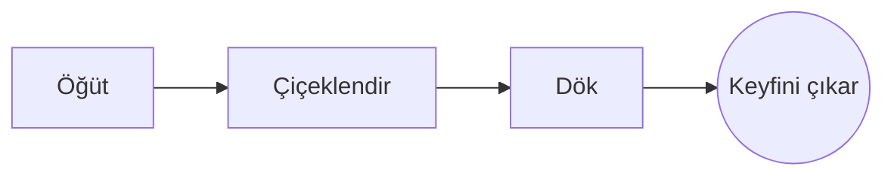

# Mükemmel Filtre Kahve

Birkaç adımda yavaş bir sabah ritüeli. Soldaki **kaynakta** ya da doğrudan sağdaki *önizlemede* yazın: ikisi de eşzamanlı kalır ve ==her düzenleme Markdown’da temiz bir değişikliktir==.

> [!TIP]
> Kaynama noktasından hemen sonraki, yaklaşık 94 °C’lik su, acılık katmadan tatlılığı öne çıkarır.

## Oran

Çoğu tarif bir ölçü kahveye on altı ölçü su oranında karar kılar:

$$
m_{\text{su}} = 16 \times m_{\text{kahve}}
$$

Yani $20\,\text{g}$ kahve için $320\,\text{g}$ su gerekir.

## Adım adım



## Demleme yöntemleri

| Yöntem       | Öğütme    | Süre |
|:-------------|:---------:|-----:|
| Filtre kahve | İnce-orta | 3:30 |
| French press | Kalın     | 4:00 |
| Espresso     | İnce      | 0:28 |

## Başlamadan önce

- [x] Taze kavrulmuş çekirdekler :coffee:
- [x] Bir değirmen taşlı öğütücü
- [ ] Kuğu boyunlu ibrikli bir su ısıtıcı

```python
def water_for(coffee_g: float, ratio: int = 16) -> float:
    return coffee_g * ratio
```

Çiçeklenme
: Telvenin gazını bırakmasını sağlayan ilk su darbesi.[^1]

[^1]: Taze çekirdekler en çok kabarır; eskiler neredeyse hiç kabarmaz.
