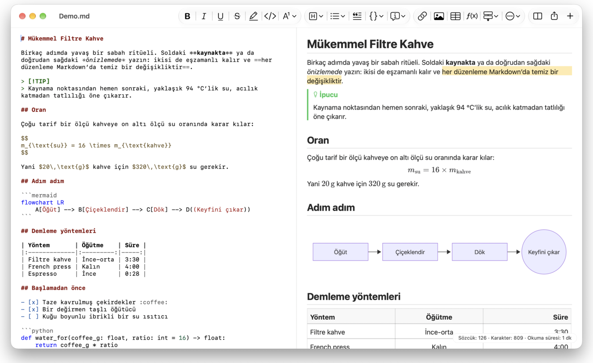
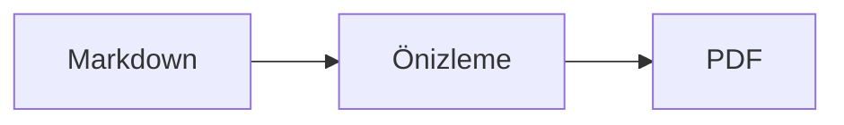

<p>&nbsp;&nbsp;&nbsp;</p>

# Splat

**Kaynakta ya da doğrudan önizlemede yazmanızı sağlayan macOS Markdown düzenleyicisi.**

Splat solda sözdizimi renkli Markdown kaynağınızı, sağda canlı ve tümüyle düzenlenebilir bir önizlemeyi gösterir. İkisinden birinde yazın: önizlemede yazdığınız her şey kaynakta asgari bir değişikliğe dönüşür; böylece dokunmadığınız satırlar bayt bayt aynı kalır ve Git diff’leriniz temiz kalır. Splat zaten kullandığınız Markdown’ı okur: CommonMark ve GitHub Flavored Markdown, GitHub uyarıları, Obsidian wiki bağlantıları, gömmeleri ve bilgi kutuları, Pandoc ve Typora eklentileri, gömülü HTML, LaTeX formülleri ile Mermaid, Graphviz ve PlantUML diyagramları; hepsi çevrimdışı görüntülenir. Tek tıkla PDF, HTML ya da Word olarak dışa aktarın. Rust ile gerçek AppKit denetimleri üzerine yazılmıştır, 35 dilde kullanılabilir ve siz istemedikçe ağa hiçbir şey göndermez.
 


[](https://github.com/sventmueller/splat/releases/latest/download/Splat.dmg)

**[Splat.dmg dosyasını indirin](https://github.com/sventmueller/splat/releases/latest/download/Splat.dmg)**: Apple tarafından imzalanmış ve notarize edilmiştir; Apple Silicon ve Intel üzerinde macOS 14 veya üstü için.

**Bir hata mı buldunuz?** Splat, dokunmadığınız satırları bayt bayt aynı tutar. Yine de biri değişirse veya bir dosya yanlış görüntülenirse [bir issue açın](https://github.com/sventmueller/splat/issues/new/choose) ve dosyayı ekleyin. Splat işinize yarıyorsa [GitHub’da bir yıldız](https://github.com/sventmueller/splat) başkalarının da onu bulmasına yardımcı olur.
 
 

[](https://www.rust-lang.org)
[](https://www.apple.com/macos/)

[](https://github.com/madsmtm/objc2)
[](https://webkit.org)
[](https://github.com/kivikakk/comrak)
[](https://github.github.com/gfm/)
[](https://www.mathjax.org)
[](https://cortexjs.io/mathlive/)
[](https://mermaid.js.org)
[](https://graphviz.org)
[](https://plantuml.com)


[](#lisans)

[Bahasa Indonesia](../id/README.md) ·
[Bahasa Melayu](../ms/README.md) ·
[Català](../ca/README.md) ·
[Čeština](../cs/README.md) ·
[Dansk](../da/README.md) ·
[Deutsch](../de/README.md) ·
[English](../../../README.md) ·
[Español](../es/README.md) ·
[Français](../fr/README.md) ·
[Hrvatski](../hr/README.md) ·
[Italiano](../it/README.md) ·
[Magyar](../hu/README.md) ·
[Nederlands](../nl/README.md) ·
[Norsk](../no/README.md) ·
[Polski](../pl/README.md) ·
[Português (Brasil)](../pt_BR/README.md) ·
[Português (Portugal)](../pt_PT/README.md) ·
[Română](../ro/README.md) ·
[Slovenčina](../sk/README.md) ·
[Slovenščina](../sl/README.md) ·
[Suomi](../fi/README.md) ·
[Svenska](../sv/README.md) ·
[Tiếng Việt](../vi/README.md) ·
**Türkçe** ·
[Ελληνικά](../el/README.md) ·
[Русский](../ru/README.md) ·
[Українська](../uk/README.md) ·
[עברית](../he/README.md)‎ ·
[العربية](../ar/README.md)‎ ·
[हिन्दी](../hi/README.md) ·
[ไทย](../th/README.md) ·
[한국어](../ko/README.md) ·
[日本語](../ja/README.md) ·
[简体中文](../zh-Hans/README.md) ·
[繁體中文](../zh-Hant/README.md)

## İçindekiler

- [Bir bakışta özellikler](#bir-bakışta-özellikler)
- [Gereksinimler](#gereksinimler)
- [Kurulum](#kurulum)
- [Başlarken](#başlarken)
- [Yazmak](#yazmak)
  - [Kaynakta](#kaynakta)
  - [Önizlemede](#önizlemede)
  - [Biçimlendirme komutları](#biçimlendirme-komutları)
  - [Listeler ve görevler](#listeler-ve-görevler)
  - [Tablolar](#tablolar)
- [Desteklenen Markdown](#desteklenen-markdown)
  - [CommonMark ve GitHub Flavored Markdown](#commonmark-ve-github-flavored-markdown)
  - [Bilgi kutuları](#bilgi-kutuları)
  - [Genişletilmiş sözdizimi](#genişletilmiş-sözdizimi)
  - [Obsidian](#obsidian)
  - [Atıflar ve başvurular](#atıflar-ve-başvurular)
  - [Gömülü HTML](#gömülü-html)
  - [Tipografik noktalama](#tipografik-noktalama)
  - [Sözdizimi özeti](#sözdizimi-özeti)
- [Formüller](#formüller)
- [Diyagramlar](#diyagramlar)
- [Görüntüler](#görüntüler)
- [Bağlantılar ve gezinme](#bağlantılar-ve-gezinme)
- [Dışa aktarma, yazdırma ve paylaşma](#dışa-aktarma-yazdırma-ve-paylaşma)
- [Görünüm ve erişilebilirlik](#görünüm-ve-erişilebilirlik)
- [Diller](#diller)
- [Klavye kısayolları](#klavye-kısayolları)
- [Gizlilik ve güvenlik](#gizlilik-ve-güvenlik)
- [Büyük belgeler](#büyük-belgeler)
- [Bilinen sınırlamalar](#bilinen-sınırlamalar)
- [Sorun giderme](#sorun-giderme)
- [Geliştiriciler için](#geliştiriciler-için)
  - [Derleme](#derleme)
  - [Dağıtım](#dağıtım)
  - [Test](#test)
  - [Proje yapısı](#proje-yapısı)
  - [Veri akışı](#veri-akışı)
  - [Denetleyicideki kurallar](#denetleyicideki-kurallar)
  - [Komut ekleme](#komut-ekleme)
  - [Çeviriler](#çeviriler)
  - [Üçüncü taraf bileşenler](#üçüncü-taraf-bileşenler)
- [Lisans](#lisans)

## Bir bakışta özellikler

- **İki yazma yolu, tek metin.** Kaynak da önizleme de düzenlenebilir. Tek gerçek Markdown dosyasıdır: her belgenin tek bir geri alma geçmişi vardır ve önizlemedeki her düzenleme kaynakta olabilecek en küçük değişikliğe çevrilir.
- **Zaten kullandığınız Markdown.** CommonMark, GitHub Flavored Markdown, GitHub uyarıları, Obsidian, Pandoc ve Typora eklentileri, emoji kısa kodları, spoiler’lar, tanım listeleri, başlık çapaları ve GitHub README dosyalarındaki gibi HTML.
- **Formüller ve diyagramlar dahili.** MathJax ile LaTeX formülleri ve görsel bir formül düzenleyicisi. Mermaid, Graphviz ve PlantUML diyagramları Mac’inizde Java, sunucu ya da ağ bağlantısı olmadan görüntülenir.
- **Her şey için bir düğme.** Her Markdown yapısının bir araç çubuğu düğmesi ve bir menü öğesi vardır; yaygın olanların klavye kısayolu da bulunur. Tabloların satırlar, sütunlar ve hizalama için kendi menüsü vardır.
- **Hiçbir şey kaybetmeden dışa aktarma.** PDF, tek başına yeterli tek bir HTML dosyası ya da gerçek başlıklar, listeler, tablolar, dipnotlar ve görüntüler içeren bir Word belgesi.
- **Tepeden tırnağa yerel.** Gerçek AppKit pencereleri, sekmeler, menüler, açılır pencereler, Sürümler, Otomatik Kaydet, paylaşım menüsü, koyu mod, yazım denetimi, dikte ve VoiceOver. Electron yok, metnin kendisi için web görünümü yok.
- **Büyük dosyalarda hızlı.** 10 MB’lık bir belgede bir tuş vuruşunu işlemek, görünümün kendi işinden önce yaklaşık 10 ms sürer.
- **Gizliliğe duyarlı ve özenli.** Web’deki görüntüler yalnızca siz izin verdikten sonra yüklenir, diğer uygulamalara giden bağlantılar önce sorar ve güvenilmeyen görüntü verilerini çözen her şey korumalı yardımcı işlemlerde çalışır.
- **Kendi dilinizde.** Arayüz ve yerleşik Markdown hızlı başvurusu 35 dilde gelir: Arapça, Katalanca, Çince (Basitleştirilmiş), Çince (Geleneksel), Hırvatça, Çekçe, Danca, Felemenkçe, İngilizce, Fince, Fransızca, Almanca, Yunanca, İbranice, Hintçe, Macarca, Endonezce, İtalyanca, Japonca, Korece, Malayca, Norveççe, Lehçe, Portekizce (Brezilya), Portekizce (Portekiz), Romence, Rusça, Slovakça, Slovence, İspanyolca, İsveççe, Tayca, Türkçe, Ukraynaca ve Vietnamca.

## Gereksinimler

- macOS 14 Sonoma veya üstü. Splat macOS 27’de geliştirilir ve test edilir; orada Liquid Glass tasarımını kendiliğinden benimser.
- Apple Silicon veya Intel işlemcili bir Mac.
- Yaklaşık 45 MB disk alanı.

## Kurulum

**Disk görüntüsünden.** [`Splat.dmg`](https://github.com/sventmueller/splat/releases/latest/download/Splat.dmg) dosyasını indirin, açın ve Splat’ı Applications klasörüne sürükleyin. Görüntü bir Developer ID ile imzalanmış ve Apple tarafından notarize edilmiştir; bu yüzden uyarısız açılır.

**Homebrew ile.** Cask kendi tap’inde bulunur:

```sh
brew install --cask sventmueller/tap/splat
```

`brew upgrade --cask splat` yeni sürümleri kurar, `brew uninstall --zap --cask splat` ise Splat’ın ayarlarını ve önbelleklerini de kaldırır.

**Güncellemeler.** Disk görüntüsünden ya da Homebrew ile kurulan Splat kendini [Sparkle](https://sparkle-project.org) ile güncel tutar. İkinci açılışta, günde bir kez kendiliğinden güncelleme arayıp arayamayacağını sorar. **Splat › Güncellemeleri Denetle…** hemen denetler; aynı menüdeki **Güncellemeleri Otomatik Olarak Denetle** ve **Güncellemeleri Otomatik Olarak İndir ve Yükle** seçimlerinizi sonradan değiştirir. Splat bir güncellemeyi yalnızca geliştiricinin imzasını taşıyorsa kurar. Kendi derlemenizde güncelleyici yoktur.

**Kaynaktan.** Önkoşullar için [Building](#derleme) bölümüne bakın, ardından:

```sh
make build
ditto target/release/Splat.app /Applications/Splat.app
open /Applications/Splat.app
```

Markdown dosyalarını çift tıklayarak Splat ile açmak için Finder’da herhangi bir `.md` dosyası seçin, **Dosya › Bilgi Ver**’ı seçin, **Şununla Aç** altında Splat’ı seçin ve **Tümünü Değiştir…**’e tıklayın. Splat kendini `.md`, `.markdown`, `.mdown` ve `.mkd` dosyaları için kaydeder.

## Başlarken

### Pencere

Her belge kendi penceresinde açılır; sekmeleri tercih ediyorsanız sekme olarak:

- **Sol: kaynak.** SF Mono yazı tipiyle, sözdizimi renkli Markdown’ınız.
- **Sağ: önizleme.** Görüntülenmiş belge, düzenlemeye hazır.
- **Ana hat kenar çubuğu (isteğe bağlı).** Tüm başlıklar bir ağaç olarak; birine tıklamak onu iki bölmede de gösterir. **Görüntü › Ana Hattı Göster** (⌃⌘S) ile açıp kapatın.
- **Araç çubuğu.** Düğmeler neyi değiştirdiklerine göre gruplanmıştır: karakterler, paragraflar ve eklenen öğeler; ardından önizlemeyi aç/kapat, Paylaş ve Yeni Belge. **Görüntü › Araç Çubuğunu Özelleştir…** ile özelleştirin.

Her iki tarafa daha fazla yer vermek için ayırıcıyı sürükleyin. **Görüntü › Önizlemeyi Gizle** (⌥⌘P) yalnızca kaynağı bırakır; Splat bunu pencere başına hatırlar. İki bölme birlikte kayar ve birinde yaptığınız seçim ötekinde vurgulanır.

### Belgeler, sekmeler ve sürümler

Splat sıradan bir macOS belge uygulamasıdır:

- **Otomatik Kaydet ve Sürümler.** Değişiklikler yerinde kaydedilir. **Dosya › Geri Dön › Tüm Sürümlere Göz At…** sizi zamanda geriye götürür.
- **Başka programlardan gelen değişiklikler.** Git, bir betik ya da başka bir düzenleyici açık bir belgeyi değiştirdiğinde Splat onu yeniden yükler; imleci ve kaydırma konumunu korur. Kendi kaydedilmemiş değişiklikleriniz varsa Splat bunları tutar ve macOS diğer sürümün üzerine kaydetmeden önce sorar.
- **Olağan dosya komutları.** Çoğalt (⇧⌘S), Adını Değiştir…, Şuraya Taşı… ve **Dosya › Son Kullanılanı Aç**.
- **Sekmeler.** **Dosya › Yeni Sekme** ya da araç çubuğundaki **+** düğmesi yeni bir belgeyi sekmede açar; standart Pencere menüsü sekmeleri birleştirir, taşır ve arasında geçiş yapar.
- **Pencere yerleşimi.** Son pencerenizin boyutu ve konumu, yeniden başlatmalar boyunca da hatırlanır. Orada zaten bir pencere varsa yenisi biraz kaydırılmış olarak açılır.
- **Dock simgesi.** Son pencereyi kapattıktan sonra simgeye tıklamak yeni bir belge açar.
- **Markdown dosyalarını Splat ile açma.** **Splat › Markdown İçin Saptanmış Uygulama Olarak Ayarla**, bir `.md` ya da `.markdown` dosyasına çift tıklamanın Splat’ı açmasını sağlar; macOS bir kez onay ister. Splat saptanmış uygulamayken öğenin yanında onay işareti görünür.

Dosyalar UTF-8 metin ya da bayt sırası işaretli UTF-16 olmalıdır. Splat başka kodlamaları tahmin edip metni bozmak yerine reddeder. Bayt sırası işareti kalır, UTF-16 UTF-16 olarak kalır ve tüm satırları CRLF ile biten bir dosyada eklediğiniz satırlar da CRLF alır.

**Bir çökmeden sonra** en fazla son birkaç saniyelik yazı kaybolur: Splat her beş saniyede bir kaydedilmemiş metni `~/Library/Application Support/Splat/Unsaved` klasörüne kopyalar, belge kaydedilince ya da Splat normal şekilde kapanınca kopyaları siler. Sonraki açılışta çökmenin orada bıraktıklarını `~/Library/Application Support/Splat/Recovery` klasörüne taşır ve bunu klasörü açan bir düğmeyle bir kez bildirir. Splat’ın hâlâ tepki verebildiği bir çökme, açık her belgenin metnini de oraya yazar.

### Hızlı başvuru

**Yardım › Markdown Hızlı Başvuru**, kendi dilinizdeki bir kopya kâğıdını yeni, başlıksız bir belge olarak açar. Sıradan bir belgedir; her şeyi hemen orada, kaynakta ya da önizlemede deneyin.

## Yazmak

### Kaynakta

Kaynak, Markdown için ayarlanmış düz metin düzenleyicisidir:

- **Sözdizimi renkleri** VS Code’daki gibi: başlıklar, vurgu, bağlantılar, kod, tablolar, HTML, front matter ve formüllerle diyagramların içinde LaTeX ile Mermaid. Açık, koyu ve Karşıtlığı Artır için paletler vardır.
- **Çitli kod blokları** Bash, C, C++, C#, CSS (SCSS ve Less dahil), Go, HTML, XML, Java, JavaScript, JSON, Kotlin, PHP, Python, Ruby, Rust, SQL, Swift, TypeScript, YAML, TeX ve Mermaid için renklendirilir; `js`, `py` ya da `sh` gibi olağan kısa adlar da geçerlidir.
- **Sürpriz değişimler yok.** Akıllı tırnaklar, akıllı tireler ve metin değişimi varsayılan olarak kapalıdır, çünkü `--`, `---` ve `"` işaretlerini bozarlar. **Düzen › Değişimler** altından açabilirsiniz.
- **Sistemin yazı araçları.** Yazım ve dilbilgisi denetimi, dikte, Bul ve Değiştir (⌥⌘F) ve Konuşma.
- **Sürükle ve bırak.** Bir görüntü dosyasını bırakırsanız `` eklenir, başka bir dosya bırakırsanız ona bir bağlantı, bir URL bırakırsanız `[url](url)` eklenir. Her bırakma tek bir geri alma adımıdır.
- **Görüntü yapıştırma.** Panodaki bir resim, örneğin bir ekran görüntüsü, belgenin yanına PNG dosyası olarak kaydedilir (`Görüntü 2026-10-29 13.09.07.png`) ve görüntü olarak eklenir. Bunun için belgenin bir kez kaydedilmiş olması gerekir.

### Önizlemede

Önizleme bir kelime işlemci gibi davranır, ama onda yaptığınız her şey Markdown olarak son bulur:

- **Yazma.** `*` ya da `#` gibi Markdown’da anlam taşıyan karakterler, yazıldığı gibi görünsün diye öncelenir (escape edilir).
- **Return** yeni bir paragraf ya da liste öğesi başlatır. **⌥Return** veya **⌃Return** satır sonu ekler.
- **İmleçte biçimlendirme.** İmleç bir sözcüğün sonundayken Kalın, İtalik ve diğer karakter biçimleri bundan sonra yazdıklarınıza uygulanır. Durdurmak için biçimi yeniden seçin. Sözcüğün içindeyken tüm sözcük biçimlendirilir.
- **Boş satırlar.** Boş bir satırda Return bir boş satır daha ekler, Backspace onu kaldırır. Kaynakta her ek boş satır iki boş satır daha demektir; diğer Markdown programları bunları normal paragraf aralığı olarak gösterir.
- **Geri Al** iki bölmede de çalışır. Geri alma öğelerinin adları vardır (“Kalın’ı Geri Al”), yazma her ardışık yazım için tek adımdır ve Geri Al ile Yinele’den sonra iki bölme de değişikliğe kayar.
- **Formüller ve diyagramlar** bitmiş grafikler olarak görünür. Birine tıklayın, imleci üzerine getirin ya da üzerinde Return’e basın; düzenleyicisi açılır ([Formülleri](#formüller) ve [Diyagramları](#diyagramlar) görün).
- **Gömülü HTML, gömülü notlar ve front matter** gösterilir, ancak kaynakta düzenlenir. Üzerlerine tıklamak imleci kaynakta karşılık gelen yere koyar.

Markdown’ın ifade edemediği her şey önizlemede engellenir: Font ve Renk panelleri, cetvel, zengin metin ve görüntülerin yapıştırılması ya da bırakılması. Yapıştırılan HTML ve RTF düz metin olarak gelir.

### Biçimlendirme komutları

Her komuta araç çubuğundan, menü çubuğundan ve iki bölmenin bağlam menüsünden ulaşılır. Menü öğeleri, imlecin bulunduğu yerdeki biçimlendirme için onay işareti gösterir.

| Menü | Komutlar |
|---|---|
| **Biçim › Font** | Kalın, İtalik, Altı Çizgili, Üstü Çizgili, Vurgula, Kod, Üs, İndis |
| **Biçim › Başlık** | Gövde Metni, Başlık 1–6 |
| **Biçim › Liste** | Madde İşaretli Liste, Numaralı Liste, Görev Listesi |
| **Biçim** | Alıntı, Kod Bloku (Dil Yok ya da 20 dilden biri; mevcut bir bloğun dilini de değiştirir), Bilgi Kutusu (Not, İpucu, Önemli, Uyarı, Dikkat; aynı tür yeniden seçilirse kaldırılır), Formülü veya Diyagramı Düzenle…, Biçimlendirmeyi Temizle |
| **Ekle** | Bağlantı…, Görüntü…, Tablo…, Formül, Diyagram (Akış Şeması, Sıralama Diyagramı, Gantt Şeması), İçindekiler, Dipnot, Bölücü Çizgi |
| **Tablo** | Üste/Alta Satır Ekle, Sola/Sağa Sütun Ekle, Satırı Sil, Sütunu Sil, Hizalama (Sol, Ortala, Sağ, Saptanmış), Tablo Sütunlarını Hizala |
| **Görüntü** | Önizlemeyi Gizle/Göster, Ana Hattı Göster/Gizle, Tipografik noktalama, Büyüt/Küçült, Gerçek Boyut, araç çubuğu, sekme çubuğu, tam ekran |

Altı çizgili, vurgu, üs ve indis `<ins>`, `<mark>`, `<sup>` ve `<sub>` olarak yazılır; GitHub bunları da gösterir. Splat GitHub’ın kaldırdığı `<u>` etiketini ve daha kısa `==vurgu==`, `^üs^` ve `~indis~` biçimlerini de okur. GitHub `==` ve `^` işaretlerini yazıldığı gibi, `~indis~` biçimini ise üstü çizili gösterir.

### Listeler ve görevler

- Return listeyi sürdürür; boş bir öğede Return listeyi bitirir.
- **Tab** ve **⇧Tab** önizlemede liste öğelerini girintiler ve girintiyi geri alır.
- Önizlemede bir görev onay kutusuna tıklamak `- [ ]` ile `- [x]` arasında geçiş yapar.
- **Biçim › Liste** seçili paragrafları listeye dönüştürür ya da listenin türünü değiştirir.

### Tablolar

- **Ekle › Tablo…** satır sayısını (başlık satırı dahil) ve sütun sayısını sorar.
- Önizlemede **Tab** sonraki hücreye, **⇧Tab** önceki hücreye, **Return** alttaki hücreye geçer. Son hücrede Tab bir satır ekler.
- **Tablo** menüsü satır ve sütun ekler, siler ve bir sütunun hizalamasını belirler (⌘{, ⌘|, ⌘}).
- **Tablo › Tablo Sütunlarını Hizala** kaynağı boşluklarla doldurur, böylece sütunlar hizalanır.

## Desteklenen Markdown

Splat, CommonMark ve GFM ile uyumlu bir ayrıştırıcı olan [comrak](https://github.com/kivikakk/comrak) ile ayrıştırır ve eklentilerinin çoğunu açar. Aşağıdakilerin hepsi önizlemede ve tüm dışa aktarmalarda görüntülenir.

### CommonMark ve GitHub Flavored Markdown

- Başlıklar (`#` ile ve altı çizgili), paragraflar, satır sonları, vurgu, güçlü vurgu, satır içi kod, alıntı blokları, bölücü çizgiler.
- Madde işaretli, numaralı ve iç içe listeler; görev listeleri.
- Bağlantılar (satır içi, başvurulu ve otomatik), görüntüler, bağlantı başvuru tanımları.
- Sözdizimi renkli çitli ve girintili kod blokları.
- Sütun hizalamalı tablolar.
- `~~iki tilde~~` ile üstü çizili metin.
- Dipnotlar: `metin[^1]` ve belgenin herhangi bir yerinde `[^1]: Not.` Belirteçe tıklamak nota atlar.
- En üstte `---` satırları arasında YAML front matter. Önizleme bunu tek satırda özetler, örneğin “Meta Veriler: title, date, tags”.

### Bilgi kutuları

GitHub uyarıları simge ve başlıkla renkli kutular olarak görüntülenir:

```markdown
> [!NOTE]
> Kullanıcıların bilmesi gereken yararlı bilgi.

> [!WARNING]
> Hemen dikkat gerektiren kritik içerik.
```

Beş tür Not, İpucu, Önemli, Uyarı ve Dikkat’tir. **Biçim › Bilgi Kutusu**, imlecin bulunduğu paragrafı bir bilgi kutusuna dönüştürür.

Obsidian bilgi kutuları da çalışır; istediğiniz başlığı ve bir katlanma durumunu taşıyabilir:

```markdown
> [!tip]- Açmak için ▸ simgesine tıklayın
> Açılana kadar gizli.

> [!question]+ Varsayılan olarak açık
> `+` açık, `-` kapalı başlar.
```

Obsidian’ın diğer türleri beş rengin en yakınıyla gösterilir: `success`, `check`, `done` ve `hint` İpucu olarak; `question`, `help` ve `faq` Önemli olarak; `attention` Uyarı olarak; `failure`, `fail`, `missing`, `danger`, `error` ve `bug` Dikkat olarak; geri kalan her şey Not olarak.

### Genişletilmiş sözdizimi

| Özellik | Sözdizimi | Kaynağı |
|---|---|---|
| Vurgu | `==işaretli metin==` | Obsidian, Typora |
| Üs | `x^2^` | Pandoc, Typora |
| İndis | `H~2~O` | Pandoc, Typora |
| Emoji kısa kodu | `:rocket:` 🚀 olur | GitHub |
| Spoiler | `\|\|gizli metin\|\|`, okumak için seçin | Discord |
| Satır içi dipnot | `metin^[notun kendisi]` | Pandoc, Obsidian |
| Tanım listesi | `Terim`, boş satır, `: Açıklama` | PHP Markdown Extra, Pandoc |
| Başlık çapası | `## Kurulum {#setup}`, `[bkz.](#setup)` ile bağlantı | Pandoc, kramdown |

Tanım listeleri kaynakta şöyle görünür:

```markdown
Terim

: Terimin açıklaması.
```

Özel bir çapa yoksa her başlık, GitHub’daki gibi metninden türetilmiş bir çapa alır: `## Başlarken` başlığına `#başlarken` ile ulaşılır.

### Obsidian

- **Wiki bağlantıları.** `[[Not]]`, aynı klasördeki ya da altındaki bir klasördeki `Not.md` dosyasına bağlanır. `[[Not|Gösterilen metin]]` kendi metninizi gösterir, `[[Not#Başlık]]` notu açar. ⌘-tıklama notu Splat’ta açar.
- **Gömmeler.** `![[Not]]` başka notu bu notun içinde gösterir; onun içine gömülü notlar bağlantı olarak görünür. `![[diagram.png]]` bir görüntü gösterir. Obsidian’daki gibi gömmeler notları ve görüntüleri belgenin klasöründe ya da altında adlandırır, asla mutlak yolla değil; yalnızca Markdown dosyaları not olarak gösterilir.
- **Yorumlar.** `%%Yalnızca kaynakta%%` kaynakta görünür kalır, önizlemeden ve her dışa aktarmadan çıkarılır; hem satır içinde hem de kendi satırlarında.
- **Etiketler.** `#fikir` ya da `#proje/splat` vurgulanır. ⌘-tıklama etiketi belgede arar.
- **Katlanabilir bilgi kutuları.** [Bilgi kutuları](#bilgi-kutuları) bölümüne bakın.

### Atıflar ve başvurular

- **Pandoc atıfları.** `[@doe2020]` ya da `[@doe2020; @roe2021]`, “(Doe 2020; Roe 2021)” gibi okunur. Girişler, front matter’da `bibliography: refs.bib` olarak adlandırılan BibTeX dosyasından gelir. O yoksa Splat, belgenin yanındaki `references.bib`, `literatur.bib` ya da `bibliography.bib` dosyasını kullanır.
- **GitHub ve GitLab başvuruları.** Belge, `origin` uzak deposu github.com’da ya da bir GitLab sunucusunda olan bir Git deposunda duruyorsa `@ad`, `#12` (issue) ve `!7` (merge request, yalnızca GitLab) vurgulanır. ⌘-tıklama bunları tarayıcıda açar.

### Gömülü HTML

GitHub README dosyalarında bulduğunuz türden HTML, bir tarayıcı motoruyla değil, kendi okuyucusuyla görüntülenir:

- ortalanmış paragraflar ve bloklar (`<p align="center">`, `<div align="center">`)
- boyutlu görüntüler (``)
- bağlantılar, `<kbd>⌘</kbd>`, `<br>`, `<u>`, `<ins>`, `<mark>`, `<sup>`, `<sub>`
- listeler ve tablolar; sütunlara yayılan hücreler dahil (`colspan`)
- katlanabilir bölümler: `<details><summary>Daha fazla</summary>…</details>`, ▸ simgesine tıklayarak açılır

HTML etiketleri arasındaki Markdown, Markdown olarak görüntülenir. Betikler, stiller, çerçeveler ve formlar tümüyle dışarıda bırakılır; bağlantılar ve görüntüler yalnızca `http`, `https`, `mailto` ve göreli adresleri korur.

### Tipografik noktalama

**Görüntü › Tipografik noktalama**, düz tırnakları arayüz dilinizin tırnak işaretleri olarak, `--` işaretini kısa tire, `---` işaretini uzun tire ve `...` işaretini üç nokta olarak gösterir. Almancada `"Ja"` „Ja“ olur, Fransızcada «Oui», Japoncada 「はい」; Çince ve Japoncanın tırnakları boşluksuz dizdiği yerlerde de böyledir. `צה"ל` gibi İbranice kısaltmalar gershayim’lerini alır: צה״ל. Kaynak düz karakterleri korur; önizleme ve tüm dışa aktarmalar tipografik olanları gösterir. Ayar, siz açana kadar kapalıdır.

### Sözdizimi özeti

| Öğe | Markdown |
|---|---|
| **Kalın** | `**Kalın**` |
| *İtalik* | `*İtalik*` |
| Altı çizgili | `<ins>Altı çizgili</ins>` veya `<u>Altı çizgili</u>` |
| ~~Üstü çizgili~~ | `~~Üstü çizgili~~` |
| Vurgu | `<mark>Vurgu</mark>` veya `==Vurgu==` |
| `Kod` | `` `Kod` `` |
| x² | `x<sup>2</sup>` veya `x^2^` |
| H₂O | `H<sub>2</sub>O` veya `H~2~O` |
| [Bağlantı](https://example.com) | `[Bağlantı](https://example.com)` |
| Başlık | `# Başlık` ile `###### Başlık` arası |
| Alıntı | `> Alıntı` |
| Madde işaretli liste | `- Öğe` |
| Numaralı liste | `1. Öğe` |
| Görev | `- [ ] Açık` ve `- [x] Tamam` |
| Kod bloku | ```` ```rust ```` … ```` ``` ```` |
| Tablo | `\| A \| B \|` ve başlığın altında `\|---\|---\|` |
| Dipnot | `Metin[^1]` ve `[^1]: Not` |
| Bölücü çizgi | `---` |
| Görüntü | `` |
| Formül | `$E = mc^2$`, `$$ … $$` |
| Diyagram | ```` ```mermaid ````, ```` ```dot ````, ```` ```plantuml ```` |
| Bilgi kutusu | `> [!TIP]` |
| Wiki bağlantısı | `[[Not]]`, `[[Not\|Metin]]` |
| Gömme | `![[Not]]`, `![[image.png]]` |
| Yorum | `%%Yorum%%` |
| Etiket | `#etiket` |
| Atıf | `[@key]` |
| Spoiler | `\|\|Spoiler\|\|` |
| Emoji | `:tada:` |

## Formüller

Formüller, TeX ve AMS matematiğiyle [MathJax](https://www.mathjax.org) tarafından keskin vektör grafikleri olarak görüntülenir. `\text{…}` içindeki metin herhangi bir yazı sisteminde olabilir: MathJax’in fontlarında bulunmayanlar Mac’inizin fontlarından gelir; Arapça ve İbranice sağdan sola akar, emoji renkli görünür.

| Tür | Sözdizimi |
|---|---|
| Satır içi | `$E = mc^2$`, `` $`E = mc^2`$ `` (GitHub, GitLab), `\(E = mc^2\)` |
| Ayrı satırda | `$$` … `$$`, `\[` … `\]` ya da `math` ile işaretli bir kod bloku |

**Formülü düzenleme.** Düzenleyicisini bir açılır pencerede açmak için önizlemede bir formüle tıklayın, çift tıklayın, üzerinde Return’e basın ya da imleci üzerine getirin. **Ekle › Formül** yeni bir tane ekler ve düzenleyiciyi hemen açar.

- **Görsel ya da LaTeX.** En üstteki anahtar, görsel bir düzenleyici ([MathLive](https://cortexjs.io/mathlive/)) ile LaTeX kodu arasında geçiş yapar. Splat seçiminizi hatırlar.
- **Yapı taşları**: kesir, karekök, üs ve indis, sınırları olan toplam ve integral, limit, içerikle birlikte büyüyen ayraçlar, 2×2 matris, Yunan harfleri ile ilişkiler, işleçler ve oklar. Bunlar □ yer tutucuları bırakır ve **Tab** bir sonrakine atlar.
- **Canlı önizleme.** Değişiklikler siz yazarken belgede görünür. MathJax hataları kodun altındaki bir satırda gösterilir.
- **Onaylama ya da vazgeçme.** Dışarıya tıklamak değişikliği tek bir geri alma adımı olarak korur; **Esc** veya **Vazgeç** onu atar. Yeni ve boş bir formülden Esc ile çıkmak onu yeniden kaldırır.
- Bağlam menüsü, işaretçinin altındaki formül için **Formülü Düzenle…** seçeneğini sunar.

VoiceOver bir formülü LaTeX kodu olarak okur. Splat formülleri görüntüler, eksiksiz LaTeX belgelerini değil: paket, TikZ ve `\documentclass` yoktur.

## Diyagramlar

Diyagramlar Splat’ın içinde, çevrimdışı ve açık ile koyu bir varyantla görüntülenir.

| Motor | Kod bloku | Ne çizer |
|---|---|---|
| [Mermaid](https://mermaid.js.org) | ```` ```mermaid ```` | akış şemaları, sıralama, sınıf, durum, varlık ilişkisi, Gantt, pasta, zihin haritaları, zaman çizelgeleri ve diğer tüm Mermaid türleri |
| [Graphviz](https://graphviz.org) | ```` ```dot ```` veya ```` ```graphviz ```` | DOT dilinde çizgeler |
| [PlantUML](https://plantuml.com) | ```` ```plantuml ```` veya ```` ```puml ```` | UML diyagramları; Java olmadan çalışır |



**Diyagramı düzenleme**, formülü düzenlemeye benzer: kodu bir açılır pencerede açmak için ona tıklayın; sözdizimi renkleri vardır, hata iletileri kodun altındaki bir satırda görünür. **Ekle › Diyagram**, bir akış şeması, bir sıralama diyagramı ya da bir Gantt şeması şablonuyla başlar. Yapı taşları en yaygın üç Mermaid türüne yardımcı olur:

- **Akış Şeması:** Düğüm ▾ (dikdörtgen, yuvarlatılmış, daire, eşkenar dörtgen, veritabanı), Bağlantı, Etiketli bağlantı, Grup, Yön ▾
- **Sıralama Diyagramı:** Katılımcı, İleti, Yanıt, Not, Döngü, Alternatif yollar
- **Gantt Şeması:** Bölüm, Görev, Kilometre taşı

Diğer diyagram türleri kod olarak düzenlenir. VoiceOver bir diyagramın başlığını ya da alternatif metnini okur.

Açılıştan sonraki ilk diyagram yaklaşık bir saniye sürer, çünkü görüntüleme motoru arka planda başlar. 10 saniyeden uzun süren bir diyagram hata gösterir ve görüntüleme motoru bir sonrakine yeniden başlar. PlantUML’in motoru (3 MB) yalnızca ilk PlantUML diyagramıyla yüklenir. Web’den bir PlantUML `!include` engellenir.

## Görüntüler

- **Yerel görüntüler** belgeye göreli yollar kullanır: ``. Splat PNG, JPEG, GIF, WebP, BMP, SVG, HEIC, TIFF, AVIF ve PDF gösterir.
- **Web’deki görüntüler** siz izin verene kadar engelli kalır: önizlemenin üstündeki bir çubuk, bunları yüklemenin sunucularına belgeyi açtığınızı ve ne zaman açtığınızı bildireceğini açıklar. **Görüntüleri Yükle** bunlara bu belge için izin verir; Splat seçimi dosya başına hatırlar.
- **Boyut.** `` bir görüntünün boyutunu belirler; aksi halde görüntüler önizlemenin genişliğine sığar.
- **Diskteki değişiklikler.** Değiştirdiğiniz bir görüntü ya da belge adını verdikten sonra ortaya çıkan bir görüntü, belge yeniden açılmadan görünür. Ağ yüzünden başarısız olan web görüntüleri, bir belge onları gösterdiği sürece yeniden denenir.
- **Bellek.** Görüntüler en uzun kenarında 2560 piksele kadar gösterilir; bu bir A4 sayfayı da doldurur. Mac’in belleğinin sekizde birini doldurduklarında ve macOS bellek baskısı bildirdiği sürece daha küçük çözülürler.
- **Koyu mod.** Beyaz arka planlı görüntüler koyu önizlemede hafifçe karartılır.
- **Yapıştırma ve bırakma.** [Kaynakta](#kaynakta) bölümüne bakın.

## Bağlantılar ve gezinme

Önizlemede bir tıklama imleci yerleştirir, böylece bağlantı metnini düzenleyebilirsiniz; **⌘-tıklama** bağlantıyı izler:

- `http`, `https` ve `mailto` tarayıcınızda ya da posta uygulamanızda açılır.
- Markdown dosyaları Splat’ta açılır; diğer dosyalar ve klasörler Finder’da gösterilir.
- `#çapa` belgede o başlığa atlar.
- `slack://` ya da `vscode://` gibi başka bir uygulamayı açan adresler önce sorar ve tam adresi ile uygulamayı gösterir. **Vazgeç** önceden seçilidir.

**Ekle › İçindekiler**, tüm başlıkların bağlantılı bir listesini ekler. İmleç içindeyken aynı komut onu günceller. Ana hat kenar çubuğu (⌃⌘S) iki bölmede de herhangi bir başlığa atlar.

## Dışa aktarma, yazdırma ve paylaşma

| Biçim | Nasıl | Ne elde edersiniz |
|---|---|---|
| **PDF** | **Dosya › PDF Olarak Dışa Aktar…** veya Paylaş menüsü | Kâğıt boyutunda sayfalar, her zaman açık görünümde; formüller ve diyagramlar vektör grafikleri olarak. **Dosya › Sayfa Düzeni…** kâğıdı belirler. |
| **Yazdırma** | **Dosya › Yazdır…** (⌘P) | PDF ile aynı düzen. |
| **HTML** | **Dosya › HTML Olarak Dışa Aktar…** veya Paylaş menüsü | Tek başına yeterli tek bir dosya: yerel görüntüler gömülü, formüller ve diyagramlar keskin görüntüler olarak, içindekiler çalışsın diye başlık çapaları. Betik yok. |
| **Word** | **Dosya › Word Belgesi Olarak Dışa Aktar…** veya Paylaş menüsü | Word’ün başlık stillerini, gerçek listeleri ve tabloları (birleştirilmiş hücreler dahil), Word dipnotları olarak dipnotları, gömülü görüntüleri, formülleri ve diyagramları içeren bir `.docx`. |
| **Markdown** | Araç çubuğundaki **Paylaş** düğmesi | Mail, Mesajlar, AirDrop ve diğer tüm paylaşım servisleri için belge bir `.md` dosyası olarak. |

**Dosya › Paylaş** menüsü bunların hepsini tek bir yerde sunar. Dışa aktarmalar tipografik noktalama ayarını ve web’den izin verdiğiniz görüntüleri kullanır; web’deki görüntüler HTML’de bağlantı olarak kalır.

## Görünüm ve erişilebilirlik

- **Koyu mod** sistemi izler. Formüller ve diyagramlar her görünüm için ayrı görüntülenir.
- Sistem Ayarları’ndaki **Kontrastı artır**, sözdizimi renklerini yüksek karşıtlıklı paletlere geçirir.
- **Yakınlaştırma.** ⌘+, ⌘− ve ⌘0 iki bölmeyi de ölçekler.
- **Tam ekran, sekmeler ve özelleştirilebilir araç çubuğu**, her Mac uygulamasında olduğu gibi.
- **VoiceOver.** Bölmeler “Markdown kaynağı” ve “Önizleme” olarak etiketlenir, formüller kodları olarak, diyagramlar başlıkları olarak okunur. Her komuta klavyeden ulaşılabilir.

Splat’ın ayarlar penceresi yoktur: az sayıdaki seçenek uygulandıkları yerde, **Görüntü** ve **Düzen › Değişimler** altında durur.

## Diller

Arayüz, menüler ve Markdown hızlı başvurusu 35 dile çevrilmiştir:

Arapça, Katalanca, Çince (Basitleştirilmiş), Çince (Geleneksel), Hırvatça, Çekçe, Danca, Felemenkçe, İngilizce, Fince, Fransızca, Almanca, Yunanca, İbranice, Hintçe, Macarca, Endonezce, İtalyanca, Japonca, Korece, Malayca, Norveççe, Lehçe, Portekizce (Brezilya), Portekizce (Portekiz), Romence, Rusça, Slovakça, Slovence, İspanyolca, İsveççe, Tayca, Türkçe, Ukraynaca ve Vietnamca.

Splat, **Sistem Ayarları › Genel › Dil ve Bölge** içindeki dil sırasını izler; orada **Uygulamalar** altından yalnızca Splat için de bir dil seçebilirsiniz. Dilinizde çeviri yoksa İngilizceyi kullanır. Menü terimleri Apple’ın kendi çevirilerini izler, böylece Splat Mac’inizin geri kalanı gibi okunur.

İbranice ve Arapça metin, arayüz dili ne olursa olsun göründüğü her yerde sağdan sola okunur: her paragraf, başlık ve liste öğesi ilk harfinin yönünü alır, alıntılar ve bilgi kutuları çubuklarını sağa çizer ve metni sağdan sola başlayan bir tablo sütunlarını sağdan sıralar. Kod blokları soldan sağa kalır. PDF, HTML ve Word dışa aktarmaları bu yönleri korur. Sistem dili İbranice ya da Arapça olduğunda macOS pencereyi de aynalar, böylece önizleme solda yer alır.

## Klavye kısayolları

| Eylem | Kısayol |
|---|---|
| Kalın, İtalik, Altı Çizgili | ⌘B, ⌘I, ⌘U |
| Üstü çizgili | ⇧⌘X |
| Bağlantı… | ⌘K |
| Gövde metni, Başlık 1–6 | ⌥⌘0, ⌥⌘1 ile ⌥⌘6 arası |
| Tablo sütununu sola, ortaya, sağa hizala | ⌘{, ⌘\|, ⌘} |
| Önizlemeyi gizle veya göster | ⌥⌘P |
| Ana hattı göster veya gizle | ⌃⌘S |
| Büyüt, küçült, gerçek boyut | ⌘+, ⌘−, ⌘0 |
| Yeni belge, aç, kaydet, çoğalt | ⌘N, ⌘O, ⌘S, ⇧⌘S |
| Sayfa düzeni, yazdır | ⇧⌘P, ⌘P |
| Bul, bul ve değiştir | ⌘F, ⌥⌘F |
| Sonrakini, öncekini bul; seçimi kullan; seçime git | ⌘G, ⇧⌘G; ⌘E; ⌘J |
| Yazım ve dilbilgisi denetimini göster; belgeyi denetle | ⌘:, ⌘; |
| Yapıştır ve stili eşleştir | ⌥⇧⌘V |
| Araç çubuğunu gizle, tüm sekmeleri göster, tam ekran | ⌥⌘T, ⇧⌘\\, ⌃⌘F |
| Satır sonu (önizleme) | ⌥Return veya ⌃Return |
| Tabloda sonraki hücre / önceki hücre (önizleme) | Tab / ⇧Tab |
| Liste öğesini girintile / girintiyi geri al (önizleme) | Tab / ⇧Tab |
| Formül düzenleyicisinde sonraki yer tutucu | Tab |
| Formül veya diyagram düzenleyicisini değişiklik yapmadan kapat | Esc |
| Bir bağlantıyı, etiketi veya başvuruyu izle (önizleme) | ⌘-tıklama |

Splat, Apple’ın standart kısayollarına dokunmaz.

## Gizlilik ve güvenlik

Bir Markdown dosyası herkesten gelebilir; bu yüzden Splat her belgeyi güvenilmez sayar.

- **Varsayılan olarak ağ yok.** Splat’ta telemetri yoktur. Güncellemeleri yalnızca siz onay verdikten sonra ya da **Güncellemeleri Denetle…**’yi seçtiğinizde arar: o zaman GitHub’dan küçük bir akış dosyası yükler ve istek uygulamanın adı ile sürümünden başka bir şey içermez. Formüller ve diyagramlar yerelde görüntülenir; bunu yapan web görünümleri ağa erişemez. **Yardım › Sorun Bildir…**, tarayıcınızda GitHub’daki bir formu açar; adresi Splat sürümünü, macOS sürümünü ve Mac türünü içerir, belgelerinizden hiçbir şey içermez.
- **Web’deki görüntüler** yalnızca izninizden sonra, yalnızca `https` üzerinden, asla yerel ağınızdaki sunuculardan olmayarak, her biri en fazla 10 MB ve çerezsiz özel bir oturumda yüklenir.
- **Yalıtılmış çözme.** Görüntüler ile formüllerin ve diyagramların grafikleri, devraldıkları her dosyayı kapatan ve ilk baytı okumadan önce kendini bir sanal alana (sandbox) kilitleyen yardımcı işlemlerde çözülür: dosya erişimi yok, ağ yok. Yalnızca boyutu denetlenen pikselleri geri verirler ve 10 saniye sonra durdurulurlar. Apple’ın kendi görüntü çözücüleri yalnızca HEIC, TIFF, AVIF ve PDF’yi görür, o da yalnızca veri gerçekten o biçimdeyse; bunlar ayrıca sistemin font klasörlerini okuyabilen ve sistemin video çözücüsünü kullanabilen kendi yardımcılarında çalışır. SVG’ler, formüller ve diyagramlar da bu yardımcıdan geçer; bu yüzden Splat’ta sabit çözünürlüklü resimlerdir: nokta başına dört piksel, uzun kenarda en fazla 2560.
- **Yerel dosyalar** bir belgeye yalnızca onun adlandırdığı yolla ulaşır. Gömmeler Markdown notlarını belgenin klasöründen ve altından gösterir, eksik bir resim de yalnızca orada aranır. Başka yerdeki, mutlak ya da `~` ile başlayan bir görüntü yolu önizlemede yine yüklenir; HTML ve Word dışa aktarmaları, yazdırma ve PDF’ler yalnızca belgenin klasöründe ya da Git deposunda (bu depo Ana klasörünüzü de içermediği sürece) olanı yanına alır, böylece başkasından gelen bir belge dosyalarınızı ilettiğiniz bir dışa aktarmaya çekemez.
- **Kaydedilmemiş metnin kopyaları**, bir çökmeden sonra kurtarma için Mac’inizde, Library klasörünüzde kalır. Kaydetmeyle ya da Splat’ın normal sonlanmasıyla giderler; bir çökmenin geride bıraktığı kopyalar siz silene kadar kurtarma klasöründe kalır.
- **Bağlantılar** bir tıklamayla asla bir program başlatmaz. Web ve posta bağlantıları olağan şekilde açılır; diğer uygulamalara giden bağlantılar önce sorar.
- **Belgelerdeki HTML**, Splat’ın kendi ayrıştırıcısı tarafından okunur. Betikler, stiller, çerçeveler ve formlar asla çalışmaz.
- **Dışa aktarmalar** betik taşımaz. HTML sayfaları, GitHub’ın yaptığı gibi yalnızca sabit bir zararsız etiket ve öznitelik listesini ve ek olarak bir içerik güvenlik politikasını korur. Word dosyaları yalnızca `http`, `https` ve `mailto` adreslerine bağlanır.
- **Kod imzalama**, Hardened Runtime ile. Splat, belgelerinizin yanındaki görüntüleri her klasör için sormadan gösterebilmek amacıyla App Sandbox olmadan çalışır; tüm çözme işlemlerinin yalıtılması bunu dengeler.

## Büyük belgeler

Splat, birkaç megabaytlık belgelerde de duyarlı kalır:

- Kaynak, yalnızca görünen kısmı yerleştiren TextKit 2’yi kullanır.
- Önizlemede yazarken ve 2 MB’a kadar belgelerin kaynağında, yalnızca etkilenen paragraflar yeniden ayrıştırılır, renklendirilir ve yerleştirilir. 10 MB’lık bir belgede ayrıştırma ve renklendirme yaklaşık 3 ms, işleme yaklaşık 10 ms, önizlemesinde görünümün kendi işiyle birlikte tam bir tuş vuruşu yaklaşık 30 ms sürer.
- Büyük önizlemeler önce görünen kısmı, kalanını uygulama boştayken görüntüler. Görünüme kaydırılan bloklar çizilmeden önce görüntülenir.
- Daha büyük belgelerin kaynağında, siz yazarken önizleme için ayrıştırma arka planda çalışır.
- Belge yaklaşık 4 GB bellek gerektirecek olduğunda düz metin olarak kalır; bu, sıradan Markdown için yaklaşık 50 ila 120 MB, yalnızca tablo veya başlıklardan oluşan belgeler için ise yalnızca 10 ila 20 MB demektir: kaynakta renk yoktur ve önizleme neden boş kaldığını söyler. Dışa aktarmalar yine çalışır.
- Yaklaşık 200 KB’tan itibaren bir belge, ayrıştırılmadan önce penceresini açar; 5 MB’ta renkler ve önizleme yaklaşık çeyrek saniye sonra gelir.
- Formüller ve diyagramlar dahil tüm görüntüler birlikte, Mac’in belleğinin en fazla dörtte birini, bellek azken de bunun yarısını kaplar. Bunun ötesinde, diğer görüntüler yeniden yer açılana kadar yer tutucu olarak gösterilir.

Bazı değişiklikler tümüyle işlenir; 10 MB’ta tuş vuruşu başına yaklaşık 300 ms sürer: bir dipnotun tanımında ya da başvurularında, satır içi bir dipnotun yanında, belgenin en sonunda bir dipnotun yanında, front matter’da ya da bağlantı başvuru tanımlarında yapılanlar ve `%%` yorum blokları olan ya da iki kez ya da bir alıntı veya liste içinde tanımlanmış dipnotu olan bir belgedeki her değişiklik. Bellek dosyayla birlikte büyür: 1 MB’lık Markdown için kabaca 115–160 MB, 10 MB için 340–510 MB.

## Bilinen sınırlamalar

- **Tek tilde indis demektir.** `~metin~` Pandoc’taki gibi indistir; üstü çizili için `~~iki~~` gerekir. GitHub tek tildeyle de üstünü çizer.
- **Önizlemede salt okunur:** gömülü HTML, gömülü notlar ve front matter kaynakta düzenlenir.
- **Çok derin iç içe geçme:** 64 düzeyden derin iç içe HTML ve 16 düzeyden derin satır içi HTML içeriğine yer bırakır.
- **Birleştirilmiş tablo hücreleri** yalnızca HTML tablolarında ve yalnızca sütunlar boyunca vardır (`colspan`, `rowspan` yok). MultiMarkdown’ın birleştirilmiş hücreler için tablo sözdizimi desteklenmez.
- **Kaynakçalar** yalnızca BibTeX’ten okunur; CSL JSON ya da YAML’dan okunmaz.
- **Başvurular** github.com’da ya da bir GitLab sunucusunda bir depo gerektirir; `!7` yalnızca GitLab’da vardır.
- **Tipografik noktalama:** Almancadaki kapanış tek tırnağı kesme işaretinden ayırt edilemez ve ’ olarak dizilir.
- **Belgeler değil, formüller:** LaTeX paketi, TikZ ya da tam belge yok.
- **Görsel formül düzenleyicisi** LaTeX’i MathLive’ın gösteriminde yazar: boşluklar kaybolur (`E = mc^2` `E=mc^2` olur), görüntü aynı kalır.
- **Tasarım gereği:** satır numarası yok, ayarlar penceresi yok, Help Book yok, App Store’da değil.
- **Intel’de daha az test edildi.** Pencere öz-testleri yalnızca Apple Silicon’da çalışır; Intel’de CI `cargo test` çalıştırır.

## Sorun giderme

**Splat’ı yeniden derledikten sonra son belgeler listesi boş.** macOS, son belgeleri ve klasör izinlerini uygulamanın kod imzasına bağlar. Yerel derlemeler, oturum açma anahtarlığınızdaki “Splat Local Signing” sertifikasıyla imzalanır, bu yüzden yeniden derlemelerde ikisi de korunur. Sertifika silindiyse sonraki derleme yenisini oluşturur ve listeler bir kez baştan başlar.

**Disk görüntüsündeki uygulama, kendi derlememden farklı son belgeler gösteriyor.** İkisi farklı imzalar taşır, bu yüzden macOS her biri için ayrı bir liste ve ayrı klasör izinleri tutar.

**HTML ya da başka sözdizimi düz kod olarak görünüyor.** Belgeyi Splat’ın eski bir kopyası açmış olabilir. Onu kapatın, Finder’da belge için **Dosya › Bilgi Ver**’ı seçin ve **Şununla Aç** altında Applications klasörünüzdeki Splat’ın yazılı olduğunu denetleyin.

**Splat menüsünde Güncellemeleri Denetle… yok.** Yalnızca disk görüntüsünden ya da Homebrew ile gelen sürüm kendini günceller; kendi derlemenizde güncelleyici yoktur.

**Web’deki görüntüler görünmüyor.** Önizlemenin üstündeki çubukta **Görüntüleri Yükle**’ye tıklayın. Yalnızca herkese açık sunuculardaki `https` görüntüleri yüklenir.

**Ekran görüntüsünü yapıştırmak önce kaydetmemi istiyor.** Yapıştırılan görüntüler belgenin yanına dosya olarak kaydedilir; bunun için diskte bir yer gerekir. Belgeyi kaydedin, sonra yeniden yapıştırın.

**“Dosya UTF-8 metni değil.”** Dosya başka bir kodlamadadır ve onu belirten bir bayt sırası işareti yoktur. Önce dönüştürün, örneğin `iconv -f ISO-8859-1 -t UTF-8 old.md > new.md` ile.

**Bir formül ya da diyagram hata gösteriyor.** Üzerine tıklayın: düzenleyici, kodun altında MathJax, Mermaid, Graphviz ya da PlantUML’in iletisini gösterir.

## Geliştiriciler için

Splat, AppKit ve WebKit ile doğrudan [objc2](https://github.com/madsmtm/objc2) üzerinden konuşan bir Rust uygulamasıdır. Swift, Objective-C, Xcode projesi ve Interface Builder dosyası yoktur.

### Derleme

Önkoşullar:

- Command Line Tools kurulu macOS (`xcode-select --install`). Xcode gerekmez; Splat `actool`, `ibtool` ve `metal` olmadan derlenir.
- Rust 1.99 (`brew install rust`). [rust-toolchain.toml](../../../rust-toolchain.toml), CI’ın kullandığı tam sürümü adlandırır; rustup onu kendiliğinden kurar, Homebrew’un Rust’ı dosyayı yok sayar. Yeni derleyici ve clippy uyarılarının projeye ulaşması, sürümün orada yükseltilmesiyle olur.
- rustup, `make lint`, `make check` ve `make universal` için: `cargo xtask check-library` kütüphaneyi Linux için derler, böylece macOS gerektirmediğini gösterir; Homebrew’un Rust’ında başka hedef yoktur.

[Makefile](../../../Makefile) kısa giriş noktalarını barındırır; `make help` hepsini listeler:

```sh
make build                  # target/release/Splat.app, cargo xtask bundle --release ile aynı
make universal              # Apple Silicon ve Intel için target/splat-universal, disk görüntüsünün taşıdığı gibi
make check                  # biçimlendirme, uyarısız clippy, tüm testler, vendored kütüphaneler; CI'ın çalıştırdığı
make test                   # önce make check, sonra pencere olmadan öz-test
make test-gui               # pencereli öz-testler; Mac'i yaklaşık dört dakika meşgul eder
make test-long              # daha uzun rastgele arama ve 10 MB'lık kısmi güncelleme denetimi
make fuzz                   # kısmi ayrıştırma ve tüm çıktılar için rastgele girdi
make coverage               # tüm testlerin ve öz-testlerin satır kapsamı, modül başına bir tabanla
make coverage-library       # pencere olmayan modüller için aynı tabanlar, CI'daki gibi
make bench FILE=<file.md>   # büyük bir dosyayı açma, yazma ve kaydırma süreleri
make release                # önce make test, sonra notarize edilmiş disk görüntüsü
```

Derleme mantığının kendisi [xtask](../../../xtask/src/main.rs) Rust crate’inde bulunur:

```sh
cargo xtask bundle --release   # target/release/Splat.app, Hardened Runtime, "Splat Local Signing" ile imzalı
cargo xtask bundle             # target/debug/Splat Debug.app, Markdown dosyalarını asla açmayan ayrı bir uygulama
cargo xtask dmg                # dağıtım için dist/Splat-<version>.dmg, Developer ID, notarize edilmiş
cargo xtask icon               # assets/icon-1024.png dosyasından assets/AppIcon.icns ve README simgesini yeniden oluştur
cargo xtask vendor check       # paketlenmiş JavaScript'i vendor.lock'a karşı doğrula
cargo xtask vendor fetch       # vendor.lock'taki bir sürümü değiştirdikten sonra yeniden indir
```

`bundle`, `Info.plist` dosyasını yazar, kaynakları ve yerelleştirmeleri kopyalar ve uygulamayı “Splat Local Signing” sertifikasıyla imzalar. İlk derleme bu sertifikayı oturum açma anahtarlığınızda, 20 yıl geçerli olarak oluşturur. O durdukça Splat son belgelerini ve klasör izinlerini yeniden derlemeler boyunca korur; geçici (ad hoc) bir imzayla her derleme macOS için yeni bir uygulama olurdu. Debug ve öz-test derlemelerinin kendi paket kimlikleri vardır (`local.splat.debug`, `local.splat.selftest`) ve Markdown dosyaları için kaydolmaz; böylece Finder bir belgeyi asla eski bir derlemede açmaz ve normal uygulamanın ayarlarına dokunmazlar.

Sürüm, `major.minor.build` biçiminde [VERSION](../../../VERSION) dosyasında bulunur ve bir sonraki derlemenin alacağı sürümdür. Başarılı olan her sürüm derlemesi (`make build`, `cargo xtask bundle --release`, `make release`) derleme numarasını bir artırır; debug ve öz-test derlemeleri ona dokunmaz. Major ve minor elle yükseltilir: VERSION’ı örneğin `1.1.0` yapın, sonraki derleme tam olarak onu alır.

### Dağıtım

`cargo xtask dmg` (ya da önce `make test` çalıştıran `make release`) bir sürüm derlemesi yapar, Developer ID’nizle imzalar, uygulamayı Apple ile notarize eder ve bileti zımbalar (staple), onu Applications’a bir bağlantı içeren sıkıştırılmış, salt okunur bir disk görüntüsüne paketler, görüntüyü de notarize edip zımbalar ve sonucu Gatekeeper ile denetler. Uygulama kendi biletini taşır; böylece Homebrew’un yaptığı gibi Finder olmadan kurulan bir kopya ilk açılışta çevrimdışıyken de açılır; notary servisiyle iki tur birkaç dakika sürer. Yalnızca her adımı geçen bir görüntü, commit edilen kopya olan `dist/Splat-<version>.dmg` olur ve derleme numarası artar. Önceki görüntü bir sürüm daha kalır, çünkü GitHub’ın raw sunucusu bir push’tan sonra birkaç dakika eski güncelleme akışını verebilir; daha eskiler çöpe taşınır. Başarısız bir çalıştırma `dist/` ve VERSION’ı olduğu gibi bırakır.
Her sürüm, depo geçmişine yaklaşık 16 MB’lık tam görüntüyü ekler. Yalnızca çağrıldığında çalışır, normal bir derlemenin parçası olarak asla çalışmaz ve şunları gerektirir:

- anahtarlıkta bir “Developer ID Application” sertifikası
- Apple’ın notary servisi için, uygulamaya özel parolayla kaydedilmiş bir oturum; `xcrun notarytool store-credentials notary --apple-id <Apple ID> --team-id <team ID>` ile bir kez oluşturulur
- güncellemeleri imzalayan özel anahtar, oturum açma anahtarlığında. Onu Sparkle’ın `generate_keys` aracı oluşturdu; genel yarısı [xtask/src/main.rs](../../../xtask/src/main.rs) içindeki `UPDATE_KEY` ile kurulu her kopyanın içindedir ve kopyalar yalnızca onunla imzalanmış güncellemeleri kabul eder. Bir parola yöneticisinde yedeğini tutun: `target/sparkle-2.10.1/bin/generate_keys -x <file>` onu dışa aktarır, `-f <file>` başka bir Mac’te içe aktarır. O olmadan kurulu kopyalar bir daha asla güncellenemez.
- rustup (`brew install rustup`; Homebrew’un Rust’ını yerinde bırakır)
- Bu sürümün getirdiklerini anlatan `RELEASE_NOTES.md`. Güncelleme penceresi bunu, sorunun nasıl bildirileceğini söyleyen satırın üstünde gösterir; bu yüzden dosya boşsa veya hâlâ önceki sürümün notlarını içeriyorsa `dmg` durur

Bunlardan biri eksikse `dmg` derlemeden önce durur. İlk çalıştırmada macOS, Terminal’in Finder’ı denetleyip denetleyemeyeceğini sorar; bu izin olmadan disk görüntüsü ne arka planını ne de simge düzenini gösterir.

Güncelleyiciyi yalnızca disk görüntüsü taşır; bu, derlemenin GitHub sürümünden `target/` içine bir kez indirdiği ve xtask’taki sağlama toplamına karşı denetlediği [Sparkle](https://sparkle-project.org)’dır. Hardened runtime çerçeveyi yalnızca uygulamanın Team ID’sini taşıyorsa yükler; Developer ID imzasında bu vardır, yerel sertifikada yoktur; ayrıca bir güncelleme kendi derlemenizin yerine geçmemelidir. Öz-test derlemesi de güncelleme menüsünü onunla denetlemek için Sparkle’ı taşır: var olmayan bir akışla, ikinci açılıştaki Sparkle sorusu olmadan ve yerel olarak imzalanmış uygulamanın çerçeveyi yüklemesine izin veren bir entitlement ile. `dmg`, yeni görüntüyü güncelleme anahtarıyla imzalar ve kurulu kopyaların GitHub’dan okuduğu akış olan `dist/appcast.xml` dosyasını yazar. Görüntüyü ve akışı birlikte commit edip push edin: o andan itibaren kurulu kopyalar güncellemeyi sunar. Bu README’deki ve çevirilerindeki indirme bağlantıları en yeni GitHub sürümündeki `Splat.dmg` dosyasını gösterir; bu yüzden her sürümde bu adla bir kopya bulunur: `cp dist/Splat-<version>.dmg target/Splat.dmg`, ardından `gh release create v<version> dist/Splat-<version>.dmg target/Splat.dmg`.

Disk görüntüsü Apple Silicon ve Intel için evrensel (universal) bir ikili dosyadır; diğer derlemeler yalnızca ana bilgisayarın işlemcisi içindir. Homebrew’un Rust’ı standart kütüphaneyi yalnızca ana bilgisayarın işlemcisi için getirir; bu yüzden `dmg`, [rust-toolchain.toml](../../../rust-toolchain.toml) dosyasındaki araç zincirini ve hedefleri ilk kullanımda kuran rustup üzerinden derler ve program ya da Sparkle iki işlemciden biri için kod içermiyorsa durur. `make universal` yalnızca programı derler.
İçindeki uygulama yerel bir derlemeden farklı bir imza taşır, bu yüzden macOS ikisi için ayrı son belgeler ve klasör izinleri tutar.

### Test

| Komut | Neyi denetler |
|---|---|
| `cargo test --release` | birim, rastgele ve çeviri testleri |
| `SPLAT_FUZZ_ROUNDS=20000 cargo test --release` | daha uzun bir rastgele arama; `SPLAT_FUZZ_SEED` girdileri değiştirir |
| `SPLAT_I18N_ONLY=fr cargo test --release i18n` | diğerleri eksikken tek bir dil |
| `cargo clippy --release --all-targets [--features selftest]` | lint’ler; her `unsafe` bloğunun gerekçesi, işlevlerin uzunluğu ve kütüphanede sayı dönüşümleri dahil |
| `cargo xtask check-library` | kütüphane Linux için derlenir, yani içindeki hiçbir şey macOS gerektirmez |
| `cargo xtask vendor check` | JavaScript kütüphaneleri `vendor.lock` ile bayt bayt eşleşir |
| `cargo xtask selftest probe` | pencere olmadan, her biri beklenen sonucuyla: formüller, diyagramlar, işlem içindeki bir sunucuya karşı web görüntüleri, engellenen adresler, her komutun yazdığı metin, her görüntü biçimi iki dışa aktarma üzerinden, yanıt vermeyi bırakan bir sayfa ve web görünümlerinin savunmaları, savunmasız bir sayfaya karşı. Yaklaşık yarım dakika sürer. Uygulamanın önde olmasını gerektiren şeyler kilitli bir ekranda atlanır |
| `cargo xtask selftest gui [--stop-after "<check>"] [--scenarios] [--only "<group>"] [--in-back]` | çalışan uygulama, tıklama tıklama. Bir pencere açar ve içine yazar; Mac yaklaşık dört dakika meşguldür. `--scenarios` yalnızca ikinci bölümü, yaklaşık bir buçuk dakikada çalıştırır. `--only` bu bölümün tek bir grubunu kendi belgesinde, kilitli ekranda da çalıştırır. `--in-back`, uygulamanın önde olmasını gerektireni atlar; o olmadan böyle bir denetim başarısız olur |
| `cargo xtask selftest resize` | ayırıcıyı taşıdıktan sonra pencereyi genişletir: pencere yeniden boyutlandırılırken kaynak yeniden satırlanır. Yaklaşık on saniye sürer |
| `cargo xtask selftest typing [--by-hand]` | kayıtlar boyunca yazar, uygulamanın olay kuyruğundan geçen tuşlarla ya da `--by-hand` ile elle: yazılanlar kalır ve kaydedilmemiş görünür. Yaklaşık bir dakika sürer |
| `cargo xtask selftest bench <file.md> [--keystroke-ms <n>]` | büyük bir dosyayı açma, yazma ve kaydırma süreleri; en hızlı tuş vuruşu daha uzun sürerse `--keystroke-ms` başarısız olur |
| `cargo test --release -- --ignored partial_updates` | 10 MB’ta bir tuş vuruşu: kısmi güncellemeye karşı tam güncelleme, aynı sonuç en çok dörtte bir sürede |
| `cargo test --release --test hostile` | yığını taşıracak ya da ikinci dereceden zaman alacak biçimde kurulmuş belgeler, her biri süreleri metinle birlikte artması gereken iki boyutta, ayrıştırma, yerleşim, her iki dışa aktarma, tuş vuruşları ve komutlar üzerinden |
| `make mutants` | `crates/splat-markdown`, `crates/splat-preview` ve `crates/splat-file-state` içine tek tek yerleştirilen hatalar, [cargo-mutants](https://mutants.rs) üzerinden (`cargo install cargo-mutants`); hangilerini hiçbir testin fark etmediğini söyler. Saatler sürer; `FILE=crates/splat-preview/src/bridge/mod.rs` kapsamı daraltır |
| `make fuzz` | [cargo-fuzz](https://github.com/rust-fuzz/cargo-fuzz) ile rastgele girdi, rustup'ın nightly sürümünü gerektirir: tam ayrıştırma gibi okunması gereken tuş vuruşları, tüm çıktılar, önizlemedeki düzenlemeler, tüm komutlar ve açıldığı gibi kaydedilen bir dosya. `SECONDS=600` daha uzun arar |
| `cargo test --release --test fuzz_seeds` | `fuzz/seeds/` içindeki tohumlar, fuzzer olmadan bu fuzz hedeflerinin denetimlerinden geçirilir; her `cargo test` içinde yer alır |
| `cargo test --profile checked --workspace` | hata ayıklama derlemesinin ek olarak denetledikleriyle testler: her kısmi ayrıştırmadan sonra bloklar metne uyar ve taşıdığı şey metnin söylediğidir. `make test-long` kapsamındadır |
| `cargo test --release --test entry_points --test structure` | kaynaklardan: sistemin çağırdığı her şey panic'e karşı korunur ve modüller yalnızca aşağı doğru bağımlıdır |
| `cargo test --release --test decoder` | çözücü işlem görüntüleri çözer ve ne dosyalara ne de ağa ulaşır |
| `make coverage` | `cargo test` ve tüm öz-testlerin satır kapsamı, [cargo-llvm-cov](https://github.com/taiki-e/cargo-llvm-cov) üzerinden (`brew install cargo-llvm-cov llvm`); tabanların altında başarısız olur. Mac’i yaklaşık beş dakika meşgul eder |
| `make coverage-library` | yalnızca `cargo test` ile ölçülen `splat-markdown`, `splat-preview`, `splat-file-state` ve `splat-i18n` crate’leri için daha yüksek tabanlar |

Birim testleri test ettikleri kodun yanında durur. `crates/splat-testkit/tests/` modele ve önizlemeye dışarıdan ulaşanları barındırır: `robustness.rs` içindeki rastgele testler (bunlar `splat-testkit` üretecini `sync.rs` testleriyle paylaşır), `hostile.rs` içindeki zarar vermek için kurulmuş belgeler ve `fuzz_seeds.rs` içindeki fuzz hedeflerinin tohumları. `tests/` programın tamamına bakanları barındırır: kaynakları, çevirileri ve derlenmiş programı başlatan çözücü testi. `src/editor/` içinde pencere gerektirmeyen kararlar, kendi testleri olan serbest işlevlerde durur: denetleyicinin belge hakkında bildiği her şey ve bunun nasıl değiştiği `state.rs` içinde, görüntüleme kuralları `render_queue.rs` içinde, metin kopyası `sync.rs` içinde, paragraf biçemleri, yazı tipleri ve renkler değer olarak `render.rs` içinde, araç çubuğu tanımlayıcılarının neye karşılık geldiği `toolbar.rs` içinde, bir bağlantı tıklamasının ne anlama geldiği `navigation.rs` içinde.

Bir pencere öz-testi adımı zamanı değil, adlandırılmış bir koşulu bekler; yalnızca sinyal vermeyen şey, örneğin bir şeyin yokluğu, gerekçesiyle birlikte bir bekleme tutar. Boşuna beklemek, hiç gelmeyeni adlandıran başarısız bir denetimdir, paniğe düşen bir adım da başarısız bir denetimdir ve çalıştırma her iki durumda da sürer. Bu çalıştırmada bir şey söyleyemeyen bir denetim `SELFTEST SKIP` bildirir: xtask onu listeler, o ne geçer ne de başarısız olur. xtask her kipi ve ayrıca `--scenarios`’u denetimlerinin yaklaşık onda dokuzunda tutar. Pencere öz-testi, ana tıklama turundan sonra `src/editor/selftest/scenarios.rs` içinde ikinci bir bölüm çalıştırır: her biçimlendirme ve tablo komutu, iletişim kutuları, bağlantı tıklamaları, yapıştırma, bırakma, dışa aktarmalar, başka bir programın değiştirdiği bir dosya, büyük bir değişiklik, diskte değişen görüntüler, bellek baskısı, devasa bir belge ve bir çökmeden sonra kurtarma. Her grubu kendi belgesini açar, böylece birindeki bir başarısızlık sonrakine ulaşmaz ve her biri `--only` ile tek başına çalışabilir. Pencere olmadan öz-test kaydetmeyi de bilerek bozar: hiçbir şey kabul etmeyen bir klasör, salt okunur bir dosya, kaybolmuş bir klasör, dolu bir disk ve bir kaydetmenin her geri çağrısında bir panic; bunların hiçbiri metne mal olmamalıdır.

Kapsamın iki tabanı vardır: her modül satırlarının en az %84’i, tüm modüller birlikte en az %96’i. `make coverage`, `cargo test`’i öz-testlerle birlikte ölçer ve ikisinden birinin altında başarısız olur; `make coverage-library`, pencere gerektirmeyeni %90 ve %97’de tutar. Tabanlar ve yalnızca bir çökmede çalışan `main.rs` içindeki panik kancası gibi az sayıdaki istisna, gerekçeleriyle birlikte [xtask](../../../xtask/src/coverage.rs) içindedir. Ölçülen derlemeler `target/coverage/` içine gider, böylece ölçüm kodu asla `target/release/` ya da bir disk görüntüsüne ulaşmaz. Çözücü yardımcısı kendini kilitlemeden önce ölçüm dosyasını açar, bu yüzden o da ölçülür.

CI ([.github/workflows/ci.yml](../../../.github/workflows/ci.yml)), `main`’e yapılan her push ve her pull request için Apple Silicon’da `make check`, `make coverage-library` ve universal derlemeyi, Intel’de `cargo test`’i çalıştırır. Her gece [.github/workflows/nightly.yml](../../../.github/workflows/nightly.yml), yeni rastgele girdilerle `make test-long` çalıştırır. Öz-testler ve disk görüntüsü geliştiricinin Mac’inde kalır: bir ekrana ve anahtarlıktaki imzalama sertifikalarına ihtiyaç duyarlar.

Öz-test çıktısı `target/selftest/` içine gider. Öz-test ayrı bir uygulama derler (`target/release/Splat Selftest.app`, paket kimliği `local.splat.selftest`) ve normal uygulamanın ayarlarına, son belgelerine ve dosya ilişkilendirmelerine dokunmaz.

### Proje yapısı

Pencere gerektirmeyen her şey, `crates/` altında kendi başına bir crate’tir ve macOS olmadan derlenir; böylece birbirlerine nasıl bağlı olduklarına derleyici uyulmasını sağlar. `src/` içindeki uygulama (`splat-app` paketi, `splat` programı) onların üzerine kurulur.

- `crates/splat-markdown/`: her tüketicinin okuduğu ağaç, metnine sahip olan `doc/` içindeki `Doc`, ve ayrıştırıcıya tek bağlama `reader/` içinde: comrak başka hiçbir yerde anılmaz, `reader/assumptions.rs` ise kodun onun hakkında neyi varsaydığını tutar. Sözdizimi renkleri ve tüm komutlar `commands/` içinde saf metin düzenlemeleri (`Edit`) olarak. Ayrıca bir düzenlemeden sonra yeniden ayrıştırma (`incremental.rs`), gömülü HTML için okuyucu (`markup.rs`), akan metindeki tipografi, etiketler, başvurular ve alıntılar (`typography.rs`), metnin nasıl göründüğü ve hangi Markdown ile HTML’in onu öyle yaptığı (`style.rs`), bir adresin ne olabileceği (`url.rs`) ile HTML ve Word dışa aktarma (`html.rs`, `docx.rs` ile `docx/html.rs` ve `docx/xml.rs`). Bir konumun kendi türü vardır: kaynak metinde `Byte`, kaynak görünümünde `U16`, önizleme görünümünde `Shown` (`text.rs`).
- `crates/splat-preview/`: önizleme yerleşimi `layout/` içinde, gömülü HTML `layout/html.rs` içinde, ve önizleme ile kaynak arasındaki eşleme (`Bridge`, `Index`). Bir `Bridge`, `Doc`’un başka bir sürümüne ait yerleşimi reddeder.
- `crates/splat-file-state/`: bir dosyanın hangi metni, hangi biçimde tuttuğu ve ona bakmanın ne anlama geldiği.
- `crates/splat-i18n/` ve `resources/*.lproj`: 35 dil; anahtarlar Almanca metinlerdir ve uygulama başlarken arayüz dilinin tablosunu kurar.
- `crates/splat-testkit/`: rastgele testlerin üreteci ve fuzz hedeflerinin denetimleri.
- `src/editor/`: pencere. Tek bir `EditorController` nesnesi AppKit’e her iki görünümün delegesi olarak hizmet eder ve işi bileşenlere devreder; bileşenler denetleyicinin üzerindeki küçük yapılardır ve sahip oldukları durumun alanlarına diğer modüller erişemez:

| Modül | Sorumluluk |
|---|---|
| `controller.rs` | sınıf, işi ileten delege yöntemleri, `invalidate` ve programın geri kalanının bir düzenleyiciye söyledikleri; bileşenlere yalnızca o ulaşır |
| `panes.rs` | `Panes`: metin görünümleri, ana hat, bölmelerin gösterilmesi ve gizlenmesi ve görünümlere erişim veren şey |
| `controller/layers.rs` | kim kime ulaşabilir: bir bileşen, altındakileri sunan bir denetleyici tutamacı alır ve derleyici buna uyulmasını sağlar |
| `state.rs` | denetleyicinin belge hakkında bildikleri ve bunu değiştiren her yol; alanları özeldir ve hiçbir görünüme dokunmaz |
| `model.rs` | durumu ve metin kopyasını bir görünüme erişemeyen closure’lara ödünç verir |
| `actions.rs` | komut kaydı: seçici, başlık, kısayol, simge, komutun ne zaman geçerli olduğu |
| `editing.rs` | `Editing`: komutları çalıştırma ve doğrulama, önizlemede yazma |
| `update.rs` | `Updater`: ayrıştırma, renklendirme, önizlemeyi güncelleme; bir düzenlemeden sonra yalnızca etkilenen paragraflar |
| `sync.rs` | metin kopyası ve blok kayıtları, AppKit olmadan ve rastgele testlerle |
| `progressive.rs` | `Progressive`: büyük önizlemeleri adım adım görüntüleme |
| `selection.rs`, `scroll.rs` | `Selection`, `ScrollSync`: iki bölmenin seçimi ve kaydırma konumu uyumlu |
| `atom.rs`, `atom/edit.rs` | `AtomEditor`: formül ve diyagram düzenleyicisi |
| `navigation.rs`, `links.rs` | `Links`: bağlantılar, wiki bağlantıları, etiketler, görev onay kutuları, katlama, dipnotlar |
| `env.rs` | önizlemenin metnin dışından okuduğu şeyler: tipografik noktalama, `@name` ve `#12` için depo, BibTeX dosyası, gömülü notlar |
| `render.rs`, `images.rs`, `picture.rs`, `remote.rs`, `safe_image.rs` | önizleme metni, yerel ve uzak görüntüler; `Pictures` `images.rs` içinde |
| `attributes.rs` | metin öznitelikleri; her anahtar yalnızca beklediği türde bir değer alır |
| `shadow.rs` | bir çökmeden sonra kurtarma için kaydedilmemiş metnin kopyaları |
| `decoder.rs` | görüntüleri ve grafikleri çözen korumalı yardımcı işlemler |
| `export.rs`, `outline.rs` | `Sharing`: HTML ve Word dışa aktarma; ana hat kenar çubuğu |
| `js.rs`, `mathfield.rs`, `render_queue.rs` | MathJax, Mermaid, Graphviz, PlantUML ve görsel formül düzenleyicisi için WebKit; WebKit’ten bağımsız olarak neyin ne zaman görüntüleneceğinin kuralları |
| `webkit.rs` | WebKit’e çağrılar; yalnızca gezinme delegesinin ömrü `js.rs` ve `mathfield.rs` ile kalır |
| `controller/window.rs`, `toolbar.rs`, `views.rs`, `dialogs.rs`, `style.rs` | pencerenin kurulması, araç çubuğu, metin görünümleri, iletişim kutuları, renkler |

- `src/menu.rs`, `src/app.rs`, `src/document.rs`: menü çubuğu, uygulama delegesi, belge (`MDDocument`, bir `NSDocument` alt sınıfı).
- `src/util/`: işçi iş parçacıkları (`lanes.rs`), yanıt vermeyi bırakabilen birimler (`volumes.rs`), AppKit yardımcıları, dosyalar ve süreçler. `src/diag.rs`: kullanıcının görmediği yerde ters giden şey, bir belgenin hiçbir metni olmadan sistem günlüğüne gider.
- `src/large_alloc.rs`: büyük bellek ayırmaları doğrudan çekirdekten gelir ve serbest bırakılınca ona geri döner; böylece büyük düzenlemelerden sonra bellek geri döner.
- `resources/js/`: web sayfaları ve kütüphaneler; sürümler ve sağlama toplamları [vendor.lock](../../../vendor.lock) içinde.
- `xtask/`: paketleme, imzalama, disk görüntüsü, simge, vendoring, öz-test çalıştırıcısı ve kapsam tabanları.

### Veri akışı

Soldaki metin görünümündeki kaynak metin tek gerçek kaynaktır.

1. Oradaki her karakter değişikliği, metni yeniden okumadan metin kopyasını (`Snapshot`) yerinde günceller.
2. Bir güncelleme kopyayı ayrıştırır, kaynağı yalnızca renklerin değiştiği yerde yeniden renklendirir, önizlemeyi yerleştirir ve yalnızca içeriği değişen blokları değiştirir.
3. Bir düzenlemeden sonra, komşuları aynı kaldığı sürece yalnızca etkilenen paragraflar yeniden ayrıştırılır, renklendirilir ve yerleştirilir; bunun neden tam ayrıştırmanın verdiğini verdiğini ve comrak değiştiğinde neye bakılacağını [docs/partial-parse.md](../../../docs/partial-parse.md) söyler. `%%` yorum blokları olan belgeler, front matter’daki değişiklikler ve bağlantı başvuru tanımları olan bir belgede köşeli parantez içeren bir parçadaki değişiklikler tümüyle işlenir. comrak bir dipnot başvurusunu yalnızca tanımı aynı ayrıştırmadaysa tanır ve tanımları metnin arkasına taşır; bu yüzden parça, etiket başına bir yer tutucu tanımla ayrıştırılır ve numaralarını eski ağaçtan alır; parçadaki başvurulara ya da tanımlara veya satır içi bir dipnotun yanına yapılan bir değişiklik tümüyle işlenir.
4. `<details>` ya da `<div align>` açıp sonra kapatan HTML blokları, aradaki Markdown bloklarını etkiler; yeniden kullanılan bir blok aynı çevreye sahip olmalıdır.
5. 2 MB’a kadar bir belgenin kaynağında yazarken kısmi güncelleme hemen çalışır; uygulanmıyorsa ya da belge daha büyükse ayrıştırma ve yerleşim arka planda çalışır. Önizlemede yazarken hemen çalışırlar, çünkü önizlemenin imleci sonuca bağlıdır.
6. Önizlemedeki girdi `Bridge` tarafından kaynağın bir düzenlemesine çevrilir ve oradan sonra aynı yolu izler. Markdown metni sözdizimine çevirmenin yalnızca kurallarla başa çıkılamayacak kadar çok yolunu içerir; bu yüzden `preview/verify.rs` değişen parçayı yeniden ayrıştırır ve gösterdiğini yazılanla karşılaştırır; tutmayan bir düzenleme daha fazla öncelenir (escape edilir) ya da reddedilir.
7. comrak’ın satır içi konumları birkaç yerde yanlış çıkar, örneğin bir bağlantı başvuru tanımının arkasında. `reader/positions.rs` bir bloğu okurken bunları kaynağa karşı denetler ve uymadıkları yerde kaynaktan yeniden okur.

### Denetleyicideki kurallar

1. Denetleyicinin görünümlerde kendi yaptığı değişiklikler `Panes::silently` içinde çalışır; delege geri çağrıları bunları yok sayar. Başka her yerde görünümler yalnızca okunabilir, bunu derleyici denetler. Geri çağrıların duyması gereken şey ya da bir görünümü AppKit’e veren şey, bunu `Panes::for_appkit` üzerinden geçerek belirtir.
2. Durum yalnızca okumak ve hesaplamak için ödünç alınır; bir görünümü değiştiren, yerleştiren ya da kaydıran bir çağrı boyunca asla: `Model` onu `Send` closure’lara ödünç verir ve hiçbir görünüm `Send` değildir, bunu derleyici denetler. Yalnızca testleri pencere gerektirmeyen kendi yöntemleriyle değişir.
3. Dışarıdan gelen iletiler (yüklenen bir görüntü, görüntülenen bir formül) `renders_arrived` ve `image_arrived` üzerinden gecikmeli olarak gelir, asla bir güncellemenin ortasında değil.
4. Metin değişikliği olmadan yeniden çizim yalnızca `invalidate(reason)` üzerinden yapılır.
5. Metin kopyası kaynağın bir değişikliği boyunca tutulmaz, yoksa o değişiklik tüm metni kopyalar: `with_text` onu yalnızca bir `Send` closure’ın süresince ödünç verir.
6. Yeni bir komut `actions.rs` içinde bir girdi, `controller.rs` içinde bir yöntem ve `Editing::perform` içinde bir dal gerektirir.
7. Her `unsafe` bloğu gerekçesini bir `// SAFETY:` yorumu olarak taşır. Baytlar sistemin görüntü çözücülerine yalnızca yardımcı süreçte, `decoder::decode_native` üzerinden ulaşır; bir test kaynakları başka çağrılar için tarar.
8. Ana iş parçacığındaki hiçbir şey kullanıcının klasörlerini beklemez, çünkü bir ağ birimi yanıt vermeyi bırakabilir: dosyalara `DISK` iş parçacığında bakılır ve önizleme yanıtları `Env::known` üzerinden okur. Yalnızca kullanıcının beklediği bir eylem, örneğin bir dışa aktarma ya da kaydetme, diske doğrudan dokunabilir.
9. Bitmesi gereken, bir panic’ten sonra da biter, çünkü ana iş parçacığı panic’ten sağ çıkar: kaldırılmış bir bayrak `with_raised` üzerinden, metin deposunun düzenlenmesi `editing` üzerinden, geri almanın bilmemesi gerekenler de `without_undo` üzerinden geçer. Bir test, elle yazılanları bulur.
10. Bir belgedeki adresin tek bir okunuşu vardır, `splat_markdown::url` içinde; bir test, elle karşılaştırılan şemaları bulur.

### Komut ekleme

Menü çubuğu, araç çubuğu ve bağlam menüsü öğelerinin hepsini [src/editor/actions.rs](../../../src/editor/actions.rs) içindeki kayıttan kurar; menü doğrulaması bir komutun ne zaman geçerli olduğunu ve onay işareti gösterip göstermediğini oradan okur. Yeni bir komut için gerekenler:

1. `Spec`’iyle bir `Action` varyantı: seçici, başlık, araç çubuğu etiketi, ipucu (bir fiille başlar, en fazla 75 karakter), kısayol, SF Symbol ve ne zaman geçerli olduğu
2. `src/editor/controller.rs` içindeki yöntem
3. `Editing::perform` içinde bir dal
4. her `Localizable.strings` içindeki metinleri

`every_command_has_a_method_and_every_method_a_command` testi, kayıt ile yöntemlerin eşleştiğini denetler. ⌘E, ⌘J, ⌘T, ⌘;, ⇧⌘C, ⌥⌘C, ⌥⌘V, ⇧⌘P, ⌥⌘T, ⌃⌘F ve ⌘, gibi Apple’ın standart kısayollarına dokunulmaz.

### Çeviriler

Kod, anahtar olarak Almanca metni kullanır: `t("Fett")` onu çalışma anında arar, `n("Fett")` bir sabiti sonraki arama için işaretler. Her `resources/<language>.lproj/` şunları barındırır:

- `Localizable.strings`: her arayüz metni, menü terimleri Apple’ın kendi sözlüklerine göre
- `InfoPlist.strings`: macOS’un uygulama ve belge türü için gösterdiği adlar
- `QuickReference.md`: Markdown hızlı başvurusu

`cargo xtask bundle` her `.lproj` klasörünü bir yerelleştirme olarak listeler ve `CFBundleDevelopmentRegion` İngilizcedir; böylece sistem menüleri ve kaydetme iletişim kutusu aynı dili izler. i18n testi, her dilin her metne sahip olduğunu ve her hızlı başvurunun Almancadakiyle aynı ana hatta sahip olduğunu denetler.

`assets/readme/<language>/`, bu README’yi o dilde, ekran görüntüsünü ve ekran görüntüsünün gösterdiği demo belgeyi barındırır. Bu README’de yapılan bir değişiklik o kopyalara da yapılmalıdır.

### Üçüncü taraf bileşenler

| Bileşen | Sürüm | Kullanım amacı | Lisans |
|---|---|---|---|
| [comrak](https://github.com/kivikakk/comrak) | 0.59, [bir satırı değiştirilmiş](../../../vendor/comrak/PATCH.md) | Markdown ayrıştırıcısı | BSD-2-Clause |
| [objc2](https://github.com/madsmtm/objc2), objc2-foundation, block2 | 0.6 / 0.3 | Objective-C çalışma zamanı, Foundation, bloklar | MIT |
| objc2-app-kit, objc2-web-kit, dispatch2 | 0.3 | AppKit, WebKit ve Grand Central Dispatch bağlayıcıları | Zlib, Apache-2.0 veya MIT |
| [krilla](https://github.com/LaurenzV/krilla), krilla-svg, [usvg](https://github.com/linebender/resvg) | 0.8 / 0.47 | formüller ve SVG görüntüleri vektör PDF olarak | MIT veya Apache-2.0 |
| [image](https://github.com/image-rs/image) | 0.25 | PNG, JPEG, GIF, WebP ve BMP çözme | MIT veya Apache-2.0 |
| [unicode-width](https://github.com/unicode-rs/unicode-width) | 0.2 | tablo sütunlarını hizalama | MIT veya Apache-2.0 |
| [entities](https://github.com/p-jackson/entities) | 1 | HTML karakter başvurularının adları | MIT |
| [MathJax](https://www.mathjax.org) | 4.1.3 | formülleri görüntüleme | Apache-2.0 |
| [MathLive](https://cortexjs.io/mathlive/) | 0.111.4 | KaTeX fontlarıyla görsel formül düzenleyicisi | MIT |
| [Mermaid](https://mermaid.js.org) | 12.3.0 | Mermaid diyagramları | MIT |
| [Viz.js](https://github.com/mdaines/viz-js) | 3.24.0 | WebAssembly’ye derlenmiş Graphviz; Graphviz (EPL-1.0) ve Expat (MIT) içerir | MIT |
| [PlantUML](https://github.com/plantuml/plantuml) (`@plantuml/core`) | 1.2026.9 | JavaScript’e derlenmiş PlantUML diyagramları | MIT |
| [Sparkle](https://sparkle-project.org) | 2.10.1 | disk görüntüsü sürümünün güncellemeleri | MIT; parçaları BSD ve zlib lisansları altında |

JavaScript kütüphaneleri `resources/js/` içinde tam yayımlandıkları gibi saklanır; [vendor.lock](../../../vendor.lock) kaynaklarını ve SHA-256 sağlama toplamlarını kaydeder. Viz.js içindeki Graphviz ve Expat’ınkiler dahil lisans metinleri, yanlarında `resources/js/LICENSE-*` olarak durur ve uygulamanın içinde dağıtılır. Sparkle depoda saklanmaz: `cargo xtask dmg` sürümünü indirir ve xtask’taki sağlama toplamına karşı denetler; lisansı uygulamanın içinde `LICENSE-sparkle` olarak dağıtılır.

## Lisans

Splat, aşağıdakilerden herhangi birinin altında lisanslanmıştır

- Apache Lisansı, Sürüm 2.0 ([LICENSE-APACHE](../../../LICENSE-APACHE))
- MIT Lisansı ([LICENSE-MIT](../../../LICENSE-MIT))

tercihinize bağlı olarak.

Siz açıkça başka türlü belirtmedikçe, Apache-2.0 lisansında tanımlandığı üzere Splat’a dahil edilmek üzere sizin tarafınızdan kasıtlı olarak sunulan her katkı, ek hüküm ya da koşul olmaksızın yukarıdaki gibi çift lisanslı olacaktır.
