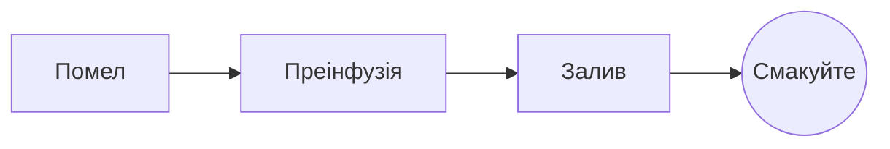

# Ідеальне пурровер

Повільний ранковий ритуал у кількох кроках. Пишіть у **вихідному тексті** ліворуч або просто в *попередньому перегляді* праворуч: обидва завжди синхронні, а ==кожна правка — це чиста зміна== в Markdown.

> [!TIP]
> Вода, що щойно перестала кипіти, близько 94 °C, розкриває солодкість без гіркоти.

## Пропорція

Більшість рецептів зупиняється на одній частині кави до шістнадцяти частин води:

$$
m_{\text{вода}} = 16 \times m_{\text{кава}}
$$

Тож для $20\,\text{г}$ кави потрібно $320\,\text{г}$ води.

## Крок за кроком



## Способи заварювання

| Спосіб     | Помел    |  Час |
|:-----------|:--------:|-----:|
| Пурровер   | Середній | 3:30 |
| Френч-прес | Грубий   | 4:00 |
| Еспресо    | Дрібний  | 0:28 |

## Перед початком

- [x] Свіжообсмажені зерна :coffee:
- [x] Жорнова кавомолка
- [ ] Чайник із вузьким носиком

```python
def water_for(coffee_g: float, ratio: int = 16) -> float:
    return coffee_g * ratio
```

Преінфузія
: Перший полив, завдяки якому кава віддає гази.[^1]

[^1]: Свіжі зерна «дихають» найбільше; старі ледь піднімаються.
