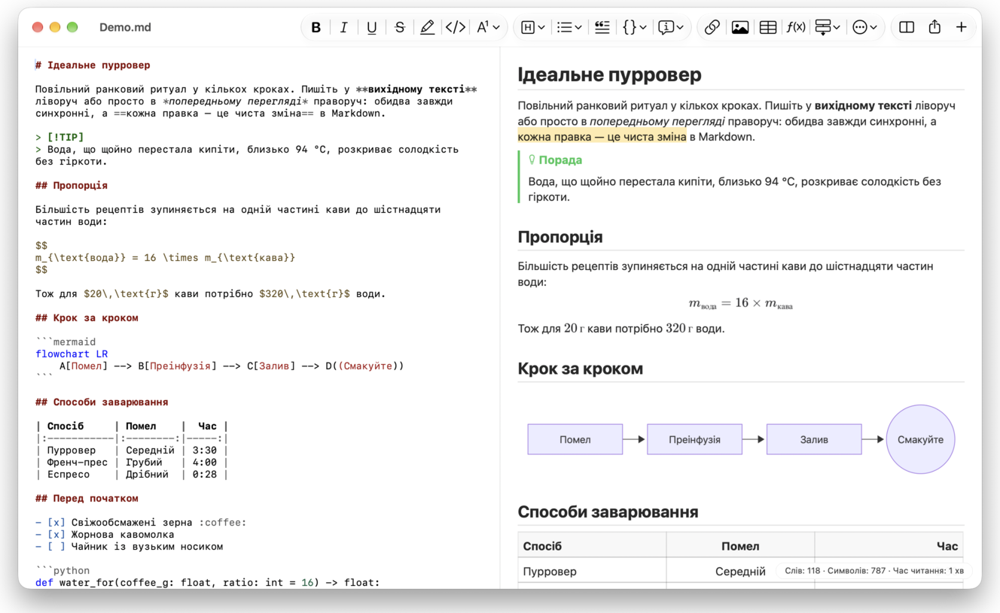
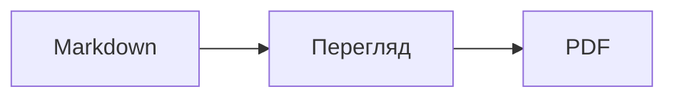

<p>&nbsp;&nbsp;&nbsp;</p>

# Splat

**Редактор Markdown для macOS, у якому можна писати у вихідному тексті або просто в попередньому перегляді.**

Splat показує вихідний текст Markdown із підсвічуванням синтаксису ліворуч, а праворуч — живий попередній перегляд, який теж можна повністю редагувати. Друкуйте в будь-якій частині: усе, що ви пишете в попередньому перегляді, стає мінімальною зміною вихідного тексту, тож рядки, яких ви не торкалися, залишаються байт у байт тими самими, а ваші diff у Git — чистими. Splat розуміє той Markdown, яким ви вже користуєтеся: CommonMark і GitHub Flavored Markdown, GitHub alerts, вікіпосилання, вбудовування й інформаційні блоки з Obsidian, розширення Pandoc і Typora, вбудований HTML, формули LaTeX та діаграми Mermaid, Graphviz і PlantUML — усе відображається офлайн. Переглядайте цілу теку нотаток і шукайте в ній, дивіться, що змінилося з останнього коміту Git, вставляйте з Word або вебсторінки як Markdown та експортуйте в PDF, HTML або Word одним клацанням. Програму написано на Rust із використанням справжніх елементів керування AppKit, вона підтримує 35 мов і нічого не надсилає мережею, доки ви самі цього не попросите.
 


[](https://github.com/sventmueller/splat/releases/latest/download/Splat.dmg)

**[Завантажити Splat.dmg](https://github.com/sventmueller/splat/releases/latest/download/Splat.dmg)**: підписано й нотаризовано Apple, для macOS 14 або новішої на Apple Silicon та Intel.

**Знайшли помилку?** Splat залишає рядки, яких ви не торкалися, байт у байт тими самими. Якщо якийсь усе ж зміниться або файл відображатиметься неправильно, [відкрийте issue](https://github.com/sventmueller/splat/issues/new/choose) і додайте файл. Якщо Splat вам корисний, [зірка на GitHub](https://github.com/sventmueller/splat) допоможе іншим його знайти.
 
 

[](https://www.rust-lang.org)
[](https://www.apple.com/macos/)

[](https://github.com/madsmtm/objc2)
[](https://webkit.org)
[](https://github.com/kivikakk/comrak)
[](https://github.github.com/gfm/)
[](https://www.mathjax.org)
[](https://cortexjs.io/mathlive/)
[](https://mermaid.js.org)
[](https://graphviz.org)
[](https://plantuml.com)


[](#ліцензія)

[Bahasa Indonesia](../id/README.md) ·
[Bahasa Melayu](../ms/README.md) ·
[Català](../ca/README.md) ·
[Čeština](../cs/README.md) ·
[Dansk](../da/README.md) ·
[Deutsch](../de/README.md) ·
[English](../../../README.md) ·
[Español](../es/README.md) ·
[Français](../fr/README.md) ·
[Hrvatski](../hr/README.md) ·
[Italiano](../it/README.md) ·
[Magyar](../hu/README.md) ·
[Nederlands](../nl/README.md) ·
[Norsk](../no/README.md) ·
[Polski](../pl/README.md) ·
[Português (Brasil)](../pt_BR/README.md) ·
[Português (Portugal)](../pt_PT/README.md) ·
[Română](../ro/README.md) ·
[Slovenčina](../sk/README.md) ·
[Slovenščina](../sl/README.md) ·
[Suomi](../fi/README.md) ·
[Svenska](../sv/README.md) ·
[Tiếng Việt](../vi/README.md) ·
[Türkçe](../tr/README.md) ·
[Ελληνικά](../el/README.md) ·
[Русский](../ru/README.md) ·
**Українська** ·
[עברית](../he/README.md)‎ ·
[العربية](../ar/README.md)‎ ·
[हिन्दी](../hi/README.md) ·
[ไทย](../th/README.md) ·
[한국어](../ko/README.md) ·
[日本語](../ja/README.md) ·
[简体中文](../zh-Hans/README.md) ·
[繁體中文](../zh-Hant/README.md)

## Зміст

- [Коротко про можливості](#коротко-про-можливості)
- [Вимоги](#вимоги)
- [Інсталяція](#інсталяція)
- [Початок роботи](#початок-роботи)
- [Письмо](#письмо)
  - [У вихідному тексті](#у-вихідному-тексті)
  - [У попередньому перегляді](#у-попередньому-перегляді)
  - [Команди форматування](#команди-форматування)
  - [Списки та завдання](#списки-та-завдання)
  - [Таблиці](#таблиці)
  - [Вставлення форматованого тексту](#вставлення-форматованого-тексту)
  - [Метадані](#метадані)
- [Підтримуваний Markdown](#підтримуваний-markdown)
  - [CommonMark і GitHub Flavored Markdown](#commonmark-і-github-flavored-markdown)
  - [Інформаційні блоки](#інформаційні-блоки)
  - [Розширений синтаксис](#розширений-синтаксис)
  - [Obsidian](#obsidian)
  - [Цитування та посилання](#цитування-та-посилання)
  - [Вбудований HTML](#вбудований-html)
  - [Типографські розділові знаки](#типографські-розділові-знаки)
  - [Огляд синтаксису](#огляд-синтаксису)
- [Формули](#формули)
- [Діаграми](#діаграми)
- [Зображення](#зображення)
- [Посилання та навігація](#посилання-та-навігація)
- [Нотатки в теці](#нотатки-в-теці)
- [Зміни з останнього коміту](#зміни-з-останнього-коміту)
- [Експорт, друк і поширення](#експорт-друк-і-поширення)
- [Імпорт документів Word](#імпорт-документів-word)
- [Вигляд і доступність](#вигляд-і-доступність)
- [Мови](#мови)
- [Скорочення клавіатури](#скорочення-клавіатури)
- [Приватність і безпека](#приватність-і-безпека)
- [Великі документи](#великі-документи)
- [Відомі обмеження](#відомі-обмеження)
- [Усунення несправностей](#усунення-несправностей)
- [Для розробників](#для-розробників)
  - [Сторонні компоненти](#сторонні-компоненти)
- [Ліцензія](#ліцензія)

## Коротко про можливості

- **Два способи писати, один текст.** І вихідний текст, і попередній перегляд можна редагувати. Єдина істина — файл Markdown: на кожен документ є одна історія скасувань, а кожна зміна в попередньому перегляді перетворюється на найменшу можливу зміну вихідного тексту.
- **Markdown, яким ви вже користуєтеся.** CommonMark, GitHub Flavored Markdown, GitHub alerts, Obsidian, розширення Pandoc і Typora, емодзі за кодами, спойлери, списки визначень, якорі заголовків і HTML, як у README на GitHub.
- **Формули й діаграми вбудовано.** Формули LaTeX через MathJax із візуальним редактором формул. Діаграми Mermaid, Graphviz і PlantUML відображаються на вашому Mac без Java, сервера чи мережі.
- **Кнопка для кожної дії.** Кожна конструкція Markdown має кнопку на панелі інструментів і пункт меню, а поширені — ще й скорочення клавіатури. Таблиці мають власне меню для рядків, стовпців і вирівнювання.
- **Тека, а не лише файл.** Бічна панель показує нотатки поруч із документом і шукає в усіх них. Перейменування нотатки змінює посилання на неї, а кожен байт навколо них лишається незмінним.
- **Зміни одразу видно.** У репозиторії Git смуги поруч із текстом позначають те, що відрізняється від останнього коміту, в обох панелях.
- **З Word та інтернету в Markdown.** Вставляйте форматований текст як Markdown, клітинки з електронної таблиці — як таблицю, а цілі документи Word імпортуйте разом із зображеннями.
- **Експорт без втрат.** PDF, один самодостатній файл HTML або документ Word зі справжніми заголовками, списками, таблицями, виносками та зображеннями. Можна додати номери сторінок, верхні колонтитули й титульну сторінку або використати шаблон Word вашої компанії.
- **Рідна програма до кісток.** Справжні вікна AppKit, вкладки, меню, спливні вікна, Версії, Автозбереження, меню поширення, темний режим, перевірка правопису, диктування та VoiceOver. Жодного Electron, жодного веб-вікна для самого тексту.
- **Швидка з великими файлами.** Промальовування натискання клавіші в документі на 10 МБ займає близько 10 мс, до роботи самого вікна.
- **Приватна й обережна.** Зображення з інтернету завантажуються лише після вашого дозволу, посилання на інші програми спершу запитують підтвердження, а все, що розпізнає ненадійні дані зображень, виконується в ізольованих допоміжних процесах.
- **Вашою мовою.** Інтерфейс і вбудований короткий довідник Markdown доступні 35 мовами: англійською, арабською, в’єтнамською, голландською, грецькою, данською, івритом, індонезійською, іспанською, італійською, каталанською, китайською (спрощеною), китайською (традиційною), корейською, малайською, німецькою, норвезькою, польською, португальською (Бразилія), португальською (Португалія), румунською, російською, словацькою, словенською, тайською, турецькою, угорською, українською, фінською, французькою, гінді, хорватською, чеською та шведською.

## Вимоги

- macOS 14 Sonoma або новіша. Splat розробляють і тестують на macOS 27, де програма автоматично переймає дизайн Liquid Glass.
- Mac з Apple Silicon або процесором Intel.
- Близько 45 МБ місця на диску.

## Інсталяція

**З образу диска.** Завантажте [`Splat.dmg`](https://github.com/sventmueller/splat/releases/latest/download/Splat.dmg), відкрийте його й перетягніть Splat у теку «Програми». Образ підписано сертифікатом Developer ID і нотаризовано Apple, тому він відкривається без попереджень.

**Через Homebrew.** Cask міститься у власному tap:

```sh
brew install --cask sventmueller/tap/splat
```

`brew upgrade --cask splat` встановлює нові версії, а `brew uninstall --zap --cask splat` додатково вилучає налаштування й кеші Splat.

**Оновлення.** Splat з образу диска чи з Homebrew оновлюється сам через [Sparkle](https://sparkle-project.org). Під час другого запуску програма питає, чи може вона самостійно шукати оновлення раз на добу. **Splat › Перевірити наявність оновлень…** шукає одразу; **Автоматично перевіряти наявність оновлень** та **Автоматично завантажувати й інсталювати оновлення** в тому самому меню пізніше змінюють ваш вибір. Splat інсталює оновлення, лише якщо воно має підпис розробника. Власна збірка не має засобу оновлення.

**З вихідного коду.** Потрібні складники описано в розділі [«Збірка»](../../../docs/development.md#building), далі:

```sh
make build
ditto target/release/Splat.app /Applications/Splat.app
open /Applications/Splat.app
```

Щоб відкривати файли Markdown у Splat подвійним клацанням, виберіть у Finder будь-який файл `.md`, виберіть **Файл › Досьє**, у розділі **Відкривати програмою** оберіть Splat і натисніть **Застосувати до всіх…**. Splat реєструється для файлів `.md`, `.markdown`, `.mdown` і `.mkd`.

## Початок роботи

### Вікно

Кожен документ відкривається у власному вікні або у вкладці, якщо ви віддаєте перевагу вкладкам:

- **Ліворуч: вихідний текст.** Ваш Markdown шрифтом SF Mono з підсвічуванням синтаксису.
- **Праворуч: попередній перегляд.** Відображений документ, готовий до редагування.
- **Бічна панель (необовʼязкова).** Усі заголовки у вигляді дерева, клацання на заголовку показує його в обох панелях: **Перегляд › Показати структуру** (⌃⌘S). Ще дві вкладки містять [нотатки в теці](#нотатки-в-теці) і пошук у них.
- **Панель інструментів.** Кнопки згруповано за тим, що вони змінюють: символи, абзаци та вставлені елементи, далі — перегляд увімкнено/вимкнено, «Поширити» і «Новий документ». Настроюється через **Перегляд › Настроїти панель інструментів…**.

Перетягуйте роздільник, щоб надати котрійсь зі сторін більше місця. **Перегляд › Сховати попередній перегляд** (⌥⌘P) залишає тільки вихідний текст; Splat запамʼятовує це для кожного вікна окремо. Обидві панелі прокручуються разом, а виділення в одній панелі підсвічується й в іншій.

У кутку вікна показано кількість слів і символів у тексті та час читання, а поки є виділення — те саме для нього. Адреси посилань, теги HTML, метадані, коментарі, формули й діаграми не враховуються. **Перегляд › Сховати кількість слів** прибирає цей показник.

### Документи, вкладки та версії

Splat — звичайна документна програма macOS:

- **Автозбереження та Версії.** Зміни зберігаються на місці. **Файл › Відновити › Переглянути всі версії…** повертає вас у минуле.
- **Зміни з інших програм.** Коли Git, скрипт або інший редактор змінює відкритий документ, Splat перезавантажує його й зберігає позицію курсора та прокручування. Якщо у вас є власні незбережені зміни, Splat залишає їх, а macOS питає, перш ніж перезаписати іншу версію.
- **Звичайні команди файлів.** Дублювати (⇧⌘S), Перейменувати…, Перемістити в… і **Файл › Відкрити недавні**.
- **Вкладки.** **Файл › Нова вкладка** або кнопка **+** на панелі інструментів відкриває новий документ у вкладці; стандартне меню «Вікно» обʼєднує, переміщує й перемикає вкладки.
- **Розташування вікна.** Розмір і позицію останнього вікна запамʼятовується, у тому числі між перезапусками. Якщо там уже стоїть вікно, нове відкривається з невеликим зсувом.
- **Піктограма в Dock.** Клацання на ній після закриття останнього вікна відкриває новий документ.
- **Відкривати файли Markdown у Splat.** **Splat › Зробити основною програмою для Markdown** робить так, що подвійне клацання на файлі `.md` чи `.markdown` відкриває Splat; macOS один раз просить підтвердження. Поки Splat є основною програмою, біля пункту стоїть позначка.

Файли мають бути текстом UTF-8 або UTF-16 з позначкою порядку байтів. Splat відмовляється від інших кодувань, замість того щоб вгадувати й псувати текст. Позначка порядку байтів зберігається, UTF-16 залишається UTF-16, а якщо в файлі всі рядки закінчуються на CRLF, то додані вами рядки теж отримують CRLF.

**Після збою** втрачаються щонайбільше останні кілька секунд друкування: кожні пʼять секунд Splat копіює незбережений текст до `~/Library/Application Support/Splat/Unsaved` і вилучає копії, щойно документ збережено або Splat нормально завершено. Під час наступного запуску те, що залишив збій, переміщується до `~/Library/Application Support/Splat/Recovery`, про що програма один раз повідомляє кнопкою, що відкриває теку. Збій, на який Splat ще може відреагувати, записує туди також текст кожного відкритого документа.

### Короткий довідник

**Довідка › Короткий довідник Markdown** відкриває шпаргалку вашою мовою як новий документ без назви. Це звичайний документ, тож усе можна випробувати просто там — у вихідному тексті або в попередньому перегляді.

## Письмо

### У вихідному тексті

Вихідний текст — це редактор простого тексту, налаштований для Markdown:

- **Підсвічування синтаксису** як у VS Code: заголовки, наголос, посилання, код, таблиці, HTML, front matter, а також LaTeX і Mermaid усередині формул і діаграм. Є палітри для світлого й темного режимів та для режиму «Збільшити контрастність».
- **Огороджені блоки коду** підсвічуються для Bash, C, C++, C#, CSS (також SCSS і Less), Go, HTML, XML, Java, JavaScript, JSON, Kotlin, PHP, Python, Ruby, Rust, SQL, Swift, TypeScript, YAML, TeX і Mermaid, зокрема за звичними короткими назвами, як-от `js`, `py` або `sh`.
- **Жодних несподіваних замін.** Динамічні лапки, динамічні тире та замінення тексту типово вимкнено, бо вони ламають `--`, `---` і `"`. Увімкнути їх можна в **Редагування › Підстановки**.
- **Системні засоби письма.** Перевірка правопису й граматики, диктування, Знайти і замінити (⌥⌘F) та читання вголос.
- **Перетягування.** Киньте файл зображення, щоб вставити ``, будь-який інший файл — щоб вставити посилання на нього, а URL — щоб вставити `[url](url)`. Кожне перетягування — один крок скасування.
- **Вставлення зображень.** Картинка в буфері обміну, наприклад знімок екрана, зберігається як файл PNG поруч із документом (`Зображення 2026-10-29 13.09.07.png`) і вставляється як зображення. Для цього документ потрібно один раз зберегти.

### У попередньому перегляді

Попередній перегляд поводиться як текстовий процесор, але все, що ви в ньому робите, потрапляє в Markdown:

- **Друкування.** Символи, що мають у Markdown особливе значення, як-от `*` чи `#`, екрануються, щоб відображатися так, як їх надруковано.
- **Return** починає новий абзац або пункт списку. **⌥Return** чи **⌃Return** вставляє розрив рядка.
- **Форматування біля курсора.** Коли курсор стоїть у кінці слова, «Жирний», «Курсив» та інші формати символів застосовуються до того, що ви надрукуєте далі. Виберіть формат ще раз, щоб його вимкнути. Усередині слова форматується все слово.
- **Порожні рядки.** Return на порожньому рядку додає ще один порожній рядок, а Backspace вилучає його. У вихідному тексті кожен такий додатковий порожній рядок — це ще два порожні рядки; інші програми для Markdown показують їх як звичайний відступ між абзацами.
- **Відмінити** діє в обох панелях. Пункти скасування мають назви («Відмінити Жирний»), друкування — це один крок на серію натискань, а після дій «Відмінити» і «Повторити» обидві панелі прокручуються до зміни.
- **Формули й діаграми** зʼявляються як готова графіка. Клацніть на ній, перемістіть на неї курсор або натисніть на ній Return, щоб відкрити редактор (див. [«Формули»](#формули) і [«Діаграми»](#діаграми)).
- **Вбудований HTML, вбудовані нотатки та front matter** показуються, але редагуються у вихідному тексті. Клацання на них ставить курсор у відповідне місце там.

Усе, що Markdown не здатний виразити, у попередньому перегляді заблоковано: панелі «Шрифт» і «Колір», лінійку, вставлення та перетягування форматованого тексту й зображень. Вставлені HTML і RTF надходять як простий текст, якщо тільки ви не виберете [Вставити як Markdown](#вставлення-форматованого-тексту).

### Команди форматування

Кожна команда доступна на панелі інструментів, у рядку меню та в контекстному меню обох панелей. Пункти меню показують позначку для форматування біля курсора.

| Меню | Команди |
|---|---|
| **Формат › Шрифт** | Жирний, Курсив, Підкреслення, Закреслення, Виділення, Код, Надрядковий, Підрядковий |
| **Формат › Заголовок** | Основний текст, Заголовок від 1 до 6 |
| **Формат › Список** | Список із маркерами, Нумерований список, Список завдань |
| **Формат** | Цитата, Блок коду (Без мови або одна з 20 мов; також змінює мову наявного блоку), Інформаційний блок (Нотатка, Порада, Важливо, Застереження, Обережно; той самий тип ще раз вилучає його), Редагувати формулу або діаграму…, Очистити форматування |
| **Вставити** | Посилання…, Зображення…, Таблиця…, Формула, Діаграма (Блок-схема, Діаграма послідовності, Діаграма Ганта), Зміст, Виноска, Горизонтальна лінія |
| **Таблиця** | Вставити рядок вище/нижче, Вставити стовпець ліворуч/праворуч, Видалити рядок, Видалити стовпець, Вирівнювання (За лівим краєм, По центру, За правим краєм, Типове), Вирівняти стовпці таблиці |
| **Перегляд** | Сховати/Показати попередній перегляд, Показати/Сховати структуру, Типографські розділові знаки, Наблизити/Віддалити, Фактичний розмір, панель інструментів, панель вкладок, повноекранний режим |

Підкреслення, виділення, надрядковий і підрядковий текст записуються як `<ins>`, `<mark>`, `<sup>` і `<sub>`, які GitHub теж показує. Splat також розуміє `<u>`, який GitHub вилучає, та коротші `==highlight==`, `^sup^` і `~sub~`. GitHub показує `==` та `^` як є, а `~sub~` — як закреслення.

### Списки та завдання

- Return продовжує список; Return на порожньому пункті завершує його.
- **Tab** і **⇧Tab** збільшують і зменшують відступ пунктів списку в попередньому перегляді.
- Клацання на прапорці завдання в попередньому перегляді перемикає `- [ ]` і `- [x]`.
- **Формат › Список** перетворює вибрані абзаци на список або змінює його вид.

### Таблиці

- **Вставити › Таблиця…** запитує кількість рядків (разом із заголовком) і стовпців.
- У попередньому перегляді **Tab** переходить до наступної клітинки, **⇧Tab** — до попередньої, а **Return** — до клітинки нижче. Tab в останній клітинці додає рядок.
- Меню **Таблиця** вставляє й видаляє рядки та стовпці та задає вирівнювання стовпця (⌘{, ⌘|, ⌘}).
- **Таблиця › Вирівняти стовпці таблиці** доповнює вихідний текст пропусками, щоб стовпці вишикувалися.

### Вставлення форматованого тексту

**Редагування › Вставити як Markdown** (⌃⌘V), також у контекстному меню обох панелей, перетворює вміст буфера обміну на Markdown на місці виділення, одним кроком скасування. ⌘V і далі вставляє простий текст.

- **З браузера, Word, Google Docs, Confluence, Нотаток або Pages:** переносяться заголовки, жирний, курсив, підкреслення, закреслення, надрядковий і підрядковий текст, посилання, списки з їхньою вкладеністю, цитати, код і таблиці.
- **З електронної таблиці:** клітинки стають таблицею з рядком заголовка й вирівняними за правим краєм стовпцями чисел. Те саме стається з текстом, розділеним табуляціями, крапками з комою або комами, якщо в кожному рядку однакова кількість стовпців.
- **Зображення** з вебадресою залишаються посиланнями. Зображення всередині вставленого HTML стає файлом поруч із документом, який для цього потрібно один раз зберегти. Тимчасові файли зображень Word не переносяться, а їхній альтернативний текст зберігається.
- **Посилання** зберігають лише адреси `http`, `https`, `mailto`, відносні та `#`; від будь-якого іншого посилання лишається текст.

### Метадані

**Формат › Редагувати метадані…** або клацання на рядку метаданих угорі попереднього перегляду відкриває форму з полями YAML front matter. Поля можна змінювати, додавати й вилучати. Поле, що містить список, залишається списком: його значення йдуть одне за одним через кому, а значення з комою стоїть у лапках. Нове поле з назвою `tags`, `aliases`, `keywords`, `categories`, `authors` або `cssclasses` теж стає списком. Вкладені поля й багаторядковий текст там видно, а редагуються вони у вихідному тексті.

Те, що змінює форма, — один крок скасування, і зачіпає він лише рядки змінених вами полів: коментарі, порядок, незвичні пропуски, лапки й кінці всіх інших рядків залишаються байт у байт тими самими. Документ без метаданих отримує блок на початку.

## Підтримуваний Markdown

Splat розбирає текст за допомогою [comrak](https://github.com/kivikakk/comrak), синтаксичного аналізатора, сумісного з CommonMark і GFM, та вмикає більшість його розширень. Усе нижче відображається в попередньому перегляді й у всіх експортах.

### CommonMark і GitHub Flavored Markdown

- Заголовки (`#` і підкреслені), абзаци, розриви рядків, наголос, сильний наголос, вбудований код, цитати, горизонтальні лінії.
- Списки з маркерами, нумеровані та вкладені; списки завдань.
- Посилання (вбудовані, за довідкою й автоматичні), зображення, визначення посилань.
- Огороджені й відступні блоки коду з підсвічуванням синтаксису.
- Таблиці з вирівнюванням стовпців.
- Закреслення через `~~дві тильди~~`.
- Виноски: `text[^1]` із `[^1]: Примітка.` будь-де в документі. Клацання на маркері переходить до примітки.
- YAML front matter між рядками `---` угорі. Попередній перегляд підсумовує його в одному рядку, наприклад «Метадані: title, date, tags».

### Інформаційні блоки

GitHub alerts відображаються як кольорові блоки зі значком і заголовком:

```markdown
> [!NOTE]
> Корисна інформація, яку варто знати.

> [!WARNING]
> Важливий вміст, що потребує негайної уваги.
```

Пʼять типів — Нотатка, Порада, Важливо, Застереження й Обережно. **Формат › Інформаційний блок** перетворює абзац біля курсора на такий блок.

Інформаційні блоки Obsidian теж працюють, з будь-яким заголовком і станом згортання:

```markdown
> [!tip]- Клацніть ▸, щоб розгорнути
> Приховано, доки не відкрити.

> [!question]+ Відкрито типово
> Знак `+` починає розгорнутим, знак `-` — згорнутим.
```

Інші типи Obsidian показуються найближчим із пʼяти кольорів: `success`, `check`, `done` і `hint` — як Порада; `question`, `help` і `faq` — як Важливо; `attention` — як Застереження; `failure`, `fail`, `missing`, `danger`, `error` і `bug` — як Обережно; усе інше — як Нотатка.

### Розширений синтаксис

| Можливість | Синтаксис | Звідки |
|---|---|---|
| Виділення | `==виділений текст==` | Obsidian, Typora |
| Надрядковий | `x^2^` | Pandoc, Typora |
| Підрядковий | `H~2~O` | Pandoc, Typora |
| Код емодзі | `:rocket:` стає 🚀 | GitHub |
| Спойлер | `\|\|прихований текст\|\|`, виберіть його, щоб прочитати | Discord |
| Вбудована виноска | `text^[сама примітка]` | Pandoc, Obsidian |
| Список визначень | `Термін`, порожній рядок, `: Пояснення` | PHP Markdown Extra, Pandoc |
| Якір заголовка | `## Встановлення {#setup}`, посилання `[див.](#setup)` | Pandoc, kramdown |

Списки визначень у вихідному тексті виглядають так:

```markdown
Термін

: Пояснення терміна.
```

Без власного якоря кожен заголовок отримує якір, утворений з його тексту, як на GitHub: до `## Початок роботи` можна перейти як до `#початок-роботи`.

### Obsidian

- **Вікіпосилання.** `[[Note]]` посилається на `Note.md` у тій самій теці або в теці глибше. `[[Note|Shown text]]` показує ваш власний текст, а `[[Note#Heading]]` відкриває нотатку. ⌘-клацання відкриває її в Splat.
- **Вбудовування.** `![[Note]]` показує іншу нотатку всередині цієї; вбудовані в неї нотатки зʼявляються як посилання. `![[diagram.png]]` показує зображення. Як в Obsidian, вбудовування вказують нотатки й зображення в теці документа або глибше, ніколи за абсолютним шляхом, а нотатками показуються лише файли Markdown.
- **Коментарі.** `%%Лише у вихідному тексті%%` залишаються видимими у вихідному тексті й не потрапляють ані до попереднього перегляду, ані до жодного експорту — як у рядку, так і в окремих рядках.
- **Теги.** `#idea` або `#project/splat` підсвічується. ⌘-клацання шукає тег у документі та, на бічній панелі, у всій теці.
- **Інформаційні блоки, що згортаються.** Див. [«Інформаційні блоки»](#інформаційні-блоки).

### Цитування та посилання

- **Цитування Pandoc.** `[@doe2020]` або `[@doe2020; @roe2021]` читається як «(Doe 2020; Roe 2021)». Записи беруться з файлу BibTeX, який front matter називає як `bibliography: refs.bib`. Без цього Splat використовує `references.bib`, `literatur.bib` або `bibliography.bib` поруч із документом.
- **Посилання GitHub і GitLab.** Якщо документ лежить у репозиторії Git, віддалений репозиторій `origin` якого розташований на github.com або на хості GitLab, то `@name`, `#12` (issue) і `!7` (merge request, лише GitLab) підсвічуються. ⌘-клацання відкриває їх у браузері.

### Вбудований HTML

HTML, який трапляється в README на GitHub, відображається власним аналізатором, а не рушієм браузера:

- абзаци й блоки по центру (`<p align="center">`, `<div align="center">`)
- зображення із заданим розміром (``)
- посилання, `<kbd>⌘</kbd>`, `<br>`, `<u>`, `<ins>`, `<mark>`, `<sup>`, `<sub>`
- списки й таблиці, зокрема клітинки, що охоплюють кілька стовпців (`colspan`)
- розділи, що згортаються: `<details><summary>Більше</summary>…</details>`, відкриваються клацанням на ▸

Markdown між тегами HTML відображається як Markdown. Скрипти, стилі, фрейми та форми повністю відкидаються, а посилання й зображення зберігають лише адреси `http`, `https`, `mailto` і відносні.

### Типографські розділові знаки

**Перегляд › Типографські розділові знаки** показує прямі лапки як лапки мови інтерфейсу, `--` — як коротке тире, `---` — як довге тире, а `...` — як три крапки. Німецькою `"Ja"` стає „Ja“, французькою «Oui», японською 「はい」, також там, де китайська й японська ставлять лапки без пропуску; єврейські скорочення на кшталт `צה"ל` отримують гершаїм, צה״ל. Вихідний текст зберігає прості символи; попередній перегляд і всі експорти показують типографські. Налаштування вимкнено, доки ви його не ввімкнете.

### Огляд синтаксису

| Елемент | Markdown |
|---|---|
| **Жирний** | `**Жирний**` |
| *Курсив* | `*Курсив*` |
| Підкреслення | `<ins>Підкреслення</ins>` або `<u>Підкреслення</u>` |
| ~~Закреслення~~ | `~~Закреслення~~` |
| Виділення | `<mark>Виділення</mark>` або `==Виділення==` |
| `Код` | `` `Код` `` |
| x² | `x<sup>2</sup>` або `x^2^` |
| H₂O | `H<sub>2</sub>O` або `H~2~O` |
| [Посилання](https://example.com) | `[Посилання](https://example.com)` |
| Заголовок | `# Заголовок` до `###### Заголовок` |
| Цитата | `> Цитата` |
| Список із маркерами | `- Пункт` |
| Нумерований список | `1. Пункт` |
| Завдання | `- [ ] Відкрите` і `- [x] Виконане` |
| Блок коду | ```` ```rust ```` … ```` ``` ```` |
| Таблиця | `\| A \| B \|` з `\|---\|---\|` під заголовком |
| Виноска | `Текст[^1]` і `[^1]: Примітка` |
| Горизонтальна лінія | `---` |
| Зображення | `` |
| Формула | `$E = mc^2$`, `$$ … $$` |
| Діаграма | ```` ```mermaid ````, ```` ```dot ````, ```` ```plantuml ```` |
| Інформаційний блок | `> [!TIP]` |
| Вікіпосилання | `[[Note]]`, `[[Note\|Текст]]` |
| Вбудовування | `![[Note]]`, `![[image.png]]` |
| Коментар | `%%Коментар%%` |
| Тег | `#тег` |
| Цитування | `[@key]` |
| Спойлер | `\|\|Спойлер\|\|` |
| Емодзі | `:tada:` |

## Формули

Формули відображає [MathJax](https://www.mathjax.org) зі своєю математикою TeX та AMS, у вигляді чіткої векторної графіки. Текст у `\text{…}` може бути будь-яким письмом: чого бракує шрифтам MathJax, береться зі шрифтів вашого Mac, причому арабське й єврейське письмо йде справа наліво, а емодзі — кольорові.

| Вид | Синтаксис |
|---|---|
| У тексті | `$E = mc^2$`, `` $`E = mc^2`$ `` (GitHub, GitLab), `\(E = mc^2\)` |
| Окремою формулою | `$$` … `$$`, `\[` … `\]` або блок коду з позначкою `math` |

**Редагування формули.** Клацніть формулу в попередньому перегляді, клацніть на ній двічі, натисніть на ній Return або перемістіть на неї курсор, щоб відкрити її редактор у спливному вікні. **Вставити › Формула** вставляє нову й одразу відкриває редактор.

- **Візуально або LaTeX.** Перемикач угорі перемикає між візуальним редактором ([MathLive](https://cortexjs.io/mathlive/)) і кодом LaTeX. Splat запамʼятовує ваш вибір.
- **Готові елементи** для дробу, квадратного кореня, надрядкового й підрядкового індексів, суми та інтеграла з межами, границі, дужок, що збільшуються разом із вмістом, матриці 2×2, грецьких літер, а також відношень, операторів і стрілок. Вони залишають заповнювачі □, і **Tab** переходить до наступного.
- **Живий попередній перегляд.** Зміни зʼявляються в документі під час введення. Помилки MathJax показуються в рядку під кодом.
- **Підтвердити або відхилити.** Клацання поза вікном зберігає зміну як один крок скасування; **Esc** або **Скасувати** відкидає її. Вихід клавішею Esc з нової порожньої формули вилучає її.
- Контекстне меню пропонує **Редагувати формулу…** для формули під вказівником.

VoiceOver читає формулу як її код LaTeX. Splat відображає формули, а не повні документи LaTeX: немає ні пакетів, ні TikZ, ні `\documentclass`.

## Діаграми

Діаграми відображаються всередині Splat, офлайн, у світлому й темному варіантах.

| Рушій | Блок коду | Що він малює |
|---|---|---|
| [Mermaid](https://mermaid.js.org) | ```` ```mermaid ```` | блок-схеми, діаграми послідовності, класів, станів, «сутність — звʼязок», Ганта, кругові, інтелект-карти, часові шкали та всі інші типи Mermaid |
| [Graphviz](https://graphviz.org) | ```` ```dot ```` або ```` ```graphviz ```` | графи мовою DOT |
| [PlantUML](https://plantuml.com) | ```` ```plantuml ```` або ```` ```puml ```` | діаграми UML; працює без Java |



**Редагування діаграми** працює так само, як редагування формули: клацніть її, щоб відкрити код у спливному вікні, з підсвічуванням синтаксису та повідомленнями про помилки в рядку під кодом. **Вставити › Діаграма** починає із шаблону блок-схеми, діаграми послідовності або діаграми Ганта. Готові елементи допомагають із трьома найпоширенішими типами Mermaid:

- **Блок-схема:** Вузол ▾ (прямокутник, заокруглений, коло, ромб, база даних), Зʼєднання, Зʼєднання з підписом, Група, Напрямок ▾
- **Діаграма послідовності:** Учасник, Повідомлення, Відповідь, Нотатка, Цикл, Альтернативні шляхи
- **Діаграма Ганта:** Розділ, Завдання, Віха

Інші типи діаграм редагуються як код. VoiceOver читає заголовок діаграми або її альтернативний текст.

Перша діаграма після запуску займає близько секунди, бо рушій відображення стартує у фоновому режимі. Діаграма, яка триває довше за 10 секунд, показує помилку, а рушій відображення для наступної запускається заново. Рушій PlantUML (3 МБ) завантажується лише з першою діаграмою PlantUML. `!include` у PlantUML з інтернету заблоковано.

## Зображення

- **Локальні зображення** використовують шляхи відносно документа: ``. Splat показує PNG, JPEG, GIF, WebP, BMP, SVG, HEIC, TIFF, AVIF і PDF.
- **Зображення з інтернету** залишаються заблокованими, доки ви їх не дозволите: смуга над попереднім переглядом пояснює, що їх завантаження повідомляє їхнім серверам, що і коли ви відкриваєте документ. **Завантажити зображення** дозволяє їх для цього документа; Splat запамʼятовує вибір для кожного файлу окремо.
- **Розмір.** `` задає розмір зображення; інакше зображення вміщуються в ширину попереднього перегляду.
- **Зміни на диску.** Зображення, яке ви замінили, або те, що зʼявилося вже після того, як документ його назвав, показується без повторного відкриття документа. Зображення з інтернету, які не завантажилися через мережу, пробуються знову, доки документ їх показує.
- **Памʼять.** Зображення показуються до 2560 пікселів по довшому боці, чого вистачає й на сторінку A4. Вони розпізнаються в меншому розмірі, коли займають одну восьму памʼяті Mac, і поки macOS повідомляє про брак памʼяті.
- **Темний режим.** Зображення з білим тлом у темному попередньому перегляді трохи затемнюються.
- **Вставлення й перетягування.** Див. [«У вихідному тексті»](#у-вихідному-тексті).

## Посилання та навігація

У попередньому перегляді клацання ставить курсор, щоб можна було редагувати текст посилання; **⌘-клацання** переходить за посиланням:

- `http`, `https` і `mailto` відкриваються у вашому браузері чи поштовій програмі.
- Файли Markdown відкриваються в Splat; інші файли й теки показуються у Finder.
- `#anchor` переходить до заголовка в документі.
- Адреси, що відкривають іншу програму, наприклад `slack://` чи `vscode://`, спершу запитують підтвердження й показують повну адресу та програму. **Скасувати** вибрано заздалегідь.

**Вставити › Зміст** вставляє список посилань на всі заголовки. Якщо курсор стоїть у ньому, та сама команда оновлює його. Бічна панель зі структурою (⌃⌘S) переходить до будь-якого заголовка в обох панелях.

## Нотатки в теці

Кнопки вгорі бічної панелі перемикають між структурою, файлами й пошуком.

- **Файли** (**Перегляд › Показати файли**, ⌃⌘E). Усі файли Markdown у теці документа або, якщо вона лежить у репозиторії Git, в усьому репозиторії. Клацання або Return відкриває нотатку у вкладці цього вікна; якщо вона вже відкрита, вона виходить на передній план. Кнопка поруч із назвою теки показує іншу теку в цьому вікні. Приховані файли, `node_modules`, `target`, `Pods`, `DerivedData`, `__pycache__` і теки без нотаток не показуються. Документ просто у вашій теці Домівка показує лише нотатки поруч із ним, щоб Splat не обходив усі ваші теки й не питав про кожну з них.
- **Пошук** (**Редагування › Пошук › Пошук у всіх нотатках…**, ⇧⌘F). Знаходить текст у всіх нотатках незалежно від регістру й від того, як закодовано діакритичні знаки. `#tag` знаходить тег, `#project` — також `#project/splat`, і нічого всередині коду. Клацання на результаті відкриває нотатку в цьому місці.
- **Посилання на нотатку.** Контекстне меню нотатки перелічує нотатки, які посилаються на неї вікіпосиланням, вбудовуванням, відносним посиланням або визначенням посилання.
- **Перейменування нотатки.** Те саме меню перейменовує її та змінює ці посилання. Спершу Splat повідомляє, скільки це посилань і в скількох файлах. У кожному посиланні змінюється лише назва, а кожен інший байт файлу залишається незмінним. Відкриті документи приймають зміну як крок скасування; в інших файлах скасувати її можуть лише Git або Версії. Файл, який тим часом змінила інша програма, зупиняє перейменування всіх посилань, і Splat називає цей файл.

Список стежить за текою, коли вікно виходить на передній план. Пошук дивиться на файли такими, якими вони є на диску, а ще не збережений текст ураховується від наступного автозбереження.

## Зміни з останнього коміту

У документі з репозиторію Git смуги поруч із текстом позначають те, що відрізняється від останнього коміту, у вихідному тексті й у попередньому перегляді: зелені — додані рядки, сині — змінені рядки, а коротка червона позначка — місце, де щось було вилучено. Вони оновлюються під час друкування й коли гілка зміщується. **Перегляд › Зміни з останнього коміту** вимикає їх для всіх вікон.

Рядки, що відрізняються лише кінцем рядка, не враховуються, тож файл із CRLF щодо коміту з LF не показує змін. Новий файл не має позначок до свого першого коміту, як і документ понад 32 МБ.

## Експорт, друк і поширення

| Формат | Як | Що ви отримаєте |
|---|---|---|
| **PDF** | **Файл › Експортувати як PDF…** або меню «Поширити» | Сторінки паперового розміру, завжди у світлому вигляді, формули й діаграми як векторна графіка. **Файл › Параметри сторінки…** задає папір. |
| **Друк** | **Файл › Друкувати…** (⌘P) | Те саме компонування, що й у PDF. |
| **HTML** | **Файл › Експортувати як HTML…** або меню «Поширити» | Один самодостатній файл: локальні зображення вбудовано, формули й діаграми як чіткі зображення, якорі заголовків, щоб працював зміст. Без скриптів. |
| **Word** | **Файл › Експортувати як документ Word…** або меню «Поширити» | Файл `.docx` зі стилями заголовків Word, справжніми списками й таблицями (зокрема з об’єднаними клітинками), виносками як виносками Word, вбудованими зображеннями, формулами та діаграмами. |
| **Markdown** | Кнопка **Поширити** на панелі інструментів | Документ як файл `.md` для Пошти, Повідомлень, AirDrop та всіх інших служб поширення. |

Меню **Файл › Поширити** пропонує все це в одному місці. Експорт враховує налаштування типографських розділових знаків та зображення з інтернету, які ви дозволили; у HTML зображення з інтернету залишаються посиланнями.

**Файл › Параметри експорту…** задає для всіх документів, що PDF, друк і Word додають до тексту:

- **Номери сторінок** у нижньому колонтитулі PDF і друку, у вигляді `2 / 9`.
- **Верхній і нижній колонтитули** для PDF і друку. `{title}`, `{author}`, `{date}`, `{page}` і `{pages}` замінюються своїми значеннями, перші три — з метаданих документа.
- **Титульна сторінка** для PDF, друку й Word, із `title`, `subtitle`, `author` і `date` з метаданих або з назвою документа як заголовком. На ній немає ні верхнього, ні нижнього колонтитула.
- **Шаблон Word** — файл `.docx` або `.dotx`, вигляд якого переймає експорт: його стилі, зокрема з локалізованими назвами, тема, розмір сторінки, поля, верхні й нижні колонтитули. Шаблон, який не вдається прочитати, зупиняє експорт і повідомляє про це, а не видає документ без нього.

## Імпорт документів Word

**Файл › Імпортувати документ Word…** запитує файл `.docx` або `.dotx` і місце для його Markdown, потім відкриває результат. Зображення потрапляють у теку поруч із ним, названу за іменем документа з `-images`.

Заголовки й списки переносяться так, як їх визначають стилі й нумерація Word, зокрема в документах, стилі яких мають локалізовані назви. Жирний, курсив, підкреслення, закреслення, виділення, надрядковий і підрядковий текст, посилання, цитати, код, виноски, кінцеві виноски й таблиці теж переносяться, клітинки на кілька стовпців — як таблиця HTML. Формули стають LaTeX. Відстежувані зміни вважаються прийнятими, а зміст не переноситься, бо **Вставити › Зміст** створює новий. Старі файли `.doc` і документи, захищені паролем, відхиляються.

## Вигляд і доступність

- **Темний режим** відповідає системному. Формули й діаграми відображаються для кожного вигляду окремо.
- **Збільшення контрасту** у Параметрах системи перемикає кольори синтаксису на висококонтрастні палітри.
- **Масштаб.** ⌘+, ⌘− і ⌘0 масштабують обидві панелі.
- **Повноекранний режим, вкладки й настроювана панель інструментів**, як у кожній програмі для Mac.
- **VoiceOver.** Панелі мають підписи «Вихідний текст Markdown» і «Перегляд», формули читаються як їхній код, а діаграми — як їхній заголовок. Кожна команда доступна з клавіатури.

У Splat немає вікна параметрів: кілька налаштувань розташовано там, де вони діють, — у меню **Перегляд**, **Редагування › Підстановки** і **Файл › Параметри експорту…**.

## Мови

Інтерфейс, меню та короткий довідник Markdown перекладено 35 мовами:

англійською, арабською, в’єтнамською, голландською, грецькою, данською, івритом, індонезійською, іспанською, італійською, каталанською, китайською (спрощеною), китайською (традиційною), корейською, малайською, німецькою, норвезькою, польською, португальською (Бразилія), португальською (Португалія), румунською, російською, словацькою, словенською, тайською, турецькою, угорською, українською, фінською, французькою, гінді, хорватською, чеською та шведською.

Splat дотримується порядку мов у **Системні параметри › Загальні › Мова і регіон**; там само в розділі **Програми** можна вибрати мову лише для Splat. Якщо вашої мови немає серед перекладів, програма використовує англійську. Терміни меню відповідають перекладам самої Apple, тож Splat читається як решта вашого Mac.

Текст івритом і арабською читається справа наліво всюди, де він з’являється, незалежно від мови інтерфейсу: кожен абзац, заголовок і пункт списку набуває напрямку за своєю першою літерою, цитати та інформаційні блоки малюють смугу праворуч, а таблиця, текст якої починається справа наліво, розташовує стовпці від правого краю. Блоки коду залишаються зліва направо. Експорт у PDF, HTML і Word зберігає ці напрямки. Якщо системна мова — іврит або арабська, macOS також віддзеркалює вікно, тож попередній перегляд опиняється ліворуч.

## Скорочення клавіатури

| Дія | Скорочення |
|---|---|
| Жирний, курсив, підкреслення | ⌘B, ⌘I, ⌘U |
| Закреслення | ⇧⌘X |
| Посилання… | ⌘K |
| Основний текст, заголовок від 1 до 6 | ⌥⌘0, ⌥⌘1 до ⌥⌘6 |
| Вирівняти стовпець таблиці за лівим краєм, по центру, за правим краєм | ⌘{, ⌘\|, ⌘} |
| Сховати або показати попередній перегляд | ⌥⌘P |
| Показати або сховати структуру | ⌃⌘S |
| Показати або сховати файли | ⌃⌘E |
| Пошук у всіх нотатках | ⇧⌘F |
| Вставити як Markdown | ⌃⌘V |
| Наблизити, віддалити, фактичний розмір | ⌘+, ⌘−, ⌘0 |
| Новий документ, відкрити, зберегти, дублювати | ⌘N, ⌘O, ⌘S, ⇧⌘S |
| Параметри сторінки, друк | ⇧⌘P, ⌘P |
| Пошук, знайти і замінити | ⌘F, ⌥⌘F |
| Знайти наступне, попереднє; використати вибране; перейти до вибраного | ⌘G, ⇧⌘G; ⌘E; ⌘J |
| Показати правопис і граматику; перевірити документ | ⌘:, ⌘; |
| Вставити і допасувати стиль | ⌥⇧⌘V |
| Сховати панель інструментів, показати всі вкладки, повноекранний режим | ⌥⌘T, ⇧⌘\\, ⌃⌘F |
| Розрив рядка (попередній перегляд) | ⌥Return або ⌃Return |
| Наступна / попередня клітинка в таблиці (попередній перегляд) | Tab / ⇧Tab |
| Збільшити / зменшити відступ пункту списку (попередній перегляд) | Tab / ⇧Tab |
| Наступний заповнювач у редакторі формул | Tab |
| Закрити редактор формули чи діаграми без змін | Esc |
| Перейти за посиланням, тегом чи згадкою (попередній перегляд) | ⌘-клацання |

Splat не чіпає стандартних скорочень Apple.

## Приватність і безпека

Файл Markdown може прийти від будь-кого, тому Splat вважає кожен документ ненадійним.

- **Типово без мережі.** У Splat немає телеметрії. Він шукає оновлення, лише коли ви погодитеся або виберете **Перевірити наявність оновлень…**: тоді він завантажує невеликий файл стрічки з GitHub, а запит називає лише програму та її версію. Формули й діаграми відображаються локально; веб-вікна, що це роблять, не мають доступу до мережі. **Довідка › Повідомити про проблему…** відкриває у браузері форму на GitHub; її адреса містить версію Splat, версію macOS і тип Mac, але нічого з ваших документів.
- **Зображення з інтернету** завантажуються лише з вашого дозволу, лише через `https`, ніколи з вузлів вашої локальної мережі, не більше 10 МБ кожне і в приватному сеансі без cookie.
- **Ізольоване розпізнавання.** Зображення та графіку формул і діаграм розпізнають допоміжні процеси, які закривають усі успадковані файли й замикаються в пісочниці до того, як прочитають перший байт: без доступу до файлів, без мережі. Вони повертають лише пікселі, розмір яких перевіряється, і зупиняються через 10 секунд. Власні розпізнавачі зображень Apple бачать лише HEIC, TIFF, AVIF і PDF, і лише тоді, коли дані справді мають такий формат; вони працюють у власному допоміжному процесі, який додатково може читати системні теки шрифтів і користуватися системним відеодекодером. SVG, формули й діаграми проходять через цей процес так само, тож у Splat вони є картинками з фіксованою роздільною здатністю: чотири пікселі на пункт, до 2560 по довшому боці.
- **Локальні файли** потрапляють у документ лише за шляхом, який він називає. Вбудовування показують нотатки Markdown з теки документа та глибше, а відсутню картинку шукають лише там. Шлях до зображення деінде, абсолютний або такий, що починається з `~`, усе одно завантажується в попередньому перегляді; експорт у HTML і Word, друк і PDF беруть лише те, що лежить у теці документа або в його репозиторії Git, хіба що цей репозиторій містить ще й вашу теку Домівка, тому чужий документ не може затягнути ваші файли в експорт, який ви передаєте далі.
- **Теки з нотатками** читаються лише тоді, коли бічна панель їх показує, а перейменування нотатки змінює інші файли лише після того, як ви підтвердили, скільки їх.
- **Репозиторії Git** Splat читає сам. Він ніколи не запускає програму `git`, конфігурація якої в чужому репозиторії може запускати інші програми, і читає не більше, ніж версію відкритого документа з останнього коміту. Він нічого туди не записує й не виходить у мережу.
- **Документи Word і вставлений текст** читають власні аналізатори Splat з обмеженнями на розмір, вкладеність і на те, наскільки файл може розпакуватися. Посилання в них зберігають лише ті адреси, які Splat дозволяє й деінде, а назви зображень у файлі Word ніколи не визначають, куди їх буде записано.
- **Копії незбереженого тексту** залишаються на цьому Mac, у вашій теці «Бібліотека», для відновлення після збою. Вони зникають зі збереженням або нормальним завершенням Splat; копії, які залишив збій, лежать у теці відновлення, доки ви їх не видалите.
- **Посилання** ніколи не запускають програму одним клацанням. Вебпосилання й поштові відкриваються як зазвичай; посилання на інші програми спершу запитують підтвердження.
- **HTML у документах** читає власний аналізатор Splat. Скрипти, стилі, фрейми та форми ніколи не виконуються.
- **Експорт** не містить скриптів. Сторінки HTML зберігають лише фіксований перелік нешкідливих тегів і атрибутів, як на GitHub, а також політику безпеки вмісту. Файли Word посилаються лише на адреси `http`, `https` і `mailto`.
- **Підпис коду** з Hardened Runtime. Splat працює без App Sandbox, щоб показувати зображення поруч із вашими документами, не питаючи дозволу для кожної теки; ізоляція всього розпізнавання це врівноважує.

## Великі документи

Splat залишається чутливим із документами на кілька мегабайтів:

- Вихідний текст використовує TextKit 2, який компонує лише видиму частину.
- Поки ви друкуєте в попередньому перегляді, а також у вихідному тексті документів до 2 МБ, лише зачеплені абзаци розбираються, розфарбовуються й компонуються заново. У документі на 10 МБ розбір і розфарбовування займають близько 3 мс, промальовування близько 10 мс, а ціле натискання клавіші в його попередньому перегляді близько 30 мс, враховуючи роботу самого вікна.
- Великі попередні перегляди спершу відображають видиму частину, а решту — у вільний від роботи час. Блоки, прокручені в поле зору, відображаються до того, як їх буде намальовано.
- У вихідному тексті більших документів розбір для попереднього перегляду виконується у фоновому режимі, поки ви друкуєте.
- Документ залишається простим текстом, якщо йому знадобилося б близько 4 ГБ пам’яті (приблизно 50–120 МБ звичайного Markdown, але лише 10–20 МБ, якщо в ньому тільки таблиці чи заголовки): вихідний текст без кольорів, а попередній перегляд пояснює, чому він порожній. Експорт і далі працює.
- Від приблизно 200 КБ документ відкриває вікно до того, як його розібрано; при 5 МБ кольори й попередній перегляд з’являються приблизно через чверть секунди.
- Усі зображення разом, зокрема формули й діаграми, займають щонайбільше чверть пам’яті Mac, а поки пам’яті бракує, удвічі менше. Понад це наступні зображення показуються як заповнювачі, доки знову не з’явиться місце.

Деякі зміни обробляються повністю, приблизно 300 мс на натискання клавіші при 10 МБ: зміни у визначенні або посиланнях виноски, поряд із вбудованою виноскою, на самому кінці документа поряд із виноскою, у front matter або у визначеннях посилань, а також кожна зміна в документі з блоками коментарів `%%` або з виноскою, визначеною двічі чи всередині цитати або списку. Пам’ять зростає разом із файлом: приблизно 115–160 МБ на 1 МБ Markdown і 340–510 МБ на 10 МБ.

## Відомі обмеження

- **Одинарна тильда означає підрядковий.** `~text~` — підрядковий, як у Pandoc; для закреслення потрібно `~~two~~`. GitHub закреслює й однією тильдою.
- **Лише читання в попередньому перегляді:** вбудований HTML і вбудовані нотатки редагуються у вихідному тексті, front matter — у його формі або у вихідному тексті.
- **Дуже глибока вкладеність:** HTML, вкладений глибше за 64 рівні, та вбудований HTML глибше за 16 поступаються місцем своєму вмісту.
- **Об’єднані клітинки таблиць** існують лише в таблицях HTML і лише між стовпцями (`colspan`, без `rowspan`). Синтаксис таблиць MultiMarkdown для об’єднаних клітинок не підтримується.
- **Бібліографії** читаються лише з BibTeX, не з CSL JSON чи YAML.
- **Посилання** потребують репозиторію на github.com або на хості GitLab; `!7` існує лише в GitLab.
- **Типографські розділові знаки:** німецьку закривальну одинарну лапку не відрізнити від апострофа, тому її ставлять як ’.
- **Формули, а не документи:** жодних пакетів LaTeX, TikZ чи повних документів.
- **Візуальний редактор формул** записує LaTeX у нотації MathLive: пропуски зникають (`E = mc^2` стає `E=mc^2`), відображення лишається тим самим.
- **Кількість слів:** тайська, лаоська, кхмерська та бірманська пишуться без пропусків і рахуються за відрізками тексту, а не за словами. `3.14` і `snake_case` — по два слова кожне.
- **Перейменування нотатки** не змінює посилань у вбудованому HTML, а вікіпосилання лишається як є, якщо нова назва містить `#`, `|`, `^`, `[`, `]` або `\`.
- **Позначки змін** читають репозиторії з об’єктами SHA-1 і звичайними або упакованими refs; репозиторій із SHA-256 або reftable позначок не показує. Файл під фільтром Git, наприклад LFS, порівнюється з тим, що зберіг фільтр.
- **Імпорт Word** не переносить текст із верхніх і нижніх колонтитулів та приміток, а зображення у `.emz` або SVG зберігають лише альтернативний текст.
- **Вставити як Markdown** читає RTF як західний текст і бере там заголовки лише з розмірів шрифту. Більшість програм пропонують і HTML, якому ця команда віддає перевагу.
- **За задумом:** без нумерації рядків, без вікна параметрів, без Help Book, не в App Store.
- **На Intel перевірено менше.** Самотести вікна виконуються лише на Apple Silicon; на Intel CI запускає `cargo test`.

## Усунення несправностей

**Список нещодавніх документів порожній після того, як я перебудував Splat.** macOS пов’язує нещодавні документи й дозволи на теки з підписом коду програми. Локальні збірки підписано сертифікатом «Splat Local Signing» у вашій в’язці ключів входу, тож перебудови зберігають і те, і те. Якщо сертифікат видалено, наступна збірка створює новий, і списки починаються заново один раз.

**Програма з образу диска показує інші нещодавні документи, ніж моя власна збірка.** Вони мають різні підписи, тому macOS веде для кожної окремий список і окремі дозволи на теки.

**HTML чи інший синтаксис показується як простий код.** Документ, імовірно, відкрила застаріла копія Splat. Завершіть її, виберіть **Файл › Досьє** для документа у Finder і переконайтеся, що в розділі **Відкривати програмою** названо Splat з вашої теки «Програми».

**У меню Splat немає пункту «Перевірити наявність оновлень…».** Самооновлюється лише версія з образу диска чи з Homebrew; власна збірка не має засобу оновлення.

**Зображення з інтернету не з’являються.** Клацніть **Завантажити зображення** у смузі над попереднім переглядом. Завантажуються лише зображення `https` із публічних вузлів.

**Вставлення знімка екрана просить спершу зберегти документ.** Вставлені зображення зберігаються як файли поруч із документом, а для цього потрібне місце на диску. Збережіть його й вставте ще раз.

**«Файл не є текстом UTF-8.»** Файл має інше кодування і не має позначки порядку байтів, яка б його назвала. Спершу перетворіть його, наприклад командою `iconv -f ISO-8859-1 -t UTF-8 old.md > new.md`.

**Формула чи діаграма показує помилку.** Клацніть на ній: редактор показує повідомлення MathJax, Mermaid, Graphviz чи PlantUML під кодом.

## Для розробників

Збирання, тестування, будова коду та правила, яких він дотримується, описані в [docs/development.md](../../../docs/development.md) (англійською).

### Сторонні компоненти

| Компонент | Версія | Для чого | Ліцензія |
|---|---|---|---|
| [comrak](https://github.com/kivikakk/comrak) | 0.59 з [одним зміненим рядком](../../../vendor/comrak/PATCH.md) | аналізатор Markdown | BSD-2-Clause |
| [objc2](https://github.com/madsmtm/objc2), objc2-foundation, block2 | 0.6 / 0.3 | середовище виконання Objective-C, Foundation, блоки | MIT |
| objc2-app-kit, objc2-web-kit, dispatch2 | 0.3 | прив’язки до AppKit, WebKit і Grand Central Dispatch | Zlib, Apache-2.0 або MIT |
| [svg2pdf](https://github.com/typst/svg2pdf) | 0.13 | формули й зображення SVG як векторний PDF | MIT або Apache-2.0 |
| [image](https://github.com/image-rs/image) | 0.25 | розпізнавання PNG, JPEG, GIF, WebP і BMP | MIT або Apache-2.0 |
| [unicode-width](https://github.com/unicode-rs/unicode-width) | 0.2 | вирівнювання стовпців таблиць | MIT або Apache-2.0 |
| [entities](https://github.com/p-jackson/entities) | 1 | назви символьних посилань HTML | MIT |
| [miniz_oxide](https://github.com/Frommi/miniz_oxide) | 0.9 | розпакування файлів Word і об’єктів Git | MIT, Zlib або Apache-2.0 |
| [roxmltree](https://github.com/RazrFalcon/roxmltree) | 0.21 | читання XML файлів Word | MIT або Apache-2.0 |
| [unicode-normalization](https://github.com/unicode-rs/unicode-normalization) | 0.1 | назви й пошук незалежно від складених і розкладених літер | MIT або Apache-2.0, Unicode-3.0 |
| [emojis](https://github.com/rossmacarthur/emojis) | 0.9 | збереження тексту на кшталт `:shortcode:` дослівно в імпортованому тексті | MIT або Apache-2.0, Unicode-3.0 |
| [MathJax](https://www.mathjax.org) | 4.1.3 | відображення формул | Apache-2.0 |
| [MathLive](https://cortexjs.io/mathlive/) | 0.111.4 | візуальний редактор формул зі шрифтами KaTeX | MIT |
| [Mermaid](https://mermaid.js.org) | 12.3.0 | діаграми Mermaid | MIT |
| [Viz.js](https://github.com/mdaines/viz-js) | 3.24.0 | Graphviz, скомпільований у WebAssembly, містить Graphviz (EPL-1.0) та Expat (MIT) | MIT |
| [PlantUML](https://github.com/plantuml/plantuml) (`@plantuml/core`) | 1.2026.9 | діаграми PlantUML, скомпільовані в JavaScript | MIT |
| [Sparkle](https://sparkle-project.org) | 2.10.1 | оновлення версії з образу диска | MIT, із частинами під ліцензіями BSD і zlib |

Бібліотеки JavaScript зберігаються в `resources/js/` саме в тому вигляді, як їх опубліковано; [vendor.lock](../../../vendor.lock) фіксує їхні джерела та контрольні суми SHA-256. Тексти їхніх ліцензій, зокрема Graphviz і Expat всередині Viz.js, лежать поруч як `resources/js/LICENSE-*` і постачаються разом із програмою. Sparkle не зберігається в репозиторії: `cargo xtask dmg` завантажує його випуск і звіряє з контрольною сумою в xtask, а його ліцензія постачається в програмі як `LICENSE-sparkle`.

## Ліцензія

Splat ліцензовано на вибір за однією з

- Ліцензія Apache, версія 2.0 ([LICENSE-APACHE](../../../LICENSE-APACHE))
- Ліцензія MIT ([LICENSE-MIT](../../../LICENSE-MIT))

на ваш розсуд.

Якщо ви прямо не заявите інакше, будь-який внесок, свідомо поданий вами для включення до Splat, як визначено в ліцензії Apache-2.0, ліцензується на двох умовах, як зазначено вище, без жодних додаткових положень чи умов.
