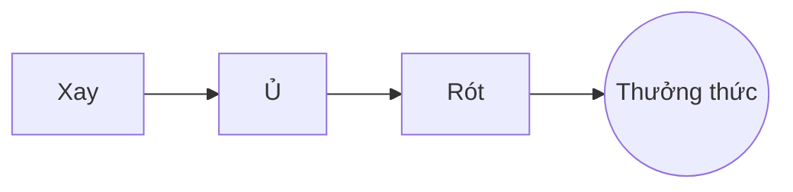

# Cà phê pour-over hoàn hảo

Một nghi thức buổi sáng chậm rãi chỉ qua vài bước. Hãy viết nó trong **mã nguồn** ở bên trái hoặc trực tiếp trong *bản xem trước* ở bên phải: cả hai luôn đồng bộ, và ==mỗi lần sửa là một thay đổi gọn gàng== trong Markdown.

> [!TIP]
> Nước vừa tắt sôi, khoảng 94 °C, làm nổi vị ngọt mà không gây đắng.

## Tỷ lệ

Hầu hết công thức chọn một phần cà phê cho mười sáu phần nước:

$$
m_{\text{nước}} = 16 \times m_{\text{cà phê}}
$$

Vậy $20\,\text{g}$ cà phê cần $320\,\text{g}$ nước.

## Từng bước



## Cách pha

| Cách pha     | Độ xay  | Thời gian |
|:-------------|:-------:|----------:|
| Pour-over    | Mịn vừa |      3:30 |
| French press | Thô     |      4:00 |
| Espresso     | Mịn     |      0:28 |

## Trước khi bắt đầu

- [x] Hạt vừa rang xong :coffee:
- [x] Một cối xay dạng lưỡi nghiền
- [ ] Một ấm có vòi cổ ngỗng

```python
def water_for(coffee_g: float, ratio: int = 16) -> float:
    return coffee_g * ratio
```

Ủ hạt
: Làn nước đầu tiên giúp bã cà phê nhả khí ra.[^1]

[^1]: Hạt tươi nở nhiều nhất; hạt cũ hầu như không nở.
