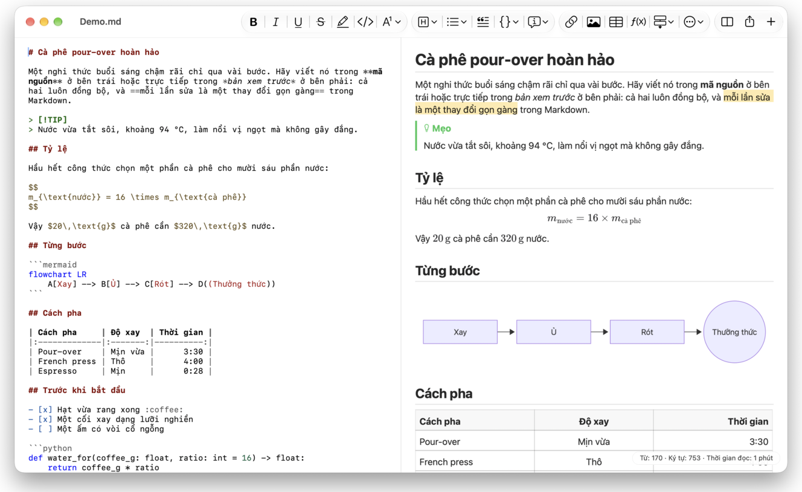
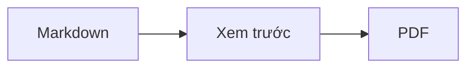

<p>&nbsp;&nbsp;&nbsp;</p>

# Splat

**Trình soạn thảo Markdown cho macOS, cho phép bạn viết ngay trong mã nguồn hoặc trực tiếp trong bản xem trước.**

Splat đặt mã nguồn Markdown có tô màu cú pháp ở bên trái và bản xem trước trực tiếp, chỉnh sửa được hoàn toàn ở bên phải. Bạn gõ ở bên nào cũng được: mọi thứ viết trong bản xem trước chỉ tạo ra thay đổi tối thiểu trong mã nguồn, nên những dòng bạn không đụng tới vẫn giữ nguyên từng byte và diff Git của bạn luôn gọn gàng. Splat đọc được loại Markdown bạn vẫn dùng: CommonMark và GitHub Flavored Markdown, GitHub alert, liên kết wiki, nhúng và callout của Obsidian, phần mở rộng của Pandoc và Typora, HTML nhúng, công thức LaTeX, cùng sơ đồ Mermaid, Graphviz và PlantUML, tất cả đều hiển thị ngoại tuyến. Duyệt và tìm kiếm trong cả một thư mục ghi chú, xem những gì đã thay đổi kể từ commit Git gần nhất, dán từ Word hoặc trang web dưới dạng Markdown, và xuất ra PDF, HTML hoặc Word chỉ bằng một lần bấm. Splat được viết bằng Rust trên các điều khiển AppKit chính gốc, có 35 ngôn ngữ và không gửi gì qua mạng trừ khi bạn yêu cầu.
 


[](https://github.com/sventmueller/splat/releases/latest/download/Splat.dmg)

**[Tải về Splat.dmg](https://github.com/sventmueller/splat/releases/latest/download/Splat.dmg)**: được Apple ký và công chứng, dành cho macOS 14 trở lên, trên Apple Silicon và Intel.

**Bạn phát hiện lỗi?** Splat giữ nguyên từng byte những dòng bạn không đụng tới. Nếu vẫn có dòng bị đổi, hoặc tệp hiển thị sai, hãy [mở một issue](https://github.com/sventmueller/splat/issues/new/choose) và đính kèm tệp. Nếu Splat hữu ích với bạn, một [sao trên GitHub](https://github.com/sventmueller/splat) sẽ giúp người khác tìm thấy nó.
 
 

[](https://www.rust-lang.org)
[](https://www.apple.com/macos/)

[](https://github.com/madsmtm/objc2)
[](https://webkit.org)
[](https://github.com/kivikakk/comrak)
[](https://github.github.com/gfm/)
[](https://www.mathjax.org)
[](https://cortexjs.io/mathlive/)
[](https://mermaid.js.org)
[](https://graphviz.org)
[](https://plantuml.com)


[](#giấy-phép)

[Bahasa Indonesia](../id/README.md) ·
[Bahasa Melayu](../ms/README.md) ·
[Català](../ca/README.md) ·
[Čeština](../cs/README.md) ·
[Dansk](../da/README.md) ·
[Deutsch](../de/README.md) ·
[English](../../../README.md) ·
[Español](../es/README.md) ·
[Français](../fr/README.md) ·
[Hrvatski](../hr/README.md) ·
[Italiano](../it/README.md) ·
[Magyar](../hu/README.md) ·
[Nederlands](../nl/README.md) ·
[Norsk](../no/README.md) ·
[Polski](../pl/README.md) ·
[Português (Brasil)](../pt_BR/README.md) ·
[Português (Portugal)](../pt_PT/README.md) ·
[Română](../ro/README.md) ·
[Slovenčina](../sk/README.md) ·
[Slovenščina](../sl/README.md) ·
[Suomi](../fi/README.md) ·
[Svenska](../sv/README.md) ·
**Tiếng Việt** ·
[Türkçe](../tr/README.md) ·
[Ελληνικά](../el/README.md) ·
[Русский](../ru/README.md) ·
[Українська](../uk/README.md) ·
[עברית](../he/README.md)‎ ·
[العربية](../ar/README.md)‎ ·
[हिन्दी](../hi/README.md) ·
[ไทย](../th/README.md) ·
[한국어](../ko/README.md) ·
[日本語](../ja/README.md) ·
[简体中文](../zh-Hans/README.md) ·
[繁體中文](../zh-Hant/README.md)

## Nội dung

- [Tính năng nổi bật](#tính-năng-nổi-bật)
- [Yêu cầu](#yêu-cầu)
- [Cài đặt](#cài-đặt)
- [Bắt đầu](#bắt-đầu)
- [Viết](#viết)
  - [Trong mã nguồn](#trong-mã-nguồn)
  - [Trong bản xem trước](#trong-bản-xem-trước)
  - [Lệnh định dạng](#lệnh-định-dạng)
  - [Danh sách và công việc](#danh-sách-và-công-việc)
  - [Bảng](#bảng)
  - [Dán văn bản có định dạng](#dán-văn-bản-có-định-dạng)
  - [Siêu dữ liệu](#siêu-dữ-liệu)
- [Markdown được hỗ trợ](#markdown-được-hỗ-trợ)
  - [CommonMark và GitHub Flavored Markdown](#commonmark-và-github-flavored-markdown)
  - [Hộp chú thích](#hộp-chú-thích)
  - [Cú pháp mở rộng](#cú-pháp-mở-rộng)
  - [Obsidian](#obsidian)
  - [Trích dẫn và tham chiếu](#trích-dẫn-và-tham-chiếu)
  - [HTML nhúng](#html-nhúng)
  - [Dấu câu kiểu chữ in](#dấu-câu-kiểu-chữ-in)
  - [Tổng quan cú pháp](#tổng-quan-cú-pháp)
- [Công thức](#công-thức)
- [Sơ đồ](#sơ-đồ)
- [Hình ảnh](#hình-ảnh)
- [Liên kết và điều hướng](#liên-kết-và-điều-hướng)
- [Ghi chú trong thư mục](#ghi-chú-trong-thư-mục)
- [Thay đổi kể từ commit gần nhất](#thay-đổi-kể-từ-commit-gần-nhất)
- [Xuất, in và chia sẻ](#xuất-in-và-chia-sẻ)
- [Nhập tài liệu Word](#nhập-tài-liệu-word)
- [Giao diện và trợ năng](#giao-diện-và-trợ-năng)
- [Ngôn ngữ](#ngôn-ngữ)
- [Phím tắt](#phím-tắt)
- [Quyền riêng tư và bảo mật](#quyền-riêng-tư-và-bảo-mật)
- [Tài liệu lớn](#tài-liệu-lớn)
- [Hạn chế đã biết](#hạn-chế-đã-biết)
- [Khắc phục sự cố](#khắc-phục-sự-cố)
- [Dành cho nhà phát triển](#dành-cho-nhà-phát-triển)
  - [Thành phần của bên thứ ba](#thành-phần-của-bên-thứ-ba)
- [Giấy phép](#giấy-phép)

## Tính năng nổi bật

- **Hai cách viết, một văn bản.** Cả mã nguồn lẫn bản xem trước đều chỉnh sửa được. Tệp Markdown là nguồn duy nhất: mỗi tài liệu chỉ có một lịch sử hoàn tác, và mỗi thao tác sửa trong bản xem trước được chuyển thành thay đổi nhỏ nhất trong mã nguồn.
- **Markdown bạn vẫn dùng.** CommonMark, GitHub Flavored Markdown, GitHub alert, Obsidian, phần mở rộng của Pandoc và Typora, shortcode emoji, spoiler, danh sách định nghĩa, neo đề mục và HTML như trong README trên GitHub.
- **Có sẵn công thức và sơ đồ.** Công thức LaTeX qua MathJax, kèm trình soạn công thức trực quan. Sơ đồ Mermaid, Graphviz và PlantUML được hiển thị ngay trên máy Mac của bạn, không cần Java, máy chủ hay kết nối mạng.
- **Có nút cho mọi thứ.** Mỗi cấu trúc Markdown đều có một nút trên thanh công cụ và một mục trong menu, những cấu trúc thông dụng còn có phím tắt. Bảng có menu riêng để thêm bớt hàng, cột và căn chỉnh.
- **Một thư mục, không chỉ một tệp.** Thanh bên liệt kê các ghi chú cạnh một tài liệu và tìm kiếm trong tất cả chúng. Đổi tên một ghi chú sẽ thay đổi các liên kết tới nó, và mọi byte xung quanh chúng vẫn giữ nguyên.
- **Thấy ngay thay đổi.** Trong một kho Git, các vạch bên cạnh văn bản đánh dấu những gì khác với commit gần nhất, ở cả hai ngăn.
- **Từ Word và web sang Markdown.** Dán văn bản có định dạng dưới dạng Markdown, các ô từ bảng tính dưới dạng bảng, và nhập nguyên tài liệu Word cùng hình ảnh của chúng.
- **Xuất mà không mất gì.** PDF, một tệp HTML độc lập duy nhất, hoặc tài liệu Word với đề mục, danh sách, bảng, chú thích cuối trang và hình ảnh thực thụ. Thêm số trang, đầu trang và trang tiêu đề, hoặc dùng mẫu Word của công ty bạn.
- **Chính gốc từ trong ra ngoài.** Cửa sổ, tab, menu, popover AppKit thật, Phiên bản, Tự động lưu, menu chia sẻ, chế độ tối, kiểm tra chính tả, đọc chính tả và VoiceOver. Không Electron, không web view cho chính phần văn bản.
- **Nhanh với tệp lớn.** Kết xuất một lần gõ phím trong tài liệu 10 MB mất khoảng 10 ms, trước phần việc của chính view.
- **Riêng tư và cẩn trọng.** Hình ảnh từ web chỉ được tải sau khi bạn cho phép, liên kết sang ứng dụng khác sẽ hỏi trước, và mọi thao tác giải mã dữ liệu hình ảnh không đáng tin đều chạy trong các tiến trình phụ trợ có sandbox.
- **Bằng ngôn ngữ của bạn.** Giao diện và phần tham khảo nhanh Markdown tích hợp có 35 ngôn ngữ: Ả Rập, Catalan, Trung Quốc (Giản thể), Trung Quốc (Phồn thể), Croatia, Séc, Đan Mạch, Hà Lan, Anh, Phần Lan, Pháp, Đức, Hy Lạp, Do Thái, Hindi, Hungary, Indonesia, Ý, Nhật, Hàn, Mã Lai, Na Uy, Ba Lan, Bồ Đào Nha (Brazil), Bồ Đào Nha (Bồ Đào Nha), Romania, Nga, Slovakia, Slovenia, Tây Ban Nha, Thụy Điển, Thái, Thổ Nhĩ Kỳ, Ukraina và Việt Nam.

## Yêu cầu

- macOS 14 Sonoma trở lên. Splat được phát triển và thử nghiệm trên macOS 27, nơi nó tự động áp dụng thiết kế Liquid Glass.
- Máy Mac dùng Apple Silicon hoặc bộ xử lý Intel.
- Khoảng 45 MB dung lượng đĩa.

## Cài đặt

**Từ ảnh đĩa.** Tải về [`Splat.dmg`](https://github.com/sventmueller/splat/releases/latest/download/Splat.dmg), mở ra rồi kéo Splat vào thư mục Applications. Ảnh đĩa được ký bằng Developer ID và được Apple công chứng, nên mở ra mà không có cảnh báo nào.

**Với Homebrew.** Cask nằm trong một tap riêng:

```sh
brew install --cask sventmueller/tap/splat
```

`brew upgrade --cask splat` cài các phiên bản mới, còn `brew uninstall --zap --cask splat` xóa luôn cài đặt và bộ nhớ đệm của Splat.

**Cập nhật.** Splat cài từ ảnh đĩa hoặc Homebrew tự cập nhật nhờ [Sparkle](https://sparkle-project.org). Ở lần mở thứ hai, Splat hỏi xem nó có được tự tìm bản cập nhật mỗi ngày một lần hay không. **Splat › Kiểm tra Bản cập nhật…** kiểm tra ngay lập tức; **Tự động Kiểm tra Bản cập nhật** và **Tự động Tải về và Cài đặt Bản cập nhật** trong cùng menu cho phép bạn đổi lựa chọn sau này. Splat chỉ cài bản cập nhật nếu nó mang chữ ký của nhà phát triển. Bản tự build không có trình cập nhật.

**Từ mã nguồn.** Xem [Xây dựng](../../../docs/development.md#building) để biết các điều kiện cần có, rồi:

```sh
make build
ditto target/release/Splat.app /Applications/Splat.app
open /Applications/Splat.app
```

Để mở tệp Markdown bằng Splat khi nhấp đúp, hãy chọn một tệp `.md` bất kỳ trong Finder, chọn **Tệp › Lấy thông tin**, chọn Splat trong **Mở bằng** rồi bấm **Thay đổi tất cả…**. Splat tự đăng ký cho các tệp `.md`, `.markdown`, `.mdown` và `.mkd`.

## Bắt đầu

### Cửa sổ

Mỗi tài liệu mở trong một cửa sổ riêng, hoặc thành một tab nếu bạn thích dùng tab:

- **Bên trái: mã nguồn.** Markdown của bạn bằng phông SF Mono với màu cú pháp.
- **Bên phải: bản xem trước.** Tài liệu đã hiển thị, sẵn sàng để sửa.
- **Thanh bên (tùy chọn).** Tất cả đề mục dưới dạng cây, bấm vào một đề mục sẽ hiển thị nó ở cả hai ngăn: **Xem › Hiển thị Dàn ý** (⌃⌘S). Hai tab nữa chứa [các ghi chú trong thư mục](#ghi-chú-trong-thư-mục) và phần tìm kiếm trong chúng.
- **Thanh công cụ.** Các nút được nhóm theo thứ chúng thay đổi: ký tự, đoạn văn và thành phần được chèn, rồi bật tắt bản xem trước, Chia sẻ và Tài liệu mới. Tùy chỉnh bằng **Xem › Tùy chỉnh thanh công cụ…**.

Kéo thanh phân cách để dành thêm chỗ cho bên nào cũng được. **Xem › Ẩn Bản xem trước** (⌥⌘P) chỉ để lại mã nguồn; Splat nhớ điều này theo từng cửa sổ. Cả hai ngăn cuộn cùng nhau, và phần chọn ở một ngăn được tô sáng ở ngăn kia.

Góc cửa sổ hiển thị số từ và số ký tự của văn bản cùng thời gian đọc, và của phần chọn khi có phần chọn. Địa chỉ liên kết, thẻ HTML, siêu dữ liệu, chú thích, công thức và sơ đồ không được tính. **Xem › Ẩn Số từ** bỏ phần này đi.

### Tài liệu, tab và phiên bản

Splat là một ứng dụng tài liệu macOS thông thường:

- **Tự động lưu và Phiên bản.** Thay đổi được lưu ngay tại chỗ. **Tệp › Khôi phục về › Duyệt tất cả phiên bản…** đưa bạn ngược về quá khứ.
- **Thay đổi từ chương trình khác.** Khi Git, một tập lệnh hay trình soạn thảo khác thay đổi tài liệu đang mở, Splat tải lại nó và giữ nguyên con trỏ cùng vị trí cuộn. Nếu bạn có thay đổi chưa lưu của riêng mình, Splat giữ chúng, và macOS sẽ hỏi trước khi lưu đè lên phiên bản kia.
- **Các lệnh tệp quen thuộc.** Nhân bản (⇧⌘S), Đổi tên…, Di chuyển tới… và **Tệp › Mở mục gần đây**.
- **Tab.** **Tệp › Tab mới** hoặc nút **+** trên thanh công cụ mở tài liệu mới thành một tab; menu Cửa sổ chuẩn sẽ gộp, di chuyển và chuyển qua lại giữa các tab.
- **Vị trí cửa sổ.** Kích thước và vị trí của cửa sổ gần nhất được ghi nhớ, kể cả sau khi khởi động lại. Nếu đã có cửa sổ ở đó, cửa sổ mới mở lệch đi một chút.
- **Biểu tượng trên Dock.** Bấm vào nó sau khi bạn đã đóng cửa sổ cuối cùng sẽ mở một tài liệu mới.
- **Mở tệp Markdown bằng Splat.** **Splat › Đặt làm Ứng dụng Mặc định cho Markdown** làm cho việc nhấp đúp vào tệp `.md` hoặc `.markdown` mở Splat; macOS hỏi xác nhận một lần. Mục này có dấu chọn khi Splat là ứng dụng mặc định.

Tệp phải là văn bản UTF-8, hoặc UTF-16 có dấu thứ tự byte. Splat từ chối các bảng mã khác thay vì đoán và làm hỏng văn bản. Dấu thứ tự byte được giữ lại, UTF-16 vẫn là UTF-16, và trong tệp có mọi dòng đều kết thúc bằng CRLF, những dòng bạn thêm vào cũng dùng CRLF.

**Sau khi bị sập**, nhiều nhất là vài giây gõ cuối cùng bị mất: cứ năm giây, Splat sao chép văn bản chưa lưu vào `~/Library/Application Support/Splat/Unsaved`, và xóa các bản sao khi tài liệu được lưu hoặc Splat thoát bình thường. Lần khởi động tiếp theo chuyển những gì lần sập để lại ở đó sang `~/Library/Application Support/Splat/Recovery` và thông báo một lần, kèm một nút mở thư mục. Với lần sập mà Splat vẫn kịp phản ứng, nó cũng ghi văn bản của mọi tài liệu đang mở vào đó.
### Tham khảo nhanh

**Trợ giúp › Tham khảo nhanh Markdown** mở một bảng tóm tắt bằng ngôn ngữ của bạn thành một tài liệu mới, chưa đặt tên. Đó là một tài liệu bình thường, nên bạn có thể thử mọi thứ ngay tại đó, trong mã nguồn hoặc trong bản xem trước.

## Viết

### Trong mã nguồn

Mã nguồn là một trình soạn thảo văn bản thuần túy được tinh chỉnh cho Markdown:

- **Màu cú pháp** như trong VS Code: đề mục, nhấn mạnh, liên kết, mã, bảng, HTML, front matter, cùng LaTeX và Mermaid bên trong công thức và sơ đồ. Có các bảng màu cho giao diện sáng, tối và Tăng độ tương phản.
- **Khối mã có rào** được tô sáng cho Bash, C, C++, C#, CSS (cả SCSS và Less), Go, HTML, XML, Java, JavaScript, JSON, Kotlin, PHP, Python, Ruby, Rust, SQL, Swift, TypeScript, YAML, TeX và Mermaid, kể cả các tên viết tắt quen thuộc như `js`, `py` hay `sh`.
- **Không thay thế bất ngờ.** Trích dẫn thông minh, gạch ngang thông minh và thay thế văn bản mặc định đều tắt, vì chúng làm hỏng `--`, `---` và `"`. Hãy bật chúng trong **Sửa › Thay thế**.
- **Công cụ viết của hệ thống.** Kiểm tra chính tả và ngữ pháp, đọc chính tả, Tìm và thay thế (⌥⌘F) và Đọc văn bản.
- **Kéo và thả.** Thả một tệp hình ảnh để chèn ``, thả tệp khác để chèn liên kết tới nó, và thả một URL để chèn `[url](url)`. Mỗi lần thả là một bước hoàn tác.
- **Dán hình ảnh.** Hình trong clipboard, chẳng hạn ảnh chụp màn hình, được lưu thành tệp PNG cạnh tài liệu (`Hình ảnh 2026-10-29 13.09.07.png`) và chèn vào như một hình ảnh. Tài liệu cần được lưu một lần để làm được điều này.

### Trong bản xem trước

Bản xem trước hoạt động như một trình xử lý văn bản, nhưng mọi thứ bạn làm trong đó đều kết thúc thành Markdown:

- **Gõ chữ.** Những ký tự có ý nghĩa trong Markdown, như `*` hay `#`, được thoát để hiện đúng như bạn gõ.
- **Return** bắt đầu một đoạn văn hoặc mục danh sách mới. **⌥Return** hoặc **⌃Return** chèn một lần ngắt dòng.
- **Định dạng tại con trỏ.** Khi con trỏ ở cuối một từ, Đậm, Nghiêng và các định dạng ký tự khác áp dụng cho những gì bạn gõ tiếp theo. Chọn lại định dạng để dừng nó. Ở giữa một từ, cả từ được định dạng.
- **Dòng trống.** Return trên một dòng trống thêm một dòng trống nữa, và Backspace xóa nó. Trong mã nguồn, mỗi dòng trống thêm vào là hai dòng trắng nữa; các chương trình Markdown khác hiển thị chúng như khoảng cách đoạn văn bình thường.
- **Hoàn tác** hoạt động trên cả hai ngăn. Các mục hoàn tác có tên (“Hoàn tác Đậm”), gõ chữ là một bước cho mỗi đợt gõ liền, và sau Hoàn tác và Làm lại, cả hai ngăn cuộn tới chỗ thay đổi.
- **Công thức và sơ đồ** hiện ra như đồ họa hoàn chỉnh. Bấm vào một cái, đưa con trỏ lên nó hoặc nhấn Return trên nó để mở trình soạn thảo của nó (xem [Công thức](#công-thức) và [Sơ đồ](#sơ-đồ)).
- **HTML nhúng, ghi chú nhúng và front matter** được hiển thị, nhưng bạn sửa chúng trong mã nguồn. Bấm vào chúng sẽ đặt con trỏ tại vị trí tương ứng ở đó.

Mọi thứ Markdown không diễn đạt được đều bị chặn trong bản xem trước: bảng Phông chữ và Màu, thước kẻ, cũng như việc dán hoặc thả văn bản có định dạng và hình ảnh. HTML và RTF được dán vào sẽ thành văn bản thuần túy, trừ khi bạn chọn [Dán dưới dạng Markdown](#dán-văn-bản-có-định-dạng).

### Lệnh định dạng

Mọi lệnh đều có sẵn từ thanh công cụ, thanh menu và menu ngữ cảnh của cả hai ngăn. Các mục menu hiện dấu chọn cho định dạng tại con trỏ.

| Menu | Lệnh |
|---|---|
| **Định dạng › Phông chữ** | Đậm, Nghiêng, Gạch chân, Gạch xuyên, Tô sáng, Mã, Chỉ số trên, Chỉ số dưới |
| **Định dạng › Đề mục** | Văn bản thường, Đề mục 1 đến 6 |
| **Định dạng › Danh sách** | Danh sách dấu đầu dòng, Danh sách đánh số, Danh sách công việc |
| **Định dạng** | Trích dẫn, Khối mã (Không có ngôn ngữ hoặc một trong 20 ngôn ngữ; cũng đổi ngôn ngữ của khối có sẵn), Hộp chú thích (Ghi chú, Mẹo, Quan trọng, Cảnh báo, Thận trọng; chọn lại cùng loại sẽ gỡ nó), Sửa công thức hoặc sơ đồ…, Xóa định dạng |
| **Chèn** | Liên kết…, Hình ảnh…, Bảng…, Công thức, Sơ đồ (Lưu đồ, Sơ đồ tuần tự, Biểu đồ Gantt), Mục lục, Chú thích cuối trang, Đường phân cách |
| **Bảng** | Chèn hàng bên trên/bên dưới, Chèn cột bên trái/bên phải, Xóa hàng, Xóa cột, Căn chỉnh (Căn trái, Căn giữa, Căn phải, Mặc định), Căn thẳng các cột của bảng |
| **Xem** | Ẩn/Hiển thị Bản xem trước, Hiển thị/Ẩn Dàn ý, Dấu câu kiểu chữ in, Phóng to/Thu nhỏ, Kích cỡ thực, thanh công cụ, thanh tab, toàn màn hình |

Gạch chân, tô sáng, chỉ số trên và chỉ số dưới được viết thành `<ins>`, `<mark>`, `<sup>` và `<sub>`, mà GitHub cũng hiển thị. Splat còn đọc `<u>`, thứ GitHub loại bỏ, và các dạng ngắn hơn `==highlight==`, `^sup^` và `~sub~`. GitHub hiển thị `==` và `^` đúng như đã gõ, còn `~sub~` thì thành gạch xuyên.

### Danh sách và công việc

- Return tiếp tục danh sách; Return trên một mục trống thì kết thúc nó.
- **Tab** và **⇧Tab** thụt lề và nhô lề các mục danh sách trong bản xem trước.
- Bấm vào hộp kiểm của công việc trong bản xem trước sẽ chuyển `- [ ]` và `- [x]`.
- **Định dạng › Danh sách** biến các đoạn văn được chọn thành danh sách hoặc đổi loại của nó.

### Bảng

- **Chèn › Bảng…** hỏi số hàng (gồm cả hàng tiêu đề) và số cột.
- Trong bản xem trước, **Tab** chuyển sang ô tiếp theo, **⇧Tab** sang ô trước và **Return** xuống ô bên dưới. Tab ở ô cuối cùng sẽ thêm một hàng.
- Menu **Bảng** chèn và xóa hàng, cột, và đặt căn chỉnh của một cột (⌘{, ⌘|, ⌘}).
- **Bảng › Căn thẳng các cột của bảng** thêm khoảng trắng vào mã nguồn để các cột thẳng hàng.

### Dán văn bản có định dạng

**Sửa › Dán dưới dạng Markdown** (⌃⌘V), cũng có trong menu ngữ cảnh của cả hai ngăn, biến những gì có trong clipboard thành Markdown tại phần chọn, như một bước hoàn tác. ⌘V vẫn chèn văn bản thuần túy.

- **Từ trình duyệt, Word, Google Docs, Confluence, Ghi chú hoặc Pages:** đề mục, đậm, nghiêng, gạch chân, gạch xuyên, chỉ số trên và chỉ số dưới, liên kết, danh sách cùng cấp lồng của chúng, trích dẫn, mã và bảng đều được giữ lại.
- **Từ bảng tính:** các ô trở thành một bảng với hàng tiêu đề và các cột số căn phải. Văn bản được phân tách bằng tab, dấu chấm phẩy hoặc dấu phẩy cũng vậy, nếu mọi dòng có cùng số cột.
- **Hình ảnh** có địa chỉ web vẫn là liên kết. Hình ảnh bên trong HTML được dán sẽ thành một tệp cạnh tài liệu, và tài liệu cần được lưu một lần để làm được điều này. Các tệp hình tạm của Word bị bỏ lại, và văn bản thay thế của chúng vẫn còn.
- **Liên kết** chỉ giữ các địa chỉ `http`, `https`, `mailto`, tương đối và `#`; với mọi liên kết khác chỉ còn lại văn bản.

### Siêu dữ liệu

**Định dạng › Sửa siêu dữ liệu…**, hoặc bấm vào dòng siêu dữ liệu ở đầu bản xem trước, mở một biểu mẫu với các trường của YAML front matter. Có thể thay đổi, thêm và xóa các trường. Trường chứa danh sách vẫn giữ dạng danh sách: các giá trị đứng nối tiếp nhau, cách bằng dấu phẩy, và giá trị chứa dấu phẩy được đặt trong dấu nháy. Trường mới có tên `tags`, `aliases`, `keywords`, `categories`, `authors` hoặc `cssclasses` cũng trở thành danh sách. Các trường lồng nhau và văn bản nhiều dòng có thể xem ở đó và sửa trong mã nguồn.

Những gì biểu mẫu thay đổi là một bước hoàn tác và chỉ chạm tới các dòng của những trường bạn đã thay đổi: chú thích, thứ tự, khoảng cách lạ, dấu nháy và ký tự cuối dòng của tất cả các dòng khác vẫn giữ nguyên từng byte. Tài liệu không có siêu dữ liệu sẽ có một khối ở đầu.

## Markdown được hỗ trợ

Splat phân tích bằng [comrak](https://github.com/kivikakk/comrak), một trình phân tích tương thích CommonMark và GFM, và bật hầu hết các phần mở rộng của nó. Mọi thứ dưới đây đều hiển thị trong bản xem trước và trong tất cả các bản xuất.

### CommonMark và GitHub Flavored Markdown

- Đề mục (`#` và kiểu gạch dưới), đoạn văn, ngắt dòng, nhấn mạnh, nhấn mạnh mạnh, mã trong dòng, trích dẫn khối, đường phân cách.
- Danh sách dấu đầu dòng, đánh số và lồng nhau; danh sách công việc.
- Liên kết (trong dòng, tham chiếu và tự động), hình ảnh, định nghĩa tham chiếu liên kết.
- Khối mã có rào và khối mã thụt lề với màu cú pháp.
- Bảng có căn chỉnh cột.
- Gạch xuyên với `~~hai dấu ngã~~`.
- Chú thích cuối trang: `văn bản[^1]` với `[^1]: Ghi chú.` ở bất kỳ đâu trong tài liệu. Bấm vào dấu đánh dấu sẽ nhảy tới ghi chú.
- YAML front matter giữa các dòng `---` ở đầu tài liệu. Bản xem trước tóm tắt nó trong một dòng, chẳng hạn “Siêu dữ liệu: title, date, tags”.

### Hộp chú thích

GitHub alert hiển thị thành các hộp có màu, kèm biểu tượng và tiêu đề:

```markdown
> [!NOTE]
> Thông tin hữu ích mà người dùng nên biết.

> [!WARNING]
> Nội dung quan trọng cần được chú ý ngay.
```

Năm loại là Ghi chú, Mẹo, Quan trọng, Cảnh báo và Thận trọng. **Định dạng › Hộp chú thích** biến đoạn văn tại con trỏ thành một hộp như vậy.

Hộp chú thích của Obsidian cũng dùng được, với tiêu đề tùy ý và trạng thái thu gọn:

```markdown
> [!tip]- Bấm ▸ để mở rộng
> Ẩn cho đến khi mở.

> [!question]+ Mở sẵn theo mặc định
> Dấu `+` bắt đầu ở trạng thái mở rộng, dấu `-` ở trạng thái thu gọn.
```

Các loại khác của Obsidian được hiển thị bằng màu gần nhất trong năm màu: `success`, `check`, `done` và `hint` thành Mẹo; `question`, `help` và `faq` thành Quan trọng; `attention` thành Cảnh báo; `failure`, `fail`, `missing`, `danger`, `error` và `bug` thành Thận trọng; mọi loại còn lại thành Ghi chú.

### Cú pháp mở rộng

| Tính năng | Cú pháp | Từ |
|---|---|---|
| Tô sáng | `==văn bản đánh dấu==` | Obsidian, Typora |
| Chỉ số trên | `x^2^` | Pandoc, Typora |
| Chỉ số dưới | `H~2~O` | Pandoc, Typora |
| Shortcode emoji | `:rocket:` thành 🚀 | GitHub |
| Spoiler | `\|\|văn bản ẩn\|\|`, chọn để đọc | Discord |
| Chú thích cuối trang trong dòng | `văn bản^[chính ghi chú]` | Pandoc, Obsidian |
| Danh sách định nghĩa | `Thuật ngữ`, dòng trống, `: Giải thích` | PHP Markdown Extra, Pandoc |
| Neo đề mục | `## Cài đặt {#setup}`, liên kết bằng `[xem](#setup)` | Pandoc, kramdown |

Danh sách định nghĩa trong mã nguồn trông như sau:

```markdown
Thuật ngữ

: Giải thích về thuật ngữ.
```

Nếu không có neo tùy chỉnh, mỗi đề mục có một neo lấy từ văn bản của nó, như trên GitHub: có thể đến `## Bắt đầu` qua `#bắt-đầu`.

### Obsidian

- **Liên kết wiki.** `[[Ghi chú]]` liên kết tới `Ghi chú.md` trong cùng thư mục hoặc thư mục con bên dưới. `[[Ghi chú|Văn bản hiển thị]]` hiển thị văn bản của riêng bạn, và `[[Ghi chú#Đề mục]]` mở ghi chú. ⌘-bấm mở nó trong Splat.
- **Nhúng.** `![[Ghi chú]]` hiển thị ghi chú kia bên trong ghi chú này; các ghi chú được nhúng trong đó hiện dưới dạng liên kết. `![[diagram.png]]` hiển thị một hình ảnh. Như trong Obsidian, phần nhúng gọi tên ghi chú và hình ảnh trong thư mục của tài liệu hoặc bên dưới nó, không bao giờ bằng đường dẫn tuyệt đối, và chỉ tệp Markdown mới hiện như ghi chú.
- **Chú thích.** `%%Chỉ có trong mã nguồn%%` vẫn hiển thị trong mã nguồn nhưng bị bỏ khỏi bản xem trước và mọi bản xuất, cả trong dòng lẫn trên dòng riêng.
- **Thẻ.** `#idea` hoặc `#project/splat` được tô sáng. ⌘-bấm tìm thẻ trong tài liệu và, ở thanh bên, trong toàn bộ thư mục.
- **Hộp chú thích có thể thu gọn.** Xem [Hộp chú thích](#hộp-chú-thích).

### Trích dẫn và tham chiếu

- **Trích dẫn Pandoc.** `[@doe2020]` hoặc `[@doe2020; @roe2021]` đọc như “(Doe 2020; Roe 2021)”. Các mục lấy từ tệp BibTeX mà front matter gọi tên bằng `bibliography: refs.bib`. Nếu không có, Splat dùng `references.bib`, `literatur.bib` hoặc `bibliography.bib` cạnh tài liệu.
- **Tham chiếu GitHub và GitLab.** Nếu tài liệu nằm trong một kho Git có remote `origin` trên github.com hoặc một máy chủ GitLab, thì `@name`, `#12` (issue) và `!7` (merge request, chỉ GitLab) được tô sáng. ⌘-bấm mở chúng trong trình duyệt.

### HTML nhúng

HTML như bạn thấy trong README trên GitHub được hiển thị, bằng trình đọc riêng chứ không phải bộ máy trình duyệt:

- đoạn văn và khối căn giữa (`<p align="center">`, `<div align="center">`)
- hình ảnh có kích thước (``)
- liên kết, `<kbd>⌘</kbd>`, `<br>`, `<u>`, `<ins>`, `<mark>`, `<sup>`, `<sub>`
- danh sách và bảng, kể cả ô trải dài nhiều cột (`colspan`)
- phần có thể thu gọn: `<details><summary>Thêm</summary>…</details>`, mở ra bằng cách bấm vào ▸

Markdown nằm giữa các thẻ HTML được hiển thị như Markdown. Tập lệnh, kiểu, khung và biểu mẫu bị bỏ hẳn, còn liên kết và hình ảnh chỉ giữ lại các địa chỉ `http`, `https`, `mailto` và địa chỉ tương đối.

### Dấu câu kiểu chữ in

**Xem › Dấu câu kiểu chữ in** hiển thị dấu trích dẫn thẳng thành dấu ngoặc kép của ngôn ngữ giao diện, `--` thành gạch nối en, `---` thành gạch nối em và `...` thành dấu ba chấm. Trong tiếng Đức, `"Ja"` thành „Ja“, trong tiếng Pháp «Oui», trong tiếng Nhật 「はい」, cả ở nơi tiếng Trung và tiếng Nhật đặt dấu trích dẫn không có khoảng trắng; các từ viết tắt tiếng Do Thái như `צה"ל` nhận dấu gershayim, צה״ל. Mã nguồn giữ nguyên các ký tự thuần túy; bản xem trước và mọi bản xuất hiển thị các ký tự kiểu chữ in. Tùy chọn này tắt cho đến khi bạn bật nó.

### Tổng quan cú pháp

| Thành phần | Markdown |
|---|---|
| **Đậm** | `**Đậm**` |
| *Nghiêng* | `*Nghiêng*` |
| Gạch chân | `<ins>Gạch chân</ins>` hoặc `<u>Gạch chân</u>` |
| ~~Gạch xuyên~~ | `~~Gạch xuyên~~` |
| Tô sáng | `<mark>Tô sáng</mark>` hoặc `==Tô sáng==` |
| `Mã` | `` `Mã` `` |
| x² | `x<sup>2</sup>` hoặc `x^2^` |
| H₂O | `H<sub>2</sub>O` hoặc `H~2~O` |
| [Liên kết](https://example.com) | `[Liên kết](https://example.com)` |
| Đề mục | `# Đề mục` đến `###### Đề mục` |
| Trích dẫn | `> Trích dẫn` |
| Danh sách dấu đầu dòng | `- Mục` |
| Danh sách đánh số | `1. Mục` |
| Công việc | `- [ ] Chưa xong` và `- [x] Đã xong` |
| Khối mã | ```` ```rust ```` … ```` ``` ```` |
| Bảng | `\| A \| B \|` với `\|---\|---\|` bên dưới hàng tiêu đề |
| Chú thích cuối trang | `Văn bản[^1]` và `[^1]: Ghi chú` |
| Đường phân cách | `---` |
| Hình ảnh | `` |
| Công thức | `$E = mc^2$`, `$$ … $$` |
| Sơ đồ | ```` ```mermaid ````, ```` ```dot ````, ```` ```plantuml ```` |
| Hộp chú thích | `> [!TIP]` |
| Liên kết wiki | `[[Ghi chú]]`, `[[Ghi chú\|Văn bản]]` |
| Nhúng | `![[Ghi chú]]`, `![[image.png]]` |
| Chú thích | `%%Chú thích%%` |
| Thẻ | `#tag` |
| Trích dẫn nguồn | `[@key]` |
| Spoiler | `\|\|Spoiler\|\|` |
| Emoji | `:tada:` |

## Công thức

Công thức được [MathJax](https://www.mathjax.org) hiển thị với toán TeX và AMS, thành đồ họa vector sắc nét. Văn bản trong `\text{…}` có thể thuộc bất kỳ hệ chữ nào: những gì phông của MathJax thiếu sẽ lấy từ phông của máy Mac của bạn, chữ Ả Rập và Do Thái chạy từ phải sang trái, còn emoji hiện có màu.

| Loại | Cú pháp |
|---|---|
| Trong dòng | `$E = mc^2$`, `` $`E = mc^2`$ `` (GitHub, GitLab), `\(E = mc^2\)` |
| Tách dòng | `$$` … `$$`, `\[` … `\]`, hoặc khối mã đánh dấu `math` |

**Sửa công thức.** Bấm vào một công thức trong bản xem trước, nhấp đúp vào nó, nhấn Return trên nó hoặc đưa con trỏ lên nó để mở trình soạn thảo của nó trong một popover. **Chèn › Công thức** chèn một công thức mới và mở trình soạn thảo ngay lập tức.

- **Trực quan hoặc LaTeX.** Công tắc ở trên cùng chuyển qua lại giữa trình soạn thảo trực quan ([MathLive](https://cortexjs.io/mathlive/)) và mã LaTeX. Splat nhớ lựa chọn của bạn.
- **Khối dựng** cho phân số, căn bậc hai, chỉ số trên và dưới, tổng và tích phân có cận, giới hạn, dấu ngoặc co giãn theo nội dung, ma trận 2×2, chữ cái Hy Lạp, cùng quan hệ, toán tử và mũi tên. Chúng để lại chỗ trống □, và **Tab** chuyển đến chỗ tiếp theo.
- **Xem trước trực tiếp.** Thay đổi hiện trong tài liệu khi bạn gõ. Lỗi từ MathJax hiện trong một dòng bên dưới mã.
- **Giữ hoặc bỏ.** Bấm ra ngoài sẽ giữ thay đổi thành một bước hoàn tác duy nhất; **Esc** hoặc **Hủy** vứt bỏ nó. Nhấn Esc ở một công thức mới, còn trống sẽ xóa nó đi.
- Menu ngữ cảnh có **Sửa công thức…** cho công thức dưới con trỏ chuột.

VoiceOver đọc một công thức bằng mã LaTeX của nó. Splat hiển thị công thức, không phải tài liệu LaTeX hoàn chỉnh: không có gói, không có TikZ và không có `\documentclass`.

## Sơ đồ

Sơ đồ được hiển thị ngay trong Splat, ngoại tuyến và có biến thể sáng lẫn tối.

| Bộ máy | Khối mã | Vẽ gì |
|---|---|---|
| [Mermaid](https://mermaid.js.org) | ```` ```mermaid ```` | lưu đồ, tuần tự, lớp, trạng thái, quan hệ thực thể, Gantt, biểu đồ tròn, sơ đồ tư duy, dòng thời gian và mọi loại Mermaid khác |
| [Graphviz](https://graphviz.org) | ```` ```dot ```` hoặc ```` ```graphviz ```` | đồ thị bằng ngôn ngữ DOT |
| [PlantUML](https://plantuml.com) | ```` ```plantuml ```` hoặc ```` ```puml ```` | sơ đồ UML; chạy không cần Java |



**Sửa sơ đồ** giống như sửa công thức: bấm vào nó để mở mã trong một popover, với màu cú pháp và thông báo lỗi trong một dòng bên dưới mã. **Chèn › Sơ đồ** bắt đầu từ mẫu cho lưu đồ, sơ đồ tuần tự hoặc biểu đồ Gantt. Các khối dựng hỗ trợ ba loại Mermaid phổ biến nhất:

- **Lưu đồ:** Nút ▾ (hình chữ nhật, bo góc, hình tròn, hình thoi, cơ sở dữ liệu), Kết nối, Kết nối có nhãn, Nhóm, Hướng ▾
- **Sơ đồ tuần tự:** Người tham gia, Tin nhắn, Trả lời, Ghi chú, Vòng lặp, Các nhánh thay thế
- **Biểu đồ Gantt:** Phần, Công việc, Cột mốc

Các loại sơ đồ khác được sửa dưới dạng mã. VoiceOver đọc tiêu đề hoặc văn bản thay thế của sơ đồ.

Sơ đồ đầu tiên sau khi mở ứng dụng mất khoảng một giây, vì bộ máy hiển thị khởi động ở chế độ nền. Sơ đồ nào mất hơn 10 giây sẽ báo lỗi, và bộ máy hiển thị khởi động lại từ đầu cho sơ đồ tiếp theo. Bộ máy của PlantUML (3 MB) chỉ được tải cùng sơ đồ PlantUML đầu tiên. `!include` của PlantUML từ web bị chặn.

## Hình ảnh

- **Hình ảnh cục bộ** dùng đường dẫn tương đối so với tài liệu: ``. Splat hiển thị PNG, JPEG, GIF, WebP, BMP, SVG, HEIC, TIFF, AVIF và PDF.
- **Hình ảnh từ web** bị chặn cho đến khi bạn cho phép: một thanh phía trên bản xem trước giải thích rằng việc tải chúng cho máy chủ của chúng biết bạn mở tài liệu và mở lúc nào. **Tải Hình ảnh** cho phép chúng với tài liệu này; Splat nhớ lựa chọn theo từng tệp.
- **Kích thước.** `` đặt kích thước hình ảnh; nếu không, hình ảnh vừa với chiều rộng của bản xem trước.
- **Thay đổi trên đĩa.** Hình ảnh bạn thay thế, hoặc hình xuất hiện sau khi tài liệu đã nhắc tới nó, hiển thị mà không cần mở lại tài liệu. Hình ảnh từ web bị lỗi do mạng sẽ được thử lại khi tài liệu đang hiển thị chúng.
- **Bộ nhớ.** Hình ảnh hiển thị tới 2560 pixel ở cạnh dài nhất, cũng đủ lấp đầy một trang A4. Chúng được giải mã nhỏ hơn khi chiếm một phần tám bộ nhớ của máy Mac, và trong lúc macOS báo áp lực bộ nhớ.
- **Chế độ tối.** Hình ảnh có nền trắng được làm mờ nhẹ trong bản xem trước tối.
- **Dán và thả.** Xem [Trong mã nguồn](#trong-mã-nguồn).

## Liên kết và điều hướng

Trong bản xem trước, một cú bấm đặt con trỏ để bạn sửa văn bản liên kết; **⌘-bấm** đi theo liên kết:

- `http`, `https` và `mailto` mở trong trình duyệt hoặc ứng dụng thư của bạn.
- Tệp Markdown mở trong Splat; các tệp và thư mục khác được hiển thị trong Finder.
- `#anchor` nhảy tới đề mục trong tài liệu.
- Địa chỉ mở một ứng dụng khác, như `slack://` hay `vscode://`, sẽ hỏi trước và hiện địa chỉ đầy đủ cùng ứng dụng. **Hủy** được chọn sẵn.

**Chèn › Mục lục** chèn một danh sách có liên kết tới tất cả đề mục. Khi con trỏ nằm trong đó, cùng lệnh này cập nhật nó. Thanh bên dàn ý (⌃⌘S) nhảy tới bất kỳ đề mục nào ở cả hai ngăn.

## Ghi chú trong thư mục

Các nút ở đầu thanh bên chuyển giữa dàn ý, các tệp và phần tìm kiếm.

- **Tệp** (**Xem › Hiển thị Tệp**, ⌃⌘E). Tất cả tệp Markdown trong thư mục của tài liệu hoặc, nếu thư mục đó nằm trong một kho Git, trong toàn bộ kho đó. Một cú bấm hoặc Return mở ghi chú thành một tab của cửa sổ này; nếu đã mở rồi, nó được đưa ra trước. Nút cạnh tên thư mục hiển thị một thư mục khác trong cửa sổ này. Các tệp ẩn, `node_modules`, `target`, `Pods`, `DerivedData`, `__pycache__` và các thư mục không có ghi chú đều bị bỏ qua. Tài liệu nằm ngay trong thư mục chính của bạn chỉ hiển thị các ghi chú bên cạnh nó, để Splat không đi qua tất cả thư mục của bạn và hỏi về từng thư mục.
- **Tìm kiếm** (**Sửa › Tìm › Tìm kiếm trong tất cả ghi chú…**, ⇧⌘F). Tìm văn bản trong tất cả ghi chú, bất kể chữ hoa hay chữ thường và bất kể dấu được mã hóa thế nào. `#tag` tìm một thẻ, `#project` tìm cả `#project/splat`, và không tìm gì bên trong mã. Bấm vào một kết quả sẽ mở ghi chú tại vị trí đó.
- **Liên kết tới một ghi chú.** Menu ngữ cảnh của một ghi chú liệt kê các ghi chú liên kết tới nó, bằng liên kết wiki, nhúng, liên kết tương đối hoặc định nghĩa tham chiếu liên kết.
- **Đổi tên ghi chú.** Cùng menu đó đổi tên ghi chú và thay đổi các liên kết này. Splat cho biết trước điều đó nghĩa là bao nhiêu liên kết trong bao nhiêu tệp. Mỗi liên kết chỉ thay đổi tên, và mọi byte khác của tệp vẫn giữ nguyên. Các tài liệu đang mở nhận thay đổi như một bước hoàn tác; ở các tệp khác chỉ Git hoặc Phiên bản mới hoàn tác được. Một tệp bị chương trình khác thay đổi trong lúc đó sẽ dừng việc đổi tên tất cả liên kết, và Splat nêu tên tệp đó.

Danh sách đi theo thư mục khi cửa sổ được đưa ra trước. Tìm kiếm xem các tệp đúng như trên đĩa, và văn bản bạn chưa lưu được tính từ lần Tự động lưu tiếp theo.

## Thay đổi kể từ commit gần nhất

Với một tài liệu trong kho Git, các vạch bên cạnh văn bản đánh dấu những gì khác với commit gần nhất, trong mã nguồn và trong bản xem trước: xanh lá cho dòng được thêm, xanh dương cho dòng bị thay đổi, và một dấu đỏ ngắn ở chỗ có nội dung bị xóa. Chúng cập nhật theo khi bạn gõ và khi nhánh di chuyển. **Xem › Thay đổi kể từ commit gần nhất** tắt chúng, cho tất cả cửa sổ.

Những dòng chỉ khác nhau ở ký tự cuối dòng không được tính, nên một tệp dùng CRLF so với commit dùng LF không hiện thay đổi nào. Tệp mới không có dấu nào cho tới commit đầu tiên của nó, tài liệu trên 32 MB cũng vậy.

## Xuất, in và chia sẻ

| Định dạng | Cách làm | Kết quả |
|---|---|---|
| **PDF** | **Tệp › Xuất dưới dạng PDF…** hoặc menu Chia sẻ | Các trang theo khổ giấy, luôn ở giao diện sáng, công thức và sơ đồ là đồ họa vector. **Tệp › Thiết lập trang…** đặt khổ giấy. |
| **In** | **Tệp › In…** (⌘P) | Bố cục giống như PDF. |
| **HTML** | **Tệp › Xuất dưới dạng HTML…** hoặc menu Chia sẻ | Một tệp độc lập: hình ảnh cục bộ được nhúng, công thức và sơ đồ là hình ảnh sắc nét, có neo đề mục để mục lục hoạt động. Không có tập lệnh. |
| **Word** | **Tệp › Xuất dưới dạng Tài liệu Word…** hoặc menu Chia sẻ | Một tệp `.docx` với kiểu đề mục của Word, danh sách và bảng thực thụ (kể cả ô đã gộp), chú thích cuối trang của Word, hình ảnh được nhúng, công thức và sơ đồ. |
| **Markdown** | Nút **Chia sẻ** trên thanh công cụ | Tài liệu dưới dạng tệp `.md` cho Mail, Tin nhắn, AirDrop và mọi dịch vụ chia sẻ khác. |

Menu **Tệp › Chia sẻ** đưa tất cả những cách này vào một chỗ. Các bản xuất dùng tùy chọn dấu câu kiểu chữ in và những hình ảnh từ web mà bạn đã cho phép; trong HTML, hình ảnh từ web vẫn là liên kết.

**Tệp › Tùy chọn xuất…** đặt những gì PDF, bản in và Word thêm vào văn bản, cho tất cả tài liệu:

- **Số trang** ở chân trang của PDF và bản in, dưới dạng `2 / 9`.
- **Đầu trang và chân trang** cho PDF và bản in. `{title}`, `{author}`, `{date}`, `{page}` và `{pages}` đại diện cho giá trị của chúng, ba cái đầu lấy từ siêu dữ liệu của tài liệu.
- **Trang tiêu đề** cho PDF, bản in và Word, với `title`, `subtitle`, `author` và `date` từ siêu dữ liệu, hoặc tên tài liệu làm tiêu đề. Trang này không có đầu trang lẫn chân trang.
- **Mẫu Word**, một tệp `.docx` hoặc `.dotx` mà bản xuất lấy diện mạo từ đó: các kiểu, kể cả tên đã bản địa hóa, chủ đề, kích thước trang, lề, đầu trang và chân trang. Mẫu không đọc được sẽ dừng việc xuất và báo như vậy, thay vì đưa cho bạn một tài liệu không có mẫu.

## Nhập tài liệu Word

**Tệp › Nhập Tài liệu Word…** hỏi một tệp `.docx` hoặc `.dotx` và nơi đặt Markdown của nó, rồi mở kết quả. Hình ảnh nằm trong một thư mục bên cạnh, đặt theo tên tài liệu với `-images`.

Đề mục và danh sách được giữ đúng theo cách các kiểu và đánh số của Word định nghĩa chúng, kể cả trong các tài liệu có kiểu mang tên đã bản địa hóa. Đậm, nghiêng, gạch chân, gạch xuyên, tô sáng, chỉ số trên và chỉ số dưới, liên kết, trích dẫn, mã, chú thích cuối trang, chú thích cuối tài liệu và bảng đều được giữ lại, ô trải qua nhiều cột thành bảng HTML. Công thức trở thành LaTeX. Các thay đổi được theo dõi coi như đã chấp nhận, và mục lục bị bỏ qua, vì **Chèn › Mục lục** tạo một mục lục mới. Tệp `.doc` cũ và tài liệu được bảo vệ bằng mật khẩu bị từ chối.

## Giao diện và trợ năng

- **Chế độ tối** theo hệ thống. Công thức và sơ đồ được hiển thị cho từng giao diện.
- **Tăng độ tương phản** trong Cài đặt hệ thống chuyển màu cú pháp sang các bảng màu tương phản cao.
- **Thu phóng.** ⌘+, ⌘− và ⌘0 co giãn cả hai ngăn.
- **Toàn màn hình, tab và thanh công cụ tùy chỉnh được**, như trong mọi ứng dụng Mac.
- **VoiceOver.** Các ngăn có nhãn “Mã nguồn Markdown” và “Xem trước”, công thức được đọc bằng mã của nó và sơ đồ bằng tiêu đề. Mọi lệnh đều dùng được từ bàn phím.

Splat không có cửa sổ cài đặt: vài tùy chọn nằm đúng nơi chúng có tác dụng, trong **Xem**, **Sửa › Thay thế** và **Tệp › Tùy chọn xuất…**.

## Ngôn ngữ

Giao diện, các menu và phần tham khảo nhanh Markdown được dịch sang 35 ngôn ngữ:

Ả Rập, Catalan, Trung Quốc (Giản thể), Trung Quốc (Phồn thể), Croatia, Séc, Đan Mạch, Hà Lan, Anh, Phần Lan, Pháp, Đức, Hy Lạp, Do Thái, Hindi, Hungary, Indonesia, Ý, Nhật, Hàn, Mã Lai, Na Uy, Ba Lan, Bồ Đào Nha (Brazil), Bồ Đào Nha (Bồ Đào Nha), Romania, Nga, Slovakia, Slovenia, Tây Ban Nha, Thụy Điển, Thái, Thổ Nhĩ Kỳ, Ukraina và Việt Nam.

Splat theo thứ tự ngôn ngữ trong **Cài đặt hệ thống › Cài đặt chung › Ngôn ngữ & Vùng**; tại đó bạn cũng có thể chọn riêng một ngôn ngữ cho Splat trong **Ứng dụng**. Nếu không có bản dịch cho ngôn ngữ của bạn, nó dùng tiếng Anh. Thuật ngữ menu theo bản dịch của chính Apple, nên Splat đọc như phần còn lại của máy Mac.

Văn bản tiếng Do Thái và Ả Rập đọc từ phải sang trái ở bất cứ đâu nó xuất hiện, bất kể ngôn ngữ giao diện: mỗi đoạn văn, đề mục và mục danh sách theo hướng của chữ cái đầu tiên, trích dẫn và hộp chú thích vẽ thanh bên phải, còn bảng có văn bản bắt đầu từ phải sang trái liệt kê các cột từ bên phải. Khối mã vẫn từ trái sang phải. Các bản xuất PDF, HTML và Word giữ nguyên những hướng này. Khi tiếng Do Thái hoặc Ả Rập là ngôn ngữ hệ thống, macOS cũng lật gương cửa sổ, nên bản xem trước nằm ở bên trái.

## Phím tắt

| Thao tác | Phím tắt |
|---|---|
| Đậm, Nghiêng, Gạch chân | ⌘B, ⌘I, ⌘U |
| Gạch xuyên | ⇧⌘X |
| Liên kết… | ⌘K |
| Văn bản thường, Đề mục 1 đến 6 | ⌥⌘0, ⌥⌘1 đến ⌥⌘6 |
| Căn cột bảng sang trái, giữa, phải | ⌘{, ⌘\|, ⌘} |
| Ẩn hoặc hiển thị bản xem trước | ⌥⌘P |
| Hiển thị hoặc ẩn dàn ý | ⌃⌘S |
| Hiển thị hoặc ẩn các tệp | ⌃⌘E |
| Tìm kiếm trong tất cả ghi chú | ⇧⌘F |
| Dán dưới dạng Markdown | ⌃⌘V |
| Phóng to, thu nhỏ, kích cỡ thực | ⌘+, ⌘−, ⌘0 |
| Tài liệu mới, mở, lưu, nhân bản | ⌘N, ⌘O, ⌘S, ⇧⌘S |
| Thiết lập trang, in | ⇧⌘P, ⌘P |
| Tìm, tìm và thay thế | ⌘F, ⌥⌘F |
| Tìm mục tiếp theo, mục trước; dùng lựa chọn; chuyển đến lựa chọn | ⌘G, ⇧⌘G; ⌘E; ⌘J |
| Hiển thị chính tả và ngữ pháp; kiểm tra tài liệu | ⌘:, ⌘; |
| Dán và khớp kiểu | ⌥⇧⌘V |
| Ẩn thanh công cụ, hiển thị tất cả tab, toàn màn hình | ⌥⌘T, ⇧⌘\\, ⌃⌘F |
| Ngắt dòng (bản xem trước) | ⌥Return hoặc ⌃Return |
| Ô tiếp theo / ô trước trong bảng (bản xem trước) | Tab / ⇧Tab |
| Thụt lề / nhô lề một mục danh sách (bản xem trước) | Tab / ⇧Tab |
| Chỗ trống tiếp theo trong trình soạn công thức | Tab |
| Đóng trình soạn công thức hoặc sơ đồ mà không thay đổi | Esc |
| Đi theo liên kết, thẻ hoặc tham chiếu (bản xem trước) | ⌘-bấm |

Splat để nguyên các phím tắt chuẩn của Apple.

## Quyền riêng tư và bảo mật

Một tệp Markdown có thể đến từ bất kỳ ai, nên Splat coi mọi tài liệu là không đáng tin.

- **Mặc định không dùng mạng.** Splat không có telemetry. Nó chỉ tìm bản cập nhật khi bạn đồng ý hoặc chọn **Kiểm tra Bản cập nhật…**: khi đó nó tải một tệp nguồn cấp nhỏ từ GitHub, và yêu cầu chỉ nêu tên ứng dụng và phiên bản của nó. Công thức và sơ đồ được hiển thị cục bộ; các web view thực hiện việc đó không thể truy cập mạng. **Trợ giúp › Báo cáo sự cố…** mở một biểu mẫu trên GitHub trong trình duyệt; địa chỉ của nó chứa phiên bản Splat, phiên bản macOS và loại máy Mac, không có gì từ tài liệu của bạn.
- **Hình ảnh từ web** chỉ được tải sau khi bạn cho phép, chỉ qua `https`, không bao giờ từ máy chủ trong mạng cục bộ của bạn, tối đa 10 MB mỗi hình, và trong một phiên riêng tư không có cookie.
- **Giải mã cô lập.** Hình ảnh cùng đồ họa của công thức và sơ đồ được giải mã trong các tiến trình phụ trợ đóng mọi tệp mà chúng thừa hưởng và tự khóa mình vào một sandbox trước khi đọc byte đầu tiên: không truy cập tệp, không mạng. Chúng chỉ trả về điểm ảnh, có kiểm tra kích thước, và bị dừng sau 10 giây. Bộ giải mã hình ảnh của chính Apple chỉ nhìn thấy HEIC, TIFF, AVIF và PDF, và chỉ khi dữ liệu thật sự thuộc định dạng đó; chúng chạy trong một tiến trình phụ trợ riêng, có thể đọc thêm các thư mục phông của hệ thống và dùng bộ giải mã video của hệ thống. SVG, công thức và sơ đồ cũng đi qua tiến trình phụ trợ đó, nên trong Splat chúng là hình ảnh có độ phân giải cố định: bốn điểm ảnh cho mỗi point, tối đa 2560 ở cạnh dài hơn.
- **Tệp cục bộ** chỉ đến được tài liệu qua đường dẫn mà nó nêu. Phần nhúng hiển thị các ghi chú Markdown từ thư mục của tài liệu và bên dưới, và hình ảnh bị thiếu chỉ được tìm ở đó. Đường dẫn hình ảnh ở nơi khác, tuyệt đối hoặc bắt đầu bằng `~`, vẫn được tải trong bản xem trước; các bản xuất HTML và Word, việc in và các tệp PDF chỉ mang theo những gì nằm trong thư mục của tài liệu hoặc kho Git của nó, trừ khi kho đó cũng chứa thư mục chính của bạn, nên tài liệu của người khác không thể kéo tệp của bạn vào bản xuất mà bạn chuyển đi.
- **Thư mục ghi chú** chỉ được đọc khi thanh bên đang hiển thị chúng, và việc đổi tên ghi chú chỉ thay đổi các tệp khác sau khi bạn đã xác nhận số lượng.
- **Kho Git** do chính Splat đọc. Splat không bao giờ chạy chương trình `git`, vì cấu hình của nó trong một kho của người khác có thể khởi chạy các chương trình khác, và không đọc gì ngoài phiên bản của tài liệu đang mở trong commit gần nhất. Splat không ghi gì vào đó và không dùng mạng.
- **Tài liệu Word và văn bản được dán** do các trình phân tích riêng của Splat đọc, với giới hạn về kích thước, độ lồng và mức một tệp có thể giải nén. Liên kết trong đó chỉ giữ những địa chỉ mà Splat cho phép ở nơi khác, và tên hình ảnh trong tệp Word không bao giờ quyết định chúng được ghi vào đâu.
- **Bản sao của văn bản chưa lưu** ở lại trên máy Mac này, trong thư mục Thư viện của bạn, để khôi phục sau khi bị sập. Chúng biến mất khi lưu hoặc khi Splat kết thúc bình thường; các bản sao mà lần sập để lại vẫn ở trong thư mục khôi phục cho đến khi bạn xóa chúng.
- **Liên kết** không bao giờ khởi chạy chương trình chỉ bằng một cú bấm. Liên kết web và thư mở như thường lệ; liên kết sang ứng dụng khác hỏi trước.
- **HTML trong tài liệu** được trình phân tích riêng của Splat đọc. Tập lệnh, kiểu, khung và biểu mẫu không bao giờ chạy.
- **Các bản xuất** không mang tập lệnh. Trang HTML chỉ giữ một danh sách cố định các thẻ và thuộc tính vô hại, như GitHub, cộng với một chính sách bảo mật nội dung. Tệp Word chỉ liên kết các địa chỉ `http`, `https` và `mailto`.
- **Ký mã** với Hardened Runtime. Splat chạy không có App Sandbox để có thể hiển thị hình ảnh cạnh tài liệu của bạn mà không phải hỏi từng thư mục; việc cô lập toàn bộ khâu giải mã bù đắp cho điều này.

## Tài liệu lớn

Splat vẫn phản hồi nhanh với tài liệu vài megabyte:

- Mã nguồn dùng TextKit 2, chỉ dàn trang phần nhìn thấy.
- Khi bạn gõ trong bản xem trước, và trong mã nguồn của tài liệu tới 2 MB, chỉ các đoạn văn bị ảnh hưởng được phân tích, tô màu và dàn trang lại. Trong tài liệu 10 MB, phân tích và tô màu mất khoảng 3 ms, kết xuất khoảng 10 ms, và trọn một lần gõ phím trong bản xem trước của nó khoảng 30 ms, kể cả phần việc của chính view.
- Bản xem trước lớn hiển thị phần nhìn thấy trước và phần còn lại khi ứng dụng rảnh. Các khối cuộn vào tầm nhìn được hiển thị trước khi được vẽ.
- Trong mã nguồn của tài liệu lớn hơn, việc phân tích cho bản xem trước chạy ở chế độ nền khi bạn gõ.
- Tài liệu chỉ còn là văn bản thuần khi sẽ cần khoảng 4 GB bộ nhớ, tức khoảng 50 đến 120 MB Markdown thông thường, nhưng chỉ 10 đến 20 MB nếu toàn bảng hoặc tiêu đề: mã nguồn không có màu và bản xem trước nói lý do nó để trống. Việc xuất vẫn hoạt động.
- Từ khoảng 200 KB, tài liệu mở cửa sổ trước khi được phân tích; ở 5 MB, màu sắc và bản xem trước theo sau khoảng một phần tư giây.
- Tất cả hình ảnh cộng lại, kể cả công thức và sơ đồ, chiếm tối đa một phần tư bộ nhớ của máy Mac, và một nửa mức đó khi bộ nhớ thiếu. Vượt quá mức đó, các hình ảnh tiếp theo hiển thị dưới dạng phần giữ chỗ cho đến khi lại có chỗ.

Một số thay đổi được xử lý toàn bộ, khoảng 300 ms cho mỗi lần gõ phím ở 10 MB: những thay đổi ở định nghĩa hoặc tham chiếu của chú thích cuối trang, bên cạnh chú thích cuối trang trong dòng, ở ngay cuối tài liệu cạnh một chú thích cuối trang, ở front matter hoặc ở các định nghĩa tham chiếu liên kết, và mọi thay đổi trong tài liệu có khối chú thích `%%` hoặc có chú thích cuối trang được định nghĩa hai lần hay nằm trong một trích dẫn hoặc danh sách. Bộ nhớ tăng theo tệp, đến khoảng 115–160 MB cho 1 MB Markdown và 340–510 MB cho 10 MB.

## Hạn chế đã biết

- **Một dấu ngã đơn nghĩa là chỉ số dưới.** `~text~` là chỉ số dưới như trong Pandoc; gạch xuyên cần `~~two~~`. GitHub cũng gạch xuyên bằng một dấu ngã.
- **Chỉ đọc trong bản xem trước:** HTML nhúng và ghi chú nhúng được sửa trong mã nguồn, front matter được sửa trong biểu mẫu của nó hoặc trong mã nguồn.
- **Lồng quá sâu:** HTML lồng sâu hơn 64 cấp, và HTML trong dòng sâu hơn 16, nhường chỗ cho nội dung của nó.
- **Ô bảng đã gộp** chỉ có trong bảng HTML, và chỉ gộp theo cột (`colspan`, không có `rowspan`). Cú pháp bảng của MultiMarkdown cho ô đã gộp không được hỗ trợ.
- **Thư mục tài liệu tham khảo** chỉ được đọc từ BibTeX, không đọc từ CSL JSON hay YAML.
- **Tham chiếu** cần một kho trên github.com hoặc một máy chủ GitLab; `!7` chỉ có trên GitLab.
- **Dấu câu kiểu chữ in:** dấu nháy đơn đóng của tiếng Đức không thể phân biệt với dấu nháy lược và được đặt thành ’.
- **Công thức, không phải tài liệu:** không có gói LaTeX, TikZ hay tài liệu hoàn chỉnh.
- **Trình soạn công thức trực quan** viết LaTeX theo ký hiệu của MathLive: khoảng trắng biến mất (`E = mc^2` thành `E=mc^2`), kết quả hiển thị vẫn như cũ.
- **Số từ:** tiếng Thái, Lào, Khmer và Miến Điện viết không có khoảng trắng và được đếm theo từng đoạn chữ, không theo từ. `3.14` và `snake_case` mỗi cái là hai từ.
- **Đổi tên ghi chú** không thay đổi các liên kết trong HTML nhúng, và liên kết wiki giữ nguyên nếu tên mới chứa `#`, `|`, `^`, `[`, `]` hoặc `\`.
- **Dấu thay đổi** đọc các kho có đối tượng SHA-1 và ref thường hoặc ref đóng gói; kho dùng SHA-256 hoặc reftable không hiện dấu nào. Tệp chịu bộ lọc Git như LFS được so sánh với những gì bộ lọc đã lưu.
- **Nhập Word** bỏ lại văn bản trong đầu trang, chân trang và nhận xét, và hình ảnh dạng `.emz` hoặc SVG chỉ giữ văn bản thay thế.
- **Dán dưới dạng Markdown** đọc RTF như văn bản phương Tây, và ở đó chỉ lấy đề mục từ cỡ phông. Hầu hết chương trình cũng cung cấp HTML, và lệnh này ưu tiên HTML.
- **Có chủ ý:** không có số dòng, không có cửa sổ cài đặt, không có Help Book, không có trên App Store.
- **Ít được thử nghiệm hơn trên Intel.** Các bài tự kiểm tra có cửa sổ chỉ chạy trên Apple Silicon; trên Intel, CI chạy `cargo test`.

## Khắc phục sự cố

**Danh sách tài liệu gần đây trống sau khi tôi build lại Splat.** macOS gắn tài liệu gần đây và quyền truy cập thư mục với chữ ký mã của ứng dụng. Các bản build cục bộ được ký bằng chứng chỉ “Splat Local Signing” trong chuỗi khóa đăng nhập của bạn, nên build lại vẫn giữ cả hai. Nếu chứng chỉ bị xóa, lần build tiếp theo tạo một chứng chỉ mới và các danh sách bắt đầu lại một lần.

**Ứng dụng từ ảnh đĩa hiện những tài liệu gần đây khác với bản tự build của tôi.** Hai bản mang chữ ký khác nhau, nên macOS giữ một danh sách riêng và quyền truy cập thư mục riêng cho mỗi bản.

**HTML hoặc cú pháp khác hiện như mã thuần.** Có thể một bản Splat cũ đã mở tài liệu. Hãy thoát nó, chọn **Tệp › Lấy thông tin** cho tài liệu trong Finder và kiểm tra xem **Mở bằng** có ghi tên Splat trong thư mục Ứng dụng của bạn hay không.

**Không có Kiểm tra Bản cập nhật… trong menu Splat.** Chỉ phiên bản từ ảnh đĩa hoặc Homebrew mới tự cập nhật; bản tự build không có trình cập nhật.

**Hình ảnh từ web không hiện.** Bấm **Tải Hình ảnh** trong thanh phía trên bản xem trước. Chỉ hình ảnh `https` từ máy chủ công khai mới được tải.

**Dán ảnh chụp màn hình thì bị yêu cầu lưu trước.** Hình ảnh được dán sẽ lưu thành tệp cạnh tài liệu, cần có chỗ trên đĩa. Hãy lưu tài liệu, rồi dán lại.

**“Tệp không phải là văn bản UTF-8.”** Tệp ở một bảng mã khác và không có dấu thứ tự byte nào để gọi tên nó. Hãy chuyển đổi trước, ví dụ bằng `iconv -f ISO-8859-1 -t UTF-8 old.md > new.md`.

**Công thức hoặc sơ đồ báo lỗi.** Bấm vào nó: trình soạn thảo hiện thông báo của MathJax, Mermaid, Graphviz hoặc PlantUML bên dưới mã.

## Dành cho nhà phát triển

Cách build, kiểm thử, cấu trúc mã nguồn và các quy tắc mà mã tuân theo được mô tả trong [docs/development.md](../../../docs/development.md) (bằng tiếng Anh).

### Thành phần của bên thứ ba

| Thành phần | Phiên bản | Dùng cho | Giấy phép |
|---|---|---|---|
| [comrak](https://github.com/kivikakk/comrak) | 0.59 với [một dòng đã sửa](../../../vendor/comrak/PATCH.md) | trình phân tích Markdown | BSD-2-Clause |
| [objc2](https://github.com/madsmtm/objc2), objc2-foundation, block2 | 0.6 / 0.3 | runtime Objective-C, Foundation, block | MIT |
| objc2-app-kit, objc2-web-kit, dispatch2 | 0.3 | binding AppKit, WebKit và Grand Central Dispatch | Zlib, Apache-2.0 hoặc MIT |
| [krilla](https://github.com/LaurenzV/krilla), krilla-svg, [usvg](https://github.com/linebender/resvg) | 0.8 / 0.47 | công thức và hình ảnh SVG thành PDF vector | MIT hoặc Apache-2.0 |
| [image](https://github.com/image-rs/image) | 0.25 | giải mã PNG, JPEG, GIF, WebP và BMP | MIT hoặc Apache-2.0 |
| [unicode-width](https://github.com/unicode-rs/unicode-width) | 0.2 | căn thẳng cột bảng | MIT hoặc Apache-2.0 |
| [entities](https://github.com/p-jackson/entities) | 1 | tên của các tham chiếu ký tự HTML | MIT |
| [miniz_oxide](https://github.com/Frommi/miniz_oxide) | 0.9 | giải nén tệp Word và đối tượng Git | MIT, Zlib hoặc Apache-2.0 |
| [roxmltree](https://github.com/RazrFalcon/roxmltree) | 0.21 | đọc XML của tệp Word | MIT hoặc Apache-2.0 |
| [unicode-normalization](https://github.com/unicode-rs/unicode-normalization) | 0.1 | tên và tìm kiếm trên các chữ cái dựng sẵn và tổ hợp | MIT hoặc Apache-2.0, Unicode-3.0 |
| [emojis](https://github.com/rossmacarthur/emojis) | 0.9 | giữ nguyên văn bản kiểu `:shortcode:` trong văn bản đã nhập | MIT hoặc Apache-2.0, Unicode-3.0 |
| [MathJax](https://www.mathjax.org) | 4.1.3 | hiển thị công thức | Apache-2.0 |
| [MathLive](https://cortexjs.io/mathlive/) | 0.111.4 | trình soạn công thức trực quan, kèm phông KaTeX | MIT |
| [Mermaid](https://mermaid.js.org) | 12.3.0 | sơ đồ Mermaid | MIT |
| [Viz.js](https://github.com/mdaines/viz-js) | 3.24.0 | Graphviz biên dịch sang WebAssembly, chứa Graphviz (EPL-1.0) và Expat (MIT) | MIT |
| [PlantUML](https://github.com/plantuml/plantuml) (`@plantuml/core`) | 1.2026.9 | sơ đồ PlantUML, biên dịch sang JavaScript | MIT |
| [Sparkle](https://sparkle-project.org) | 2.10.1 | cập nhật cho phiên bản ảnh đĩa | MIT, một phần theo giấy phép BSD và zlib |

Các thư viện JavaScript được lưu trong `resources/js/` đúng như khi được phát hành; [vendor.lock](../../../vendor.lock) ghi lại nguồn và giá trị kiểm tra SHA-256 của chúng. Văn bản giấy phép của chúng, gồm cả của Graphviz và Expat bên trong Viz.js, nằm cạnh chúng dưới dạng `resources/js/LICENSE-*` và được đóng gói trong ứng dụng. Sparkle không được lưu trong kho: `cargo xtask dmg` tải bản phát hành của nó về và kiểm tra theo giá trị kiểm tra trong xtask, và giấy phép của nó được đóng gói trong ứng dụng dưới dạng `LICENSE-sparkle`.

## Giấy phép

Splat được cấp phép theo một trong hai giấy phép sau

- Giấy phép Apache, Phiên bản 2.0 ([LICENSE-APACHE](../../../LICENSE-APACHE))
- Giấy phép MIT ([LICENSE-MIT](../../../LICENSE-MIT))

tùy bạn chọn.

Trừ khi bạn tuyên bố rõ ràng khác đi, mọi đóng góp được bạn cố ý gửi để đưa vào Splat, theo định nghĩa trong giấy phép Apache-2.0, sẽ được cấp phép kép như trên, không có thêm điều khoản hay điều kiện nào.
