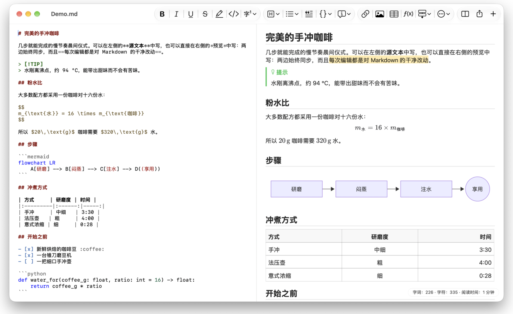
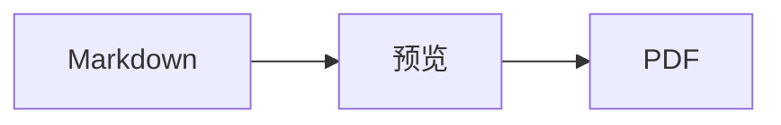

<p>&nbsp;&nbsp;&nbsp;</p>

# Splat

**适用于 macOS 的 Markdown 编辑器，既可在源文本中写作，也可直接在预览中写作。**

Splat 左侧是带语法着色的 Markdown 源文本，右侧是实时且完全可编辑的预览。在哪一侧输入都行：你在预览中写下的内容，会变成对源文本的最小改动，所以你没碰过的行与原来逐字节相同，Git diff 也始终干净。Splat 能读懂你日常使用的 Markdown：CommonMark 和 GitHub Flavored Markdown、GitHub 提示块、Obsidian 的维基链接、嵌入和标注、Pandoc 与 Typora 扩展、嵌入的 HTML、LaTeX 公式，以及 Mermaid、Graphviz 和 PlantUML 图表，全部离线渲染。一键即可导出为 PDF、HTML 或 Word。它用 Rust 编写，基于原生 AppKit 控件，支持 35 种语言，除非你要求，否则不会通过网络发送任何数据。
 


[](https://raw.githubusercontent.com/sventmueller/splat/main/dist/Splat-1.0.4.dmg)

**[下载 Splat-1.0.4.dmg](https://raw.githubusercontent.com/sventmueller/splat/main/dist/Splat-1.0.4.dmg)**：已由 Apple 签名并公证，适用于 macOS 14 或更高版本，支持 Apple 芯片和 Intel 处理器。
 
 

[](https://www.rust-lang.org)
[](https://www.apple.com/macos/)

[](https://github.com/madsmtm/objc2)
[](https://webkit.org)
[](https://github.com/kivikakk/comrak)
[](https://github.github.com/gfm/)
[](https://www.mathjax.org)
[](https://cortexjs.io/mathlive/)
[](https://mermaid.js.org)
[](https://graphviz.org)
[](https://plantuml.com)


[](#许可证)

[Bahasa Indonesia](../id/README.md) ·
[Bahasa Melayu](../ms/README.md) ·
[Català](../ca/README.md) ·
[Čeština](../cs/README.md) ·
[Dansk](../da/README.md) ·
[Deutsch](../de/README.md) ·
[English](../../../README.md) ·
[Español](../es/README.md) ·
[Français](../fr/README.md) ·
[Hrvatski](../hr/README.md) ·
[Italiano](../it/README.md) ·
[Magyar](../hu/README.md) ·
[Nederlands](../nl/README.md) ·
[Norsk](../no/README.md) ·
[Polski](../pl/README.md) ·
[Português (Brasil)](../pt_BR/README.md) ·
[Português (Portugal)](../pt_PT/README.md) ·
[Română](../ro/README.md) ·
[Slovenčina](../sk/README.md) ·
[Slovenščina](../sl/README.md) ·
[Suomi](../fi/README.md) ·
[Svenska](../sv/README.md) ·
[Tiếng Việt](../vi/README.md) ·
[Türkçe](../tr/README.md) ·
[Ελληνικά](../el/README.md) ·
[Русский](../ru/README.md) ·
[Українська](../uk/README.md) ·
[עברית](../he/README.md)‎ ·
[العربية](../ar/README.md)‎ ·
[हिन्दी](../hi/README.md) ·
[ไทย](../th/README.md) ·
[한국어](../ko/README.md) ·
[日本語](../ja/README.md) ·
**简体中文** ·
[繁體中文](../zh-Hant/README.md)

## 目录

- [功能一览](#功能一览)
- [系统要求](#系统要求)
- [安装](#安装)
- [开始使用](#开始使用)
- [写作](#写作)
  - [在源文本中](#在源文本中)
  - [在预览中](#在预览中)
  - [格式命令](#格式命令)
  - [列表和任务](#列表和任务)
  - [表格](#表格)
- [支持的 Markdown](#支持的-markdown)
  - [CommonMark 和 GitHub Flavored Markdown](#commonmark-和-github-flavored-markdown)
  - [标注](#标注)
  - [扩展语法](#扩展语法)
  - [Obsidian](#obsidian)
  - [引文和引用](#引文和引用)
  - [嵌入的 HTML](#嵌入的-html)
  - [排版标点](#排版标点)
  - [语法概览](#语法概览)
- [公式](#公式)
- [图表](#图表)
- [图像](#图像)
- [链接和导航](#链接和导航)
- [导出、打印和共享](#导出打印和共享)
- [外观和辅助功能](#外观和辅助功能)
- [语言](#语言)
- [键盘快捷键](#键盘快捷键)
- [隐私和安全](#隐私和安全)
- [大型文稿](#大型文稿)
- [已知限制](#已知限制)
- [疑难解答](#疑难解答)
- [开发者须知](#开发者须知)
  - [构建](#构建)
  - [分发](#分发)
  - [测试](#测试)
  - [项目结构](#项目结构)
  - [数据流](#数据流)
  - [控制器中的规则](#控制器中的规则)
  - [添加命令](#添加命令)
  - [翻译](#翻译)
  - [第三方组件](#第三方组件)
- [许可证](#许可证)

## 功能一览

- **两种写法，同一份文本。** 源文本和预览都可编辑。Markdown 文件是唯一的依据：每个文稿只有一份撤销记录，预览中的每次编辑都会被转换为对源文本的最小改动。
- **你日常使用的 Markdown。** CommonMark、GitHub Flavored Markdown、GitHub 提示块、Obsidian、Pandoc 和 Typora 扩展、表情符号短代码、剧透文本、定义列表、标题锚点，以及 GitHub README 中常见的 HTML。
- **内置公式和图表。** 通过 MathJax 渲染 LaTeX 公式，并配有可视化公式编辑器。Mermaid、Graphviz 和 PlantUML 图表直接在你的 Mac 上渲染，无需 Java、服务器或网络连接。
- **样样都有按钮。** 每种 Markdown 元素都有对应的工具栏按钮和菜单项，常用的还有键盘快捷键。表格有专属菜单，用于处理行、列和对齐。
- **导出不丢内容。** 可导出为 PDF、单个自包含的 HTML 文件，或带有真正的标题、列表、表格、脚注和图像的 Word 文稿。
- **彻头彻尾的原生。** 真正的 AppKit 窗口、标签页、菜单、弹出窗口、版本、自动存储、共享菜单、深色模式、拼写检查、听写和旁白。没有 Electron，文本本身也不用网页视图。
- **大文件也很快。** 在 10 MB 的文稿中，一次按键约需 25 毫秒。
- **私密而谨慎。** 来自网络的图像只有在你允许后才会载入，指向其他 App 的链接会先询问，所有解码不受信任的图像数据的操作都在沙盒化的辅助进程中运行。
- **使用你的语言。** 界面和内置的 Markdown 快速参考提供 35 种语言版本：阿拉伯语、加泰罗尼亚语、简体中文、繁体中文、克罗地亚语、捷克语、丹麦语、荷兰语、英语、芬兰语、法语、德语、希腊语、希伯来语、印地语、匈牙利语、印度尼西亚语、意大利语、日语、韩语、马来语、挪威语、波兰语、葡萄牙语（巴西）、葡萄牙语（葡萄牙）、罗马尼亚语、俄语、斯洛伐克语、斯洛文尼亚语、西班牙语、瑞典语、泰语、土耳其语、乌克兰语和越南语。

## 系统要求

- macOS 14 Sonoma 或更高版本。Splat 在 macOS 27 上开发和测试，在该系统上会自动采用液态玻璃设计。
- 搭载 Apple 芯片或 Intel 处理器的 Mac。
- 约 45 MB 磁盘空间。

## 安装

**通过磁盘映像。** 下载 [`dist/Splat-1.0.4.dmg`](https://raw.githubusercontent.com/sventmueller/splat/main/dist/Splat-1.0.4.dmg)，打开后将 Splat 拖到“应用程序”文件夹。该映像已使用 Developer ID 签名并经 Apple 公证，因此打开时不会出现警告。

**通过 Homebrew。** Cask 位于专属的 tap 中：

```sh
brew install --cask sventmueller/tap/splat
```

`brew upgrade --cask splat` 会安装新版本，`brew uninstall --zap --cask splat` 还会移除 Splat 的设置和缓存。

**更新。** 通过磁盘映像或 Homebrew 安装的 Splat 会借助 [Sparkle](https://sparkle-project.org) 自行保持最新。第二次启动时，它会询问是否可以每天自动检查一次更新。**Splat › 检查更新…** 会立即检查；之后可在同一菜单中通过 **自动检查更新** 和 **自动下载并安装更新** 更改你的选择。只有带有开发者签名的更新，Splat 才会安装。自行构建的版本没有更新功能。

**从源代码构建。** 先查看[构建](#构建)了解所需的前提条件，然后执行：

```sh
make build
ditto target/release/Splat.app /Applications/Splat.app
open /Applications/Splat.app
```

若要双击即用 Splat 打开 Markdown 文件，请在访达中选择任意 `.md` 文件，选取 **文件 › 显示简介**，在 **打开方式** 下选取 Splat，然后点按 **全部更改…**。Splat 会为 `.md`、`.markdown`、`.mdown` 和 `.mkd` 文件注册自己。

## 开始使用

### 窗口

每个文稿在各自的窗口中打开，如果你更喜欢标签页，也可以作为标签页打开：

- **左侧：源文本。** 你的 Markdown，使用 SF Mono 字体并带语法着色。
- **右侧：预览。** 渲染后的文稿，随时可编辑。
- **大纲边栏（可选）。** 以树状结构列出所有标题；点按其中一个，即可在两个窗格中同时显示它。用 **显示 › 显示大纲**（⌃⌘S）切换。
- **工具栏。** 按用途分组的按钮：字符、段落和插入的元素，然后是预览开关、共享和新建文稿。可通过 **显示 › 自定义工具栏…** 自定义。

拖移分隔线，可以让任一侧获得更多空间。**显示 › 隐藏预览**（⌥⌘P）只留下源文本；Splat 会按窗口记住这一设置。两个窗格同步滚动，在一个窗格中所做的选择会在另一个窗格中高亮显示。

### 文稿、标签页和版本

Splat 是一款标准的 macOS 文稿 App：

- **自动存储和版本。** 更改会就地存储。**文件 › 复原到 › 浏览所有版本…** 可带你回到过去。
- **来自其他程序的更改。** 当 Git、脚本或其他编辑器更改了已打开的文稿时，Splat 会重新载入，并保留插入点和滚动位置。如果你自己有未存储的更改，Splat 会保留它们，并且 macOS 会在覆盖另一个版本之前询问。
- **常用的文件命令。** 复制（⇧⌘S）、重新命名…、移到…，以及 **文件 › 打开最近使用**。
- **标签页。** **文件 › 新建标签页** 或工具栏中的 **+** 按钮会把新文稿作为标签页打开；标准的“窗口”菜单可以合并、移动和切换标签页。
- **窗口位置。** 最后一个窗口的大小和位置会被记住，重新启动后也一样。如果那个位置已有窗口，新窗口会稍微错开打开。
- **程序坞图标。** 关闭最后一个窗口后点按它，会打开一份新文稿。
- **用 Splat 打开 Markdown 文件。** **Splat › 设为 Markdown 的默认 App** 会让双击 `.md` 或 `.markdown` 文件时打开 Splat；macOS 会询问一次以确认。当 Splat 是默认 App 时，该菜单项会显示勾选标记。

文件必须是 UTF-8 文本，或带字节顺序标记的 UTF-16。Splat 会拒绝其他编码，而不是靠猜测导致文本损坏。字节顺序标记会保留，UTF-16 仍是 UTF-16；在所有行都以 CRLF 结尾的文件中，你新增的行也会使用 CRLF。

**崩溃之后**，最多丢失最后几秒的输入：Splat 每五秒会把未存储的文本拷贝到 `~/Library/Application Support/Splat/Unsaved`，并在文稿存储或 Splat 正常退出后删除这些拷贝。下次启动时，崩溃留在那里的内容会被移到 `~/Library/Application Support/Splat/Recovery`，并提示一次，附带一个打开该文件夹的按钮。Splat 仍能响应的崩溃，还会把每个已打开文稿的文本写到那里。

### 快速参考

**帮助 › Markdown 快速参考** 会把一份你所用语言的速查表作为新的未命名文稿打开。它是一份普通文稿，所以你可以直接在其中试用所有写法，无论在源文本还是在预览中。

## 写作

### 在源文本中

源文本是一个为 Markdown 调校过的纯文本编辑器：

- **语法着色**与 VS Code 类似：标题、强调、链接、代码、表格、HTML、前置元数据，以及公式和图表中的 LaTeX 与 Mermaid。提供浅色、深色和“增强对比度”三套配色。
- **围栏代码块**支持高亮的语言有 Bash、C、C++、C#、CSS（也包括 SCSS 和 Less）、Go、HTML、XML、Java、JavaScript、JSON、Kotlin、PHP、Python、Ruby、Rust、SQL、Swift、TypeScript、YAML、TeX 和 Mermaid，也认它们常用的简称，如 `js`、`py` 或 `sh`。
- **没有意外的替换。** 智能引号、智能破折号和文本替换默认关闭，因为它们会破坏 `--`、`---` 和 `"`。可在 **编辑 › 替换** 中开启。
- **系统的写作工具。** 拼写和语法检查、听写、查找和替换（⌥⌘F），以及语音。
- **拖放。** 拖入图像文件会插入 ``，拖入其他文件会插入指向它的链接，拖入 URL 会插入 `[url](url)`。每次拖放是一步撤销。
- **粘贴图像。** 剪贴板上的图片（如屏幕截图）会作为 PNG 文件存放在文稿旁边（`图像 2026-10-29 13.09.07.png`），并作为图像插入。为此，文稿需要先存储一次。

### 在预览中

预览的使用感受就像文字处理软件，但你在其中所做的一切，最终都会变成 Markdown：

- **输入。** 在 Markdown 中有特殊含义的字符，如 `*` 或 `#`，会被转义，从而按你输入的样子显示。
- **Return** 开始新的段落或列表项。**⌥Return** 或 **⌃Return** 插入换行符。
- **插入点处的格式。** 当插入点位于词尾时，粗体、斜体和其他字符格式会应用到你接下来输入的内容。再次选取该格式即可停止。在词中时，整个词都会被设置格式。
- **空行。** 在空行上按 Return 会再添加一个空行，按 Backspace 则删除它。在源文本中，每多一个空行就多出两个空白行；其他 Markdown 程序会把它们显示为正常的段落间距。
- **撤销**对两个窗格都有效。撤销项带有名称（“撤销粗体”），连续输入算作一步，撤销和重做之后，两个窗格都会滚动到发生更改的位置。
- **公式和图表**以成品图形显示。点按它、把插入点移到它上面，或在它上面按 Return，即可打开其编辑器（参见[公式](#公式)和[图表](#图表)）。
- **嵌入的 HTML、嵌入的笔记和前置元数据**会显示出来，但要在源文本中编辑。点按它们，插入点会跳到源文本中对应的位置。

Markdown 无法表达的内容在预览中一律被阻止：“字体”和“颜色”面板、标尺，以及粘贴或拖入富文本和图像。粘贴的 HTML 和 RTF 会以纯文本形式进入。

### 格式命令

每个命令都可以通过工具栏、菜单栏以及两个窗格的上下文菜单使用。菜单项会为插入点处的格式显示勾选标记。

| 菜单 | 命令 |
|---|---|
| **格式 › 字体** | 粗体、斜体、下划线、删除线、高亮、代码、上标、下标 |
| **格式 › 标题** | 正文、标题 1 至 6 |
| **格式 › 列表** | 项目符号列表、编号列表、任务列表 |
| **格式** | 引用、代码块（无语言或 20 种语言之一；也可更改现有代码块的语言）、标注（备注、提示、重要、警告、注意；再次选择同一类型即可移除）、编辑公式或图表…、清除格式 |
| **插入** | 链接…、图像…、表格…、公式、图表（流程图、时序图、甘特图）、目录、脚注、分隔线 |
| **表格** | 在上方/下方插入行、在左侧/右侧插入列、删除行、删除列、对齐（左对齐、居中、右对齐、默认）、对齐表格列 |
| **显示** | 隐藏/显示预览、显示/隐藏大纲、排版标点、放大/缩小、实际大小、工具栏、标签页栏、全屏幕 |

下划线、高亮、上标和下标分别写作 `<ins>`、`<mark>`、`<sup>` 和 `<sub>`，GitHub 同样能显示。Splat 也能读取 GitHub 会移除的 `<u>`，以及更短的 `==highlight==`、`^sup^` 和 `~sub~`。GitHub 会把 `==` 和 `^` 按原样显示，把 `~sub~` 显示为删除线。

### 列表和任务

- 按 Return 会延续列表；在空列表项上按 Return 则结束列表。
- 在预览中，**Tab** 和 **⇧Tab** 分别增加和减少列表项的缩进。
- 在预览中点按任务复选框，会切换 `- [ ]` 和 `- [x]`。
- **格式 › 列表** 会把所选段落转换为列表，或更改列表的类型。

### 表格

- **插入 › 表格…** 会询问行数（含标题行）和列数。
- 在预览中，**Tab** 跳到下一个单元格，**⇧Tab** 跳到上一个，**Return** 跳到下方的单元格。在最后一个单元格中按 Tab 会添加一行。
- **表格** 菜单可插入和删除行与列，并设定某一列的对齐方式（⌘{、⌘|、⌘}）。
- **表格 › 对齐表格列** 会为源文本补齐空格，使各列对齐。

## 支持的 Markdown

Splat 使用 [comrak](https://github.com/kivikakk/comrak) 解析，这是一个与 CommonMark 和 GFM 兼容的解析器，并开启了它的大部分扩展。以下内容都会在预览和所有导出中渲染。

### CommonMark 和 GitHub Flavored Markdown

- 标题（`#` 和下划线式）、段落、换行、强调、加强强调、行内代码、块引用、分隔线。
- 项目符号列表、编号列表和嵌套列表；任务列表。
- 链接（行内、引用式和自动链接）、图像、链接引用定义。
- 带语法着色的围栏代码块和缩进代码块。
- 带列对齐的表格。
- 用 `~~两个波浪线~~` 表示删除线。
- 脚注：`text[^1]`，并在文稿任意位置写 `[^1]: The note.`。点按标记会跳到脚注。
- 位于顶部、以 `---` 行为界的 YAML 前置元数据。预览中会将其概括为一行，例如“元数据：title, date, tags”。

### 标注

GitHub 提示块会渲染为带图标和标题的彩色方框：

```markdown
> [!NOTE]
> 用户应当了解的有用信息。

> [!WARNING]
> 需要立即关注的关键内容。
```

五种类型是备注、提示、重要、警告和注意。**格式 › 标注** 会把插入点所在的段落转换为标注。

Obsidian 的标注同样可用，可以带任意标题和折叠状态：

```markdown
> [!tip]- 点按 ▸ 展开
> 打开前处于隐藏状态。

> [!question]+ 默认展开
> `+` 表示初始展开，`-` 表示初始折叠。
```

Obsidian 的其他类型会以五种颜色中最接近的一种显示：`success`、`check`、`done` 和 `hint` 显示为提示；`question`、`help` 和 `faq` 显示为重要；`attention` 显示为警告；`failure`、`fail`、`missing`、`danger`、`error` 和 `bug` 显示为注意；其余都显示为备注。

### 扩展语法

| 功能 | 语法 | 来源 |
|---|---|---|
| 高亮 | `==标记的文本==` | Obsidian、Typora |
| 上标 | `x^2^` | Pandoc、Typora |
| 下标 | `H~2~O` | Pandoc、Typora |
| 表情符号短代码 | `:rocket:` 变成 🚀 | GitHub |
| 剧透 | `\|\|隐藏的文本\|\|`，选中即可阅读 | Discord |
| 行内脚注 | `text^[脚注内容]` | Pandoc、Obsidian |
| 定义列表 | `术语`、空行、`: 解释` | PHP Markdown Extra、Pandoc |
| 标题锚点 | `## 安装 {#setup}`，用 `[参见](#setup)` 链接 | Pandoc、kramdown |

定义列表在源文本中是这样的：

```markdown
术语

: 术语的解释。
```

没有自定义锚点时，每个标题都会像在 GitHub 上一样，根据其文本生成一个锚点：`## 快速入门` 可通过 `#快速入门` 访问。

### Obsidian

- **维基链接。** `[[Note]]` 链接到同一文件夹或其下级文件夹中的 `Note.md`。`[[Note|显示的文本]]` 显示你自己的文本，`[[Note#Heading]]` 打开该笔记。按住 ⌘ 点按会在 Splat 中打开它。
- **嵌入。** `![[Note]]` 在当前笔记中显示另一篇笔记；其中再嵌入的笔记会显示为链接。`![[diagram.png]]` 显示图像。与 Obsidian 一样，嵌入所指的笔记和图像位于文稿所在的文件夹或其下级文件夹中，从不使用绝对路径，并且只有 Markdown 文件会显示为笔记。
- **注释。** `%%仅在源文本中%%` 在源文本中保持可见，而在预览和所有导出中会被省略，无论是行内的还是单独成行的。
- **标签。** `#idea` 或 `#project/splat` 会被高亮。按住 ⌘ 点按可在文稿中搜索该标签。
- **可折叠的标注。** 参见[标注](#标注)。

### 引文和引用

- **Pandoc 引文。** `[@doe2020]` 或 `[@doe2020; @roe2021]` 读作“(Doe 2020; Roe 2021)”。条目来自前置元数据中以 `bibliography: refs.bib` 指定的 BibTeX 文件。没有指定时，Splat 会使用文稿旁边的 `references.bib`、`literatur.bib` 或 `bibliography.bib`。
- **GitHub 和 GitLab 引用。** 如果文稿位于某个 Git 仓库中，且其 `origin` 远程库在 github.com 或某个 GitLab 主机上，则 `@name`、`#12`（议题）和 `!7`（合并请求，仅限 GitLab）会被高亮。按住 ⌘ 点按会在浏览器中打开它们。

### 嵌入的 HTML

GitHub README 中常见的 HTML 都会被渲染，用的是 Splat 自己的读取器，而不是浏览器引擎：

- 居中的段落和区块（`<p align="center">`、`<div align="center">`）
- 指定尺寸的图像（``）
- 链接、`<kbd>⌘</kbd>`、`<br>`、`<u>`、`<ins>`、`<mark>`、`<sup>`、`<sub>`
- 列表和表格，包括跨列的单元格（`colspan`）
- 可折叠的部分：`<details><summary>更多</summary>…</details>`，点按 ▸ 即可展开

HTML 标签之间的 Markdown 会按 Markdown 渲染。脚本、样式、框架和表单一律省略，链接和图像只保留 `http`、`https`、`mailto` 和相对地址。

### 排版标点

**显示 › 排版标点** 会把直引号显示为界面语言的引号，把 `--` 显示为连接号（en dash），把 `---` 显示为破折号（em dash），把 `...` 显示为省略号。在德语中，`"Ja"` 变成 „Ja“，在法语中是 «Oui»，在日语中是 「はい」，中文和日文的引号前后也不加空格；希伯来语的缩写（如 `צה"ל`）会得到 gershayim，即 צה״ל。源文本保留普通字符；预览和所有导出显示排版后的字符。该设置在你开启之前处于关闭状态。

### 语法概览

| 元素 | Markdown |
|---|---|
| **粗体** | `**粗体**` |
| *斜体* | `*斜体*` |
| 下划线 | `<ins>下划线</ins>` 或 `<u>下划线</u>` |
| ~~删除线~~ | `~~删除线~~` |
| 高亮 | `<mark>高亮</mark>` 或 `==高亮==` |
| `代码` | `` `代码` `` |
| x² | `x<sup>2</sup>` 或 `x^2^` |
| H₂O | `H<sub>2</sub>O` 或 `H~2~O` |
| [链接](https://example.com) | `[链接](https://example.com)` |
| 标题 | `# 标题` 至 `###### 标题` |
| 引用 | `> 引用` |
| 项目符号列表 | `- 项目` |
| 编号列表 | `1. 项目` |
| 任务 | `- [ ] 待办` 和 `- [x] 已完成` |
| 代码块 | ```` ```rust ```` … ```` ``` ```` |
| 表格 | `\| A \| B \|`，标题行下方为 `\|---\|---\|` |
| 脚注 | `文本[^1]` 和 `[^1]: 脚注` |
| 分隔线 | `---` |
| 图像 | `` |
| 公式 | `$E = mc^2$`、`$$ … $$` |
| 图表 | ```` ```mermaid ````、```` ```dot ````、```` ```plantuml ```` |
| 标注 | `> [!TIP]` |
| 维基链接 | `[[Note]]`、`[[Note\|文本]]` |
| 嵌入 | `![[Note]]`、`![[image.png]]` |
| 注释 | `%%注释%%` |
| 标签 | `#标签` |
| 引文 | `[@key]` |
| 剧透 | `\|\|剧透\|\|` |
| 表情符号 | `:tada:` |

## 公式

公式由 [MathJax](https://www.mathjax.org) 借助其 TeX 和 AMS 数学功能渲染，呈现为清晰的矢量图形。`\text{…}` 中的文本可以使用任何文字：MathJax 字体里缺少的字形会取自你 Mac 的字体，阿拉伯语和希伯来语按从右到左排列，表情符号保持彩色。

| 类型 | 语法 |
|---|---|
| 行内 | `$E = mc^2$`、`` $`E = mc^2`$ ``（GitHub、GitLab）、`\(E = mc^2\)` |
| 独立成行 | `$$` … `$$`、`\[` … `\]`，或标记为 `math` 的代码块 |

**编辑公式。** 在预览中点按公式、双击它、在它上面按 Return，或把插入点移到它上面，即可在弹出窗口中打开其编辑器。**插入 › 公式** 会插入一个新公式，并立即打开编辑器。

- **可视化或 LaTeX。** 顶部的开关可在可视化编辑器（[MathLive](https://cortexjs.io/mathlive/)）和 LaTeX 代码之间切换。Splat 会记住你的选择。
- **构建块**包括分数、平方根、上标和下标、带上下限的求和与积分、极限、随内容伸缩的括号、2×2 矩阵、希腊字母，以及关系符、运算符和箭头。它们会留下占位符 □，按 **Tab** 键跳到下一个。
- **实时预览。** 更改会在你输入时出现在文稿中。MathJax 报告的错误显示在代码下方的一行中。
- **提交或放弃。** 点按外部会把更改保留为一步撤销；按 **Esc** 或点按 **取消** 则放弃更改。对新建的空公式按 Esc 会把它移除。
- 上下文菜单为指针下的公式提供 **编辑公式…**。

旁白会把公式读作其 LaTeX 代码。Splat 渲染的是公式，而不是完整的 LaTeX 文档：不支持宏包、TikZ 和 `\documentclass`。

## 图表

图表在 Splat 内部离线渲染，并提供浅色和深色两种样式。

| 引擎 | 代码块 | 可绘制的内容 |
|---|---|---|
| [Mermaid](https://mermaid.js.org) | ```` ```mermaid ```` | 流程图、时序图、类图、状态图、实体关系图、甘特图、饼图、思维导图、时间线，以及 Mermaid 的所有其他类型 |
| [Graphviz](https://graphviz.org) | ```` ```dot ```` 或 ```` ```graphviz ```` | 用 DOT 语言描述的图 |
| [PlantUML](https://plantuml.com) | ```` ```plantuml ```` 或 ```` ```puml ```` | UML 图；无需 Java 即可运行 |



**编辑图表**与编辑公式类似：点按它，即可在弹出窗口中打开代码，代码带语法着色，错误信息显示在代码下方的一行中。**插入 › 图表** 会从流程图、时序图或甘特图的模板开始。构建块可帮助你处理最常见的三种 Mermaid 类型：

- **流程图：** 节点 ▾（矩形、圆角、圆形、菱形、数据库）、连线、带标签的连线、分组、方向 ▾
- **时序图：** 参与者、消息、回复、备注、循环、备选路径
- **甘特图：** 部分、任务、里程碑

其他图表类型以代码形式编辑。旁白会读出图表的标题或替代文本。

启动后的第一个图表约需一秒钟，因为渲染引擎要在后台启动。耗时超过 10 秒的图表会显示错误，渲染引擎会为下一个图表重新启动。PlantUML 的引擎（7 MB）只在第一个 PlantUML 图表出现时才载入。来自网络的 PlantUML `!include` 会被阻止。

## 图像

- **本地图像**使用相对于文稿的路径：``。Splat 可显示 PNG、JPEG、GIF、WebP、BMP、SVG、HEIC、TIFF、AVIF 和 PDF。
- **来自网络的图像**在你允许之前一直被阻止：预览上方的横幅会说明，载入它们会让其服务器得知你打开了文稿以及打开的时间。**载入图像** 会对此文稿允许载入；Splat 会按文件记住这一选择。
- **尺寸。** `` 可设定图像尺寸；否则图像会适应预览的宽度。
- **磁盘上的更改。** 你替换的图像，或在文稿提到它之后才出现的图像，无需重新打开文稿即可显示。因网络问题而失败的网络图像，在文稿显示它们期间会再次尝试。
- **内存。** 图像最长边最多按 2560 像素显示，这也足以铺满一张 A4 纸。一旦图像占满 Mac 内存的八分之一，以及在 macOS 报告内存压力期间，它们会以更小的尺寸解码。
- **深色模式。** 白色背景的图像在深色预览中会略微调暗。
- **粘贴和拖放。** 参见[在源文本中](#在源文本中)。

## 链接和导航

在预览中，点按会放置插入点，以便你编辑链接文本；**按住 ⌘ 点按**则会跟随链接：

- `http`、`https` 和 `mailto` 会在你的浏览器或邮件 App 中打开。
- Markdown 文件在 Splat 中打开；其他文件和文件夹会在访达中显示。
- `#anchor` 会跳到文稿中的对应标题。
- 会打开其他 App 的地址，如 `slack://` 或 `vscode://`，会先询问，并显示完整地址和对应的 App。**取消** 为预先选中的按钮。

**插入 › 目录** 会插入一份包含所有标题的带链接列表。插入点位于其中时，同一命令会更新它。大纲边栏（⌃⌘S）可在两个窗格中跳到任意标题。

## 导出、打印和共享

| 格式 | 方式 | 得到什么 |
|---|---|---|
| **PDF** | **文件 › 导出为PDF…** 或“共享”菜单 | 按纸张尺寸分页，始终使用浅色外观，公式和图表为矢量图形。**文件 › 页面设置…** 用于设定纸张。 |
| **打印** | **文件 › 打印…**（⌘P） | 与 PDF 相同的版面。 |
| **HTML** | **文件 › 导出为 HTML…** 或“共享”菜单 | 一个自包含的文件：本地图像已嵌入，公式和图表为清晰的图像，标题带锚点，因此目录可以正常跳转。不含脚本。 |
| **Word** | **文件 › 导出为 Word 文稿…** 或“共享”菜单 | 一个 `.docx` 文件，带有 Word 的标题样式、真正的列表和表格（包括合并的单元格）、Word 脚注、嵌入的图像、公式和图表。 |
| **Markdown** | 工具栏中的 **共享** 按钮 | 将文稿作为 `.md` 文件，供“邮件”、“信息”、隔空投送以及其他所有共享服务使用。 |

**文件 › 共享** 菜单把这些方式集中在一处。导出会采用排版标点设置，以及你已允许载入的网络图像；在 HTML 中，网络图像仍保持为链接。

## 外观和辅助功能

- **深色模式**跟随系统。公式和图表会针对每种外观分别渲染。
- 系统设置中的 **增强对比度** 会把语法着色切换为高对比度配色。
- **缩放。** ⌘+、⌘− 和 ⌘0 可同时缩放两个窗格。
- **全屏幕、标签页和可自定义的工具栏**，与每一款 Mac App 一样。
- **旁白。** 两个窗格分别标记为“Markdown 源文本”和“预览”，公式读作其代码，图表读作其标题。每个命令都可通过键盘访问。

Splat 没有设置窗口：为数不多的选项就放在它们起作用的地方，即 **显示** 和 **编辑 › 替换** 中。

## 语言

界面、菜单和 Markdown 快速参考已翻译为 35 种语言：

阿拉伯语、加泰罗尼亚语、简体中文、繁体中文、克罗地亚语、捷克语、丹麦语、荷兰语、英语、芬兰语、法语、德语、希腊语、希伯来语、印地语、匈牙利语、印度尼西亚语、意大利语、日语、韩语、马来语、挪威语、波兰语、葡萄牙语（巴西）、葡萄牙语（葡萄牙）、罗马尼亚语、俄语、斯洛伐克语、斯洛文尼亚语、西班牙语、瑞典语、泰语、土耳其语、乌克兰语和越南语。

Splat 遵循 **系统设置 › 通用 › 语言与地区** 中的语言顺序；你也可以在那里的 **应用程序** 下单独为 Splat 选择语言。如果没有你所用语言的翻译，它会使用英语。菜单术语沿用 Apple 自己的翻译，因此 Splat 读起来与 Mac 上的其他部分一致。

希伯来语和阿拉伯语文本无论出现在哪里，也无论界面语言是什么，都按从右到左阅读：每个段落、标题和列表项的方向由其第一个字母决定，引用和标注的竖条画在右侧，文本从右到左开头的表格则从右侧起排列各列。代码块保持从左到右。PDF、HTML 和 Word 导出会保留这些方向。如果系统语言是希伯来语或阿拉伯语，macOS 还会镜像窗口，使预览位于左侧。

## 键盘快捷键

| 操作 | 快捷键 |
|---|---|
| 粗体、斜体、下划线 | ⌘B、⌘I、⌘U |
| 删除线 | ⇧⌘X |
| 链接… | ⌘K |
| 正文、标题 1 至 6 | ⌥⌘0、⌥⌘1 至 ⌥⌘6 |
| 将表格列左对齐、居中、右对齐 | ⌘{、⌘\|、⌘} |
| 隐藏或显示预览 | ⌥⌘P |
| 显示或隐藏大纲 | ⌃⌘S |
| 放大、缩小、实际大小 | ⌘+、⌘−、⌘0 |
| 新建文稿、打开、存储、复制 | ⌘N、⌘O、⌘S、⇧⌘S |
| 页面设置、打印 | ⇧⌘P、⌘P |
| 查找、查找和替换 | ⌘F、⌥⌘F |
| 查找下一个、上一个；使用所选内容查找；跳到所选内容 | ⌘G、⇧⌘G；⌘E；⌘J |
| 显示拼写和语法；检查文稿 | ⌘:、⌘; |
| 粘贴并匹配样式 | ⌥⇧⌘V |
| 隐藏工具栏、显示所有标签页、全屏幕 | ⌥⌘T、⇧⌘\\、⌃⌘F |
| 换行（预览） | ⌥Return 或 ⌃Return |
| 表格中的下一个单元格 / 上一个单元格（预览） | Tab / ⇧Tab |
| 增加 / 减少列表项缩进（预览） | Tab / ⇧Tab |
| 公式编辑器中的下一个占位符 | Tab |
| 不保存更改并关闭公式或图表编辑器 | Esc |
| 跟随链接、标签或引用（预览） | 按住 ⌘ 点按 |

Splat 不改动 Apple 的标准快捷键。

## 隐私和安全

Markdown 文件可能来自任何人，因此 Splat 把每份文稿都视为不受信任。

- **默认不联网。** Splat 没有遥测功能。只有在你同意或选取 **检查更新…** 之后，它才会检查更新：此时它会从 GitHub 载入一个小型订阅源文件，请求中除了 App 名称及其版本外不含任何信息。公式和图表在本地渲染；负责渲染的网页视图无法访问网络。
- **来自网络的图像**只有在你许可之后才会载入，只通过 `https`，从不来自本地网络中的主机，每张最大 10 MB，并且在不带 Cookie 的隐私会话中进行。
- **隔离解码。** 图像以及公式和图表的图形，在辅助进程中解码；这些进程会关闭继承的所有文件，并在读取第一个字节之前把自己锁进沙盒：无法访问文件，也无法联网。它们只交回像素，且会检查像素的尺寸，10 秒后即被终止。Apple 自带的图像解码器只处理 HEIC、TIFF、AVIF 和 PDF，而且仅当数据确实是该格式时才处理；它们在专属的辅助进程中运行，该进程另外可以读取系统的字体文件夹，并使用系统的视频解码器。SVG、公式和图表同样要经过这个辅助进程，因此它们在 Splat 中是分辨率固定的图片：每点四个像素，长边最多 2560 像素。
- **本地文件**只能通过文稿中写明的路径进入文稿。嵌入会显示文稿所在文件夹及其下级文件夹中的 Markdown 笔记，缺失的图片也只在那里查找。其他位置的图像路径，无论是绝对路径还是以 `~` 开头，仍然会载入，HTML 和 Word 导出也会把它嵌入：转交不是你写的文稿之前，请先查看它的导出结果。
- **未存储文本的拷贝**留在这台 Mac 的“资源库”文件夹中，用于崩溃后的恢复。存储或 Splat 正常结束后，它们就会消失；崩溃遗留的拷贝则会留在恢复文件夹中，直到你将其删除。
- **链接**绝不会因点按而启动程序。网页和邮件链接照常打开；指向其他 App 的链接会先询问。
- **文稿中的 HTML** 由 Splat 自己的解析器读取。脚本、样式、框架和表单绝不会运行。
- **导出**不含脚本。HTML 页面和 GitHub 一样，只保留固定列表中的无害标签和属性，另外还有内容安全策略。Word 文件只链接 `http`、`https` 和 `mailto` 地址。
- **代码签名**使用 Hardened Runtime。Splat 不在 App 沙盒中运行，这样它无需针对每个文件夹询问，就能显示文稿旁边的图像；所有解码都被隔离，这弥补了这一点。

## 大型文稿

对于几兆字节的文稿，Splat 仍能保持响应：

- 源文本使用 TextKit 2，它只对可见部分进行排版。
- 在预览中输入时，以及在最大 2 MB 的文稿的源文本中输入时，只有受影响的段落会重新解析、着色和排版：在 10 MB 的文稿中约 25 毫秒，在其预览中一次按键约 50 毫秒（含视图自身的工作）。
- 大型预览先渲染可见部分，其余部分在 App 空闲时渲染。滚动到视野中的区块会在绘制之前先渲染。
- 在较大文稿的源文本中，预览的解析会在你输入时于后台运行。
- 文稿一旦需要约 4 GB 内存便保持为纯文本（普通 Markdown 约 50 到 120 MB，全是表格或标题时只需 10 到 20 MB）：源文本没有颜色，预览会说明它为何保持空白。导出仍然可用。
- 从约 200 KB 起，文稿会在解析之前先打开窗口；到 5 MB 时，着色和预览约四分之一秒后才出现。

有些更改需要完整处理，在 10 MB 时每次按键约 300 毫秒：对脚注的定义或引用的更改、行内脚注旁边的更改、紧挨脚注的文稿最末尾处的更改、对前置元数据或链接引用定义附近的更改，以及在含有 `%%` 注释块、或某个脚注被定义两次、或脚注位于引用或列表内的文稿中所做的每一处更改。内存随文件增长，1 MB 的 Markdown 约需 115–160 MB，10 MB 则约需 340–510 MB。

## 已知限制

- **单个波浪线表示下标。** `~text~` 与 Pandoc 中一样是下标；删除线需要 `~~two~~`。GitHub 用一个波浪线也能显示删除线。
- **预览中只读：** 嵌入的 HTML、嵌入的笔记和前置元数据需在源文本中编辑。
- **嵌套过深：** 嵌套超过 64 层的 HTML，以及超过 16 层的行内 HTML，只会保留其内容。
- **合并的表格单元格**只存在于 HTML 表格中，而且只能跨列（`colspan`，不支持 `rowspan`）。不支持 MultiMarkdown 用于合并单元格的表格语法。
- **参考文献**只读取 BibTeX，不读取 CSL JSON 或 YAML。
- **引用**需要位于 github.com 或某个 GitLab 主机上的仓库；`!7` 只在 GitLab 上有。
- **排版标点：** 德语的单引号结束符无法与撇号区分，会按 ’ 处理。
- **只支持公式，不支持文档：** 没有 LaTeX 宏包、TikZ，也不支持完整文档。
- **可视化公式编辑器**以 MathLive 的写法输出 LaTeX：空格会消失（`E = mc^2` 变成 `E=mc^2`），渲染效果不变。
- **有意如此：** 没有行号、没有设置窗口、没有帮助手册，也不在 App Store 上架。
- **在 Intel 上测试较少。** 窗口自测只在 Apple 芯片上运行；在 Intel 上，CI 运行 `cargo test`。

## 疑难解答

**重新构建 Splat 后，最近使用的文稿列表是空的。** macOS 把最近使用的文稿和文件夹权限与 App 的代码签名绑定在一起。本地构建使用你登录钥匙串中的证书“Splat Local Signing”签名，因此重新构建后两者都会保留。如果该证书被删除，下次构建会创建一个新的，列表会重新开始一次。

**磁盘映像中的 App 显示的最近使用的文稿，与我自己构建的版本不同。** 两者的签名不同，所以 macOS 为各自保存单独的列表和单独的文件夹权限。

**HTML 或其他语法显示为纯代码。** 可能是旧版 Splat 打开了该文稿。请退出它，在访达中对该文稿选取 **文件 › 显示简介**，并检查 **打开方式** 指向的是“应用程序”文件夹中的 Splat。

**Splat 菜单中没有“检查更新…”。** 只有来自磁盘映像或 Homebrew 的版本会自行更新；自行构建的版本没有更新功能。

**来自网络的图像不显示。** 点按预览上方横幅中的 **载入图像**。只有来自公共主机的 `https` 图像才会载入。

**粘贴屏幕截图时要求我先存储。** 粘贴的图像会以文件形式存放在文稿旁边，这需要磁盘上有位置。请先存储，然后再次粘贴。

**“该文件不是 UTF-8 文本，无法作为 Markdown 打开。”** 该文件使用了其他编码，并且没有可以指明编码的字节顺序标记。请先转换它，例如使用 `iconv -f ISO-8859-1 -t UTF-8 old.md > new.md`。

**公式或图表显示错误。** 点按它：编辑器会在代码下方显示 MathJax、Mermaid、Graphviz 或 PlantUML 的错误信息。

## 开发者须知

Splat 是一个 Rust 应用，通过 [objc2](https://github.com/madsmtm/objc2) 直接调用 AppKit 和 WebKit。没有 Swift，没有 Objective-C，没有 Xcode 项目，也没有 Interface Builder 文件。

### 构建

前提条件：

- 安装了命令行工具的 macOS（`xcode-select --install`）。不需要 Xcode；Splat 的构建不依赖 `actool`、`ibtool` 和 `metal`。
- Rust 1.99（`brew install rust`）。[rust-toolchain.toml](../../../rust-toolchain.toml) 写明了 CI 所用的确切版本；rustup 会自动安装它，而 Homebrew 的 Rust 会忽略该文件。在那里提高版本号，新的编译器和 clippy 警告就会由此进入项目。

[Makefile](../../../Makefile) 提供简短的入口；`make help` 会列出全部：

```sh
make build                  # target/release/Splat.app，与 cargo xtask bundle --release 相同
make universal              # 面向 Apple 芯片和 Intel 的 target/splat-universal，与磁盘映像所含的一致
make check                  # 格式、无警告的 clippy、全部测试、内置库；即 CI 所运行的内容
make test                   # 先执行 make check，再执行无窗口的自测
make test-gui               # 带窗口的自测；它们会占用 Mac 约四分钟
make test-long              # 更长的随机搜索，以及 10 MB 的局部更新检查
make coverage               # 全部测试和自测的行覆盖率，每个模块有下限
make coverage-library       # 针对无窗口模块的同样下限，与 CI 中一致
make bench FILE=<file.md>   # 打开、输入和滚动大文件的耗时
make release                # 先执行 make test，再生成经过公证的磁盘映像
```

构建逻辑本身位于 Rust crate [xtask](../../../xtask/src/main.rs) 中：

```sh
cargo xtask bundle --release   # target/release/Splat.app，Hardened Runtime，使用“Splat Local Signing”签名
cargo xtask bundle             # target/debug/Splat Debug.app，一个绝不打开 Markdown 文件的独立 App
cargo xtask dmg                # 用于分发的 dist/Splat-<version>.dmg，Developer ID，已公证
cargo xtask icon               # 根据 assets/icon-1024.png 重新生成 assets/AppIcon.icns 和 README 图标
cargo xtask vendor check       # 对照 vendor.lock 校验内置的 JavaScript
cargo xtask vendor fetch       # 修改 vendor.lock 中的版本后重新下载
```

`bundle` 会写入 `Info.plist`，拷贝资源和本地化文件，并用证书“Splat Local Signing”为 App 签名。首次构建会在你的登录钥匙串中创建该证书，有效期 20 年。只要它还在，Splat 在多次重新构建之间就能保留最近使用的文稿和文件夹权限；若使用临时签名，每次构建在 macOS 看来都是一个新 App。调试构建和自测构建带有各自的 bundle ID（`local.splat.debug`、`local.splat.selftest`），并且不注册 Markdown 文件，所以访达绝不会用过时的构建打开文稿，它们也不会动正常 App 的设置。

版本号保存在 [VERSION](../../../VERSION) 中，格式为 `major.minor.build`，它就是下一次构建所得到的版本。每次成功的发布构建（`make build`、`cargo xtask bundle --release`、`make release`）都会把构建号加一；调试构建和自测构建则不会动它。主版本号和次版本号需手动提高：比如把 VERSION 设为 `1.1.0`，下一次构建就会得到恰好这个版本。

### 分发

`cargo xtask dmg`（或先运行 `make test` 的 `make release`）会构建发布版本，用你的 Developer ID 签名，请 Apple 公证该 App 并装订票据，把它打包成带有指向“应用程序”链接的压缩只读磁盘映像，同样对映像进行公证和装订，并用 Gatekeeper 检查结果。App 自带票据，这样不经过访达安装的副本（如 Homebrew 所做的）首次启动时也能离线打开；与公证服务的两轮往返各需几分钟。只有通过了每一步的映像才会成为 `dist/Splat-<version>.dmg`，也就是提交的那一份：本 README 及其翻译中的下载链接随之更新，构建号也会增加。上一个映像会再保留一个版本，因为推送之后的几分钟内，GitHub 的 raw 服务器可能仍会提供旧的更新订阅源；更旧的映像会被移到废纸篓。失败的运行会让 `dist/`、各 README 和 VERSION 保持原样。每次发布都会把完整的映像（约 16 MB）加入仓库历史。它只在被调用时运行，绝不作为普通构建的一部分，并且需要：

- 钥匙串中的“Developer ID Application”证书
- 已保存的 Apple 公证服务登录信息，使用 App 专用密码，通过 `xcrun notarytool store-credentials notary --apple-id <Apple ID> --team-id <team ID>` 创建一次
- 登录钥匙串中用于签署更新的私钥。它由 Sparkle 的 `generate_keys` 创建；其公钥是 [xtask/src/main.rs](../../../xtask/src/main.rs) 中的 `UPDATE_KEY`，也存在于每一份已安装的副本中，这些副本只接受用它签署的更新。请在密码管理器中保留一份备份：`target/sparkle-2.10.1/bin/generate_keys -x <file>` 导出它，`-f <file>` 在另一台 Mac 上导入它。没有它，已安装的副本就再也无法更新。
- rustup（`brew install rustup`，它不会动 Homebrew 的 Rust）

只要缺少其中任何一项，`dmg` 就会在构建之前停止。首次运行时，macOS 会询问“终端”是否可以控制访达；没有这项权限，磁盘映像既不会显示背景，也不会显示图标排列。

只有磁盘映像带有更新程序 [Sparkle](https://sparkle-project.org)，构建时会从它的 GitHub 发布页面下载一次到 `target/` 中，并对照 xtask 中的校验和进行检查。Hardened Runtime 只会在框架带有 App 的 Team ID 时才加载它，Developer ID 签名带有该 ID，而本地证书没有；而且更新不得替换你自己构建的版本。自测构建同样带有 Sparkle，以便据此检查更新菜单：使用不存在的订阅源，不出现 Sparkle 在第二次启动时的询问，并带有让本地签名的 App 能加载该框架的权限。`dmg` 会用更新密钥为新映像签名，并写出 `dist/appcast.xml`，即已安装的副本从 GitHub 读取的订阅源。请把映像、订阅源和各 README 一起提交并推送：从那时起，已安装的副本就会收到更新提示。

磁盘映像是同时适用于 Apple 芯片和 Intel 的通用二进制；其他构建只面向主机的处理器。Homebrew 的 Rust 只附带主机处理器的标准库，所以 `dmg` 通过 rustup 构建，它会在首次使用时安装 [rust-toolchain.toml](../../../rust-toolchain.toml) 中的工具链和目标平台，并且在程序或 Sparkle 缺少任一处理器的代码时停止。`make universal` 只构建程序本身。其中的 App 带有与本地构建不同的签名，所以 macOS 会为两者分别保存最近使用的文稿和文件夹权限。

### 测试

| 命令 | 检查内容 |
|---|---|
| `cargo test --release` | 单元测试、随机测试和翻译测试 |
| `SPLAT_FUZZ_ROUNDS=20000 cargo test --release` | 更长的随机搜索；`SPLAT_FUZZ_SEED` 用于改变输入 |
| `SPLAT_I18N_ONLY=fr cargo test --release i18n` | 只测一种语言，适用于其他语言尚不完整时 |
| `cargo clippy --release --all-targets [--features selftest]` | 代码检查，包括每个 `unsafe` 块的理由说明、函数长度，以及在库中的数值转换 |
| `cargo xtask vendor check` | JavaScript 库与 `vendor.lock` 逐字节一致 |
| `cargo xtask selftest probe` | 无窗口，各自带有预期结果：公式、图表、对照进程内服务器的网络图像、被阻止的地址、网页视图的防护 |
| `cargo xtask selftest gui [--stop-after "<check>"] [--scenarios]` | 运行中的 App，逐次点按。它会打开窗口并向其中输入；Mac 会被占用约四分钟。`--scenarios` 只运行第二部分，约一分半钟 |
| `cargo xtask selftest resize` | 拖移分隔线后加宽窗口：调整窗口大小时，源文本会重新换行。约需十秒 |
| `cargo xtask selftest bench <file.md>` | 打开、输入和滚动大文件的耗时 |
| `cargo test --release -- --ignored partial_updates` | 10 MB 文稿中的一次按键：局部更新与完整更新的对比，结果与时间上限 |
| `cargo test --release --test hostile` | 专门构造来溢出栈或耗费二次方时间的文稿，经过解析、排版、两种导出、按键和命令 |
| `make mutants` | 通过 [cargo-mutants](https://mutants.rs)（`cargo install cargo-mutants`）逐个向 `src/markdown/` 和 `src/preview/` 植入故障；指出哪些故障没有任何测试察觉。需要数小时；`FILE=src/preview/bridge.rs` 可缩小范围 |
| `cargo test --release --test decoder` | 解码器进程解码图像，既无法访问文件，也无法访问网络 |
| `make coverage` | 通过 [cargo-llvm-cov](https://github.com/taiki-e/cargo-llvm-cov)（`brew install cargo-llvm-cov llvm`）统计 `cargo test` 和所有自测的行覆盖率；低于下限则失败。会占用 Mac 约五分钟 |
| `make coverage-library` | `src/markdown/`、`src/preview/` 和 `i18n.rs` 的下限，仅由 `cargo test` 测得 |

单元测试紧挨着被测代码。`tests/` 存放从外部访问库的测试：`robustness.rs` 中的随机测试（与 `sync.rs` 的测试共用 `src/fuzz.rs` 中的生成器）、`hostile.rs` 中专门用来刁难程序的文稿，以及启动已构建程序的解码器测试。`src/editor/` 中不需要窗口的决策放在带有各自测试的独立函数里：控制器所知道的一切及其变化方式在 `state.rs`，渲染规则在 `render_queue.rs`，文本拷贝在 `sync.rs`。窗口自测中若有某一步白白等待，整次运行即告失败。窗口自测在主要的点按流程之后还会运行第二部分，位于 `src/editor/selftest/scenarios.rs`：每个格式命令和表格命令、各种对话框、链接点按、粘贴、拖放、导出、大幅更改、磁盘上变化的图像、内存压力、超大文稿，以及崩溃后的恢复。

覆盖率有两条下限：每个模块至少覆盖 80 % 的行，所有模块合计至少 85 %。`make coverage` 把 `cargo test` 与自测合并测量，低于任一下限都会失败；这些下限以及少数例外（如 `main.rs` 中只在崩溃时运行的 panic 钩子）连同理由都写在 [xtask](../../../xtask/src/coverage.rs) 中。测量用的构建会放进 `target/coverage/`，所以用于测量的代码绝不会进入 `target/release/` 或磁盘映像。解码器辅助进程在把自己锁起来之前就打开了它的测量文件，因此它也被计入。

CI（[.github/workflows/ci.yml](../../../.github/workflows/ci.yml)）会在每次推送到 `main` 和每个拉取请求时，在 Apple 芯片上运行 `make check`、`make coverage-library` 和通用构建，在 Intel 上运行 `cargo test`。每天夜里，[.github/workflows/nightly.yml](../../../.github/workflows/nightly.yml) 会用新的随机输入运行 `make test-long`。自测和磁盘映像只在开发者自己的 Mac 上进行：它们需要屏幕和钥匙串中的签名证书。

自测的输出放在 `target/selftest/` 中。自测会构建一个独立的 App（`target/release/Splat Selftest.app`，bundle ID 为 `local.splat.selftest`），不会动正常 App 的设置、最近使用的文稿和文件关联。

### 项目结构

`src/lib.rs` 把所有不需要窗口的部分做成一个独立的库 `splat`：`markdown/`、`preview/`、`i18n.rs` 和测试生成器 `fuzz.rs`。`src/main.rs` 中的 App 构建于其上。

- `src/markdown/`：解析器绑定（comrak）、语法着色，以及所有作为纯文本编辑（`Edit`）的命令。还包括编辑后的重新解析（`incremental.rs`）、嵌入 HTML 的读取器（`markup.rs`）、排版、正文中的标签、引用和引文（`typography.rs`）、文本的外观以及由哪些 Markdown 和 HTML 实现该外观（`style.rs`）、地址可以是什么（`url.rs`），以及 HTML 和 Word 导出（`html.rs`、`docx.rs`，附带 `docx/html.rs` 和 `docx/xml.rs`）。预览和两种导出读取的是同一棵树 `Doc`。不涉及 AppKit。
- `src/preview/`：预览的排版、其中嵌入的 HTML（`layout/html.rs`），以及预览与源文本之间的映射（`Bridge`、`Index`）。不涉及 AppKit。
- `src/editor/`：窗口。一个 `EditorController` 对象作为两个视图的代理为 AppKit 服务；其工作按职责拆分：

| 模块 | 职责 |
|---|---|
| `mod.rs` | 类、代理方法、`invalidate` |
| `state.rs` | 控制器对文稿所知道的一切，以及改变它的所有途径；其字段是私有的，并且不接触任何视图 |
| `actions.rs` | 命令注册表：选择器、标题、快捷键、符号、命令何时适用 |
| `editing.rs` | 运行和验证命令，在预览中输入 |
| `update.rs` | 解析、着色、更新预览；编辑之后只处理受影响的段落 |
| `sync.rs` | 文本拷贝和区块记录，不涉及 AppKit，并带有随机测试 |
| `progressive.rs` | 分步渲染大型预览 |
| `selection.rs`、`scroll.rs` | 两个窗格的选择和滚动位置保持同步 |
| `atom.rs`、`atom_edit.rs` | 公式和图表编辑器 |
| `navigation.rs`、`links.rs` | 链接、维基链接、标签、任务复选框、折叠、脚注 |
| `env.rs` | 预览从文本之外读取的内容：排版标点、`@name` 和 `#12` 所对应的仓库、BibTeX 文件、嵌入的笔记 |
| `render.rs`、`images.rs`、`remote.rs`、`safe_image.rs` | 预览文本、本地和远程图像 |
| `attributes.rs` | 文本属性；每个键只能得到它所期望类型的值 |
| `shadow.rs` | 用于崩溃后恢复的未存储文本拷贝 |
| `decoder.rs` | 解码图像和图形的沙盒化辅助进程 |
| `export.rs`、`outline.rs` | HTML 和 Word 导出；大纲边栏 |
| `js.rs`、`mathfield.rs`、`render_queue.rs` | 用于 MathJax、Mermaid、Graphviz、PlantUML 和可视化公式编辑器的 WebKit；与 WebKit 无关的、关于何时渲染什么的规则 |
| `webkit.rs` | 对 WebKit 的调用；只有导航代理的生命周期仍由 `js.rs` 和 `mathfield.rs` 负责 |
| `window.rs`、`toolbar.rs`、`views.rs`、`dialogs.rs`、`style.rs` | 窗口、工具栏、文本视图、对话框、颜色 |

- `src/menu.rs`、`src/app.rs`、`src/document.rs`：菜单栏、App 代理、文稿（`MDDocument`，一个 `NSDocument` 子类）。
- `src/i18n.rs` 与 `resources/*.lproj`：35 种语言；键是德语文本。
- `src/large_alloc.rs`：大块分配直接来自内核，释放时直接还给内核，因此大幅编辑之后内存会回落。
- `resources/js/`：网页和库；版本和校验和见 [vendor.lock](../../../vendor.lock)。
- `xtask/`：打包、签名、磁盘映像、图标、内置库、自测运行器和覆盖率下限。

### 数据流

左侧文本视图中的源文本是唯一的依据。

1. 那里的每次字符更改，都会就地更新文本拷贝（`Snapshot`），而无需再次读取文本。
2. 一次更新会解析该拷贝，只在颜色有变化的地方为源文本重新着色，并对预览排版，只替换内容有变化的区块。
3. 编辑之后，只要相邻段落保持不变，就只会重新解析、着色和排版受影响的段落；它们何时会变化，由 `reparse_part_and_color` 判断。含有 `%%` 注释块的文稿、对前置元数据的更改以及对链接引用定义附近的更改，会被完整处理。comrak 只有在同一次解析中找到脚注的定义时才会识别脚注引用，并把定义移到文本后面，所以该部分会用每个标签一个替身定义来解析，并从旧的树中取得编号；对该部分中的引用或定义的更改，或对行内脚注旁边的更改，会被完整处理。
4. 以 `<details>` 或 `<div align>` 开头、之后才闭合的 HTML 块，会影响它们之间的 Markdown 块；被复用的块必须有相同的上下文。
5. 在最大 2 MB 的文稿的源文本中输入时，局部更新会立即运行；若不适用，或文稿更大，解析和排版会在后台运行。在预览中输入时，它们会立即运行，因为预览的插入点取决于结果。
6. 预览中的输入由 `Bridge` 转换为对源文本的编辑，此后走同一条路径。Markdown 把文本变成语法的方式太多，仅靠规则应付不了，所以 `preview/verify.rs` 会再次解析更改的部分，并把它显示的内容与输入的内容比较；站不住脚的编辑会被进一步转义或被拒绝。
7. comrak 的行内位置在少数地方会出错，例如在链接引用定义后面。`markdown/positions.rs` 在读取块时会对照源文本检查它们，对不吻合之处再从源文本重新读取。

### 控制器中的规则

1. 控制器自己对视图的更改在 `silently()` 内运行；代理回调会忽略它们。
2. 只在读取和计算时借用 `state`，绝不在会改变、排版或滚动视图的调用期间借用。它只通过自己的方法改变，这些方法的测试不需要窗口。
3. 来自外部的消息（图像已载入、公式已渲染）通过 `renders_arrived` 和 `image_arrived` 延迟到达，绝不会在更新进行到一半时到达。
4. 没有文本更改的重绘只通过 `invalidate(reason)` 进行。
5. 不要在源文本更改期间持有 `Rc<Snapshot>`，否则该更改会拷贝整份文本。
6. 新命令需要在 `actions.rs` 中添加一项，在 `mod.rs` 中添加一个方法，在 `editing::perform` 中添加一个分支。
7. 每个 `unsafe` 块都以 `// SAFETY:` 注释的形式附上它的理由。字节只能通过 `decoder::system_image` 进入 App 中的系统图像解码器。
8. 主线程上的任何操作都不会等待用户的文件夹，因为网络卷可能停止响应：文件在线程 `DISK` 上查看，预览通过 `Env::known` 读取结果。只有用户正在等待的操作，如导出或存储，才可以直接访问磁盘。

### 添加命令

菜单栏、工具栏和上下文菜单都从 [src/editor/actions.rs](../../../src/editor/actions.rs) 中的注册表构建各自的项目，菜单验证也在那里读取命令何时适用以及是否显示勾选标记。新命令需要：

1. `Action` 的一个变体及其 `Spec`：选择器、标题、工具栏标签、提示（以动词开头，最多 75 个字符）、快捷键、SF Symbol 以及适用时机
2. `src/editor/mod.rs` 中的方法
3. `editing::perform` 中的一个分支
4. 每个 `Localizable.strings` 中它的文本

测试 `every_command_has_a_method_and_every_method_a_command` 会检查注册表与方法是否一一对应。Apple 的标准快捷键，如 ⌘E、⌘J、⌘T、⌘;、⇧⌘C、⌥⌘C、⌥⌘V、⇧⌘P、⌥⌘T、⌃⌘F 和 ⌘,，保持不动。

### 翻译

代码以德语文本作为键：`t("Fett")` 在运行时查找它，`n("Fett")` 则标记一个常量以备日后查找。每个 `resources/<language>.lproj/` 包含：

- `Localizable.strings`：所有界面文本，菜单术语依据 Apple 自己的术语表
- `InfoPlist.strings`：macOS 为该 App 及其文稿类型显示的名称
- `QuickReference.md`：Markdown 快速参考

`cargo xtask bundle` 会把每个 `.lproj` 文件夹列为一种本地化，并且 `CFBundleDevelopmentRegion` 是英语，因此系统菜单和存储对话框遵循同一种语言。i18n 测试会检查每种语言是否具备全部文本，以及每份快速参考是否具有德语版的大纲。

`assets/readme/<language>/` 存放该语言的本 README、其屏幕截图以及截图中所示的演示文稿。对本 README 的更改也应同步到这些副本中。

### 第三方组件

| 组件 | 版本 | 用途 | 许可证 |
|---|---|---|---|
| [comrak](https://github.com/kivikakk/comrak) | 0.59 | Markdown 解析器 | BSD-2-Clause |
| [objc2](https://github.com/madsmtm/objc2)、objc2-foundation、block2 | 0.6 / 0.3 | Objective-C 运行时、Foundation、块 | MIT |
| objc2-app-kit、objc2-web-kit、dispatch2 | 0.3 | AppKit、WebKit 和 Grand Central Dispatch 的绑定 | Zlib、Apache-2.0 或 MIT |
| [svg2pdf](https://github.com/typst/svg2pdf) | 0.13 | 将公式和 SVG 图像转为矢量 PDF | MIT 或 Apache-2.0 |
| [image](https://github.com/image-rs/image) | 0.25 | 解码 PNG、JPEG、GIF、WebP 和 BMP | MIT 或 Apache-2.0 |
| [unicode-width](https://github.com/unicode-rs/unicode-width) | 0.2 | 对齐表格列 | MIT 或 Apache-2.0 |
| [entities](https://github.com/p-jackson/entities) | 1 | HTML 字符引用的名称 | MIT |
| [MathJax](https://www.mathjax.org) | 3.2.2 | 渲染公式 | Apache-2.0 |
| [MathLive](https://cortexjs.io/mathlive/) | 0.111.1 | 可视化公式编辑器，附带 KaTeX 字体 | MIT |
| [Mermaid](https://mermaid.js.org) | 12.2.0 | Mermaid 图表 | MIT |
| [Viz.js](https://github.com/mdaines/viz-js) | 3.24.0 | 编译为 WebAssembly 的 Graphviz，内含 Graphviz（EPL-1.0）和 Expat（MIT） | MIT |
| [PlantUML](https://github.com/plantuml/plantuml)（`@plantuml/core`） | 1.2026.6 | 编译为 JavaScript 的 PlantUML 图表 | MIT |
| [Sparkle](https://sparkle-project.org) | 2.10.1 | 磁盘映像版本的更新 | MIT，部分采用 BSD 和 zlib 许可证 |

JavaScript 库按发布时的原样存放在 `resources/js/` 中；[vendor.lock](../../../vendor.lock) 记录了它们的来源和 SHA-256 校验和。它们的许可证文本，包括 Viz.js 内含的 Graphviz 和 Expat 的许可证文本，以 `resources/js/LICENSE-*` 的形式放在它们旁边，并随 App 一起发布。Sparkle 不存放在仓库中：`cargo xtask dmg` 会下载它的发布版本，并对照 xtask 中的校验和检查，其许可证以 `LICENSE-sparkle` 的形式随 App 一起发布。

## 许可证

Splat 依据以下任一许可证授权

- Apache License, Version 2.0（[LICENSE-APACHE](../../../LICENSE-APACHE)）
- MIT License（[LICENSE-MIT](../../../LICENSE-MIT)）

由你选择。

除非你明确另行声明，否则你有意提交以纳入 Splat 的任何贡献，按 Apache-2.0 许可证中的定义，均应按上述方式双重授权，不附加任何其他条款或条件。
