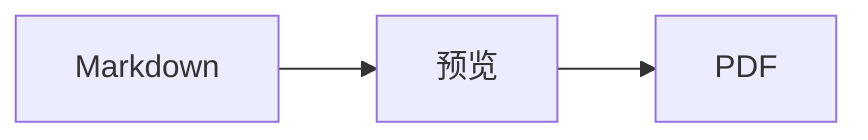

<p>&nbsp;&nbsp;&nbsp;</p>

# Splat

**适用于 macOS 的 Markdown 编辑器，既可在源文本中写作，也可直接在预览中写作。**

Splat 左侧是带语法着色的 Markdown 源文本，右侧是实时且完全可编辑的预览。在哪一侧输入都行：你在预览中写下的内容，会变成对源文本的最小改动，所以你没碰过的行与原来逐字节相同，Git diff 也始终干净。Splat 能读懂你日常使用的 Markdown：CommonMark 和 GitHub Flavored Markdown、GitHub 提示块、Obsidian 的维基链接、嵌入和标注、Pandoc 与 Typora 扩展、嵌入的 HTML、LaTeX 公式，以及 Mermaid、Graphviz 和 PlantUML 图表，全部离线渲染。可以浏览和搜索整个文件夹的笔记，查看自上次 Git 提交以来的更改，把 Word 或网页中的内容粘贴为 Markdown，一键即可导出为 PDF、HTML 或 Word。它用 Rust 编写，基于原生 AppKit 控件，支持 35 种语言，除非你要求，否则不会通过网络发送任何数据。
 


[](https://github.com/sventmueller/splat/releases/latest/download/Splat.dmg)

**[下载 Splat.dmg](https://github.com/sventmueller/splat/releases/latest/download/Splat.dmg)**：已由 Apple 签名并公证，适用于 macOS 14 或更高版本，支持 Apple 芯片和 Intel 处理器。

**发现 Bug 了？** Splat 会让你没碰过的行与原来逐字节相同。如果某行还是变了，或者文件显示不正确，请[提交 Issue](https://github.com/sventmueller/splat/issues/new/choose) 并附上文件。如果 Splat 对你有用，在 [GitHub 上点个 Star](https://github.com/sventmueller/splat) 能帮助更多人找到它。
 
 

[](https://www.rust-lang.org)
[](https://www.apple.com/macos/)

[](https://github.com/madsmtm/objc2)
[](https://webkit.org)
[](https://github.com/kivikakk/comrak)
[](https://github.github.com/gfm/)
[](https://www.mathjax.org)
[](https://cortexjs.io/mathlive/)
[](https://mermaid.js.org)
[](https://graphviz.org)
[](https://plantuml.com)


[](#许可证)

[Bahasa Indonesia](../id/README.md) ·
[Bahasa Melayu](../ms/README.md) ·
[Català](../ca/README.md) ·
[Čeština](../cs/README.md) ·
[Dansk](../da/README.md) ·
[Deutsch](../de/README.md) ·
[English](../../../README.md) ·
[Español](../es/README.md) ·
[Français](../fr/README.md) ·
[Hrvatski](../hr/README.md) ·
[Italiano](../it/README.md) ·
[Magyar](../hu/README.md) ·
[Nederlands](../nl/README.md) ·
[Norsk](../no/README.md) ·
[Polski](../pl/README.md) ·
[Português (Brasil)](../pt_BR/README.md) ·
[Português (Portugal)](../pt_PT/README.md) ·
[Română](../ro/README.md) ·
[Slovenčina](../sk/README.md) ·
[Slovenščina](../sl/README.md) ·
[Suomi](../fi/README.md) ·
[Svenska](../sv/README.md) ·
[Tiếng Việt](../vi/README.md) ·
[Türkçe](../tr/README.md) ·
[Ελληνικά](../el/README.md) ·
[Русский](../ru/README.md) ·
[Українська](../uk/README.md) ·
[עברית](../he/README.md)‎ ·
[العربية](../ar/README.md)‎ ·
[हिन्दी](../hi/README.md) ·
[ไทย](../th/README.md) ·
[한국어](../ko/README.md) ·
[日本語](../ja/README.md) ·
**简体中文** ·
[繁體中文](../zh-Hant/README.md)

## 目录

- [功能一览](#功能一览)
- [系统要求](#系统要求)
- [安装](#安装)
- [开始使用](#开始使用)
- [写作](#写作)
  - [在源文本中](#在源文本中)
  - [在预览中](#在预览中)
  - [格式命令](#格式命令)
  - [列表和任务](#列表和任务)
  - [表格](#表格)
  - [粘贴带格式的文本](#粘贴带格式的文本)
  - [元数据](#元数据)
- [支持的 Markdown](#支持的-markdown)
  - [CommonMark 和 GitHub Flavored Markdown](#commonmark-和-github-flavored-markdown)
  - [标注](#标注)
  - [扩展语法](#扩展语法)
  - [Obsidian](#obsidian)
  - [引文和引用](#引文和引用)
  - [嵌入的 HTML](#嵌入的-html)
  - [排版标点](#排版标点)
  - [语法概览](#语法概览)
- [公式](#公式)
- [图表](#图表)
- [图像](#图像)
- [链接和导航](#链接和导航)
- [文件夹中的笔记](#文件夹中的笔记)
- [自上次提交以来的更改](#自上次提交以来的更改)
- [导出、打印和共享](#导出打印和共享)
- [导入 Word 文稿](#导入-word-文稿)
- [外观和辅助功能](#外观和辅助功能)
- [语言](#语言)
- [键盘快捷键](#键盘快捷键)
- [隐私和安全](#隐私和安全)
- [大型文稿](#大型文稿)
- [已知限制](#已知限制)
- [疑难解答](#疑难解答)
- [开发者须知](#开发者须知)
  - [第三方组件](#第三方组件)
- [许可证](#许可证)

## 功能一览

- **两种写法，同一份文本。** 源文本和预览都可编辑。Markdown 文件是唯一的依据：每个文稿只有一份撤销记录，预览中的每次编辑都会被转换为对源文本的最小改动。
- **你日常使用的 Markdown。** CommonMark、GitHub Flavored Markdown、GitHub 提示块、Obsidian、Pandoc 和 Typora 扩展、表情符号短代码、剧透文本、定义列表、标题锚点，以及 GitHub README 中常见的 HTML。
- **内置公式和图表。** 通过 MathJax 渲染 LaTeX 公式，并配有可视化公式编辑器。Mermaid、Graphviz 和 PlantUML 图表直接在你的 Mac 上渲染，无需 Java、服务器或网络连接。
- **样样都有按钮。** 每种 Markdown 元素都有对应的工具栏按钮和菜单项，常用的还有键盘快捷键。表格有专属菜单，用于处理行、列和对齐。
- **不止一个文件，而是整个文件夹。** 边栏列出文稿所在文件夹中的笔记，并可搜索其全部内容。重新命名笔记会更改指向它的链接，除此之外的每个字节都保持不变。
- **更改一目了然。** 在 Git 仓库中，文本旁边的竖条会在两个窗格中标出与上次提交不同的内容。
- **从 Word 和网页到 Markdown。** 把带格式的文本粘贴为 Markdown，把电子表格的单元格粘贴为表格，还能连同图像导入整份 Word 文稿。
- **导出不丢内容。** 可导出为 PDF、单个自包含的 HTML 文件，或带有真正的标题、列表、表格、脚注和图像的 Word 文稿。可以添加页码、页眉和标题页，也可以使用公司的 Word 模板。
- **彻头彻尾的原生。** 真正的 AppKit 窗口、标签页、菜单、弹出窗口、版本、自动存储、共享菜单、深色模式、拼写检查、听写和旁白。没有 Electron，文本本身也不用网页视图。
- **大文件也很快。** 在 10 MB 的文稿中，渲染一次按键约需 10 毫秒（不含视图自身的工作）。
- **私密而谨慎。** 来自网络的图像只有在你允许后才会载入，指向其他 App 的链接会先询问，所有解码不受信任的图像数据的操作都在沙盒化的辅助进程中运行。
- **使用你的语言。** 界面和内置的 Markdown 快速参考提供 35 种语言版本：阿拉伯语、加泰罗尼亚语、简体中文、繁体中文、克罗地亚语、捷克语、丹麦语、荷兰语、英语、芬兰语、法语、德语、希腊语、希伯来语、印地语、匈牙利语、印度尼西亚语、意大利语、日语、韩语、马来语、挪威语、波兰语、葡萄牙语（巴西）、葡萄牙语（葡萄牙）、罗马尼亚语、俄语、斯洛伐克语、斯洛文尼亚语、西班牙语、瑞典语、泰语、土耳其语、乌克兰语和越南语。

## 系统要求

- macOS 14 Sonoma 或更高版本。Splat 在 macOS 27 上开发和测试，在该系统上会自动采用液态玻璃设计。
- 搭载 Apple 芯片或 Intel 处理器的 Mac。
- 约 45 MB 磁盘空间。

## 安装

**通过磁盘映像。** 下载 [`Splat.dmg`](https://github.com/sventmueller/splat/releases/latest/download/Splat.dmg)，打开后将 Splat 拖到“应用程序”文件夹。该映像已使用 Developer ID 签名并经 Apple 公证，因此打开时不会出现警告。

**通过 Homebrew。** Cask 位于专属的 tap 中：

```sh
brew install --cask sventmueller/tap/splat
```

`brew upgrade --cask splat` 会安装新版本，`brew uninstall --zap --cask splat` 还会移除 Splat 的设置和缓存。

**更新。** 通过磁盘映像或 Homebrew 安装的 Splat 会借助 [Sparkle](https://sparkle-project.org) 自行保持最新。第二次启动时，它会询问是否可以每天自动检查一次更新。**Splat › 检查更新…** 会立即检查；之后可在同一菜单中通过 **自动检查更新** 和 **自动下载并安装更新** 更改你的选择。只有带有开发者签名的更新，Splat 才会安装。自行构建的版本没有更新功能。

**从源代码构建。** 先查看[构建](../../../docs/development.md#building)了解所需的前提条件，然后执行：

```sh
make build
ditto target/release/Splat.app /Applications/Splat.app
open /Applications/Splat.app
```

若要双击即用 Splat 打开 Markdown 文件，请在访达中选择任意 `.md` 文件，选取 **文件 › 显示简介**，在 **打开方式** 下选取 Splat，然后点按 **全部更改…**。Splat 会为 `.md`、`.markdown`、`.mdown` 和 `.mkd` 文件注册自己。

## 开始使用

### 窗口

每个文稿在各自的窗口中打开，如果你更喜欢标签页，也可以作为标签页打开：

- **左侧：源文本。** 你的 Markdown，使用 SF Mono 字体并带语法着色。
- **右侧：预览。** 渲染后的文稿，随时可编辑。
- **边栏（可选）。** 以树状结构列出所有标题，点按其中一个，即可在两个窗格中同时显示它：**显示 › 显示大纲**（⌃⌘S）。另外两个标签页是[文件夹中的笔记](#文件夹中的笔记)和对它们的搜索。窗口标题旁的按钮可显示或隐藏边栏，新窗口会按上一个窗口留下的状态打开边栏。
- **工具栏。** 按用途分组的按钮：字符、段落和插入的元素，然后是预览开关、共享和新建文稿。可通过 **显示 › 自定义工具栏…** 自定义。

拖移分隔线，可以让任一侧获得更多空间。**显示 › 隐藏预览**（⌥⌘P）只留下源文本；Splat 会按窗口记住这一设置。两个窗格同步滚动，在一个窗格中所做的选择会在另一个窗格中高亮显示。

窗口一角显示文本的词数、字符数和阅读所需的时间，有选定内容时还显示选定内容的这些数字。链接地址、HTML 标签、元数据、注释、公式和图表不计入。默认不显示，选取 **显示 › 显示字数** 即可显示。

### 文稿、标签页和版本

Splat 是一款标准的 macOS 文稿 App：

- **自动存储和版本。** 更改会就地存储。**文件 › 复原到 › 浏览所有版本…** 可带你回到过去。
- **来自其他程序的更改。** 当 Git、脚本或其他编辑器更改了已打开的文稿时，Splat 会重新载入，并保留插入点和滚动位置。如果你自己有未存储的更改，Splat 会保留它们，并且 macOS 会在覆盖另一个版本之前询问。
- **常用的文件命令。** 复制（⇧⌘S）、重新命名…、移到…，以及 **文件 › 打开最近使用**。
- **标签页。** **文件 › 新建标签页** 或工具栏中的 **+** 按钮会把新文稿作为标签页打开；标准的“窗口”菜单可以合并、移动和切换标签页。
- **窗口位置。** 最后一个窗口的大小和位置会被记住，重新启动后也一样。如果那个位置已有窗口，新窗口会稍微错开打开。
- **程序坞图标。** 关闭最后一个窗口后点按它，会打开一份新文稿。
- **用 Splat 打开 Markdown 文件。** **Splat › 设为 Markdown 的默认 App** 会让双击 `.md` 或 `.markdown` 文件时打开 Splat；macOS 会询问一次以确认。当 Splat 是默认 App 时，该菜单项会显示勾选标记。

文件必须是 UTF-8 文本，或带字节顺序标记的 UTF-16。Splat 会拒绝其他编码，而不是靠猜测导致文本损坏。字节顺序标记会保留，UTF-16 仍是 UTF-16；在所有行都以 CRLF 结尾的文件中，你新增的行也会使用 CRLF。

**崩溃之后**，最多丢失最后几秒的输入：Splat 每五秒会把未存储的文本拷贝到 `~/Library/Application Support/Splat/Unsaved`，并在文稿存储或 Splat 正常退出后删除这些拷贝。下次启动时，崩溃留在那里的内容会被移到 `~/Library/Application Support/Splat/Recovery`，并提示一次，附带一个打开该文件夹的按钮。Splat 仍能响应的崩溃，还会把每个已打开文稿的文本写到那里。

### 快速参考

**帮助 › Markdown 快速参考** 会把一份你所用语言的速查表作为新的未命名文稿打开。它是一份普通文稿，所以你可以直接在其中试用所有写法，无论在源文本还是在预览中。

## 写作

### 在源文本中

源文本是一个为 Markdown 调校过的纯文本编辑器：

- **语法着色**与 VS Code 类似：标题、强调、链接、代码、表格、HTML、前置元数据，以及公式和图表中的 LaTeX 与 Mermaid。提供浅色、深色和“增强对比度”三套配色。
- **围栏代码块**支持高亮的语言有 Bash、C、C++、C#、CSS（也包括 SCSS 和 Less）、Go、HTML、XML、Java、JavaScript、JSON、Kotlin、PHP、Python、Ruby、Rust、SQL、Swift、TypeScript、YAML、TeX 和 Mermaid，也认它们常用的简称，如 `js`、`py` 或 `sh`。
- **没有意外的替换。** 智能引号、智能破折号和文本替换默认关闭，因为它们会破坏 `--`、`---` 和 `"`。可在 **编辑 › 替换** 中开启。
- **系统的写作工具。** 拼写和语法检查、听写、查找和替换（⌥⌘F），以及语音。
- **拖放。** 拖入图像文件会插入 ``，拖入其他文件会插入指向它的链接，拖入 URL 会插入 `[url](url)`。每次拖放是一步撤销。
- **粘贴图像。** 剪贴板上的图片（如屏幕截图）会作为 PNG 文件存放在文稿旁边（`图像 2026-10-29 13.09.07.png`），并作为图像插入。为此，文稿需要先存储一次。

### 在预览中

预览的使用感受就像文字处理软件，但你在其中所做的一切，最终都会变成 Markdown：

- **输入。** 在 Markdown 中有特殊含义的字符，如 `*` 或 `#`，会被转义，从而按你输入的样子显示。
- **Return** 开始新的段落或列表项。**⌥Return** 或 **⌃Return** 插入换行符。
- **插入点处的格式。** 当插入点位于词尾时，粗体、斜体和其他字符格式会应用到你接下来输入的内容。再次选取该格式即可停止。在词中时，整个词都会被设置格式。
- **空行。** 在空行上按 Return 会再添加一个空行，按 Backspace 则删除它。在源文本中，每多一个空行就多出两个空白行；其他 Markdown 程序会把它们显示为正常的段落间距。
- **撤销**对两个窗格都有效。撤销项带有名称（“撤销粗体”），连续输入算作一步，撤销和重做之后，两个窗格都会滚动到发生更改的位置。
- **公式和图表**以成品图形显示。点按它、把插入点移到它上面，或在它上面按 Return，即可打开其编辑器（参见[公式](#公式)和[图表](#图表)）。
- **嵌入的 HTML、嵌入的笔记和前置元数据**会显示出来，但要在源文本中编辑。点按它们，插入点会跳到源文本中对应的位置。

Markdown 无法表达的内容在预览中一律被阻止：“字体”和“颜色”面板、标尺，以及粘贴或拖入富文本和图像。粘贴的 HTML 和 RTF 会以纯文本形式进入，除非你选择[粘贴为 Markdown](#粘贴带格式的文本)。

### 格式命令

每个命令都可以通过工具栏、菜单栏以及两个窗格的上下文菜单使用。菜单项会为插入点处的格式显示勾选标记。

| 菜单 | 命令 |
|---|---|
| **格式 › 字体** | 粗体、斜体、下划线、删除线、高亮、代码、上标、下标 |
| **格式 › 标题** | 正文、标题 1 至 6 |
| **格式 › 列表** | 项目符号列表、编号列表、任务列表 |
| **格式** | 引用、代码块（无语言或 20 种语言之一；也可更改现有代码块的语言）、标注（备注、提示、重要、警告、注意；再次选择同一类型即可移除）、编辑公式或图表…、清除格式 |
| **插入** | 链接…、图像…、表格…、公式、图表（流程图、时序图、甘特图）、目录、脚注、分隔线 |
| **表格** | 在上方/下方插入行、在左侧/右侧插入列、删除行、删除列、对齐（左对齐、居中、右对齐、默认）、对齐表格列 |
| **显示** | 隐藏/显示预览、显示/隐藏大纲、排版标点、放大/缩小、实际大小、工具栏、标签页栏、全屏幕 |

下划线、高亮、上标和下标分别写作 `<ins>`、`<mark>`、`<sup>` 和 `<sub>`，GitHub 同样能显示。Splat 也能读取 GitHub 会移除的 `<u>`，以及更短的 `==highlight==`、`^sup^` 和 `~sub~`。GitHub 会把 `==` 和 `^` 按原样显示，把 `~sub~` 显示为删除线。

### 列表和任务

- 按 Return 会延续列表；在空列表项上按 Return 则结束列表。
- 在预览中，**Tab** 和 **⇧Tab** 分别增加和减少列表项的缩进。
- 在预览中点按任务复选框，会切换 `- [ ]` 和 `- [x]`。
- **格式 › 列表** 会把所选段落转换为列表，或更改列表的类型。

### 表格

- **插入 › 表格…** 会询问行数（含标题行）和列数。
- 在预览中，**Tab** 跳到下一个单元格，**⇧Tab** 跳到上一个，**Return** 跳到下方的单元格。在最后一个单元格中按 Tab 会添加一行。
- **表格** 菜单可插入和删除行与列，并设定某一列的对齐方式（⌘{、⌘|、⌘}）。
- **表格 › 对齐表格列** 会为源文本补齐空格，使各列对齐。

### 粘贴带格式的文本

**编辑 › 粘贴为 Markdown**（⌃⌘V）也位于两个窗格的上下文菜单中，它会把剪贴板上的内容转为 Markdown 并放到所选位置，算作一步撤销。⌘V 仍然插入纯文本。

- **来自浏览器、Word、Google Docs、Confluence、“备忘录”或 Pages：** 标题、粗体、斜体、下划线、删除线、上标和下标、链接、保留嵌套的列表、引用、代码和表格都会带过来。
- **来自电子表格：** 单元格变成带标题行的表格，数字列右对齐。以制表符、分号或逗号分隔的文本也一样，前提是每行的列数相同。
- **图片** 如果有网址，就仍保持为链接。粘贴的 HTML 中所含的图片会变成文稿旁边的文件，为此文稿需要先存储一次。Word 的临时图片文件不会带过来，但其替代文本会保留。
- **链接** 只保留 `http`、`https`、`mailto`、相对地址和 `#` 地址；其他链接只留下文本。

### 元数据

**格式 › 编辑元数据…**，或点按预览顶部的元数据行，会打开一个表单，其中是 YAML 前置元数据的各个字段。字段可以更改、添加和移除。带列表的字段仍保持为列表：各个值用逗号依次隔开，含逗号的值放在引号中。名为 `tags`、`aliases`、`keywords`、`categories`、`authors` 或 `cssclasses` 的新字段也会成为列表。嵌套字段和多行文本可以在表单中查看，并在源文本中编辑。

表单所做的更改算作一步撤销，并且只涉及你更改的字段所在的行：其他所有字段的注释、顺序、不规则的空格、引号和行尾都逐字节保持不变。没有元数据的文稿会在开头新增一个块。

## 支持的 Markdown

Splat 使用 [comrak](https://github.com/kivikakk/comrak) 解析，这是一个与 CommonMark 和 GFM 兼容的解析器，并开启了它的大部分扩展。以下内容都会在预览和所有导出中渲染。

### CommonMark 和 GitHub Flavored Markdown

- 标题（`#` 和下划线式）、段落、换行、强调、加强强调、行内代码、块引用、分隔线。
- 项目符号列表、编号列表和嵌套列表；任务列表。
- 链接（行内、引用式和自动链接）、图像、链接引用定义。
- 带语法着色的围栏代码块和缩进代码块。
- 带列对齐的表格。
- 用 `~~两个波浪线~~` 表示删除线。
- 脚注：`text[^1]`，并在文稿任意位置写 `[^1]: The note.`。点按标记会跳到脚注。
- 位于顶部、以 `---` 行为界的 YAML 前置元数据。预览中会将其概括为一行，例如“元数据：title, date, tags”。

### 标注

GitHub 提示块会渲染为带图标和标题的彩色方框：

```markdown
> [!NOTE]
> 用户应当了解的有用信息。

> [!WARNING]
> 需要立即关注的关键内容。
```

五种类型是备注、提示、重要、警告和注意。**格式 › 标注** 会把插入点所在的段落转换为标注。

Obsidian 的标注同样可用，可以带任意标题和折叠状态：

```markdown
> [!tip]- 点按 ▸ 展开
> 打开前处于隐藏状态。

> [!question]+ 默认展开
> `+` 表示初始展开，`-` 表示初始折叠。
```

Obsidian 的其他类型会以五种颜色中最接近的一种显示：`success`、`check`、`done` 和 `hint` 显示为提示；`question`、`help` 和 `faq` 显示为重要；`attention` 显示为警告；`failure`、`fail`、`missing`、`danger`、`error` 和 `bug` 显示为注意；其余都显示为备注。

### 扩展语法

| 功能 | 语法 | 来源 |
|---|---|---|
| 高亮 | `==标记的文本==` | Obsidian、Typora |
| 上标 | `x^2^` | Pandoc、Typora |
| 下标 | `H~2~O` | Pandoc、Typora |
| 表情符号短代码 | `:rocket:` 变成 🚀 | GitHub |
| 剧透 | `\|\|隐藏的文本\|\|`，选中即可阅读 | Discord |
| 行内脚注 | `text^[脚注内容]` | Pandoc、Obsidian |
| 定义列表 | `术语`、空行、`: 解释` | PHP Markdown Extra、Pandoc |
| 标题锚点 | `## 安装 {#setup}`，用 `[参见](#setup)` 链接 | Pandoc、kramdown |

定义列表在源文本中是这样的：

```markdown
术语

: 术语的解释。
```

没有自定义锚点时，每个标题都会像在 GitHub 上一样，根据其文本生成一个锚点：`## 快速入门` 可通过 `#快速入门` 访问。

### Obsidian

- **维基链接。** `[[Note]]` 链接到同一文件夹或其下级文件夹中的 `Note.md`。`[[Note|显示的文本]]` 显示你自己的文本，`[[Note#Heading]]` 打开该笔记。按住 ⌘ 点按会在 Splat 中打开它。
- **嵌入。** `![[Note]]` 在当前笔记中显示另一篇笔记；其中再嵌入的笔记会显示为链接。`![[diagram.png]]` 显示图像。与 Obsidian 一样，嵌入所指的笔记和图像位于文稿所在的文件夹或其下级文件夹中，从不使用绝对路径，并且只有 Markdown 文件会显示为笔记。
- **注释。** `%%仅在源文本中%%` 在源文本中保持可见，而在预览和所有导出中会被省略，无论是行内的还是单独成行的。
- **标签。** `#idea` 或 `#project/splat` 会被高亮。按住 ⌘ 点按可在文稿中搜索该标签，在边栏中还会搜索整个文件夹。
- **可折叠的标注。** 参见[标注](#标注)。

### 引文和引用

- **Pandoc 引文。** `[@doe2020]` 或 `[@doe2020; @roe2021]` 读作“(Doe 2020; Roe 2021)”。条目来自前置元数据中以 `bibliography: refs.bib` 指定的 BibTeX 文件。没有指定时，Splat 会使用文稿旁边的 `references.bib`、`literatur.bib` 或 `bibliography.bib`。
- **GitHub 和 GitLab 引用。** 如果文稿位于某个 Git 仓库中，且其 `origin` 远程库在 github.com 或某个 GitLab 主机上，则 `@name`、`#12`（议题）和 `!7`（合并请求，仅限 GitLab）会被高亮。按住 ⌘ 点按会在浏览器中打开它们。

### 嵌入的 HTML

GitHub README 中常见的 HTML 都会被渲染，用的是 Splat 自己的读取器，而不是浏览器引擎：

- 居中的段落和区块（`<p align="center">`、`<div align="center">`）
- 指定尺寸的图像（``）
- 链接、`<kbd>⌘</kbd>`、`<br>`、`<u>`、`<ins>`、`<mark>`、`<sup>`、`<sub>`
- 列表和表格，包括跨列的单元格（`colspan`）
- 可折叠的部分：`<details><summary>更多</summary>…</details>`，点按 ▸ 即可展开

HTML 标签之间的 Markdown 会按 Markdown 渲染。脚本、样式、框架和表单一律省略，链接和图像只保留 `http`、`https`、`mailto` 和相对地址。

### 排版标点

**显示 › 排版标点** 会把直引号显示为界面语言的引号，把 `--` 显示为连接号（en dash），把 `---` 显示为破折号（em dash），把 `...` 显示为省略号。在德语中，`"Ja"` 变成 „Ja“，在法语中是 «Oui»，在日语中是 「はい」，中文和日文的引号前后也不加空格；希伯来语的缩写（如 `צה"ל`）会得到 gershayim，即 צה״ל。源文本保留普通字符；预览和所有导出显示排版后的字符。该设置在你开启之前处于关闭状态。

### 语法概览

| 元素 | Markdown |
|---|---|
| **粗体** | `**粗体**` |
| *斜体* | `*斜体*` |
| 下划线 | `<ins>下划线</ins>` 或 `<u>下划线</u>` |
| ~~删除线~~ | `~~删除线~~` |
| 高亮 | `<mark>高亮</mark>` 或 `==高亮==` |
| `代码` | `` `代码` `` |
| x² | `x<sup>2</sup>` 或 `x^2^` |
| H₂O | `H<sub>2</sub>O` 或 `H~2~O` |
| [链接](https://example.com) | `[链接](https://example.com)` |
| 标题 | `# 标题` 至 `###### 标题` |
| 引用 | `> 引用` |
| 项目符号列表 | `- 项目` |
| 编号列表 | `1. 项目` |
| 任务 | `- [ ] 待办` 和 `- [x] 已完成` |
| 代码块 | ```` ```rust ```` … ```` ``` ```` |
| 表格 | `\| A \| B \|`，标题行下方为 `\|---\|---\|` |
| 脚注 | `文本[^1]` 和 `[^1]: 脚注` |
| 分隔线 | `---` |
| 图像 | `` |
| 公式 | `$E = mc^2$`、`$$ … $$` |
| 图表 | ```` ```mermaid ````、```` ```dot ````、```` ```plantuml ```` |
| 标注 | `> [!TIP]` |
| 维基链接 | `[[Note]]`、`[[Note\|文本]]` |
| 嵌入 | `![[Note]]`、`![[image.png]]` |
| 注释 | `%%注释%%` |
| 标签 | `#标签` |
| 引文 | `[@key]` |
| 剧透 | `\|\|剧透\|\|` |
| 表情符号 | `:tada:` |

## 公式

公式由 [MathJax](https://www.mathjax.org) 借助其 TeX 和 AMS 数学功能渲染，呈现为清晰的矢量图形。`\text{…}` 中的文本可以使用任何文字：MathJax 字体里缺少的字形会取自你 Mac 的字体，阿拉伯语和希伯来语按从右到左排列，表情符号保持彩色。

| 类型 | 语法 |
|---|---|
| 行内 | `$E = mc^2$`、`` $`E = mc^2`$ ``（GitHub、GitLab）、`\(E = mc^2\)` |
| 独立成行 | `$$` … `$$`、`\[` … `\]`，或标记为 `math` 的代码块 |

**编辑公式。** 在预览中点按公式、双击它、在它上面按 Return，或把插入点移到它上面，即可在弹出窗口中打开其编辑器。**插入 › 公式** 会插入一个新公式，并立即打开编辑器。

- **可视化或 LaTeX。** 顶部的开关可在可视化编辑器（[MathLive](https://cortexjs.io/mathlive/)）和 LaTeX 代码之间切换。Splat 会记住你的选择。
- **构建块**包括分数、平方根、上标和下标、带上下限的求和与积分、极限、随内容伸缩的括号、2×2 矩阵、希腊字母，以及关系符、运算符和箭头。它们会留下占位符 □，按 **Tab** 键跳到下一个。
- **实时预览。** 更改会在你输入时出现在文稿中。MathJax 报告的错误显示在代码下方的一行中。
- **提交或放弃。** 点按外部会把更改保留为一步撤销；按 **Esc** 或点按 **取消** 则放弃更改。对新建的空公式按 Esc 会把它移除。
- 上下文菜单为指针下的公式提供 **编辑公式…**。

旁白会把公式读作其 LaTeX 代码。Splat 渲染的是公式，而不是完整的 LaTeX 文档：不支持宏包、TikZ 和 `\documentclass`。

## 图表

图表在 Splat 内部离线渲染，并提供浅色和深色两种样式。

| 引擎 | 代码块 | 可绘制的内容 |
|---|---|---|
| [Mermaid](https://mermaid.js.org) | ```` ```mermaid ```` | 流程图、时序图、类图、状态图、实体关系图、甘特图、饼图、思维导图、时间线，以及 Mermaid 的所有其他类型 |
| [Graphviz](https://graphviz.org) | ```` ```dot ```` 或 ```` ```graphviz ```` | 用 DOT 语言描述的图 |
| [PlantUML](https://plantuml.com) | ```` ```plantuml ```` 或 ```` ```puml ```` | UML 图；无需 Java 即可运行 |



**编辑图表**与编辑公式类似：点按它，即可在弹出窗口中打开代码，代码带语法着色，错误信息显示在代码下方的一行中。**插入 › 图表** 会从流程图、时序图或甘特图的模板开始。构建块可帮助你处理最常见的三种 Mermaid 类型：

- **流程图：** 节点 ▾（矩形、圆角、圆形、菱形、数据库）、连线、带标签的连线、分组、方向 ▾
- **时序图：** 参与者、消息、回复、备注、循环、备选路径
- **甘特图：** 部分、任务、里程碑

其他图表类型以代码形式编辑。旁白会读出图表的标题或替代文本。

启动后的第一个图表约需一秒钟，因为渲染引擎要在后台启动。耗时超过 10 秒的图表会显示错误，渲染引擎会为下一个图表重新启动。PlantUML 的引擎（3 MB）只在第一个 PlantUML 图表出现时才载入。来自网络的 PlantUML `!include` 会被阻止。

## 图像

- **本地图像**使用相对于文稿的路径：``。Splat 可显示 PNG、JPEG、GIF、WebP、BMP、SVG、HEIC、TIFF、AVIF 和 PDF。
- **来自网络的图像**在你允许之前一直被阻止：预览上方的横幅会说明，载入它们会让其服务器得知你打开了文稿以及打开的时间。**载入图像** 会对此文稿允许载入；Splat 会按文件记住这一选择。
- **尺寸。** `` 可设定图像尺寸；否则图像会适应预览的宽度。
- **磁盘上的更改。** 你替换的图像，或在文稿提到它之后才出现的图像，无需重新打开文稿即可显示。因网络问题而失败的网络图像，在文稿显示它们期间会再次尝试。
- **内存。** 图像最长边最多按 2560 像素显示，这也足以铺满一张 A4 纸。一旦图像占满 Mac 内存的八分之一，以及在 macOS 报告内存压力期间，它们会以更小的尺寸解码。
- **深色模式。** 白色背景的图像在深色预览中会略微调暗。
- **粘贴和拖放。** 参见[在源文本中](#在源文本中)。

## 链接和导航

在预览中，点按会放置插入点，以便你编辑链接文本；**按住 ⌘ 点按**则会跟随链接：

- `http`、`https` 和 `mailto` 会在你的浏览器或邮件 App 中打开。
- Markdown 文件在 Splat 中打开；其他文件和文件夹会在访达中显示。
- `#anchor` 会跳到文稿中的对应标题。
- 会打开其他 App 的地址，如 `slack://` 或 `vscode://`，会先询问，并显示完整地址和对应的 App。**取消** 为预先选中的按钮。

**插入 › 目录** 会插入一份包含所有标题的带链接列表。插入点位于其中时，同一命令会更新它。大纲边栏（⌃⌘S）可在两个窗格中跳到任意标题。

## 文件夹中的笔记

边栏顶部的按钮用于在大纲、文件和搜索之间切换。

- **文件**（**显示 › 显示文件**，⌃⌘E）。文稿所在文件夹中的所有 Markdown 文件；如果文稿位于 Git 仓库中，则是整个仓库中的所有 Markdown 文件。点按或按 Return 会把笔记作为此窗口的标签页打开；如果它已打开，则会移到最前面。文件夹名称旁边的按钮可在此窗口中显示另一个文件夹。隐藏文件、`node_modules`、`target`、`Pods`、`DerivedData`、`__pycache__` 和没有笔记的文件夹都不会列出。直接位于个人文件夹中的文稿只显示它旁边的笔记，这样 Splat 就不会遍历你所有的文件夹并逐个询问。
- **搜索**（**编辑 › 查找 › 在所有笔记中搜索…**，⇧⌘F）。在所有笔记中查找文本，不区分大小写，也不管重音符号如何编码。`#tag` 查找标签，`#project` 也会找到 `#project/splat`，代码中的内容不会被找到。点按某个结果会在该位置打开笔记。
- **指向笔记的链接。** 笔记的上下文菜单会列出通过维基链接、嵌入、相对链接或引用定义指向它的笔记。
- **重新命名笔记。** 同一菜单可重新命名它并更改这些链接。Splat 会先告诉你这涉及多少个文件中的多少个链接。每个链接只更改名称，文件的其他每个字节都保持不变。已打开的文稿把这一更改算作一步撤销；在其他文件中，只有 Git 或版本才能撤回。如果其间有其他程序更改过某个文件，所有链接的重新命名都会停止，Splat 会指出该文件。

窗口移到最前面时，列表会跟随文件夹更新。搜索查看的是磁盘上的文件，尚未存储的文本要到下一次自动存储后才会计入。

## 自上次提交以来的更改

对于位于 Git 仓库中的文稿，文本旁边的竖条会在源文本和预览中标出与上次提交不同的内容：绿色表示新增的行，蓝色表示更改的行，被移除内容的位置有一个红色短标记。这些标记会随你的输入和分支的移动而更新。**显示 › 自上次提交以来的更改** 可以关闭它们，对所有窗口生效。

仅行尾不同的行不计入，所以相对于使用 LF 的提交，使用 CRLF 的文件不显示更改。新文件在首次提交之前没有标记，超过 32 MB 的文稿也没有。

## 导出、打印和共享

| 格式 | 方式 | 得到什么 |
|---|---|---|
| **PDF** | **文件 › 导出为PDF…** 或“共享”菜单 | 按纸张尺寸分页，始终使用浅色外观，公式和图表为矢量图形。**文件 › 页面设置…** 用于设定纸张。 |
| **打印** | **文件 › 打印…**（⌘P） | 与 PDF 相同的版面。 |
| **HTML** | **文件 › 导出为 HTML…** 或“共享”菜单 | 一个自包含的文件：本地图像已嵌入，公式和图表为清晰的图像，标题带锚点，因此目录可以正常跳转。不含脚本。 |
| **Word** | **文件 › 导出为 Word 文稿…** 或“共享”菜单 | 一个 `.docx` 文件，带有 Word 的标题样式、真正的列表和表格（包括合并的单元格）、Word 脚注、嵌入的图像、公式和图表。 |
| **Markdown** | 工具栏中的 **共享** 按钮 | 将文稿作为 `.md` 文件，供“邮件”、“信息”、隔空投送以及其他所有共享服务使用。 |

**文件 › 共享** 菜单把这些方式集中在一处。导出会采用排版标点设置，以及你已允许载入的网络图像；在 HTML 中，网络图像仍保持为链接。

**文件 › 导出选项…** 用于设定 PDF、打印和 Word 会向文本添加什么，对所有文稿生效：

- **页码** 位于 PDF 和打印页面的页脚中，形式为 `2 / 9`。
- **页眉和页脚** 用于 PDF 和打印。`{title}`、`{author}`、`{date}`、`{page}` 和 `{pages}` 代表相应的值，前三个来自文稿的元数据。
- **标题页** 用于 PDF、打印和 Word，内容为元数据中的 `title`、`subtitle`、`author` 和 `date`，没有标题时以文稿名称作为标题。它没有页眉，也没有页脚。
- **Word 模板**，即导出时采用其外观的 `.docx` 或 `.dotx` 文件：它的样式（包括本地化的名称）、主题、页面大小、页边距、页眉和页脚。无法读取的模板会停止导出并说明情况，而不是给你一份没有应用模板的文稿。

## 导入 Word 文稿

**文件 › 导入 Word 文稿…** 会询问要导入的 `.docx` 或 `.dotx` 文件以及 Markdown 的存放位置，然后打开结果。图像会放在它旁边的文件夹中，文件夹以文稿名称加 `-images` 命名。

标题和列表按 Word 的样式和编号定义导入，样式名称已本地化的文稿也一样。粗体、斜体、下划线、删除线、高亮、上标和下标、链接、引用、代码、脚注、尾注和表格都会带过来，跨列的单元格变成 HTML 表格。公式变成 LaTeX。修订视为已接受，目录不会带过来，因为 **插入 › 目录** 会生成新的目录。旧的 `.doc` 文件和受密码保护的文稿会被拒绝。

## 外观和辅助功能

- **深色模式**跟随系统。公式和图表会针对每种外观分别渲染。
- 系统设置中的 **增强对比度** 会把语法着色切换为高对比度配色。
- **缩放。** ⌘+、⌘− 和 ⌘0 可同时缩放两个窗格。
- **全屏幕、标签页和可自定义的工具栏**，与每一款 Mac App 一样。
- **旁白。** 两个窗格分别标记为“Markdown 源文本”和“预览”，公式读作其代码，图表读作其标题。每个命令都可通过键盘访问。

Splat 没有设置窗口：为数不多的选项就放在它们起作用的地方，即 **显示**、**编辑 › 替换** 和 **文件 › 导出选项…** 中。

## 语言

界面、菜单和 Markdown 快速参考已翻译为 35 种语言：

阿拉伯语、加泰罗尼亚语、简体中文、繁体中文、克罗地亚语、捷克语、丹麦语、荷兰语、英语、芬兰语、法语、德语、希腊语、希伯来语、印地语、匈牙利语、印度尼西亚语、意大利语、日语、韩语、马来语、挪威语、波兰语、葡萄牙语（巴西）、葡萄牙语（葡萄牙）、罗马尼亚语、俄语、斯洛伐克语、斯洛文尼亚语、西班牙语、瑞典语、泰语、土耳其语、乌克兰语和越南语。

Splat 遵循 **系统设置 › 通用 › 语言与地区** 中的语言顺序；你也可以在那里的 **应用程序** 下单独为 Splat 选择语言。如果没有你所用语言的翻译，它会使用英语。菜单术语沿用 Apple 自己的翻译，因此 Splat 读起来与 Mac 上的其他部分一致。

希伯来语和阿拉伯语文本无论出现在哪里，也无论界面语言是什么，都按从右到左阅读：每个段落、标题和列表项的方向由其第一个字母决定，引用和标注的竖条画在右侧，文本从右到左开头的表格则从右侧起排列各列。代码块保持从左到右。PDF、HTML 和 Word 导出会保留这些方向。如果系统语言是希伯来语或阿拉伯语，macOS 还会镜像窗口，使预览位于左侧。

## 键盘快捷键

| 操作 | 快捷键 |
|---|---|
| 粗体、斜体、下划线 | ⌘B、⌘I、⌘U |
| 删除线 | ⇧⌘X |
| 代码 | ⌥⇧⌘C |
| 链接… | ⌘K |
| 正文、标题 1 至 6 | ⌥⌘0、⌥⌘1 至 ⌥⌘6 |
| 将表格列左对齐、居中、右对齐 | ⌘{、⌘\|、⌘} |
| 隐藏或显示预览 | ⌥⌘P |
| 显示或隐藏大纲 | ⌃⌘S |
| 显示或隐藏文件 | ⌃⌘E |
| 在所有笔记中搜索 | ⇧⌘F |
| 粘贴为 Markdown | ⌃⌘V |
| 放大、缩小、实际大小 | ⌘+、⌘−、⌘0 |
| 新建文稿、打开、存储、复制 | ⌘N、⌘O、⌘S、⇧⌘S |
| 页面设置、打印 | ⇧⌘P、⌘P |
| 查找、查找和替换 | ⌘F、⌥⌘F |
| 查找下一个、上一个；使用所选内容查找；跳到所选内容 | ⌘G、⇧⌘G；⌘E；⌘J |
| 显示拼写和语法；检查文稿 | ⌘:、⌘; |
| 粘贴并匹配样式 | ⌥⇧⌘V |
| 隐藏工具栏、显示所有标签页、全屏幕 | ⌥⌘T、⇧⌘\\、⌃⌘F |
| 换行（预览） | ⌥Return 或 ⌃Return |
| 表格中的下一个单元格 / 上一个单元格（预览） | Tab / ⇧Tab |
| 增加 / 减少列表项缩进（预览） | Tab / ⇧Tab |
| 公式编辑器中的下一个占位符 | Tab |
| 不保存更改并关闭公式或图表编辑器 | Esc |
| 跟随链接、标签或引用（预览） | 按住 ⌘ 点按 |

Splat 不改动 Apple 的标准快捷键。

## 隐私和安全

Markdown 文件可能来自任何人，因此 Splat 把每份文稿都视为不受信任。

- **默认不联网。** Splat 没有遥测功能。只有在你同意或选取 **检查更新…** 之后，它才会检查更新：此时它会从 GitHub 载入一个小型订阅源文件，请求中除了 App 名称及其版本外不含任何信息。公式和图表在本地渲染；负责渲染的网页视图无法访问网络。**帮助 › 报告问题…** 会在浏览器中打开 GitHub 上的表单；其地址包含 Splat 版本、macOS 版本和 Mac 类型，不含你文档中的任何内容。
- **来自网络的图像**只有在你许可之后才会载入，只通过 `https`，从不来自本地网络中的主机，每张最大 10 MB，并且在不带 Cookie 的隐私会话中进行。
- **隔离解码。** 图像以及公式和图表的图形，在辅助进程中解码；这些进程会关闭继承的所有文件，并在读取第一个字节之前把自己锁进沙盒：无法访问文件，也无法联网。它们只交回像素，且会检查像素的尺寸，10 秒后即被终止。Apple 自带的图像解码器只处理 HEIC、TIFF、AVIF 和 PDF，而且仅当数据确实是该格式时才处理；它们在专属的辅助进程中运行，该进程另外可以读取系统的字体文件夹，并使用系统的视频解码器。SVG、公式和图表同样要经过这个辅助进程，因此它们在 Splat 中是分辨率固定的图片：每点四个像素，长边最多 2560 像素。
- **本地文件**只能通过文稿中写明的路径进入文稿。嵌入会显示文稿所在文件夹及其下级文件夹中的 Markdown 笔记，缺失的图片也只在那里查找。其他位置的图像路径，无论是绝对路径还是以 `~` 开头，在预览中仍然会载入；HTML 和 Word 导出、打印和 PDF 只带上文稿所在文件夹或其 Git 仓库中的内容（除非该仓库同时包含你的个人文件夹），因此别人的文稿无法把你的文件拉进你转交的导出文件。
- **笔记文件夹**只有在边栏显示它们时才会读取，重新命名笔记只有在你确认数量之后才会更改其他文件。
- **Git 仓库**由 Splat 自己读取。它绝不运行 `git` 程序，因为别人仓库中的相应配置可以启动其他程序；它读取的内容也不超过已打开文稿在上次提交中的版本。它不向仓库写入任何内容，也不联网。
- **Word 文稿和粘贴的文本**由 Splat 自己的解析器读取，大小、嵌套和文件可解压到的程度都有限制。其中的链接只保留 Splat 在其他地方允许的地址，Word 文件中图像的名称绝不决定图像写到哪里。
- **未存储文本的拷贝**留在这台 Mac 的“资源库”文件夹中，用于崩溃后的恢复。存储或 Splat 正常结束后，它们就会消失；崩溃遗留的拷贝则会留在恢复文件夹中，直到你将其删除。
- **链接**绝不会因点按而启动程序。网页和邮件链接照常打开；指向其他 App 的链接会先询问。
- **文稿中的 HTML** 由 Splat 自己的解析器读取。脚本、样式、框架和表单绝不会运行。
- **导出**不含脚本。HTML 页面和 GitHub 一样，只保留固定列表中的无害标签和属性，另外还有内容安全策略。Word 文件只链接 `http`、`https` 和 `mailto` 地址，你所选 Word 模板自带的链接除外。
- **代码签名**使用 Hardened Runtime。Splat 不在 App 沙盒中运行，这样它无需针对每个文件夹询问，就能显示文稿旁边的图像；所有解码都被隔离，这弥补了这一点。

## 大型文稿

对于几兆字节的文稿，Splat 仍能保持响应：

- 源文本使用 TextKit 2，它只对可见部分进行排版。
- 在预览中输入时，以及在最大 2 MB 的文稿的源文本中输入时，只有受影响的段落会重新解析、着色和排版。在 10 MB 的文稿中，解析和着色约需 3 毫秒，渲染约需 10 毫秒，在其预览中完整的一次按键约需 30 毫秒（含视图自身的工作）。
- 大型预览先渲染可见部分，其余部分在 App 空闲时渲染。滚动到视野中的区块会在绘制之前先渲染。
- 在较大文稿的源文本中，预览的解析会在你输入时于后台运行。
- 文稿一旦需要约 4 GB 内存便保持为纯文本（普通 Markdown 约 50 到 120 MB，全是表格或标题时只需 10 到 20 MB）：源文本没有颜色，预览会说明它为何保持空白。导出仍然可用。
- 从约 200 KB 起，文稿会在解析之前先打开窗口；到 5 MB 时，着色和预览约四分之一秒后才出现。
- 所有图像加起来，包括公式和图表，最多占用 Mac 内存的四分之一，内存紧张时再减半。超出部分的图像会显示为占位符，直到再次有空间。

有些更改需要完整处理，在 10 MB 时每次按键约 300 毫秒：对脚注的定义或引用的更改、行内脚注旁边的更改、紧挨脚注的文稿最末尾处的更改、对前置元数据或链接引用定义的更改，以及在含有 `%%` 注释块、或某个脚注被定义两次、或脚注位于引用或列表内、或行内脚注或未闭合的公式标记超过 1000 个的文稿中所做的每一处更改。内存随文件增长，1 MB 的 Markdown 约需 115–160 MB，10 MB 则约需 340–510 MB。

## 已知限制

- **单个波浪线表示下标。** `~text~` 与 Pandoc 中一样是下标；删除线需要 `~~two~~`。GitHub 用一个波浪线也能显示删除线。
- **预览中只读：** 嵌入的 HTML 和嵌入的笔记需在源文本中编辑，前置元数据可在其表单或源文本中编辑。
- **嵌套过深：** 嵌套超过 64 层的 HTML，以及超过 16 层的行内 HTML，只会保留其内容。
- **合并的表格单元格**只存在于 HTML 表格中，而且只能跨列（`colspan`，不支持 `rowspan`）。不支持 MultiMarkdown 用于合并单元格的表格语法。
- **参考文献**只读取 BibTeX，不读取 CSL JSON 或 YAML。
- **引用**需要位于 github.com 或某个 GitLab 主机上的仓库；`!7` 只在 GitLab 上有。
- **排版标点：** 德语的单引号结束符无法与撇号区分，会按 ’ 处理。
- **只支持公式，不支持文档：** 没有 LaTeX 宏包、TikZ，也不支持完整文档。
- **可视化公式编辑器**以 MathLive 的写法输出 LaTeX：空格会消失（`E = mc^2` 变成 `E=mc^2`），渲染效果不变。
- **字数：** 泰语、老挝语、高棉语和缅甸语书写时不用空格，按连续的文本段而不是按词计数。`3.14` 和 `snake_case` 各算两个词。
- **重新命名笔记** 不会更改嵌入的 HTML 中的链接；如果新名称含有 `#`、`|`、`^`、`[`、`]` 或 `\`，维基链接会保持原样。
- **更改标记** 读取使用 SHA-1 对象以及普通或打包引用的仓库；使用 SHA-256 或 reftable 的仓库不显示标记。受 Git 过滤器（如 LFS）管理的文件，会与过滤器存储的内容比较。
- **Word 导入** 会略去页眉、页脚和批注中的文本，`.emz` 或 SVG 格式的图片只保留替代文本。
- **粘贴为 Markdown** 把 RTF 当作西文文本读取，其中的标题只根据字体大小判断。大多数程序同时提供 HTML，它会优先使用 HTML。
- **有意如此：** 没有行号、没有设置窗口、没有帮助手册，也不在 App Store 上架。
- **在 Intel 上测试较少。** 窗口自测只在 Apple 芯片上运行；在 Intel 上，CI 运行 `cargo test`。

## 疑难解答

**重新构建 Splat 后，最近使用的文稿列表是空的。** macOS 把最近使用的文稿和文件夹权限与 App 的代码签名绑定在一起。本地构建使用你登录钥匙串中的证书“Splat Local Signing”签名，因此重新构建后两者都会保留。如果该证书被删除，下次构建会创建一个新的，列表会重新开始一次。

**磁盘映像中的 App 显示的最近使用的文稿，与我自己构建的版本不同。** 两者的签名不同，所以 macOS 为各自保存单独的列表和单独的文件夹权限。

**HTML 或其他语法显示为纯代码。** 可能是旧版 Splat 打开了该文稿。请退出它，在访达中对该文稿选取 **文件 › 显示简介**，并检查 **打开方式** 指向的是“应用程序”文件夹中的 Splat。

**Splat 菜单中没有“检查更新…”。** 只有来自磁盘映像或 Homebrew 的版本会自行更新；自行构建的版本没有更新功能。

**来自网络的图像不显示。** 点按预览上方横幅中的 **载入图像**。只有来自公共主机的 `https` 图像才会载入。

**粘贴屏幕截图时要求我先存储。** 粘贴的图像会以文件形式存放在文稿旁边，这需要磁盘上有位置。请先存储，然后再次粘贴。

**“该文件不是 UTF-8 文本，无法作为 Markdown 打开。”** 该文件使用了其他编码，并且没有可以指明编码的字节顺序标记。请先转换它，例如使用 `iconv -f ISO-8859-1 -t UTF-8 old.md > new.md`。

**公式或图表显示错误。** 点按它：编辑器会在代码下方显示 MathJax、Mermaid、Graphviz 或 PlantUML 的错误信息。

## 开发者须知

构建、测试、代码结构及其遵循的规则见 [docs/development.md](../../../docs/development.md)（英文）。

### 第三方组件

| 组件 | 版本 | 用途 | 许可证 |
|---|---|---|---|
| [comrak](https://github.com/kivikakk/comrak) | 0.59（[改动一行](../../../vendor/comrak/PATCH.md)） | Markdown 解析器 | BSD-2-Clause |
| [objc2](https://github.com/madsmtm/objc2)、objc2-foundation、block2 | 0.6 / 0.3 | Objective-C 运行时、Foundation、块 | MIT |
| objc2-app-kit、objc2-web-kit、dispatch2 | 0.3 | AppKit、WebKit 和 Grand Central Dispatch 的绑定 | Zlib、Apache-2.0 或 MIT |
| [krilla](https://github.com/LaurenzV/krilla), krilla-svg, [usvg](https://github.com/linebender/resvg) | 0.8 / 0.47 | 将公式和 SVG 图像转为矢量 PDF | MIT 或 Apache-2.0 |
| [image](https://github.com/image-rs/image) | 0.25 | 解码 PNG、JPEG、GIF、WebP 和 BMP | MIT 或 Apache-2.0 |
| [unicode-width](https://github.com/unicode-rs/unicode-width) | 0.2 | 对齐表格列 | MIT 或 Apache-2.0 |
| [entities](https://github.com/p-jackson/entities) | 1 | HTML 字符引用的名称 | MIT |
| [miniz_oxide](https://github.com/Frommi/miniz_oxide) | 0.9 | 解压 Word 文件和 Git 对象 | MIT、Zlib 或 Apache-2.0 |
| [roxmltree](https://github.com/RazrFalcon/roxmltree) | 0.21 | 读取 Word 文件的 XML | MIT 或 Apache-2.0 |
| [encoding_rs](https://github.com/hsivonen/encoding_rs) | 0.8 | 读取以旧代码页编写的 RTF 文本 | MIT 或 Apache-2.0、BSD-3-Clause |
| [unicode-normalization](https://github.com/unicode-rs/unicode-normalization) | 0.1 | 跨合成字母和分解字母的名称与搜索 | MIT 或 Apache-2.0、Unicode-3.0 |
| [emojis](https://github.com/rossmacarthur/emojis) | 0.9 | 让导入文本中类似 `:shortcode:` 的文本保持字面形式 | MIT 或 Apache-2.0、Unicode-3.0 |
| [MathJax](https://www.mathjax.org) | 4.1.3 | 渲染公式 | Apache-2.0 |
| [MathLive](https://cortexjs.io/mathlive/) | 0.111.4 | 可视化公式编辑器，附带 KaTeX 字体 | MIT |
| [Mermaid](https://mermaid.js.org) | 12.3.0 | Mermaid 图表 | MIT |
| [Viz.js](https://github.com/mdaines/viz-js) | 3.24.0 | 编译为 WebAssembly 的 Graphviz，内含 Graphviz（EPL-1.0）和 Expat（MIT） | MIT |
| [PlantUML](https://github.com/plantuml/plantuml)（`@plantuml/core`） | 1.2026.9 | 编译为 JavaScript 的 PlantUML 图表 | MIT |
| [Sparkle](https://sparkle-project.org) | 2.10.1 | 磁盘映像版本的更新 | MIT，部分采用 BSD 和 zlib 许可证 |

JavaScript 库按发布时的原样存放在 `resources/js/` 中；[vendor.lock](../../../vendor.lock) 记录了它们的来源和 SHA-256 校验和。它们的许可证文本，包括 Viz.js 内含的 Graphviz 和 Expat 的许可证文本，以 `resources/js/LICENSE-*` 的形式放在它们旁边，并随 App 一起发布。Sparkle 不存放在仓库中：`cargo xtask dmg` 会下载它的发布版本，并对照 xtask 中的校验和检查，其许可证以 `LICENSE-sparkle` 的形式随 App 一起发布。

## 许可证

Splat 依据以下任一许可证授权

- Apache License, Version 2.0（[LICENSE-APACHE](../../../LICENSE-APACHE)）
- MIT License（[LICENSE-MIT](../../../LICENSE-MIT)）

由你选择。

除非你明确另行声明，否则你有意提交以纳入 Splat 的任何贡献，按 Apache-2.0 许可证中的定义，均应按上述方式双重授权，不附加任何其他条款或条件。
