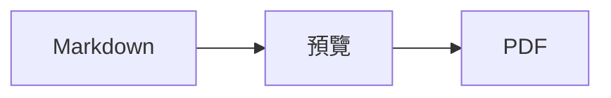

<p>&nbsp;&nbsp;&nbsp;</p>

# Splat

**適用於 macOS 的 Markdown 編輯器，可在原始碼中書寫，也能直接在預覽中書寫。**

Splat 左邊是帶語法上色的 Markdown 原始碼，右邊是即時且完全可編輯的預覽。兩邊都能輸入：你在預覽中寫的內容，會變成對原始碼的最小更動，所以沒碰過的行會逐位元組保持不變，Git diff 也始終清爽。Splat 讀得懂你平常使用的 Markdown：CommonMark 與 GitHub Flavored Markdown、GitHub alerts、Obsidian 的 wiki 連結、嵌入與標註框、Pandoc 與 Typora 的擴充語法、內嵌 HTML、LaTeX 公式，以及 Mermaid、Graphviz 和 PlantUML 圖表，全部離線呈現。你可以瀏覽和搜尋整個檔案夾的筆記，查看自上次 Git 提交以來的更動，把 Word 或網頁的內容貼上為 Markdown，只需按一下，即可輸出為 PDF、HTML 或 Word。它以 Rust 寫成，建立在原生 AppKit 控制項之上，支援 35 種語言，沒有遙測功能。
 


[](https://github.com/sventmueller/splat/releases/latest/download/Splat.dmg)

**[下載 Splat.dmg](https://github.com/sventmueller/splat/releases/latest/download/Splat.dmg)**：已由 Apple 簽署並公證，適用於 macOS 14 或以上版本，支援 Apple 晶片與 Intel。

**發現 Bug 了嗎？** Splat 會讓你沒碰過的行逐位元組保持不變。如果某行還是變了，或檔案顯示不正確，請[提交 Issue](https://github.com/sventmueller/splat/issues/new/choose) 並附上檔案。如果 Splat 對你有用，在 [GitHub 上按個 Star](https://github.com/sventmueller/splat) 能幫助更多人找到它。
 
 

[](https://www.rust-lang.org)
[](https://www.apple.com/macos/)

[](https://github.com/madsmtm/objc2)
[](https://webkit.org)
[](https://github.com/kivikakk/comrak)
[](https://github.github.com/gfm/)
[](https://www.mathjax.org)
[](https://cortexjs.io/mathlive/)
[](https://mermaid.js.org)
[](https://graphviz.org)
[](https://plantuml.com)


[](#授權條款)

[Bahasa Indonesia](../id/README.md) ·
[Bahasa Melayu](../ms/README.md) ·
[Català](../ca/README.md) ·
[Čeština](../cs/README.md) ·
[Dansk](../da/README.md) ·
[Deutsch](../de/README.md) ·
[English](../../../README.md) ·
[Español](../es/README.md) ·
[Français](../fr/README.md) ·
[Hrvatski](../hr/README.md) ·
[Italiano](../it/README.md) ·
[Magyar](../hu/README.md) ·
[Nederlands](../nl/README.md) ·
[Norsk](../no/README.md) ·
[Polski](../pl/README.md) ·
[Português (Brasil)](../pt_BR/README.md) ·
[Português (Portugal)](../pt_PT/README.md) ·
[Română](../ro/README.md) ·
[Slovenčina](../sk/README.md) ·
[Slovenščina](../sl/README.md) ·
[Suomi](../fi/README.md) ·
[Svenska](../sv/README.md) ·
[Tiếng Việt](../vi/README.md) ·
[Türkçe](../tr/README.md) ·
[Ελληνικά](../el/README.md) ·
[Русский](../ru/README.md) ·
[Українська](../uk/README.md) ·
[עברית](../he/README.md)‎ ·
[العربية](../ar/README.md)‎ ·
[हिन्दी](../hi/README.md) ·
[ไทย](../th/README.md) ·
[한국어](../ko/README.md) ·
[日本語](../ja/README.md) ·
[简体中文](../zh-Hans/README.md) ·
**繁體中文**

## 目錄

- [功能一覽](#功能一覽)
- [系統需求](#系統需求)
- [安裝](#安裝)
- [開始使用](#開始使用)
- [書寫](#書寫)
  - [在原始碼中](#在原始碼中)
  - [在預覽中](#在預覽中)
  - [格式指令](#格式指令)
  - [列表與待辦事項](#列表與待辦事項)
  - [表格](#表格)
  - [貼上格式化文字](#貼上格式化文字)
  - [後設資料](#後設資料)
- [支援的 Markdown](#支援的-markdown)
  - [CommonMark 與 GitHub Flavored Markdown](#commonmark-與-github-flavored-markdown)
  - [標註框](#標註框)
  - [延伸語法](#延伸語法)
  - [Obsidian](#obsidian)
  - [引用與參照](#引用與參照)
  - [內嵌 HTML](#內嵌-html)
  - [排版標點符號](#排版標點符號)
  - [語法總覽](#語法總覽)
- [公式](#公式)
- [圖表](#圖表)
- [影像](#影像)
- [連結與導覽](#連結與導覽)
- [檔案夾中的筆記](#檔案夾中的筆記)
- [自上次提交以來的更動](#自上次提交以來的更動)
- [輸出、列印與分享](#輸出列印與分享)
- [輸入 Word 文件](#輸入-word-文件)
- [外觀與輔助使用](#外觀與輔助使用)
- [語言](#語言)
- [鍵盤快速鍵](#鍵盤快速鍵)
- [隱私與安全性](#隱私與安全性)
- [大型文件](#大型文件)
- [已知限制](#已知限制)
- [疑難排解](#疑難排解)
- [給開發者](#給開發者)
  - [第三方元件](#第三方元件)
- [授權條款](#授權條款)

## 功能一覽

- **兩種寫法，同一份文字。** 原始碼和預覽都能編輯。Markdown 檔案是唯一的依據：每份文件只有一份還原記錄，預覽中的每次編輯都會轉換成對原始碼的最小更動。
- **你平常使用的 Markdown。** CommonMark、GitHub Flavored Markdown、GitHub alerts、Obsidian、Pandoc 與 Typora 的擴充語法、emoji 短代碼、劇透、定義列表、標題錨點，以及 GitHub README 中常見的 HTML。
- **內建公式與圖表。** 透過 MathJax 呈現 LaTeX 公式，並附有視覺化公式編輯器。Mermaid、Graphviz 和 PlantUML 圖表直接在你的 Mac 上呈現，不需要 Java、伺服器或網路連線。
- **樣樣有按鈕。** 每種 Markdown 語法都有對應的工具列按鈕和選單項目，常用的還有鍵盤快速鍵。表格另有專屬選單，可處理列、欄和對齊方式。
- **不只是檔案，而是整個檔案夾。** 側邊欄會列出文件所在檔案夾中的筆記，並搜尋全部內容。重新命名筆記會更動指向它的連結，除此之外的每個位元組都保持不變。
- **更動一目了然。** 在 Git 儲存庫中，文字旁的長條會在兩個窗格中標出與上次提交不同之處。
- **從 Word 和網頁到 Markdown。** 將格式化文字貼上為 Markdown，將試算表的儲存格貼上為表格，還能連同影像輸入整份 Word 文件。
- **輸出不打折。** 可輸出為 PDF、單一獨立的 HTML 檔案，或包含真正標題、列表、表格、註腳和影像的 Word 文件。可加上頁碼、頁首和標題頁，或使用公司的 Word 樣板。
- **徹頭徹尾的原生。** 真正的 AppKit 視窗、標籤頁、選單、彈出視窗、版本、自動儲存、分享選單、深色模式、拼字檢查、聽寫和旁白。沒有 Electron，文字本身也不使用網頁檢視器。
- **大檔案也很快。** 在 10 MB 的文件中，渲染一個按鍵約需 10 毫秒（不含檢視器本身的工作）。
- **注重隱私，謹慎處理。** Splat 在 App Sandbox 中執行，打開其他 App 的連結前會先詢問，所有解碼不受信任影像資料的工作都在沙盒化的專屬服務中執行。
- **使用你的語言。** 介面和內建的 Markdown 快速參考提供 35 種語言：阿拉伯文、加泰隆尼亞文、簡體中文、繁體中文、克羅埃西亞文、捷克文、丹麥文、荷蘭文、英文、芬蘭文、法文、德文、希臘文、希伯來文、印地文、匈牙利文、印尼文、義大利文、日文、韓文、馬來文、挪威文、波蘭文、葡萄牙文（巴西）、葡萄牙文（葡萄牙）、羅馬尼亞文、俄文、斯洛伐克文、斯洛維尼亞文、西班牙文、瑞典文、泰文、土耳其文、烏克蘭文和越南文。

## 系統需求

- macOS 14 Sonoma 或以上版本。Splat 在 macOS 27 上開發與測試，在該系統上會自動採用液態玻璃設計。
- 搭載 Apple 晶片或 Intel 處理器的 Mac。
- 約 45 MB 的磁碟空間。

## 安裝

**從磁碟映像檔安裝。** 下載 [`Splat.dmg`](https://github.com/sventmueller/splat/releases/latest/download/Splat.dmg)，打開後將 Splat 拖到「應用程式」檔案夾。映像檔已用 Developer ID 簽署並由 Apple 公證，所以打開時不會出現警告。

**透過 Homebrew 安裝。** Cask 位於專屬的 tap 中：

```sh
brew install --cask sventmueller/tap/splat
```

`brew upgrade --cask splat` 會安裝新版本，`brew uninstall --zap --cask splat` 還會一併移除 Splat 的設定和快取。

**更新。** 從磁碟映像檔或 Homebrew 安裝的 Splat 會透過 [Sparkle](https://sparkle-project.org) 自行保持最新。第二次啟動時，它會詢問是否可以每天自動檢查一次更新。**Splat › 檢查更新項目⋯** 會立即檢查；之後若想更改選擇，可在同一個選單中使用 **自動檢查更新項目** 和 **自動下載並安裝更新項目**。Splat 只會安裝帶有開發者簽章的更新。自行建置的版本沒有更新功能。

**從原始碼安裝。** 先在「[建置](../../../docs/development.md#building)」中查看前置條件，然後：

```sh
make build
ditto target/release/Splat.app /Applications/Splat.app
open /Applications/Splat.app
```

若要連按兩下就用 Splat 打開 Markdown 檔案，請在 Finder 中選取任一 `.md` 檔案，選擇 **檔案 › 取得資訊**，在 **打開檔案的應用程式** 下選取 Splat，然後按一下 **全部更改⋯**。Splat 會自行註冊處理 `.md`、`.markdown`、`.mdown` 和 `.mkd` 檔案。

## 開始使用

### 視窗

每份文件都在自己的視窗中打開，如果你偏好標籤頁，也可以在標籤頁中打開：

- **左邊：原始碼。** 你的 Markdown，以 SF Mono 字體顯示並帶有語法上色。
- **右邊：預覽。** 呈現後的文件，隨時可以編輯。
- **側邊欄（選用）。** 所有標題以樹狀顯示，按一下標題，兩個窗格都會顯示該處：**顯示方式 › 顯示大綱**（⌃⌘S）。另外兩個標籤頁是「[檔案夾中的筆記](#檔案夾中的筆記)」和對它們的搜尋。視窗標題旁的按鈕可顯示或隱藏側邊欄，新視窗會依上一個視窗留下的狀態開啟側邊欄。
- **工具列。** 按鈕依更改的對象分組：字元、段落與插入的項目，接著是預覽開關、分享和新增文件。可用 **顯示方式 › 自訂工具列⋯** 自訂。

拖移分隔線，可讓任一邊有更多空間。**顯示方式 › 隱藏預覽**（⌥⌘P）只留下原始碼；Splat 會依視窗記住這項設定。兩個窗格會一起捲動，在一個窗格中選取的內容會在另一個窗格中醒目標示。

視窗角落會顯示文字的字數、字元數和閱讀所需的時間，有選取範圍時也會顯示選取範圍的這些數字。連結位址、HTML 標籤、後設資料、註解、公式和圖表不計入。預設不顯示，選擇 **顯示方式 › 顯示字數** 即可顯示。

### 文件、標籤頁與版本

Splat 是一般的 macOS 文件型 App：

- **自動儲存與版本。** 更動會直接儲存在原檔中。**檔案 › 回復成 › 瀏覽所有版本⋯** 可讓你回到過去。
- **其他程式所做的更動。** 當 Git、腳本或其他編輯器更動了已打開的文件，Splat 會重新載入，並保留插入點和捲動位置。如果你自己有尚未儲存的更動，Splat 會保留它們，並且在覆寫另一個版本前，由 macOS 先詢問。
- **常用的檔案指令。** 複製（⇧⌘S）、重新命名⋯、移到⋯，以及 **檔案 › 打開最近使用過的檔案**。
- **標籤頁。** **檔案 › 新增標籤頁** 或工具列中的 **+** 按鈕會在標籤頁中打開新文件；標準的「視窗」選單可合併、移動和切換標籤頁。
- **視窗位置。** 上一個視窗的大小和位置會被記住，重新啟動後也一樣。如果該處已有視窗，新視窗會稍微錯開打開。
- **Dock 圖像。** 關閉最後一個視窗後，按一下它會打開新文件。
- **用 Splat 打開 Markdown 檔案。** **Splat › 設為 Markdown 的預設 App** 可讓連按兩下 `.md` 或 `.markdown` 檔案時打開 Splat；macOS 會詢問一次以確認。Splat 是預設 App 時，該項目會顯示勾號。

檔案必須是 UTF-8 文字，或帶有位元組順序記號的 UTF-16。Splat 會拒絕其他編碼，而不是猜測並損毀文字。位元組順序記號會保留，UTF-16 仍是 UTF-16，而在每一行都以 CRLF 結尾的檔案中，你新增的行也會使用 CRLF。

**當機後**，最多只會遺失最後幾秒的輸入：Splat 每五秒會將未儲存的文字拷貝到 `~/Library/Application Support/Splat/Unsaved`，並在文件儲存或 Splat 正常結束後移除這些拷貝。下次啟動時，當機所留下的內容會移到 `~/Library/Application Support/Splat/Recovery`，並提示一次，附有可打開該檔案夾的按鈕。Splat 仍能回應的當機，也會把每份已打開文件的文字寫到那裡。

### 快速參考

**輔助說明 › Markdown 快速參考** 會以你的語言，在新的未命名文件中打開一份速查表。它是一般的文件，所以可以直接在原始碼或預覽中試用所有內容。

## 書寫

### 在原始碼中

原始碼是專為 Markdown 調校的純文字編輯器：

- **語法上色**，就像 VS Code：標題、強調、連結、程式碼、表格、HTML、front matter，以及公式和圖表中的 LaTeX 與 Mermaid。提供淺色、深色和提高對比三種配色。
- **圍欄式程式碼區塊**會為 Bash、C、C++、C#、CSS（也包含 SCSS 和 Less）、Go、HTML、XML、Java、JavaScript、JSON、Kotlin、PHP、Python、Ruby、Rust、SQL、Swift、TypeScript、YAML、TeX 和 Mermaid 上色，常用的簡稱如 `js`、`py` 或 `sh` 也一樣適用。
- **不會有意外的替代。** 智慧型引號、智慧型破折號和文字替代預設為關閉，因為它們會破壞 `--`、`---` 和 `"`。可在 **編輯 › 替代** 下開啟。
- **系統的書寫工具。** 拼字和文法檢查、聽寫、尋找與取代（⌥⌘F）以及語音。
- **拖放。** 拖入影像檔會插入 ``，拖入其他檔案會插入指向它的連結，拖入網址則會插入 `[url](url)`。每次拖放都是一個還原步驟。
- **貼上影像。** 剪貼簿中的圖片，例如螢幕截圖，會以 PNG 檔案儲存在文件旁（`影像 2026-10-29 13.09.07.png`），並作為影像插入。文件必須先儲存過一次。

### 在預覽中

預覽的操作方式像文書處理器，但你在其中所做的一切，最後都會變成 Markdown：

- **輸入。** 在 Markdown 中有特殊意義的字元，例如 `*` 或 `#`，會被跳脫，讓它們如實顯示。
- **Return** 開始新段落或新的列表項目。**⌥Return** 或 **⌃Return** 插入換行。
- **在游標處設定格式。** 游標位於字詞結尾時，粗體、斜體和其他字元格式會套用到接下來輸入的內容。再選一次該格式即可停止。位於字詞中間時，則會套用到整個字詞。
- **空白行。** 在空白行上按 Return 會再加一個空白行，按 Delete 則會移除它。在原始碼中，每個多出的空白行相當於兩個空行；其他 Markdown 程式會將它們顯示為一般的段落間距。
- **還原**在兩個窗格間通用。還原項目帶有名稱（「還原粗體」），輸入時一連串按鍵算一個步驟，還原與重做之後兩個窗格都會捲動到更動處。
- **公式和圖表**以完成的圖形顯示。按一下、將游標移到上面，或在上面按 Return，即可打開它的編輯器（請見「[公式](#公式)」和「[圖表](#圖表)」）。
- **內嵌 HTML、內嵌筆記和 front matter** 會顯示出來，但要在原始碼中編輯。按一下它們，游標會移到原始碼中對應的位置。

Markdown 無法表達的一切，在預覽中都會被阻擋：字體和顏色面板、尺標，以及貼上或拖入格式化文字和影像。貼上的 HTML 和 RTF 會以純文字形式進來，除非你選擇「[貼上為 Markdown](#貼上格式化文字)」。

### 格式指令

每個指令都可以從工具列、選單列，以及兩個窗格各自的快顯選單中使用。選單項目會為游標所在處目前套用的格式顯示勾號。

| 選單 | 指令 |
|---|---|
| **格式 › 字體** | 粗體、斜體、底線、刪除線、醒目標示、程式碼、上標、下標 |
| **格式 › 標題** | 內文、標題 1 至 6 |
| **格式 › 列表** | 項目符號列表、編號列表、待辦清單 |
| **格式** | 引言、程式碼區塊（不指定語言或 20 種語言之一；也能變更現有區塊的語言）、標註框（附註、提示、重要、警告、小心；再選一次相同類型即可移除）、編輯公式或圖表⋯、清除格式 |
| **插入** | 連結⋯、影像⋯、表格⋯、公式、圖表（流程圖、循序圖、甘特圖）、目錄、註腳、分隔線 |
| **表格** | 在上方/下方插入列、在左側/右側插入欄、刪除列、刪除欄、對齊方式（靠左、置中、靠右、預設）、對齊表格欄位 |
| **顯示方式** | 隱藏/顯示預覽、顯示/隱藏大綱、排版標點符號、放大/縮小、實際大小、工具列、標籤頁列、全螢幕 |

底線、醒目標示、上標和下標會寫成 `<ins>`、`<mark>`、`<sup>` 和 `<sub>`，GitHub 同樣會顯示它們。Splat 也讀得懂 GitHub 會移除的 `<u>`，以及較短的 `==highlight==`、`^sup^` 和 `~sub~`。GitHub 會把 `==` 和 `^` 如實顯示，並把 `~sub~` 顯示為刪除線。

### 列表與待辦事項

- Return 會延續列表；在空白項目上按 Return 則結束列表。
- 在預覽中，**Tab** 和 **⇧Tab** 會增加和減少列表項目的縮排。
- 在預覽中按一下待辦事項的核取方塊，會切換 `- [ ]` 和 `- [x]`。
- **格式 › 列表** 會將所選段落轉為列表，或更改列表的類型。

### 表格

- **插入 › 表格⋯** 會詢問列數（包含標題列）和欄數。
- 在預覽中，**Tab** 會跳到下一個儲存格，**⇧Tab** 跳到上一個，**Return** 跳到下方的儲存格。在最後一個儲存格按 Tab 會新增一列。
- **表格**選單可插入和刪除列與欄，並設定欄的對齊方式（⌘{、⌘|、⌘}）。
- **表格 › 對齊表格欄位** 會在原始碼中補上空白，讓各欄對齊。

### 貼上格式化文字

**編輯 › 貼上為 Markdown**（⌃⌘V）也位於兩個窗格的快顯選單中，它會將剪貼簿的內容轉為 Markdown 並放在選取處，算作一個還原步驟。⌘V 仍會插入純文字。

- **來自瀏覽器、Word、Google Docs、Confluence、「備忘錄」或 Pages：** 標題、粗體、斜體、底線、刪除線、上標和下標、連結、保留巢狀結構的列表、引言、程式碼和表格都會一起帶過來。
- **來自試算表：** 儲存格會變成有標題列的表格，數字欄靠右對齊。以定位字元、分號或逗號分隔的文字也一樣，前提是每行的欄數相同。
- **圖片** 若有網址，就仍是連結。貼上的 HTML 中的圖片會變成文件旁的檔案，為此文件必須先儲存過一次。Word 的暫存圖片檔案不會帶過來，但替代文字會保留。
- **連結** 只保留 `http`、`https`、`mailto`、相對位址和 `#` 位址；其他連結只留下文字。

### 後設資料

**格式 › 編輯後設資料⋯**，或按一下預覽頂端的後設資料行，會打開一個表單，列出 YAML front matter 的欄位。欄位可以更改、新增和移除。含列表的欄位仍保持為列表：各值以逗號依序隔開，含逗號的值會放在引號中。名為 `tags`、`aliases`、`keywords`、`categories`、`authors` 或 `cssclasses` 的新欄位也會成為列表。巢狀欄位和多行文字可在表單中查看，並在原始碼中編輯。

表單所做的更動算作一個還原步驟，而且只影響你更動的欄位所在的行：其他所有欄位的註解、順序、不規則的間距、引號和行尾都逐位元組保持不變。沒有後設資料的文件會在開頭新增一個區塊。

## 支援的 Markdown

Splat 以 [comrak](https://github.com/kivikakk/comrak) 解析，這是相容於 CommonMark 和 GFM 的解析器，並開啟了它大部分的擴充功能。以下所有內容都會呈現在預覽和所有輸出中。

### CommonMark 與 GitHub Flavored Markdown

- 標題（`#` 和底線式）、段落、換行、強調、加強強調、行內程式碼、引用區塊、分隔線。
- 項目符號、編號和巢狀列表；待辦清單。
- 連結（行內、參照和自動連結）、影像、連結參照定義。
- 帶語法上色的圍欄式和縮排式程式碼區塊。
- 帶欄對齊的表格。
- 以 `~~兩個波浪號~~` 表示刪除線。
- 註腳：`文字[^1]` 搭配文件中任何位置的 `[^1]: 註腳內容。`。按一下標記會跳到註腳。
- 位於最上方 `---` 行之間的 YAML front matter。預覽會用一行概括，例如「後設資料：title、date、tags」。

### 標註框

GitHub alerts 會呈現為帶圖像和標題的彩色方塊：

```markdown
> [!NOTE]
> 使用者應該知道的實用資訊。

> [!WARNING]
> 需要立即注意的重要內容。
```

五種類型是附註、提示、重要、警告和小心。**格式 › 標註框** 會把游標所在的段落轉成標註框。

Obsidian 的標註框同樣適用，可使用任何標題和摺疊狀態：

```markdown
> [!tip]- 按一下 ▸ 即可展開
> 打開前是隱藏的。

> [!question]+ 預設為展開
> `+` 表示展開，`-` 表示收合。
```

Obsidian 的其他類型會以五種顏色中最接近的一種顯示：`success`、`check`、`done` 和 `hint` 顯示為提示；`question`、`help` 和 `faq` 顯示為重要；`attention` 顯示為警告；`failure`、`fail`、`missing`、`danger`、`error` 和 `bug` 顯示為小心；其餘都顯示為附註。

### 延伸語法

| 功能 | 語法 | 來源 |
|---|---|---|
| 醒目標示 | `==標示的文字==` | Obsidian、Typora |
| 上標 | `x^2^` | Pandoc、Typora |
| 下標 | `H~2~O` | Pandoc、Typora |
| Emoji 短代碼 | `:rocket:` 會變成 🚀 | GitHub |
| 劇透 | `\|\|隱藏的文字\|\|`，選取即可閱讀 | Discord |
| 行內註腳 | `文字^[註腳本身]` | Pandoc、Obsidian |
| 定義列表 | `術語`、空白行、`: 說明` | PHP Markdown Extra、Pandoc |
| 標題錨點 | `## 安裝 {#setup}`，以 `[參見](#setup)` 連結 | Pandoc、kramdown |

定義列表在原始碼中長這樣：

```markdown
術語

: 術語的說明。
```

沒有自訂錨點時，每個標題都會依其文字產生一個，與 GitHub 相同：`## 開始使用` 可用 `#開始使用` 連結到。

### Obsidian

- **Wiki 連結。** `[[筆記]]` 會連結到同一個檔案夾或其子檔案夾中的 `筆記.md`。`[[筆記|顯示的文字]]` 會顯示你自己的文字，`[[筆記#標題]]` 則打開該筆記。按住 ⌘ 鍵按一下會在 Splat 中打開。
- **嵌入。** `![[筆記]]` 會在此筆記內顯示另一份筆記；其中再嵌入的筆記則以連結顯示。`![[diagram.png]]` 會顯示影像。與 Obsidian 相同，嵌入只會以名稱指向文件所在檔案夾或其子檔案夾中的筆記和影像，絕不使用絕對路徑，而且只有 Markdown 檔案會顯示為筆記。
- **註解。** `%%只在原始碼中%%` 會在原始碼中保持可見，預覽和所有輸出都會省略它，無論是行內或獨立成行。
- **標籤。** `#idea` 或 `#project/splat` 會醒目標示。按住 ⌘ 鍵按一下會在文件中搜尋該標籤，在側邊欄中還會搜尋整個檔案夾。
- **可摺疊的標註框。** 請見「[標註框](#標註框)」。

### 引用與參照

- **Pandoc 引用。** `[@doe2020]` 或 `[@doe2020; @roe2021]` 讀起來像「(Doe 2020; Roe 2021)」。文獻條目來自 front matter 中以 `bibliography: refs.bib` 指定的 BibTeX 檔案。沒有指定時，Splat 會使用文件旁的 `references.bib`、`literatur.bib` 或 `bibliography.bib`。
- **GitHub 與 GitLab 參照。** 如果文件位於 Git 儲存庫中，且其 `origin` 遠端在 github.com 或某個 GitLab 主機上，`@name`、`#12`（issue）和 `!7`（合併請求，僅限 GitLab）都會醒目標示。按住 ⌘ 鍵按一下會在瀏覽器中打開。

### 內嵌 HTML

GitHub README 中常見的 HTML 都會呈現，使用的是專屬的讀取器，而不是瀏覽器引擎：

- 置中的段落和區塊（`<p align="center">`、`<div align="center">`）
- 指定大小的影像（``）
- 連結、`<kbd>⌘</kbd>`、`<br>`、`<u>`、`<ins>`、`<mark>`、`<sup>`、`<sub>`
- 列表和表格，包含跨欄的儲存格（`colspan`）
- 可收合的區段：`<details><summary>更多</summary>…</details>`，按一下 ▸ 即可展開

HTML 標籤之間的 Markdown 會當作 Markdown 呈現。腳本、樣式、框架和表單會被完全省略，連結和影像只保留 `http`、`https`、`mailto` 和相對位址。

### 排版標點符號

**顯示方式 › 排版標點符號** 會把直引號顯示為你的介面語言所用的引號，`--` 顯示為連字號（en dash），`---` 顯示為長破折號（em dash），`...` 顯示為刪節號。在德文中，`"Ja"` 會變成 „Ja“，法文是 «Oui»，日文是 「はい」，中文和日文的引號前後也不加空格；希伯來文縮寫如 `צה"ל` 會加上 gershayim，變成 צה״ל。原始碼保留原本的字元；預覽和所有輸出則顯示排版後的字元。這項設定在你開啟之前都是關閉的。

### 語法總覽

| 元素 | Markdown |
|---|---|
| **粗體** | `**粗體**` |
| *斜體* | `*斜體*` |
| 底線 | `<ins>底線</ins>` 或 `<u>底線</u>` |
| ~~刪除線~~ | `~~刪除線~~` |
| 醒目標示 | `<mark>醒目標示</mark>` 或 `==醒目標示==` |
| `程式碼` | `` `程式碼` `` |
| x² | `x<sup>2</sup>` 或 `x^2^` |
| H₂O | `H<sub>2</sub>O` 或 `H~2~O` |
| [連結](https://example.com) | `[連結](https://example.com)` |
| 標題 | `# 標題` 至 `###### 標題` |
| 引言 | `> 引言` |
| 項目符號列表 | `- 項目` |
| 編號列表 | `1. 項目` |
| 待辦事項 | `- [ ] 未完成` 和 `- [x] 已完成` |
| 程式碼區塊 | ```` ```rust ```` … ```` ``` ```` |
| 表格 | `\| A \| B \|`，標題列下方加上 `\|---\|---\|` |
| 註腳 | `文字[^1]` 和 `[^1]: 註腳` |
| 分隔線 | `---` |
| 影像 | `` |
| 公式 | `$E = mc^2$`、`$$ … $$` |
| 圖表 | ```` ```mermaid ````、```` ```dot ````、```` ```plantuml ```` |
| 標註框 | `> [!TIP]` |
| Wiki 連結 | `[[筆記]]`、`[[筆記\|文字]]` |
| 嵌入 | `![[筆記]]`、`![[image.png]]` |
| 註解 | `%%註解%%` |
| 標籤 | `#標籤` |
| 引用 | `[@key]` |
| 劇透 | `\|\|劇透\|\|` |
| Emoji | `:tada:` |

## 公式

公式由 [MathJax](https://www.mathjax.org) 以其 TeX 和 AMS 數學套件呈現，是清晰的向量圖形。`\text{…}` 中的文字可以使用任何文字系統：MathJax 字體所缺的字，會改用你 Mac 的字體，阿拉伯文和希伯來文由右至左排列，emoji 則以彩色顯示。

| 種類 | 語法 |
|---|---|
| 行內 | `$E = mc^2$`、`` $`E = mc^2`$ ``（GitHub、GitLab）、`\(E = mc^2\)` |
| 獨立顯示 | `$$` … `$$`、`\[` … `\]`，或標示為 `math` 的程式碼區塊 |

**編輯公式。** 在預覽中按一下公式、連按兩下、在上面按 Return，或將游標移到上面，就會在彈出視窗中打開它的編輯器。**插入 › 公式** 會插入新的公式並立即打開編輯器。

- **視覺化或 LaTeX。** 最上方的切換開關可在視覺化編輯器（[MathLive](https://cortexjs.io/mathlive/)）和 LaTeX 程式碼之間切換。Splat 會記住你的選擇。
- **組件**包括分數、根號、上標與下標、帶上下限的總和與積分、極限、隨內容放大的括號、2×2 矩陣、希臘字母，以及關係符號、運算子與箭頭。它們會留下佔位符號 □，按 **Tab** 鍵會跳到下一個。
- **即時預覽。** 輸入時，更動會立即出現在文件中。MathJax 的錯誤會顯示在程式碼下方的一行中。
- **套用或捨棄。** 在外面按一下，會將更動保留為單一還原步驟；按 **Esc** 或 **取消** 則會捨棄。對新的空白公式按 Esc，會將它再次移除。
- 快顯選單為指標下方的公式提供 **編輯公式⋯**。

旁白會把公式讀成它的 LaTeX 程式碼。Splat 呈現的是公式，而不是完整的 LaTeX 文件：沒有套件、沒有 TikZ，也沒有 `\documentclass`。

## 圖表

圖表在 Splat 內呈現，離線運作，並有淺色與深色兩種版本。

| 引擎 | 程式碼區塊 | 繪製內容 |
|---|---|---|
| [Mermaid](https://mermaid.js.org) | ```` ```mermaid ```` | 流程圖、循序圖、類別圖、狀態圖、實體關係圖、甘特圖、圓餅圖、心智圖、時間軸，以及 Mermaid 的所有其他類型 |
| [Graphviz](https://graphviz.org) | ```` ```dot ```` 或 ```` ```graphviz ```` | 以 DOT 語言描述的圖形 |
| [PlantUML](https://plantuml.com) | ```` ```plantuml ```` 或 ```` ```puml ```` | UML 圖表；不需要 Java 即可執行 |



**編輯圖表**的方式和編輯公式相同：按一下它，就會在彈出視窗中打開程式碼，並附有語法上色，錯誤訊息則顯示在程式碼下方的一行中。**插入 › 圖表** 會從流程圖、循序圖或甘特圖的範本開始。組件可協助處理最常見的三種 Mermaid 類型：

- **流程圖：** 節點 ▾（矩形、圓角矩形、圓形、菱形、資料庫）、連線、帶標籤的連線、群組、方向 ▾
- **循序圖：** 參與者、訊息、回覆、備註、迴圈、依條件走不同路徑
- **甘特圖：** 區段、任務、里程碑

其他圖表類型以程式碼編輯。旁白會讀出圖表的標題或替代文字。

啟動後的第一個圖表約需一秒，因為呈現引擎會在背景啟動。耗時超過 10 秒的圖表會顯示錯誤，呈現引擎會為下一個圖表重新啟動。PlantUML 的引擎（3 MB）只在第一個 PlantUML 圖表出現時才載入。來自網路的 PlantUML `!include` 會被阻擋。

## 影像

- **本機影像**使用相對於文件的路徑：``。Splat 可顯示 PNG、JPEG、GIF、WebP、BMP、SVG、HEIC、TIFF、AVIF 和 PDF。
- **來自網路的影像**會在文件顯示它們時立即載入，透過 `https`，每張最大 10 MB。和電子郵件中的影像一樣，它們會讓對方的伺服器得知文件被打開以及打開的時間。
- **大小。** `` 可指定影像大小；否則影像會配合預覽的寬度。
- **磁碟上的更動。** 你替換的影像，或在文件提到之後才出現的影像，不必重新打開文件就會顯示。因網路問題而失敗的網路影像，在文件顯示它們期間會再次嘗試。
- **記憶體。** 影像最長邊最多以 2560 像素顯示，這樣也足以填滿一頁 A4。一旦影像佔滿 Mac 記憶體的八分之一，或 macOS 回報記憶體壓力時，就會以較小的尺寸解碼。
- **深色模式。** 白色背景的影像在深色預覽中會稍微調暗。
- **貼上與拖放。** 請見「[在原始碼中](#在原始碼中)」。

## 連結與導覽

在預覽中，按一下會放置游標，讓你編輯連結文字；**按住 ⌘ 鍵按一下** 則前往連結：

- `http`、`https` 和 `mailto` 會在你的瀏覽器或郵件 App 中打開。
- Markdown 檔案會在 Splat 中打開；其他檔案和檔案夾則在 Finder 中顯示。
- `#anchor` 會跳到文件中的該標題。
- 會打開其他 App 的位址，例如 `slack://` 或 `vscode://`，會先詢問，並顯示完整位址和該 App。預設選取的是 **取消**。

**插入 › 目錄** 會插入所有標題的連結列表。游標位於其中時，同一個指令會更新它。大綱側邊欄（⌃⌘S）可在兩個窗格中跳到任何標題。

## 檔案夾中的筆記

側邊欄頂端的按鈕可在大綱、檔案和搜尋之間切換。

- **檔案**（**顯示方式 › 顯示檔案**，⌃⌘E）。文件所在檔案夾中的所有 Markdown 檔案；若文件位於 Git 儲存庫中，則是整個儲存庫中的所有 Markdown 檔案。按一下或按 Return 會以此視窗的標籤頁打開筆記；若已打開，則會移到最前面。檔案夾名稱旁的按鈕可在此視窗中顯示另一個檔案夾。隱藏檔案、`node_modules`、`target`、`Pods`、`DerivedData`、`__pycache__` 和沒有筆記的檔案夾都不會列出。直接位於「個人專屬」檔案夾中的文件只會顯示它旁邊的筆記，這樣 Splat 就不會走遍你所有的檔案夾並逐一詢問。
- **搜尋**（**編輯 › 尋找 › 在所有筆記中搜尋⋯**，⇧⌘F）。在所有筆記中尋找文字，不分大小寫，也不論重音符號如何編碼。`#tag` 會尋找標籤，`#project` 也會找到 `#project/splat`，程式碼內的內容則不會被找到。按一下結果會在該處打開筆記。
- **指向筆記的連結。** 筆記的快顯選單會列出以 Wiki 連結、嵌入、相對連結或參照定義指向它的筆記。
- **重新命名筆記。** 同一個選單可重新命名它並更動那些連結。Splat 會先告訴你這涉及多少個檔案中的多少個連結。每個連結只更動名稱，檔案的其他每個位元組都保持不變。已打開的文件會把更動當作一個還原步驟；在其他檔案中，只有 Git 或版本才能復原。如果其間有其他程式更動過某個檔案，所有連結的重新命名都會停止，Splat 會指出該檔案。

視窗移到最前面時，列表會跟著檔案夾更新。搜尋看的是磁碟上的檔案，尚未儲存的文字要到下一次自動儲存後才會計入。

## 自上次提交以來的更動

若文件位於 Git 儲存庫中，文字旁的長條會在原始碼和預覽中標出與上次提交不同之處：綠色代表新增的行，藍色代表更動的行，移除內容之處則有一個紅色短標記。這些標記會隨著你輸入及分支移動而更新。**顯示方式 › 自上次提交以來的更動** 可將其關閉，適用於所有視窗。

只有行尾不同的行不計入，所以相對於使用 LF 的提交，使用 CRLF 的檔案不會顯示更動。新檔案在首次提交前沒有標記，超過 32 MB 的文件也沒有。

## 輸出、列印與分享

| 格式 | 方式 | 你會得到 |
|---|---|---|
| **PDF** | **檔案 › 輸出為PDF⋯** 或分享選單 | 紙張大小的頁面，一律採用淺色外觀，公式和圖表為向量圖形。**檔案 › 設定頁面⋯** 可設定紙張。 |
| **列印** | **檔案 › 列印⋯**（⌘P） | 與 PDF 相同的版面。 |
| **HTML** | **檔案 › 輸出為 HTML⋯** 或分享選單 | 單一獨立的檔案：內嵌本機影像，公式和圖表為清晰的影像，並有標題錨點讓目錄可以運作。不含腳本。 |
| **Word** | **檔案 › 輸出為 Word 文件⋯** 或分享選單 | 一個 `.docx`，帶有 Word 的標題樣式、真正的列表和表格（包含合併的儲存格）、作為 Word 註腳的註腳、內嵌影像、公式和圖表。 |
| **Markdown** | 工具列中的 **分享** 按鈕 | 文件以 `.md` 檔案形式提供給「郵件」、「訊息」、AirDrop 和其他所有分享服務。 |

**檔案 › 分享** 選單把這些選項集中在同一處。輸出會採用排版標點符號的設定，以及預覽已載入的網路影像；來自網路的影像在 HTML 中仍是連結。

**檔案 › 輸出選項⋯** 可設定 PDF、列印和 Word 會在文字之外加上什麼，適用於所有文件：

- **頁碼** 會以 `2 / 9` 的形式出現在 PDF 和列印頁面的頁尾中。
- **頁首和頁尾** 適用於 PDF 和列印。`{title}`、`{author}`、`{date}`、`{page}` 和 `{pages}` 代表相應的值，前三個取自文件的後設資料。
- **標題頁** 適用於 PDF、列印和 Word，內容為後設資料中的 `title`、`subtitle`、`author` 和 `date`，沒有標題時以文件名稱作為標題。它沒有頁首，也沒有頁尾。
- **Word 樣板**，即輸出時採用其外觀的 `.docx` 或 `.dotx`：它的樣式（包含本地化的名稱）、主題、頁面大小、邊界、頁首和頁尾。無法讀取的樣板會停止輸出並告知此事，而不是給你一份沒有套用樣板的文件。

## 輸入 Word 文件

**檔案 › 輸入 Word 文件⋯** 會詢問要輸入的 `.docx` 或 `.dotx` 檔案以及 Markdown 的存放位置，然後打開結果。影像會放在它旁邊的檔案夾中，檔案夾以文件名稱加上 `-images` 命名。

標題和列表會依 Word 的樣式和編號定義帶入，樣式名稱已本地化的文件也一樣。粗體、斜體、底線、刪除線、醒目標示、上標和下標、連結、引言、程式碼、註腳、章節附註和表格都會一起帶過來，跨欄的儲存格會變成 HTML 表格。公式會變成 LaTeX。修訂內容視為已接受，目錄不會帶過來，因為 **插入 › 目錄** 會產生新的目錄。舊的 `.doc` 檔案和受密碼保護的文件會被拒絕。

## 外觀與輔助使用

- **深色模式**跟隨系統。公式和圖表會依每種外觀分別呈現。
- 在「系統設定」中開啟 **增加對比** 時，語法顏色會改用高對比配色。
- **縮放。** ⌘+、⌘− 和 ⌘0 會縮放兩個窗格。
- **全螢幕、標籤頁和可自訂的工具列**，與每個 Mac App 相同。
- **旁白。** 窗格標示為「Markdown 原始碼」和「預覽」，公式讀成它的程式碼，圖表則讀成它的標題。每個指令都能用鍵盤操作。

Splat 沒有設定視窗：少數選項就放在用到它們的地方，也就是 **顯示方式**、**編輯 › 替代** 和 **檔案 › 輸出選項⋯** 中。

## 語言

介面、選單和 Markdown 快速參考已翻譯成 35 種語言：

阿拉伯文、加泰隆尼亞文、簡體中文、繁體中文、克羅埃西亞文、捷克文、丹麥文、荷蘭文、英文、芬蘭文、法文、德文、希臘文、希伯來文、印地文、匈牙利文、印尼文、義大利文、日文、韓文、馬來文、挪威文、波蘭文、葡萄牙文（巴西）、葡萄牙文（葡萄牙）、羅馬尼亞文、俄文、斯洛伐克文、斯洛維尼亞文、西班牙文、瑞典文、泰文、土耳其文、烏克蘭文和越南文。

Splat 會依照 **系統設定 › 一般 › 語言與地區** 中的語言順序；你也可以在那裡的 **應用程式** 下，單獨為 Splat 選擇語言。如果沒有你的語言的翻譯，就會使用英文。選單用語依循 Apple 自己的翻譯，所以 Splat 讀起來就像 Mac 的其他部分。

希伯來文和阿拉伯文的文字無論出現在哪裡，也不論介面語言為何，都由右至左閱讀：每個段落、標題和列表項目都依第一個字母決定方向，引言和標註框的色條畫在右側，文字由右至左開頭的表格，其欄位也從右側開始排列。程式碼區塊維持由左至右。PDF、HTML 和 Word 輸出會保留這些方向。若系統語言是希伯來文或阿拉伯文，macOS 也會鏡像視窗，所以預覽位於左側。

## 鍵盤快速鍵

| 動作 | 快速鍵 |
|---|---|
| 粗體、斜體、底線 | ⌘B、⌘I、⌘U |
| 刪除線 | ⇧⌘X |
| 程式碼 | ⌥⇧⌘C |
| 連結⋯ | ⌘K |
| 內文、標題 1 至 6 | ⌥⌘0、⌥⌘1 至 ⌥⌘6 |
| 將表格欄靠左、置中、靠右對齊 | ⌘{、⌘\|、⌘} |
| 隱藏或顯示預覽 | ⌥⌘P |
| 顯示或隱藏大綱 | ⌃⌘S |
| 顯示或隱藏檔案 | ⌃⌘E |
| 在所有筆記中搜尋 | ⇧⌘F |
| 貼上為 Markdown | ⌃⌘V |
| 放大、縮小、實際大小 | ⌘+、⌘−、⌘0 |
| 新增文件、打開、儲存、複製 | ⌘N、⌘O、⌘S、⇧⌘S |
| 設定頁面、列印 | ⇧⌘P、⌘P |
| 尋找、尋找與取代 | ⌘F、⌥⌘F |
| 尋找下一個、上一個；使用所選範圍；跳至所選範圍 | ⌘G、⇧⌘G；⌘E；⌘J |
| 顯示拼字和文法檢查；檢查文件 | ⌘:、⌘; |
| 貼上並符合樣式 | ⌥⇧⌘V |
| 隱藏工具列、顯示所有標籤頁、全螢幕 | ⌥⌘T、⇧⌘\\、⌃⌘F |
| 換行（預覽） | ⌥Return 或 ⌃Return |
| 表格中的下一個/上一個儲存格（預覽） | Tab / ⇧Tab |
| 增加/減少列表項目的縮排（預覽） | Tab / ⇧Tab |
| 公式編輯器中的下一個佔位符號 | Tab |
| 不做更動而關閉公式或圖表編輯器 | Esc |
| 前往連結、標籤或參照（預覽） | 按住 ⌘ 鍵按一下 |

Splat 不會改動 Apple 的標準快速鍵。

## 隱私與安全性

Markdown 檔案可能來自任何人，所以 Splat 會把每份文件都視為不受信任。

- **無遙測。** Splat 不會回報任何關於你如何使用它的資訊。只有在你同意後，或選擇 **檢查更新項目⋯** 時，它才會檢查更新：此時它會從 GitHub 載入一個小型摘要檔案，而請求中除了 App 和它的版本之外，不含任何其他資訊。公式和圖表在本機呈現；負責呈現的網頁檢視器無法連上網路。**輔助說明 › 回報問題⋯** 會在瀏覽器中打開 GitHub 上的表單；其網址包含 Splat 版本、macOS 版本和 Mac 類型，不含你文件中的任何內容。
- **來自網路的影像**會在文件顯示它們時立即載入，可來自任何主機，且只透過 `https`，每張最大 10 MB，並在不含 cookie 的私密工作階段中進行。對方的伺服器會得知文件被打開以及打開的時間。
- **獨立解碼。** 影像以及公式和圖表的圖形，會在專屬服務中解碼；macOS 會在專屬的沙盒中啟動這項服務：無法存取你的任何檔案，也無法使用網路。它只交回像素，且會檢查像素的大小；一旦某次解碼超過 10 秒或用掉太多記憶體，它就會自行結束。Apple 自己的影像解碼器只會處理 HEIC、TIFF、AVIF 和 PDF，而且只在資料確實是該格式時才會處理。SVG、公式和圖表也會經過這項服務，所以它們在 Splat 中是解析度固定的圖片：每點四個像素，較長邊最多 2560。
- **本機檔案**只會依文件所指的路徑進入文件，而且只能來自你已授予取用權限的檔案夾：Splat 可以讀取你打開的文件，但它周圍的圖片、筆記、參考書目和儲存庫，要等你透過預覽上方橫幅中的 **授予檔案夾取用權限⋯** 授予其所在檔案夾的取用權限後才能讀取。授予的權限涵蓋所有子檔案夾，並會被記住。嵌入會顯示文件所在檔案夾及其子檔案夾中的 Markdown 筆記，找不到的圖片也只會在那裡尋找。其他位置的影像路徑，無論是絕對路徑或以 `~` 開頭，都會從已授予取用權限的檔案夾載入到預覽中；HTML 和 Word 輸出、列印和 PDF 只會帶上文件所在檔案夾或其 Git 儲存庫中的內容（除非該儲存庫同時包含你的「個人專屬」檔案夾），因此別人的文件無法把你的檔案拉進你傳出去的輸出檔案。
- **筆記檔案夾**只有在側邊欄顯示時才會讀取，重新命名筆記只有在你確認數量後才會更動其他檔案。
- **Git 儲存庫**由 Splat 自己讀取。它絕不執行 `git` 程式，因為別人儲存庫中的相應設定可以啟動其他程式；它讀取的內容也不會超過已打開文件在上次提交中的版本。它不會在儲存庫中寫入任何內容，也不會連上網路。
- **Word 文件和貼上的文字**由 Splat 自己的解析器讀取，大小、巢狀層級和檔案可解壓縮的程度都有限制。其中的連結只保留 Splat 在其他地方允許的位址，Word 檔案中影像的名稱絕不會決定影像寫入何處。
- **未儲存文字的拷貝**會留在這部 Mac 的資源庫檔案夾中，用於當機後的回復。它們會隨著儲存或 Splat 正常結束而移除；當機後留下的拷貝則會留在回復檔案夾中，直到你刪除它們。
- **連結**絕不會因為一次按一下就啟動程式。網頁和郵件連結照常打開；指向其他 App 的連結會先詢問。
- **文件中的 HTML** 由 Splat 自己的解析器讀取。腳本、樣式、框架和表單絕不會執行。
- **輸出**不含腳本。HTML 頁面和 GitHub 一樣，只保留固定清單中無害的標籤和屬性，再加上內容安全政策。Word 檔案只連結 `http`、`https` 和 `mailto` 位址，你所選 Word 樣板本身帶有的連結除外。
- **程式碼簽署**採用 Hardened Runtime 和 App Sandbox。Splat 只能讀寫你打開的文件和你授予取用權限的檔案夾，為網路影像和更新連上網路，以及列印；除此之外什麼都不能做。

## 大型文件

Splat 在數 MB 的文件中仍能保持流暢：

- 原始碼使用 TextKit 2，只排版可見的部分。
- 在預覽中輸入時，以及在最大 2 MB 的文件原始碼中輸入時，只會重新解析、上色和排版受影響的段落。在 10 MB 的文件中，解析和上色約需 3 毫秒，渲染約需 10 毫秒，在其預覽中完整輸入一個按鍵約需 30 毫秒（含檢視器本身的工作）。
- 大型預覽會先呈現可見的部分，其餘則在 App 閒置時呈現。捲動到畫面中的區塊，會在繪製之前先呈現。
- 在較大文件的原始碼中，預覽的解析會在你輸入時於背景執行。
- 文件一旦需要約 4 GB 記憶體就只會維持純文字（一般 Markdown 約 50 到 120 MB，全是表格或標題時只需 10 到 20 MB）：原始碼沒有顏色，預覽則會說明為何保持空白。輸出仍可使用。
- 從約 200 KB 起，文件會在解析之前先打開視窗；在 5 MB 時，顏色和預覽會在約四分之一秒後跟上。
- 所有影像加起來，包括公式和圖表，最多佔用 Mac 記憶體的四分之一，記憶體不足時再減半。超出部分的影像會顯示為預留位置，直到再次有空間。

有些更動會完整處理，在 10 MB 時每個按鍵約 300 毫秒：更動註腳的定義或參照、更動行內註腳旁邊的內容、在文件最末端的註腳旁邊更動、更動 front matter 或連結參照定義，以及在含有 `%%` 註解區塊、註腳被定義兩次、註腳位於引言或列表內，或行內註腳或未閉合的公式標記超過 1000 個的文件中所做的每一項更動。記憶體會隨檔案增長，1 MB 的 Markdown 約為 115–160 MB，10 MB 則約為 340–510 MB。

## 已知限制

- **單一波浪號代表下標。** `~text~` 和 Pandoc 一樣是下標；刪除線需要 `~~two~~`。GitHub 也接受單一波浪號作為刪除線。
- **預覽中唯讀：** 內嵌 HTML 和內嵌筆記要在原始碼中編輯，front matter 則在它的表單或原始碼中編輯。
- **非常深的巢狀：** 巢狀超過 64 層的 HTML，以及超過 16 層的行內 HTML，只會保留其內容。
- **合併的表格儲存格**只存在於 HTML 表格中，而且只能跨欄（`colspan`，沒有 `rowspan`）。不支援 MultiMarkdown 用於合併儲存格的表格語法。
- **參考書目**只能從 BibTeX 讀取，不支援 CSL JSON 或 YAML。
- **參照**需要位於 github.com 或 GitLab 主機上的儲存庫；`!7` 只存在於 GitLab。
- **排版標點符號：** 德文的右單引號無法與撇號區分，會一律排成 ’。
- **是公式，不是文件：** 沒有 LaTeX 套件、TikZ 或完整文件。
- **視覺化公式編輯器**以 MathLive 的寫法產生 LaTeX：空格會消失（`E = mc^2` 變成 `E=mc^2`），呈現結果不變。
- **字數：** 泰文、寮文、高棉文和緬甸文書寫時不用空格，會依連續的文字段落而非依字詞計算。`3.14` 和 `snake_case` 各算兩個字詞。
- **重新命名筆記** 不會更動內嵌 HTML 中的連結；如果新名稱含有 `#`、`|`、`^`、`[`、`]` 或 `\`，Wiki 連結會保持原樣。
- **更動標記** 讀取的是使用 SHA-1 物件以及一般或封裝參照的儲存庫；使用 SHA-256 或 reftable 的儲存庫不會顯示標記。受 Git 篩選器（例如 LFS）管理的檔案，會與篩選器儲存的內容比較。
- **Word 輸入** 會略過頁首、頁尾和註解中的文字，`.emz` 或 SVG 格式的圖片只保留替代文字。
- **貼上為 Markdown** 會把 RTF 當作西文文字讀取，其中的標題只依字體大小判斷。大多數程式也會提供 HTML，它會優先使用 HTML。
- **刻意如此：** 沒有行號、沒有設定視窗、沒有 Help Book，也不在 App Store 上架。
- **在 Intel 上測試較少。** 視窗自我測試只在 Apple 晶片上執行；在 Intel 上，CI 執行 `cargo test`。

## 疑難排解

**重新建置 Splat 後，最近使用的文件列表是空的。** macOS 會把最近使用的文件和檔案夾權限，與 App 的程式碼簽章綁在一起。本機建置使用你登入鑰匙圈中的「Splat Local Signing」憑證簽署，所以重新建置後兩者都會保留。如果憑證被刪除，下次建置會建立新的憑證，列表會重新開始一次。

**磁碟映像檔中的 App 顯示的最近使用文件，和我自己建置的不同。** 兩者的簽章不同，所以 macOS 會為各自保留獨立的列表和獨立的檔案夾權限。

**HTML 或其他語法顯示為純程式碼。** 可能是舊版的 Splat 打開了該文件。請結束它，在 Finder 中對該文件選擇 **檔案 › 取得資訊**，並確認 **打開檔案的應用程式** 指向「應用程式」檔案夾中的 Splat。

**Splat 選單中沒有「檢查更新項目⋯」。** 只有來自磁碟映像檔或 Homebrew 的版本才會自行更新；自行建置的版本沒有更新功能。

**來自網路的影像沒有出現。** 只有 `https` 影像才會載入，每張最大 10 MB。因網路問題而失敗的影像，在文件顯示它期間會再次嘗試。

**貼上螢幕截圖時要求我先儲存。** 貼上的影像會以檔案形式存放在文件旁，這需要磁碟上有位置。請先儲存，再重新貼上。

**「此檔案不是 UTF-8 文字。」** 檔案使用其他編碼，而且沒有可標明編碼的位元組順序記號。請先轉換，例如用 `iconv -f ISO-8859-1 -t UTF-8 old.md > new.md`。

**公式或圖表顯示錯誤。** 按一下它：編輯器會在程式碼下方顯示 MathJax、Mermaid、Graphviz 或 PlantUML 的訊息。

## 給開發者

建置、測試、程式碼結構及其遵循的規則請見 [docs/development.md](../../../docs/development.md)（英文）。

### 第三方元件

| 元件 | 版本 | 用途 | 授權條款 |
|---|---|---|---|
| [comrak](https://github.com/kivikakk/comrak) | 0.59（[更動一行](../../../vendor/comrak/PATCH.md)） | Markdown 解析器 | BSD-2-Clause |
| [objc2](https://github.com/madsmtm/objc2)、objc2-foundation、block2 | 0.6 / 0.3 | Objective-C 執行環境、Foundation、區塊 | MIT |
| objc2-app-kit、objc2-web-kit、dispatch2 | 0.3 | AppKit、WebKit 和 Grand Central Dispatch 的綁定 | Zlib、Apache-2.0 或 MIT |
| [krilla](https://github.com/LaurenzV/krilla), krilla-svg, [usvg](https://github.com/linebender/resvg) | 0.8 / 0.47 | 將公式和 SVG 影像轉為向量 PDF | MIT 或 Apache-2.0 |
| [image](https://github.com/image-rs/image) | 0.25 | 解碼 PNG、JPEG、GIF、WebP 和 BMP | MIT 或 Apache-2.0 |
| [unicode-width](https://github.com/unicode-rs/unicode-width) | 0.2 | 對齊表格欄位 | MIT 或 Apache-2.0 |
| [entities](https://github.com/p-jackson/entities) | 1 | HTML 字元參照的名稱 | MIT |
| [miniz_oxide](https://github.com/Frommi/miniz_oxide) | 0.9 | 解壓縮 Word 檔案和 Git 物件 | MIT、Zlib 或 Apache-2.0 |
| [roxmltree](https://github.com/RazrFalcon/roxmltree) | 0.21 | 讀取 Word 檔案的 XML | MIT 或 Apache-2.0 |
| [encoding_rs](https://github.com/hsivonen/encoding_rs) | 0.8 | 讀取以舊字碼頁編寫的 RTF 文字 | MIT 或 Apache-2.0、BSD-3-Clause |
| [unicode-normalization](https://github.com/unicode-rs/unicode-normalization) | 0.1 | 跨組合字母和分解字母的名稱與搜尋 | MIT 或 Apache-2.0、Unicode-3.0 |
| [emojis](https://github.com/rossmacarthur/emojis) | 0.9 | 讓輸入文字中類似 `:shortcode:` 的文字保持字面形式 | MIT 或 Apache-2.0、Unicode-3.0 |
| [MathJax](https://www.mathjax.org) | 4.1.3 | 呈現公式 | Apache-2.0 |
| [MathLive](https://cortexjs.io/mathlive/) | 0.111.4 | 視覺化公式編輯器，附 KaTeX 字體 | MIT |
| [Mermaid](https://mermaid.js.org) | 12.3.0 | Mermaid 圖表 | MIT |
| [Viz.js](https://github.com/mdaines/viz-js) | 3.24.0 | 編譯為 WebAssembly 的 Graphviz，內含 Graphviz（EPL-1.0）和 Expat（MIT） | MIT |
| [PlantUML](https://github.com/plantuml/plantuml)（`@plantuml/core`） | 1.2026.9 | PlantUML 圖表，編譯為 JavaScript | MIT |
| [Sparkle](https://sparkle-project.org) | 2.10.1 | 磁碟映像檔版本的更新 | MIT，部分採用 BSD 和 zlib 授權 |

JavaScript 函式庫會原封不動地存放在 `resources/js/` 中；[vendor.lock](../../../vendor.lock) 記錄了它們的來源和 SHA-256 檢查碼。它們的授權文字，包括 Viz.js 內 Graphviz 和 Expat 的授權文字，就放在旁邊，名為 `resources/js/LICENSE-*`，並隨 App 一起發佈。Sparkle 不存放在儲存庫中：`cargo xtask dmg` 會下載它的發行版並對照 xtask 中的檢查碼驗證，它的授權則以 `LICENSE-sparkle` 隨 App 一起發佈。

## 授權條款

Splat 採用以下任一授權條款：

- Apache License, Version 2.0（[LICENSE-APACHE](../../../LICENSE-APACHE)）
- MIT License（[LICENSE-MIT](../../../LICENSE-MIT)）

由你選擇。

除非你另有明確聲明，否則依 Apache-2.0 授權條款所定義，你有意提交以納入 Splat 的任何貢獻，都將採用如上的雙重授權，不附加任何其他條款或條件。
