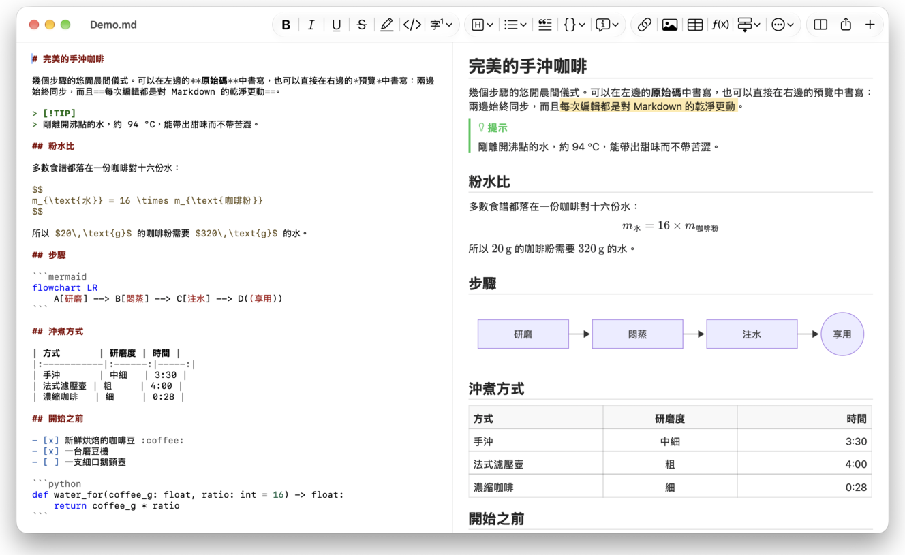
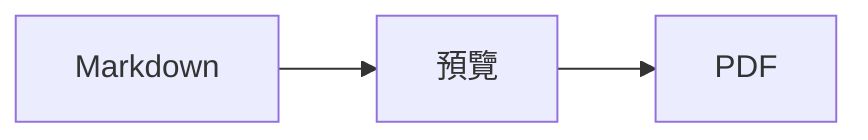

<p>&nbsp;&nbsp;&nbsp;</p>

# Splat

**適用於 macOS 的 Markdown 編輯器，可在原始碼中書寫，也能直接在預覽中書寫。**

Splat 左邊是帶語法上色的 Markdown 原始碼，右邊是即時且完全可編輯的預覽。兩邊都能輸入：你在預覽中寫的內容，會變成對原始碼的最小更動，所以沒碰過的行會逐位元組保持不變，Git diff 也始終清爽。Splat 讀得懂你平常使用的 Markdown：CommonMark 與 GitHub Flavored Markdown、GitHub alerts、Obsidian 的 wiki 連結、嵌入與標註框、Pandoc 與 Typora 的擴充語法、內嵌 HTML、LaTeX 公式，以及 Mermaid、Graphviz 和 PlantUML 圖表，全部離線呈現。只需按一下，即可輸出為 PDF、HTML 或 Word。它以 Rust 寫成，建立在原生 AppKit 控制項之上，支援 35 種語言，除非你要求，否則不會透過網路傳送任何資料。
 


[](https://raw.githubusercontent.com/sventmueller/splat/main/dist/Splat-1.0.6.dmg)

**[下載 Splat-1.0.6.dmg](https://raw.githubusercontent.com/sventmueller/splat/main/dist/Splat-1.0.6.dmg)**：已由 Apple 簽署並公證，適用於 macOS 14 或以上版本，支援 Apple 晶片與 Intel。
 
 

[](https://www.rust-lang.org)
[](https://www.apple.com/macos/)

[](https://github.com/madsmtm/objc2)
[](https://webkit.org)
[](https://github.com/kivikakk/comrak)
[](https://github.github.com/gfm/)
[](https://www.mathjax.org)
[](https://cortexjs.io/mathlive/)
[](https://mermaid.js.org)
[](https://graphviz.org)
[](https://plantuml.com)


[](#授權條款)

[Bahasa Indonesia](../id/README.md) ·
[Bahasa Melayu](../ms/README.md) ·
[Català](../ca/README.md) ·
[Čeština](../cs/README.md) ·
[Dansk](../da/README.md) ·
[Deutsch](../de/README.md) ·
[English](../../../README.md) ·
[Español](../es/README.md) ·
[Français](../fr/README.md) ·
[Hrvatski](../hr/README.md) ·
[Italiano](../it/README.md) ·
[Magyar](../hu/README.md) ·
[Nederlands](../nl/README.md) ·
[Norsk](../no/README.md) ·
[Polski](../pl/README.md) ·
[Português (Brasil)](../pt_BR/README.md) ·
[Português (Portugal)](../pt_PT/README.md) ·
[Română](../ro/README.md) ·
[Slovenčina](../sk/README.md) ·
[Slovenščina](../sl/README.md) ·
[Suomi](../fi/README.md) ·
[Svenska](../sv/README.md) ·
[Tiếng Việt](../vi/README.md) ·
[Türkçe](../tr/README.md) ·
[Ελληνικά](../el/README.md) ·
[Русский](../ru/README.md) ·
[Українська](../uk/README.md) ·
[עברית](../he/README.md)‎ ·
[العربية](../ar/README.md)‎ ·
[हिन्दी](../hi/README.md) ·
[ไทย](../th/README.md) ·
[한국어](../ko/README.md) ·
[日本語](../ja/README.md) ·
[简体中文](../zh-Hans/README.md) ·
**繁體中文**

## 目錄

- [功能一覽](#功能一覽)
- [系統需求](#系統需求)
- [安裝](#安裝)
- [開始使用](#開始使用)
- [書寫](#書寫)
  - [在原始碼中](#在原始碼中)
  - [在預覽中](#在預覽中)
  - [格式指令](#格式指令)
  - [列表與待辦事項](#列表與待辦事項)
  - [表格](#表格)
- [支援的 Markdown](#支援的-markdown)
  - [CommonMark 與 GitHub Flavored Markdown](#commonmark-與-github-flavored-markdown)
  - [標註框](#標註框)
  - [延伸語法](#延伸語法)
  - [Obsidian](#obsidian)
  - [引用與參照](#引用與參照)
  - [內嵌 HTML](#內嵌-html)
  - [排版標點符號](#排版標點符號)
  - [語法總覽](#語法總覽)
- [公式](#公式)
- [圖表](#圖表)
- [影像](#影像)
- [連結與導覽](#連結與導覽)
- [輸出、列印與分享](#輸出列印與分享)
- [外觀與輔助使用](#外觀與輔助使用)
- [語言](#語言)
- [鍵盤快速鍵](#鍵盤快速鍵)
- [隱私與安全性](#隱私與安全性)
- [大型文件](#大型文件)
- [已知限制](#已知限制)
- [疑難排解](#疑難排解)
- [給開發者](#給開發者)
  - [建置](#建置)
  - [發佈](#發佈)
  - [測試](#測試)
  - [專案結構](#專案結構)
  - [資料流](#資料流)
  - [控制器中的規則](#控制器中的規則)
  - [新增指令](#新增指令)
  - [翻譯](#翻譯)
  - [第三方元件](#第三方元件)
- [授權條款](#授權條款)

## 功能一覽

- **兩種寫法，同一份文字。** 原始碼和預覽都能編輯。Markdown 檔案是唯一的依據：每份文件只有一份還原記錄，預覽中的每次編輯都會轉換成對原始碼的最小更動。
- **你平常使用的 Markdown。** CommonMark、GitHub Flavored Markdown、GitHub alerts、Obsidian、Pandoc 與 Typora 的擴充語法、emoji 短代碼、劇透、定義列表、標題錨點，以及 GitHub README 中常見的 HTML。
- **內建公式與圖表。** 透過 MathJax 呈現 LaTeX 公式，並附有視覺化公式編輯器。Mermaid、Graphviz 和 PlantUML 圖表直接在你的 Mac 上呈現，不需要 Java、伺服器或網路連線。
- **樣樣有按鈕。** 每種 Markdown 語法都有對應的工具列按鈕和選單項目，常用的還有鍵盤快速鍵。表格另有專屬選單，可處理列、欄和對齊方式。
- **輸出不打折。** 可輸出為 PDF、單一獨立的 HTML 檔案，或包含真正標題、列表、表格、註腳和影像的 Word 文件。
- **徹頭徹尾的原生。** 真正的 AppKit 視窗、標籤頁、選單、彈出視窗、版本、自動儲存、分享選單、深色模式、拼字檢查、聽寫和旁白。沒有 Electron，文字本身也不使用網頁檢視器。
- **大檔案也很快。** 在 10 MB 的文件中，渲染一個按鍵約需 25 毫秒（不含檢視器本身的工作）。
- **注重隱私，謹慎處理。** 來自網路的影像要在你允許後才會載入，打開其他 App 的連結前會先詢問，所有解碼不受信任影像資料的工作都在沙盒輔助程序中執行。
- **使用你的語言。** 介面和內建的 Markdown 快速參考提供 35 種語言：阿拉伯文、加泰隆尼亞文、簡體中文、繁體中文、克羅埃西亞文、捷克文、丹麥文、荷蘭文、英文、芬蘭文、法文、德文、希臘文、希伯來文、印地文、匈牙利文、印尼文、義大利文、日文、韓文、馬來文、挪威文、波蘭文、葡萄牙文（巴西）、葡萄牙文（葡萄牙）、羅馬尼亞文、俄文、斯洛伐克文、斯洛維尼亞文、西班牙文、瑞典文、泰文、土耳其文、烏克蘭文和越南文。

## 系統需求

- macOS 14 Sonoma 或以上版本。Splat 在 macOS 27 上開發與測試，在該系統上會自動採用液態玻璃設計。
- 搭載 Apple 晶片或 Intel 處理器的 Mac。
- 約 45 MB 的磁碟空間。

## 安裝

**從磁碟映像檔安裝。** 下載 [`dist/Splat-1.0.6.dmg`](https://raw.githubusercontent.com/sventmueller/splat/main/dist/Splat-1.0.6.dmg)，打開後將 Splat 拖到「應用程式」檔案夾。映像檔已用 Developer ID 簽署並由 Apple 公證，所以打開時不會出現警告。

**透過 Homebrew 安裝。** Cask 位於專屬的 tap 中：

```sh
brew install --cask sventmueller/tap/splat
```

`brew upgrade --cask splat` 會安裝新版本，`brew uninstall --zap --cask splat` 還會一併移除 Splat 的設定和快取。

**更新。** 從磁碟映像檔或 Homebrew 安裝的 Splat 會透過 [Sparkle](https://sparkle-project.org) 自行保持最新。第二次啟動時，它會詢問是否可以每天自動檢查一次更新。**Splat › 檢查更新項目⋯** 會立即檢查；之後若想更改選擇，可在同一個選單中使用 **自動檢查更新項目** 和 **自動下載並安裝更新項目**。Splat 只會安裝帶有開發者簽章的更新。自行建置的版本沒有更新功能。

**從原始碼安裝。** 先在「[建置](#建置)」中查看前置條件，然後：

```sh
make build
ditto target/release/Splat.app /Applications/Splat.app
open /Applications/Splat.app
```

若要連按兩下就用 Splat 打開 Markdown 檔案，請在 Finder 中選取任一 `.md` 檔案，選擇 **檔案 › 取得資訊**，在 **打開檔案的應用程式** 下選取 Splat，然後按一下 **全部更改⋯**。Splat 會自行註冊處理 `.md`、`.markdown`、`.mdown` 和 `.mkd` 檔案。

## 開始使用

### 視窗

每份文件都在自己的視窗中打開，如果你偏好標籤頁，也可以在標籤頁中打開：

- **左邊：原始碼。** 你的 Markdown，以 SF Mono 字體顯示並帶有語法上色。
- **右邊：預覽。** 呈現後的文件，隨時可以編輯。
- **大綱側邊欄（選用）。** 所有標題以樹狀顯示；按一下標題，兩個窗格都會顯示該處。可用 **顯示方式 › 顯示大綱**（⌃⌘S）切換。
- **工具列。** 按鈕依更改的對象分組：字元、段落與插入的項目，接著是預覽開關、分享和新增文件。可用 **顯示方式 › 自訂工具列⋯** 自訂。

拖移分隔線，可讓任一邊有更多空間。**顯示方式 › 隱藏預覽**（⌥⌘P）只留下原始碼；Splat 會依視窗記住這項設定。兩個窗格會一起捲動，在一個窗格中選取的內容會在另一個窗格中醒目標示。

### 文件、標籤頁與版本

Splat 是一般的 macOS 文件型 App：

- **自動儲存與版本。** 更動會直接儲存在原檔中。**檔案 › 回復成 › 瀏覽所有版本⋯** 可讓你回到過去。
- **其他程式所做的更動。** 當 Git、腳本或其他編輯器更動了已打開的文件，Splat 會重新載入，並保留插入點和捲動位置。如果你自己有尚未儲存的更動，Splat 會保留它們，並且在覆寫另一個版本前，由 macOS 先詢問。
- **常用的檔案指令。** 複製（⇧⌘S）、重新命名⋯、移到⋯，以及 **檔案 › 打開最近使用過的檔案**。
- **標籤頁。** **檔案 › 新增標籤頁** 或工具列中的 **+** 按鈕會在標籤頁中打開新文件；標準的「視窗」選單可合併、移動和切換標籤頁。
- **視窗位置。** 上一個視窗的大小和位置會被記住，重新啟動後也一樣。如果該處已有視窗，新視窗會稍微錯開打開。
- **Dock 圖像。** 關閉最後一個視窗後，按一下它會打開新文件。
- **用 Splat 打開 Markdown 檔案。** **Splat › 設為 Markdown 的預設 App** 可讓連按兩下 `.md` 或 `.markdown` 檔案時打開 Splat；macOS 會詢問一次以確認。Splat 是預設 App 時，該項目會顯示勾號。

檔案必須是 UTF-8 文字，或帶有位元組順序記號的 UTF-16。Splat 會拒絕其他編碼，而不是猜測並損毀文字。位元組順序記號會保留，UTF-16 仍是 UTF-16，而在每一行都以 CRLF 結尾的檔案中，你新增的行也會使用 CRLF。

**當機後**，最多只會遺失最後幾秒的輸入：Splat 每五秒會將未儲存的文字拷貝到 `~/Library/Application Support/Splat/Unsaved`，並在文件儲存或 Splat 正常結束後移除這些拷貝。下次啟動時，當機所留下的內容會移到 `~/Library/Application Support/Splat/Recovery`，並提示一次，附有可打開該檔案夾的按鈕。Splat 仍能回應的當機，也會把每份已打開文件的文字寫到那裡。

### 快速參考

**輔助說明 › Markdown 快速參考** 會以你的語言，在新的未命名文件中打開一份速查表。它是一般的文件，所以可以直接在原始碼或預覽中試用所有內容。

## 書寫

### 在原始碼中

原始碼是專為 Markdown 調校的純文字編輯器：

- **語法上色**，就像 VS Code：標題、強調、連結、程式碼、表格、HTML、front matter，以及公式和圖表中的 LaTeX 與 Mermaid。提供淺色、深色和提高對比三種配色。
- **圍欄式程式碼區塊**會為 Bash、C、C++、C#、CSS（也包含 SCSS 和 Less）、Go、HTML、XML、Java、JavaScript、JSON、Kotlin、PHP、Python、Ruby、Rust、SQL、Swift、TypeScript、YAML、TeX 和 Mermaid 上色，常用的簡稱如 `js`、`py` 或 `sh` 也一樣適用。
- **不會有意外的替代。** 智慧型引號、智慧型破折號和文字替代預設為關閉，因為它們會破壞 `--`、`---` 和 `"`。可在 **編輯 › 替代** 下開啟。
- **系統的書寫工具。** 拼字和文法檢查、聽寫、尋找與取代（⌥⌘F）以及語音。
- **拖放。** 拖入影像檔會插入 ``，拖入其他檔案會插入指向它的連結，拖入網址則會插入 `[url](url)`。每次拖放都是一個還原步驟。
- **貼上影像。** 剪貼簿中的圖片，例如螢幕截圖，會以 PNG 檔案儲存在文件旁（`影像 2026-10-29 13.09.07.png`），並作為影像插入。文件必須先儲存過一次。

### 在預覽中

預覽的操作方式像文書處理器，但你在其中所做的一切，最後都會變成 Markdown：

- **輸入。** 在 Markdown 中有特殊意義的字元，例如 `*` 或 `#`，會被跳脫，讓它們如實顯示。
- **Return** 開始新段落或新的列表項目。**⌥Return** 或 **⌃Return** 插入換行。
- **在游標處設定格式。** 游標位於字詞結尾時，粗體、斜體和其他字元格式會套用到接下來輸入的內容。再選一次該格式即可停止。位於字詞中間時，則會套用到整個字詞。
- **空白行。** 在空白行上按 Return 會再加一個空白行，按 Delete 則會移除它。在原始碼中，每個多出的空白行相當於兩個空行；其他 Markdown 程式會將它們顯示為一般的段落間距。
- **還原**在兩個窗格間通用。還原項目帶有名稱（「還原粗體」），輸入時一連串按鍵算一個步驟，還原與重做之後兩個窗格都會捲動到更動處。
- **公式和圖表**以完成的圖形顯示。按一下、將游標移到上面，或在上面按 Return，即可打開它的編輯器（請見「[公式](#公式)」和「[圖表](#圖表)」）。
- **內嵌 HTML、內嵌筆記和 front matter** 會顯示出來，但要在原始碼中編輯。按一下它們，游標會移到原始碼中對應的位置。

Markdown 無法表達的一切，在預覽中都會被阻擋：字體和顏色面板、尺標，以及貼上或拖入格式化文字和影像。貼上的 HTML 和 RTF 會以純文字形式進來。

### 格式指令

每個指令都可以從工具列、選單列，以及兩個窗格各自的快顯選單中使用。選單項目會為游標所在處目前套用的格式顯示勾號。

| 選單 | 指令 |
|---|---|
| **格式 › 字體** | 粗體、斜體、底線、刪除線、醒目標示、程式碼、上標、下標 |
| **格式 › 標題** | 內文、標題 1 至 6 |
| **格式 › 列表** | 項目符號列表、編號列表、待辦清單 |
| **格式** | 引言、程式碼區塊（不指定語言或 20 種語言之一；也能變更現有區塊的語言）、標註框（附註、提示、重要、警告、小心；再選一次相同類型即可移除）、編輯公式或圖表⋯、清除格式 |
| **插入** | 連結⋯、影像⋯、表格⋯、公式、圖表（流程圖、循序圖、甘特圖）、目錄、註腳、分隔線 |
| **表格** | 在上方/下方插入列、在左側/右側插入欄、刪除列、刪除欄、對齊方式（靠左、置中、靠右、預設）、對齊表格欄位 |
| **顯示方式** | 隱藏/顯示預覽、顯示/隱藏大綱、排版標點符號、放大/縮小、實際大小、工具列、標籤頁列、全螢幕 |

底線、醒目標示、上標和下標會寫成 `<ins>`、`<mark>`、`<sup>` 和 `<sub>`，GitHub 同樣會顯示它們。Splat 也讀得懂 GitHub 會移除的 `<u>`，以及較短的 `==highlight==`、`^sup^` 和 `~sub~`。GitHub 會把 `==` 和 `^` 如實顯示，並把 `~sub~` 顯示為刪除線。

### 列表與待辦事項

- Return 會延續列表；在空白項目上按 Return 則結束列表。
- 在預覽中，**Tab** 和 **⇧Tab** 會增加和減少列表項目的縮排。
- 在預覽中按一下待辦事項的核取方塊，會切換 `- [ ]` 和 `- [x]`。
- **格式 › 列表** 會將所選段落轉為列表，或更改列表的類型。

### 表格

- **插入 › 表格⋯** 會詢問列數（包含標題列）和欄數。
- 在預覽中，**Tab** 會跳到下一個儲存格，**⇧Tab** 跳到上一個，**Return** 跳到下方的儲存格。在最後一個儲存格按 Tab 會新增一列。
- **表格**選單可插入和刪除列與欄，並設定欄的對齊方式（⌘{、⌘|、⌘}）。
- **表格 › 對齊表格欄位** 會在原始碼中補上空白，讓各欄對齊。

## 支援的 Markdown

Splat 以 [comrak](https://github.com/kivikakk/comrak) 解析，這是相容於 CommonMark 和 GFM 的解析器，並開啟了它大部分的擴充功能。以下所有內容都會呈現在預覽和所有輸出中。

### CommonMark 與 GitHub Flavored Markdown

- 標題（`#` 和底線式）、段落、換行、強調、加強強調、行內程式碼、引用區塊、分隔線。
- 項目符號、編號和巢狀列表；待辦清單。
- 連結（行內、參照和自動連結）、影像、連結參照定義。
- 帶語法上色的圍欄式和縮排式程式碼區塊。
- 帶欄對齊的表格。
- 以 `~~兩個波浪號~~` 表示刪除線。
- 註腳：`文字[^1]` 搭配文件中任何位置的 `[^1]: 註腳內容。`。按一下標記會跳到註腳。
- 位於最上方 `---` 行之間的 YAML front matter。預覽會用一行概括，例如「後設資料：title、date、tags」。

### 標註框

GitHub alerts 會呈現為帶圖像和標題的彩色方塊：

```markdown
> [!NOTE]
> 使用者應該知道的實用資訊。

> [!WARNING]
> 需要立即注意的重要內容。
```

五種類型是附註、提示、重要、警告和小心。**格式 › 標註框** 會把游標所在的段落轉成標註框。

Obsidian 的標註框同樣適用，可使用任何標題和摺疊狀態：

```markdown
> [!tip]- 按一下 ▸ 即可展開
> 打開前是隱藏的。

> [!question]+ 預設為展開
> `+` 表示展開，`-` 表示收合。
```

Obsidian 的其他類型會以五種顏色中最接近的一種顯示：`success`、`check`、`done` 和 `hint` 顯示為提示；`question`、`help` 和 `faq` 顯示為重要；`attention` 顯示為警告；`failure`、`fail`、`missing`、`danger`、`error` 和 `bug` 顯示為小心；其餘都顯示為附註。

### 延伸語法

| 功能 | 語法 | 來源 |
|---|---|---|
| 醒目標示 | `==標示的文字==` | Obsidian、Typora |
| 上標 | `x^2^` | Pandoc、Typora |
| 下標 | `H~2~O` | Pandoc、Typora |
| Emoji 短代碼 | `:rocket:` 會變成 🚀 | GitHub |
| 劇透 | `\|\|隱藏的文字\|\|`，選取即可閱讀 | Discord |
| 行內註腳 | `文字^[註腳本身]` | Pandoc、Obsidian |
| 定義列表 | `術語`、空白行、`: 說明` | PHP Markdown Extra、Pandoc |
| 標題錨點 | `## 安裝 {#setup}`，以 `[參見](#setup)` 連結 | Pandoc、kramdown |

定義列表在原始碼中長這樣：

```markdown
術語

: 術語的說明。
```

沒有自訂錨點時，每個標題都會依其文字產生一個，與 GitHub 相同：`## 開始使用` 可用 `#開始使用` 連結到。

### Obsidian

- **Wiki 連結。** `[[筆記]]` 會連結到同一個檔案夾或其子檔案夾中的 `筆記.md`。`[[筆記|顯示的文字]]` 會顯示你自己的文字，`[[筆記#標題]]` 則打開該筆記。按住 ⌘ 鍵按一下會在 Splat 中打開。
- **嵌入。** `![[筆記]]` 會在此筆記內顯示另一份筆記；其中再嵌入的筆記則以連結顯示。`![[diagram.png]]` 會顯示影像。與 Obsidian 相同，嵌入只會以名稱指向文件所在檔案夾或其子檔案夾中的筆記和影像，絕不使用絕對路徑，而且只有 Markdown 檔案會顯示為筆記。
- **註解。** `%%只在原始碼中%%` 會在原始碼中保持可見，預覽和所有輸出都會省略它，無論是行內或獨立成行。
- **標籤。** `#idea` 或 `#project/splat` 會醒目標示。按住 ⌘ 鍵按一下會在文件中搜尋該標籤。
- **可摺疊的標註框。** 請見「[標註框](#標註框)」。

### 引用與參照

- **Pandoc 引用。** `[@doe2020]` 或 `[@doe2020; @roe2021]` 讀起來像「(Doe 2020; Roe 2021)」。文獻條目來自 front matter 中以 `bibliography: refs.bib` 指定的 BibTeX 檔案。沒有指定時，Splat 會使用文件旁的 `references.bib`、`literatur.bib` 或 `bibliography.bib`。
- **GitHub 與 GitLab 參照。** 如果文件位於 Git 儲存庫中，且其 `origin` 遠端在 github.com 或某個 GitLab 主機上，`@name`、`#12`（issue）和 `!7`（合併請求，僅限 GitLab）都會醒目標示。按住 ⌘ 鍵按一下會在瀏覽器中打開。

### 內嵌 HTML

GitHub README 中常見的 HTML 都會呈現，使用的是專屬的讀取器，而不是瀏覽器引擎：

- 置中的段落和區塊（`<p align="center">`、`<div align="center">`）
- 指定大小的影像（``）
- 連結、`<kbd>⌘</kbd>`、`<br>`、`<u>`、`<ins>`、`<mark>`、`<sup>`、`<sub>`
- 列表和表格，包含跨欄的儲存格（`colspan`）
- 可收合的區段：`<details><summary>更多</summary>…</details>`，按一下 ▸ 即可展開

HTML 標籤之間的 Markdown 會當作 Markdown 呈現。腳本、樣式、框架和表單會被完全省略，連結和影像只保留 `http`、`https`、`mailto` 和相對位址。

### 排版標點符號

**顯示方式 › 排版標點符號** 會把直引號顯示為你的介面語言所用的引號，`--` 顯示為連字號（en dash），`---` 顯示為長破折號（em dash），`...` 顯示為刪節號。在德文中，`"Ja"` 會變成 „Ja“，法文是 «Oui»，日文是 「はい」，中文和日文的引號前後也不加空格；希伯來文縮寫如 `צה"ל` 會加上 gershayim，變成 צה״ל。原始碼保留原本的字元；預覽和所有輸出則顯示排版後的字元。這項設定在你開啟之前都是關閉的。

### 語法總覽

| 元素 | Markdown |
|---|---|
| **粗體** | `**粗體**` |
| *斜體* | `*斜體*` |
| 底線 | `<ins>底線</ins>` 或 `<u>底線</u>` |
| ~~刪除線~~ | `~~刪除線~~` |
| 醒目標示 | `<mark>醒目標示</mark>` 或 `==醒目標示==` |
| `程式碼` | `` `程式碼` `` |
| x² | `x<sup>2</sup>` 或 `x^2^` |
| H₂O | `H<sub>2</sub>O` 或 `H~2~O` |
| [連結](https://example.com) | `[連結](https://example.com)` |
| 標題 | `# 標題` 至 `###### 標題` |
| 引言 | `> 引言` |
| 項目符號列表 | `- 項目` |
| 編號列表 | `1. 項目` |
| 待辦事項 | `- [ ] 未完成` 和 `- [x] 已完成` |
| 程式碼區塊 | ```` ```rust ```` … ```` ``` ```` |
| 表格 | `\| A \| B \|`，標題列下方加上 `\|---\|---\|` |
| 註腳 | `文字[^1]` 和 `[^1]: 註腳` |
| 分隔線 | `---` |
| 影像 | `` |
| 公式 | `$E = mc^2$`、`$$ … $$` |
| 圖表 | ```` ```mermaid ````、```` ```dot ````、```` ```plantuml ```` |
| 標註框 | `> [!TIP]` |
| Wiki 連結 | `[[筆記]]`、`[[筆記\|文字]]` |
| 嵌入 | `![[筆記]]`、`![[image.png]]` |
| 註解 | `%%註解%%` |
| 標籤 | `#標籤` |
| 引用 | `[@key]` |
| 劇透 | `\|\|劇透\|\|` |
| Emoji | `:tada:` |

## 公式

公式由 [MathJax](https://www.mathjax.org) 以其 TeX 和 AMS 數學套件呈現，是清晰的向量圖形。`\text{…}` 中的文字可以使用任何文字系統：MathJax 字體所缺的字，會改用你 Mac 的字體，阿拉伯文和希伯來文由右至左排列，emoji 則以彩色顯示。

| 種類 | 語法 |
|---|---|
| 行內 | `$E = mc^2$`、`` $`E = mc^2`$ ``（GitHub、GitLab）、`\(E = mc^2\)` |
| 獨立顯示 | `$$` … `$$`、`\[` … `\]`，或標示為 `math` 的程式碼區塊 |

**編輯公式。** 在預覽中按一下公式、連按兩下、在上面按 Return，或將游標移到上面，就會在彈出視窗中打開它的編輯器。**插入 › 公式** 會插入新的公式並立即打開編輯器。

- **視覺化或 LaTeX。** 最上方的切換開關可在視覺化編輯器（[MathLive](https://cortexjs.io/mathlive/)）和 LaTeX 程式碼之間切換。Splat 會記住你的選擇。
- **組件**包括分數、根號、上標與下標、帶上下限的總和與積分、極限、隨內容放大的括號、2×2 矩陣、希臘字母，以及關係符號、運算子與箭頭。它們會留下佔位符號 □，按 **Tab** 鍵會跳到下一個。
- **即時預覽。** 輸入時，更動會立即出現在文件中。MathJax 的錯誤會顯示在程式碼下方的一行中。
- **套用或捨棄。** 在外面按一下，會將更動保留為單一還原步驟；按 **Esc** 或 **取消** 則會捨棄。對新的空白公式按 Esc，會將它再次移除。
- 快顯選單為指標下方的公式提供 **編輯公式⋯**。

旁白會把公式讀成它的 LaTeX 程式碼。Splat 呈現的是公式，而不是完整的 LaTeX 文件：沒有套件、沒有 TikZ，也沒有 `\documentclass`。

## 圖表

圖表在 Splat 內呈現，離線運作，並有淺色與深色兩種版本。

| 引擎 | 程式碼區塊 | 繪製內容 |
|---|---|---|
| [Mermaid](https://mermaid.js.org) | ```` ```mermaid ```` | 流程圖、循序圖、類別圖、狀態圖、實體關係圖、甘特圖、圓餅圖、心智圖、時間軸，以及 Mermaid 的所有其他類型 |
| [Graphviz](https://graphviz.org) | ```` ```dot ```` 或 ```` ```graphviz ```` | 以 DOT 語言描述的圖形 |
| [PlantUML](https://plantuml.com) | ```` ```plantuml ```` 或 ```` ```puml ```` | UML 圖表；不需要 Java 即可執行 |



**編輯圖表**的方式和編輯公式相同：按一下它，就會在彈出視窗中打開程式碼，並附有語法上色，錯誤訊息則顯示在程式碼下方的一行中。**插入 › 圖表** 會從流程圖、循序圖或甘特圖的範本開始。組件可協助處理最常見的三種 Mermaid 類型：

- **流程圖：** 節點 ▾（矩形、圓角矩形、圓形、菱形、資料庫）、連線、帶標籤的連線、群組、方向 ▾
- **循序圖：** 參與者、訊息、回覆、備註、迴圈、依條件走不同路徑
- **甘特圖：** 區段、任務、里程碑

其他圖表類型以程式碼編輯。旁白會讀出圖表的標題或替代文字。

啟動後的第一個圖表約需一秒，因為呈現引擎會在背景啟動。耗時超過 10 秒的圖表會顯示錯誤，呈現引擎會為下一個圖表重新啟動。PlantUML 的引擎（7 MB）只在第一個 PlantUML 圖表出現時才載入。來自網路的 PlantUML `!include` 會被阻擋。

## 影像

- **本機影像**使用相對於文件的路徑：``。Splat 可顯示 PNG、JPEG、GIF、WebP、BMP、SVG、HEIC、TIFF、AVIF 和 PDF。
- **來自網路的影像**在你允許之前都會被阻擋：預覽上方的橫幅會說明，載入它們會讓對方的伺服器得知你打開了文件以及打開的時間。**載入影像** 會對此文件允許載入；Splat 會依檔案記住這項選擇。
- **大小。** `` 可指定影像大小；否則影像會配合預覽的寬度。
- **磁碟上的更動。** 你替換的影像，或在文件提到之後才出現的影像，不必重新打開文件就會顯示。因網路問題而失敗的網路影像，在文件顯示它們期間會再次嘗試。
- **記憶體。** 影像最長邊最多以 2560 像素顯示，這樣也足以填滿一頁 A4。一旦影像佔滿 Mac 記憶體的八分之一，或 macOS 回報記憶體壓力時，就會以較小的尺寸解碼。
- **深色模式。** 白色背景的影像在深色預覽中會稍微調暗。
- **貼上與拖放。** 請見「[在原始碼中](#在原始碼中)」。

## 連結與導覽

在預覽中，按一下會放置游標，讓你編輯連結文字；**按住 ⌘ 鍵按一下** 則前往連結：

- `http`、`https` 和 `mailto` 會在你的瀏覽器或郵件 App 中打開。
- Markdown 檔案會在 Splat 中打開；其他檔案和檔案夾則在 Finder 中顯示。
- `#anchor` 會跳到文件中的該標題。
- 會打開其他 App 的位址，例如 `slack://` 或 `vscode://`，會先詢問，並顯示完整位址和該 App。預設選取的是 **取消**。

**插入 › 目錄** 會插入所有標題的連結列表。游標位於其中時，同一個指令會更新它。大綱側邊欄（⌃⌘S）可在兩個窗格中跳到任何標題。

## 輸出、列印與分享

| 格式 | 方式 | 你會得到 |
|---|---|---|
| **PDF** | **檔案 › 輸出為PDF⋯** 或分享選單 | 紙張大小的頁面，一律採用淺色外觀，公式和圖表為向量圖形。**檔案 › 設定頁面⋯** 可設定紙張。 |
| **列印** | **檔案 › 列印⋯**（⌘P） | 與 PDF 相同的版面。 |
| **HTML** | **檔案 › 輸出為 HTML⋯** 或分享選單 | 單一獨立的檔案：內嵌本機影像，公式和圖表為清晰的影像，並有標題錨點讓目錄可以運作。不含腳本。 |
| **Word** | **檔案 › 輸出為 Word 文件⋯** 或分享選單 | 一個 `.docx`，帶有 Word 的標題樣式、真正的列表和表格（包含合併的儲存格）、作為 Word 註腳的註腳、內嵌影像、公式和圖表。 |
| **Markdown** | 工具列中的 **分享** 按鈕 | 文件以 `.md` 檔案形式提供給「郵件」、「訊息」、AirDrop 和其他所有分享服務。 |

**檔案 › 分享** 選單把這些選項集中在同一處。輸出會採用排版標點符號的設定，以及你允許載入的網路影像；來自網路的影像在 HTML 中仍是連結。

## 外觀與輔助使用

- **深色模式**跟隨系統。公式和圖表會依每種外觀分別呈現。
- 在「系統設定」中開啟 **增加對比** 時，語法顏色會改用高對比配色。
- **縮放。** ⌘+、⌘− 和 ⌘0 會縮放兩個窗格。
- **全螢幕、標籤頁和可自訂的工具列**，與每個 Mac App 相同。
- **旁白。** 窗格標示為「Markdown 原始碼」和「預覽」，公式讀成它的程式碼，圖表則讀成它的標題。每個指令都能用鍵盤操作。

Splat 沒有設定視窗：少數選項就放在用到它們的地方，也就是 **顯示方式** 和 **編輯 › 替代** 中。

## 語言

介面、選單和 Markdown 快速參考已翻譯成 35 種語言：

阿拉伯文、加泰隆尼亞文、簡體中文、繁體中文、克羅埃西亞文、捷克文、丹麥文、荷蘭文、英文、芬蘭文、法文、德文、希臘文、希伯來文、印地文、匈牙利文、印尼文、義大利文、日文、韓文、馬來文、挪威文、波蘭文、葡萄牙文（巴西）、葡萄牙文（葡萄牙）、羅馬尼亞文、俄文、斯洛伐克文、斯洛維尼亞文、西班牙文、瑞典文、泰文、土耳其文、烏克蘭文和越南文。

Splat 會依照 **系統設定 › 一般 › 語言與地區** 中的語言順序；你也可以在那裡的 **應用程式** 下，單獨為 Splat 選擇語言。如果沒有你的語言的翻譯，就會使用英文。選單用語依循 Apple 自己的翻譯，所以 Splat 讀起來就像 Mac 的其他部分。

希伯來文和阿拉伯文的文字無論出現在哪裡，也不論介面語言為何，都由右至左閱讀：每個段落、標題和列表項目都依第一個字母決定方向，引言和標註框的色條畫在右側，文字由右至左開頭的表格，其欄位也從右側開始排列。程式碼區塊維持由左至右。PDF、HTML 和 Word 輸出會保留這些方向。若系統語言是希伯來文或阿拉伯文，macOS 也會鏡像視窗，所以預覽位於左側。

## 鍵盤快速鍵

| 動作 | 快速鍵 |
|---|---|
| 粗體、斜體、底線 | ⌘B、⌘I、⌘U |
| 刪除線 | ⇧⌘X |
| 連結⋯ | ⌘K |
| 內文、標題 1 至 6 | ⌥⌘0、⌥⌘1 至 ⌥⌘6 |
| 將表格欄靠左、置中、靠右對齊 | ⌘{、⌘\|、⌘} |
| 隱藏或顯示預覽 | ⌥⌘P |
| 顯示或隱藏大綱 | ⌃⌘S |
| 放大、縮小、實際大小 | ⌘+、⌘−、⌘0 |
| 新增文件、打開、儲存、複製 | ⌘N、⌘O、⌘S、⇧⌘S |
| 設定頁面、列印 | ⇧⌘P、⌘P |
| 尋找、尋找與取代 | ⌘F、⌥⌘F |
| 尋找下一個、上一個；使用所選範圍；跳至所選範圍 | ⌘G、⇧⌘G；⌘E；⌘J |
| 顯示拼字和文法檢查；檢查文件 | ⌘:、⌘; |
| 貼上並符合樣式 | ⌥⇧⌘V |
| 隱藏工具列、顯示所有標籤頁、全螢幕 | ⌥⌘T、⇧⌘\\、⌃⌘F |
| 換行（預覽） | ⌥Return 或 ⌃Return |
| 表格中的下一個/上一個儲存格（預覽） | Tab / ⇧Tab |
| 增加/減少列表項目的縮排（預覽） | Tab / ⇧Tab |
| 公式編輯器中的下一個佔位符號 | Tab |
| 不做更動而關閉公式或圖表編輯器 | Esc |
| 前往連結、標籤或參照（預覽） | 按住 ⌘ 鍵按一下 |

Splat 不會改動 Apple 的標準快速鍵。

## 隱私與安全性

Markdown 檔案可能來自任何人，所以 Splat 會把每份文件都視為不受信任。

- **預設不使用網路。** Splat 沒有遙測功能。只有在你同意後，或選擇 **檢查更新項目⋯** 時，它才會檢查更新：此時它會從 GitHub 載入一個小型摘要檔案，而請求中除了 App 和它的版本之外，不含任何其他資訊。公式和圖表在本機呈現；負責呈現的網頁檢視器無法連上網路。
- **來自網路的影像**要在你許可後才會載入，且只透過 `https`，絕不從你區域網路中的主機載入，每張最大 10 MB，並在不含 cookie 的私密工作階段中進行。
- **獨立解碼。** 影像以及公式和圖表的圖形，會在輔助程序中解碼；這些程序會關閉它們繼承的所有檔案，並在讀取第一個位元組之前把自己鎖進沙盒：無法存取檔案，也無法使用網路。它們只交回像素，且會檢查像素的大小，並在 10 秒後被停止。Apple 自己的影像解碼器只會處理 HEIC、TIFF、AVIF 和 PDF，而且只在資料確實是該格式時才會處理；它們在專屬的輔助程序中執行，該程序另外可以讀取系統的字體檔案夾，並使用系統的視訊解碼器。SVG、公式和圖表也會經過這個輔助程序，所以它們在 Splat 中是解析度固定的圖片：每點四個像素，較長邊最多 2560。
- **本機檔案**只會依文件所指的路徑進入文件。嵌入會顯示文件所在檔案夾及其子檔案夾中的 Markdown 筆記，找不到的圖片也只會在那裡尋找。其他位置的影像路徑，無論是絕對路徑或以 `~` 開頭，仍然會載入，而且 HTML 和 Word 輸出會將它嵌入：傳給別人之前，請先檢查不是你所寫的文件的輸出內容。
- **未儲存文字的拷貝**會留在這部 Mac 的資源庫檔案夾中，用於當機後的回復。它們會隨著儲存或 Splat 正常結束而移除；當機後留下的拷貝則會留在回復檔案夾中，直到你刪除它們。
- **連結**絕不會因為一次按一下就啟動程式。網頁和郵件連結照常打開；指向其他 App 的連結會先詢問。
- **文件中的 HTML** 由 Splat 自己的解析器讀取。腳本、樣式、框架和表單絕不會執行。
- **輸出**不含腳本。HTML 頁面和 GitHub 一樣，只保留固定清單中無害的標籤和屬性，再加上內容安全政策。Word 檔案只連結 `http`、`https` 和 `mailto` 位址。
- **程式碼簽署**採用 Hardened Runtime。Splat 不在 App Sandbox 中執行，這樣才能顯示文件旁的影像，而不必每個檔案夾都詢問；所有解碼的隔離抵銷了這點。

## 大型文件

Splat 在數 MB 的文件中仍能保持流暢：

- 原始碼使用 TextKit 2，只排版可見的部分。
- 在預覽中輸入時，以及在最大 2 MB 的文件原始碼中輸入時，只會重新解析、上色和排版受影響的段落。在 10 MB 的文件中，解析和上色約需 20 毫秒，渲染約需 25 毫秒，在其預覽中完整輸入一個按鍵約需 60 毫秒（含檢視器本身的工作）。
- 大型預覽會先呈現可見的部分，其餘則在 App 閒置時呈現。捲動到畫面中的區塊，會在繪製之前先呈現。
- 在較大文件的原始碼中，預覽的解析會在你輸入時於背景執行。
- 文件一旦需要約 4 GB 記憶體就只會維持純文字（一般 Markdown 約 50 到 120 MB，全是表格或標題時只需 10 到 20 MB）：原始碼沒有顏色，預覽則會說明為何保持空白。輸出仍可使用。
- 從約 200 KB 起，文件會在解析之前先打開視窗；在 5 MB 時，顏色和預覽會在約四分之一秒後跟上。

有些更動會完整處理，在 10 MB 時每個按鍵約 300 毫秒：更動註腳的定義或參照、更動行內註腳旁邊的內容、在文件最末端的註腳旁邊更動、更動 front matter 或靠近連結參照定義之處，以及在含有 `%%` 註解區塊、註腳被定義兩次，或註腳位於引言或列表內的文件中所做的每一項更動。記憶體會隨檔案增長，1 MB 的 Markdown 約為 115–160 MB，10 MB 則約為 340–510 MB。

## 已知限制

- **單一波浪號代表下標。** `~text~` 和 Pandoc 一樣是下標；刪除線需要 `~~two~~`。GitHub 也接受單一波浪號作為刪除線。
- **預覽中唯讀：** 內嵌 HTML、內嵌筆記和 front matter 要在原始碼中編輯。
- **非常深的巢狀：** 巢狀超過 64 層的 HTML，以及超過 16 層的行內 HTML，只會保留其內容。
- **合併的表格儲存格**只存在於 HTML 表格中，而且只能跨欄（`colspan`，沒有 `rowspan`）。不支援 MultiMarkdown 用於合併儲存格的表格語法。
- **參考書目**只能從 BibTeX 讀取，不支援 CSL JSON 或 YAML。
- **參照**需要位於 github.com 或 GitLab 主機上的儲存庫；`!7` 只存在於 GitLab。
- **排版標點符號：** 德文的右單引號無法與撇號區分，會一律排成 ’。
- **是公式，不是文件：** 沒有 LaTeX 套件、TikZ 或完整文件。
- **視覺化公式編輯器**以 MathLive 的寫法產生 LaTeX：空格會消失（`E = mc^2` 變成 `E=mc^2`），呈現結果不變。
- **刻意如此：** 沒有行號、沒有設定視窗、沒有 Help Book，也不在 App Store 上架。
- **在 Intel 上測試較少。** 視窗自我測試只在 Apple 晶片上執行；在 Intel 上，CI 執行 `cargo test`。

## 疑難排解

**重新建置 Splat 後，最近使用的文件列表是空的。** macOS 會把最近使用的文件和檔案夾權限，與 App 的程式碼簽章綁在一起。本機建置使用你登入鑰匙圈中的「Splat Local Signing」憑證簽署，所以重新建置後兩者都會保留。如果憑證被刪除，下次建置會建立新的憑證，列表會重新開始一次。

**磁碟映像檔中的 App 顯示的最近使用文件，和我自己建置的不同。** 兩者的簽章不同，所以 macOS 會為各自保留獨立的列表和獨立的檔案夾權限。

**HTML 或其他語法顯示為純程式碼。** 可能是舊版的 Splat 打開了該文件。請結束它，在 Finder 中對該文件選擇 **檔案 › 取得資訊**，並確認 **打開檔案的應用程式** 指向「應用程式」檔案夾中的 Splat。

**Splat 選單中沒有「檢查更新項目⋯」。** 只有來自磁碟映像檔或 Homebrew 的版本才會自行更新；自行建置的版本沒有更新功能。

**來自網路的影像沒有出現。** 請按一下預覽上方橫幅中的 **載入影像**。只有來自公開主機的 `https` 影像才會載入。

**貼上螢幕截圖時要求我先儲存。** 貼上的影像會以檔案形式存放在文件旁，這需要磁碟上有位置。請先儲存，再重新貼上。

**「此檔案不是 UTF-8 文字。」** 檔案使用其他編碼，而且沒有可標明編碼的位元組順序記號。請先轉換，例如用 `iconv -f ISO-8859-1 -t UTF-8 old.md > new.md`。

**公式或圖表顯示錯誤。** 按一下它：編輯器會在程式碼下方顯示 MathJax、Mermaid、Graphviz 或 PlantUML 的訊息。

## 給開發者

Splat 是一個 Rust 應用程式，透過 [objc2](https://github.com/madsmtm/objc2) 直接與 AppKit 和 WebKit 溝通。沒有 Swift、沒有 Objective-C、沒有 Xcode 專案，也沒有 Interface Builder 檔案。

### 建置

前置條件：

- 安裝了命令列工具的 macOS（`xcode-select --install`）。不需要 Xcode；Splat 建置時不需要 `actool`、`ibtool` 和 `metal`。
- Rust 1.99（`brew install rust`）。[rust-toolchain.toml](../../../rust-toolchain.toml) 指定了 CI 使用的確切版本；rustup 會自行安裝，Homebrew 的 Rust 則會忽略這個檔案。在那裡調高版本，新的編譯器和 clippy 警告才會進入專案。
- rustup，用於 `make lint`、`make check` 和 `make universal`：`cargo xtask check-library` 為 Linux 建置函式庫，以證明它不需要 macOS，而 Homebrew 的 Rust 沒有其他目標平台。

[Makefile](../../../Makefile) 提供簡短的入口；`make help` 會列出全部：

```sh
make build                  # target/release/Splat.app，與 cargo xtask bundle --release 相同
make universal              # target/splat-universal，適用於 Apple 晶片與 Intel，即磁碟映像檔所含的版本
make check                  # 格式、無警告的 clippy、所有測試、內附的函式庫；即 CI 執行的內容
make test                   # 先執行 make check，再執行無視窗的自我測試
make test-gui               # 有視窗的自我測試；約佔用 Mac 四分鐘
make test-long              # 較長的隨機搜尋，以及 10 MB 的部分更新檢查
make coverage               # 所有測試與自我測試的行覆蓋率，每個模組都有下限
make coverage-library       # 無視窗模組的相同下限，如同 CI 中所做
make bench FILE=<file.md>   # 打開、輸入和捲動大型檔案的計時
make release                # 先執行 make test，再產生已公證的磁碟映像檔
```

建置邏輯本身位於 Rust crate [xtask](../../../xtask/src/main.rs) 中：

```sh
cargo xtask bundle --release   # target/release/Splat.app，Hardened Runtime，以「Splat Local Signing」簽署
cargo xtask bundle             # target/debug/Splat Debug.app，一個不會打開 Markdown 檔案的獨立 App
cargo xtask dmg                # dist/Splat-<version>.dmg，供發佈用，Developer ID，已公證
cargo xtask icon               # 從 assets/icon-1024.png 重新建立 assets/AppIcon.icns 和 README 圖像
cargo xtask vendor check       # 對照 vendor.lock 驗證內附的 JavaScript
cargo xtask vendor fetch       # 更改 vendor.lock 中的版本後重新下載
```

`bundle` 會寫入 `Info.plist`、拷貝資源和本地化檔案，並用「Splat Local Signing」憑證為 App 簽署。第一次建置會在你的登入鑰匙圈中建立該憑證，有效期限 20 年。只要它還在，Splat 在重新建置後就會保留最近使用的文件和檔案夾權限；若使用 ad hoc 簽章，每次建置對 macOS 來說都是一個新的 App。除錯和自我測試的建置有各自的 bundle ID（`local.splat.debug`、`local.splat.selftest`），也不會註冊處理 Markdown 檔案，所以 Finder 絕不會用舊版建置打開文件，它們也不會動到正常 App 的設定。

版本放在 [VERSION](../../../VERSION) 中，格式為 `major.minor.build`，是下一次建置所採用的版本。每次成功的發行建置（`make build`、`cargo xtask bundle --release`、`make release`）都會把建置編號加一；除錯和自我測試的建置則不會動它。主版本和次版本要手動調高：例如把 VERSION 設為 `1.1.0`，下一次建置就會精確取得這個版本。

### 發佈

`cargo xtask dmg`（或 `make release`，它會先執行 `make test`）會建置發行版，用你的 Developer ID 簽署，請 Apple 公證 App 並附上憑證，然後把它封裝成帶有「應用程式」連結的壓縮唯讀磁碟映像檔，再對映像檔本身公證並附上憑證，最後用 Gatekeeper 檢查結果。App 自帶憑證，所以不經 Finder 安裝的拷貝（如 Homebrew 的做法）在第一次啟動時也能離線打開；與公證服務往返的兩輪各需幾分鐘。只有通過每個步驟的映像檔才會成為 `dist/Splat-<version>.dmg`，也就是要提交的那份：本 README 及其翻譯中的下載連結會隨之更新，建置編號也會加一。前一個映像檔會再保留一個版本，因為 GitHub 的 raw 伺服器在推送後的幾分鐘內可能仍會提供舊的更新摘要；更舊的則移到垃圾桶。執行失敗時，`dist/`、各 README 和 VERSION 會維持原樣。
每次發行都會把完整的映像檔（約 16 MB）加進儲存庫歷史。它只在被呼叫時執行，絕不屬於一般建置的一部分，並且需要：

- 鑰匙圈中的「Developer ID Application」憑證
- 已儲存的 Apple 公證服務登入資訊，使用 App 專用密碼，以 `xcrun notarytool store-credentials notary --apple-id <Apple ID> --team-id <team ID>` 建立一次
- 用來簽署更新的私密金鑰，位於登入鑰匙圈中。它由 Sparkle 的 `generate_keys` 建立；其公開的一半是 [xtask/src/main.rs](../../../xtask/src/main.rs) 中的 `UPDATE_KEY`，也存在於每個已安裝的拷貝內，這些拷貝只接受以它簽署的更新。請在密碼管理工具中保留備份：`target/sparkle-2.10.1/bin/generate_keys -x <file>` 會匯出，`-f <file>` 則在另一部 Mac 上匯入。沒有它，已安裝的拷貝就再也無法更新。
- rustup（`brew install rustup`，不會動到 Homebrew 的 Rust）

如果缺少其中任何一項，`dmg` 會在建置之前停止。第一次執行時，macOS 會詢問終端機是否可以控制 Finder；沒有這項權限，磁碟映像檔就不會顯示背景，也不會有圖像排列。

只有磁碟映像檔帶有更新程式 [Sparkle](https://sparkle-project.org)，建置時會從它的 GitHub 發行版下載到 `target/` 一次，並對照 xtask 中的檢查碼驗證。Hardened Runtime 只在框架帶有 App 的 Team ID 時才會載入它，Developer ID 簽章有這個 ID，本機憑證則沒有；而且更新不得取代你自己建置的版本。自我測試建置也帶有 Sparkle，用來對照它檢查更新選單：使用不存在的摘要、沒有第二次啟動時 Sparkle 的詢問，並帶有讓本機簽署的 App 能載入該框架的 entitlement。`dmg` 會用更新金鑰為新的映像檔簽署，並寫入 `dist/appcast.xml`，即已安裝的拷貝從 GitHub 讀取的更新摘要。請把映像檔、更新摘要和各 README 一起提交並推送：從那時起，已安裝的拷貝就會提供更新。

磁碟映像檔是適用於 Apple 晶片與 Intel 的通用二進位檔；其他建置只適用於主機的處理器。Homebrew 的 Rust 只附帶主機處理器的標準函式庫，所以 `dmg` 透過 rustup 建置，它會在第一次使用時安裝 [rust-toolchain.toml](../../../rust-toolchain.toml) 的工具鏈和目標，並在程式或 Sparkle 缺少任一處理器的程式碼時停止。`make universal` 只建置程式本身。
映像檔中的 App 簽章與本機建置不同，所以 macOS 會為兩者各自保留獨立的最近使用文件和檔案夾權限。

### 測試

| 指令 | 檢查內容 |
|---|---|
| `cargo test --release` | 單元測試、隨機測試和翻譯測試 |
| `SPLAT_FUZZ_ROUNDS=20000 cargo test --release` | 較長的隨機搜尋；`SPLAT_FUZZ_SEED` 可改變輸入 |
| `SPLAT_I18N_ONLY=fr cargo test --release i18n` | 單一語言，適用於其他語言尚未完成時 |
| `cargo clippy --release --all-targets [--features selftest]` | lint 檢查，包含每個 `unsafe` 區塊的理由說明、函式的長度，以及在函式庫中的數值轉換 |
| `cargo xtask check-library` | 函式庫可為 Linux 建置，因此其中沒有任何東西需要 macOS |
| `cargo xtask vendor check` | JavaScript 函式庫與 `vendor.lock` 逐位元組相符 |
| `cargo xtask selftest probe` | 無視窗，每項都有預期結果：公式、圖表、對照行程內部伺服器的網路影像、被阻擋的位址、每個指令寫出的文字、每種影像格式經過兩種輸出、一個不再回應的頁面，以及網頁檢視器對沒有防護的頁面的防護。大約需要半分鐘。需要 App 在最前面的部分，在鎖定畫面時會被略過 |
| `cargo xtask selftest gui [--stop-after "<check>"] [--scenarios]` | 執行中的 App，一個按鍵一個按鍵地測。會打開視窗並在其中輸入；Mac 約有四分鐘處於忙碌。`--scenarios` 只執行第二部分，約一分半鐘 |
| `cargo xtask selftest resize` | 移動分隔線後加寬視窗：調整視窗大小時，原始碼會重新換行。約需十秒 |
| `cargo xtask selftest bench <file.md>` | 打開、輸入和捲動大型檔案的計時 |
| `cargo test --release -- --ignored partial_updates` | 在 10 MB 中輸入一個按鍵：部分更新與完整更新的對照、結果相同，耗時至多四分之一 |
| `cargo test --release --test hostile` | 為了讓堆疊溢位或耗費二次方時間而建構的文件，每份有兩種大小，其耗時必須隨文字同比增長，經過解析、排版、兩種輸出、按鍵和指令 |
| `make mutants` | 透過 [cargo-mutants](https://mutants.rs)（`cargo install cargo-mutants`），把錯誤逐一植入 `src/markdown/` 和 `src/preview/`；指出哪些錯誤沒有任何測試發現。需要數小時；`FILE=src/preview/bridge.rs` 可縮小範圍 |
| `cargo test --release --test decoder` | 解碼程序能解碼影像，且無法存取檔案或網路 |
| `make coverage` | 透過 [cargo-llvm-cov](https://github.com/taiki-e/cargo-llvm-cov)（`brew install cargo-llvm-cov llvm`）取得 `cargo test` 和所有自我測試的行覆蓋率；低於下限即失敗。約佔用 Mac 五分鐘 |
| `make coverage-library` | `src/markdown/`、`src/preview/` 和 `i18n.rs` 對照其更高的下限，僅以 `cargo test` 量測 |

單元測試與它們所測試的程式碼放在一起。`tests/` 存放從外部存取函式庫的測試：`robustness.rs` 中的隨機測試，它們與 `sync.rs` 的測試共用 `src/fuzz.rs` 中的產生器；`hostile.rs` 中為了找碴而建構的文件；以及會啟動已建置程式的解碼器測試。`src/editor/` 中不需要視窗的決策，放在各有測試的獨立函式中：控制器所知道的一切以及它如何改變在 `state.rs` 中，呈現規則在 `render_queue.rs` 中，文字拷貝在 `sync.rs` 中，段落樣式、字型和顏色作為值在 `render.rs` 中，工具列識別碼的意義在 `toolbar.rs` 中，點按連結的意義在 `navigation.rs` 中。

視窗自我測試中的一個步驟等待的是具名條件，而不是時間；只有不給出訊號的情形（例如某物不存在）才保留附有理由的停頓。白等一場是一項失敗的檢查，並會指明始終沒有出現的東西，某個步驟 panic 同樣是一項失敗的檢查，兩種情況下執行都會繼續。在本次執行中無從判斷的檢查會回報 `SELFTEST SKIP`：xtask 會列出它，它既不通過也不失敗。xtask 要求每種模式，以及單獨的 `--scenarios`，約達到其檢查數的九成。視窗自我測試在主要的點按流程之後會執行第二部分，位於 `src/editor/selftest/scenarios.rs`：每個格式和表格指令、對話框、連結點按、貼上、拖放、輸出、大量更動、磁碟上變動的影像、記憶體壓力、巨大文件，以及當機後的回復。

覆蓋率有兩個下限：每個模組至少 84 % 的行，所有模組合計至少 96 %。`make coverage` 會把 `cargo test` 連同自我測試一起量測，低於任一下限就會失敗；`make coverage-library` 要求不需要視窗的部分達到 90 % 和 97 %。下限和少數例外，例如只在當機時才執行的 `main.rs` 中的 panic hook，連同理由都記錄在 [xtask](../../../xtask/src/coverage.rs) 中。量測用的建置會放在 `target/coverage/`，所以量測用的程式碼絕不會進入 `target/release/` 或磁碟映像檔。解碼輔助程式會在把自己鎖進沙盒之前先打開它的量測檔，所以也會被量測到。

CI（[.github/workflows/ci.yml](../../../.github/workflows/ci.yml)）在每次推送到 `main` 和每個 pull request 時，於 Apple 晶片上執行 `make check`、`make coverage-library` 和通用建置，並在 Intel 上執行 `cargo test`。每天夜間，[.github/workflows/nightly.yml](../../../.github/workflows/nightly.yml) 會以新的隨機輸入執行 `make test-long`。自我測試和磁碟映像檔留在開發者的 Mac 上：它們需要螢幕，以及鑰匙圈中的簽署憑證。

自我測試的輸出放在 `target/selftest/`。自我測試會建置一個獨立的 App（`target/release/Splat Selftest.app`，bundle ID 為 `local.splat.selftest`），不會動到正常 App 的設定、最近使用的文件和檔案關聯。

### 專案結構

`src/lib.rs` 把所有不需要視窗的部分做成自己的函式庫 `splat`：`markdown/`、`preview/`、`i18n.rs` 和測試產生器 `fuzz.rs`。它的建置不需要 macOS。`src/main.rs` 中的 App 建立在它之上。

- `src/markdown/`：所有使用方讀取的樹，即 `doc/` 中的 `Doc`，它擁有自己的文字，以及 `reader/` 中與解析器唯一的綁定：comrak 在其他地方都不出現，`reader/assumptions.rs` 記錄了程式碼對它的假設。語法上色，以及 `commands/` 中所有指令（以純文字編輯 `Edit` 的形式）。還有編輯後的重新解析（`incremental.rs`）、內嵌 HTML 的讀取器（`markup.rs`）、排版、內文中的標籤、參照與引用（`typography.rs`）、文字的外觀以及哪些 Markdown 和 HTML 能造成這種外觀（`style.rs`）、位址可以是什麼（`url.rs`），以及 HTML 和 Word 輸出（`html.rs`、`docx.rs`，搭配 `docx/html.rs` 和 `docx/xml.rs`）。位置有自己的型別：原始文字中是 `Byte`，原始碼檢視器中是 `U16`，預覽檢視器中是 `Shown`（`text.rs`）。不含 AppKit。
- `src/preview/`：`layout/` 中預覽的版面、`layout/html.rs` 中內嵌的 HTML，以及預覽與原始碼之間的對應（`Bridge`、`Index`）。`Bridge` 會拒絕另一個版本的 `Doc` 的版面。不含 AppKit。
- `src/editor/`：視窗。一個 `EditorController` 物件作為兩個檢視器的委派，為 AppKit 服務，並轉發給各元件；元件是建立在控制器及其所擁有狀態之上的小型結構，其欄位其他模組無法觸及：

| 模組 | 職責 |
|---|---|
| `mod.rs` | 類別、轉發的委派方法、`invalidate` |
| `panes.rs` | `Panes`：文字檢視器、大綱、窗格的顯示與隱藏，以及提供檢視器存取權的部分 |
| `state.rs` | 控制器對文件所知的一切，以及改變它的每種方式；它的欄位是私有的，也不碰任何檢視器 |
| `model.rs` | 把狀態和文字拷貝借給無法觸及檢視器的閉包 |
| `actions.rs` | 指令登錄表：selector、標題、快速鍵、符號、指令何時適用 |
| `editing.rs` | `Editing`：執行並驗證指令、在預覽中輸入 |
| `update.rs` | `Updater`：解析、上色、更新預覽；編輯後只處理受影響的段落 |
| `sync.rs` | 文字拷貝和區塊記錄，不含 AppKit，並附有隨機測試 |
| `progressive.rs` | `Progressive`：逐步呈現大型預覽 |
| `selection.rs`、`scroll.rs` | `Selection`, `ScrollSync`：兩個窗格的選取範圍和捲動位置同步 |
| `atom.rs`、`atom/edit.rs` | `AtomEditor`：公式和圖表編輯器 |
| `navigation.rs`、`links.rs` | `Links`：連結、wiki 連結、標籤、待辦事項核取方塊、摺疊、註腳 |
| `env.rs` | 預覽從文字之外讀取的內容：排版標點符號、`@name` 和 `#12` 的儲存庫、BibTeX 檔案、內嵌筆記 |
| `render.rs`、`images.rs`、`remote.rs`、`safe_image.rs` | 預覽文字、本機和遠端影像；`Pictures` 位於 `images.rs` |
| `attributes.rs` | 文字屬性；每個鍵只會得到它所預期型別的值 |
| `shadow.rs` | 未儲存文字的拷貝，用於當機後的回復 |
| `decoder.rs` | 解碼影像和圖形的沙盒輔助程序 |
| `export.rs`、`outline.rs` | `Sharing`：HTML 和 Word 輸出；大綱側邊欄 |
| `js.rs`、`mathfield.rs`、`render_queue.rs` | 用於 MathJax、Mermaid、Graphviz、PlantUML 和視覺化公式編輯器的 WebKit；與 WebKit 無關的、何時呈現什麼的規則 |
| `webkit.rs` | 對 WebKit 的呼叫；只有導覽委派的生命週期仍留在 `js.rs` 和 `mathfield.rs` |
| `window.rs`、`toolbar.rs`、`views.rs`、`dialogs.rs`、`style.rs` | 建構視窗、工具列、文字檢視器、對話框、顏色 |

- `src/menu.rs`、`src/app.rs`、`src/document.rs`：選單列、App 委派、文件（`MDDocument`，一個 `NSDocument` 子類別）。
- `src/i18n.rs` 搭配 `resources/*.lproj`：35 種語言；鍵是德文文字，App 啟動時會安裝介面語言的表。
- `src/util/`：工作執行緒（`lanes.rs`）、可能停止回應的磁碟區（`volumes.rs`）、AppKit 輔助工具、檔案和行程。`src/diag.rs`：使用者看不到的出錯情況會寫入系統日誌，且不含任何文件文字。
- `src/large_alloc.rs`：大型配置直接來自核心，釋放時也直接還給它，所以大量編輯後記憶體會歸還。
- `resources/js/`：網頁和函式庫；版本和檢查碼在 [vendor.lock](../../../vendor.lock) 中。
- `xtask/`：打包、簽署、磁碟映像檔、圖像、內附函式庫、自我測試執行器和覆蓋率下限。

### 資料流

左邊文字檢視器中的原始碼文字是唯一的依據。

1. 那裡的每次字元更動都會就地更新文字拷貝（`Snapshot`），不必重新讀取文字。
2. 更新時會解析該拷貝，只在顏色改變之處為原始碼重新上色，排版預覽，並只替換內容改變的區塊。
3. 編輯後，只要相鄰的內容維持不變，就只會重新解析、上色和排版受影響的段落；何時不成立，由 `reparse_part_and_color` 判斷。含有 `%%` 註解區塊的文件、對 front matter 的更動，以及在含有連結參照定義的文件中，對含有方括號的部分的更動，都會完整處理。comrak 只有在同一次解析中找到註腳定義時，才會辨識註腳參照，並把定義移到文字後面，所以該部分會用每個標籤一個替身定義來解析，並從舊的樹取得編號；對該部分中的參照或定義的更動，或行內註腳旁邊的更動，都會完整處理。
4. 開啟 `<details>` 或 `<div align>` 並在稍後才關閉的 HTML 區塊，會影響中間的 Markdown 區塊；重複使用的區塊必須有相同的周圍環境。
5. 在最大 2 MB 的文件原始碼中輸入時，部分更新會立即執行；如果不適用，或文件較大，解析和排版會在背景執行。在預覽中輸入時，它們會立即執行，因為預覽的游標取決於結果。
6. 預覽中的輸入會由 `Bridge` 轉換成對原始碼的編輯，之後走相同的路徑。Markdown 把文字變成語法的方式太多，光靠規則不夠，所以 `preview/verify.rs` 會再次解析更動的部分，並把顯示的結果與輸入的內容比較；不成立的編輯會被進一步跳脫或拒絕。
7. comrak 的行內位置在少數地方會出錯，例如在連結參照定義之後。`markdown/reader/positions.rs` 在讀取區塊時會對照原始碼檢查它們，不吻合之處則從原始碼重新讀取。

### 控制器中的規則

1. 控制器自己對檢視器所做的更動，在 `Panes::silently` 內執行；委派回呼會忽略它們。其他地方檢視器只能讀取，因此由編譯器來檢查這一點。回呼應當聽到的更動，或把檢視器交給 AppKit 的操作，要透過 `Panes::for_appkit` 來表明。
2. 只在讀取和計算時借用狀態，絕不跨越會更動、排版或捲動檢視器的呼叫：`Model` 把它借給 `Send` 閉包，而沒有任何檢視器是 `Send`，因此由編譯器來檢查這一點。它只透過自己的方法改變，這些方法的測試不需要視窗。
3. 來自外部的訊息（影像已載入、公式已呈現）會透過 `renders_arrived` 和 `image_arrived` 延遲抵達，絕不在更新進行到一半時抵達。
4. 沒有文字更動的重新繪製，只能透過 `invalidate(reason)` 進行。
5. 文字拷貝不會跨越原始文字的更動而被持有，否則該更動會複製整份文字：`with_text` 只在一個 `Send` 閉包的存續期間把它借出。
6. 新指令需要在 `actions.rs` 中有一個項目、在 `mod.rs` 中有一個方法，以及在 `Editing::perform` 中有一個分支。
7. 每個 `unsafe` 區塊都以 `// SAFETY:` 註解附上理由。位元組只能在輔助行程中透過 `decoder::decode_native` 進入系統的影像解碼器；有一項測試會掃描原始碼中的其他呼叫。
8. 主執行緒上的任何工作都不等待使用者的檔案夾，因為網路磁碟區可能停止回應：檔案在 `DISK` 執行緒上查看，預覽則透過 `Env::known` 讀取答案。只有使用者正在等待的動作，如輸出或儲存，才可以直接存取磁碟。

### 新增指令

選單列、工具列和快顯選單都從 [src/editor/actions.rs](../../../src/editor/actions.rs) 的登錄表建立項目，選單驗證也在那裡讀取指令何時適用，以及是否顯示勾號。新指令需要：

1. `Action` 的一個變體及其 `Spec`：selector、標題、工具列標籤、工具提示（以動詞開頭，最多 75 個字元）、快速鍵、SF Symbol，以及適用時機
2. `src/editor/mod.rs` 中的方法
3. `Editing::perform` 中的一個分支
4. 其文字，放進每個 `Localizable.strings`

測試 `every_command_has_a_method_and_every_method_a_command` 會檢查登錄表與方法是否相符。Apple 的標準快速鍵，如 ⌘E、⌘J、⌘T、⌘;、⇧⌘C、⌥⌘C、⌥⌘V、⇧⌘P、⌥⌘T、⌃⌘F 和 ⌘,，維持不動。

### 翻譯

程式碼以德文文字作為鍵：`t("Fett")` 在執行時查詢，`n("Fett")` 則標記一個常數以便稍後查詢。每個 `resources/<language>.lproj/` 包含：

- `Localizable.strings`：所有介面文字，選單用語依循 Apple 自己的詞彙表
- `InfoPlist.strings`：macOS 為 App 及其文件類型顯示的名稱
- `QuickReference.md`：Markdown 快速參考

`cargo xtask bundle` 會把每個 `.lproj` 檔案夾列為一種本地化，而 `CFBundleDevelopmentRegion` 是英文，所以系統選單和儲存對話框會跟隨相同的語言。i18n 測試會檢查每種語言是否都有每段文字，以及每份快速參考是否都有德文版的大綱。

`assets/readme/<language>/` 存放此 README 的該語言版本、它的螢幕截圖，以及該截圖所顯示的示範文件。對此 README 的更動，也要同步到這些拷貝中。

### 第三方元件

| 元件 | 版本 | 用途 | 授權條款 |
|---|---|---|---|
| [comrak](https://github.com/kivikakk/comrak) | 0.59 | Markdown 解析器 | BSD-2-Clause |
| [objc2](https://github.com/madsmtm/objc2)、objc2-foundation、block2 | 0.6 / 0.3 | Objective-C 執行環境、Foundation、區塊 | MIT |
| objc2-app-kit、objc2-web-kit、dispatch2 | 0.3 | AppKit、WebKit 和 Grand Central Dispatch 的綁定 | Zlib、Apache-2.0 或 MIT |
| [svg2pdf](https://github.com/typst/svg2pdf) | 0.13 | 將公式和 SVG 影像轉為向量 PDF | MIT 或 Apache-2.0 |
| [image](https://github.com/image-rs/image) | 0.25 | 解碼 PNG、JPEG、GIF、WebP 和 BMP | MIT 或 Apache-2.0 |
| [unicode-width](https://github.com/unicode-rs/unicode-width) | 0.2 | 對齊表格欄位 | MIT 或 Apache-2.0 |
| [entities](https://github.com/p-jackson/entities) | 1 | HTML 字元參照的名稱 | MIT |
| [MathJax](https://www.mathjax.org) | 3.2.2 | 呈現公式 | Apache-2.0 |
| [MathLive](https://cortexjs.io/mathlive/) | 0.111.1 | 視覺化公式編輯器，附 KaTeX 字體 | MIT |
| [Mermaid](https://mermaid.js.org) | 12.2.0 | Mermaid 圖表 | MIT |
| [Viz.js](https://github.com/mdaines/viz-js) | 3.24.0 | 編譯為 WebAssembly 的 Graphviz，內含 Graphviz（EPL-1.0）和 Expat（MIT） | MIT |
| [PlantUML](https://github.com/plantuml/plantuml)（`@plantuml/core`） | 1.2026.6 | PlantUML 圖表，編譯為 JavaScript | MIT |
| [Sparkle](https://sparkle-project.org) | 2.10.1 | 磁碟映像檔版本的更新 | MIT，部分採用 BSD 和 zlib 授權 |

JavaScript 函式庫會原封不動地存放在 `resources/js/` 中；[vendor.lock](../../../vendor.lock) 記錄了它們的來源和 SHA-256 檢查碼。它們的授權文字，包括 Viz.js 內 Graphviz 和 Expat 的授權文字，就放在旁邊，名為 `resources/js/LICENSE-*`，並隨 App 一起發佈。Sparkle 不存放在儲存庫中：`cargo xtask dmg` 會下載它的發行版並對照 xtask 中的檢查碼驗證，它的授權則以 `LICENSE-sparkle` 隨 App 一起發佈。

## 授權條款

Splat 採用以下任一授權條款：

- Apache License, Version 2.0（[LICENSE-APACHE](../../../LICENSE-APACHE)）
- MIT License（[LICENSE-MIT](../../../LICENSE-MIT)）

由你選擇。

除非你另有明確聲明，否則依 Apache-2.0 授權條款所定義，你有意提交以納入 Splat 的任何貢獻，都將採用如上的雙重授權，不附加任何其他條款或條件。
