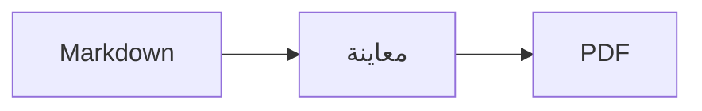
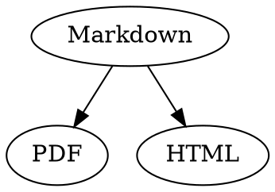

# مرجع Markdown السريع

هذه النظرة العامة مستند عادي: يمكنك التجربة فيه، سواء في المصدر أو في المعاينة.

## النص

| النتيجة | بناء الجملة | الاختصار |
|---|---|---|
| **غامق** | `**غامق**` | ⌘B |
| *مائل* | `*مائل*` | ⌘I |
| <ins>تسطير</ins> | `<ins>تسطير</ins>` | ⌘U |
| ~~يتوسطه خط~~ | `~~يتوسطه خط~~` | ⇧⌘X |
| <mark>تمييز</mark> | `<mark>تمييز</mark>` | |
| `رمز` | `` `رمز` `` | |
| x<sup>2</sup> | `x<sup>2</sup>` | |
| H<sub>2</sub>O | `H<sub>2</sub>O` | |
| [رابط](https://example.com) | `[رابط](https://example.com)` | ⌘K |

التسطير والتمييز والخط المرتفع والخط المنخفض ليست جزءًا من Markdown القياسي، بل هي HTML. ولا تعرضها كل برامج عرض Markdown.

إذا كان المؤشر في نهاية كلمة، يتم تطبيق التنسيق على ما تكتبه بعدها؛ أما داخل الكلمة فيتم تنسيق الكلمة كلها.

## العناوين

```
# عنوان 1
## عنوان 2
### عنوان 3
```

الاختصارات: من ⌥⌘1 إلى ⌥⌘6، والنص الأساسي بالاختصار ⌥⌘0.

## القوائم

- قائمة تعداد نقطي بالرمز `-`
- العنصر الثاني
  - مسافة بادئة بمفتاح Tab في المعاينة

1. قائمة تعداد رقمي بالرمز `1.`
2. العنصر الثاني

- [ ] مهمة مفتوحة
- [x] مهمة منجزة (انقر عليها في المعاينة لتبديل حالتها)

## الاقتباسات والرمز البرمجي

> يبدأ الاقتباس بالرمز `>`.

```rust
fn main() {
    println!("كتلة رمز برمجي مع لغة");
}
```

تضيف اللغة المكتوبة بعد علامات الاقتباس العكسية الثلاث ألوان بناء الجملة. يعرض "التنسيق › كتلة رمز برمجي" اللغات الشائعة، ويمكنه أيضًا تغيير لغة كتلة موجودة.

> [!TIP]
> تتوفر المربعات التوضيحية بخمسة أنواع: ملاحظة ونصيحة ومهم وتحذير وتنبيه ("التنسيق › مربع توضيحي" ينسق الفقرة التي يوجد فيها المؤشر).

## الجداول

| يسار | وسط | يمين |
|:------|:---------:|-------:|
| a     | b         | c      |

في المعاينة، ينتقل Tab إلى الخلية التالية وينتقل Return إلى الخلية أدناه. تُدرج قائمة "جدول" الصفوف والأعمدة، وتحاذي الأعمدة في المصدر.

## الصيغ والمخططات

صيغة داخل السطر: $E = mc^2$

$$
\int_0^1 x^2 \, dx = \frac{1}{3}
$$



يؤدي النقر على صيغة أو مخطط في المعاينة إلى فتح المحرر، وكذلك انتقال المؤشر إليه؛ ويغلقه Esc دون تغييرات. يمكن تعديل الصيغ مرئيًا أو كرمز LaTeX؛ وتُدرج وحدات البناء الكسور والجذور والمجاميع والرموز، وينتقل Tab إلى العنصر النائب التالي □. وللمخططات الانسيابية والتسلسلية ومخططات جانت وحدات بناء للعقد والوصلات والرسائل والمهام. ويعرض المحرر أخطاء الرمز البرمجي على الفور.

يمكن أيضًا كتابة الصيغ في كتل `math` أو بين `\(` و `\)`. وتُكتب مخططات Graphviz وPlantUML في كتل معلمة بـ `dot` و `plantuml`:



```plantuml
Alice -> Bob : Hi
```

## بناء الجملة الموسع

==تمييز==، x^2^، H~2~O، ||نص مخفي|| و :rocket: مأخوذة من Obsidian وTypora وGitHub. تبقى %%التعليقات%% في المصدر فقط، ويمكن أيضًا كتابة الحواشي السفلية مباشرة داخل النص^[مثل هذه الحاشية].

المصطلح

: شرح في قائمة تعريفات

> [!tip]-
> انقر على ▸ لتوسيع المربع.

يربط [[ملاحظة]] بملاحظة في المجلد نفسه أو في مجلد فرعي منه، أما ![[ملاحظة]] فيضمنها. يتم تمييز #وسوم والإشارات مثل @name و #12 في مشاريع GitHub وGitLab والاقتباسات المرجعية مثل [@doe2020] من ملف BibTeX؛ وبالنقر مع ⌘ تنتقل إليها. يضبط "عرض › علامات الترقيم الطباعية" علامات الاقتباس والشرطات وعلامات الحذف الخاصة باللغة.

### مرساة مخصصة {#anchor}

<details>
<summary>HTML</summary>

يتم عرض HTML كما في ملفات README على GitHub: الفقرات الموسطة، والصور ذات الحجم المحدد، و<kbd>⌘</kbd>، والأقسام القابلة للطي مثل هذا القسم.

</details>

## متفرقات

يؤدي الضغط على Return في سطر فارغ في المعاينة إلى إدراج سطر فارغ آخر، ويزيله مفتاح الحذف. ويحتوي المصدر لذلك على سطرين فارغين إضافيين؛ وتعرضهما برامج Markdown الأخرى كتباعد عادي بين الفقرات.

يربط "إدراج › جدول المحتويات" بكل العناوين؛ وإذا كان المؤشر داخل جدول المحتويات، يتم تحديثه. انقر مع ⌘ على أي إدخال للانتقال إلى العنوان.

تشير الحواشي السفلية إلى ملاحظات[^1]. ويتم إنشاء خط فاصل بالرمز `---`:

---

[^1]: تظهر الملاحظة في نهاية المستند.
