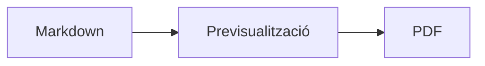
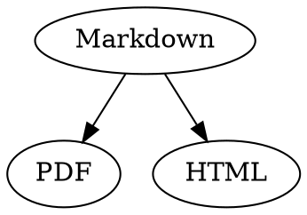

# Referència ràpida de Markdown

Aquesta guia és un document normal: hi pots fer proves, al codi font a l’esquerra o a la previsualització a la dreta.

## Text

| Resultat | Sintaxi | Drecera |
|---|---|---|
| **Negreta** | `**Negreta**` | ⌘B |
| *Cursiva* | `*Cursiva*` | ⌘I |
| <ins>Subratllat</ins> | `<ins>Subratllat</ins>` | ⌘U |
| ~~Ratllat~~ | `~~Ratllat~~` | ⇧⌘X |
| <mark>Ressaltat</mark> | `<mark>Ressaltat</mark>` | |
| `Codi` | `` `Codi` `` | |
| x<sup>2</sup> | `x<sup>2</sup>` | |
| H<sub>2</sub>O | `H<sub>2</sub>O` | |
| [Enllaç](https://example.com) | `[Enllaç](https://example.com)` | ⌘K |

El subratllat, el ressaltat, el superíndex i el subíndex no són Markdown estàndard, sinó HTML. No tots els visualitzadors de Markdown els mostren.

Si el cursor és al final d’una paraula, el format s’aplica al que escriguis a continuació; dins d’una paraula, formata tota la paraula.

## Capçaleres

```
# Capçalera 1
## Capçalera 2
### Capçalera 3
```

Dreceres: de ⌥⌘1 a ⌥⌘6, cos de text amb ⌥⌘0.

## Llistes

- Llista amb vinyetes amb `-`
- Segon element
  - Amb sagnat mitjançant Tab a la previsualització

1. Llista numerada amb `1.`
2. Segon element

- [ ] Tasca pendent
- [x] Tasca feta (fes-hi clic a la previsualització per canviar-ne l’estat)

## Cites i codi

> Una cita comença amb `>`.

```rust
fn main() {
    println!("Bloc de codi amb llenguatge");
}
```

El llenguatge que segueix els tres accents greus afegeix colors de sintaxi. «Format › Bloc de codi» ofereix els llenguatges habituals i també permet canviar el d’un bloc existent.

> [!TIP]
> Hi ha requadres de tipus Nota, Consell, Important, Avís i Precaució («Format › Requadre» formata el paràgraf on és el cursor).

## Taules

| Esquerra | Centre | Dreta |
|:------|:---------:|-------:|
| a     | b         | c      |

A la previsualització, Tab passa a la cel·la següent i Return a la cel·la de sota. El menú «Taula» insereix files i columnes i alinea les columnes al codi font.

## Fórmules i diagrames

Fórmula en línia: $E = mc^2$

$$
\int_0^1 x^2 \, dx = \frac{1}{3}
$$



Si fas clic en una fórmula o un diagrama a la previsualització, s’obre l’editor, i també quan el cursor hi arriba; Esc el tanca sense canvis. Les fórmules es poden editar visualment o com a LaTeX; els blocs insereixen fraccions, arrels, sumes i símbols, i Tab salta al marcador de posició □ següent. Per als diagrames de flux, de seqüència i de Gantt hi ha blocs per a nodes, connexions, missatges i tasques. L’editor mostra directament els errors del codi.

Les fórmules també poden anar en blocs `math` o entre `\(` i `\)`. Els diagrames de Graphviz i PlantUML van en blocs `dot` i `plantuml`:



```plantuml
Alice -> Bob : Hi
```

## Sintaxi ampliada

==Ressaltat==, x^2^, H~2~O, ||spoiler|| i :rocket: vénen d’Obsidian, Typora i GitHub. Els %%comentaris%% només són al codi font, i les notes al peu també poden anar dins del text^[com aquesta].

Terme

: Explicació en una llista de definicions

> [!tip]-
> Fes clic a ▸ per desplegar el requadre.

[[Nota]] enllaça una nota de la mateixa carpeta o de més avall, ![[Nota]] la incrusta. Les #etiquetes, les referències com @nom i #12 en projectes de GitHub i GitLab i les cites com [@doe2020] d’un fitxer BibTeX es ressalten; ⌘-clic les segueix. «Mostra › Puntuació tipogràfica» posa les cometes, els guions i els punts suspensius de la llengua.

### Àncora pròpia {#ancora}

<details>
<summary>HTML</summary>

L’HTML com el dels README de GitHub es mostra: paràgrafs centrats, imatges amb mida, <kbd>⌘</kbd> i seccions desplegables com aquesta.

</details>

## Altres

Return en una línia buida de la previsualització insereix una altra línia buida, i la tecla Elimina (⌫) la treu. Al codi font hi ha per això dues línies buides addicionals; altres programes de Markdown les mostren com un espaiat normal entre paràgrafs.

«Insereix › Taula de contingut» enllaça totes les capçaleres; si el cursor és dins de la taula, s’actualitza. ⌘-clic en una entrada per anar a la capçalera.

Les notes a peu de pàgina remeten a anotacions[^1]. Un separador es crea amb `---`:

---

[^1]: L’anotació és al final del document.
