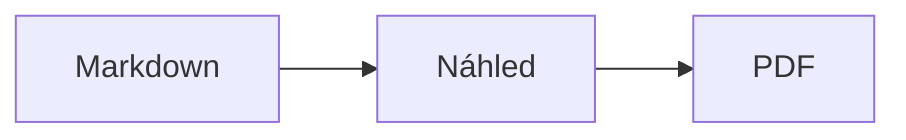
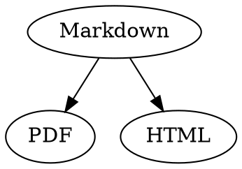

# Markdown – stručný přehled

Tento přehled je běžný dokument: můžete si v něm vše vyzkoušet, vlevo ve zdrojovém textu nebo vpravo v náhledu.

## Text

| Výsledek | Zápis | Zkratka |
|---|---|---|
| **Tučné** | `**Tučné**` | ⌘B |
| *Kurzíva* | `*Kurzíva*` | ⌘I |
| <ins>Podtržené</ins> | `<ins>Podtržené</ins>` | ⌘U |
| ~~Přeškrtnuté~~ | `~~Přeškrtnuté~~` | ⇧⌘X |
| <mark>Zvýraznění</mark> | `<mark>Zvýraznění</mark>` | |
| `Kód` | `` `Kód` `` | |
| x<sup>2</sup> | `x<sup>2</sup>` | |
| H<sub>2</sub>O | `H<sub>2</sub>O` | |
| [Odkaz](https://example.com) | `[Odkaz](https://example.com)` | ⌘K |

Podtržení, zvýraznění, horní a dolní index nejsou standardní Markdown, ale HTML. Ne každý prohlížeč Markdownu je zobrazí.

Když je kurzor na konci slova, formátování platí pro to, co napíšete dál; uvnitř slova se naformátuje celé slovo.

## Nadpisy

```
# Nadpis 1
## Nadpis 2
### Nadpis 3
```

Zkratky: ⌥⌘1 až ⌥⌘6, základní text pomocí ⌥⌘0.

## Seznamy

- Seznam s odrážkami pomocí `-`
- Druhá položka
  - Odsazeno klávesou Tab v náhledu

1. Číslovaný seznam pomocí `1.`
2. Druhá položka

- [ ] Otevřený úkol
- [x] Dokončený úkol (přepnete kliknutím v náhledu)

## Citace a kód

> Citace začíná znakem `>`.

```rust
fn main() {
    println!("Blok kódu s jazykem");
}
```

Jazyk uvedený za třemi zpětnými apostrofy zapne barevné zvýraznění syntaxe. „Formát › Blok kódu“ nabízí běžné jazyky a změní je i u existujícího bloku.

> [!TIP]
> Informační rámečky jsou k dispozici jako Poznámka, Tip, Důležité, Varování a Pozor („Formát › Informační rámeček“ naformátuje odstavec u kurzoru).

## Tabulky

| Vlevo | Na střed | Vpravo |
|:------|:---------:|-------:|
| a     | b         | c      |

V náhledu přejde Tab do další buňky a Return do buňky pod ní. Nabídka „Tabulka“ vkládá řádky a sloupce a zarovná sloupce ve zdrojovém textu.

## Vzorce a diagramy

Vzorec v textu: $E = mc^2$

$$
\int_0^1 x^2 \, dx = \frac{1}{3}
$$



Kliknutím na vzorec nebo diagram v náhledu se otevře editor, stejně jako když na něj přesunete kurzor; Esc ho zavře beze změn. Vzorce lze upravovat vizuálně nebo jako LaTeX; stavební bloky vkládají zlomky, odmocniny, součty a symboly a Tab přeskočí na další zástupný symbol □. Pro vývojové, sekvenční a Ganttovy diagramy jsou k dispozici stavební bloky pro uzly, spojení, zprávy a úkoly. Chyby v kódu editor zobrazí okamžitě.

Vzorce mohou být také v blocích `math` nebo mezi `\(` a `\)`. Diagramy Graphviz a PlantUML patří do bloků `dot` a `plantuml`:



```plantuml
Alice -> Bob : Hi
```

## Rozšířená syntaxe

==Zvýraznění==, x^2^, H~2~O, ||spoiler|| a :rocket: pocházejí z Obsidianu, Typory a GitHubu. %%Komentáře%% zůstávají jen ve zdroji a poznámky pod čarou mohou být i přímo v textu^[jako tato].

Pojem

: Vysvětlení v seznamu definic

> [!tip]-
> Kliknutím na ▸ rámeček rozbalíte.

[[Poznámka]] odkazuje na poznámku ve stejné složce nebo pod ní, ![[Poznámka]] ji vloží. #Štítky, odkazy jako @jméno a #12 v projektech GitHub a GitLab a citace jako [@doe2020] ze souboru BibTeX se zvýrazní; ⌘-klik na ně přejde. „Zobrazení › Typografická interpunkce“ nastaví uvozovky, pomlčky a výpustky daného jazyka.

### Vlastní kotva {#kotva}

<details>
<summary>HTML</summary>

HTML jako v README na GitHubu se zobrazí: zarovnané odstavce, obrázky s velikostí, <kbd>⌘</kbd> a rozbalovací oddíly jako tento.

</details>

## Ostatní

Return na prázdném řádku náhledu vloží další prázdný řádek, Backspace ho odstraní. Ve zdrojovém textu jsou pro to dva prázdné řádky navíc; jiné programy pro Markdown je zobrazí jako běžnou mezeru mezi odstavci.

„Přidat › Obsah“ vytvoří odkazy na všechny nadpisy; když je kurzor v obsahu, obsah se aktualizuje. ⌘-kliknutím na položku přejdete na nadpis.

Poznámky pod čarou odkazují na vysvětlivky[^1]. Oddělovač vytvoříte pomocí `---`:

---

[^1]: Vysvětlivka je na konci dokumentu.
