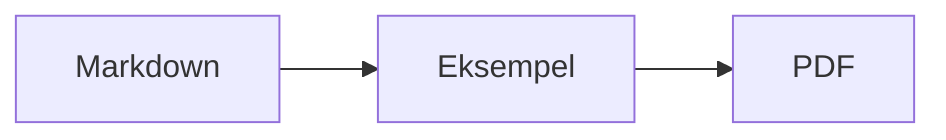
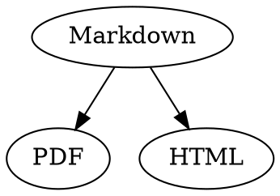

# Markdown-hurtigreference

Denne oversigt er et almindeligt dokument: Du kan prøve tingene af i den, til venstre i kildeteksten eller til højre i eksemplet.

## Tekst

| Resultat | Syntaks | Genvej |
|---|---|---|
| **Fed** | `**Fed**` | ⌘B |
| *Kursiv* | `*Kursiv*` | ⌘I |
| <ins>Understreget</ins> | `<ins>Understreget</ins>` | ⌘U |
| ~~Gennemstreget~~ | `~~Gennemstreget~~` | ⇧⌘X |
| <mark>Fremhævet</mark> | `<mark>Fremhævet</mark>` | |
| `Kode` | `` `Kode` `` | |
| x<sup>2</sup> | `x<sup>2</sup>` | |
| H<sub>2</sub>O | `H<sub>2</sub>O` | |
| [Link](https://example.com) | `[Link](https://example.com)` | ⌘K |

Understregning, fremhævning, hævet og sænket skrift er ikke standard-Markdown, men HTML. Ikke alle Markdown-fremvisere viser dem.

Står markøren i slutningen af et ord, gælder formateringen for det, du skriver bagefter; inde i et ord formaterer den hele ordet.

## Overskrifter

```
# Overskrift 1
## Overskrift 2
### Overskrift 3
```

Genveje: ⌥⌘1 til ⌥⌘6, brødtekst med ⌥⌘0.

## Lister

- Punktliste med `-`
- Andet punkt
  - Indrykket med Tab i eksemplet

1. Nummereret liste med `1.`
2. Andet punkt

- [ ] Åben opgave
- [x] Udført opgave (klik på den i eksemplet for at skifte)

## Citater og kode

> Et citat begynder med `>`.

```rust
fn main() {
    println!("Kodeblok med sprog");
}
```

Sproget efter de tre backticks giver syntaksfarver. “Format › Kodeblok” tilbyder de gængse sprog og ændrer dem også for en eksisterende blok.

> [!TIP]
> Infobokse findes som Bemærk, Tip, Vigtigt, Advarsel og Forsigtig (“Format › Infoboks” formaterer afsnittet ved markøren).

## Tabeller

| Venstre | Centreret | Højre |
|:------|:---------:|-------:|
| a     | b         | c      |

I eksemplet springer Tab til næste celle og Return til cellen nedenfor. Menuen “Tabel” indsætter rækker og kolonner og justerer kolonnerne i kildeteksten.

## Formler og diagrammer

Formel i teksten: $E = mc^2$

$$
\int_0^1 x^2 \, dx = \frac{1}{3}
$$



Et klik på en formel eller et diagram i eksemplet åbner editoren, ligesom når markøren lander på den; Esc lukker den uden ændringer. Formler kan redigeres visuelt eller som LaTeX; byggeklodser indsætter brøker, rødder, summer og symboler, og Tab springer til næste pladsholder □. Rutediagrammer, sekvens- og Gantt-diagrammer har byggeklodser til knuder, forbindelser, beskeder og opgaver. Editoren viser fejl i koden med det samme.

Formler kan også stå i `math`-blokke eller mellem `\(` og `\)`. Graphviz- og PlantUML-diagrammer står i blokke med `dot` og `plantuml`:



```plantuml
Alice -> Bob : Hi
```

## Udvidet syntaks

==Fremhævning==, x^2^, H~2~O, ||spoiler|| og :rocket: kommer fra Obsidian, Typora og GitHub. %%Kommentarer%% står kun i kilden, og fodnoter kan også stå direkte i teksten^[som denne].

Begreb

: Forklaring i en definitionsliste

> [!tip]-
> Klik på ▸ for at folde boksen ud.

[[Note]] linker til en note i samme mappe eller under den, ![[Note]] indlejrer den. #Tags, henvisninger som @navn og #12 i GitHub- og GitLab-projekter og citater som [@doe2020] fra en BibTeX-fil fremhæves; ⌘-klik følger dem. “Oversigt › Typografisk tegnsætning” sætter sprogets anførselstegn, tankestreger og udeladelsesprikker.

### Eget anker {#anker}

<details>
<summary>HTML</summary>

HTML som i README-filer på GitHub vises: centrerede afsnit, billeder med størrelse, <kbd>⌘</kbd> og sektioner, der kan foldes ud, som denne.

</details>

## Andet

Return på en tom linje i eksemplet indsætter endnu en tom linje, tilbagetasten fjerner den. I kildeteksten står der to ekstra tomme linjer for den; andre Markdown-programmer viser dem som almindelig afstand mellem afsnit.

“Indsæt › Indholdsfortegnelse” linker til alle overskrifter; står markøren i fortegnelsen, bliver den opdateret. ⌘-klik på et punkt for at springe til overskriften.

Fodnoter henviser til anmærkninger[^1]. En skillelinje laves med `---`:

---

[^1]: Anmærkningen står i slutningen af dokumentet.
