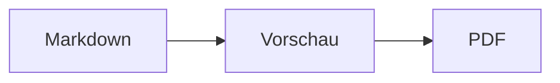
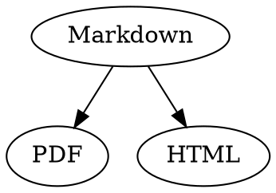

# Markdown-Kurzreferenz

Diese Übersicht ist ein normales Dokument: Du kannst darin ausprobieren, links im Quelltext oder rechts in der Vorschau.

## Text

| Ergebnis | Schreibweise | Kurzbefehl |
|---|---|---|
| **Fett** | `**Fett**` | ⌘B |
| *Kursiv* | `*Kursiv*` | ⌘I |
| <ins>Unterstrichen</ins> | `<ins>Unterstrichen</ins>` | ⌘U |
| ~~Durchgestrichen~~ | `~~Durchgestrichen~~` | ⇧⌘X |
| <mark>Textmarker</mark> | `<mark>Textmarker</mark>` | |
| `Code` | `` `Code` `` | |
| x<sup>2</sup> | `x<sup>2</sup>` | |
| H<sub>2</sub>O | `H<sub>2</sub>O` | |
| [Link](https://example.com) | `[Link](https://example.com)` | ⌘K |

Unterstrichen, Textmarker, hoch- und tiefgestellt sind kein Markdown-Standard, sondern HTML. Nicht jeder Markdown-Viewer stellt sie dar.

Steht der Cursor am Ende eines Wortes, gilt eine Formatierung für das, was du danach tippst; im Wort formatiert sie das ganze Wort.

## Überschriften

```
# Überschrift 1
## Überschrift 2
### Überschrift 3
```

Kurzbefehle: ⌥⌘1 bis ⌥⌘6, Fließtext mit ⌥⌘0.

## Listen

- Aufzählung mit `-`
- Zweiter Punkt
  - Eingerückt mit Tab in der Vorschau

1. Nummerierung mit `1.`
2. Zweiter Punkt

- [ ] Offene Aufgabe
- [x] Erledigte Aufgabe (in der Vorschau anklicken zum Umschalten)

## Zitate und Code

> Ein Zitat beginnt mit `>`.

```rust
fn main() {
    println!("Codeblock mit Sprache");
}
```

Die Sprache hinter den drei Backticks sorgt für Syntaxfarben. „Format › Codeblock“ bietet die gängigen Sprachen an und ändert sie auch für einen bestehenden Block.

> [!TIP]
> Hinweisboxen gibt es als Hinweis, Tipp, Wichtig, Warnung und Vorsicht („Format › Hinweisbox“, formatiert den Absatz am Cursor).

## Tabellen

| Links | Zentriert | Rechts |
|:------|:---------:|-------:|
| a     | b         | c      |

In der Vorschau springt Tab in die nächste Zelle, Return in die Zelle darunter. Das Menü „Tabelle“ fügt Zeilen und Spalten ein und richtet den Quelltext bündig aus.

## Formeln und Diagramme

Inline-Formel: $E = mc^2$

$$
\int_0^1 x^2 \, dx = \frac{1}{3}
$$



Ein Klick auf eine Formel oder ein Diagramm in der Vorschau öffnet den Editor, ebenso wenn der Cursor darauf landet; Esc schließt ihn ohne Änderung. Formeln lassen sich grafisch oder als LaTeX bearbeiten; Bausteine fügen Brüche, Wurzeln, Summen und Symbole ein, Tab springt zum nächsten Platzhalter □. Für Fluss-, Sequenz- und Gantt-Diagramme gibt es Bausteine für Knoten, Verbindungen, Nachrichten und Aufgaben. Fehler im Code zeigt der Editor direkt an.

Formeln stehen auch in `math`-Blöcken oder zwischen `\(` und `\)`. Graphviz- und PlantUML-Diagramme stehen in Blöcken mit `dot` und `plantuml`:



```plantuml
Alice -> Bob : Hi
```

## Erweiterte Schreibweisen

==Textmarker==, x^2^, H~2~O, ||Spoiler|| und :rocket: kommen aus Obsidian, Typora und GitHub. %%Kommentare%% stehen nur im Quelltext, Fußnoten auch direkt im Text^[wie diese].

Begriff

: Erklärung in einer Definitionsliste

> [!tip]-
> Ein Klick auf ▸ klappt die Box auf.

[[Notiz]] verlinkt eine Notiz im selben Ordner oder darunter, ![[Notiz]] bettet sie ein. #Tags, Verweise wie @name und #12 in GitHub- und GitLab-Projekten und Zitate wie [@doe2020] aus einer BibTeX-Datei werden hervorgehoben; ⌘-Klick folgt ihnen. „Darstellung › Typografische Satzzeichen“ setzt Anführungszeichen, Gedankenstriche und Auslassungspunkte der Sprache.

### Eigener Anker {#anker}

<details>
<summary>HTML</summary>

HTML wie in GitHub-READMEs wird dargestellt: zentrierte Absätze, Bilder mit Größe, <kbd>⌘</kbd> und aufklappbare Abschnitte wie dieser.

</details>

## Sonstiges

Return auf einer leeren Zeile der Vorschau fügt eine weitere Leerzeile ein, Rückschritt entfernt sie. Im Quelltext stehen dafür zwei zusätzliche Leerzeilen; andere Markdown-Programme zeigen sie als normalen Absatzabstand.

„Einfügen › Inhaltsverzeichnis“ verlinkt alle Überschriften; steht der Cursor im Verzeichnis, wird es aktualisiert. ⌘-Klick auf einen Eintrag springt zur Überschrift.

Fußnoten verweisen auf Anmerkungen[^1]. Eine Trennlinie entsteht mit `---`:

---

[^1]: Die Anmerkung steht am Ende des Dokuments.
