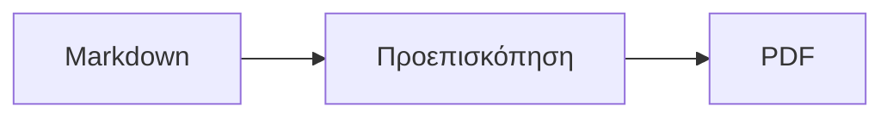
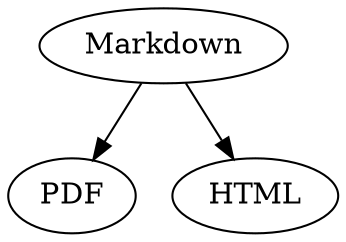

# Σύντομος οδηγός Markdown

Αυτή η επισκόπηση είναι ένα κανονικό έγγραφο: μπορείτε να δοκιμάσετε τα πάντα σε αυτό, αριστερά στον πηγαίο κώδικα ή δεξιά στην προεπισκόπηση.

## Κείμενο

| Αποτέλεσμα | Σύνταξη | Συντόμευση |
|---|---|---|
| **Έντονα** | `**Έντονα**` | ⌘B |
| *Πλάγια* | `*Πλάγια*` | ⌘I |
| <ins>Υπογράμμιση</ins> | `<ins>Υπογράμμιση</ins>` | ⌘U |
| ~~Διακριτή διαγραφή~~ | `~~Διακριτή διαγραφή~~` | ⇧⌘X |
| <mark>Επισήμανση</mark> | `<mark>Επισήμανση</mark>` | |
| `Κώδικας` | `` `Κώδικας` `` | |
| x<sup>2</sup> | `x<sup>2</sup>` | |
| H<sub>2</sub>O | `H<sub>2</sub>O` | |
| [Σύνδεσμος](https://example.com) | `[Σύνδεσμος](https://example.com)` | ⌘K |

Η υπογράμμιση, η επισήμανση, ο εκθέτης και ο δείκτης δεν είναι τυπικό Markdown αλλά HTML. Δεν τα εμφανίζουν όλα τα προγράμματα προβολής Markdown.

Όταν ο δρομέας βρίσκεται στο τέλος μιας λέξης, η μορφοποίηση ισχύει για ό,τι πληκτρολογήσετε στη συνέχεια· μέσα σε μια λέξη, μορφοποιεί ολόκληρη τη λέξη.

## Επικεφαλίδες

```
# Επικεφαλίδα 1
## Επικεφαλίδα 2
### Επικεφαλίδα 3
```

Συντομεύσεις: ⌥⌘1 έως ⌥⌘6, κυρίως κείμενο με ⌥⌘0.

## Λίστες

- Λίστα με κουκκίδες με `-`
- Δεύτερο στοιχείο
  - Εσοχή με Tab στην προεπισκόπηση

1. Λίστα με αρίθμηση με `1.`
2. Δεύτερο στοιχείο

- [ ] Ανοιχτή εργασία
- [x] Ολοκληρωμένη εργασία (κάντε κλικ σε αυτήν στην προεπισκόπηση για εναλλαγή)

## Παραθέσεις και κώδικας

> Μια παράθεση ξεκινά με `>`.

```rust
fn main() {
    println!("Μπλοκ κώδικα με γλώσσα");
}
```

Η γλώσσα μετά τα τρία ανάποδα εισαγωγικά ενεργοποιεί τον χρωματισμό σύνταξης. Η εντολή «Μορφή › Μπλοκ κώδικα» προσφέρει τις συνηθισμένες γλώσσες και αλλάζει τη γλώσσα και σε ένα υπάρχον μπλοκ.

> [!TIP]
> Τα πλαίσια ειδοποίησης υπάρχουν ως Σημείωση, Συμβουλή, Σημαντικό, Προειδοποίηση και Προσοχή (η εντολή «Μορφή › Πλαίσιο ειδοποίησης» μορφοποιεί την παράγραφο στη θέση του δρομέα).

## Πίνακες

| Αριστερά | Κέντρο | Δεξιά |
|:------|:---------:|-------:|
| a     | b         | c      |

Στην προεπισκόπηση, το Tab μεταβαίνει στο επόμενο κελί και το Return στο κελί από κάτω. Το μενού «Πίνακας» εισάγει γραμμές και στήλες και στοιχίζει τις στήλες στον πηγαίο κώδικα.

## Τύποι και διαγράμματα

Τύπος μέσα στο κείμενο: $E = mc^2$

$$
\int_0^1 x^2 \, dx = \frac{1}{3}
$$



Ένα κλικ σε έναν τύπο ή ένα διάγραμμα στην προεπισκόπηση ανοίγει τον επεξεργαστή, όπως και όταν ο δρομέας βρεθεί πάνω του· το Esc τον κλείνει χωρίς αλλαγές. Οι τύποι επεξεργάζονται οπτικά ή ως LaTeX· τα δομικά στοιχεία εισάγουν κλάσματα, ρίζες, αθροίσματα και σύμβολα, και το Tab μεταβαίνει στο επόμενο σύμβολο κράτησης θέσης □. Για διαγράμματα ροής, ακολουθίας και Gantt υπάρχουν δομικά στοιχεία για κόμβους, συνδέσεις, μηνύματα και εργασίες. Ο επεξεργαστής εμφανίζει αμέσως τα σφάλματα στον κώδικα.

Οι τύποι μπαίνουν επίσης σε μπλοκ `math` ή ανάμεσα σε `\(` και `\)`. Τα διαγράμματα Graphviz και PlantUML μπαίνουν σε μπλοκ με `dot` και `plantuml`:



```plantuml
Alice -> Bob : Hi
```

## Επεκτεταμένη σύνταξη

==Επισήμανση==, x^2^, H~2~O, ||spoiler|| και :rocket: προέρχονται από τα Obsidian, Typora και GitHub. Τα %%σχόλια%% μένουν μόνο στον πηγαίο κώδικα, ενώ οι υποσημειώσεις μπορούν να μπουν και απευθείας στο κείμενο^[όπως αυτή].

Όρος

: Επεξήγηση σε λίστα ορισμών

> [!tip]-
> Ένα κλικ στο ▸ αναπτύσσει το πλαίσιο.

Το [[Σημείωση]] συνδέει με μια σημείωση στον ίδιο φάκελο ή σε υποφάκελο και το ![[Σημείωση]] την ενσωματώνει. Οι #ετικέτες, οι αναφορές όπως @name και #12 σε έργα GitHub και GitLab και οι παραπομπές όπως [@doe2020] από ένα αρχείο BibTeX επισημαίνονται· το ⌘-κλικ τις ακολουθεί. Η εντολή «Προβολή › Τυπογραφικά σημεία στίξης» βάζει τα εισαγωγικά, τις παύλες και τα αποσιωπητικά της γλώσσας.

### Δική σας άγκυρα {#anchor}

<details>
<summary>HTML</summary>

Το HTML όπως στα README του GitHub αποδίδεται: κεντραρισμένες παράγραφοι, εικόνες με μέγεθος, <kbd>⌘</kbd> και πτυσσόμενες ενότητες όπως αυτή.

</details>

## Διάφορα

Το Return σε μια κενή γραμμή της προεπισκόπησης εισάγει άλλη μία κενή γραμμή και το Delete (⌫) την αφαιρεί. Στον πηγαίο κώδικα αυτό αντιστοιχεί σε δύο επιπλέον κενές γραμμές· άλλα προγράμματα Markdown τις εμφανίζουν ως κανονικό διάστημα μεταξύ παραγράφων.

Η εντολή «Εισαγωγή › Πίνακας περιεχομένων» δημιουργεί συνδέσμους προς όλες τις επικεφαλίδες· όταν ο δρομέας βρίσκεται μέσα στον πίνακα περιεχομένων, αυτός ενημερώνεται. Με ⌘-κλικ σε μια καταχώριση μεταβαίνετε στην επικεφαλίδα.

Οι υποσημειώσεις παραπέμπουν σε σημειώσεις[^1]. Μια διαχωριστική γραμμή δημιουργείται με `---`:

---

[^1]: Η σημείωση βρίσκεται στο τέλος του εγγράφου.
