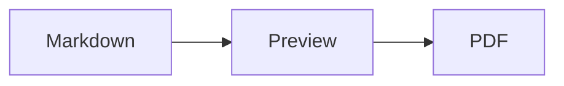
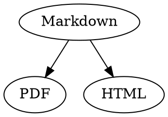

# Markdown Quick Reference

This overview is an ordinary document: try things out in it, in the source on the left or in the preview on the right.

## Text

| Result | Syntax | Shortcut |
|---|---|---|
| **Bold** | `**Bold**` | ⌘B |
| *Italic* | `*Italic*` | ⌘I |
| <ins>Underline</ins> | `<ins>Underline</ins>` | ⌘U |
| ~~Strikethrough~~ | `~~Strikethrough~~` | ⇧⌘X |
| <mark>Highlight</mark> | `<mark>Highlight</mark>` | |
| `Code` | `` `Code` `` | |
| x<sup>2</sup> | `x<sup>2</sup>` | |
| H<sub>2</sub>O | `H<sub>2</sub>O` | |
| [Link](https://example.com) | `[Link](https://example.com)` | ⌘K |

Underline, highlight, superscript and subscript are not standard Markdown but HTML. Not every Markdown viewer shows them.

With the cursor at the end of a word, formatting applies to what you type next; inside a word it formats the whole word.

## Headings

```
# Heading 1
## Heading 2
### Heading 3
```

Shortcuts: ⌥⌘1 to ⌥⌘6, body text with ⌥⌘0.

## Lists

- Bulleted list with `-`
- Second item
  - Indented with Tab in the preview

1. Numbered list with `1.`
2. Second item

- [ ] Open task
- [x] Completed task (click it in the preview to toggle)

## Quotes and Code

> A quote starts with `>`.

```rust
fn main() {
    println!("Code block with a language");
}
```

The language after the three backticks adds syntax colours. “Format › Code Block” offers the common languages and also changes them for an existing block.

> [!TIP]
> Callouts come as Note, Tip, Important, Warning and Caution (“Format › Callout” formats the paragraph at the cursor).

## Tables

| Left | Center | Right |
|:------|:---------:|-------:|
| a     | b         | c      |

In the preview, Tab moves to the next cell and Return to the cell below. The “Table” menu inserts rows and columns and lines up the columns in the source.

## Formulas and Diagrams

Inline formula: $E = mc^2$

$$
\int_0^1 x^2 \, dx = \frac{1}{3}
$$



Clicking a formula or diagram in the preview opens the editor, as does moving the cursor onto it; Esc closes it without changes. Formulas can be edited visually or as LaTeX; building blocks insert fractions, roots, sums and symbols, and Tab jumps to the next placeholder □. Flowcharts, sequence and Gantt diagrams have building blocks for nodes, connections, messages and tasks. The editor shows errors in the code right away.

Formulas also go in `math` blocks or between `\(` and `\)`. Graphviz and PlantUML diagrams go in blocks marked `dot` and `plantuml`:



```plantuml
Alice -> Bob : Hi
```

## Extended Syntax

==Highlights==, x^2^, H~2~O, ||spoilers|| and :rocket: come from Obsidian, Typora and GitHub. %%Comments%% stay in the source, and footnotes can also sit right in the text^[like this one].

Term

: Explanation in a definition list

> [!tip]-
> Click ▸ to expand the box.

[[Note]] links to a note in the same folder or below, ![[Note]] embeds it. #Tags, references like @name and #12 in GitHub and GitLab projects and citations like [@doe2020] from a BibTeX file are highlighted; ⌘-click follows them. “View › Typographic Punctuation” sets the quotation marks, dashes and ellipses of the language.

### Custom Anchor {#anchor}

<details>
<summary>HTML</summary>

HTML as in GitHub READMEs is rendered: centered paragraphs, sized images, <kbd>⌘</kbd> and collapsible sections like this one.

</details>

## Other

Return on an empty line of the preview inserts another empty line, Backspace removes it. The source holds two extra empty lines for it; other Markdown programs show them as normal paragraph spacing.

“Insert › Table of Contents” links all headings; with the cursor inside the table of contents, it is updated. ⌘-click an entry to jump to the heading.

Footnotes refer to notes[^1]. A horizontal rule is made with `---`:

---

[^1]: The note is at the end of the document.
