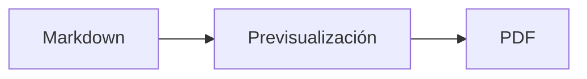
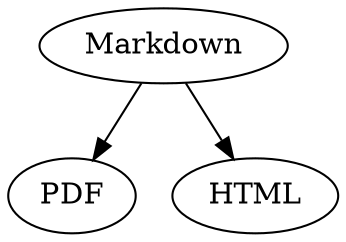

# Referencia rápida de Markdown

Esta guía es un documento normal: puedes hacer pruebas en ella, en el código fuente a la izquierda o en la previsualización a la derecha.

## Texto

| Resultado | Sintaxis | Atajo |
|---|---|---|
| **Negrita** | `**Negrita**` | ⌘B |
| *Cursiva* | `*Cursiva*` | ⌘I |
| <ins>Subrayado</ins> | `<ins>Subrayado</ins>` | ⌘U |
| ~~Tachado~~ | `~~Tachado~~` | ⇧⌘X |
| <mark>Resaltado</mark> | `<mark>Resaltado</mark>` | |
| `Código` | `` `Código` `` | |
| x<sup>2</sup> | `x<sup>2</sup>` | |
| H<sub>2</sub>O | `H<sub>2</sub>O` | |
| [Enlace](https://example.com) | `[Enlace](https://example.com)` | ⌘K |

El subrayado, el resaltado, el superíndice y el subíndice no son Markdown estándar, sino HTML. No todos los visores de Markdown los muestran.

Si el cursor está al final de una palabra, el formato se aplica a lo que escribas a continuación; dentro de una palabra, se aplica a toda la palabra.

## Encabezamientos

```
# Encabezamiento 1
## Encabezamiento 2
### Encabezamiento 3
```

Atajos: ⌥⌘1 a ⌥⌘6, cuerpo de texto con ⌥⌘0.

## Listas

- Lista con viñetas con `-`
- Segundo elemento
  - Con sangría mediante Tab en la previsualización

1. Lista numerada con `1.`
2. Segundo elemento

- [ ] Tarea pendiente
- [x] Tarea completada (haz clic en ella en la previsualización para cambiar su estado)

## Citas y código

> Una cita empieza con `>`.

```rust
fn main() {
    println!("Bloque de código con lenguaje");
}
```

El lenguaje indicado tras las tres comillas invertidas añade colores de sintaxis. «Formato › Bloque de código» ofrece los lenguajes habituales y también permite cambiar el de un bloque existente.

> [!TIP]
> Hay recuadros de tipo Nota, Consejo, Importante, Advertencia y Precaución («Formato › Recuadro» da formato al párrafo en el que está el cursor).

## Tablas

| Izquierda | Centro | Derecha |
|:------|:---------:|-------:|
| a     | b         | c      |

En la previsualización, Tab pasa a la celda siguiente y Return a la celda de abajo. El menú «Tabla» inserta filas y columnas y alinea las columnas en el código fuente.

## Fórmulas y diagramas

Fórmula en línea: $E = mc^2$

$$
\int_0^1 x^2 \, dx = \frac{1}{3}
$$



Al hacer clic en una fórmula o un diagrama de la previsualización se abre el editor, y también al situar el cursor sobre ellos; Esc lo cierra sin cambios. Las fórmulas se pueden editar visualmente o como LaTeX; los bloques insertan fracciones, raíces, sumas y símbolos, y Tab salta al siguiente marcador de posición □. Para los diagramas de flujo, de secuencia y de Gantt hay bloques para nodos, conexiones, mensajes y tareas. El editor muestra directamente los errores del código.

Las fórmulas también pueden ir en bloques `math` o entre `\(` y `\)`. Los diagramas de Graphviz y PlantUML van en bloques `dot` y `plantuml`:



```plantuml
Alice -> Bob : Hi
```

## Sintaxis ampliada

==Resaltado==, x^2^, H~2~O, ||spoiler|| y :rocket: vienen de Obsidian, Typora y GitHub. Los %%comentarios%% solo están en el código fuente, y las notas al pie también pueden ir en el texto^[como esta].

Término

: Explicación en una lista de definiciones

> [!tip]-
> Haz clic en ▸ para desplegar el cuadro.

[[Nota]] enlaza una nota de la misma carpeta o de más abajo, ![[Nota]] la incrusta. Las #etiquetas, las referencias como @nombre y #12 en proyectos de GitHub y GitLab y las citas como [@doe2020] de un archivo BibTeX se resaltan; ⌘-clic las sigue. «Visualización › Puntuación tipográfica» pone las comillas, rayas y puntos suspensivos del idioma.

### Ancla propia {#ancla}

<details>
<summary>HTML</summary>

El HTML como el de los README de GitHub se muestra: párrafos centrados, imágenes con tamaño, <kbd>⌘</kbd> y secciones desplegables como esta.

</details>

## Otros

Return en una línea vacía de la previsualización inserta otra línea vacía y la tecla Eliminar (⌫) la quita. En el código fuente hay para ello dos líneas vacías adicionales; otros programas de Markdown las muestran como un espacio normal entre párrafos.

«Insertar › Tabla de contenido» enlaza todos los encabezamientos; si el cursor está dentro de la tabla, esta se actualiza. ⌘-clic en una entrada salta al encabezamiento.

Las notas al pie remiten a anotaciones[^1]. Un separador se crea con `---`:

---

[^1]: La anotación aparece al final del documento.
