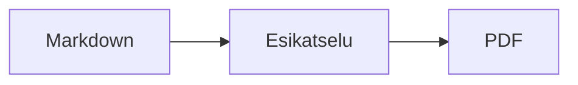
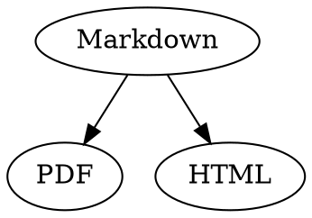

# Markdown-pikaopas

Tämä yleiskatsaus on tavallinen dokumentti: voit kokeilla asioita siinä, vasemmalla lähdetekstissä tai oikealla esikatselussa.

## Teksti

| Tulos | Merkintätapa | Pikanäppäin |
|---|---|---|
| **Lihavoitu** | `**Lihavoitu**` | ⌘B |
| *Kursivoitu* | `*Kursivoitu*` | ⌘I |
| <ins>Alleviivattu</ins> | `<ins>Alleviivattu</ins>` | ⌘U |
| ~~Yliviivattu~~ | `~~Yliviivattu~~` | ⇧⌘X |
| <mark>Korostettu</mark> | `<mark>Korostettu</mark>` | |
| `Koodi` | `` `Koodi` `` | |
| x<sup>2</sup> | `x<sup>2</sup>` | |
| H<sub>2</sub>O | `H<sub>2</sub>O` | |
| [Linkki](https://example.com) | `[Linkki](https://example.com)` | ⌘K |

Alleviivaus, korostus sekä ylä- ja alaindeksi eivät ole Markdown-standardia vaan HTML:ää. Kaikki Markdown-katseluohjelmat eivät näytä niitä.

Kun kohdistin on sanan lopussa, muotoilu koskee sitä, mitä kirjoitat seuraavaksi; sanan sisällä se muotoilee koko sanan.

## Otsikot

```
# Otsikko 1
## Otsikko 2
### Otsikko 3
```

Pikanäppäimet: ⌥⌘1–⌥⌘6, leipäteksti ⌥⌘0.

## Luettelot

- Luettelomerkitty luettelo merkillä `-`
- Toinen kohta
  - Sisennetty Tabilla esikatselussa

1. Numeroitu luettelo merkinnällä `1.`
2. Toinen kohta

- [ ] Avoin tehtävä
- [x] Valmis tehtävä (vaihda tilaa klikkaamalla sitä esikatselussa)

## Lainaukset ja koodi

> Lainaus alkaa merkillä `>`.

```rust
fn main() {
    println!("Koodilohko, jolla on kieli");
}
```

Kolmen takahipsun jälkeen merkitty kieli tuo syntaksivärit. ”Muoto › Koodilohko” tarjoaa yleisimmät kielet ja vaihtaa myös olemassa olevan lohkon kielen.

> [!TIP]
> Huomautuslaatikoita on viittä tyyppiä: Huomautus, Vihje, Tärkeää, Varoitus ja Huomio (”Muoto › Huomautuslaatikko” muotoilee kohdistimen kohdalla olevan kappaleen).

## Taulukot

| Vasen | Keskitetty | Oikea |
|:------|:---------:|-------:|
| a     | b         | c      |

Esikatselussa Tab siirtyy seuraavaan soluun ja Return alla olevaan soluun. ”Taulukko”-valikko lisää rivejä ja sarakkeita ja tasaa lähdetekstin sarakkeet.

## Kaavat ja kaaviot

Tekstinsisäinen kaava: $E = mc^2$

$$
\int_0^1 x^2 \, dx = \frac{1}{3}
$$



Kaavan tai kaavion klikkaaminen esikatselussa avaa editorin, samoin kohdistimen siirtyminen sen kohdalle; Esc sulkee sen muutoksitta. Kaavoja voi muokata visuaalisesti tai LaTeXina; rakennuspalikat lisäävät murtolukuja, juuria, summia ja symboleja, ja Tab siirtyy seuraavaan paikkamerkkiin □. Vuokaavioissa sekä sekvenssi- ja Gantt-kaavioissa on rakennuspalikoita solmuille, yhteyksille, viesteille ja tehtäville. Editori näyttää koodin virheet heti.

Kaavat voivat olla myös `math`-lohkoissa tai merkkien `\(` ja `\)` välissä. Graphviz- ja PlantUML-kaaviot kirjoitetaan lohkoihin `dot` ja `plantuml`:



```plantuml
Alice -> Bob : Hi
```

## Laajennettu syntaksi

==Korostus==, x^2^, H~2~O, ||spoileri|| ja :rocket: tulevat Obsidianista, Typorasta ja GitHubista. %%Kommentit%% näkyvät vain lähteessä, ja alaviitteet voivat olla myös suoraan tekstissä^[kuten tämä].

Käsite

: Selitys määritelmäluettelossa

> [!tip]-
> Laajenna laatikko osoittamalla ▸.

[[Muistiinpano]] linkittää samassa tai alemmassa kansiossa olevaan muistiinpanoon, ![[Muistiinpano]] upottaa sen. #Tunnisteet, viittaukset kuten @nimi ja #12 GitHub- ja GitLab-projekteissa sekä lähdeviitteet kuten [@doe2020] BibTeX-tiedostosta korostetaan; ⌘-osoitus seuraa niitä. ”Näytä › Typografiset välimerkit” käyttää kielen lainausmerkkejä, ajatusviivoja ja kolmea pistettä.

### Oma ankkuri {#ankkuri}

<details>
<summary>HTML</summary>

GitHubin README-tiedostojen kaltainen HTML näytetään: keskitetyt kappaleet, kokoon määritetyt kuvat, <kbd>⌘</kbd> ja tämän kaltaiset laajennettavat osiot.

</details>

## Muuta

Return tyhjällä rivillä esikatselussa lisää uuden tyhjän rivin, askelpalautin poistaa sen. Lähdetekstissä sitä vastaa kaksi ylimääräistä tyhjää riviä; muut Markdown-ohjelmat näyttävät ne tavallisena kappalevälinä.

”Lisää › Sisällysluettelo” linkittää kaikki otsikot; jos kohdistin on luettelossa, luettelo päivitetään. ⌘-klikkaa kohtaa siirtyäksesi otsikkoon.

Alaviitteet viittaavat huomautuksiin[^1]. Erotin syntyy merkinnällä `---`:

---

[^1]: Huomautus on dokumentin lopussa.
