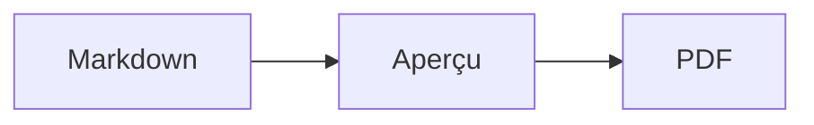
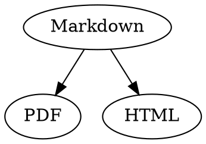

# Aide-mémoire Markdown

Cette vue d’ensemble est un document ordinaire : faites-y vos essais, à gauche dans la source ou à droite dans l’aperçu.

## Texte

| Résultat | Syntaxe | Raccourci |
|---|---|---|
| **Gras** | `**Gras**` | ⌘B |
| *Italique* | `*Italique*` | ⌘I |
| <ins>Souligné</ins> | `<ins>Souligné</ins>` | ⌘U |
| ~~Barré~~ | `~~Barré~~` | ⇧⌘X |
| <mark>Surbrillance</mark> | `<mark>Surbrillance</mark>` | |
| `Code` | `` `Code` `` | |
| x<sup>2</sup> | `x<sup>2</sup>` | |
| H<sub>2</sub>O | `H<sub>2</sub>O` | |
| [Lien](https://example.com) | `[Lien](https://example.com)` | ⌘K |

Le soulignement, la surbrillance, l’exposant et l’indice ne font pas partie du Markdown standard, ce sont des balises HTML. Tous les lecteurs Markdown ne les affichent pas.

Si le curseur se trouve à la fin d’un mot, la mise en forme s’applique à ce que vous tapez ensuite ; à l’intérieur d’un mot, elle s’applique au mot entier.

## Titres

```
# Titre 1
## Titre 2
### Titre 3
```

Raccourcis : ⌥⌘1 à ⌥⌘6, corps de texte avec ⌥⌘0.

## Listes

- Liste à puces avec `-`
- Deuxième élément
  - Indenté avec Tab dans l’aperçu

1. Liste numérotée avec `1.`
2. Deuxième élément

- [ ] Tâche à faire
- [x] Tâche terminée (cliquez dessus dans l’aperçu pour changer son état)

## Citations et code

> Une citation commence par `>`.

```rust
fn main() {
    println!("Bloc de code avec un langage");
}
```

Le langage indiqué après les trois accents graves active la coloration syntaxique. « Format › Bloc de code » propose les langages courants et permet aussi de changer celui d’un bloc existant.

> [!TIP]
> Les encadrés existent en Note, Astuce, Important, Attention et Mise en garde (« Format › Encadré » met en forme le paragraphe où se trouve le curseur).

## Tableaux

| Gauche | Centre | Droite |
|:------|:---------:|-------:|
| a     | b         | c      |

Dans l’aperçu, Tab passe à la cellule suivante et Return à la cellule du dessous. Le menu « Tableau » insère des lignes et des colonnes et aligne les colonnes dans la source.

## Formules et diagrammes

Formule en ligne : $E = mc^2$

$$
\int_0^1 x^2 \, dx = \frac{1}{3}
$$



Un clic sur une formule ou un diagramme dans l’aperçu ouvre l’éditeur, tout comme placer le curseur dessus ; Esc le ferme sans modification. Les formules se modifient visuellement ou en LaTeX ; des blocs insèrent fractions, racines, sommes et symboles, et Tab passe à l’espace réservé □ suivant. Pour les diagrammes de flux, de séquence et de Gantt, des blocs insèrent nœuds, connexions, messages et tâches. L’éditeur signale directement les erreurs dans le code.

Les formules peuvent aussi figurer dans des blocs `math` ou entre `\(` et `\)`. Les diagrammes Graphviz et PlantUML vont dans des blocs `dot` et `plantuml` :



```plantuml
Alice -> Bob : Hi
```

## Syntaxe étendue

==Surlignage==, x^2^, H~2~O, ||spoiler|| et :rocket: viennent d’Obsidian, Typora et GitHub. Les %%commentaires%% restent dans la source, et les notes peuvent aussi figurer dans le texte^[comme celle-ci].

Terme

: Explication dans une liste de définitions

> [!tip]-
> Cliquez sur ▸ pour développer l’encadré.

[[Note]] renvoie à une note du même dossier ou d’un sous-dossier, ![[Note]] l’intègre. Les #étiquettes, les références comme @nom et #12 dans les projets GitHub et GitLab et les citations comme [@doe2020] d’un fichier BibTeX sont mises en évidence ; ⌘-clic les suit. « Présentation › Ponctuation typographique » pose les guillemets, tirets et points de suspension de la langue.

### Ancre personnalisée {#ancre}

<details>
<summary>HTML</summary>

Le HTML des README de GitHub est affiché : paragraphes centrés, images dimensionnées, <kbd>⌘</kbd> et sections repliables comme celle-ci.

</details>

## Divers

Return sur une ligne vide de l’aperçu insère une autre ligne vide, la touche Supprimer (⌫) la retire. La source contient pour cela deux lignes vides supplémentaires ; les autres programmes Markdown les affichent comme un espacement normal entre paragraphes.

« Insérer › Table des matières » crée un lien vers chaque titre ; si le curseur se trouve dans la table, elle est mise à jour. ⌘-clic sur une entrée pour aller au titre.

Les notes de bas de page renvoient à des remarques[^1]. Un séparateur s’obtient avec `---` :

---

[^1]: La remarque figure à la fin du document.
