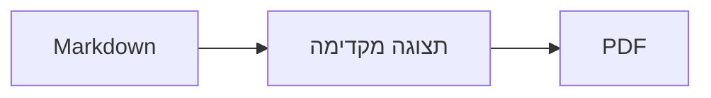
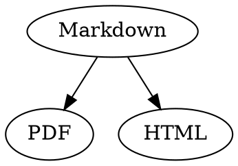

# מדריך מהיר ל-Markdown

סקירה זו היא מסמך רגיל: אפשר לנסות בה כל דבר, בקוד המקור או בתצוגה המקדימה.

## מלל

| תוצאה | כתיב | קיצור מקלדת |
|---|---|---|
| **עבה** | `**עבה**` | ⌘B |
| *נטוי* | `*נטוי*` | ⌘I |
| <ins>קו תחתון</ins> | `<ins>קו תחתון</ins>` | ⌘U |
| ~~קו חוצה~~ | `~~קו חוצה~~` | ⇧⌘X |
| <mark>הדגשה</mark> | `<mark>הדגשה</mark>` | |
| `קוד` | `` `קוד` `` | |
| x<sup>2</sup> | `x<sup>2</sup>` | |
| H<sub>2</sub>O | `H<sub>2</sub>O` | |
| [קישור](https://example.com) | `[קישור](https://example.com)` | ⌘K |

קו תחתון, הדגשה, כתב עילי וכתב תחתי אינם חלק מתקן Markdown אלא HTML. לא כל מציג Markdown מציג אותם.

כשהסמן נמצא בסוף מילה, העיצוב חל על מה שמקלידים אחר כך; בתוך מילה הוא מעצב את המילה כולה.

## כותרות

```
# כותרת 1
## כותרת 2
### כותרת 3
```

קיצורי מקלדת: ⌥⌘1 עד ⌥⌘6, גוף המלל עם ⌥⌘0.

## רשימות

- רשימת תבליטים עם `-`
- פריט שני
  - מוזח עם Tab בתצוגה המקדימה

1. רשימה ממוספרת עם `1.`
2. פריט שני

- [ ] משימה פתוחה
- [x] משימה שהושלמה (לחיצה עליה בתצוגה המקדימה משנה את מצבה)

## ציטוטים וקוד

> ציטוט מתחיל ב-`>`.

```rust
fn main() {
    println!("בלוק קוד עם שפה");
}
```

השפה שנכתבת אחרי שלושת הגרשים ההפוכים (backticks) מפעילה צביעת תחביר. ״עיצוב › בלוק קוד״ מציע את השפות הנפוצות ומשנה גם את השפה של בלוק קיים.

> [!TIP]
> תיבות הערה קיימות בסוגים הערה, טיפ, חשוב, אזהרה וזהירות (״עיצוב › תיבת הערה״ מעצב את הפסקה שבה נמצא הסמן).

## טבלאות

| שמאל | מרכז | ימין |
|:------|:---------:|-------:|
| א     | ב         | ג      |

בתצוגה המקדימה, מקש Tab עובר לתא הבא ומקש Return לתא שמתחת. התפריט ״טבלה״ מוסיף שורות ועמודות ומיישר את העמודות בקוד המקור.

## נוסחאות ותרשימים

נוסחה בתוך השורה: $E = mc^2$

$$
\int_0^1 x^2 \, dx = \frac{1}{3}
$$



לחיצה על נוסחה או על תרשים בתצוגה המקדימה פותחת את העורך, וכך גם כשהסמן מגיע אליהם; מקש Esc סוגר אותו בלי שינויים. אפשר לערוך נוסחאות באופן חזותי או כקוד LaTeX; אבני בניין מוסיפות שברים, שורשים, סכומים וסמלים, ומקש Tab עובר לממלא המקום הבא □. לתרשימי זרימה, רצף וגאנט יש אבני בניין לצמתים, לחיבורים, להודעות ולמשימות. העורך מציג שגיאות בקוד מיד.

נוסחאות אפשר לכתוב גם בבלוקים של `math` או בין `\(` לבין `\)`. תרשימי Graphviz ו-PlantUML נכתבים בבלוקים מסוג `dot` ומסוג `plantuml`:



```plantuml
Alice -> Bob : Hi
```

## כתיב מורחב

==הדגשה==, x^2^, H~2~O, ||ספוילר|| וגם :rocket: מגיעים מ-Obsidian, מ-Typora ומ-GitHub. %%הערות%% נשארות רק בקוד המקור, ואת הערות השוליים אפשר לכתוב גם ישירות בתוך המלל^[כמו זו].

מונח

: הסבר ברשימת הגדרות

> [!tip]-
> לחיצה על ▸ פותחת את התיבה.

[[פתק]] מקשר לפתק באותה תיקיה או בתיקיה שמתחתיה, ואילו ![[פתק]] מטמיע אותו. #תגיות, הפניות כמו @name או #12 בפרויקטים של GitHub ו-GitLab, וציטוטים כמו [@doe2020] מקובץ BibTeX מודגשים; לחיצה עם ⌘ עוקבת אחריהם. ״תצוגה › סימני פיסוק טיפוגרפיים״ מציב את המירכאות, המקפים וסימני שלוש הנקודות של השפה.

### עוגן מותאם אישית {#anchor}

<details>
<summary>HTML</summary>

קוד HTML כמו בקובצי README של GitHub מוצג: פסקאות ממורכזות, תמונות בגודל מוגדר, <kbd>⌘</kbd> וקטעים מתקפלים כמו זה.

</details>

## שונות

הקשה על Return בשורה ריקה בתצוגה המקדימה מוסיפה שורה ריקה נוספת, והקשה על ⌫ מסירה אותה. בקוד המקור נוספות לשם כך שתי שורות ריקות; תוכנות Markdown אחרות מציגות אותן כמרווח רגיל בין פסקאות.

״הוספה › תוכן העניינים״ מקשר לכל הכותרות; כשהסמן נמצא בתוך תוכן העניינים, הוא מתעדכן. לחיצה עם ⌘ על פריט קופצת אל הכותרת.

הערות שוליים מפנות לביאורים[^1]. קו מפריד נוצר עם `---`:

---

[^1]: הביאור מופיע בסוף המסמך.
