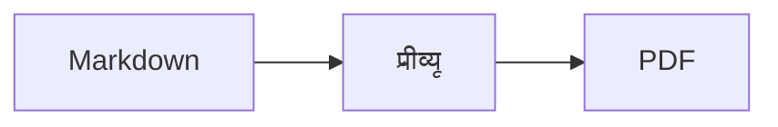
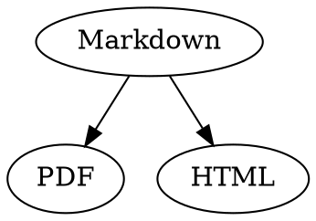

# Markdown त्वरित संदर्भ

यह अवलोकन एक सामान्य दस्तावेज़ है, इसलिए आप इसमें कुछ भी आज़मा सकते हैं, बाईं ओर सोर्स में या दाईं ओर प्रीव्यू में।

## टेक्स्ट

| परिणाम | सिंटैक्स | शॉर्टकट |
|---|---|---|
| **बोल्ड** | `**बोल्ड**` | ⌘B |
| *इटैलिक* | `*इटैलिक*` | ⌘I |
| <ins>रेखांकित</ins> | `<ins>रेखांकित</ins>` | ⌘U |
| ~~स्ट्राइकथ्रू~~ | `~~स्ट्राइकथ्रू~~` | ⇧⌘X |
| <mark>हाइलाइट</mark> | `<mark>हाइलाइट</mark>` | |
| `कोड` | `` `कोड` `` | |
| x<sup>2</sup> | `x<sup>2</sup>` | |
| H<sub>2</sub>O | `H<sub>2</sub>O` | |
| [लिंक](https://example.com) | `[लिंक](https://example.com)` | ⌘K |

रेखांकित, हाइलाइट, सुपरस्क्रिप्ट और सबस्क्रिप्ट मानक Markdown नहीं, बल्कि HTML हैं। हर Markdown व्यूअर इन्हें नहीं दिखाता है।

अगर कर्सर किसी शब्द के अंत में है, तो फ़ॉर्मैटिंग उस टेक्स्ट पर लागू होती है जो आप आगे टाइप करते हैं; शब्द के बीच में होने पर यह पूरे शब्द को फ़ॉर्मैट करती है।

## हेडिंग

```
# हेडिंग 1
## हेडिंग 2
### हेडिंग 3
```

शॉर्टकट : ⌥⌘1 से ⌥⌘6 तक, बॉडी टेक्स्ट के लिए ⌥⌘0।

## सूचियाँ

- `-` से बुलेट सूची
- दूसरा आइटम
  - प्रीव्यू में टैब से इंडेंट किया गया

1. `1.` से संख्या सूची
2. दूसरा आइटम

- [ ] खुला कार्य
- [x] पूरा हुआ कार्य (टॉगल करने के लिए प्रीव्यू में इस पर क्लिक करें)

## उद्धरण और कोड

> उद्धरण `>` से शुरू होता है।

```rust
fn main() {
    println!("भाषा के साथ कोड ब्लॉक");
}
```

तीन बैकटिक के बाद लिखी भाषा से सिंटैक्स के रंग मिलते हैं। “फ़ॉर्मैट › कोड ब्लॉक” में आम भाषाएँ मिलती हैं, और इससे मौजूदा ब्लॉक की भाषा भी बदली जा सकती है।

> [!TIP]
> कॉलआउट नोट, सुझाव, महत्वपूर्ण, चेतावनी और सावधानी के रूप में उपलब्ध हैं (“फ़ॉर्मैट › कॉलआउट” कर्सर वाले अनुच्छेद को फ़ॉर्मैट करता है)।

## टेबल

| बाएँ | मध्य | दाएँ |
|:------|:---------:|-------:|
| a     | b         | c      |

प्रीव्यू में टैब दबाने पर अगला सेल और रिटर्न दबाने पर नीचे वाला सेल चुना जाता है। “टेबल” मेनू पंक्तियाँ और कॉलम डालता है और सोर्स में कॉलम को एक सीध में करता है।

## सूत्र और डायग्राम

इनलाइन सूत्र : $E = mc^2$

$$
\int_0^1 x^2 \, dx = \frac{1}{3}
$$



प्रीव्यू में किसी सूत्र या डायग्राम पर क्लिक करने से एडिटर खुलता है, और कर्सर के उस पर पहुँचने पर भी; एस्केप दबाने पर यह बिना बदलाव के बंद हो जाता है। सूत्रों को विज़ुअल रूप से या LaTeX के रूप में संपादित किया जा सकता है; बिल्डिंग ब्लॉक भिन्न, वर्गमूल, योग और चिह्न डालते हैं, और टैब दबाने पर अगला प्लेसहोल्डर □ चुना जाता है। फ़्लोचार्ट, सीक्वेंस डायग्राम और गैंट चार्ट के लिए नोड, कनेक्शन, संदेश और कार्य के बिल्डिंग ब्लॉक हैं। एडिटर कोड की गलतियाँ तुरंत दिखाता है।

सूत्र `math` ब्लॉक में या `\(` और `\)` के बीच भी लिखे जा सकते हैं। Graphviz और PlantUML डायग्राम `dot` और `plantuml` वाले ब्लॉक में लिखे जाते हैं :



```plantuml
Alice -> Bob : Hi
```

## विस्तारित सिंटैक्स

==हाइलाइट==, x^2^, H~2~O, ||स्पॉइलर|| और :rocket: Obsidian, Typora और GitHub से आते हैं। %%टिप्पणियाँ%% केवल सोर्स में रहती हैं, और फ़ुटनोट सीधे टेक्स्ट में भी लिखे जा सकते हैं^[इस तरह]।

शब्द

: परिभाषा सूची में व्याख्या

> [!tip]-
> ▸ पर क्लिक करने से बॉक्स खुल जाता है।

[[नोट]] उसी फ़ोल्डर या उसके नीचे के किसी नोट से लिंक करता है, ![[नोट]] उसे एम्बेड करता है। #टैग, GitHub और GitLab प्रोजेक्ट में @name और #12 जैसे संदर्भ, और BibTeX फ़ाइल से [@doe2020] जैसे उद्धरण हाइलाइट किए जाते हैं; ⌘-क्लिक से आप उन तक पहुँचते हैं। “दृश्य › टाइपोग्राफ़िक विराम चिह्न” भाषा के अनुसार उद्धरण चिह्न, डैश और एलिप्सिस लगाता है।

### कस्टम एंकर {#anchor}

<details>
<summary>HTML</summary>

HTML को GitHub README फ़ाइलों की तरह दिखाया जाता है, जैसे बीच में रखे अनुच्छेद, तय आकार वाली इमेज, <kbd>⌘</kbd> और इस तरह के खुलने-बंद होने वाले सेक्शन।

</details>

## अन्य

प्रीव्यू में किसी ख़ाली पंक्ति पर रिटर्न दबाने से एक और ख़ाली पंक्ति जुड़ जाती है, डिलीट (⌫) उसे हटा देता है। सोर्स में इसके लिए दो अतिरिक्त ख़ाली पंक्तियाँ होती हैं; अन्य Markdown प्रोग्राम उन्हें सामान्य अनुच्छेद अंतराल के रूप में दिखाते हैं।

“डालें › विषय-सूची” सभी हेडिंग को लिंक करता है; कर्सर विषय-सूची में होने पर उसे अपडेट किया जाता है। किसी प्रविष्टि पर ⌘-क्लिक करने से आप उस हेडिंग पर पहुँच जाते हैं।

फ़ुटनोट अतिरिक्त जानकारी की ओर इशारा करते हैं[^1]। क्षैतिज रेखा `---` से बनती है :

---

[^1]: यह जानकारी दस्तावेज़ के अंत में दिखती है।
