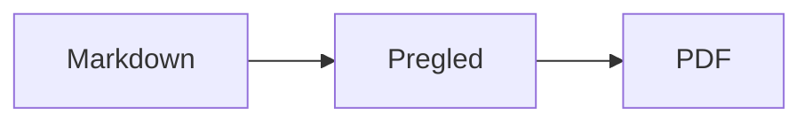
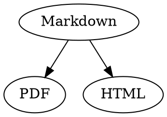

# Kratki vodič za Markdown

Ovaj je vodič običan dokument: u njemu možete isprobavati, lijevo u izvornom kodu ili desno u pregledu.

## Tekst

| Rezultat | Zapis | Prečac |
|---|---|---|
| **Podebljano** | `**Podebljano**` | ⌘B |
| *Kurziv* | `*Kurziv*` | ⌘I |
| <ins>Podcrtano</ins> | `<ins>Podcrtano</ins>` | ⌘U |
| ~~Precrtano~~ | `~~Precrtano~~` | ⇧⌘X |
| <mark>Istaknuto</mark> | `<mark>Istaknuto</mark>` | |
| `Kod` | `` `Kod` `` | |
| x<sup>2</sup> | `x<sup>2</sup>` | |
| H<sub>2</sub>O | `H<sub>2</sub>O` | |
| [Link](https://example.com) | `[Link](https://example.com)` | ⌘K |

Podcrtano, istaknuto, eksponent i indeks nisu standardni Markdown, nego HTML. Ne prikazuje ih svaki preglednik Markdowna.

Kad je kursor na kraju riječi, formatiranje vrijedi za ono što zatim upišete; unutar riječi formatira cijelu riječ.

## Naslovi

```
# Naslov 1
## Naslov 2
### Naslov 3
```

Prečaci: ⌥⌘1 do ⌥⌘6, osnovni tekst s ⌥⌘0.

## Popisi

- Popis s predznacima s `-`
- Druga stavka
  - Uvučeno tipkom Tab u pregledu

1. Numerirani popis s `1.`
2. Druga stavka

- [ ] Otvoreni zadatak
- [x] Dovršeni zadatak (kliknite ga u pregledu za promjenu stanja)

## Citati i kod

> Citat počinje s `>`.

```rust
fn main() {
    println!("Blok koda s jezikom");
}
```

Jezik iza triju obrnutih apostrofa daje bojanje sintakse. „Formatiraj › Blok koda“ nudi uobičajene jezike i mijenja ih i za postojeći blok.

> [!TIP]
> Okviri s napomenom postoje kao Napomena, Savjet, Važno, Upozorenje i Oprez („Formatiraj › Okvir s napomenom“ formatira odlomak na mjestu kursora).

## Tablice

| Lijevo | Centrirano | Desno |
|:------|:---------:|-------:|
| a     | b         | c      |

U pregledu Tab prelazi u sljedeću ćeliju, a Return u ćeliju ispod. Izbornik „Tablica“ umeće retke i stupce te poravnava stupce u izvornom kodu.

## Formule i dijagrami

Formula u retku: $E = mc^2$

$$
\int_0^1 x^2 \, dx = \frac{1}{3}
$$



Klik na formulu ili dijagram u pregledu otvara uređivač, kao i kad kursor dođe na njih; Esc ga zatvara bez promjena. Formule se mogu uređivati vizualno ili kao LaTeX; gradivni blokovi umeću razlomke, korijene, zbrojeve i simbole, a Tab skače na sljedeće rezervirano mjesto □. Za dijagrame toka, dijagrame slijeda i Ganttove dijagrame postoje gradivni blokovi za čvorove, veze, poruke i zadatke. Uređivač odmah prikazuje pogreške u kodu.

Formule mogu stajati i u blokovima `math` ili između `\(` i `\)`. Graphviz i PlantUML dijagrami pišu se u blokove `dot` i `plantuml`:



```plantuml
Alice -> Bob : Hi
```

## Proširena sintaksa

==Isticanje==, x^2^, H~2~O, ||spoiler|| i :rocket: dolaze iz Obsidiana, Typore i GitHuba. %%Komentari%% ostaju samo u izvoru, a fusnote mogu stajati i izravno u tekstu^[poput ove].

Pojam

: Objašnjenje u popisu definicija

> [!tip]-
> Kliknite ▸ da proširite okvir.

[[Bilješka]] povezuje bilješku u istoj ili nižoj mapi, ![[Bilješka]] je ugrađuje. #Oznake, reference poput @ime i #12 u GitHub i GitLab projektima te citati poput [@doe2020] iz BibTeX datoteke ističu se; ⌘-klik ih slijedi. „Prikaz › Tipografska interpunkcija“ postavlja navodnike, crtice i tri točke jezika.

### Vlastito sidro {#sidro}

<details>
<summary>HTML</summary>

HTML kao u README datotekama na GitHubu se prikazuje: centrirani odlomci, slike s veličinom, <kbd>⌘</kbd> i odjeljci koji se otvaraju poput ovog.

</details>

## Ostalo

Return u praznom retku pregleda umeće još jedan prazan redak, a Backspace ga uklanja. U izvornom kodu za to stoje dva dodatna prazna retka; drugi programi za Markdown prikazuju ih kao običan razmak između odlomaka.

„Umetni › Kazalo sadržaja“ povezuje sve naslove; kad je kursor u kazalu, ono se ažurira. ⌘-klik na stavku skače na naslov.

Fusnote upućuju na bilješke[^1]. Linija razdjelnika nastaje s `---`:

---

[^1]: Bilješka se nalazi na kraju dokumenta.
