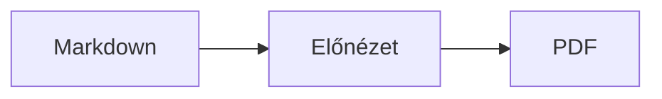
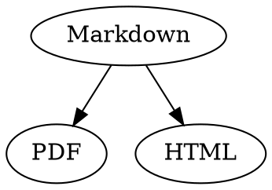

# Markdown-gyorsreferencia

Ez az áttekintés egy hagyományos dokumentum: kipróbálhat benne bármit, balra a forráskódban vagy jobbra az előnézetben.

## Szöveg

| Eredmény | Írásmód | Billentyűparancs |
|---|---|---|
| **Félkövér** | `**Félkövér**` | ⌘B |
| *Dőlt* | `*Dőlt*` | ⌘I |
| <ins>Aláhúzás</ins> | `<ins>Aláhúzás</ins>` | ⌘U |
| ~~Áthúzás~~ | `~~Áthúzás~~` | ⇧⌘X |
| <mark>Kiemelés</mark> | `<mark>Kiemelés</mark>` | |
| `Kód` | `` `Kód` `` | |
| x<sup>2</sup> | `x<sup>2</sup>` | |
| H<sub>2</sub>O | `H<sub>2</sub>O` | |
| [Link](https://example.com) | `[Link](https://example.com)` | ⌘K |

Az aláhúzás, a kiemelés, a felső és az alsó index nem szabványos Markdown, hanem HTML. Nem minden Markdown-megjelenítő jeleníti meg őket.

Ha a kurzor egy szó végén áll, a formázás arra vonatkozik, amit ezután gépel be; a szón belül az egész szót formázza.

## Címsorok

```
# Címsor 1
## Címsor 2
### Címsor 3
```

Billentyűparancsok: ⌥⌘1-től ⌥⌘6-ig, szövegtörzs: ⌥⌘0.

## Listák

- Felsorolásjeles lista `-` jellel
- Második elem
  - Behúzás a Tab billentyűvel az előnézetben

1. Számozott lista `1.` jellel
2. Második elem

- [ ] Nyitott feladat
- [x] Elvégzett feladat (az előnézetben rákattintva átváltható)

## Idézetek és kód

> Az idézet `>` jellel kezdődik.

```rust
fn main() {
    println!("Kódblokk megadott nyelvvel");
}
```

A három fordított aposztróf utáni nyelv szintaxiskiemelést ad. A „Formátum › Kódblokk” felkínálja a gyakori nyelveket, és egy meglévő blokkban is módosítja a nyelvet.

> [!TIP]
> Megjegyzésdoboz a következő fajtákban létezik: Megjegyzés, Tipp, Fontos, Figyelmeztetés és Vigyázat (a „Formátum › Megjegyzésdoboz” a kurzornál lévő bekezdést formázza).

## Táblázatok

| Balra | Középre | Jobbra |
|:------|:---------:|-------:|
| a     | b         | c      |

Az előnézetben a Tab a következő cellába, a Return az alatta lévő cellába ugrik. A „Táblázat” menü sorokat és oszlopokat szúr be, és a forráskódban egymás alá igazítja az oszlopokat.

## Képletek és diagramok

Szövegközi képlet: $E = mc^2$

$$
\int_0^1 x^2 \, dx = \frac{1}{3}
$$



Ha az előnézetben egy képletre vagy diagramra kattint, megnyílik a szerkesztő, és akkor is, ha a kurzor rákerül; az Esc változtatás nélkül bezárja. A képletek vizuálisan vagy LaTeX-ként szerkeszthetők; az építőelemek törteket, gyököket, összegeket és szimbólumokat szúrnak be, a Tab pedig a következő □ helyőrzőre ugrik. A folyamatábrákhoz, szekvencia- és Gantt-diagramokhoz csomópontokhoz, kapcsolatokhoz, üzenetekhez és feladatokhoz vannak építőelemek. A szerkesztő azonnal jelzi a kód hibáit.

A képletek `math` blokkokba vagy `\(` és `\)` közé is kerülhetnek. A Graphviz- és PlantUML-diagramok `dot` és `plantuml` blokkokba kerülnek:



```plantuml
Alice -> Bob : Hi
```

## Bővített szintaxis

==Kiemelés==, x^2^, H~2~O, ||spoiler|| és :rocket: az Obsidianból, a Typorából és a GitHubról származik. A %%megjegyzések%% csak a forrásban maradnak, a lábjegyzetek pedig közvetlenül a szövegben is állhatnak^[mint ez].

Fogalom

: Magyarázat definíciós listában

> [!tip]-
> Kattintson a ▸ jelre a doboz kibontásához.

A [[Jegyzet]] ugyanabban vagy alatta lévő mappában lévő jegyzetre hivatkozik, a ![[Jegyzet]] beágyazza. A #címkék, a GitHub- és GitLab-projektekben a @név és #12 hivatkozások, valamint a BibTeX-fájlból származó [@doe2020] idézetek kiemelve jelennek meg; a ⌘-kattintás követi őket. A „Nézet › Tipográfiai írásjelek” a nyelv idézőjeleit, gondolatjeleit és három pontját használja.

### Saját horgony {#horgony}

<details>
<summary>HTML</summary>

A GitHub README-fájljaihoz hasonló HTML megjelenik: középre igazított bekezdések, méretezett képek, <kbd>⌘</kbd> és ehhez hasonló kibontható szakaszok.

</details>

## Egyéb

Az előnézet egy üres sorában a Return újabb üres sort szúr be, a Backspace eltávolítja. A forráskódban ehhez két további üres sor áll; más Markdown-programok ezeket normál bekezdésközként jelenítik meg.

A „Beszúrás › Tartalomjegyzék” az összes címsorra linket hoz létre; ha a kurzor a tartalomjegyzékben áll, frissíti azt. Egy bejegyzésre ⌘-kattintva a címsorra ugorhat.

A lábjegyzetek jegyzetekre utalnak[^1]. Elválasztóvonalat a `---` hoz létre:

---

[^1]: A jegyzet a dokumentum végén található.
