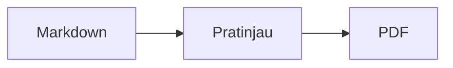
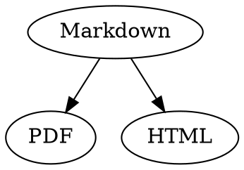

# Referensi Singkat Markdown

Ikhtisar ini adalah dokumen biasa: Anda dapat mencoba langsung di dalamnya, di sumber sebelah kiri atau di pratinjau sebelah kanan.

## Teks

| Hasil | Penulisan | Pintasan |
|---|---|---|
| **Tebal** | `**Tebal**` | ⌘B |
| *Miring* | `*Miring*` | ⌘I |
| <ins>Garis bawah</ins> | `<ins>Garis bawah</ins>` | ⌘U |
| ~~Coret~~ | `~~Coret~~` | ⇧⌘X |
| <mark>Sorot</mark> | `<mark>Sorot</mark>` | |
| `Kode` | `` `Kode` `` | |
| x<sup>2</sup> | `x<sup>2</sup>` | |
| H<sub>2</sub>O | `H<sub>2</sub>O` | |
| [Tautan](https://example.com) | `[Tautan](https://example.com)` | ⌘K |

Garis bawah, sorotan, superskrip, dan subskrip bukan Markdown standar, melainkan HTML. Tidak semua penampil Markdown menampilkannya.

Jika kursor berada di akhir kata, format berlaku untuk teks yang Anda ketik berikutnya; di dalam kata, format diterapkan pada seluruh kata.

## Heading

```
# Heading 1
## Heading 2
### Heading 3
```

Pintasan: ⌥⌘1 hingga ⌥⌘6, teks isi dengan ⌥⌘0.

## Daftar

- Daftar berpoin dengan `-`
- Butir kedua
  - Diindentasi dengan Tab di pratinjau

1. Daftar bernomor dengan `1.`
2. Butir kedua

- [ ] Tugas terbuka
- [x] Tugas selesai (klik di pratinjau untuk mengubah statusnya)

## Kutipan dan Kode

> Kutipan diawali dengan `>`.

```rust
fn main() {
    println!("Blok kode dengan bahasa");
}
```

Nama bahasa setelah tiga backtick memberikan pewarnaan sintaks. “Format › Blok Kode” menawarkan bahasa-bahasa yang umum dan juga dapat mengubahnya untuk blok yang sudah ada.

> [!TIP]
> Kotak info tersedia sebagai Catatan, Tips, Penting, Peringatan, dan Hati-hati (“Format › Kotak Info” memformat paragraf di posisi kursor).

## Tabel

| Kiri | Tengah | Kanan |
|:------|:---------:|-------:|
| a     | b         | c      |

Di pratinjau, Tab berpindah ke sel berikutnya dan Return ke sel di bawahnya. Menu “Tabel” menyisipkan baris dan kolom serta meratakan kolom di sumber.

## Rumus dan Diagram

Rumus sebaris: $E = mc^2$

$$
\int_0^1 x^2 \, dx = \frac{1}{3}
$$



Mengeklik rumus atau diagram di pratinjau akan membuka editor, begitu pula saat kursor berpindah ke atasnya; Esc menutupnya tanpa perubahan. Rumus dapat diedit secara visual atau sebagai LaTeX; blok penyusun menyisipkan pecahan, akar, jumlah, dan simbol, lalu Tab melompat ke penanda tempat □ berikutnya. Diagram alir, diagram urutan, dan diagram Gantt memiliki blok penyusun untuk simpul, koneksi, pesan, dan tugas. Editor langsung menampilkan kesalahan dalam kode.

Rumus juga dapat ditulis dalam blok `math` atau di antara `\(` dan `\)`. Diagram Graphviz dan PlantUML ditulis dalam blok `dot` dan `plantuml`:



```plantuml
Alice -> Bob : Hi
```

## Sintaks tambahan

==Sorotan==, x^2^, H~2~O, ||spoiler|| dan :rocket: berasal dari Obsidian, Typora, dan GitHub. %%Komentar%% hanya ada di sumber, dan catatan kaki juga dapat ditulis langsung di teks^[seperti ini].

Istilah

: Penjelasan dalam daftar definisi

> [!tip]-
> Klik ▸ untuk membentangkan kotak.

[[Catatan]] menautkan catatan di folder yang sama atau di bawahnya, ![[Catatan]] menyematkannya. #Tag, rujukan seperti @nama dan #12 di proyek GitHub dan GitLab, serta kutipan seperti [@doe2020] dari file BibTeX disorot; ⌘-klik mengikutinya. “Lihat › Tanda baca tipografis” memakai tanda kutip, tanda pisah, dan elipsis bahasa tersebut.

### Jangkar sendiri {#jangkar}

<details>
<summary>HTML</summary>

HTML seperti di README GitHub ditampilkan: paragraf rata tengah, gambar dengan ukuran, <kbd>⌘</kbd>, dan bagian yang dapat dibuka seperti ini.

</details>

## Lainnya

Return pada baris kosong di pratinjau menyisipkan satu baris kosong lagi, Backspace menghapusnya. Di sumber, setiap baris tersebut berupa dua baris kosong tambahan; program Markdown lain menampilkannya sebagai jarak paragraf biasa.

“Sisipkan › Daftar Isi” menautkan semua heading; jika kursor berada di dalam daftar isi, daftar isi akan diperbarui. ⌘-klik sebuah entri untuk melompat ke heading-nya.

Catatan kaki merujuk ke keterangan[^1]. Garis pembatas dibuat dengan `---`:

---

[^1]: Keterangan ini berada di akhir dokumen.
