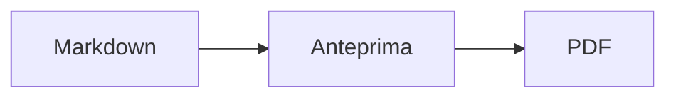
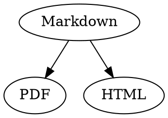

# Guida rapida a Markdown

Questa panoramica è un normale documento: puoi fare delle prove, a sinistra nel codice sorgente o a destra nell’anteprima.

## Testo

| Risultato | Sintassi | Scorciatoia |
|---|---|---|
| **Grassetto** | `**Grassetto**` | ⌘B |
| *Corsivo* | `*Corsivo*` | ⌘I |
| <ins>Sottolineato</ins> | `<ins>Sottolineato</ins>` | ⌘U |
| ~~Barrato~~ | `~~Barrato~~` | ⇧⌘X |
| <mark>Evidenziato</mark> | `<mark>Evidenziato</mark>` | |
| `Codice` | `` `Codice` `` | |
| x<sup>2</sup> | `x<sup>2</sup>` | |
| H<sub>2</sub>O | `H<sub>2</sub>O` | |
| [Link](https://example.com) | `[Link](https://example.com)` | ⌘K |

Sottolineato, evidenziato, apice e pedice non sono Markdown standard, ma HTML. Non tutti i visualizzatori Markdown li mostrano.

Se il cursore è alla fine di una parola, la formattazione si applica a ciò che scrivi dopo; all’interno di una parola, formatta l’intera parola.

## Intestazioni

```
# Intestazione 1
## Intestazione 2
### Intestazione 3
```

Scorciatoie: da ⌥⌘1 a ⌥⌘6, corpo del testo con ⌥⌘0.

## Elenchi

- Elenco puntato con `-`
- Secondo punto
  - Rientrato con Tab nell’anteprima

1. Elenco numerato con `1.`
2. Secondo punto

- [ ] Attività da fare
- [x] Attività completata (fai clic nell’anteprima per cambiarne lo stato)

## Citazioni e codice

> Una citazione inizia con `>`.

```rust
fn main() {
    println!("Blocco di codice con linguaggio");
}
```

Il linguaggio indicato dopo i tre accenti gravi attiva i colori della sintassi. “Formato › Blocco di codice” propone i linguaggi più comuni e permette anche di cambiarlo per un blocco esistente.

> [!TIP]
> I riquadri possono essere di tipo Nota, Suggerimento, Importante, Attenzione e Cautela (“Formato › Riquadro” formatta il paragrafo in cui si trova il cursore).

## Tabelle

| A sinistra | Al centro | A destra |
|:------|:---------:|-------:|
| a     | b         | c      |

Nell’anteprima, Tab passa alla cella successiva e Return alla cella sottostante. Il menu “Tabella” inserisce righe e colonne e allinea le colonne nel codice sorgente.

## Formule e diagrammi

Formula in linea: $E = mc^2$

$$
\int_0^1 x^2 \, dx = \frac{1}{3}
$$



Un clic su una formula o un diagramma nell’anteprima apre l’editor, così come portarvi sopra il cursore; Esc lo chiude senza modifiche. Le formule si possono modificare in modo visuale o come LaTeX; i blocchi inseriscono frazioni, radici, somme e simboli, e Tab passa al segnaposto □ successivo. Per i diagrammi di flusso, di sequenza e di Gantt ci sono blocchi per nodi, collegamenti, messaggi e attività. L’editor mostra subito gli errori nel codice.

Le formule possono stare anche in blocchi `math` o tra `\(` e `\)`. I diagrammi Graphviz e PlantUML vanno in blocchi `dot` e `plantuml`:



```plantuml
Alice -> Bob : Hi
```

## Sintassi estesa

==Evidenziato==, x^2^, H~2~O, ||spoiler|| e :rocket: vengono da Obsidian, Typora e GitHub. I %%commenti%% restano nel sorgente, e le note a piè di pagina possono stare anche nel testo^[come questa].

Termine

: Spiegazione in un elenco di definizioni

> [!tip]-
> Fai clic su ▸ per espandere il riquadro.

[[Nota]] collega una nota nella stessa cartella o più in basso, ![[Nota]] la incorpora. I #tag, i riferimenti come @nome e #12 nei progetti GitHub e GitLab e le citazioni come [@doe2020] da un file BibTeX vengono evidenziati; ⌘-clic li segue. «Vista › Punteggiatura tipografica» usa le virgolette, i trattini e i puntini di sospensione della lingua.

### Ancora personalizzata {#ancora}

<details>
<summary>HTML</summary>

L’HTML come nei README di GitHub viene mostrato: paragrafi centrati, immagini con dimensioni, <kbd>⌘</kbd> e sezioni espandibili come questa.

</details>

## Altro

Return su una riga vuota dell’anteprima inserisce un’altra riga vuota, il tasto Elimina (⌫) la rimuove. Nel codice sorgente ci sono a questo scopo due righe vuote in più; gli altri programmi Markdown le mostrano come una normale spaziatura tra paragrafi.

“Inserisci › Indice” crea un link a tutte le intestazioni; se il cursore si trova nell’indice, questo viene aggiornato. ⌘-clic su una voce per passare all’intestazione.

Le note a piè di pagina rimandano ad annotazioni[^1]. Un separatore si crea con `---`:

---

[^1]: L’annotazione si trova alla fine del documento.
