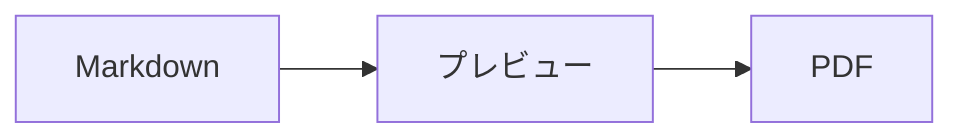
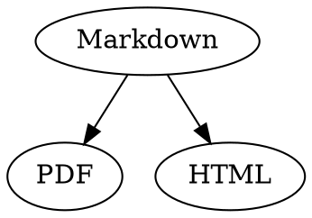

# Markdownクイックリファレンス

この一覧は通常の書類です。左のソースでも右のプレビューでも、自由に試してみてください。

## テキスト

| 結果 | 記法 | ショートカット |
|---|---|---|
| **ボールド** | `**ボールド**` | ⌘B |
| *イタリック* | `*イタリック*` | ⌘I |
| <ins>アンダーライン</ins> | `<ins>アンダーライン</ins>` | ⌘U |
| ~~取り消し線~~ | `~~取り消し線~~` | ⇧⌘X |
| <mark>ハイライト</mark> | `<mark>ハイライト</mark>` | |
| `コード` | `` `コード` `` | |
| x<sup>2</sup> | `x<sup>2</sup>` | |
| H<sub>2</sub>O | `H<sub>2</sub>O` | |
| [リンク](https://example.com) | `[リンク](https://example.com)` | ⌘K |

アンダーライン、ハイライト、上付き、下付きはMarkdownの標準ではなくHTMLです。すべてのMarkdownビューアで表示されるとは限りません。

カーソルが単語の末尾にあるときは、その後に入力するテキストにフォーマットが適用されます。単語の途中では、単語全体がフォーマットされます。

## 見出し

```
# 見出し1
## 見出し2
### 見出し3
```

ショートカット：⌥⌘1〜⌥⌘6、本文は⌥⌘0。

## リスト

- `-`で箇条書き
- 2番目の項目
  - プレビューでTabキーを押すとインデント

1. `1.`で番号付きリスト
2. 2番目の項目

- [ ] 未完了のタスク
- [x] 完了したタスク（プレビューでクリックすると切り替わります）

## 引用とコード

> 引用は`>`で始めます。

```rust
fn main() {
    println!("言語を指定したコードブロック");
}
```

3つのバッククォートの後に言語名を書くと、構文がカラー表示されます。「フォーマット › コードブロック」では主な言語を選べるほか、既存のブロックの言語も変更できます。

> [!TIP]
> コールアウトには注記、ヒント、重要、警告、注意があります（「フォーマット › コールアウト」でカーソル位置の段落をフォーマットします）。

## 表

| 左揃え | 中央揃え | 右揃え |
|:------|:---------:|-------:|
| a     | b         | c      |

プレビューでは、Tabキーで次のセルへ、Returnキーで下のセルへ移動します。「表」メニューでは、行や列を挿入したり、ソースの列を揃えたりできます。

## 数式と図

インライン数式：$E = mc^2$

$$
\int_0^1 x^2 \, dx = \frac{1}{3}
$$



プレビューで数式や図をクリックするか、カーソルをその上に移動すると、エディタが開きます。Escキーを押すと、変更せずに閉じます。数式はビジュアルに、またはLaTeXで編集できます。パーツを使うと分数、平方根、総和、記号を挿入でき、Tabキーで次のプレースホルダ□へ移動します。フローチャート、シーケンス図、ガントチャートには、ノード、接続、メッセージ、タスク用のパーツがあります。コードのエラーはエディタにすぐ表示されます。

数式は`math`ブロック内や、`\(`と`\)`の間にも書けます。GraphvizとPlantUMLの図は、`dot`または`plantuml`を指定したブロックに書きます：



```plantuml
Alice -> Bob : Hi
```

## 拡張記法

==ハイライト==、x^2^、H~2~O、||ネタバレ||、:rocket:はObsidian、Typora、GitHubに由来する記法です。%%コメント%%はソースにだけ残ります。脚注は本文中に直接書くこともできます^[このように]。

用語

: 定義リストでの説明

> [!tip]-
> ▸をクリックするとボックスが展開されます。

[[メモ]]は同じフォルダまたはその下にあるメモにリンクし、![[メモ]]はそのメモを埋め込みます。 #タグ、GitHubやGitLabのプロジェクトでの @name や #12 のような参照、BibTeXファイルからの[@doe2020]のような引用は強調表示され、⌘+クリックでたどれます。「表示 › タイポグラフィ記号」を使うと、引用符、ダッシュ、省略記号がその言語のものになります。

### 独自のアンカー {#anchor}

<details>
<summary>HTML</summary>

GitHubのREADMEと同じようにHTMLが表示されます。中央揃えの段落、サイズを指定した画像、<kbd>⌘</kbd>、このような折りたたみ可能なセクションなどです。

</details>

## その他

プレビューの空の行でReturnキーを押すと空の行がもう1行挿入され、Deleteキーで削除されます。ソースには、そのための空の行が2行追加されます。ほかのMarkdownアプリでは、通常の段落間隔として表示されます。

「挿入 › 目次」はすべての見出しにリンクします。カーソルが目次内にあるときは、目次が更新されます。項目を⌘+クリックすると、その見出しへジャンプします。

脚注で注釈を参照できます[^1]。区切り線は`---`で作成します：

---

[^1]: 注釈は書類の末尾に表示されます。
