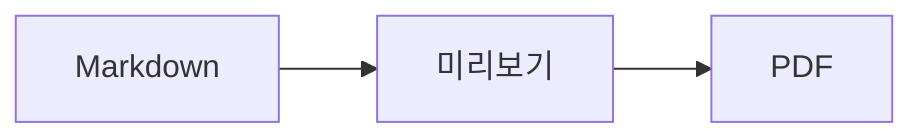
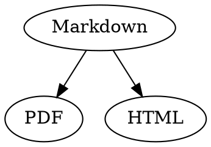

# Markdown 빠른 참조

이 개요는 일반 문서입니다. 왼쪽의 소스나 오른쪽의 미리보기에서 자유롭게 사용해 보십시오.

## 텍스트

| 결과 | 작성법 | 단축키 |
|---|---|---|
| **볼드체** | `**볼드체**` | ⌘B |
| *이탤릭체* | `*이탤릭체*` | ⌘I |
| <ins>밑줄체</ins> | `<ins>밑줄체</ins>` | ⌘U |
| ~~취소선~~ | `~~취소선~~` | ⇧⌘X |
| <mark>하이라이트</mark> | `<mark>하이라이트</mark>` | |
| `코드` | `` `코드` `` | |
| x<sup>2</sup> | `x<sup>2</sup>` | |
| H<sub>2</sub>O | `H<sub>2</sub>O` | |
| [링크](https://example.com) | `[링크](https://example.com)` | ⌘K |

밑줄체, 하이라이트, 위 첨자 및 아래 첨자는 Markdown 표준이 아니라 HTML입니다. 모든 Markdown 뷰어에서 표시되는 것은 아닙니다.

커서가 단어 끝에 있으면 이후에 입력하는 텍스트에 포맷이 적용되고, 단어 안에 있으면 단어 전체에 포맷이 적용됩니다.

## 머리말

```
# 머리말 1
## 머리말 2
### 머리말 3
```

단축키: ⌥⌘1~⌥⌘6, 본문은 ⌥⌘0.

## 목록

- `-`로 구분점 목록 만들기
- 두 번째 항목
  - 미리보기에서 Tab 키로 들여쓰기

1. `1.`로 번호 목록 만들기
2. 두 번째 항목

- [ ] 미완료 작업
- [x] 완료된 작업(미리보기에서 클릭하여 전환)

## 인용 및 코드

> 인용은 `>`로 시작합니다.

```rust
fn main() {
    println!("언어를 지정한 코드 블록");
}
```

세 개의 백틱 뒤에 언어를 지정하면 구문이 색상으로 표시됩니다. “포맷 › 코드 블록”에서 자주 쓰는 언어를 선택할 수 있으며, 기존 블록의 언어도 변경할 수 있습니다.

> [!TIP]
> 콜아웃에는 참고, 팁, 중요, 경고, 주의가 있습니다(“포맷 › 콜아웃”을 선택하면 커서가 있는 단락이 콜아웃이 됩니다).

## 표

| 왼쪽 정렬 | 중앙 정렬 | 오른쪽 정렬 |
|:------|:---------:|-------:|
| a     | b         | c      |

미리보기에서 Tab 키를 누르면 다음 셀로, Return 키를 누르면 아래 셀로 이동합니다. “표” 메뉴에서 행과 열을 삽입하고 소스의 열을 정렬할 수 있습니다.

## 수식 및 다이어그램

인라인 수식: $E = mc^2$

$$
\int_0^1 x^2 \, dx = \frac{1}{3}
$$



미리보기에서 수식이나 다이어그램을 클릭하거나 커서를 그 위로 옮기면 편집기가 열리며, Esc 키를 누르면 변경 사항 없이 닫힙니다. 수식은 비주얼 또는 LaTeX로 편집할 수 있습니다. 구성 요소로 분수, 제곱근, 합, 기호를 삽입할 수 있고, Tab 키를 누르면 다음 자리 표시자 □ 위치로 이동합니다. 순서도, 시퀀스 다이어그램, 간트 차트에는 노드, 연결, 메시지, 작업을 위한 구성 요소가 있습니다. 코드의 오류는 편집기에 바로 표시됩니다.

수식은 `math` 블록이나 `\(` 및 `\)` 사이에도 쓸 수 있습니다. Graphviz 및 PlantUML 다이어그램은 `dot` 및 `plantuml`로 지정한 블록에 씁니다:



```plantuml
Alice -> Bob : Hi
```

## 확장 구문

==하이라이트==, x^2^, H~2~O, ||스포일러|| 및 :rocket: 구문은 Obsidian, Typora, GitHub에서 왔습니다. %%주석%% 같은 주석은 소스에만 남으며, 각주는 본문에 바로 쓸 수도 있습니다^[이 각주처럼].

용어

: 정의 목록의 설명

> [!tip]-
> ▸를 클릭하면 상자가 펼쳐집니다.

[[메모]]는 같은 폴더나 그 하위 폴더에 있는 메모에 링크하고, ![[메모]]는 그 메모를 삽입합니다. #태그, GitHub 및 GitLab 프로젝트의 @name 및 #12 같은 참조, BibTeX 파일의 [@doe2020] 같은 인용은 강조 표시되며 ⌘-클릭으로 따라갈 수 있습니다. “보기 › 타이포그래피 문장 부호”를 사용하면 해당 언어의 인용 부호, 대시, 줄임표가 적용됩니다.

### 사용자 지정 앵커 {#anchor}

<details>
<summary>HTML</summary>

GitHub README에서처럼 HTML이 표시됩니다. 중앙 정렬된 단락, 크기를 지정한 이미지, <kbd>⌘</kbd>, 그리고 이와 같이 펼칠 수 있는 섹션 등입니다.

</details>

## 기타

미리보기의 빈 줄에서 Return 키를 누르면 빈 줄이 하나 더 삽입되고, Delete 키를 누르면 제거됩니다. 소스에는 이를 위해 빈 줄 두 개가 추가로 들어가며, 다른 Markdown 앱에서는 일반 단락 간격으로 표시됩니다.

“삽입 › 목차”는 모든 머리말에 대한 링크를 만듭니다. 커서가 목차 안에 있으면 목차가 업데이트됩니다. 항목을 ⌘-클릭하면 해당 머리말로 이동합니다.

각주로 주석을 참조할 수 있습니다[^1]. 구분선은 `---`로 만듭니다:

---

[^1]: 주석은 문서 끝에 표시됩니다.
