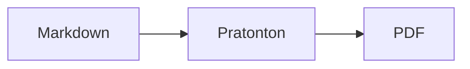
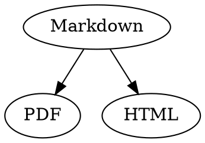

# Rujukan Pantas Markdown

Gambaran keseluruhan ini ialah dokumen biasa: anda boleh mencuba di dalamnya, dalam sumber di sebelah kiri atau dalam pratonton di sebelah kanan.

## Teks

| Hasil | Sintaks | Pintasan |
|---|---|---|
| **Tebal** | `**Tebal**` | ⌘B |
| *Italik* | `*Italik*` | ⌘I |
| <ins>Garis bawah</ins> | `<ins>Garis bawah</ins>` | ⌘U |
| ~~Garis potong~~ | `~~Garis potong~~` | ⇧⌘X |
| <mark>Serlahan</mark> | `<mark>Serlahan</mark>` | |
| `Kod` | `` `Kod` `` | |
| x<sup>2</sup> | `x<sup>2</sup>` | |
| H<sub>2</sub>O | `H<sub>2</sub>O` | |
| [Pautan](https://example.com) | `[Pautan](https://example.com)` | ⌘K |

Garis bawah, serlahan, superskrip dan subskrip bukan Markdown standard, tetapi HTML. Bukan semua pemapar Markdown memaparkannya.

Apabila kursor berada di hujung perkataan, format digunakan pada apa yang anda taip seterusnya; di dalam perkataan, format digunakan pada seluruh perkataan.

## Pengepala

```
# Pengepala 1
## Pengepala 2
### Pengepala 3
```

Pintasan: ⌥⌘1 hingga ⌥⌘6, teks badan dengan ⌥⌘0.

## Senarai

- Senarai berbulet dengan `-`
- Item kedua
  - Diindenkan dengan Tab dalam pratonton

1. Senarai bernombor dengan `1.`
2. Item kedua

- [ ] Tugas belum selesai
- [x] Tugas selesai (klik dalam pratonton untuk menogol)

## Petikan dan Kod

> Petikan bermula dengan `>`.

```rust
fn main() {
    println!("Blok kod dengan bahasa");
}
```

Nama bahasa selepas tiga tanda backtick memberikan warna sintaks. “Format › Blok Kod” menawarkan bahasa yang biasa digunakan dan juga menukarnya untuk blok sedia ada.

> [!TIP]
> Kotak maklumat tersedia sebagai Nota, Petua, Penting, Amaran dan Awas (“Format › Kotak Maklumat” memformatkan perenggan di kursor).

## Jadual

| Kiri | Tengah | Kanan |
|:------|:---------:|-------:|
| a     | b         | c      |

Dalam pratonton, Tab beralih ke sel seterusnya dan Return ke sel di bawahnya. Menu “Jadual” memasukkan baris dan lajur serta menjajarkan lajur dalam sumber.

## Formula dan Rajah

Formula sebaris: $E = mc^2$

$$
\int_0^1 x^2 \, dx = \frac{1}{3}
$$



Mengklik formula atau rajah dalam pratonton akan membuka penyunting, begitu juga apabila kursor bergerak ke atasnya; Esc menutupnya tanpa perubahan. Formula boleh diedit secara visual atau sebagai LaTeX; blok binaan memasukkan pecahan, punca kuasa, hasil tambah dan simbol, dan Tab melompat ke ruang letak □ seterusnya. Carta alir, rajah jujukan dan carta Gantt mempunyai blok binaan untuk nod, sambungan, mesej dan tugas. Penyunting terus menunjukkan ralat dalam kod.

Formula juga boleh ditulis dalam blok `math` atau di antara `\(` dan `\)`. Gambar rajah Graphviz dan PlantUML ditulis dalam blok `dot` dan `plantuml`:



```plantuml
Alice -> Bob : Hi
```

## Sintaks lanjutan

==Serlahan==, x^2^, H~2~O, ||spoiler|| dan :rocket: datang daripada Obsidian, Typora dan GitHub. %%Ulasan%% hanya ada dalam sumber, dan nota kaki juga boleh ditulis terus dalam teks^[seperti ini].

Istilah

: Penerangan dalam senarai definisi

> [!tip]-
> Klik ▸ untuk mengembangkan kotak.

[[Nota]] memaut ke nota dalam folder yang sama atau di bawahnya, ![[Nota]] membenamkannya. #Tag, rujukan seperti @nama dan #12 dalam projek GitHub dan GitLab serta petikan seperti [@doe2020] daripada fail BibTeX diserlahkan; ⌘-klik mengikutinya. “Paparan › Tanda baca tipografi” menggunakan tanda petik, sengkang dan elipsis bahasa itu.

### Sauh sendiri {#sauh}

<details>
<summary>HTML</summary>

HTML seperti dalam README GitHub dipaparkan: perenggan di tengah, imej bersaiz, <kbd>⌘</kbd> dan bahagian yang boleh dikembangkan seperti ini.

</details>

## Lain-lain

Return pada baris kosong dalam pratonton memasukkan satu lagi baris kosong, Backspace membuangnya. Dalam sumber, setiap baris itu ialah dua baris kosong tambahan; program Markdown lain memaparkannya sebagai jarak perenggan biasa.

“Masukkan › Senarai Kandungan” memautkan semua pengepala; apabila kursor berada dalam senarai kandungan, senarai itu dikemas kini. ⌘-klik pada entri untuk melompat ke pengepala tersebut.

Nota kaki merujuk kepada catatan[^1]. Garis pembahagi dibuat dengan `---`:

---

[^1]: Catatan ini terletak di hujung dokumen.
